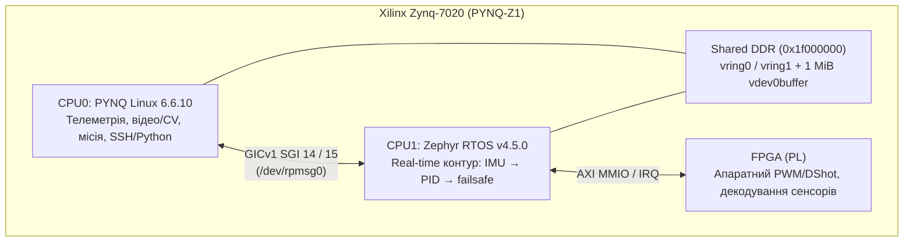

# Гетерогенний Zynq-7000 на практиці: PYNQ Linux (CPU0) + Zephyr RTOS (CPU1) через OpenAMP/RPMsg (Частина 2, чернетка)

> **Статус чернетки:** інфраструктура AMP (`zynq_remoteproc` + `trace0` + двосторонній `/dev/rpmsg0`) уже зібрана й підтверджена на живому Digilent PYNQ-Z1. Прикладний кейс — **керування FPV-коптером** (розподіл між Linux, Zephyr і FPGA PL) — перебуває в розробці й буде доповнений реальними замірами пізніше.

У [Частині 1](DOU-Zephyr-RTOS-on-PYNQ-Z1-without-Vivado-UA.md) ми запустили Zephyr RTOS v4.5.0 на Digilent PYNQ-Z1 без Vivado, підняли 1G Ethernet, TFTP netboot і навіть 2-ядерний SMP. Але коли йдеться про складний бортовий пристрій на кшталт **FPV-коптера**, чистий RTOS на обох ядрах незручний: хочеться мати і **Linux** (для телеметрії, навігації, відео/комп’ютерного зору, Python), і **жорсткий real-time** без пауз планувальника Linux (для контуру стабілізації IMU → PID → ESC).

У цій частині показуємо, як перетворити один кристал **Zynq-7000 (`XC7Z020`)** на асиметричну двоядерну систему (**AMP**): на **CPU0** працює стоковий **PYNQ Linux 6.6.10** (без перезбірки ядра!), на **CPU1** — ізольований **Zephyr RTOS v4.5.0**, а між ними літають пакети по **OpenAMP / RPMsg** (`/dev/rpmsg0`) із затримкою ~140 мкс.

---

## 1. Навіщо AMP, якщо вже є SMP (горизонт: борт FPV-коптера)

| Критерій | 2-ядерний SMP (Частина 1) | AMP / OpenAMP (Частина 2) |
|---|---|---|
| Що працює на ядрах | Один Zephyr на CPU0 + CPU1 | **CPU0:** PYNQ Linux (Ubuntu 22.04) · **CPU1:** Zephyr RTOS |
| Детермінізм контуру керування | Нижчий (глобальні `spinlock`, IPI, спільний планувальник) | Високий — CPU1 повністю ізольоване від ОС Linux |
| Екосистема | Лише RTOS | Python, OpenCV, SSH, мережа, FS **+** жорсткий RT |
| Як спілкуються ядра | Спільна пам’ять / `k_msgq` | `remoteproc` + `virtio` vring + апаратні **GIC SGI 14/15** |

Для FPV-коптера такий поділ лягає природно на три рівні одного кристала Zynq-7020:



---

## 2. Несподіваний подарунок у стоковому PYNQ v3.1: перезбирати Linux не треба

Перше питання перед будь-яким AMP-проєктом: чи доведеться компілювати власне ядро Linux? Ми розпакували `kernel-0` із заводського `image.ub` PYNQ v3.1 і витягли вбудований `IKCONFIG`. Виявилося, що `Linux 6.6.10-xilinx-v2024.1` **уже містить усі потрібні модулі**:

```text
CONFIG_REMOTEPROC=y
CONFIG_ZYNQ_REMOTEPROC=m
CONFIG_RPMSG=m
CONFIG_RPMSG_VIRTIO=m
CONFIG_RPMSG_CHAR=m
CONFIG_RPMSG_CTRL=m
CONFIG_RPMSG_NS=m
```

Єдине, чого бракувало у стоковому Device Tree (`fdt-0`), — це опис зарезервованої пам’яті для CPU1 (`reserved-memory`) і вузол контролера `xlnx,zynq_remoteproc`.

---

## 3. Карта пам’яті DDR3 і DT-оверлей `amp/openamp.dts`

Щоб Linux і Zephyr гарантовано не затирали пам’ять одне одного, ми відрізали верхні 32 МБ із 512 МБ DDR3 (з позначкою `no-map` у Linux):

| Діапазон фізичних адрес | Розмір | Призначення |
|---|---|---|
| `0x00000000 – 0x1dffffff` | 480 МБ | PYNQ Linux (CPU0), ядро, DTB, файловий кеш |
| `0x1e000000 – 0x1effffff` | 16 МБ | `rproc@1e000000` — код, стек, дані та `trace0` Zephyr (CPU1) |
| `0x1f000000 – 0x1f003fff` | 16 КБ | `vdev0vring0` (кільце дескрипторів TX/RX) |
| `0x1f004000 – 0x1f007fff` | 16 КБ | `vdev0vring1` (кільце дескрипторів RX/TX) |
| `0x1f008000 – 0x1f107fff` | 1 МБ | `vdev0buffer` (`shared-dma-pool` для пакетів RPMsg) |

DT-оверлей `amp/openamp.dts` компілюється утилітою `dtc` і накладається на стоковий `fdt-0` (`fdtoverlay` → `pynq-amp.dtb`). Завдяки TFTP netboot із Частини 1 ми навіть не виймали microSD — U-Boot просто завантажив заводський `image.ub` із карти разом із нашим `pynq-amp.dtb` по TFTP:

```text
fatload mmc 0:1 0x10000000 image.ub
tftpboot 0x02000000 pynq1/pynq-amp.dtb
bootm 0x10000000:kernel-0 - 0x02000000
```

---

## 4. Три підводні камені запуску Zephyr на CPU1 поруч із Linux

Коли Linux завантажує `zephyr_amp.elf` через `zynq_remoteproc`, він автоматично виконує hot-unplug CPU1 (`remove_cpu(1)`), копіює ELF-сегменти у `0x1e000000` і запускає CPU1 через короткий трамплін за адресою `0x00000000`. Але звичайна збірка Zephyr у таких умовах одразу впаде або покладе Linux. Довелося розв’язати три проблеми:

1. **Не затирати таблицю векторів Linux (`0x00000000`) і замапити `VBAR` у MMU.**
   У стандартному Zynq-7000 Zephyr копіює вектори в `0x00000000`. Ми перевизначили слабку функцію `relocate_vector_table()`, щоб перевести `VBAR` прямо на `_vector_start` (`0x1e000000`), і додали сторінку `vbar_vectors` у таблицю MMU (`soc.c`) — без цього перший `SVC` або IRQ викликав prefetch abort на незамапленій сторінці.
2. **Не чіпати GIC Distributor Linux (`CONFIG_GIC_SAFE_CONFIG=y`).**
   Оскільки контролер переривань GICv1 спільний, `CONFIG_GIC_SAFE_CONFIG=y` забороняє Zephyr скидати `GICD_CTLR` і налаштування SPI-переривань Linux.
3. **Когерентність із SCU Linux (`L1 invalidate` + `ACTLR.SMP | ACTLR.FW`).**
   Linux на CPU0 уже ввімкнув Snoop Control Unit (SCU). Поки CPU1 не інвалідував власні L1-кеші й не підняв біти `ACTLR.SMP | ACTLR.FW` до запуску MMU, `main()` на CPU1 не стартував. Щойно додали ці 4 рядки (плюс `CONFIG_USE_SWITCH=y`, `CONFIG_FPU=n`), Linux показав живі логи Zephyr у `debugfs` без жодного конфлікту за UART0:

```text
$ sudo cat /sys/kernel/debug/remoteproc/remoteproc0/trace0
*** Zephyr AMP on PYNQ-Z1 CPU1 booted ***
MPIDR=0x80000001 VBAR=0x1e000000
Zephyr CPU1 heartbeat tick=1 uptime_ms=1000
Zephyr CPU1 heartbeat tick=2 uptime_ms=2000
```

---

## 5. Двосторонній канал OpenAMP / RPMsg (`/dev/rpmsg0`) поверх GICv1 SGI 14/15

Драйвер `zynq_remoteproc` у Linux 6.6 використовує для сповіщень vring два програмні переривання GICv1: **SGI #14** (Linux → CPU1) та **SGI #15** (CPU1 → Linux). Ми додали в `west` модулі `libmetal` та `open-amp`, замапили область `0x1f000000` (`0x108000` байт) як `MT_STRONGLY_ORDERED`, розширили `.resource_table` секцією `RSC_VDEV` (`VIRTIO_ID_RPMSG`) і підняли endpoint `"rpmsg-raw"`.

Після завантаження модулів `virtio_rpmsg_bus`, `rpmsg_ctrl` і `rpmsg_char` Linux автоматично створив символьний пристрій **`/dev/rpmsg0`**:

```text
virtio_rpmsg_bus virtio0: rpmsg host is online
rproc-virtio rproc-virtio.0.auto: registered virtio0 (type 7)
remoteproc remoteproc0: remote processor remoteproc@0 is now up
virtio_rpmsg_bus virtio0: creating channel rpmsg-raw addr 0x400
```

Живий echo-тест із Python у PYNQ Linux до Zephyr на CPU1 показав стабільну затримку **137–179 мкс** у два боки (включно з `select()` і перемиканням контексту в userspace Linux):

```text
TX: 'Hello Zephyr from PYNQ Linux!' -> RX (413 us): '[Zephyr CPU1 #1] echo: Hello Zephyr from PYNQ Linux!\n'
TX: 'OpenAMP over GIC SGI 14/15'    -> RX (179 us): '[Zephyr CPU1 #2] echo: OpenAMP over GIC SGI 14/15\n'
TX: 'ping 3'                        -> RX (137 us): '[Zephyr CPU1 #3] echo: ping 3\n'
```

Що означає ця цифра для майбутнього контуру керування **FPV-коптером**? Якщо зовнішній контур (уставки траєкторії/швидкості з Linux, $f_{\text{cmd}} = 100\text{ Гц}$, $T_{\text{cmd}} = 10\text{ мс}$) передає команди у внутрішній контур стабілізації Zephyr на CPU1 ($f_{\text{PID}} = 1\text{ кГц}$, $T_{\text{PID}} = 1\text{ мс}$), частка накладних витрат IPC становить:

$$\eta_{\text{IPC}} = \frac{\text{RTT}_{\text{RPMsg}}}{T_{\text{cmd}}} \approx \frac{0.15\text{ мс}}{10\text{ мс}} = 1.5\%$$

При цьому сам 1 кГц контур стабілізації на CPU1 узагалі не залежить від затримок Linux і продовжує тримати апарат, навіть якщо на CPU0 тимчасово завантажений Python чи відеокодер.

---

## 6. [TODO] Практичний кейс: FPGA PL + контур керування FPV-коптером

*(Розділ-заготовка для завершення статті після апаратних експериментів.)*

- [ ] **Крок 1 (швидка перевірка PL без Vivado):** доступ із Zephyr CPU1 до AXI GPIO в уже завантаженому `base.bin` (`LD0–LD3`, `BTN0–BTN3`) за командами з Python через `/dev/rpmsg0`.
- [ ] **Крок 2 (таймінг і джитер):** порівняння затримки реакції на апаратне переривання з PL (Linux userspace vs Zephyr CPU1).
- [ ] **Крок 3 (архітектура FPV-коптера):**
  - опитування IMU по SPI/I2C та PID-контур на Zephyr CPU1;
  - генерація керуючих сигналів моторів (PWM / DShot) у PL або таймерах PS;
  - телеметрія, failsafe та верхньорівневі команди з Linux CPU0 по `/dev/rpmsg0`.

---

## Посилання

- Репозиторій проєкту (папка `amp/`, `patches/`, `ROADMAP.md`): [github.com/nick-fedchik/ZephyrOS-PYNC-Z1](https://github.com/nick-fedchik/ZephyrOS-PYNC-Z1)
- Частина 1: [Zephyr RTOS на Digilent PYNQ-Z1 без Vivado/Vitis](DOU-Zephyr-RTOS-on-PYNQ-Z1-without-Vivado-UA.md)
