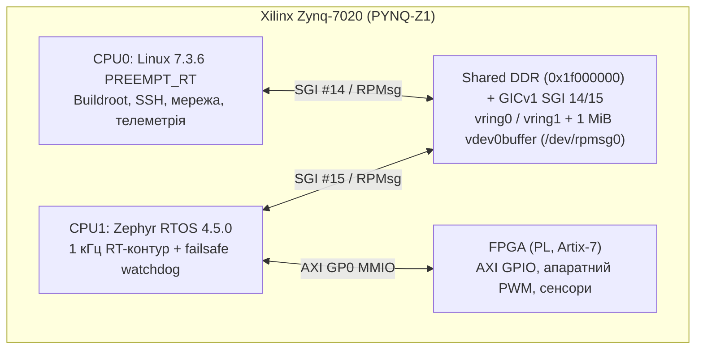
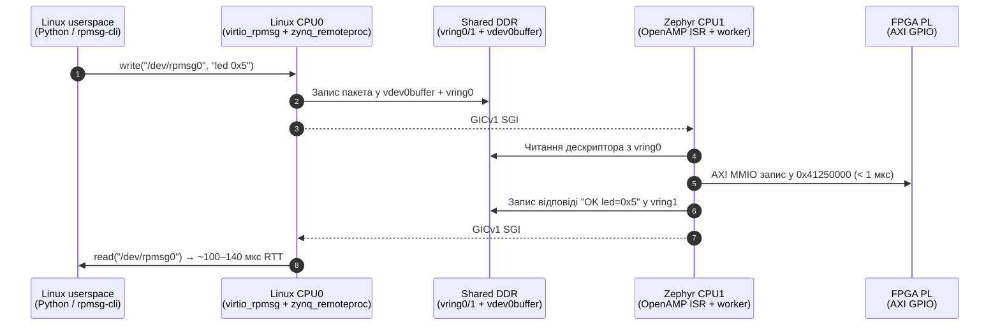
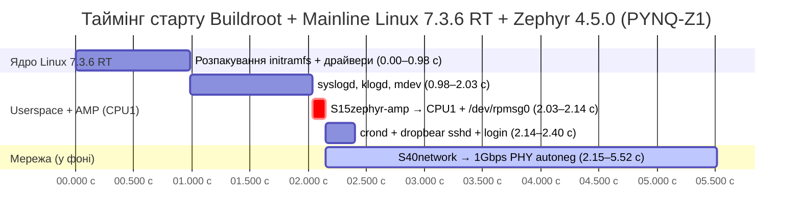
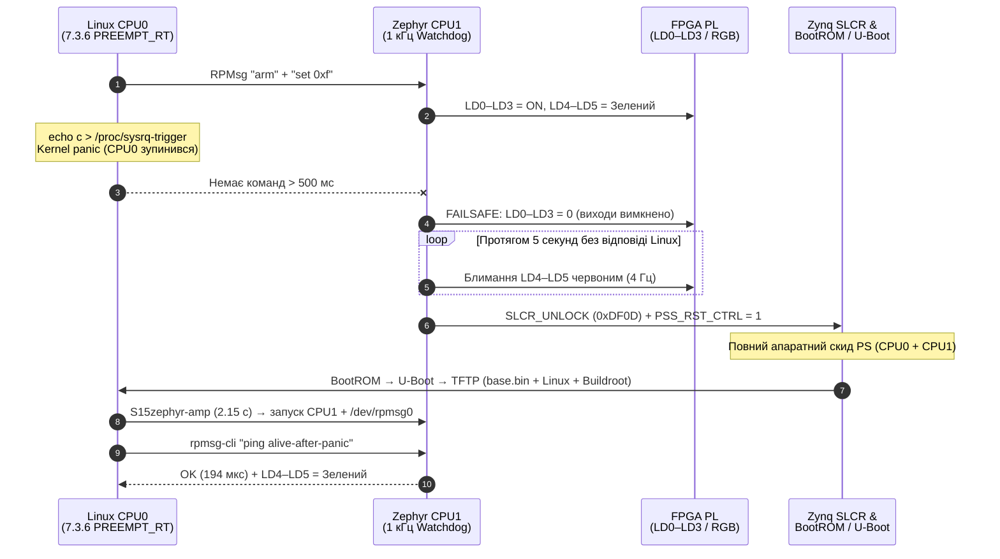

# Linux і Zephyr на одному кристалі Zynq-7000: AMP, PREEMPT_RT, Buildroot і живий `kernel panic`

*Як я поселив Embedded Linux 7.3.6 (`PREEMPT_RT`) і Zephyr RTOS 4.5.0 на сусідніх ядрах одного чипа, порівняв їхній джитер (9.28 мс проти 39 мкс проти 0.33 мкс), скоротив старт із 25 с до 2.1 с і змусив Zephyr самотужки піднімати плату після реального `kernel panic` Linux.*

У [першій частині](DOU-Zephyr-RTOS-on-PYNQ-Z1-without-Vivado-UA.md) я запустив Zephyr RTOS 4.5.0 на двоядерній FPGA-платі Digilent PYNQ-Z1. Але в реальній робототехніці, ЧПК чи промисловому контролері однієї RTOS часто замало: хочеться мати і **Linux** (мережа, SSH, телеметрія, файлова система), і **жорсткий real-time**, який не збивається, навіть якщо Linux на сусідньому ядрі завантажений на 100% або взагалі завис.

Асиметрична багатопроцесорність (**AMP**) дає змогу буквально розрізати один чип **Zynq-7000 (`XC7Z020`)** навпіл:



Нижче — шість наочних експериментів на живому залізі: від першого повідомлення між ОС до навмисного `kernel panic` Linux із повним самовідновленням плати без жодної кнопки. *(Повна технічна версія з картою пам’яті, патчами, конфігами ядра й Buildroot — на GitHub за посиланням у кінці.)*

---

## 1. Запуск Zephyr із Linux і канал `/dev/rpmsg0` за ~100–140 мкс

Перше завдання — підняти Zephyr на CPU1 прямо з-під Linux на CPU0 і налагодити між ними швидкий двосторонній обмін без конфліктів за пам’ять і переривання.

Я відрізав у Device Tree верхні 32 МБ DDR3 спеціально під CPU1 та спільні буфери `vring`, налаштував Zephyr так, щоб він тримав свою таблицю векторів окремо від Linux, не чіпав спільний контролер переривань GIC і коректно під’єднувався до когерентного кешу SCU. Після завантаження прошивки через Linux `remoteproc` система сама вивела CPU1 з-під планувальника Linux (`cpu/online = 0`) і створила символьний пристрій `/dev/rpmsg0`.



Двосторонній обмін між Linux і Zephyr запрацював зі стабільною затримкою **100–140 мкс** (включно з перемиканням контексту в userspace Linux). А оскільки в базовому бітстрімі `base.bin` уже є блоки AXI GPIO у FPGA PL, Zephyr із CPU1 одразу почав керувати світлодіодами `LD0–LD3`, RGB `LD4–LD5` і читати кнопки `BTN0–BTN3` напряму по шині AXI — без жодного рядка в Vivado.

---

## 2. Бенчмарк 1 кГц під 100% навантаженням: Linux vs `PREEMPT_RT` vs Zephyr

Далі виникло закономірне питання: чи справді потрібна окрема RTOS на CPU1, чи достатньо сучасного Linux із увімкненим `PREEMPT_RT`?

Щоб відповісти на нього в цифрах, я порівняв точність періодичного 1 кГц циклу (період 1000 мкс) під 100% навантаженням CPU у трьох конфігураціях:
1. Стоковий **PYNQ Linux 6.6.10** (non-RT).
2. Власноруч зібраний мінімальний **Mainline Linux 7.3.6** із `CONFIG_PREEMPT_RT=y` (`5.3 МБ` `zImage`, усі потрібні драйвери вбудовані в ядро + портований під Linux 7.3 драйвер `zynq_remoteproc.c`).
3. **Zephyr 4.5.0 на CPU1**, який одночасно з таймером перемикає світлодіод у FPGA PL.

*(По дорозі знайшлася кумедна апаратна деталь: Linux виставляє на спільному Cortex-A9 Global Timer подільник `/2`, тож частота таймера на CPU1 падає з 325 МГц до 162.5 МГц — після виправлення частоти в Devicetree годинники обох ОС зійшлися 1:1.)*

Різниця виявилася разючою:

| Конфігурація (1 кГц цикл, 100% навантаження CPU) | Максимальний джитер | Відносно Zephyr |
|---|---:|---:|
| Стоковий PYNQ Linux `6.6.10` (non-RT) | **9 279.5 мкс** (9.28 мс) | ~25 700× гірше |
| Mainline Linux `7.3.6 PREEMPT_RT` (`SCHED_FIFO 80`, Python) | **128.4 мкс** | ~133× гірше |
| Mainline Linux `7.3.6 PREEMPT_RT` (`cyclictest`, C на Buildroot) | **39.0 мкс** | ~50× гірше |
| **Zephyr `4.5.0` на CPU1** (поруч із навантаженим Linux) | **0.33 – 0.97 мкс** | **еталон (< 1 мкс)** |

`PREEMPT_RT` справді дає величезний стрибок для Linux (із 9.28 мс до **39 мкс** у нативному `cyclictest`), але ізольований **Zephyr на CPU1** усе одно лишається на півтора-два порядки точнішим і повністю захищеним від планувальника Linux.

---

## 3. Від 7 ГБ Ubuntu до 3.37 МБ Embedded Linux у RAM (`Buildroot`)

Навіть із 5.3-мегабайтним ядром `7.3.6 PREEMPT_RT` система все ще вантажилася зі стокового ~7 ГБ образу Ubuntu 22.04 (~30 с старту, `systemd`, `swap`, десятки фонових сервісів).

Між ручним `BusyBox`, `Buildroot` і важким `Yocto Project` я обрав **Buildroot `2026.08.2`**. У мінімальний `initramfs` увійшли `BusyBox`, легкий `Dropbear SSH` (вхід по ключу без пароля), `cyclictest`, `i2c-tools`, `ethtool`, моя компактна C-утиліта `rpmsg-cli` (замість Python), прошивка `zephyr_amp.elf` та скрипт автозапуску `S15zephyr-amp`.

У результаті весь rootfs стиснувся до **3.37 МБ** (`rootfs.cpio.uboot`) і вантажиться по TFTP прямо в RAM — після U-Boot microSD взагалі не використовується, тож файлова система не боїться раптового зняття живлення. Споживання пам’яті всього Embedded Linux впало до **14 МБ RAM** (`449 МБ` вільно, `Swap: 0`).

---

## 4. Як одруківка в стоковому DTB крала 19.3 секунди старту

На першому запуску легкого Buildroot я помітив у `dmesg` дивну тиху паузу майже в 20 секунд між розпакуванням `initramfs` (`0.66 с`) і стартом мережі (`20.00 с`).

Один перезапуск із `initcall_debug` миттєво показав винуватця: драйвер Ethernet `macb` витрачав **19.49 секунди** на ініціалізацію. Декомпіляція стокового DTB із PYNQ v3.1 розкрила причину: через стару міграцію `dt-schema` (`amba` → `axi`) налаштування PHY потрапили в «сирітський» вузол `/amba/ethernet@e000b000`, тоді як реальний контролер сидів у `/axi/ethernet@e000b000`. Не знаючи адреси PHY, драйвер щоразу сканував усі 32 MDIO-адреси з таймаутом. Я додав коректне перекриття за міткою `&gem0`, переніс автостарт Zephyr перед мережею (`S15zephyr-amp`) і запустив `S40network` асинхронно у фоні.



Після цих двох правок час до готовності **Zephyr CPU1 + `/dev/rpmsg0`** скоротився з **24.8 с** до **2.14 с** (а до `Dropbear SSH` і `login:` — **2.40 с**). Гігабітний лінк піднімається паралельно у фоні на **5.52 с** (фізичне автоузгодження `RTL8211F` апаратно бере ~3.1 с, але вже нічого не блокує).

---

## 5. Експеримент 1: Core Ping-Pong — як довести з Linux, що Zephyr живий

Статус `remoteproc0/state = running` у Linux показує лише, що CPU1 запускали, але не гарантує, що Zephyr не завис. Щоб мати активну перевірку «живості» з візуальним підтвердженням на платі, я запустив серію ping-pong запитів через `rpmsg-cli` із виводом у консоль і перемиканням світлодіодів `LD0–LD3` та RGB `LD4–LD5` силами Zephyr CPU1.

`cpu/online = 0` підтвердив ізоляцію ядра, а всі 8 раундів ping-pong пройшли за **136–237 мкс** із живим «біжучим вогником» на платі:

```text
[round 1] [Zephyr CPU1 #18] echo: ping-pong #1 (168.4 us) | OK led=0x1 | OK rgb=0x09
[round 8] [Zephyr CPU1 #39] echo: ping-pong #8 (179.1 us) | OK led=0x8 | OK rgb=0x12
```

---

## 6. Експеримент 2: реальний `kernel panic` Linux і самовідновлення плати силами Zephyr

Головна перевага AMP у критичних системах перевіряється одним питанням: що станеться, якщо Linux на CPU0 реально «помре» (`kernel panic`), і чи зможе Zephyr на CPU1 захистити залізо й повернути систему до життя без людини?

На CPU1 працює 1 кГц супервізор-watchdog із трьома станами (`DISARMED` → `ARMED` → `FAILSAFE`). Я перевів систему в `ARMED` (увімкнув виходи `LD0–LD3` і зелені `LD4–LD5`) та навмисно викликав справжній `kernel panic` Linux командою `echo c > /proc/sysrq-trigger`.



Ось що відбулося наживо:
1. Linux на CPU0 миттєво зупинився з `Kernel panic - not syncing: sysrq triggered crash`.
2. Через **500 мс** Zephyr на CPU1 сам обнулив виходи `LD0–LD3` і почав блимати червоним `LD4–LD5` (4 Гц).
3. Через **5 секунд** без відповіді Linux Zephyr сам розблокував `SLCR` і виконав апаратний скид усього процесорного комплексу (`SLCR.PSS_RST_CTRL = 1`) — це надійніше за скид лише CPU0, бо повертає в чистий стан усі спільні контролери PS (GIC, Ethernet, DMA, SDHCI).
4. **Без жодного натискання кнопок** плата пройшла U-Boot, завантажила Linux `7.3.6 RT` + Buildroot + Zephyr CPU1 і відповіла по SSH:

```text
=== AUTO-RECOVERED AFTER LINUX KERNEL PANIC (ZERO BUTTONS PRESSED!) ===
cpu/online=0, remoteproc0=running
[Zephyr CPU1 #1] echo: ping alive-after-panic (194.1 us)
```

---

## Висновки

- На одному чипі Zynq-7000 можна побудувати повністю самостійний стек **Mainline Linux `7.3.6 PREEMPT_RT` (`5.3 МБ`) + Buildroot (`3.37 МБ`, `14 МБ RAM`) + Zephyr `4.5.0` (CPU1) + FPGA PL**, де RT-контур стартує за **2.14 с**.
- `PREEMPT_RT` радикально покращує Linux (джитер падає з **9.28 мс** до **39 мкс** у `cyclictest`), але виділений **Zephyr на CPU1** усе одно тримає **`< 1 мкс`** і продовжує працювати навіть після реального `kernel panic` Linux.
- Двоетапна схема **миттєвий `FAILSAFE` у Zephyr CPU1 (виходи = 0, червона індикація) → апаратний скид PS через `SLCR`** дозволяє системі безпечно переживати крах Linux і самостійно повертатися в роботу.

---

## Скорочення

- **AMP** (*Asymmetric Multiprocessing*) — різні ОС на різних ядрах одного чипа.
- **AXI** — системна шина зв’язку між процесорною частиною PS і логікою FPGA (PL).
- **DTB / DTS** — скомпільований та текстовий Device Tree.
- **GIC / SGI** — контролер переривань ARM та програмне між’ядерне переривання.
- **PREEMPT_RT** — режим реального часу в ядрі Linux.
- **RPMsg** — протокол обміну повідомленнями між ядрами поверх спільної пам’яті VirtIO.
- **RTT** (*Round-Trip Time*) — час проходження запиту і відповіді у два боки.
- **SLCR** (*System Level Control Registers*) — системні регістри керування тактуванням і скидом Zynq-7000.

---

## Посилання

- **Повна технічна версія статті на GitHub** (карта пам’яті DDR3, три підводні камені запуску CPU1, деталі порту `zynq_remoteproc`, конфіги ядра й Buildroot): [articles/Zephyr-RTOS-on-PYNQ-Z1-AMP-OpenAMP-Part2-UA.md](https://github.com/nick-fedchik/Zephyr-RTOS-PYNC-Z1/blob/main/articles/Zephyr-RTOS-on-PYNQ-Z1-AMP-OpenAMP-Part2-UA.md)
- Репозиторій проєкту (`amp/`, `linux/`, `buildroot/`, `patches/`): [github.com/nick-fedchik/Zephyr-RTOS-PYNC-Z1](https://github.com/nick-fedchik/Zephyr-RTOS-PYNC-Z1)
- Частина 1: [Zephyr RTOS на FPGA-платі PYNQ-Z1 без Vivado](DOU-Zephyr-RTOS-on-PYNQ-Z1-without-Vivado-UA.md)
