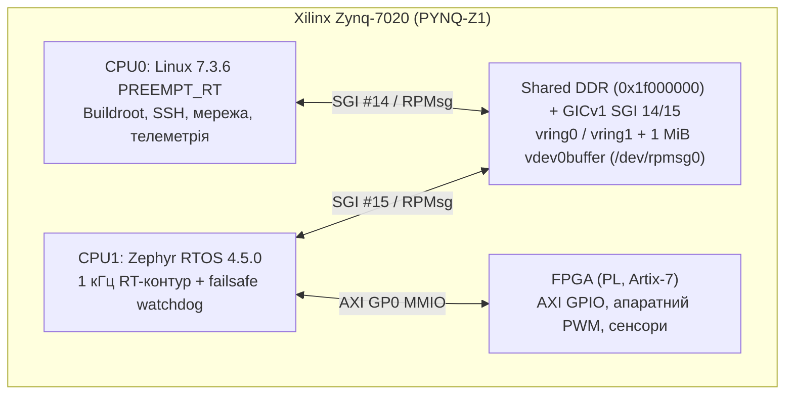
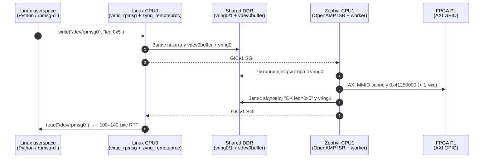
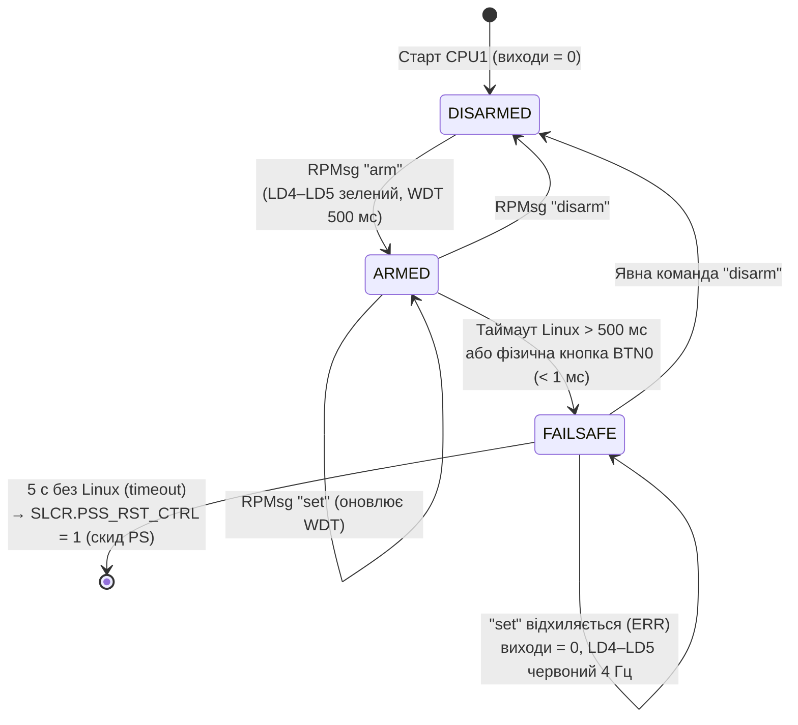
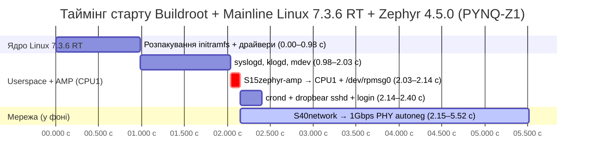
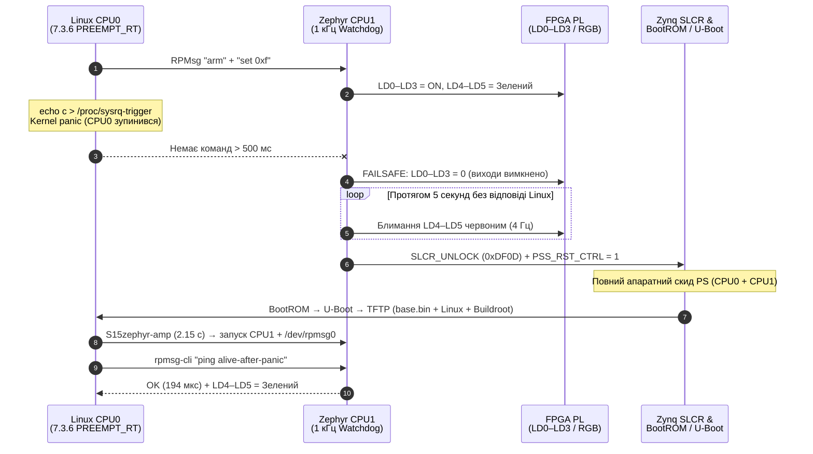

# Linux і Zephyr на одному кристалі Zynq-7000

*Як я розділив двоядерну FPGA-плату Digilent PYNQ-Z1 між Linux (CPU0), Zephyr RTOS 4.5.0 (CPU1) і логікою FPGA (PL), зібрав власний Mainline Linux 7.3.6 `PREEMPT_RT` + Buildroot на 3.37 МБ і перевірив живий `kernel panic` із повним самовідновленням плати.*

У [першій частині](DOU-Zephyr-RTOS-on-PYNQ-Z1-without-Vivado-UA.md) я запустив Zephyr RTOS 4.5.0 на Digilent PYNQ-Z1 без Vivado, підняв 1G Ethernet, TFTP netboot і 2-ядерний SMP. Але коли мова заходить про складнішу вбудовану систему реального часу — наприклад, робототехніку, ЧПК чи промисловий контролер — тримати чисту RTOS на обох ядрах незручно. Хочеться мати одночасно і **Linux** (для телеметрії, мережі, веб-інтерфейсу, обробки даних, Python), і **жорсткий real-time** без пауз планувальника Linux (для 1 кГц контуру керування й апаратного `FAILSAFE`).

У цій частині я покажу, як поділив один чип **Zynq-7000 (`XC7Z020`)** в асиметричному режимі (**AMP**): на **CPU0** крутиться Linux (спершу стоковий **PYNQ Linux 6.6.10**, а згодом мінімальний **Mainline Linux 7.3.6 `PREEMPT_RT`**), на **CPU1** — ізольований **Zephyr RTOS 4.5.0**, а між ними ходять повідомлення через **OpenAMP / RPMsg** (`/dev/rpmsg0`) із затримкою ~100–140 мкс.

---

## 1. Навіщо AMP, якщо вже працює SMP

| Критерій | 2-ядерний SMP (Частина 1) | AMP / OpenAMP (Частина 2) |
|---|---|---|
| Що працює на ядрах | Один Zephyr на CPU0 + CPU1 | **CPU0:** Linux · **CPU1:** Zephyr RTOS |
| Детермінізм задач реального часу | Нижчий (глобальні `spinlock`, IPI, спільний планувальник) | Високий — CPU1 повністю ізольоване від ОС Linux |
| Програмне середовище | Лише RTOS | Python, SSH, мережа, файлова система + жорсткий RT |
| Як спілкуються ядра | Спільна пам’ять / `k_msgq` | `remoteproc` + `virtio` vring + апаратні **GIC SGI 14/15** |

У гетерогенній вбудованій системі ролі в межах одного Zynq-7020 розподіляються чітко на три рівні:



---

## 2. Перевірка стокового PYNQ Linux: ядро перезбирати не довелося

Перше, що я перевірив перед стартом робіт: чи доведеться одразу компілювати власне ядро Linux під PYNQ-Z1. Я витягнув вбудований конфіг `IKCONFIG` із заводського `image.ub` (PYNQ v3.1) і приємно здивувався: тамтешній `Linux 6.6.10-xilinx-v2024.1` уже має всі потрібні модулі для AMP — `REMOTEPROC`, `zynq_remoteproc` та весь стек `rpmsg` (`virtio`, `char`, `ctrl`, `ns`). У стоковому Device Tree бракувало лише двох речей: зарезервованої області пам’яті для CPU1 (`reserved-memory`) і вузла `xlnx,zynq_remoteproc`.

---

## 3. Карта пам’яті DDR3 і DT-оверлей `amp/openamp.dts`

Щоб Linux і Zephyr гарантовано не затирали пам’ять одне одного, я відрізав верхні 32 МБ із 512 МБ DDR3 (з атрибутом `no-map` для Linux):

| Діапазон фізичних адрес | Розмір | Призначення |
|---|---|---|
| `0x00000000 – 0x1dffffff` | 480 МБ | Linux (CPU0), ядро, DTB, файловий кеш |
| `0x1e000000 – 0x1effffff` | 16 МБ | `rproc@1e000000` — код, стек, дані та буфер `trace0` Zephyr (CPU1) |
| `0x1f000000 – 0x1f007fff` | 32 КБ | `vdev0vring0` і `vdev0vring1` (кільця дескрипторів TX/RX) |
| `0x1f008000 – 0x1f107fff` | 1 МБ | `vdev0buffer` (`shared-dma-pool` для пакетів RPMsg) |

Оверлей `amp/openamp.dts` накладається на стоковий Device Tree (`fdtoverlay` → `pynq-amp.dtb`). Завдяки TFTP netboot із першої частини мені знову не довелося виймати microSD — U-Boot просто завантажив заводський `image.ub` із карти разом із моїм `pynq-amp.dtb` по мережі.

---

## 4. Три підводні камені запуску Zephyr на CPU1 поруч із Linux

Коли Linux завантажує `zephyr_amp.elf` через `zynq_remoteproc`, він сам виконує hot-unplug CPU1 (`remove_cpu(1)`), розкладає ELF-сегменти у `0x1e000000` і запускає CPU1 через короткий трамплін за адресою `0x00000000`. Звичайна збірка Zephyr у такому оточенні одразу впаде або покладе Linux. Під час відлагодження по SSH і `/dev/mem` мені довелося вирішити три проблеми:

1. **Не затирати таблицю векторів Linux (`0x00000000`) і замапити `VBAR` у MMU.**
   У базовому коді Zynq-7000 Zephyr копіює таблицю векторів у `0x00000000`. Я перевизначив слабку функцію `relocate_vector_table()`, щоб перевести `VBAR` прямо на `_vector_start` (`0x1e000000`), і додав сторінку `vbar_vectors` у `soc.c` — без цього перший `SVC` або IRQ падав у prefetch abort на незамапленій сторінці.
2. **Не чіпати GIC Distributor Linux (`CONFIG_GIC_SAFE_CONFIG=y`).**
   Контролер переривань GICv1 спільний для обох ядер. Опція `CONFIG_GIC_SAFE_CONFIG=y` забороняє Zephyr скидати `GICD_CTLR` і ламати переривання Linux.
3. **Когерентність із SCU Linux (`L1 invalidate` + `ACTLR.SMP | ACTLR.FW`).**
   Linux на CPU0 уже ввімкнув Snoop Control Unit (SCU). Поки я не додав на CPU1 інвалідацію L1-кешів і встановлення бітів `ACTLR.SMP | ACTLR.FW` до запуску MMU (разом із `CONFIG_USE_SWITCH=y` та `CONFIG_FPU=n`), `main()` на CPU1 не стартував. Після цього Linux одразу показав живі логи Zephyr у `debugfs` без жодного конфлікту за UART0:

```text
$ sudo cat /sys/kernel/debug/remoteproc/remoteproc0/trace0
*** Zephyr AMP on PYNQ-Z1 CPU1 booted ***
MPIDR=0x80000001 VBAR=0x1e000000
Zephyr CPU1 heartbeat tick=1 uptime_ms=1000
Zephyr CPU1 heartbeat tick=2 uptime_ms=2000
```

---

## 5. Двосторонній канал OpenAMP / RPMsg (`/dev/rpmsg0`) через GICv1 SGI 14/15

Драйвер `zynq_remoteproc` у Linux 6.6 використовує для сповіщень vring два програмні переривання GICv1: **SGI #14** (Linux → CPU1) та **SGI #15** (CPU1 → Linux). Я додав у `west` модулі `libmetal` і `open-amp`, замапив область `0x1f000000` (`0x108000` байт) як `MT_STRONGLY_ORDERED`, додав у `.resource_table` запис `RSC_VDEV` (`VIRTIO_ID_RPMSG`) і підняв endpoint `"rpmsg-raw"`.

Після завантаження модулів `virtio_rpmsg_bus`, `rpmsg_ctrl` і `rpmsg_char` Linux автоматично створив символьний пристрій **`/dev/rpmsg0`**. Чому саме `/dev/rpmsg0`, а не звичний `/dev/tty*`? Послідовний `/dev/tty` передає суцільний потік байтів без меж пакетів і тягне за собою термінальну обробку (`termios`, echo, `\r\n`), де повідомлення доводиться різати вручну. Натомість `/dev/rpmsg0` (`rpmsg_char`) працює як пакетний канал поверх VirtIO `vring`: один `write()` із Linux приходить на Zephyr як одне цілісне повідомлення, а один `read()` повертає готову відповідь — ідеально для команд керування й телеметрії.

Тестовий Python-скрипт у PYNQ Linux відправив повідомлення на Zephyr CPU1 і отримав відповіді із затримкою **137–179 мкс** у два боки (разом із `select()` та перемиканням контексту в userspace Linux):



```text
TX: 'Hello Zephyr from PYNQ Linux!' -> RX (413 us): '[Zephyr CPU1 #1] echo: Hello Zephyr from PYNQ Linux!\n'
TX: 'OpenAMP over GIC SGI 14/15'    -> RX (179 us): '[Zephyr CPU1 #2] echo: OpenAMP over GIC SGI 14/15\n'
TX: 'ping 3'                        -> RX (137 us): '[Zephyr CPU1 #3] echo: ping 3\n'
```

Що означає ця затримка для типової задачі керування в реальному часі? Якщо Linux передає уставки на частоті $f_{\text{cmd}} = 100\text{ Гц}$ ($T_{\text{cmd}} = 10\text{ мс}$) у 1 кГц контур керування Zephyr на CPU1 ($T_{\text{ctrl}} = 1\text{ мс}$), накладні витрати на обмін між ядрами становлять:

$$\eta_{\text{IPC}} = \frac{\text{RTT}_{\text{RPMsg}}}{T_{\text{cmd}}} \approx \frac{0.15\text{ мс}}{10\text{ мс}} = 1.5\%$$

При цьому контур реального часу на CPU1 працює незалежно від завантаження Linux і не просідає, навіть якщо на CPU0 в цей момент працює важка обробка даних або Python.

---

## 6. Керування FPGA (PL) із Zephyr CPU1 без Vivado: AXI GPIO у `base.bin`

PYNQ Linux автоматично прошиває в FPGA базовий бітстрім `base.bin` ще при старті системи (`fpga_manager fpga0: operating`). Із файла опису дизайну `base.hwh` на платі я витягнув фізичні адреси чотирьох блоків AXI GPIO:

- `0x41200000` — перемикачі `SW0–SW1`
- `0x41210000` — кнопки `BTN0–BTN3`
- `0x41240000` — RGB-світлодіоди `LD4–LD5`
- `0x41250000` — світлодіоди `LD0–LD3`

Я замапив діапазон `0x41200000` (`0x60000` байт) як `MT_DEVICE` у `soc.c` і додав у `amp/zephyr_cpu1` команди керування через `/dev/rpmsg0`: `led <hex>`, `rgb <hex>`, `blink <ms>` (апаратний таймер `k_timer` на CPU1, незалежний від Linux) та `read` (читання кнопок і перемикачів із PL).

Перевірка з Python на PYNQ Linux:

```text
CMD: read       -> ( 461 us) OK btns=0x0 sw=0x0 leds=0xf rgb=0x00 blink_ms=0
CMD: led 0x5    -> ( 164 us) OK led=0x5
CMD: rgb 0x12   -> ( 133 us) OK rgb=0x12
CMD: read       -> ( 128 us) OK btns=0x0 sw=0x0 leds=0x5 rgb=0x12 blink_ms=0
CMD: blink 150  -> ( 127 us) OK blink=150 ms
CMD: read       -> ( 128 us) OK btns=0x0 sw=0x0 leds=0x1 rgb=0x12 blink_ms=150
```

На платі `LD0–LD3` запустили стабільний «біжучий вогник» кожні 150 мс під керуванням Zephyr на CPU1, а `LD4–LD5` засвітилися зеленим — повний трирівневий ланцюжок **Linux (CPU0) ↔ `/dev/rpmsg0` ↔ Zephyr (CPU1) ↔ FPGA PL** запрацював без жодного рядка в Vivado.

---

## 7. Бенчмарк 1 кГц реального часу: Linux (CPU0) проти Zephyr (CPU1)

Щоб перевірити на практиці, що саме дає ізольований Zephyr на CPU1 для 1 кГц контуру реального часу, я додав у `amp/zephyr_cpu1` команду `jitter 1000` (1000 тіків `k_timer` із періодом 1000 мкс, вимір по 325 МГц Global Timer + перемикання `LD0` через AXI GPIO у кожному тіку) і порівняв її з аналогічною C-програмою на Linux (`clock_nanosleep(CLOCK_MONOTONIC, TIMER_ABSTIME)`):

- спочатку при вільному CPU0;
- потім під 100% завантаженням CPU0 (4 паралельні Python-процеси, що імітують важку обробку відео або телеметрії).

Реальний вивід із плати:

```text
=== [1] IDLE CPU0 ===
LINUX  n=1000 min_us=43.760 max_us=3808.991 avg_us=1000.077 max_jitter_us=2808.991
ZEPHYR OK n=1000 min_us=999.473 max_us=1000.175 avg_us=999.996 max_jitter_us=0.526

=== [2] 100% CPU0 STRESS LOAD (4 busy workers on Linux CPU0) ===
LINUX  n=1000 min_us=40.142 max_us=10279.523 avg_us=1000.081 max_jitter_us=9279.523
ZEPHYR OK n=1000 min_us=999.640 max_us=1000.163 avg_us=999.996 max_jitter_us=0.360
```

| Сценарій | Linux userspace (C, `CLOCK_MONOTONIC`) | Zephyr RTOS на CPU1 (`k_timer` + PL GPIO) | Різниця (max jitter) |
|---|---|---|---|
| CPU0 у простої | `max_jitter = 2808.99 мкс` (2.81 мс) | `max_jitter = 0.526 мкс` (526 нс) | **~5 300×** |
| CPU0 під 100% навантаженням | `max_jitter = 9279.52 мкс` (9.28 мс) | `max_jitter = 0.360 мкс` (360 нс) | **~25 700×** |

Навіть коли Linux на CPU0 завантажений на 100% і пропускає майже 10 мс (10 пропущених циклів 1 кГц поспіль!), Zephyr на CPU1 тримає період із джитером **менше півмікросекунди** (після калібрування частоти таймера під Linux нижче: `Wall=1.001s`, `avg_us=999.993`, `max_jitter_us=0.332`), одночасно перемикаючи лінію `LD0` у FPGA. *(Зазначу чесно: у Linux тест запускався без `PREEMPT_RT` і без `SCHED_FIFO`, тобто в типовому заводському PYNQ Linux — саме в такому режимі працює більшість Python/OpenCV-сервісів.)*

---

## 8. Знахідка з `GTC_CTRL` і 1 кГц failsafe-супервізор на CPU1

Коли я додав на CPU1 прототип 1 кГц failsafe-супервізора (`arm` / `set` / `disarm` / `state`) і перевірив таймаут відносно годинника Linux, спливла неочевидна апаратна деталь: 20 мс паузи в Python показували на CPU1 рівно `age_ms=10`. Читання регістра `GTC_CTRL` (`0xF8F00208`) пояснило причину за секунду:

```text
GTC_CTRL (0xF8F00208) = 0x00000101, prescaler=1
```

PYNQ Linux виставляє на спільному Cortex-A9 Global Timer подільник `prescaler = 1` (ділення на $1 + 1 = 2$), тож реальна частота таймера в AMP-режимі становить не $325\text{ МГц}$, а:

$$f_{\text{GTC,AMP}} = \frac{325\text{ МГц}}{1 + 1} = 162.5\text{ МГц}$$

Після уточнення `clock-frequency = <162500000>` в `amp/zephyr_cpu1/boards/pynq_z1.overlay` час на обох ядрах збігся 1:1 (`time.sleep(0.02)` → `age_ms=20`, 1000 тіків → `Wall=1.001s`).

Далі я перевірив сценарій аварії Linux на CPU0:
1. Команда `arm` переводить CPU1 у режим `ARMED` (RGB `LD4–LD5` світяться зеленим, активується watchdog 500 мс).
2. Python шле команди `set` із частотою 50 Гц (кожні 20 мс).
3. Python зупиняє відправку на 700 мс (імітація зависання Linux).



Через 500 мс CPU1 сам переходить у `FAILSAFE`, обнуляє виходи `LD0–LD3`, відхиляє подальші `set` і починає блимати червоним `LD4–LD5` (4 Гц):

```text
1) ARM: OK state=ARMED timeout_ms=500
2) SET[0]: OK state=ARMED mask=0x1 age_ms=20
2) SET[3]: OK state=ARMED mask=0xf age_ms=20
2) SET[7]: OK state=ARMED mask=0xf age_ms=20
3) Simulating Linux CPU0 hang for 0.7s...
4) STATE after hang: OK state=FAILSAFE reason=1 ticks=862
5) SET rejected in FAILSAFE: ERR state=FAILSAFE reason=1
=== trace0 ===
FAILSAFE: Linux command timeout (>500 ms) on CPU1
```

Аналогічно працює й фізичний аварійний стоп кнопкою `BTN0` на платі — CPU1 зчитує її напряму з AXI GPIO за < 1 мс, повністю в обхід Linux.

---

## 9. Mainline Linux 7.3.6 із `PREEMPT_RT`: чи може він замінити Zephyr на CPU1?

Коли я отримав джитер `9.28 мс` на заводському PYNQ Linux `6.6.10`, виникло логічне питання: а якщо замість старого vendor-ядра зібрати актуальний **Mainline Linux 7.3.6** із увімкненим `CONFIG_PREEMPT_RT=y` і мінімальним набором вбудованих драйверів?

На Zynq-7000 підтримка `arch/arm/mach-zynq`, `zynq-fpga` (`fpga_manager`) і `PREEMPT_RT` уже є прямо в mainline-ядрі. Не вистачало лише одного драйвера — `zynq_remoteproc.c` (він історично живе в `Xilinx/linux-xlnx`). Оскільки `zynq_cpun_start()` у mainline `arch/arm/mach-zynq/platsmp.c` збереглася, я портував `zynq_remoteproc.c` під API Linux 7.3 (`void remove()`, `request_percpu_irq()` для GIC SGI 14/15, `of_iomap()` для запису в `GICD_SGIR` і `rproc_of_resm_mem_entry_init()` для `vdev0buffer`).

Мінімальний конфіг `linux/pynq_z1_min_defconfig` (лише `ARCH_ZYNQ`, усі потрібні драйвери вбудовані `=y` без зовнішніх `.ko`-модулів: мережа `macb`, SD/`ext4`, `xuartps`, GPIO, I2C/SPI, `zynq-fpga`, `zynq_remoteproc`, `rpmsg`, а також `XADC`, `Cadence Watchdog`, `USB Host/ACM/FTDI/CP210X` та `OF_OVERLAY`) зібрався за ~25 секунд у `zImage` розміром **5.3 МБ**. Ядро завантажилося по TFTP **поверх стокового Debian-подібного rootfs (Ubuntu 22.04 із PYNQ-образу на microSD)** — тож усі звичні системні утиліти (`systemd`, `sshd`, `python3`, мережеві скрипти) запрацювали одразу, без перезбірки rootfs і без встановлення зовнішніх модулів ядра (`374 МБ` вільної RAM із `490 МБ`):

```text
Linux pynq-1 7.3.6-pynq-z1-rt #4 SMP PREEMPT_RT armv7l GNU/Linux
/sys/class/fpga_manager/fpga0/state      -> operating
/sys/class/remoteproc/remoteproc0/state  -> running
/sys/bus/iio/devices/iio:device0         -> Zynq die temp = 62.3 C (XADC)
/dev/watchdog0                           -> Cadence Watchdog
```

Окрема знахідка під час запуску: на відміну від важкого образу PYNQ, де сервіс `pynq` автоматично прошиває `base.bin` під час старту, на мінімальному mainline-ядрі FPGA PL за замовчуванням порожня (`fpga0/state = unknown`). Якщо запустити `zephyr_amp.elf` до прошивки PL, перше звернення CPU1 до AXI GPIO (`0x41250000`) вішає шину AXI GP0 і обидва ядра. Завантаження `base.bin` в U-Boot (`fpga load 0 0x05000000 $filesize`) вирішує це ще до старту ядра Linux.

Порівняння 1 кГц циклу під 100% навантаженням CPU на тій самій платі PYNQ-Z1:

| Конфігурація (1 кГц, 100% навантаження CPU) | avg | p99 | max джитер |
|---|---:|---:|---:|
| PYNQ Linux `6.6.10` (non-RT, `SCHED_OTHER`) | — | — | **9 279.5 мкс** |
| Mainline Linux `7.3.6 PREEMPT_RT` (`SCHED_OTHER`) | 552.9 мкс | 8 244.1 мкс | **10 196.0 мкс** |
| Mainline Linux `7.3.6 PREEMPT_RT` (`SCHED_FIFO 80`) | 50.7 мкс | 69.9 мкс | **128.4 мкс** |
| **Zephyr `4.5.0` на CPU1** (поруч із Linux `7.3.6 RT`) | — | — | **0.966 мкс** |

Що це дало на практиці:
- **`PREEMPT_RT` із `SCHED_FIFO`** зменшив максимальний джитер Linux у **72 рази** (із `9.28 мс` до **`128.4 мкс`**), а середня затримка `/dev/rpmsg0` знизилася зі `137–179 мкс` до **`94–110 мкс`**.
- Водночас **Zephyr на CPU1** усе одно залишається на два порядки точнішим (**`< 1 мкс`** проти `128.4 мкс`) і повністю ізольованим від навантаження, планувальника та зависань Linux — тому зв’язка **Mainline Linux `7.3.6 PREEMPT_RT` (CPU0) + Zephyr `4.5.0` (CPU1) + FPGA PL** дає найкращий баланс для вбудованої системи керування.

### Як перевірити розподіл ядер і що відбувається при рестарті Linux

Переконатися з Linux, що CPU1 справді відданий Zephyr, найпростіше за трьома ознаками: `/sys/devices/system/cpu/online` змінюється з `0-1` на **`0`**, `/sys/class/remoteproc/remoteproc0/state` показує **`running`**, а `trace0` і `/dev/rpmsg0` відповідають від імені `MPIDR=0x80000001`.

Поведінка Zephyr під час перезапуску Linux залежить від сценарію:
- **Штатний `reboot`, апаратний Watchdog або кнопка `SRST`:** Linux записує `SLCR.PSS_RST_CTRL` (`0xF8000200`) і виконує апаратний скид усього PS разом з обома ядрами CPU0 і CPU1. Після перезавантаження `remoteproc0` знову в стані `offline`, доки його не запустить ручна команда або `systemd`-сервіс (у сервісі варто прописати `ExecStop` із `echo stop > state`, щоб перед `reboot` коректно зупиняти CPU1).
- **Зависання Linux (kernel panic або deadlock без апаратного скиду):** CPU1 продовжує працювати незалежно — супервізор у Zephyr через 500 мс без команд від Linux сам переводить систему у `FAILSAFE` і гасить виходи.

### Від стокової Ubuntu до справжнього Embedded Linux: вибір rootfs

Після переходу на 5.3-мегабайтне mainline-ядро `7.3.6 PREEMPT_RT` найважчою частиною залишається стоковий Debian-подібний rootfs (Ubuntu 22.04 із PYNQ-образу на ~7 ГБ, старт ~30 секунд, `systemd`, `swap`, десятки фонових сервісів). Щоб отримати справжній Embedded Linux на CPU0, є три основні варіанти:

1. **Ручний `BusyBox` + `Dropbear SSH` у `initramfs` (~8–12 МБ, старт ~2 с)** — максимально легкий образ у RAM, не боїться раптового зняття живлення, але потребує ручного супроводу бібліотек і утиліт.
2. **Buildroot (~15–35 МБ, старт ~3 с, read-only `squashfs` або `initramfs`)** — класичний інструмент для відтворюваної збірки мінімального Embedded Linux із `BusyBox`, `dropbear`, `i2c-tools`, мережею та власним C-демоном для `/dev/rpmsg0` (або мінімальним `python3`).
3. **Yocto Project** — промисловий стандарт для великих команд і серійних продуктів, але з високим порогом входу й багатогодинними збірками.

Оскільки я вже мав чималий досвід із `BusyBox`, а **Yocto Project** для такого R&D-проєкту занадто важкий, для наступного етапу я обираю **варіант 2 — Buildroot**, щоб повністю відв’язатися від стокового образу PYNQ й отримати швидкий, відтворюваний Embedded Linux на CPU0 поруч із Zephyr на CPU1.

---

## 10. Buildroot `2026.08.2`: справжній Embedded Linux (`3.37 МБ` у RAM)

Для повної відмови від стокового образу PYNQ я зібрав мінімальний `initramfs` у **Buildroot `2026.08.2`** (із готовим Bootlin `armv7-eabihf` external toolchain, тож не довелося компілювати GCC з нуля). До конфігурації `buildroot/pynq_z1_defconfig` увійшли:

- **`BusyBox 1.38.0`** (ініціалізація, `mdev`, `udhcpc`, базові утиліти);
- **`Dropbear SSH 2026.94`** із автоматичним підкладанням публічного SSH-ключа у `/root/.ssh/authorized_keys` для входу без пароля;
- **`rt-tests` (`cyclictest`)**, **`i2c-tools`**, **`ethtool`**;
- **`/usr/bin/rpmsg-cli`** — компактна C-утиліта (~60 рядків, `buildroot/rpmsg-cli.c`), яка напряму спілкується з `/dev/rpmsg0` і міряє RTT без потреби в Python;
- **`/lib/firmware/zephyr_amp.elf`** і init-скрипт **`/etc/init.d/S15zephyr-amp`** (спочатку був `S90`, але я переніс його перед мережею), що автоматично запускає Zephyr `4.5.0` на CPU1 після старту (коли `fpga0 = operating`) і чисто зупиняє його перед `reboot`;
- **асинхронний `/etc/init.d/S40network`**, який піднімає `ifup -a` у фоні, щоб 3-секундне фізичне автоузгодження 1Gbps PHY (`RTL8211F`) не блокувало старт `dropbear` і консолі.

Готовий образ `rootfs.cpio.uboot` вийшов розміром **3.37 МБ** (проти ~7 ГБ стокової Ubuntu) і вантажиться по TFTP прямо в RAM разом із `base.bin` і `zImage-7.3.6` (`bootz 0x02000000 0x06000000 0x04000000`). Після U-Boot microSD взагалі не використовується, тож файлова система не боїться раптового зняття живлення.

Перевірка на живому PYNQ-Z1 після завантаження:

```text
Linux pynq-1 7.3.6-pynq-z1-rt #4 SMP PREEMPT_RT armv7l GNU/Linux
Mem: 479 MB total, 14 MB used, 449 MB available (Swap: 0)
online CPUs: 0   |   fpga0: operating   |   remoteproc0: running

# rpmsg-cli "ping buildroot"
[Zephyr CPU1 #1] echo: ping buildroot (169.6 us)
# rpmsg-cli "blink 150"
OK blink=150 ms (139.2 us)
# rpmsg-cli jitter
OK n=1000 min_us=999.236 max_us=1000.301 avg_us=999.993 max_jitter_us=0.763 (1001167.8 us)

# cyclictest -m -Sp80 -i1000 -l1000 -q
T: 0 (186) P:80 I:1000 C: 1000 Min: 13 Act: 15 Avg: 14 Max: 39
```

Нативний C-бенчмарк **`cyclictest`** (1 кГц, `SCHED_FIFO 80`) на чистому **Buildroot + Mainline Linux `7.3.6 PREEMPT_RT`** показав максимальну затримку всього **39 мкс** (avg **14 мкс**), а весь Embedded Linux займає лише **14 МБ RAM** із автоматично запущеним **Zephyr `4.5.0`** на CPU1 (**`0.763 мкс`** max jitter).

### Бонус-знахідка: як одруківка в стоковому DTB крала 19.3 секунди старту

На першому запуску Buildroot я помітив у `dmesg` дивну тиху паузу між `Freeing initrd memory` (`0.66 с`) та ініціалізацією `macb` (`20.00 с`). Прогін із `initcall_debug` миттєво показав винуватця:

```text
probe of e000b000.ethernet with driver macb returned 0 after 19493203 usecs
```

Декомпіляція стокового DTB із PYNQ v3.1 виявила кумедний баг міграції: `phy-handle` був прописаний у вузлі `/amba/ethernet@e000b000`, тоді як реальний контролер сидить у `/axi/ethernet@e000b000`. Причина проста: у старіших версіях `zynq-7000.dtsi` (часів Linux 4.x–5.x) шина периферії називалася `amba`, а з переходом на новіші правила `dt-schema` в Linux 6.6 її перейменували на `axi`; старий `system-user.dtsi` перевизначав Ethernet за шляхом, тому `dtc` без жодного попередження просто створив поруч «сирітський» вузол `/amba/ethernet@e000b000`. Через це `macb` не знав адреси PHY і на кожному завантаженні послідовно сканував усі 32 MDIO-адреси з таймаутом (~19.3 с). Додавання в `amp/openamp.dts` перекриття за міткою **`&gem0`** (з явним `phy-handle` на `ethernet-phy@0` та фіксованим `local-mac-address`) скоротило час старту з **24.8 с** до **5.58 с**.

А перенесення автозапуску Zephyr перед мережею (`S15zephyr-amp`) разом із фоновим `S40network` дало ще кращий розподіл таймінгів (із повним логом ядра на UART0, повторювано до мілісекунд):



Чесно щодо цифр: фізичне автоузгодження `1Gbps/Full` на `RTL8211F` апаратно триває ~3.1 с, тому лінк Ethernet усе одно з’являється на **`5.52 с`**. Але завдяки ранньому `S15zephyr-amp` і фоновій мережі **контур реального часу на CPU1 (`/dev/rpmsg0`) готовий уже на `2.14 с`**, а `dropbear sshd` і `pynq-1 login:` — на **`2.40 с`** (якщо додатково додати `quiet` у `bootargs`, старт `/dev/rpmsg0` стискається до **`1.78 с`**):

```text
[    0.983531] Run /init as init process
Starting Zephyr CPU1 (zephyr_amp.elf)...
[    2.136998] remoteproc remoteproc0: remote processor remoteproc@0 is now up
[    2.157340] virtio_rpmsg_bus virtio0: creating channel rpmsg-raw addr 0x400
Starting network (async): OK
Starting dropbear sshd: OK
pynq-1 login:
[    5.517815] macb e000b000.ethernet eth0: Link is Up - 1Gbps/Full - flow control tx
```

---

## 11. Два живі експерименти: Core Ping-Pong і самовідновлення після `kernel panic`

Щоб закрити два практичних питання — як із Linux переконатися, що Zephyr на CPU1 справді активний, і що CPU1 здатний зробити при реальному краху Linux, — я провів два живі тести на зв’язці **Buildroot + Mainline Linux `7.3.6 PREEMPT_RT` + Zephyr `4.5.0`**.

### Експеримент 1: Core Ping-Pong (перевірка «живості» CPU1)

Самого запису `remoteproc0/state = running` замало — він показує лише, що прошивку запускали, але не гарантує, що CPU1 не завис. Надійна перевірка поєднує системні ознаки (`cpu/online = 0`, `remoteproc0 = running`, `MPIDR=0x80000001` у `trace0`) з активним ping-pong через `/dev/rpmsg0`, де Zephyr у відповідь перемикає світлодіоди в FPGA PL (`LD0–LD3`, `LD4–LD5`) і повертає лічильник повідомлень у консоль:

```text
=== EXPERIMENT 1: Linux CPU0 <-> Zephyr CPU1 Ping-Pong ===
cpu/online=0, remoteproc0=running
  [round 1] [Zephyr CPU1 #18] echo: ping-pong #1 (168.4 us) | OK led=0x1 (237.0 us) | OK rgb=0x09 (164.1 us)
  [round 2] [Zephyr CPU1 #21] echo: ping-pong #2 (227.2 us) | OK led=0x2 (173.1 us) | OK rgb=0x12 (174.9 us)
  ...
  [round 8] [Zephyr CPU1 #39] echo: ping-pong #8 (179.1 us) | OK led=0x8 (158.4 us) | OK rgb=0x12 (162.8 us)
```

### Експеримент 2: Реальний `kernel panic` Linux → Zephyr Watchdog → апаратний скид `SLCR`

Я додав у `soc.c` MMU-мапінг `slcr_reset` (`0xF8000000`, `4 КБ`), а в 1 кГц супервізор `amp/zephyr_cpu1/src/main.c` — другу фазу реакції на таймаут Linux: якщо після 500 мс таймауту система пробула в `FAILSAFE` ще **5 секунд** (блимаючи червоним `LD4–LD5` із обнуленими виходами `LD0–LD3`), Zephyr на CPU1 розблоковує `SLCR_UNLOCK` (`0xF8000008 = 0xDF0D`) і записує `1` у **`SLCR.PSS_RST_CTRL` (`0xF8000200`)**.



Далі я перевів CPU1 у `ARMED` і навмисно «вбив» ядро Linux на CPU0 через `echo c > /proc/sysrq-trigger`:

```text
1) OK state=ARMED timeout_ms=500 (183.4 us)
2) OK state=ARMED mask=0xf age_ms=117 (2827.8 us)
3) Triggering REAL Linux kernel panic on CPU0 NOW!
[   28.388308] Kernel panic - not syncing: sysrq triggered crash
[   28.433272] ---[ end Kernel panic - not syncing: sysrq triggered crash ]---

   (через 500 мс Zephyr CPU1 гасить LD0–LD3 і 5 с блимає червоним LD4–LD5)
   (на 5-й секунді Zephyr CPU1 записує SLCR.PSS_RST_CTRL = 1)

U-Boot 2024.01 (May 14 2024 - 03:31:48 +0000)
CPU:   Zynq 7z020
...
=== AUTO-RECOVERED AFTER LINUX KERNEL PANIC (ZERO BUTTONS PRESSED!) ===
cpu/online=0, remoteproc0=running
[Zephyr CPU1 #1] echo: ping alive-after-panic (194.1 us)
OK rgb=0x12 (176.5 us)
```

Важливий архітектурний нюанс: запис у `SLCR.PSS_RST_CTRL` скидає **весь процесорний комплекс (PS)** — обидва ядра CPU0 і CPU1 та всі контролери периферії, після чого плата проходить чистий старт BootROM → U-Boot → `Linux 7.3.6 RT` → `S15zephyr-amp`. Хоча в Zynq-7000 існує окремий біт скиду лише CPU0 (`A9_CPU_RST_CTRL.A9_RST0`), після `kernel panic` спільні контролери PS (GIC, Ethernet, DMA, SDHCI) залишаються в неузгодженому стані — тому двоетапна схема (**миттєвий `FAILSAFE` у Zephyr CPU1 → повний чистий скид PS**) значно надійніша.

---

## Висновки

- На PYNQ-Z1 можна запустити **AMP / OpenAMP** як на заводському **PYNQ Linux 6.6.10** (без перезбірки ядра), так і на повністю самостійному **Embedded Linux** (`Mainline Linux 7.3.6 PREEMPT_RT` `5.3 МБ` + `Buildroot 2026.08.2` `initramfs` `3.37 МБ`, споживання **14 МБ RAM**, автостарт Zephyr CPU1 за **2.14 с**).
- Для безпечного співіснування Zephyr на CPU1 поруч із Linux критичні три речі: `VBAR` у власній ділянці пам’яті з MMU-мапінгом, `CONFIG_GIC_SAFE_CONFIG=y` та когерентність із SCU (`ACTLR.SMP | ACTLR.FW`), а для доступу до PL — попередня прошивка FPGA (`base.bin`).
- `PREEMPT_RT` (`SCHED_FIFO`) зменшує максимальний джитер Linux із **9.28 мс** до **39 мкс** (нативний `cyclictest` на Buildroot) і прискорює `/dev/rpmsg0` до **94–110 мкс**, але виділений **Zephyr на CPU1** усе одно дає субмікросекундний джитер (**`< 1 мкс`**) і незалежний `FAILSAFE` при зависанні Linux.

---

## Скорочення

- **AMP** (*Asymmetric Multiprocessing*) — асиметрична багатопроцесорність (різні ОС на різних ядрах одного чипа).
- **AXI** (*Advanced eXtensible Interface*) — системна шина зв’язку між процесорною частиною PS і логікою FPGA (PL).
- **DTB / DTBO / DTS** — скомпільований Device Tree, оверлей та його вихідний код.
- **GIC / SGI** — контролер переривань ARM та програмне між’ядерне переривання (*Software Generated Interrupt*).
- **IPC** (*Inter-Processor Communication*) — міжпроцесорний обмін даними.
- **PREEMPT_RT** — режим реального часу в ядрі Linux із витісненням критичних секцій та потоковими обробниками переривань.
- **RPMsg** (*Remote Processor Messaging*) — протокол обміну повідомленнями поверх VirtIO vring.
- **RTT** (*Round-Trip Time*) — повний час проходження запиту і відповіді.
- **SCHED_FIFO** — політика планувальника реального часу POSIX (фіксований пріоритет без квантування часу).
- **SCU** (*Snoop Control Unit*) — блок когерентності L1-кешів між ядрами Cortex-A9.
- **VBAR** (*Vector Base Address Register*) — регістр базової адреси таблиці векторів виключень ARM.

---

## Посилання

- **Повна технічна версія статті на GitHub** (повний `IKCONFIG`, команди U-Boot, деталі конфігів ядра й Buildroot): [articles/Zephyr-RTOS-on-PYNQ-Z1-AMP-OpenAMP-Part2-UA.md](https://github.com/nick-fedchik/Zephyr-RTOS-PYNC-Z1/blob/main/articles/Zephyr-RTOS-on-PYNQ-Z1-AMP-OpenAMP-Part2-UA.md)
- Репозиторій проєкту (папки `amp/`, `linux/`, `buildroot/`, `patches/`, `ROADMAP.md`): [github.com/nick-fedchik/Zephyr-RTOS-PYNC-Z1](https://github.com/nick-fedchik/Zephyr-RTOS-PYNC-Z1)
- Частина 1: [Zephyr RTOS на FPGA-платі PYNQ-Z1 без Vivado](DOU-Zephyr-RTOS-on-PYNQ-Z1-without-Vivado-UA.md)
- Mainline Linux 7.3.6: [kernel.org](https://www.kernel.org/)
- Драйвер `zynq_remoteproc.c` у `Xilinx/linux-xlnx` (`v6.6`): [github.com/Xilinx/linux-xlnx](https://github.com/Xilinx/linux-xlnx)
