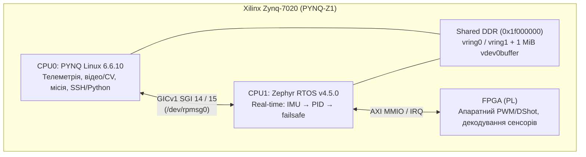

# Linux і Zephyr на одному кристалі Zynq-7000

*(Чернетка другої частини. Інфраструктура AMP із `zynq_remoteproc`, `trace0` та двостороннім `/dev/rpmsg0` уже зібрана й перевірена на живому Digilent PYNQ-Z1. Прикладний розділ про керування FPV-коптером і роботу з FPGA PL ще в роботі.)*

У [першій частині](DOU-Zephyr-RTOS-on-PYNQ-Z1-without-Vivado-UA.md) я запустив Zephyr RTOS v4.5.0 на Digilent PYNQ-Z1 без Vivado, підняв 1G Ethernet, TFTP netboot і 2-ядерний SMP. Але коли мова заходить про складнішу бортову кіберсистему — наприклад, керування **FPV-коптером** — тримати чисту RTOS на обох ядрах незручно. Хочеться мати одночасно і **Linux** (для телеметрії, навігації, відео, комп’ютерного зору, Python), і **жорсткий real-time** без пауз планувальника Linux (для стабілізації польоту IMU → PID → ESC).

У цій частині я покажу, як поділив один чип **Zynq-7000 (`XC7Z020`)** в асиметричному режимі (**AMP**): на **CPU0** крутиться стоковий **PYNQ Linux 6.6.10** (без перезбірки ядра), на **CPU1** — ізольований **Zephyr RTOS v4.5.0**, а між ними ходять повідомлення через **OpenAMP / RPMsg** (`/dev/rpmsg0`) із затримкою близько 140 мкс.

---

## 1. Навіщо AMP, якщо вже працює SMP

| Критерій | 2-ядерний SMP (Частина 1) | AMP / OpenAMP (Частина 2) |
|---|---|---|
| Що працює на ядрах | Один Zephyr на CPU0 + CPU1 | **CPU0:** PYNQ Linux (Ubuntu 22.04) · **CPU1:** Zephyr RTOS |
| Детермінізм задач реального часу | Нижчий (глобальні `spinlock`, IPI, спільний планувальник) | Високий — CPU1 повністю ізольоване від ОС Linux |
| Програмне середовище | Лише RTOS | Python, OpenCV, SSH, мережа, файлова система + жорсткий RT |
| Як спілкуються ядра | Спільна пам’ять / `k_msgq` | `remoteproc` + `virtio` vring + апаратні **GIC SGI 14/15** |

Для бортової обчислювальної системи FPV-коптера ролі в межах одного Zynq-7020 розподіляються чітко на три рівні:



---

## 2. Перевірка стокового PYNQ Linux: ядро перезбирати не довелося

Перше, що я перевірив перед стартом робіт: чи доведеться компілювати власне ядро Linux під PYNQ-Z1. Я розпакував `kernel-0` із заводського `image.ub` (PYNQ v3.1) і витягнув вбудований `IKCONFIG`. Виявилося, що `Linux 6.6.10-xilinx-v2024.1` уже має всі потрібні модулі:

```text
CONFIG_REMOTEPROC=y
CONFIG_ZYNQ_REMOTEPROC=m
CONFIG_RPMSG=m
CONFIG_RPMSG_VIRTIO=m
CONFIG_RPMSG_CHAR=m
CONFIG_RPMSG_CTRL=m
CONFIG_RPMSG_NS=m
```

У стоковому Device Tree (`fdt-0`) бракувало лише двох речей: зарезервованої області пам’яті для CPU1 (`reserved-memory`) і вузла `xlnx,zynq_remoteproc`.

---

## 3. Карта пам’яті DDR3 і DT-оверлей `amp/openamp.dts`

Щоб Linux і Zephyr гарантовано не затирали пам’ять одне одного, я відрізав верхні 32 МБ із 512 МБ DDR3 (з атрибутом `no-map` для Linux):

| Діапазон фізичних адрес | Розмір | Призначення |
|---|---|---|
| `0x00000000 – 0x1dffffff` | 480 МБ | PYNQ Linux (CPU0), ядро, DTB, файловий кеш |
| `0x1e000000 – 0x1effffff` | 16 МБ | `rproc@1e000000` — код, стек, дані та буфер `trace0` Zephyr (CPU1) |
| `0x1f000000 – 0x1f003fff` | 16 КБ | `vdev0vring0` (кільце дескрипторів TX/RX) |
| `0x1f004000 – 0x1f007fff` | 16 КБ | `vdev0vring1` (кільце дескрипторів RX/TX) |
| `0x1f008000 – 0x1f107fff` | 1 МБ | `vdev0buffer` (`shared-dma-pool` для пакетів RPMsg) |

Оверлей `amp/openamp.dts` компілюється `dtc` і накладається на стоковий `fdt-0` (`fdtoverlay` → `pynq-amp.dtb`). Завдяки TFTP netboot із першої частини мені знову не довелося виймати microSD — U-Boot просто завантажив заводський `image.ub` із карти разом із моїм `pynq-amp.dtb` по TFTP:

```text
fatload mmc 0:1 0x10000000 image.ub
tftpboot 0x02000000 pynq1/pynq-amp.dtb
bootm 0x10000000:kernel-0 - 0x02000000
```

---

## 4. Три підводні камені запуску Zephyr на CPU1 поруч із Linux

Коли Linux завантажує `zephyr_amp.elf` через `zynq_remoteproc`, він сам виконує hot-unplug CPU1 (`remove_cpu(1)`), розкладає ELF-сегменти у `0x1e000000` і запускає CPU1 через короткий трамплін за адресою `0x00000000`. Звичайна збірка Zephyr у такому оточенні одразу впаде або покладе Linux. Під час відлагодження по SSH і `/dev/mem` мені довелося вирішити три проблеми:

1. **Не затирати таблицю векторів Linux (`0x00000000`) і замапити `VBAR` у MMU.**
   У базовому коді Zynq-7000 Zephyr копіює таблицю векторів у `0x00000000`. Я перевизначив слабку функцію `relocate_vector_table()`, щоб перевести `VBAR` прямо на `_vector_start` (`0x1e000000`), і додав сторінку `vbar_vectors` у `soc.c` — без цього перший `SVC` або IRQ падав у prefetch abort на незамапленій сторінці.
2. **Не чіпати GIC Distributor Linux (`CONFIG_GIC_SAFE_CONFIG=y`).**
   Контролер переривань GICv1 спільний для обох ядер. Опція `CONFIG_GIC_SAFE_CONFIG=y` забороняє Zephyr скидати `GICD_CTLR` і ламати переривання Linux.
3. **Когерентність із SCU Linux (`L1 invalidate` + `ACTLR.SMP | ACTLR.FW`).**
   Linux на CPU0 уже ввімкнув Snoop Control Unit (SCU). Поки я не додав на CPU1 інвалідацію L1-кешів і встановлення бітів `ACTLR.SMP | ACTLR.FW` до запуску MMU (разом із `CONFIG_USE_SWITCH=y` та `CONFIG_FPU=n`), `main()` на CPU1 не стартував. Після цього Linux одразу показав живі логи Zephyr у `debugfs` без жодного конфлікту за UART0:

```text
$ sudo cat /sys/kernel/debug/remoteproc/remoteproc0/trace0
*** Zephyr AMP on PYNQ-Z1 CPU1 booted ***
MPIDR=0x80000001 VBAR=0x1e000000
Zephyr CPU1 heartbeat tick=1 uptime_ms=1000
Zephyr CPU1 heartbeat tick=2 uptime_ms=2000
```

---

## 5. Двосторонній канал OpenAMP / RPMsg (`/dev/rpmsg0`) через GICv1 SGI 14/15

Драйвер `zynq_remoteproc` у Linux 6.6 використовує для сповіщень vring два програмні переривання GICv1: **SGI #14** (Linux → CPU1) та **SGI #15** (CPU1 → Linux). Я додав у `west` модулі `libmetal` і `open-amp`, замапив область `0x1f000000` (`0x108000` байт) як `MT_STRONGLY_ORDERED`, додав у `.resource_table` запис `RSC_VDEV` (`VIRTIO_ID_RPMSG`) і підняв endpoint `"rpmsg-raw"`.

Після завантаження модулів `virtio_rpmsg_bus`, `rpmsg_ctrl` і `rpmsg_char` Linux автоматично створив пристрій **`/dev/rpmsg0`**:

```text
virtio_rpmsg_bus virtio0: rpmsg host is online
rproc-virtio rproc-virtio.0.auto: registered virtio0 (type 7)
remoteproc remoteproc0: remote processor remoteproc@0 is now up
virtio_rpmsg_bus virtio0: creating channel rpmsg-raw addr 0x400
```

Тестовий Python-скрипт у PYNQ Linux відправив повідомлення на Zephyr CPU1 і отримав відповіді із затримкою **137–179 мкс** у два боки (разом із `select()` та перемиканням контексту в userspace Linux):

```text
TX: 'Hello Zephyr from PYNQ Linux!' -> RX (413 us): '[Zephyr CPU1 #1] echo: Hello Zephyr from PYNQ Linux!\n'
TX: 'OpenAMP over GIC SGI 14/15'    -> RX (179 us): '[Zephyr CPU1 #2] echo: OpenAMP over GIC SGI 14/15\n'
TX: 'ping 3'                        -> RX (137 us): '[Zephyr CPU1 #3] echo: ping 3\n'
```

Що означає ця затримка для майбутньої задачі керування **FPV-коптером**? Якщо Linux передає уставки польоту на частоті $f_{\text{cmd}} = 100\text{ Гц}$ ($T_{\text{cmd}} = 10\text{ мс}$) у цикл стабілізації Zephyr на CPU1 ($f_{\text{PID}} = 1\text{ кГц}$, $T_{\text{PID}} = 1\text{ мс}$), накладні витрати на обмін між ядрами становлять:

$$\eta_{\text{IPC}} = \frac{\text{RTT}_{\text{RPMsg}}}{T_{\text{cmd}}} \approx \frac{0.15\text{ мс}}{10\text{ мс}} = 1.5\%$$

При цьому цикл стабілізації на CPU1 працює незалежно від завантаження Linux і продовжує тримати апарат, навіть якщо на CPU0 в цей момент працює відеокодер або Python.

---

## 6. Керування FPGA (PL) із Zephyr CPU1 без Vivado: AXI GPIO у `base.bin`

PYNQ Linux автоматично прошиває в FPGA базовий бітстрім `base.bin` ще при старті системи (`fpga_manager fpga0: operating`). Із файла опису дизайну `base.hwh` на платі я витягнув фізичні адреси чотирьох блоків AXI GPIO:

- `0x41200000` — перемикачі `SW0–SW1`
- `0x41210000` — кнопки `BTN0–BTN3`
- `0x41240000` — RGB-світлодіоди `LD4–LD5`
- `0x41250000` — світлодіоди `LD0–LD3`

Я замапив діапазон `0x41200000` (`0x60000` байт) як `MT_DEVICE` у `soc.c` і додав у `amp/zephyr_cpu1` команди керування через `/dev/rpmsg0`: `led <hex>`, `rgb <hex>`, `blink <ms>` (апаратний таймер `k_timer` на CPU1, незалежний від Linux) та `read` (читання кнопок і перемикачів із PL).

Перевірка з Python на PYNQ Linux:

```text
CMD: read       -> ( 461 us) OK btns=0x0 sw=0x0 leds=0xf rgb=0x00 blink_ms=0
CMD: led 0x5    -> ( 164 us) OK led=0x5
CMD: rgb 0x12   -> ( 133 us) OK rgb=0x12
CMD: read       -> ( 128 us) OK btns=0x0 sw=0x0 leds=0x5 rgb=0x12 blink_ms=0
CMD: blink 150  -> ( 127 us) OK blink=150 ms
CMD: read       -> ( 128 us) OK btns=0x0 sw=0x0 leds=0x1 rgb=0x12 blink_ms=150
```

На платі `LD0–LD3` запустили стабільний «біжучий вогник» кожні 150 мс під керуванням Zephyr на CPU1, а `LD4–LD5` засвітилися зеленим — повний трирівневий ланцюжок **Linux (CPU0) ↔ `/dev/rpmsg0` ↔ Zephyr (CPU1) ↔ FPGA PL** запрацював без жодного рядка в Vivado.

---

## 7. Бенчмарк 1 кГц реального часу: Linux (CPU0) проти Zephyr (CPU1)

Щоб перевірити на практиці, що саме дає ізольований Zephyr на CPU1 для задач на кшталт 1 кГц циклу стабілізації FPV-коптера, я додав у `amp/zephyr_cpu1` команду `jitter 1000` (1000 тіків `k_timer` із періодом 1000 мкс, вимір по 325 МГц Global Timer + перемикання `LD0` через AXI GPIO у кожному тіку) і порівняв її з аналогічною C-програмою на Linux (`clock_nanosleep(CLOCK_MONOTONIC, TIMER_ABSTIME)`):

- спочатку при вільному CPU0;
- потім під 100% завантаженням CPU0 (4 паралельні Python-процеси, що імітують важку обробку відео або телеметрії).

Реальний вивід із плати:

```text
=== [1] IDLE CPU0 ===
LINUX  n=1000 min_us=43.760 max_us=3808.991 avg_us=1000.077 max_jitter_us=2808.991
ZEPHYR OK n=1000 min_us=999.473 max_us=1000.175 avg_us=999.996 max_jitter_us=0.526

=== [2] 100% CPU0 STRESS LOAD (4 busy workers on Linux CPU0) ===
LINUX  n=1000 min_us=40.142 max_us=10279.523 avg_us=1000.081 max_jitter_us=9279.523
ZEPHYR OK n=1000 min_us=999.640 max_us=1000.163 avg_us=999.996 max_jitter_us=0.360
```

| Сценарій | Linux userspace (C, `CLOCK_MONOTONIC`) | Zephyr RTOS на CPU1 (`k_timer` + PL GPIO) | Різниця (max jitter) |
|---|---|---|---|
| CPU0 у простої | `max_jitter = 2808.99 мкс` (2.81 мс) | `max_jitter = 0.526 мкс` (526 нс) | **~5 300×** |
| CPU0 під 100% навантаженням | `max_jitter = 9279.52 мкс` (9.28 мс) | `max_jitter = 0.360 мкс` (360 нс) | **~25 700×** |

Навіть коли Linux на CPU0 завантажений на 100% і пропускає майже 10 мс (10 пропущених циклів 1 кГц поспіль!), Zephyr на CPU1 тримає період із джитером **менше півмікросекунди** (після калібрування частоти таймера під Linux нижче: `Wall=1.001s`, `avg_us=999.993`, `max_jitter_us=0.332`), одночасно перемикаючи лінію `LD0` у FPGA. *(Зазначу чесно: у Linux тест запускався без `PREEMPT_RT` і без `SCHED_FIFO`, тобто в типовому заводському PYNQ Linux — саме в такому режимі працює більшість Python/OpenCV-сервісів.)*

---

## 8. Знахідка з `GTC_CTRL` і 1 кГц failsafe-супервізор на CPU1

Коли я додав на CPU1 прототип 1 кГц failsafe-супервізора (`arm` / `set` / `disarm` / `state`) і перевірив таймаут відносно годинника Linux, спливла неочевидна апаратна деталь: 20 мс паузи в Python показували на CPU1 рівно `age_ms=10`. Читання регістра `GTC_CTRL` (`0xF8F00208`) пояснило причину за секунду:

```text
GTC_CTRL (0xF8F00208) = 0x00000101, prescaler=1
```

PYNQ Linux виставляє на спільному Cortex-A9 Global Timer подільник `prescaler = 1` (ділення на $1 + 1 = 2$), тож реальна частота таймера в AMP-режимі становить не $325\text{ МГц}$, а:

$$f_{\text{GTC,AMP}} = \frac{325\text{ МГц}}{1 + 1} = 162.5\text{ МГц}$$

Після уточнення `clock-frequency = <162500000>` в `amp/zephyr_cpu1/boards/pynq_z1.overlay` час на обох ядрах збігся 1:1 (`time.sleep(0.02)` → `age_ms=20`, 1000 тіків → `Wall=1.001s`).

Далі я перевірив сценарій аварії Linux на CPU0:
1. Команда `arm` переводить CPU1 у режим `ARMED` (RGB `LD4–LD5` світяться зеленим, активується watchdog 500 мс).
2. Python шле команди `set` із частотою 50 Гц (кожні 20 мс).
3. Python зупиняє відправку на 700 мс (імітація зависання Linux).

Через 500 мс CPU1 сам переходить у `FAILSAFE`, обнуляє виходи `LD0–LD3`, відхиляє подальші `set` і починає блимати червоним `LD4–LD5` (4 Гц):

```text
1) ARM: OK state=ARMED timeout_ms=500
2) SET[0]: OK state=ARMED mask=0x1 age_ms=20
2) SET[3]: OK state=ARMED mask=0xf age_ms=20
2) SET[7]: OK state=ARMED mask=0xf age_ms=20
3) Simulating Linux CPU0 hang for 0.7s...
4) STATE after hang: OK state=FAILSAFE reason=1 ticks=862
5) SET rejected in FAILSAFE: ERR state=FAILSAFE reason=1
=== trace0 ===
FAILSAFE: Linux command timeout (>500 ms) on CPU1
```

Аналогічно працює й фізичний аварійний стоп кнопкою `BTN0` на платі — CPU1 зчитує її напряму з AXI GPIO за < 1 мс, повністю в обхід Linux.

---

## 9. [TODO] Далі: апаратний PWM у FPGA PL і керування FPV-коптером

*(Розділ-заготовка — буде доповнений після підключення сенсорів і регуляторів.)*

- [ ] Генерація апаратного PWM (50 Гц / 400 Гц) через `axi_timer` (`0x41C00000`) у FPGA PL з Zephyr CPU1;
- [ ] Опитування IMU по SPI/I2C та цикл стабілізації (PID) на Zephyr CPU1;
- [ ] Телеметрія та верхньорівневі команди з Linux CPU0 через `/dev/rpmsg0`.

---

## Висновки

- На PYNQ-Z1 із заводським **PYNQ Linux 6.6.10** не потрібно перезбирати ядро Linux, щоб запустити **AMP / OpenAMP** — `zynq_remoteproc` та модулі `rpmsg` уже є в образі.
- Для безпечного співіснування Zephyr на CPU1 поруч із Linux критичні три речі: `VBAR` у власній ділянці пам’яті з MMU-мапінгом, `CONFIG_GIC_SAFE_CONFIG=y` та когерентність із SCU (`ACTLR.SMP | ACTLR.FW`).
- Двосторонній обмін між Python у Linux і Zephyr на CPU1 через `/dev/rpmsg0` працює зі стабільною затримкою **137–179 мкс**, чого із запасом вистачає для розділення високорівневих задач (Linux) і реального часу (Zephyr) у бортовій інженерній системі.

---

## Скорочення

- **AMP** (*Asymmetric Multiprocessing*) — асиметрична багатопроцесорність (різні ОС на різних ядрах одного чипа).
- **AXI** (*Advanced eXtensible Interface*) — системна шина зв’язку між процесорною частиною PS і логікою FPGA (PL).
- **DTB / DTBO / DTS** — скомпільований Device Tree, оверлей та його вихідний код.
- **ESC** (*Electronic Speed Controller*) — регулятор обертів безколекторного двигуна.
- **GIC / SGI** — контролер переривань ARM та програмне між’ядерне переривання (*Software Generated Interrupt*).
- **IMU** (*Inertial Measurement Unit*) — інерціальний вимірювальний модуль (гіроскоп + акселерометр).
- **IPC** (*Inter-Processor Communication*) — міжпроцесорний обмін даними.
- **PID** — пропорційно-інтегрально-диференціальний регулятор стабілізації.
- **RPMsg** (*Remote Processor Messaging*) — протокол обміну повідомленнями поверх VirtIO vring.
- **RTT** (*Round-Trip Time*) — повний час проходження запиту і відповіді.
- **SCU** (*Snoop Control Unit*) — блок когерентності L1-кешів між ядрами Cortex-A9.
- **VBAR** (*Vector Base Address Register*) — регістр базової адреси таблиці векторів виключень ARM.

---

## Посилання

- Репозиторій проєкту (папка `amp/`, `patches/`, `ROADMAP.md`): [github.com/nick-fedchik/Zephyr-RTOS-PYNC-Z1](https://github.com/nick-fedchik/Zephyr-RTOS-PYNC-Z1)
- Частина 1: [Zephyr RTOS на FPGA-платі PYNQ-Z1 без Vivado](DOU-Zephyr-RTOS-on-PYNQ-Z1-without-Vivado-UA.md)
- Драйвер `zynq_remoteproc.c` у `Xilinx/linux-xlnx` (`v6.6`): [github.com/Xilinx/linux-xlnx](https://github.com/Xilinx/linux-xlnx)
