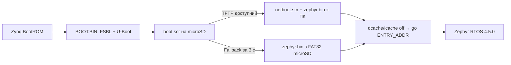

# Zephyr RTOS на FPGA-платі PYNQ-Z1

*Запуск Zephyr RTOS 4.5.0 на процесорній частині (PS) Zynq-7000 без встановлення Vivado: консоль UART0, out-of-tree порт плати, Ethernet, TFTP netboot і експериментальний 2-ядерний SMP. Робота з програмованою логікою FPGA (PL) — у подальших планах.*

Плати на базі **Xilinx (AMD) Zynq-7000** дуже популярні серед інженерів: такі SoC ставлять у свої рішення багато виробників — від Digilent (PYNQ-Z1, Zybo, Arty Z7) та Avnet (ZedBoard, MicroZed) до ALINX та інших. Причина проста: в одному чипі поєднано повноцінний двоядерний процесор **ARM Cortex-A9** (частина **PS** — *Processing System*) і матрицю програмованої логіки **FPGA** (частина **PL** — *Programmable Logic*).

У мене під рукою є **Digilent PYNQ-Z1** на чипі `XC7Z020`. Окрім двох ядер Cortex-A9 (650 МГц), 512 МБ DDR3 та гігабітного Ethernet, її FPGA-частина класу Artix-7 має близько 85 тисяч логічних комірок (53 200 LUT), ~4.9 Мбіт блочної пам’яті BRAM і 220 DSP-блоків. На самій платі виведені HDMI In/Out, аудіо, два роз’єми Pmod і колодка формату Arduino/chipKIT, підключені до програмованої логіки. Це дає змогу обробляти відео, високошвидкісні потоки з АЦП або генерувати апаратні сигнали (наприклад, для керування моторами дрона) прямо в логіці, не навантажуючи процесор.

Для embedded-програмістів із базовим досвідом STM32/ESP32 та Linux/Git такий перехід відкриває ширший простір для інженерної творчості без різкої зміни інструментів. Замість фіксованого набору периферії та кількох сотень кілобайтів ОЗП ви отримуєте 512 МБ DDR3, гігабітний Ethernet, два ядра з MMU (де можна на практиці розібратися з кешами, віртуальною пам’яттю, багатоядерним плануванням або запуском RTOS поруч із Linux) і матрицю FPGA, у якій за потреби можна «добудувати» власну периферію. І все це — на тому самому Zephyr RTOS із Devicetree, Kconfig і `west`. Повний покроковий рецепт налаштування хост-машини я виніс у [`README.md`](https://github.com/nick-fedchik/Zephyr-RTOS-PYNC-Z1/blob/main/README.md) та [`setup_and_build.sh`](https://github.com/nick-fedchik/Zephyr-RTOS-PYNC-Z1/blob/main/setup_and_build.sh), а тут зосереджуся на інженерних рішеннях і граблях, на які натрапив на живому залізі.

Зазвичай із PYNQ-Z1 працюють у Linux із Python/Jupyter, а для низькорівневої розробки ставлять AMD Vivado/Vitis на десятки гігабайтів. Я перевірив інший підхід: запустив **Zephyr RTOS 4.5.0** на процесорній частині PS без встановлення Vivado (синтез бітстрімів `.bit` для PL тут не розглядається — це окремий наступний етап). Далі — шлях від порожньої папки до консолі UART0, Ethernet, TFTP-завантаження, підтвердженого бага в upstream Zephyr і експериментального 2-ядерного SMP.

---

## 1. Чому Zynq-7000 не стартує як STM32, і де ламаються готові гайди

На мікроконтролері на кшталт STM32 прошивка виконується прямо з вбудованої Flash. У Zynq-7000 старт складніший: після подачі живлення внутрішній BootROM шукає на microSD файл `BOOT.BIN`, у якому запакований початковий завантажувач **FSBL** (*First Stage Boot Loader*) та U-Boot. Саме FSBL піднімає контролер зовнішньої пам’яті **DDR3 (512 МБ, 32-bit)**, тактові генератори PLL і мультиплексор виводів **MIO** (*Multiplexed I/O*). Лише після цього в DDR можна завантажувати `zephyr.bin`.

Чимало інструкцій у мережі радять зібрати `BOOT.BIN` самостійно з upstream U-Boot командою `make DEVICE_TREE="zynq-pynq-z1"` або взяти `ps7_init_gpl.c` із репозиторію `Xilinx/PYNQ` і покласти його в `board/xilinx/zynq/custom_hw_platform/`. На актуальних версіях обидва рецепти не спрацювали:

- в upstream U-Boot (`xilinx_zynq_virt_defconfig`) немає `zynq-pynq-z1`, а чужі конфіги (`zynq-zed` або `zynq-zybo`) мають іншу розводку DDR і виводять консоль на `UART1` (MIO 48/49) замість `UART0` (MIO 14/15);
- у репозиторії `Xilinx/PYNQ` лежать Vivado Tcl-скрипти дизайну, а не готовий `ps7_init_gpl.c`.

Тому я пішов найпростішим робочим шляхом: зробив бекап розділу microSD і використав офіційний `BOOT.BIN` з образу **PYNQ v3.1**. Він уже коректно ініціалізує DDR3, `UART0` на MIO 14/15 та гігабітний Ethernet `gem0` у режимі `rgmii-id`.



---

## 2. Перша збірка: на що звернути увагу при `west build`

Усі інструменти я ізолював всередині папки проєкту скриптом [`setup_and_build.sh`](https://github.com/nick-fedchik/Zephyr-RTOS-PYNC-Z1/blob/main/setup_and_build.sh) (`.venv/`, `.tools/`, `zephyr-ws/`), щоб не засмічувати систему. Під час розгортання **Zephyr 4.5.0** вилізли три нюанси:

1. **У маніфесті немає модуля `hal_xilinx`.** Код для Zynq-7000 лежить прямо в основному дереві Zephyr (`soc/xlnx/zynq7000/`). Крім того, `west config manifest.project-filter` приймає регулярний вираз, а не glob (`-*` падає з помилкою). Мінімальний робочий фільтр:
   ```sh
   west config manifest.project-filter -- "-.*,+cmsis,+picolibc"
   ```
2. **Потрібен Zephyr SDK 1.0.x.** У Zephyr 4.5.0 скрипт `FindZephyr-sdk.cmake` відхиляє SDK `0.17.0` і вимагає `1.0.x`. Я поставив мінімальний бандл `1.0.1` лише з тулчейном `arm-zephyr-eabi`. Звернув увагу, що в 1.0.1 змінився шлях до утиліт: замість `arm-zephyr-eabi/bin/` тепер `gnu/arm-zephyr-eabi/bin/`.
3. **`LOAD_ADDR` і `ENTRY_ADDR` — це різні адреси.** Сирий `zephyr.bin` не містить ELF-заголовків. Якщо завантажити його командою `fatload` на адресу точки входу, усі абсолютні посилання з’їдуть. Тож `fatload` (або `tftpboot`) має класти бінарник на базову адресу першого сегмента `LOAD`, а `go` — стрибати на `Entry point address`:

$$A_{\text{load}} = \texttt{0x00100000}, \quad A_{\text{entry}} = \texttt{0x00102BBC}, \quad \Delta = \texttt{0x2BBC}\text{ байт}$$

У скрипті обидві адреси автоматично дістаються з `zephyr.elf`:

```sh
LOAD_ADDR=$("$READELF" -lW build/zephyr/zephyr.elf | awk '$1 == "LOAD" {print $4; exit}')
ENTRY_ADDR=$("$READELF" -h build/zephyr/zephyr.elf | awk '/Entry point address:/ {print $4}')
```

Частота системного таймера Cortex-A9 Global Timer (GTC) на PYNQ-Z1 також відрізняється від ZedBoard: процесор працює на $650\text{ МГц}$, а GTC тактується половинною частотою (`CPU_3x2x`):

$$f_{\text{GTC}} = \frac{f_{\text{CPU}}}{2} = \frac{650\text{ МГц}}{2} = 325\text{ МГц}$$

---

## 3. Перший запуск: U-Boot відпрацьовує, а консоль мовчить

Спершу я збирав проєкт на базі готової плати `zedboard` (там той самий `XC7Z020`) з overlay, який перемикав консоль із `uart1` на `uart0` (`0xe0000000`, 100 МГц). Записав `zephyr.bin` і `boot.scr` на microSD, підключив micro-USB до порту `PROG UART`, відкрив `picocom -b 115200 /dev/ttyUSB1`, клацнув живлення `POWER` — і отримав:

```text
## Executing script at 03000000
=== Starting Zephyr RTOS on PYNQ-Z1 ===
32924 bytes read in 14 ms (2.2 MiB/s)
## Starting application at 0x00102BBC ...
```

І далі — тиша.

Без JTAG-дебагера в такій ситуації починаю зі статичної перевірки артефактів збірки. За досвідом роботи з іншими контролерами (наприклад, **AURIX TC499**), коли консоль «мовчить» одразу після передачі керування від завантажувача, проблема майже завжди в одному з трьох місць: порядок ініціалізації драйверів, тактування периферії (UART) або конфігурація виводів (pinmux/pinctrl).

Спершу я перевірив згенеровані `build/zephyr/.config` і `build/zephyr/zephyr.dts` — `CONFIG_UART_XLNX_PS=y`, `CONFIG_UART_CONSOLE=y`, `CONFIG_PINCTRL=y`, а вузол `uart0` (`0xe0000000`) увімкнений і вказаний у `chosen/zephyr,console`. Далі звірив порядок ініціалізації `PRE_KERNEL_1` у `build/zephyr/zephyr.map` (`intc_gic` → `syscon` → `uart_xlnx_ps` → `uart_console` — тут усе було на місці). Після цього відкрив код самого драйвера `drivers/serial/uart_xlnx_ps.c`, і причина стала очевидною: коли в конфігурації увімкнено `CONFIG_PINCTRL=y` (а для Zynq-7000 це за замовчуванням), `uart_xlnx_ps_init()` на самому старті викликає:

```c
err = pinctrl_apply_state(dev_cfg->pincfg, PINCTRL_STATE_DEFAULT);
if (err < 0) {
    return err;
}
```

У згенерованому `build/zephyr/zephyr.dts` (після накладання мого `boards/zedboard.overlay`) у вузла `uart0` не було властивості `pinctrl-0`. У Devicetree ця властивість вказує на блок налаштувань фізичних виводів чипа (альтернативна функція UART, стандарт I/O-буфера під апаратну напругу банку плати — `LVCMOS33` або `LVCMOS18`, підтяжка, швидкість фронту; аналог налаштування *Alternate Function* у STM32CubeMX), які драйвер застосовує перед запуском периферії. Я помилково розраховував, що MIO 14/15 уже налаштував U-Boot, тому `pinctrl_lookup_state()` повертала `-ENOENT`, і драйвер виходив ще до ввімкнення передавача.

Щойно я додав `pinctrl_uart0_default` (`groups = "uart0_1_grp"`, `MIO14`/`MIO15`, `IO_STANDARD_LVCMOS33` — відповідно до апаратної напруги Bank 0 = 3.3 В на PYNQ-Z1, на відміну від Bank 1 = 1.8 В), консоль одразу ожила:

```text
## Starting application at 0x00102BBC ...
*** Booting Zephyr OS build v4.5.0 ***
Hello from Zephyr on PYNQ-Z1
```

---

## 4. Out-of-tree порт `boards/digilent/pynq_z1/` замість `zedboard`

Щоб не залежати від конфігурації чужої плати та додаткового overlay-файла, я виніс опис PYNQ-Z1 в окремий out-of-tree HWMv2 board-порт у каталозі `boards/digilent/pynq_z1/`:

- `board.yml`, `Kconfig.pynq_z1`, `Kconfig.defconfig`, `pynq_z1_defconfig`, `pynq_z1.yaml`;
- `pynq_z1-pinctrl.dtsi` (`uart0_1_grp` на `MIO14/15`, `LVCMOS33`);
- `pynq_z1.dts` (`sram0` 511 МБ із `0x00100000` — у Devicetree Zephyr вузол `chosen/zephyr,sram` описує основну виконувану ОЗП незалежно від того, чи це внутрішня SRAM, чи зовнішня DDR3; `arch_timer` 325 МГц, `uart0` 100 МГц, `psgpio`, `gem0` + `gem0_mdio`).

Після цього збірка запускається прямо під `pynq_z1`:

```sh
west build -p always -b pynq_z1 . -d build -- -DBOARD_ROOT=.
```

---

## 5. Гігабітний Ethernet, DHCPv4 і тест через `zperf`

Лог U-Boot підказав дві важливі речі про мережу на PYNQ-Z1:

```text
ZYNQ GEM: e000b000, mdio bus e000b000, phyaddr 0, interface rgmii-id
Error: ethernet@e000b000 No valid MAC address found.
```

На платі немає EEPROM із зашитою MAC-адресою, тому без ручного налаштування адреса щоразу генерується випадково. У `pynq_z1.dts` я зафіксував власну локально-адміністровану MAC-адресу (`9e:5c:1a:8a:bf:53`), а в `prj.conf` увімкнув `CONFIG_NET_L2_ETHERNET=y`, `CONFIG_ETH_DRIVER=y`, `CONFIG_NET_DHCPV4=y`, `CONFIG_NET_HOSTNAME="pynq1"` та `CONFIG_NET_SHELL=y`.

Лінк на гігабіт піднявся одразу:

```text
[00:00:00.057,000] <inf> phy_mii: PHY (0) ID 1CC916
[00:00:02.764,000] <inf> phy_mii: PHY (0) Link speed 1000 Mb, full duplex
DHCPv4 lease acquired: IP=192.168.0.11 mask=255.255.255.0 gw=192.168.0.1
```

Мені стало цікаво перевірити реальну пропускну здатність цього каналу під Zephyr — надалі я планую поекспериментувати з пакетним стрімінгом сирими Ethernet-фреймами без IP-стеку, тож хотілося мати базову точку відліку. У самому Zephyr для цього вже є вбудована підсистема **`zperf`** (`CONFIG_NET_ZPERF=y`, `CONFIG_NET_ZPERF_SERVER=y`), яка сумісна зі стандартним Linux-клієнтом `iperf`.

Але при першій спробі `zperf tcp download 5001` консоль відповіла `Failed to start TCP server!`. Перевіривши `subsys/net/lib/sockets/sockets_service.c`, я знайшов причину: сервіс моніторингу сокетів рахує суму poll-дескрипторів усіх увімкнених сервісів (`zperf` UDP + `zperf` TCP + `mDNS` + `eventfd`). Загалом виходило понад 9, тому при `CONFIG_ZVFS_POLL_MAX=9` потік `socket_service` тихо завершувався ще при старті.

Після збільшення `CONFIG_ZVFS_POLL_MAX=16` (та `CONFIG_NET_MAX_CONTEXTS=10`) тест `iperf` із ноутбука (через Wi-Fi 6 → роутер → 2.5G-свіч → PYNQ-Z1) пройшов чисто:

```text
uart:~$ zperf tcp download 5001
TCP server started on port 5001
New TCP session started.
TCP session ended
 Duration:        10.05 s
 rate:            21.38 Mbps
```

Цей тест перевіряв стабільність мережевого стеку Zephyr через реальну домашню мережу з Wi-Fi-ділянкою (а не граничну пропускну здатність 1G-лінку по кабелю). Як орієнтовна оцінка порядку величини, для дефолтного TCP-вікна $W = 16\text{ КБ}$ і типової затримки $\text{RTT} \approx 6\text{ мс}$ формула Bandwidth-Delay Product дає близьке значення:

$$R_{\max} \approx \frac{W}{\text{RTT}} = \frac{16 \times 1024 \times 8\text{ біт}}{0.006\text{ с}} \approx 21.8\text{ Мбіт/с}$$

Щоб довести точне вузьке місце (вікно TCP, Wi-Fi чи буфери драйвера GEM), потрібен окремий кабельний тест зі збільшеним TCP-вікном і UDP-профілем `zperf`.

---

## 6. Як я перестав смикати microSD: двоступеневий TFTP netboot

Витягати microSD після кожної перекомпіляції — найшвидший спосіб розхитати слот. Оскільки в U-Boot на PYNQ-Z1 уже є робочий Ethernet, я поставив на ноутбук `atftpd` (каталог `/srv/tftp/pynq1/`) і розділив завантаження на два скрипти:

1. **`boot.scr` (записується на microSD один раз):** задає `ethaddr`, статичні `ipaddr`/`serverip`, короткий таймаут (3 с) і завантажує `pynq1/netboot.scr` на адресу `0x03100000` (щоб не затерти себе в `0x03000000`). Якщо TFTP-сервер вимкнений, скрипт автоматично відкочується на `zephyr.bin` із SD-карти.
2. **`netboot.scr` (оновлюється автоматично на кожному `./setup_and_build.sh`):** завжди містить актуальні `LOAD_ADDR` та `ENTRY_ADDR` свіжої збірки, завантажує `pynq1/zephyr.bin` по TFTP і запускає його.

Тепер весь цикл перевірки нової прошивки звівся до `./setup_and_build.sh` і натискання кнопки **`SRST`** на платі:

```text
=== PYNQ-Z1 Boot: trying TFTP (192.168.0.10) ===
TFTP from server 192.168.0.10; our IP address is 192.168.0.11
Filename 'pynq1/netboot.scr'.
Load address: 0x3100000
Bytes transferred = 210 (d2 hex)
## Executing script at 03100000
=== TFTP Netboot: Zephyr RTOS on PYNQ-Z1 ===
Filename 'pynq1/zephyr.bin'.
Load address: 0x100000
Loading: ####################
     960 KiB/s
Bytes transferred = 293104 (478f0 hex)
## Starting application at 0x0010FA8C ...
```

---

## 7. Друге ядро: баг у GICv1/v2 і експериментальний 2-ядерний SMP

У `soc/xlnx/zynq7000/xc7zxxx/Kconfig.defconfig` у Zephyr 4.5.0 прописано `CONFIG_MP_MAX_NUM_CPUS = 1` із коментарем, що SMP на AArch32 Zynq-7000 не підтримується. На Zynq-7000 немає PSCI: після старту друге ядро спить у циклі `WFE` (*Wait For Event*) у BootROM і чекає, поки CPU0 запише адресу входу в `0xFFFFFFF0` і подасть інструкцію `sev` (*Send Event*).

Щоб перевірити друге ядро окремо, я додав у прошивку невеликий ARM-трамплін (`src/cpu1_trampoline.S`) і shell-команди `cpu1 start` / `cpu1 stop` / `cpu1 status` / `cpu1 ping`. CPU0 записує адресу `cpu1_entry` у `0xFFFFFFF0` і дає `sev`, а CPU1 читає свій `MPIDR`, крутить лічильник `heartbeat` у спільній некешованій пам’яті `__nocache` (`0x00147000`), відповідає на `cpu1 ping <N>` апаратним перериванням **GIC SGI #7** і за командою `cpu1 stop` паркується в `WFE`:

```text
uart:~$ cpu1 start
Waking CPU1 -> entry=0x0010433c (shm=0x147000)...
0xFFFFFFF0 = 0x0010433c
cpu1_shm @ 0x147000: magic=0x43505531 mpidr=0x80000001 (core=1) heartbeat=1 state=RUNNING sgi_irqs=0
CPU1 is ALIVE (RUNNING)
uart:~$ cpu1 ping 42
CPU1 SGI#7 reply: 42^2 = 1764 (seq=1, sgi_irqs=1, rtt=16 us)
uart:~$ cpu1 stop
cpu1_shm @ 0x147000: magic=0x43505531 mpidr=0x80000001 (core=1) heartbeat=49 state=STOPPED sgi_irqs=1
CPU1 is PARKED (WFE)
uart:~$ cpu1 ping 123
CPU1 SGI#7 reply: 123^2 = 15129 (seq=2, sgi_irqs=2, rtt=7 us)
```

Під час цього експерименту та наступної спроби ввімкнути SMP я зіткнувся з двома проблемами у Zephyr 4.5.0 (`41d10b597304`):

1. **Підтверджений баг у релізі `4.5.0` — втрата між’ядерних SGI у GICv1/v2 (`arch/arm/core/cortex_a_r/isr_wrapper.S`).** Коли CPU1 шле переривання SGI #7 на CPU0, апаратний регістр `GICC_IAR` повертає номер ядра-відправника (`CPUID=1`) у бітах `[12:10]`, тобто `0x407` (`1031`). У `isr_wrapper.S` (в обох гілках — із `CONFIG_USE_SWITCH` і без нього) це значення без маскування порівнювалося з `CONFIG_NUM_IRQS` (`96`), і переривання тихо відкидалося як spurious — хоча в `arch/arm64/core/isr_wrapper.S:71-73` маска `bic x0, x0, #0x1c00` уже є. Одна інструкція `ubfx r0, r0, #0, #10` після `push {r0, r1}` (щоб зберегти повний `IAR` на стеку для `arm_gic_eoi`) одразу оживила SGI #7 із затримкою **7 мкс** із режиму `WFE`. Перевірка upstream показала, що цей самий баг уже зафіксовано в [issue #122600](https://github.com/zephyrproject-rtos/zephyr/issues/122600) і виправлено на гілці `main` після `4.5.0` у [PR #123040](https://github.com/zephyrproject-rtos/zephyr/pull/123040) (маскою `bic r0, r0, #0x1c00`), але для релізної збірки `4.5.0` локальний патч усе ще потрібен. Повний розбір із мінімальним відтворенням лежить у [`docs/zephyr-gic-v1-v2-sgi-bug.md`](https://github.com/nick-fedchik/Zephyr-RTOS-PYNC-Z1/blob/main/docs/zephyr-gic-v1-v2-sgi-bug.md) та `patches/0001-...patch`.
2. **Конфлікт конфігурації `CONFIG_USE_SWITCH=y` + `CONFIG_FPU_SHARING=y` (`thread.c:160` vs `exc.S:256`).** При ввімкненні `CONFIG_SMP=y` (який вимагає `CONFIG_USE_SWITCH=y`) функція `arch_new_thread()` кладе знизу стеку 232 байти нулів `struct __fpu_sf`, але `z_arm_cortex_ar_exit_exc` їх не знімає — і перший перехід у `main` стрибає на `pc=0x0`. Наразі я обійшов цей конфлікт вимкненням `CONFIG_FPU=n` (повноцінне виправлення FPU-фрейму для `CONFIG_USE_SWITCH` потребує окремої перевірки).

### Експериментальний прототип: 2-ядерний SMP на Zynq-7000

Після цих кроків я зібрав експериментальний прототип 2-ядерного SMP (`patches/0002-...patch` + `src/zynq7000_smp.c`). У `soc_reset_hook()` (виконується на обох ядрах до ввімкнення MMU) додав таку послідовність: інвалідація L1 I-cache, BTAC і L1 D-cache → інвалідація тегів і ввімкнення **SCU** (`0xF8F00000`) на первинному ядрі CPU0 → встановлення `ACTLR.SMP | ACTLR.FW` із бар’єрами `DSB`/`ISB` на кожному ядрі. Для запуску CPU1 реалізував `pm_cpu_on()` через запис точки входу в `0xFFFFFFF0` + `DSB` + `SEV`. Обидва ядра Cortex-A9 запрацювали під єдиним планувальником Zephyr:

```text
uart:~$ smp info
CONFIG_SMP=y, num_cpus=2, current_cpu=1, MPIDR=0x80000001, ACTLR=0x00000041
uart:~$ smp test
Worker[CPU0]: ran on cpu=0 MPIDR=0x80000000 ACTLR=0x00000047 time=4136 us
Worker[CPU1]: ran on cpu=1 MPIDR=0x80000001 ACTLR=0x00000041 time=11552 us
Total wall time (parallel): 11574 us
```

Загальний час `11574 us` практично дорівнює часу повільнішого воркера, тобто обидва потоки реально виконалися паралельно, а сама команда `smp info` при цьому виконалася вже на CPU1. *(Різниця між `4136 us` і `11552 us` пояснюється бітами prefetch у `ACTLR`: U-Boot залишив на CPU0 `0x47`, а на CPU1 виставлено `0x41`. Це поки експериментальний прототип без стрес-тестування тривалого навантаження та FPU, а не готова основа для продакшену.)*

---

## Висновки

- **Що перевірено на залізі:** запуск Zephyr RTOS 4.5.0 на PS-частині PYNQ-Z1 через `BOOT.BIN` із PYNQ v3.1, out-of-tree порт `boards/digilent/pynq_z1/`, консоль UART0 (`pinctrl`), лінк 1G Ethernet + DHCPv4 + `zperf`, двоступеневий TFTP netboot без смикання microSD, між’ядерне переривання GICv1 SGI #7 (7 мкс RTT) та експериментальний запуск 2-ядерного SMP.
- **Що потребує додаткової перевірки:** повноцінний кабельний тест пропускної здатності GEM (і сирих Ethernet-фреймів без IP), розбір сумісності `CONFIG_FPU_SHARING` із `CONFIG_USE_SWITCH` та перехід на наступний реліз Zephyr після `4.5.0`, де фікс [#123040](https://github.com/zephyrproject-rtos/zephyr/pull/123040) вже буде в ядрі.
- **Намір на наступні експерименти:** запустити асиметричний режим **AMP / OpenAMP**, де на CPU0 працює Linux (мережа, відео, Python), а на CPU1 буде працювати ізольований real-time Zephyr із обміном через `/dev/rpmsg0` і можливістю підключення програмованої логіки FPGA (PL).

---

## Скорочення

- **AMP** (*Asymmetric Multiprocessing*) — асиметрична багатопроцесорність, коли на різних ядрах одного чипа працюють різні ОС.
- **BDP** (*Bandwidth-Delay Product*) — добуток пропускної здатності каналу на затримку (RTT), що обмежує швидкість TCP при фіксованому розмірі вікна.
- **BRAM** (*Block RAM*) — вбудована блочна пам’ять усередині FPGA.
- **DDR3** — зовнішня динамічна оперативна пам’ять (на PYNQ-Z1 — 512 МБ, 32-бітна шина).
- **DSP** (*Digital Signal Processing*) — апаратні блоки множення-накопичення у FPGA.
- **DTS** (*Device Tree Source*) — текстовий опис апаратної конфігурації плати.
- **ELF** (*Executable and Linkable Format*) — формат виконуваного файлу з метаданими секцій і точкою входу.
- **FPGA** (*Field-Programmable Gate Array*) — програмована логічна інтегральна схема.
- **FSBL** (*First Stage Boot Loader*) — початковий завантажувач Zynq, що ініціалізує DDR, PLL і MIO.
- **GEM** (*Gigabit Ethernet MAC*) — контролер гігабітного Ethernet у Zynq-7000.
- **GIC** (*Generic Interrupt Controller*) — контролер переривань ARM (у Zynq-7000 — GICv1).
- **GTC** (*Global Timer Counter*) — глобальний 64-бітний таймер Cortex-A9 MPCore.
- **IPC / IPI** — міжпроцесорна комунікація / міжпроцесорне переривання (*Inter-Processor Interrupt*).
- **MIO** (*Multiplexed I/O*) — мультиплексовані виводи процесорної частини Zynq.
- **MMU** (*Memory Management Unit*) — блок керування віртуальною пам’яттю.
- **PL / PS** — програмована логіка (*Programmable Logic*) та процесорна система (*Processing System*) у Zynq.
- **RTOS** (*Real-Time Operating System*) — операційна система реального часу.
- **SCU** (*Snoop Control Unit*) — блок апаратної когерентності L1-кешів між ядрами Cortex-A9.
- **SDK** (*Software Development Kit*) — набір компіляторів та утиліт (тут — Zephyr SDK `1.0.1`).
- **SGI** (*Software Generated Interrupt*) — програмне між’ядерне переривання GIC (`INTID 0..15`).
- **SMP** (*Symmetric Multiprocessing*) — симетрична багатопроцесорність, коли одна ОС планує потоки на всіх ядрах.
- **SoC** (*System on Chip*) — система на кристалі.
- **TFTP** (*Trivial File Transfer Protocol*) — простий протокол передачі файлів по UDP, підтримуваний U-Boot.
- **UART** (*Universal Asynchronous Receiver-Transmitter*) — послідовний інтерфейс консолі.
- **WFE / SEV** (*Wait For Event / Send Event*) — інструкції ARM для низькоенергетичного очікування та пробудження ядра.

---

## Посилання

- Репозиторій проєкту (out-of-tree порт `boards/digilent/pynq_z1/`, `setup_and_build.sh`, патчі `patches/`, `ROADMAP.md`): [github.com/nick-fedchik/Zephyr-RTOS-PYNC-Z1](https://github.com/nick-fedchik/Zephyr-RTOS-PYNC-Z1)
- Детальне технічне мемо по знайденому багу GICv1/v2 SGI у Zephyr 4.5.0: [docs/zephyr-gic-v1-v2-sgi-bug.md](https://github.com/nick-fedchik/Zephyr-RTOS-PYNC-Z1/blob/main/docs/zephyr-gic-v1-v2-sgi-bug.md)
- Upstream Zephyr issue та фікс на `main`: [#122600](https://github.com/zephyrproject-rtos/zephyr/issues/122600), [PR #123040](https://github.com/zephyrproject-rtos/zephyr/pull/123040)
- Офіційні образи Digilent PYNQ-Z1: [pynq.io](https://www.pynq.io/)
- Zephyr RTOS: [github.com/zephyrproject-rtos/zephyr](https://github.com/zephyrproject-rtos/zephyr)
- Zephyr SDK (`sdk-ng`): [github.com/zephyrproject-rtos/sdk-ng](https://github.com/zephyrproject-rtos/sdk-ng)
