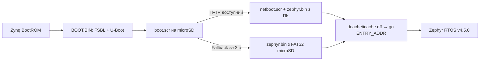

# Zephyr RTOS на Digilent PYNQ-Z1 без Vivado/Vitis: від порожньої карти до 1G Ethernet, TFTP netboot і 2-ядерного SMP (Частина 1)

Digilent PYNQ-Z1 зазвичай сприймають як плату для Python і Jupyter у Linux, до якої обов’язково додається AMD Vivado на десятки гігабайтів. Але під капотом у PYNQ-Z1 стоїть класичний двоядерний **ARM Cortex-A9 (Xilinx Zynq-7000 `XC7Z020`)** із 512 МБ DDR3 та гігабітним Ethernet. Якщо вам потрібна легка RTOS із передбачуваним часом реакції — наприклад, для майбутнього бортового контролера FPV-коптера чи робототехнічного стенда з єдиною кодовою базою для STM32, ESP32 та Zynq — Vivado на етапі запуску процесорної частини можна взагалі не ставити.

У цій статті пройдемо реальний шлях запуску **Zephyr RTOS v4.5.0** на PYNQ-Z1 у Linux — не за ідеальним мануалом, а з усіма «граблями», які довелося розбирати на живому залізі: від мовчазної консолі UART0 і падіння `zperf` до нативного порту плати, TFTP-завантаження без витягування microSD, двох знайдених багів в upstream Zephyr і запуску 2-ядерного SMP.

> **Чесна межа експерименту.** Zynq-7000 складається з процесорної частини **PS** (*Processing System*, два ядра Cortex-A9 і периферія) та програмованої логіки **PL** (*Programmable Logic*, матриця FPGA). Без Vivado ми не синтезуємо новий бітстрім (`.bit`) для PL — уся робота в цій частині відбувається на PS із повторним використанням перевіреного ініціалізатора пам’яті.

---

## 1. Чому Zynq-7000 не стартує як STM32, і де ламаються типові гайди

На мікроконтролері на кшталт STM32 код виконується прямо з вбудованої Flash-пам’яті. У Zynq-7000 усе інакше: після подачі живлення внутрішній BootROM завантажує з microSD файл `BOOT.BIN`, який містить початковий завантажувач **FSBL** (*First Stage Boot Loader*) та U-Boot. Саме FSBL має проініціалізувати контролер зовнішньої пам’яті **DDR3 (512 МБ, 32-bit)**, тактові генератори PLL та мультиплексор виводів **MIO** (*Multiplexed I/O*). Лише після цього в DDR можна завантажувати `zephyr.bin`.

Популярні інструкції радять зібрати `BOOT.BIN` самостійно з upstream U-Boot командою `make DEVICE_TREE="zynq-pynq-z1"` або скопіювати `ps7_init_gpl.c` із репозиторію `Xilinx/PYNQ` у `board/xilinx/zynq/custom_hw_platform/`. Обидва рецепти на актуальних деревах не працюють:

- в upstream U-Boot (`xilinx_zynq_virt_defconfig`) немає таргета `zynq-pynq-z1`, а чужий `zynq-zed` чи `zynq-zybo` має іншу топологію DDR і виводить консоль на `UART1` (MIO 48/49) замість `UART0` (MIO 14/15);
- у репозиторії `Xilinx/PYNQ` лежать Vivado Tcl-скрипти дизайну, а не готовий `ps7_init_gpl.c`.

Найнадійніший шлях без Vivado — **зробити бекап microSD і повторно використати офіційний `BOOT.BIN` з образу PYNQ v3.1**. Він уже містить перевірений FSBL + U-Boot саме під залізо PYNQ-Z1: піднімає DDR3, `UART0` на MIO 14/15 і гігабітний `gem0` у режимі `rgmii-id`.



---

## 2. Перша збірка: три дрібниці, які одразу ламають `west build`

Усі інструменти ми ізолювали всередині папки проєкту скриптом [`setup_and_build.sh`](https://github.com/nick-fedchik/ZephyrOS-PYNC-Z1/blob/main/setup_and_build.sh) (`.venv/`, `.tools/`, `zephyr-ws/`). Під час розгортання **Zephyr v4.5.0** виявилися три критичні деталі:

1. **Немає модуля `hal_xilinx` у маніфесті.** Підтримка Zynq-7000 живе прямо в ядрі Zephyr (`soc/xlnx/zynq7000/`). Також `west config manifest.project-filter` очікує регулярний вираз, а не glob — робочий мінімальний фільтр виглядає так:
   ```sh
   west config manifest.project-filter -- "-.*,+cmsis,+picolibc"
   ```
2. **Версія Zephyr SDK.** Zephyr v4.5.0 через `FindZephyr-sdk.cmake` вимагає **Zephyr SDK 1.0.x** (ми використали мінімальний бандл `1.0.1` лише з тулчейном `arm-zephyr-eabi`). Старіший `0.17.0` CMake відхиляє. Крім того, у SDK 1.0.1 змінився шлях до утиліт: тепер це `gnu/arm-zephyr-eabi/bin/`.
3. **Розділення `LOAD_ADDR` та `ENTRY_ADDR`.** Сирий `zephyr.bin` не має ELF-заголовків. Якщо завантажити його командою `fatload` на адресу точки входу, усі абсолютні посилання з’їдуть. Тому `fatload` (або `tftpboot`) має класти бінарник на початок першого сегмента `LOAD`, а `go` — стрибати на `Entry point address` з `readelf`:

$$\text{LOAD\_ADDR} = \texttt{0x00100000}, \quad \text{ENTRY\_ADDR} = \texttt{0x00102BBC}, \quad \Delta = \texttt{0x2BBC}\text{ байт}$$

У скрипті це витягується автоматично з `zephyr.elf`:

```sh
LOAD_ADDR=$("$READELF" -lW build/zephyr/zephyr.elf | awk '$1 == "LOAD" {print $4; exit}')
ENTRY_ADDR=$("$READELF" -h build/zephyr/zephyr.elf | awk '/Entry point address:/ {print $4}')
```

Ще один важливий параметр — частота системного таймера Cortex-A9 Global Timer (GTC). На PYNQ-Z1 процесор працює на $650\text{ МГц}$, а GTC тактується половинною частотою (`CPU_3x2x`):

$$f_{\text{GTC}} = \frac{f_{\text{CPU}}}{2} = \frac{650\text{ МГц}}{2} = 325\text{ МГц}$$

---

## 3. Момент істини: U-Boot стартує, а консоль мовчить

Перша збірка базувалася на `zedboard` з overlay, який перемикав консоль на `uart0` (`0xe0000000`, 100 МГц). Ми записали `zephyr.bin` і `boot.scr` на microSD, підключили USB до порту `PROG UART`, відкрили `picocom -b 115200 /dev/ttyUSB1`, перевели вимикач `POWER` у `ON` і побачили:

```text
## Executing script at 03000000
=== Starting Zephyr RTOS on PYNQ-Z1 ===
32924 bytes read in 14 ms (2.2 MiB/s)
## Starting application at 0x00102BBC ...
```

І далі — повна тиша.

Причина знайшлася у вихідному коді драйвера `drivers/serial/uart_xlnx_ps.c`. Коли в конфігурації увімкнено `CONFIG_PINCTRL=y` (а на Zynq-7000 він увімкнений), `uart_xlnx_ps_init()` на початку викликає:

```c
err = pinctrl_apply_state(dev_cfg->pincfg, PINCTRL_STATE_DEFAULT);
if (err < 0) {
    return err;
}
```

Ми розраховували, що піни MIO 14/15 вже налаштовані U-Boot, і не додали `pinctrl-0` до `&uart0`. Через це драйвер повертав `-ENOENT` ще до ввімкнення передавача.

Щойно ми описали `pinctrl_uart0_default` (`groups = "uart0_1_grp"`, `MIO14`/`MIO15`, `IO_STANDARD_LVCMOS33` — бо Bank 0 на PYNQ-Z1 живиться від 3.3V, на відміну від 1.8V у Bank 1), плата ожила:

```text
## Starting application at 0x00102BBC ...
*** Booting Zephyr OS build v4.5.0 ***
Hello from Zephyr on PYNQ-Z1
```

---

## 4. Від костиля з `zedboard` до нативного порту `boards/digilent/pynq_z1/`

Щоб не плутатися з назвою чужої плати та overlay-файлами, наступним кроком ми оформили повноцінний out-of-tree HWMv2 board-порт у `boards/digilent/pynq_z1/`:

- `board.yml`, `Kconfig.pynq_z1`, `Kconfig.defconfig`, `pynq_z1_defconfig`, `pynq_z1.yaml`;
- `pynq_z1-pinctrl.dtsi` (`uart0_1_grp` на `MIO14/15`, 3.3V);
- `pynq_z1.dts` (`sram0` 511 МБ із `0x00100000`, `arch_timer` 325 МГц, `uart0` 100 МГц, `psgpio`, `gem0` + `gem0_mdio`).

Тепер збірка запускається нативно без жодних overlay:

```sh
west build -p always -b pynq_z1 . -d build -- -DBOARD_ROOT=.
```

---

## 5. Вихід у мережу: 1G Ethernet, DHCPv4, `zperf` і прихована пастка `ZVFS_POLL_MAX`

Лог U-Boot підказав одразу дві важливі речі про Ethernet на PYNQ-Z1:

```text
ZYNQ GEM: e000b000, mdio bus e000b000, phyaddr 0, interface rgmii-id
Error: ethernet@e000b000 No valid MAC address found.
```

На платі немає EEPROM із заводською MAC-адресою, тому в `pynq_z1.dts` ми зафіксували локально-адміністрований MAC (`9e:5c:1a:8a:bf:53`), а в `prj.conf` увімкнули `CONFIG_NET_L2_ETHERNET=y`, `CONFIG_ETH_DRIVER=y`, `CONFIG_NET_DHCPV4=y`, `CONFIG_NET_HOSTNAME="pynq1"`, `CONFIG_MDNS_RESPONDER=y` та `CONFIG_NET_ZPERF_SERVER=y`.

На залізі гігабітний лінк піднявся одразу:

```text
[00:00:00.057,000] <inf> phy_mii: PHY (0) ID 1CC916
[00:00:02.764,000] <inf> phy_mii: PHY (0) Link speed 1000 Mb, full duplex
DHCPv4 lease acquired: IP=192.168.68.81 mask=255.255.252.0 gw=192.168.68.1
```

Але при спробі запустити бенчмарк `zperf tcp download 5001` консоль відповіла `Failed to start TCP server!`. Розбір `subsys/net/lib/sockets/sockets_service.c` показав елегантну причину: сервіс моніторингу сокетів рахує сумарну кількість poll-дескрипторів усіх зареєстрованих сервісів (`zperf` UDP + `zperf` TCP + `mDNS` + `eventfd`). У нас вийшло більше 9, тому при `CONFIG_ZVFS_POLL_MAX=9` потік `socket_service` тихо завершувався ще на старті.

Після підняття `CONFIG_ZVFS_POLL_MAX=16` (та `CONFIG_NET_MAX_CONTEXTS=10`) тест `iperf` із ноутбука на Wi-Fi 6 до плати на 1G LAN пройшов без втрат:

```text
uart:~$ zperf tcp download 5001
TCP server started on port 5001
New TCP session started.
TCP session ended
 Duration:        10.05 s
 rate:            21.38 Mbps
```

Цифра 21.4 Mbps добре узгоджується з обмеженням Bandwidth-Delay Product для дефолтного TCP-вікна $W = 16\text{ КБ}$ при затримці через Wi-Fi 6 ($\text{RTT} \approx 6\text{ мс}$):

$$R_{\max} \approx \frac{W}{\text{RTT}} = \frac{16 \times 1024 \times 8\text{ біт}}{0.006\text{ с}} \approx 21.8\text{ Мбіт/с}$$

---

## 6. Як перестати смикати microSD: двоступеневий TFTP netboot

Постійно виймати microSD після кожної перекомпіляції — найшвидший спосіб зламати слот. Оскільки U-Boot на PYNQ-Z1 вже має 1G Ethernet, ми налаштували `atftpd` на ПК (`/srv/tftp/pynq1/`) і розділили завантаження на два скрипти:

1. **`boot.scr` (записується на microSD один раз):** задає `ethaddr`, статичні `ipaddr`/`serverip`, короткий таймаут (3 с) і тягне `pynq1/netboot.scr` на адресу `0x03100000` (щоб не затерти себе в `0x03000000`). Якщо ПК вимкнений — автоматично вантажить `zephyr.bin` із SD.
2. **`netboot.scr` (оновлюється автоматично на кожному `./setup_and_build.sh`):** завжди містить актуальні `LOAD_ADDR` та `ENTRY_ADDR` свіжої збірки, завантажує `pynq1/zephyr.bin` по TFTP і запускає його.

Цикл розробки скоротився до двох дій: `./setup_and_build.sh` → кнопка **`SRST`** на платі. Реальний лог мережевого старту на залізі:

```text
=== PYNQ-Z1 Boot: trying TFTP (192.168.68.57) ===
TFTP from server 192.168.68.57; our IP address is 192.168.68.81
Filename 'pynq1/netboot.scr'.
Load address: 0x3100000
Bytes transferred = 210 (d2 hex)
## Executing script at 03100000
=== TFTP Netboot: Zephyr RTOS on PYNQ-Z1 ===
Filename 'pynq1/zephyr.bin'.
Load address: 0x100000
Loading: ####################
     960 KiB/s
Bytes transferred = 293104 (478f0 hex)
## Starting application at 0x0010FA8C ...
```

---

## 7. Друге ядро: два баги в Zephyr v4.5.0, 2-ядерний SMP і місток до AMP

У `soc/xlnx/zynq7000/xc7zxxx/Kconfig.defconfig` у Zephyr v4.5.0 досі стоїть `CONFIG_MP_MAX_NUM_CPUS = 1` із коментарем, що SMP на AArch32 Zynq-7000 ще не підтримується. Причина проста: на Zynq-7000 немає PSCI, і друге ядро після старту чекає у WFE-циклі BootROM на запис адреси входу в `0xFFFFFFF0` та інструкцію `sev`.

Для першої перевірки другого ядра ми додали в прошивку мінімальний ARM-трамплін (`src/cpu1_trampoline.S`) та shell-команди `cpu1 start` / `cpu1 stop` / `cpu1 status` / `cpu1 ping`: CPU0 записує адресу `cpu1_entry` у `0xFFFFFFF0` (верхня область `ocm_high`, уже відображена як Strongly-Ordered), дає `dsb` + `sev`, а CPU1 читає `MPIDR`, крутить лічильник `heartbeat` у спільній некешованій пам’яті `__nocache` (`0x00147000`) і за командою `cpu1 stop` паркується в `WFE` до наступного `sev`. На живому PYNQ-Z1 усе запрацювало з першого разу:

```text
uart:~$ cpu1 start
Waking CPU1 -> entry=0x0010433c (shm=0x147000)...
0xFFFFFFF0 = 0x0010433c
cpu1_shm @ 0x147000: magic=0x43505531 mpidr=0x80000001 (core=1) heartbeat=1 state=RUNNING sgi_irqs=0
CPU1 is ALIVE (RUNNING)
uart:~$ cpu1 ping 42
CPU1 SGI#7 reply: 42^2 = 1764 (seq=1, sgi_irqs=1, rtt=16 us)
uart:~$ cpu1 stop
cpu1_shm @ 0x147000: magic=0x43505531 mpidr=0x80000001 (core=1) heartbeat=49 state=STOPPED sgi_irqs=1
CPU1 is PARKED (WFE)
uart:~$ cpu1 ping 123
CPU1 SGI#7 reply: 123^2 = 15129 (seq=2, sgi_irqs=2, rtt=7 us)
```

Дорогою ми несподівано знайшли **два реальні баги в upstream Zephyr v4.5.0**:

1. **GICv1/v2 SGI drop (`arch/arm/core/cortex_a_r/isr_wrapper.S`):** коли CPU1 шле переривання SGI #7 на CPU0, апаратний `GICC_IAR` повертає `CPUID=1` у бітах `[12:10]` (`0x407` = `1031`), а `isr_wrapper.S` порівнював `1031 >= CONFIG_NUM_IRQS (96)` без маскування 10-бітного `INTID` і тихо відкидав між’ядерне переривання як spurious (тоді як в `arch/arm64/core/isr_wrapper.S:71-73` маска `bic x0, x0, #0x1c00` вже є). Патч на 1 інструкцію (`ubfx r0, r0, #0, #10` після `push {r0, r1}`, щоб зберегти повний `IAR` на стеку для `arm_gic_eoi`) одразу оживив апаратний SGI #7 із затримкою **7 мкс** (пробудження CPU1 з `WFE` → обчислення $123^2 = 15129$ → апаратний GIC SGI #7 → ISR + семафор у Zephyr). Детальне мемо винесено в `docs/zephyr-gic-v1-v2-sgi-bug.md`.
2. **Конфлікт `CONFIG_USE_SWITCH=y` + `CONFIG_FPU_SHARING=y` (`thread.c:160` vs `exc.S:256`):** при ввімкненні `CONFIG_SMP=y` (який вимагає `CONFIG_USE_SWITCH=y`) функція `arch_new_thread()` додає знизу стеку 232 байти нулів `struct __fpu_sf`, але `z_arm_cortex_ar_exit_exc` їх не знімає — і перший перехід у `main` стрибає на `pc=0x0`. Вимкнення `CONFIG_FPU=n` розблокувало старт.

### Бонус: 2-ядерний SMP Zephyr на Zynq-7000

Маючи робочий фікс SGI в обох гілках `isr_wrapper.S` і перевірений старт через `0xFFFFFFF0 + sev`, ми довели експеримент до повноцінного **2-ядерного SMP (`CONFIG_SMP=y`, `CONFIG_MP_MAX_NUM_CPUS=2`)**: у `soc_reset_hook()` увімкнули **Cortex-A9 SCU** (`0xF8F00000`) та `ACTLR.SMP | ACTLR.FW` після інвалідації L1-кешів, а в `src/zynq7000_smp.c` реалізували `pm_cpu_on()`. Обидва ядра Cortex-A9 одночасно планують і виконують потоки Zephyr:

```text
uart:~$ smp info
CONFIG_SMP=y, num_cpus=2, current_cpu=1, MPIDR=0x80000001, ACTLR=0x00000041
uart:~$ smp test
Worker[CPU0]: ran on cpu=0 MPIDR=0x80000000 ACTLR=0x00000047 time=4136 us
Worker[CPU1]: ran on cpu=1 MPIDR=0x80000001 ACTLR=0x00000041 time=11552 us
Total wall time (parallel): 11574 us
```

*(Загальний час `11574 us` практично дорівнює часу повільнішого воркера — потоки реально виконуються паралельно на обох ядрах, а сама консоль `smp info` при цьому виконалася на CPU1. Різниця у часі між CPU0 і CPU1 пояснюється бітами `ACTLR` prefetch `0x47` vs `0x41`, які U-Boot залишив увімкненими на CPU0.)*

### Що далі (Частина 2): AMP / OpenAMP — Linux на CPU0 + Zephyr на CPU1

2-ядерний SMP дає просту модель програмування, але глобальні `spinlock`-и ядра та когерентність кешів погіршують жорсткий real-time, а ще ви втрачаєте екосистему Linux. Для задач на кшталт бортового контролера **FPV-коптера** значно цікавіший **AMP (*Asymmetric Multiprocessing*)**: на **CPU0** працює PYNQ Linux (мережа, відео, телеметрія, Python), а на **CPU1** — ізольований **Zephyr RTOS** із жорстким контуром стабілізації, що спілкується з Linux через **OpenAMP / RPMsg**.

Як ми запустили **Linux 6.6.10 (CPU0) + Zephyr v4.5.0 (CPU1)** без перезбірки Linux і підняли двосторонній канал `/dev/rpmsg0` із затримкою ~140 мкс — розберемо в **Частині 2**.

---

## Висновки та код

Запустити сучасний Zephyr RTOS v4.5.0 на PYNQ-Z1 без Vivado реально за один день — і не просто як `Hello World`, а з нативним board-портом, 1G Ethernet, TFTP netboot без смикання microSD, 2-ядерним SMP і двома знайденими багами в upstream Zephyr.

Весь код, нативний порт `boards/digilent/pynq_z1/`, відтворювані патчі (`patches/`), технічне мемо по GICv1/v2 багу (`docs/zephyr-gic-v1-v2-sgi-bug.md`), скрипт автоматичної збірки з TFTP netboot і `ROADMAP.md` викладено у репозиторії:
- [github.com/nick-fedchik/ZephyrOS-PYNC-Z1](https://github.com/nick-fedchik/ZephyrOS-PYNC-Z1)
