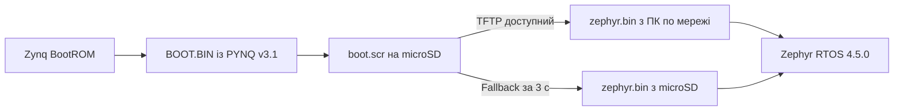

# Zephyr RTOS на FPGA-платі PYNQ-Z1 без Vivado

*Як я запустив Zephyr RTOS 4.5.0 на двоядерній FPGA-платі Digilent PYNQ-Z1 без встановлення важкого AMD Vivado, підняв гігабітний Ethernet із мережевим завантаженням, знайшов реальний баг у ядрі Zephyr і запустив обидва ядра Cortex-A9.*

Плати на базі **Xilinx (AMD) Zynq-7000** — знахідка для інженера, який виріс зі STM32 чи ESP32: в одному чипі поєднано двоядерний **ARM Cortex-A9** (650 МГц, 512 МБ DDR3, гігабітний Ethernet) і матрицю програмованої логіки **FPGA Artix-7** (~85 тис. логічних комірок). На моїй **Digilent PYNQ-Z1** (`XC7Z020`) зазвичай крутять Linux із Jupyter, а для низькорівневої розробки ставлять **AMD Vivado/Vitis** на десятки гігабайтів.

Я поставив просте завдання: чи реально запустити сучасну **Zephyr RTOS 4.5.0** на процесорній частині Zynq-7000 взагалі без Vivado — із нормальною консоллю, мережею, зручним циклом розробки й двома активними ядрами? Нижче — п’ять коротких експериментів, кожен із яких дав несподіваний результат. *(Повна технічна версія з усіма конфігами, патчами й командами лежить на GitHub — посилання наприкінці.)*

---

## 1. Старт без Vivado: як обійти FSBL і не зламати плату

**Завдання.** На відміну від STM32, Zynq-7000 не стартує напряму з Flash. Внутрішній BootROM шукає на microSD файл `BOOT.BIN` із початковим завантажувачем FSBL (який піднімає DDR3, тактування і піни) та U-Boot. Популярні гайди радять зібрати `BOOT.BIN` самотужки з upstream U-Boot — але в актуальному U-Boot немає конфіга під PYNQ-Z1, а в репозиторії `Xilinx/PYNQ` лежать Vivado-скрипти, а не готовий C-код ініціалізації.

**Експеримент.** Замість годин боротьби з генерацією FSBL я зробив бекап стокової microSD і перевикористав готовий офіційний `BOOT.BIN` з образу **PYNQ v3.1** — він уже бездоганно піднімає DDR3, UART0 і гігабітний Ethernet. Усе оточення Zephyr 4.5.0 (`west`, Zephyr SDK `1.0.1`) ізолював у папці проєкту одним скриптом `setup_and_build.sh`.



**Результат.** Порожній проєкт зібрався за хвилину без жодного мегабайта Vivado. Єдиний важливий нюанс на старті: у сирого `zephyr.bin` адреса завантаження в пам’ять (`0x00100000`) і точка входу (`0x00102BBC`) не збігаються, тому скрипт автоматично витягує обидві адреси з ELF-файла.

---

## 2. Перший запуск: U-Boot працює, а консоль мовчить

**Проблема.** U-Boot успішно завантажив прошивку, вивів `Starting application at 0x00102BBC ...` — і на цьому настала повна тиша.

**Експеримент.** Без JTAG-дебагера я перевірив згенерований Devicetree і код драйвера `uart_xlnx_ps.c`. Виявилося, що коли в Zephyr увімкнений `CONFIG_PINCTRL=y`, драйвер UART на самому старті шукає у Devicetree опис фізичних пінів (`pinctrl-0`). Я помилково розраховував, що піни MIO 14/15 уже налаштував U-Boot, тому драйвер тихо повертав `-ENOENT` ще до ввімкнення передавача.

**Результат.** Щойно я додав `pinctrl` для `UART0` (3.3 В, Bank 0) і оформив окремий out-of-tree порт плати `boards/digilent/pynq_z1/` (замість костилів поверх чужого `zedboard`), консоль миттєво ожила:

```text
*** Booting Zephyr OS build v4.5.0 ***
Hello from Zephyr on PYNQ-Z1
```

---

## 3. Гігабітний Ethernet і кінець смиканню microSD

**Завдання.** Підняти в Zephyr гігабітний Ethernet, перевірити його під навантаженням і позбутися постійного переставляння microSD після кожної перекомпіляції.

**Експеримент.** У PYNQ-Z1 немає EEPROM із MAC-адресою, тому я зафіксував локально-адміністровану адресу в Devicetree й увімкнув DHCPv4 та вбудований бенчмарк `zperf` (сумісний з `iperf`). Під час першого запуску `zperf` впав із помилкою — виявилося, що сумарна кількість poll-дескрипторів для TCP/UDP + mDNS перевищила дефолтний ліміт `9` (`CONFIG_ZVFS_POLL_MAX`). Після підняття ліміту до `16` тест пішов. А для зручної розробки я налаштував двоступеневий **TFTP netboot**: на microSD один раз записується `boot.scr`, який при старті підтягує свіжий `netboot.scr` і `zephyr.bin` прямо з ПК (із відкатом на SD, якщо ПК вимкнений).

**Результат.**
- Лінк піднявся на **1000 Mb full duplex**, DHCPv4 отримав адресу, а тест `zperf` через домашній Wi-Fi 6 показав стабільні **21.38 Mbps** (що впирається в дефолтне 16 КБ TCP-вікно та Wi-Fi RTT).
- Цикл «зміна коду → запуск на залізі» скоротився до однієї команди `./setup_and_build.sh` і натискання кнопки **SRST**: `zephyr.bin` прилітає по мережі зі швидкістю **960 KiB/s**.

---

## 4. Друге ядро: несподіваний баг у релізному Zephyr 4.5.0

**Завдання.** У Zephyr 4.5.0 для Zynq-7000 прямо прописано обмеження `1 CPU` — друге ядро Cortex-A9 просто спить у циклі `WFE`. Мені стало цікаво розбудити CPU1 вручну й обмінятися з ним перериванням GICv1 (SGI #7).

**Експеримент.** CPU1 прокинувся після запису адреси трампліна в `0xFFFFFFF0` і команди `sev`, порахував квадрат числа й відправив на CPU0 переривання SGI #7 — але CPU0 його вперто «не бачив». Коли я подивився в асемблерний обробник переривань `arch/arm/core/cortex_a_r/isr_wrapper.S`, причина виявилася разючою: апаратний регістр `GICC_IAR` у GICv1/v2 кодує номер ядра-відправника (`CPUID=1`) у бітах `[12:10]`, тож замість `7` повертається `0x407` (`1031`). А код Zephyr 4.5.0 порівнював це число з `CONFIG_NUM_IRQS` (`96`) **без маскування** — і тихо викидав будь-яке між’ядерне переривання як хибне!

**Результат.** Одна асемблерна інструкція (`ubfx r0, r0, #0, #10`) миттєво оживила між’ядерні SGI:

```text
uart:~$ cpu1 ping 123
CPU1 SGI#7 reply: 123^2 = 15129 (seq=2, sgi_irqs=2, rtt=7 us)
```

Перевірка репозиторію Zephyr показала, що це справжній upstream-баг релізу `4.5.0` ([issue #122600](https://github.com/zephyrproject-rtos/zephyr/issues/122600)), який виправили на `main` уже після релізу ([PR #123040](https://github.com/zephyrproject-rtos/zephyr/pull/123040)).

---

## 5. Експериментальний 2-ядерний SMP на Zynq-7000

**Завдання.** Раз друге ядро вже прокидається і шле IPI за 7 мкс, спробувати віддати обидва ядра Cortex-A9 єдиному планувальнику Zephyr (`CONFIG_SMP=y`).

**Експеримент.** Довелося додати ініціалізацію блоку когерентності кешів **SCU** (`ACTLR.SMP | ACTLR.FW`) до ввімкнення MMU, реалізувати `pm_cpu_on()` і тимчасово вимкнути FPU (у `4.5.0` виявився конфлікт стекового фрейму `CONFIG_USE_SWITCH` із `CONFIG_FPU_SHARING`).

**Результат.** Обидва ядра Cortex-A9 реально запрацювали паралельно під одним планувальником Zephyr:

```text
uart:~$ smp info
CONFIG_SMP=y, num_cpus=2, current_cpu=1, MPIDR=0x80000001
uart:~$ smp test
Worker[CPU0]: ran on cpu=0 time=4136 us
Worker[CPU1]: ran on cpu=1 time=11552 us
Total wall time (parallel): 11574 us
```

Загальний час (`11574 мкс`) практично дорівнює часу повільнішого потоку — задачі справді виконались одночасно на двох ядрах.

---

## Висновки

- Запустити **Zephyr RTOS 4.5.0** на Zynq-7000 без Vivado цілком реально: офіційний `BOOT.BIN` + out-of-tree порт плати + TFTP netboot дають швидкий і зручний цикл розробки.
- Навіть у зрілій RTOS трапляються цікаві низькорівневі баги: одна пропущена бітова маска в `isr_wrapper.S` робила неможливими між’ядерні SGI на GICv1/v2, а її фікс дав **7 мкс** між ядрами й відкрив дорогу до 2-ядерного SMP.
- Наступний крок — ще цікавіший: у [другій частині](DOU-Zephyr-RTOS-on-PYNQ-Z1-AMP-OpenAMP-Part2-UA.md) я розділю цей самий чип між **Linux (CPU0)**, **Zephyr RTOS (CPU1)** і **FPGA (PL)** та виміряю, наскільки жорсткий real-time на окремому ядрі перемагає навіть `PREEMPT_RT`.

---

## Скорочення

- **DDR3** — зовнішня динамічна оперативна пам’ять (512 МБ на PYNQ-Z1).
- **FPGA** (*Field-Programmable Gate Array*) — матриця програмованої логіки.
- **FSBL** (*First Stage Boot Loader*) — початковий завантажувач Zynq.
- **GIC / SGI** — контролер переривань ARM та програмне між’ядерне переривання.
- **MMU** — блок керування віртуальною пам’яттю.
- **RTOS** (*Real-Time Operating System*) — операційна система реального часу.
- **SCU** (*Snoop Control Unit*) — блок когерентності L1-кешів між ядрами Cortex-A9.
- **SMP** (*Symmetric Multiprocessing*) — режим, коли одна ОС планує потоки на обох ядрах.
- **TFTP** — простий мережевий протокол завантаження прошивок в U-Boot.

---

## Посилання

- **Повна технічна версія статті на GitHub** (усі конфіги, адреси, формули, `pinctrl` і деталі патчів): [articles/Zephyr-RTOS-on-PYNQ-Z1-UA.md](https://github.com/nick-fedchik/Zephyr-RTOS-PYNC-Z1/blob/main/articles/Zephyr-RTOS-on-PYNQ-Z1-UA.md)
- Репозиторій проєкту (`boards/digilent/pynq_z1/`, `setup_and_build.sh`, `patches/`): [github.com/nick-fedchik/Zephyr-RTOS-PYNC-Z1](https://github.com/nick-fedchik/Zephyr-RTOS-PYNC-Z1)
- Upstream-баг GICv1/v2 SGI у Zephyr: [#122600](https://github.com/zephyrproject-rtos/zephyr/issues/122600), [PR #123040](https://github.com/zephyrproject-rtos/zephyr/pull/123040)
- Частина 2: [Linux і Zephyr на одному кристалі Zynq-7000](DOU-Zephyr-RTOS-on-PYNQ-Z1-AMP-OpenAMP-Part2-UA.md)
