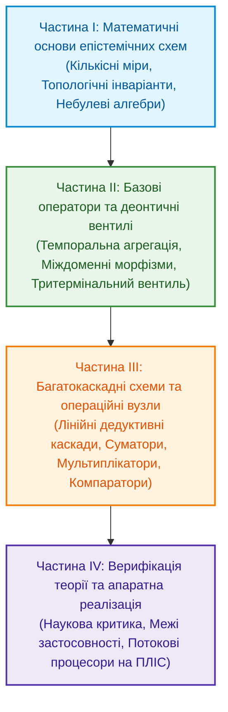

# Теорія епістемічних обчислювальних схем: Математичні інваріанти кастодії, метрології та детермінованого виведення

**Монографія з математичних основ, тензорних алгебр та потокових архітектур верифікованих обчислень**

**Автор:** [Микола Мартинович Федчик (Mykola Fedchyk)](../ExpertSystem/about-the-author.md)  
**Формат:** Науково-інженерна монографія  
**Рік видання:** 2026

---

## 1. Предмет і метод дослідження

Ця монографія викладає математичний апарат та принципи побудови **Теорії епістемічних обчислювальних схем** (англ. *Epistemic Computational Circuit Theory*, скорочено — **ТЕОС**) — дисципліни на перетині теорії булевих і алгебраїчних обчислювальних схем, формальної епістемології, інтервальної метрології та потокових процесорних архітектур (Dataflow Architectures).

Історично цифрова обчислювальна техніка сформувалася завдяки редукції релейно-контактних та логічних мереж до двозначної булевої алгебри (Дж. Буль, 1854; К. Шеннон, 1938). У межах класичних булевих схем (*Boolean Circuits*) та арифметичних схем (*Arithmetic Circuits* за Л. Валіантом, 1979) елементарний носій даних у регістрі процесора є семантично анонімним: обчислювальний вентиль не зберігає інформації про те, чи походить число з верифікованого нормативного акта, чи є воно результатом стохастичної апроксимації генеративної моделі або наслідком апаратного збою пам'яті.

**Теорія епістемічних обчислювальних схем** усуває цю структурну неповноту на рівні елементарних типів даних і базових операторів обчислювального графа:
1. **Чотирикомпонентний тензор стану:** замість скалярного біта або ізольованого числа з плаваючою комою по ребрах обчислювальної схеми передається **Епістемічний Тензор Стану** $`\Psi = \langle \mathcal{C}, w + u\varepsilon, \boldsymbol{\beta}, \vec{d}_{\mathrm{SI}} \rangle`$, який нерозривно поєднує криптографічний дескриптор побайтової кастодії першоджерела $`\mathcal{C}`$, дуальне число нормованої достовірності (або фізичної величини) зі стандартною невизначеністю за JCGM GUM $`w + u\varepsilon`$, двокомпонентний вектор бірешітки Белнапа $`\boldsymbol{\beta} = (\mu^+, \mu^-)`$ та семивимірний цілочисельний вектор розмірності фізичної величини SI $`\vec{d}_{\mathrm{SI}} \in \mathbb{Z}^7`$.
2. **Дуальність інтенсивної достовірності та екстенсивного потоку транзакцій:** відповідно до формалізму узагальнених потокових мереж, нормована вагова достовірність $`w \in [0, 1]`$ виступає інтенсивною змінною (яка при буферизованому розгалуженні копіюється на $M$ паралельних правил без ослаблення), тоді як інтенсивність верифікаційних транзакцій $`\Phi \ge 0`$ виступає екстенсивним потоком, підпорядкованим консервативному вузловому балансу.
3. **Потоковий синтез і просторово-часова амортизація складності:** нормативні правила, підсікачі за Дж. Поллоком (ASPIC+) та метрологічні допуски за ISO 14253-1 синтезуються у вигляді тритермінальних деонтичних вентилів, параконсистентних арбітрів та тристабільних інтервальних компараторів. Для стратифікованих баз знань з обмеженою деревною шириною це дозволяє перенести комбінаторну складність уніфікації на етап офлайн-компіляції та забезпечити детермінований лінійний час оперативного відгуку $`\Theta(N)`$ у рантаймі.

---

## 2. Структура монографії

### Частина 1. Математичні основи епістемічних обчислювальних схем
* **Глава 01. Концептуальний маніфест (Семантичний аналіз і синтез ТЕОС):** Вступ, Криза двійкової епістемічної сліпоти після редукції Буля — Шеннона, Потреба критичних доменів, Наукова проблема, Пропозиція (тензор стану $`\Psi`$ та чотирирівнева ієрархія схем), Переваги, Недоліки та інженерні компроміси, Порівняння парадигм і Висновки.
* **Глава 02. Фундаментальні кількісні міри та рівняння атенюації достовірності:**
  - *Нормований потенціал достовірності ($`w \in [0, 1]`$)*: кількісна міра нормативної сили та верифікованості першоджерела.
  - *Потік верифікаційних транзакцій ($`\Phi \ge 0`$)*: пропускна здатність передачі підтверджених дескрипторів кастодії за такт.
  - *Коефіцієнт деградації ($`D \ge 0`$)*: адитивна міра метрологічної невизначеності за JCGM GUM, семантичної нечіткості та застарілості джерела.
  - *Продуктивність виведення ($`P_{\mathrm{eff}}`$) та функціонал дисипативних втрат ($`L_{\mathrm{diss}}`$)*: оцінка інформаційної ефективності тракту.
* **Глава 03. Топологічні інваріанти збереження та розрахунок мереж виведення:**
  - I Інваріант: Вузловий баланс потоків кастодії та умова недопущення спонтанної генерації непідтверджених тверджень ($`\mathrm{ZHR}_{\mathrm{runtime}} = 1.0`$).
  - II Інваріант: Адитивність коефіцієнтів деградації та дисперсій уздовж шляхів графа і автоматичне диференціювання на дуальних числах Кліффорда.
  - III Інваріант: Ортогональність онтологічного входу факту та деонтичного входу норми за принципом Юма — фон Врігта.
* **Глава 04. Небулева математика епістемічних схем (Алгебра Белнапа, трикутні норми та інтервальна метрологія):**
  - Ортогональне розщеплення скалярної нечіткості Заде на три незалежні координати.
  - Теорема про ізоморфізм адитивного накопичення деградації $`D_{12} = D_1 + D_2`$ та раціональної трикутної норми Хамахера $`T_{\mathrm{ep}}`$.
  - Чотиризначна бірешітка Белнапа ($`\mathcal{B}_4`$) у різницевому та сумарному потоках параконсистентного каскаду.
  - Епістемічний тензор стану $`\Psi`$ над дуальними числами Кліффорда та пороговою алгеброю Лукасевича.

### Частина 2. Базові оператори верифікації та деонтичні вентилі
* **Глава 05. Оператори темпоральної агрегації, міждоменного відображення та структурної верифікації:** Частотний коефіцієнт чутливості схеми, байєсівський Бета-інтегратор прецедентів, експоненційний фільтр інерції канону (*Stare Decisis*), оператор міждоменного гомоморфізму решіток Галуа (FCA + 1-WL) з ізоляцією просторів імен, пороговий обмежувач рангів STANAG 2022, векторний верифікатор розмірностей SI ($`\mathbb{Z}^7`$), криптографічний предикат побайтової кастодії (`SHA-256`) та генератор попперівських контрприкладів.
* **Глава 06. Тритермінальний деонтичний вентиль та асиметричний морфізм кастодії:** Односпрямований захист аксіоматичних фактів від зворотного тиску пресупозицій ($`\mathrm{SRR} = 1.0`$) і тритермінальна комутація над тензором $`\Psi`$ (Вхід факту, Керуючий деонтичний вхід, Вихід вердикту). Апаратне розділення прямого спростування (*Rebuttal*) та підсікання правила (*Undercut*) за Дж. Поллоком.

### Частина 3. Багатокаскадні схеми та функціональні операційні вузли
* **Глава 07. Багатокаскадні дедуктивні схеми та лінійна обчислювальна складність:** Лінійний час проходження послідовних каскадів $`\Theta(N)`$ у рантаймі проти експоненційного пошуку з поверненням $`\mathcal{O}(b^N)`$ у машинах резолюції (Prolog / WAM). Некомутативна акумуляція складеної кастодії $`\mathcal{C}_{\mathrm{final}}`$ та симетричний параконсистентний арбітраж колізійних норм (ASPIC+ Pro et Contra).
* **Глава 08. Функціональні операційні вузли епістемічних схем (Суматори, Мультиплікатори, Компаратори):**
  - *Епістемічний Суматор ($`\Sigma_{\mathrm{ep}}`$)*: групове дисконтування клонів за графом походження ($`w_i = 1/\sqrt{\lvert G_k \rvert}`$) та агрегація за гіперболічною S-конормою Ейнштейна — Гамахера.
  - *Епістемічний Мультиплікатор ($`\otimes_{\mathrm{ep}}`$)*: однотактове перемноження дуальних величин, конкатенація кастодій і додавання векторів розмірностей SI.
  - *Епістемічний Компаратор ($`\lessgtr_{\mathrm{ep}}`$)*: тристабільний інтервальний компаратор із захисною смугою невизначеності $`2 U_{95\%}`$ (Guard Band за ISO 14253-1).

### Частина 4. Методологічна верифікація та межі застосовності
* **Глава 09. Наукова критика, контрприклади та межі застосовності теорії епістемічних обчислювальних схем:** Попперівська фальсифікація теорії. Розв'язання парадоксу розгалуження інформації (`Fan-out Paradox`) через буферне копіювання інтенсивного потенціалу, критерій нелінійності Гессе для дуальної метрології та перехід до гіпердуальних чисел другого порядку ($`\varepsilon_1 \varepsilon_2 \neq 0`$), теорема про просторово-часову амортизацію NP-складності Кука — Левіна та факторизація епістемічної чистоти між рантаймом і компілятором.

---

## 3. Зміст і посилання на глави монографії

1. [Глава 01. Концептуальний маніфест: від булевих вентилів до доказових обчислювальних схем](ch01-manifesto-and-epistemic-gap.md)
2. [Глава 02. Фундаментальні кількісні міри та рівняння атенюації достовірності в обчислювальних схемах](ch02-fundamental-quantities-and-ohms-law.md)
3. [Глава 03. Топологічні інваріанти збереження та розрахунок мереж доказового виведення](ch03-fedchyk-conservation-laws.md)
4. [Глава 04. Небулева математика епістемічних схем: бірешітка Белнапа, трикутні норми та інтервальна метрологія](ch04-non-boolean-fuzzy-and-belnap-circuit-math.md)
5. [Глава 05. Оператори темпоральної агрегації, міждоменного відображення та структурної верифікації тензора стану](ch05-passive-reactive-and-unique-epistemic-components.md)
6. [Глава 06. Тритермінальний деонтичний вентиль та асиметричне комутування нормативних правил](ch06-epistemic-triode-and-transistor.md)
7. [Глава 07. Багатокаскадні дедуктивні схеми та лінійна обчислювальна складність](ch07-multi-stage-cascades-and-linear-complexity.md)
8. [Глава 08. Функціональні операційні вузли епістемічних схем: нелінійні суматори, дуальні мультиплікатори та інтервальні компаратори](ch08-operational-units-adders-multipliers-comparators.md)
9. [Глава 09. Наукова критика, контрприклади та межі застосовності теорії епістемічних обчислювальних схем](ch09-scientific-critique-and-applicability-limits.md)
