# Теорія епістемічних обчислювальних схем: Математичні інваріанти кастодії, метрології та детермінованого виведення

> **Англійська назва:** *Epistemic Computational Circuit Theory: Mathematical Invariants of Provenance, Metrology, and Deterministic Inference (ECCT)*  
> **Автор:** [Микола Федчик](../ExpertSystem/about-the-author.md)  
> **Галузь знань і напрям дослідження:** Теоретична інформатика, комп'ютерна інженерія, формальна епістемологія та метрологія систем критичної безпеки  
> **Пов'язане видання:** [Архітектура доказових експертних систем (Том 1–2)](../ExpertSystem/README.md)

---

## 1. Загальна характеристика наукової праці

### 1.1. Актуальність теми дослідження

Сучасні комп'ютерні системи, що експлуатуються у відповідальних інженерних доменах — бортовій авіоніці (RTCA DO-178C), функціональній безпеці автомобільного транспорту (ISO 26262), автоматизованому керуванні енергетичними об'єктами, клінічній діагностиці та правовому комплаєнсі, — працюють в умовах жорсткого методологічного протиріччя. З одного боку, галузеві стандарти безпеки вимагають від системи прийняття рішень одночасного виконання чотирьох умов:
1. **Детермінованої побайтової простежуваності (кастодії)** кожного висновку до незмінного нормативного першоджерела або сертифікованого давача.
2. **Гарантованого верхнього часу відгуку у найгіршому випадку (*Worst-Case Execution Time*, WCET)** без непередбачуваних затримок пошуку.
3. **Неперервного аналітичного обліку інструментальної похибки вимірювання** за стандартом JCGM 100:2008 (GUM) та контролю фізичної розмірності величин у системі SI.
4. **Стійкості до логічних суперечностей (параконсистентності)** у разі зіткнення колізійних норм або показів резервованих давачів.

З іншого боку, жодна з трьох класичних обчислювальних парадигм не забезпечує одночасного виконання цих чотирьох вимог:
- **Цифрова булева схемотехніка (Дж. Буль, К. Шеннон)** та класичні арифметико-логічні пристрої (АЛП) оперують скалярними бітами й числами з плаваючою комою, які структурно позбавлені пам'яті про першоджерело, похибку вимірювання та нормативну чинність застосованого правила (*феномен двійкової епістемічної сліпоти*).
- **Класичні символьні машини логічного виведення (резолюція Дж. Робінсона, абстрактна машина Д. Воррена WAM / Prolog)** розв'язують задачу виведення через динамічний пошук із поверненням (*backtracking*) у просторі станів, часова складність якого зростає експоненційно з глибиною дедуктивного тракту як $`\mathcal{O}(b^N)`$, що унеможливлює сертифікацію жорсткого часу відгуку WCET.
- **Скалярні нечіткі системи (Л. Заде, фактори впевненості MYCIN) та стохастичні мовні моделі** згортають багатовимірний стан знання в одне дійсне число (ймовірність або вагу), змішуючи в ньому онтологічний факт, інструментальну похибку та правову колізію, і не мають конструктивного механізму захисту від генерації непідтверджених тверджень (галюцинацій) та інформаційних клонів («луна-камер»).

Усунення цього протиріччя вимагає переходу від скалярних операцій та пошукових дерев у рантаймі до **детермінованих потокових обчислювальних схем (*Computational Circuits*)**, у яких походження, метрологічна невизначеність, параконсистентний статус і фізична розмірність передаються та верифікуються синхронно як єдиний багатовимірний тензор стану.

### 1.2. Мета і завдання дослідження

**Метою монографії** є розроблення теоретичних засад, математичних інваріантів, операторної бази та методів синтезу епістемічних обчислювальних схем, які забезпечують детерміноване логіко-нормативне виведення за лінійний час у рантаймі з гарантованим збереженням побайтової кастодії першоджерел, аналітичним поширенням метрологічної невизначеності та контролем фізичних розмірностей.

Для досягнення поставленої мети у роботі розв'язано такі **науково-технічні завдання**:
1. Виконати формальний аналіз інформаційних втрат булевої редукції Шеннона та скалярної нечіткої логіки Заде й визначити мінімально достатню структуру багатовимірного носія сигналу для доказових обчислень ([Глава 01](ch01-foundations-and-epistemic-gap.md)).
2. Розділити інтенсивні та екстенсивні змінні верифікаційного тракту, формалізувати адитивний коефіцієнт метрологічно-семантичної деградації та вивести рівняння атенюації достовірності й квадратичний функціонал інформаційних втрат ([Глава 02](ch02-quantitative-measures-and-credibility-attenuation.md)).
3. Сформулювати та довести топологічні інваріанти збереження для вузлів, шляхів і тритермінальних вентилів орієнтованого графа виведення ([Глава 03](ch03-topological-conservation-invariants.md)).
4. Побудувати небулевий алгебраїчний апарат епістемічних схем шляхом поєднання раціональної трикутної норми Хамахера, чотиризначної параконсистентної бірешітки Белнапа, дуальної алгебри Кліффорда та порогової деонтичної алгебри Лукасевича ([Глава 04](ch04-belnap-bilattice-tnorms-and-dual-metrology.md)).
5. Формалізувати оператори дискретно-часової темпоральної агрегації прецедентів, стабілізації нормативної інерції канону, міждоменного відображення решіток Галуа та структурної верифікації тензора стану ([Глава 05](ch05-temporal-interdomain-and-verification-operators.md)).
6. Розробити математичну модель тритермінального деонтичного вентиля та асиметричного морфізму кастодії для апаратного розмежування емпіричного факту, регуляторної норми й двох типів контраргументів за Дж. Поллоком ([Глава 06](ch06-three-terminal-deontic-gate.md)).
7. Дослідити багатокаскадні послідовні дедуктивні схеми з лінійною часовою складністю у рантаймі $`\Theta(N)`$ та симетричні параконсистентні диференційні арбітри колізійних норм ([Глава 07](ch07-multi-stage-cascades-and-linear-complexity.md)).
8. Синтезувати функціональні операційні вузли епістемічного арифметико-логічного пристрою (нелінійний суматор із дедуплікацією клонів, дуальний мультиплікатор та тристабільний інтервальний компаратор із захисною смугою) і встановити строгі математичні межі застосовності теорії методом попперівської фальсифікації ([Глава 08](ch08-operational-units-adders-multipliers-comparators.md), [Глава 09](ch09-scientific-critique-and-applicability-limits.md)).

### 1.3. Об'єкт і предмет дослідження

- **Об'єкт дослідження:** процеси детермінованого логіко-нормативного виведення, поширення інструментальної невизначеності вимірювань, параконсистентного розв'язання колізій та криптографічної верифікації походження даних у комп'ютерних системах критичного призначення.
- **Предмет дослідження:** математичні інваріанти, алгебраїчні структури, елементарні вентильні оператори та багатокаскадні топології епістемічних обчислювальних схем над багатовимірним тензором стану.

### 1.4. Методи дослідження

Дослідження спирається на апарат суміжних розділів прикладної математики, теоретичної інформатики та метрології:
- **теорія булевих, алгебраїчних і потокових схем** (Дж. Буль, К. Шеннон, Г. Кірхгоф, Г. Пейнтер) — для побудови рівнянь вузлового балансу потоків верифікації та розрахунку каскадних графів без пошукового повернення;
- **чотиризначна параконсистентна логіка та теорія бірешіток** (Н. Белнап, Дж. М. Данн, М. Фіттінг) і **багатозначна порогова логіка** (Я. Лукасевич) — для представлення станів інформаційного вакууму і білатеральної колізії та параметризації режимів комутації вентиля;
- **теорія трикутних норм і ко-норм** (Б. Швейцер, А. Склар, Х. Хамахер) — для опису монотонного ослаблення достовірності у послідовних каскадах та асимптотичної агрегації свідчень у суматорах;
- **автоматичне диференціювання на дуальних та гіпердуальних числах** (В. Кліффорд, Дж. Файке) у поєднанні з **міжнародними метрологічними стандартами** (JCGM 100:2008 GUM, ISO 14253-1, BIPM SI) — для однотактового обчислення поширення похибок та захисту порогових компараторів;
- **структурна теорія спростовної аргументації** (Дж. Поллок, Ф. М. Дунг, С. Модгіл, Г. Праккен — ASPIC+) та **деонтична логіка** (Д. Юм, Г. Г. фон Врігт) — для розділення онтологічного входу факту і деонтичного входу норми;
- **аналіз формальних понять** (Р. Вілле, Б. Гантер — FCA), **теорія ізоморфізму графів** (Б. Вейсфейлер, А. Леман) та **криптографічні дерева хешування** (Р. Меркл, NIST FIPS 180-4 `SHA-256`) — для міждоменного відображення онтологій і побайтового контролю кастодії першоджерел.

---

## 2. Наукова новизна та демаркація одержаних результатів

Для дотримання повної академічної доброчесності результати монографії чітко розмежовані за трьома кваліфікаційними рівнями наукової новизни з явною вказівкою, які класичні результати виступають теоретичним підґрунтям:

### 2.1. Вперше запропоновано та математично обґрунтовано

1. **Модель багатовимірного епістемічного тензора стану $`\Psi = \langle \mathcal{C}, w + u\varepsilon, \boldsymbol{\beta}, \vec{d}_{\mathrm{SI}} \rangle`$ як неподільної одиниці комутації в обчислювальних схемах** ([Глава 01](ch01-foundations-and-epistemic-gap.md), [Глава 04](ch04-belnap-bilattice-tnorms-and-dual-metrology.md)), яка на відміну від булевих схем Шеннона та скалярних арифметичних схем поєднує в одному синхронному слові криптографічний дескриптор побайтової кастодії, дуальну пару «номінал + стандартна невизначеність GUM», чотиризначний вектор Белнапа та 7-вимірний вектор показників степенів одиниць SI.
2. **Математичну модель тритермінального деонтичного вентиля $`\mathcal{T}_{\mathrm{deont}}`$ та третього топологічного інваріанта ортогональності входу факту і входу норми** ([Глава 03](ch03-topological-conservation-invariants.md), [Глава 06](ch06-three-terminal-deontic-gate.md)). На відміну від двовходових булевих кон'юнкторів та скалярних мультиплікативних вентилів у нейромережах LSTM (С. Гохрайтер, Ю. Шмідгубер, 1997), запропонований вентиль оперує над повним тензором $`\Psi`$ і здійснює структурне розділення двох типів контраргументів Дж. Поллока: пряме спростування факту (*Rebuttal*) діє у вихідному вузлі диференційного арбітра, а підсікання застосовності правила (*Undercut*) блокує керуючий деонтичний вхід затвора $`G`$ без мутації первинного факту на інформаційному вході $`S`$.
3. **Теорему про просторово-часову амортизацію дедуктивного виведення в ациклічних каскадах та рівняння факторизації наскрізної епістемічної чистоти** ([Глава 07](ch07-multi-stage-cascades-and-linear-complexity.md), [Глава 09](ch09-scientific-critique-and-applicability-limits.md)). Строго доведено, що для стратифікованих нормативних баз з обмеженою деревною шириною графа залежностей ($`w \le w_{\max}`$) комбінаторна задача уніфікації переноситься у фазу офлайн-компіляції схеми поліноміального розміру $`\mathcal{O}(\lvert \mathcal{R} \rvert \cdot b_{\mathrm{eff}}^w)`$, що забезпечує лінійний час поширення сигналу в рантаймі $`\Theta(N)`$ без порушення теореми Кука — Левіна, а наскрізна безпомилковість факторизується на конструктивний інваріант рантайму та семантичну точність компілятора: $`\mathrm{ZHR}_{\mathrm{end\text{-}to\text{-}end}} = \mathrm{ZHR}_{\mathrm{runtime}}(\mathcal{P}_{\mathrm{SHA}}) \cdot \mathcal{F}_{\mathrm{compile}}`$.

### 2.2. Удосконалено

1. **Алгебраїчний метод розрахунку послідовної атенюації та паралельної агрегації достовірності у потокових мережах** ([Глава 02](ch02-quantitative-measures-and-credibility-attenuation.md), [Глава 04](ch04-belnap-bilattice-tnorms-and-dual-metrology.md), [Глава 08](ch08-operational-units-adders-multipliers-comparators.md)) шляхом доведення точного ізоморфізму між адитивним додаванням коефіцієнтів деградації тракту $`D_{12} = D_1 + D_2`$ та раціональною трикутною нормою Х. Хамахера $`T_{\mathrm{ep}}(\sigma_1, \sigma_2) = (\sigma_1 \sigma_2)/(\sigma_1 + \sigma_2 - \sigma_1 \sigma_2)`$, а також доповненням класичної гіперболічної ко-норми Ейнштейна — Гамахера вхідною матрицею дедуплікації клонів за графом криптографічного походження $`\gamma_i = 1/\sqrt{\lvert G_k \rvert}`$, що усуває ефект інформаційної луна-камери.
2. **Топологічне рівняння балансу потоків кастодії у вузлах розгалуження графа виведення** ([Глава 03](ch03-topological-conservation-invariants.md), [Глава 09](ch09-scientific-critique-and-applicability-limits.md)), у якому на відміну від класичних рівнянь збереження консервативного потоку розділено інтенсивний потенціал достовірності $`w`$ (що тиражується буферним повторювачем без поділу на $1/M$) та екстенсивний потік транзакцій пам'яті $`\Phi_{\mathrm{bus}} = M \cdot \Phi_{\mathrm{req}}`$, що розв'язує парадокс розгалуження інформації (*Fan-out Paradox*).
3. **Метод автоматичного поширення метрологічної невизначеності в операційних вузлах** ([Глава 03](ch03-topological-conservation-invariants.md), [Глава 08](ch08-operational-units-adders-multipliers-comparators.md), [Глава 09](ch09-scientific-critique-and-applicability-limits.md)), який доповнено явним критерієм кривини Гессе $`\kappa_{\mathrm{nonlin}} = \frac{1}{2}\lvert f''(x)/f'(x)\rvert u(x) \le \eta_{\mathrm{crit}}`$ та правилом переходу від дуальних чисел Кліффорда першого порядку ($\varepsilon^2 = 0$) до гіпердуальних чисел другого порядку ($`\varepsilon_1 \varepsilon_2 \neq 0`$) на сильно нелінійних ділянках тракту.

### 2.3. Набуло подальшого розвитку

1. **Методи параконсистентної обробки суперечливих доказів на бірешітці Белнапа** ([Глава 04](ch04-belnap-bilattice-tnorms-and-dual-metrology.md), [Глава 07](ch07-multi-stage-cascades-and-linear-complexity.md)), які реалізовано у вигляді симетричного диференційного арбітра зі збереженням сумарного потоку верифікації $`\Phi_1 + \Phi_2 = \Phi_{\mathrm{total}}`$ та детектуванням зони нормативного паритету.
2. **Методи дискретно-часової агрегації прецедентів та міждоменного відображення онтологій** ([Глава 05](ch05-temporal-interdomain-and-verification-operators.md)), де офлайн-гомоморфізм решіток Галуа (FCA + 1-WL) з ізоляцією просторів імен поєднано у послідовний каскад із векторним верифікатором розмірностей SI $`\mathcal{V}_{\mathrm{SI}}`$ для блокування хибних семантичних аналогій.

---

## 3. Положення, що виносяться на захист, та протокол їхньої верифікації

Кожне наукове положення монографії забезпечене: (а) формальним математичним виведенням або доведенням у відповідній главі, (б) наскрізним числовим інженерним розрахунком на предметній задачі та (в) явним критерієм фальсифікованості за К. Поппером (умовою, за якої модель спростовується або виходить за межі своєї застосовності). Зведений протокол захисту подано у таблиці 1.

**Таблиця 1.** Протокол захисту наукових положень, числових верифікаторів та меж застосовності по главах монографії.

| Глава | Основне положення, що виноситься на захист | Формальний апарат і твердження | Числовий інженерний приклад у главі | Критерій фальсифікованості за К. Поппером та межа застосовності |
| :-: | :--- | :--- | :--- | :--- |
| **[01](ch01-foundations-and-epistemic-gap.md)** | Усунення епістемічної сліпоти булевих схем заміною біта на 4-компонентний тензор стану $`\Psi`$ | Означення 1.1, формули (1.1)–(1.4), порівняльна таблиця 1.1 | Порівняльний аудит 4 парадигм за 8 критеріями безпеки | Схема не має генеративної евристичності й вимагає офлайн-компіляції корпусу та розширення шин даних до 128–512 біт (розд. 7) |
| **[02](ch02-quantitative-measures-and-credibility-attenuation.md)** | Ортогональне розділення потенціалу $`w`$, потоку транзакцій $`\Phi`$ та коефіцієнта деградації $`D`$ | Означення 2.1–2.5, рівняння атенюації (2.4)–(2.5), функціонал втрат (2.7) | Розрахунок тракту аварійного скидання тиску в гідросистемі ($`P = 25{,}4\text{ МПа}`$) | Гіперболічне рівняння $`w = w_0/(1+D)`$ застосовне лише за умови додатності та адитивності складових деградації $`D_{\mathrm{src}}, D_{\mathrm{GUM}}, D_{\mathrm{sem}} \ge 0`$ |
| **[03](ch03-topological-conservation-invariants.md)** | Три топологічні інваріанти збереження (баланс потоків у вузлі, адитивність дисперсій у шляху, ортогональність входів вентиля) | Твердження 3.1 (ZHR рантайму), Твердження 3.2 (дуальний диференціал GUM), формули (3.1)–(3.6) | Розрахунок двоступеневої схеми допуску газової турбіни з колізією норм | Пасивний поділ потоку не поширюється на інтенсивний потенціал $`w`$ при розгалуженні (`Fan-out`), який вимагає буферного повторювача (Глава 09, розд. 2) |
| **[04](ch04-belnap-bilattice-tnorms-and-dual-metrology.md)** | Ізоморфізм адитивної деградації раціональній Т-нормі Хамахера та потокова реалізація бірешітки Белнапа $`\mathcal{B}_4`$ | Твердження 4.1 (доведення ізоморфізму Хамахера), формули (4.2)–(4.11) | Розрахунок трикаскадного тракту контролю клапана при зустрічній колізії свідчень | Дуальна алгебра першого порядку ($\varepsilon^2 = 0$) втрачає точність при індексі кривини Гессе $`\kappa_{\mathrm{nonlin}} > \eta_{\mathrm{crit}}`$ (Глава 09, розд. 3) |
| **[05](ch05-temporal-interdomain-and-verification-operators.md)** | Дискретно-часові оператори темпоральної агрегації ($`\mathcal{I}_{\mathrm{Beta}}, \mathcal{S}_{\mathrm{canon}}`$), міждоменний морфізм $`\mathcal{M}_{\mathrm{FCA}}`$ та верифікатори SI / SHA-256 | Формули (5.1)–(5.12), умова ізоляції просторів імен $`\mathcal{N}_1 \cap \mathcal{N}_2 = \varnothing`$ | Розрахунок Бета-інтегратора з 20 прецедентів та блокування розмірнісної помилки діагностики | Побудова решітки Галуа є `#P`-повною і виконується лише офлайн для локальних підрешіток у каскаді з верифікатором $`\mathcal{V}_{\mathrm{SI}}`$ (Глава 09, розд. 6.1) |
| **[06](ch06-three-terminal-deontic-gate.md)** | Тритермінальний деонтичний вентиль $`\mathcal{T}_{\mathrm{deont}}`$ та операторне розділення контраргументів *Rebuttal* і *Undercut* | Означення 6.1–6.2, Теорема 6.1 (розділення Поллока), формули (6.1)–(6.6) | Розрахунок блокування медичного інфузійного дозатора при підсіканні сертифіката давача | Вентиль блокує несанкціоноване правило, але не може виправити помилковий поріг, якщо він офіційно затверджений законодавцем у першоджерелі |
| **[07](ch07-multi-stage-cascades-and-linear-complexity.md)** | Лінійна часова складність послідовного каскаду $`\Theta(N)`$ у рантаймі та симетричний диференційний арбітр колізій | Твердження 7.1 (лінійний час каскаду), формули (7.1)–(7.9) | Розрахунок 5-каскадного сертифікаційного тракту авіоніки за стандартом RTCA DO-178C (DAL A) | Лінійний час без експоненційного розростання розміру схеми досягається лише для стратифікованих графів з малою деревною шириною $`w \le w_{\max}`$ (Глава 09, Теорема 9.1) |
| **[08](ch08-operational-units-adders-multipliers-comparators.md)** | Нелінійний суматор клонів $`\Sigma_{\mathrm{ep}}`$, однотактовий дуальний мультиплікатор $`\otimes_{\mathrm{ep}}`$ та інтервальний компаратор $`\lessgtr_{\mathrm{ep}}`$ | Твердження 8.1 (асимптота $`w_{\max}=1{,}0`$), Твердження 8.2 (дуальний добуток), формули (8.1)–(8.7) | Розрахунок тракту «Суматор — Мультиплікатор — Компаратор» екстреного гальмування шасі (ISO 26262) | Точна дедуплікація клонів $`1/\sqrt{\lvert G_k \rvert}`$ вимагає графа криптографічного походження і не виявляє нерозміченого перефразування без посилань (Глава 09, розд. 6.2) |
| **[09](ch09-scientific-critique-and-applicability-limits.md)** | Уточнення аксіоматики ТЕОС через 6 рубежів попперівської критики (буферне розгалуження, гіпердуальні числа $`\mathbb{D}_2`$, амортизація Кука — Левіна) | Теорема 9.1, формули (9.1)–(9.5), зведена матриця критики (таблиця 9.1) | Числовий розрахунок похибки 2-го порядку для функції випромінювання Стефана — Больцмана $`T^4`$ | Предикат `SHA-256` гарантує цілісність байтів у рантаймі ($`\mathrm{ZHR}_{\mathrm{runtime}}=1{,}0`$), але наскрізна точність обмежена якістю парсера $`\mathcal{F}_{\mathrm{compile}}`$ (формула (9.5)) |

---

## 4. Практичне значення одержаних результатів

Розроблений у монографії математичний та схемотехнічний апарат має пряме прикладне застосування у чотирьох напрямах комп'ютерної інженерії:
1. **Проектування спеціалізованих процесорів знань (*Epistemic Processing Units*, EPU) на ПЛІС (FPGA) та ASIC:** операторні рівняння тритермінальних деонтичних вентилів, дуальних мультиплікаторів і тристабільних компараторів не містять динамічних циклів і рекурсії, що дозволяє безпосередньо синтезувати їх у синхронні конвеєрні тракти на мовах опису апаратури (SystemVerilog / VHDL) з фіксованим тактовим бюджетом WCET.
2. **Побудова детермінованих верифікаційних шлюзів (System 2) у нейро-символьних системах:** використання епістемічних схем як вихідного конвеєра нормативного допуску після мовних моделей (System 1) гарантує побайтову перевірку цитат у спільній пам'яті (`SHA-256`) та автоматичне блокування відповідей із вигаданими пресупозиціями.
3. **Автоматизація метрологічного та розмірнісного аудиту в АСУ ТП і бортових контролерах:** заміна стандартних операцій з плаваючою комою на операції над тензором $`\Psi`$ унеможливлює аварії через додавання чи порівняння величин у несумісних фізичних одиницях (наприклад, змішування імперських та метричних одиниць) і запобігає хибним спрацюванням порогової автоматики в зоні інструментальної похибки давачів за ISO 14253-1.
4. **Формальний комплаєнс-аудит нормативних і регуляторних баз:** компіляція галузевих стандартів та юридичних кодексів у спрямовані графи деонтичних вентилів і диференційних арбітрів дозволяє ще на етапі збирання бази знань виявляти нерозв'язані правові колізії та кільцеві посилання.

---

## 5. Архітектура та зміст монографії

Монографія складається з чотирьох логічно пов'язаних частин, що об'єднують 9 глав (рисунок 1). Кожна глава побудована за єдиним академічним стандартом і містить: метадані та очікувані результати за шкалою Д. Кнута, анотацію, блок наукових положень, що виносяться на захист, постановку проблеми, строгий математичний виклад із нумерованими формулами та доведеннями тверджень, візуалізацію топології, покроковий числовий інженерний розрахунок, висновки, термінологічний словник, перелік абревіатур та бібліографію першоджерел.

```mermaid
flowchart TD
    accTitle: Рисунок 1. Чотирирівнева структурно-логічна схема монографії ТЕОС
    accDescr: Діаграма показує послідовний розвиток монографії від Частини 1 (Математичні основи, Глави 01–04) через Частину 2 (Базові оператори та деонтичні вентилі, Глави 05–06) і Частину 3 (Багатокаскадні схеми та операційні вузли, Глави 07–08) до Частини 4 (Наукова критика та межі застосовності, Глава 09).

    subgraph Part1 ["Частина 1. Математичні основи епістемічних обчислювальних схем"]
        Ch01["Глава 01. Теоретичні засади: від булевих вентилів до доказових схем\n(Криза епістемічної сліпоти та тензор стану Psi)"]
        Ch02["Глава 02. Фундаментальні кількісні міри та рівняння атенюації\n(Потенціал w, потік Phi, деградація D, втрати L_diss)"]
        Ch03["Глава 03. Топологічні інваріанти збереження у графах виведення\n(Вузловий баланс кастодії, адитивність GUM, ортогональність Юма)"]
        Ch04["Глава 04. Небулева математика епістемічних схем\n(Т-норма Хамахера, бірешітка Белнапа B_4, дуальні числа Кліффорда)"]
    end

    subgraph Part2 ["Частина 2. Базові оператори верифікації та деонтичні вентилі"]
        Ch05["Глава 05. Оператори темпоральної агрегації, міждоменного відображення та верифікації\n(Бета-інтегратор, FCA + 1-WL, верифікатори SI та SHA-256)"]
        Ch06["Глава 06. Тритермінальний деонтичний вентиль та асиметричний морфізм\n(Комутація Факт-Норма-Вердикт, розділення Rebuttal та Undercut)"]
    end

    subgraph Part3 ["Частина 3. Багатокаскадні схеми та функціональні операційні вузли"]
        Ch07["Глава 07. Багатокаскадні дедуктивні схеми та лінійна складність\n(Каскад глибини N за час Theta(N) та диференційний арбітр колізій)"]
        Ch08["Глава 08. Функціональні операційні вузли епістемічних схем\n(Нелінійний суматор клонів, дуальний мультиплікатор, інтервальний компаратор)"]
    end

    subgraph Part4 ["Частина 4. Методологічна верифікація та межі застосовності"]
        Ch09["Глава 09. Наукова критика, контрприклади та межі застосовності ТЕОС\n(Парадокс Fan-out, критерій Гессе та гіпердуальні числа, амортизація Кука-Левіна)"]
    end

    Ch01 --> Ch02 --> Ch03 --> Ch04 --> Ch05 --> Ch06 --> Ch07 --> Ch08 --> Ch09

    classDef p1Style fill:#e3f2fd,stroke:#1565c0,stroke-width:2px,color:#0d47a1;
    classDef p2Style fill:#e8f5e9,stroke:#2e7d32,stroke-width:2px,color:#1b5e20;
    classDef p3Style fill:#fff3e0,stroke:#e65100,stroke-width:2px,color:#bf360c;
    classDef p4Style fill:#fce4ec,stroke:#c2185b,stroke-width:2px,color:#880e4f;

    class Ch01,Ch02,Ch03,Ch04 p1Style;
    class Ch05,Ch06 p2Style;
    class Ch07,Ch08 p3Style;
    class Ch09 p4Style;
```

### Частина 1. Математичні основи епістемічних обчислювальних схем
1. **[Глава 01. Теоретичні засади: від булевих вентилів до доказових обчислювальних схем](ch01-foundations-and-epistemic-gap.md)**  
   Вступ і предмет дисципліни. Історичний аналіз двійкової редукції Буля — Шеннона та феномену епістемічної сліпоти. Потреба критичних доменів (DO-178C, ISO 26262). Структурні обмеження імперативного програмування, пошукових рушіїв із бектрекінгом та скалярної нечіткості. Визначення чотирикомпонентного епістемічного тензора стану $`\Psi`$. Порівняльний аналіз чотирьох обчислювальних парадигм та інженерні компроміси методу.
2. **[Глава 02. Фундаментальні кількісні міри та рівняння атенюації достовірності в обчислювальних схемах](ch02-quantitative-measures-and-credibility-attenuation.md)**  
   Проблема скалярного синкретизму. Декомпозиція на інтенсивний потенціал достовірності ($`w \in [0, 1]`$), екстенсивний потік верифікаційних транзакцій ($`\Phi \ge 0`$) та трикомпонентний коефіцієнт деградації ($`D = D_{\mathrm{src}} + D_{\mathrm{GUM}} + D_{\mathrm{sem}} \ge 0`$). Рівняння гіперболічної атенюації достовірності, ефективна продуктивність тракту ($`P_{\mathrm{eff}}`$) та квадратичний функціонал інформаційних втрат ($`L_{\mathrm{diss}} = \Phi^2 \cdot D`$). Інженерний розрахунок тракту аварійного скидання тиску.
3. **[Глава 03. Топологічні інваріанти збереження та розрахунок мереж доказового виведення](ch03-topological-conservation-invariants.md)**  
   Патології графів знань без законів збереження. Перший топологічний інваріант: вузловий баланс потоків верифікованої кастодії та конструктивна умова нульових галюцинацій виконавчого рантайму ($`\mathrm{ZHR}_{\mathrm{runtime}} = 1{,}00`$). Другий топологічний інваріант: адитивність деградації та поширення дисперсій за JCGM GUM над алгеброю дуальних чисел Кліффорда. Третій топологічний інваріант: деонтично-модальна ортогональність входів факту та норми за принципом Юма — фон Врігта. Топологічний розрахунок схеми допуску газової турбіни.
4. **[Глава 04. Небулева математика епістемічних схем: бірешітка Белнапа, трикутні норми та інтервальна метрологія](ch04-belnap-bilattice-tnorms-and-dual-metrology.md)**  
   Три структурні дефекти скалярної нечіткості Заде. Ортогональне розщеплення нечіткості на три незалежні координати. Доведення ізоморфізму адитивного накопичення деградації та раціональної трикутної норми Хамахера. Операторна реалізація чотиризначної бірешітки Белнапа ($`\mathcal{B}_4`$) через диференційний та синфазний потоки. Розширення тензора стану з урахуванням ефективних ступенів свободи Велча — Саттерзвейта та порогова деонтична алгебра Лукасевича.

### Частина 2. Базові оператори верифікації та деонтичні вентилі
5. **[Глава 05. Оператори темпоральної агрегації, міждоменного відображення та структурної верифікації тензора стану](ch05-temporal-interdomain-and-verification-operators.md)**  
   Комплексний частотний оператор чутливості тракту $`Z_{\mathrm{ep}}(\omega)`$ у дискретному часі. Темпоральний Бета-інтегратор прецедентів $`\mathcal{I}_{\mathrm{Beta}}`$ та диференційний стабілізатор нормативної інерції канону $`\mathcal{S}_{\mathrm{canon}}`$ (*Stare Decisis*). Оператор міждоменного відображення решіток Галуа $`\mathcal{M}_{\mathrm{FCA}}`$ (FCA + 1-WL) з ізоляцією просторів імен. Пороговий обмежувач рангів STANAG 2022 та карантин контейнера Меркла. Векторний верифікатор розмірностей SI ($`\mathcal{V}_{\mathrm{SI}}`$), криптографічний предикат побайтової кастодії ($`\mathcal{P}_{\mathrm{SHA}}`$) та генератор попперівських контрприкладів ($`\mathcal{G}_{\mathrm{Popper}}`$).
6. **[Глава 06. Тритермінальний деонтичний вентиль та асиметричне комутування нормативних правил](ch06-three-terminal-deontic-gate.md)**  
   Асиметричний спрямований морфізм кастодії $`\mathcal{D}_{\mathrm{dir}}`$ із нульовою зворотною провідністю для захисту аксіом від пресупозицій запиту ($`\mathrm{SRR} = 1{,}0`$). Математична модель тритермінального деонтичного вентиля $`\mathcal{T}_{\mathrm{deont}}`$ (інформаційний вхід Джерела $`S`$, керуючий деонтичний вхід Затвора $`G`$, вихід Вердикту $`D`$). Доведення теореми про топологічне розділення прямого спростування (*Rebuttal*) та підсікання правила (*Undercut*) за Дж. Поллоком. Параметризація режимів роботи вентиля та розрахунок блокування медичного дозатора.

### Частина 3. Багатокаскадні схеми та функціональні операційні вузли
7. **[Глава 07. Багатокаскадні дедуктивні схеми та лінійна обчислювальна складність](ch07-multi-stage-cascades-and-linear-complexity.md)**  
   Експоненційний вибух бектрекінгу $`\mathcal{O}(b^N)`$ у машинах резолюції (Prolog / WAM). Топологія послідовного дедуктивного каскаду з $N$ деонтичних вентилів із лінійним часом поширення сигналу в рантаймі $`\Theta(N)`$. Мультиплікативний інваріант наскрізної провідності та некомутативна акумуляція складеної криптографічної кастодії $`\mathcal{C}_{\mathrm{final}}`$. Симетричний параконсистентний диференційний арбітр колізійних норм зі збереженням сумарного потоку $`\Phi_{\mathrm{total}}`$. Розрахунок 5-каскадного сертифікаційного тракту за RTCA DO-178C.
8. **[Глава 08. Функціональні операційні вузли епістемічних схем: нелінійні суматори, дуальні мультиплікатори та інтервальні компаратори](ch08-operational-units-adders-multipliers-comparators.md)**  
   Нелінійний епістемічний суматор $`\Sigma_{\mathrm{ep}}`$: групове дисконтування клонів за графом спільного походження ($`\gamma_i = 1/\sqrt{\lvert G_k \rvert}`$) та агрегація за гіперболічною S-конормою Ейнштейна — Гамахера з доведенням асимптотичної недосяжності одиничного потенціалу прямої кастодії ($`w_{\max} = 1{,}00`$) для непрямих свідчень. Однотактовий дуальний мультиплікатор $`\otimes_{\mathrm{ep}}`$. Тристабільний інтервальний компаратор $`\lessgtr_{\mathrm{ep}}`$ із захисною смугою невизначеності $`2 U_{95\%}`$ за стандартом ISO 14253-1. Наскрізний розрахунок тракту автоматичного гальмування.

### Частина 4. Методологічна верифікація та межі застосовності
9. **[Глава 09. Наукова критика, контрприклади та межі застосовності теорії епістемічних обчислювальних схем](ch09-scientific-critique-and-applicability-limits.md)**  
   Методологія превентивної попперівської фальсифікації. Перший рубіж: розв'язання парадоксу розгалуження інформації (*Fan-out Paradox*) через буферне копіювання інтенсивного потенціалу. Другий рубіж: похибка лінійної дуальної алгебри ($\varepsilon^2 = 0$) на сильно нелінійних функціях, індекс кривини Гессе та перехід до гіпердуальних чисел другого порядку ($`\mathbb{D}_2`$). Третій рубіж: теорема Кука — Левіна та просторово-часова амортизація NP-складності для графів з обмеженою деревною шириною. Четвертий рубіж: факторизація інваріанта рантайму (`SHA-256`) та семантичної точності компілятора. П'ятий і шостий рубежі: `#P`-складність решіток Галуа, межі дедуплікації перефразованих джерел і структурна відмінність операторів ТЕОС від MYCIN та LSTM. Числовий розрахунок нелінійної похибки четвертого степеня.
