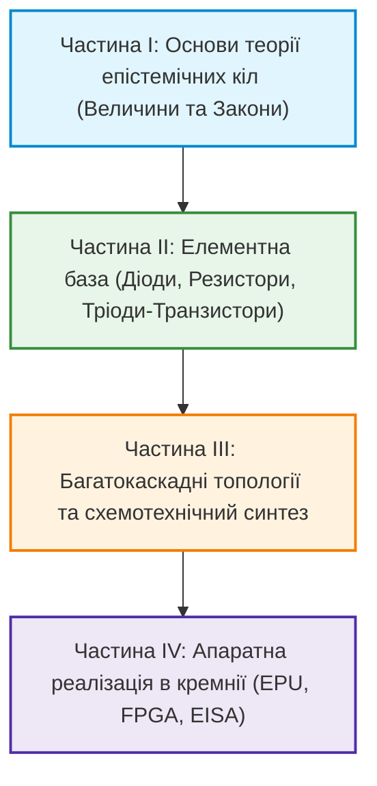

# Теорія епістемічних кіл: Схемотехніка доказових обчислень та апаратного виведення (Epistemic Circuit Theory)

**Фундаментальна праця про фізико-кібернетичні закони, елементну базу та схемотехнічний синтез детермінованих систем істинності (Epistemic Circuitry & Circuit Design)**

**Автор:** [Микола Мартинович Федчик (Mykola Fedchyk)](../ExpertSystem/about-the-author.md)  
**Формат:** Науково-інженерна монографія / Керівництво зі схемотехніки доказових систем  
**Рік заснування:** 2026  
**Базовий науковий меморандум:** [`MEMO-155`](file:///home/mfedchyk/vida/docs/research/MEMO-155-EPISTEMIC-CIRCUITRY-FOUNDATIONS-CONSERVATION-LAWS-AND-ACTIVE-DEVICES.md)  
**Реєстр винаходів:** [`INV-002`](file:///home/mfedchyk/vida/docs/research/inventions/INV-002-ANTI-SYCOPHANCY-ASYMMETRIC-CUSTODY-DIODE.md), [`INV-005`](file:///home/mfedchyk/vida/docs/research/inventions/INV-005-EMBEDDED-GUM-DUAL-NUMBERS-MICRO-METROLOGY.md), [`INV-009`](file:///home/mfedchyk/vida/docs/research/inventions/INV-009-EPISTEMIC-TRANSISTOR-AND-THREE-TERMINAL-INFERENCE-SWITCH.md)

---

## 1. Про нову дисципліну

Ця книга започатковує нову міждисциплінарну галузь знань на стику теоретичної електротехніки, кібернетики та формальної епістемології — **Теорію епістемічних кіл (Epistemic Circuit Theory)** та **Епістемічну схемотехніку (Epistemic Circuitry)**.

Історично цифрова революція пішла шляхом зведення напівпровідникової фізики транзистора до абстрактної двійкової булевої логіки (Шеннон, 1938). У цій двійковій парадигмі біт `1` має однакову вагу незалежно від того, чи є він результатом математичного доведення, галюцинацією нейромережі чи шумом на шині пам'яті.

**Теорія епістемічних кіл** повертає доказовості фізичну природу:
1. Носієм сигналу в колі є не абстрактний біт, а **потік верифікованої істинності з побайтовою кастодією першоджерела у спільній пам'яті хоста** ($V_{\text{ep}} \equiv 1.0$).
2. Елементна база обчислювальної машини проектується на основі **пасивних та активних епістемічних приладів** (резисторів невизначеності, односпрямованих діодів кастодії, тритермінальних деонтичних тріодів-транзисторів).
3. Доказове виведення розраховується за **топологічними законами збереження (Закони Федчика)**, аналогічними до законів Кірхгофа, що унеможливлює комбінаторний вибух та гарантує інваріант нульових галюцинацій $ZHR \equiv 1.000000$ на схемотехнічному рівні.

---

## 2. Структура книги (Тематичний план)

### Частина I: Основи теорії епістемічних кіл (Epistemic Circuit Foundations)
* **Глава 1. Епістемічний розрив класичної схемотехніки:** Чому булева логіка сліпа до істини. Інваріантність до фізичного субстрату.
* **Глава 2. Четвірка фундаментальних величин:**
  - *Епістемічна напруга ($U_{\text{ep}}$)*: Нормативний напір та імперативна сила норм ($[\text{eV}]$).
  - *Епістемічний струм ($I_{\text{ep}}$)*: Потік верифікованих фактів у часі ($[\text{eA}]$).
  - *Епістемічний опір ($R_{\text{ep}}$)*: Метрологічне розсіяння за ISO GUM, ентропія та застарілість ($[\text{e}\Omega]$).
  - *Епістемічна потужність ($P_{\text{ep}}$) та тепло ($P_{\text{loss}}$)*: Здатність до дії проти когнітивного перегріву ($[\text{eW}]$).
* **Глава 3. Фундаментальні закони збереження Федчика:**
  - I Закон: Вузловий баланс струмів доказовості та схемотехнічний інваріант $ZHR = 1.0$.
  - II Закон: Контурне падіння достовірності та автодиференціювання на дуальних числах.
  - III Закон: Тріодний закон деонтично-модального керування каналом.
* **Глава 4. Небулева математика ТЕЛ (Нечіткість, Бірешітка Белнапа, Т-норми):**
  - Ортогональне розщеплення нечіткості Заде на провідність затвора $G$, опір $R_{\text{ep}}$ та баланс дифкаскаду.
  - Ізоморфізм каскадування опорів і Т-норми Хамахера $T_{\text{ep}}$.
  - Чотиризначна бірешітка Белнапа ($\mathcal{FOUR}$) у струмах диференційної пари.
  - Епістемічний Тензор Стану $\Psi$ над дуальними числами Кліффорда та алгеброю Лукасевича $L_{\infty}$.

### Частина II: Елементна база епістемічної схемотехніки (Circuit Components)
* **Глава 5. Пасивні, реактивні та унікальні компоненти ТЕЛ:** Епістемічний імпеданс $Z_{\text{ep}}$, конденсатори прецедентної пам'яті, індуктивність канону (*Stare Decisis*), міждоменні трансформатори з гальванічною розв'язкою, стабілітрони STANAG 2022, Розмірнісні призми SI та Криптографічні надпровідні замки кастодії.
* **Глава 6. Епістемічний діод (`INV-002`) та Епістемічний тріод / транзистор (`INV-009`):** Односпрямований захист від підлабузництва ($SRR = 1.0$) та тритермінальне керування (Source, Drain, Gate). Розділення факту та права застосування. Режими відсічки, насичення та активної модуляції крутизною $g_m$.

### Частина III: Багатокаскадні топології та функціональні операційні вузли (Cascades & Operational Units)
* **Глава 7. Послідовні кон'юнктивні каскади та Диференційні пари $N$ тріодів:** Лінійний час перевірки дедуктивних ланцюгів $O(N)$ проти комбінаторного вибуху бектрекінгу Prolog $O(b^N)$. Акумуляція складеної кастодії $\mathcal{C}_{\text{comp}}$ та арбітраж суперечливих норм (ASPIC+ Pro et Contra).
* **Глава 8. Функціональні операційні вузли ТЕЛ (Суматори, Мультиплікатори, Компаратори):**
  - *Епістемічний Суматор ($\Sigma_{\text{ep}}$)*: Групове дисконтування клонів ($w = 1/\sqrt{|G|}$) та релятивістське додавання потенціалів Ейнштейна.
  - *Епістемічний Мультиплікатор ($\otimes_{\text{ep}}$)*: Однотактне перемноження дуальних станів, конкатенація кастодій і додавання векторів розмірностей SI.
  - *Епістемічний Компаратор ($\lessgtr_{\text{ep}}$)*: Метрологічний тригер Шмітта із захисною зоною $2 U_{95\%}$ (Guard Band за ISO 14253-1).
* **Глава 9. Багатозатворні епістемічні структури (Epistemic FinFET):** Схемотехніка перехресних юрисдикцій та ко-деонтичних правил.

### Частина IV: Апаратна реалізація в кремнії (Silicon & EPU Architecture)
* **Глава 10. Гарвардська епістемічна процесорна архітектура (EVM):** Регістровий банк виведення (`%ebx`, `%emod`, `%earg`, `%eunc`) та система інструкцій EISA.
* **Глава 11. Синтез комутаційних матриць на FPGA (Verilog/VHDL):** Безрозгалужене виконання (Branch Misprediction Immunity) за $O(1)$ тактів.
* **Глава 12. Епістемічні процесори знань майбутнього (EPU ASIC):** Проектування енергоефективних чипів критичної безпеки для автономного транспорту, авіоніки та медицини.

---

## 3. Матеріали та робочі глави книги

1. [Глава 01. Концептуальний маніфест: Від булевих вентилів до схемотехніки істини](ch01-manifesto-and-epistemic-gap.md)
2. [Глава 02. Четвірка фундаментальних величин та Закон Ома для епістеміки](ch02-fundamental-quantities-and-ohms-law.md)
3. [Глава 03. Три закони Федчика та топологічний розрахунок кіл](ch03-fedchyk-conservation-laws.md)
4. [Глава 04. Небулева математика ТЕЛ: від нечітких множин до дуальних бірешіток провідності](ch04-non-boolean-fuzzy-and-belnap-circuit-math.md)
5. [Глава 05. Пасивні, реактивні та унікальні компоненти ТЕЛ: Імпеданс, Трансформатори доменів та Розмірнісні призми](ch05-passive-reactive-and-unique-epistemic-components.md)
6. [Глава 06. Епістемічний тріод та тритермінальне деонтичне комутування](ch06-epistemic-triode-and-transistor.md)
7. [Глава 07. Багатокаскадні схеми з $N$ ес-тріодів та захист від комбінаторного вибуху](ch07-multi-stage-cascades-and-linear-complexity.md)
8. [Глава 08. Функціональні операційні вузли ТЕЛ: Релятивістські суматори, Дуальні мультиплікатори та Гістерезисні компаратори](ch08-operational-units-adders-multipliers-comparators.md)

---
*Матеріали книги засновані на дослідженнях проєкту ВІДА та відкриті до активного доповнення автором.*
