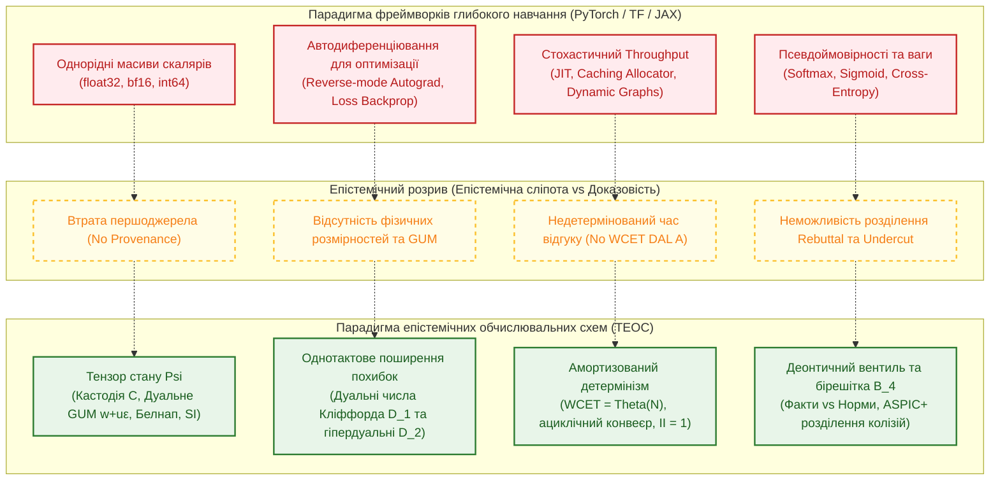

# Додаток А. Огляд фреймворків тензорних обчислень стосовно епістемічних схем (кінець 2026)

> **Книга:** [Теорія епістемічних обчислювальних схем: Математичні інваріанти кастодії, метрології та детермінованого виведення](README.md) · Додатки  
> **Попередня глава:** [Глава 09. Наукова критика, контрприклади та межі застосовності теорії епістемічних обчислювальних схем](ch09-scientific-critique-and-applicability-limits.md)  
> **Зміст книги:** [README.md](README.md)  
> **Автор:** [Микола Федчик](../ExpertSystem/about-the-author.md)  
> **Рівень складності:** `[L3]` Системно-інженерний та порівняльно-аналітичний рівень  
> **Очікувані результати:** дослідити архітектурне та математичне співвідношення між індустріальними тензорними фреймворками (PyTorch, TensorFlow/Keras, JAX) станом на кінець 2026 року та аксіоматикою Теорії епістемічних обчислювальних схем (ТЕОС); проаналізувати природу «тензора» в обох парадигмах; довести неможливість задоволення вимог доказового виведення, побайтової кастодії, інтервальної метрології та гарантій WCET засобами бібліотек оптимізації глибокого навчання.

## Анотація

У середовищі інженерів з комп'ютерних наук та систем штучного інтелекту нерідко виникає припущення, що індустріальні фреймворки багатовимірних тензорних обчислень — передусім провідна тріада **PyTorch**, **TensorFlow (разом із Keras)** та **JAX** — за рахунок розвиненої підтримки багатовимірних масивів, графів обчислень та автоматичного диференціювання вже містять усе необхідне для реалізації «тензорних схем» або безпосередньо розв'язують задачі, поставлені у цій монографії.

У цьому додатку здійснено систематичний порівняльний аналіз архітектур зазначених бібліотек станом на кінець 2026 року крізь призму аксіоматики, топологічних інваріантів та операторів ТЕОС. Додатково розглянуто ширшу екосистему інструментів Python для глибокого навчання — згідно з оглядом провідних бібліотек (Unite.AI, жовтень 2026 [[11]](#src-11)), до якого також входять високорівневі бібліотеки надбудови моделей та оркестрації (Hugging Face Transformers, PyTorch Lightning, Flax, Diffusers, DeepSpeed, fastai). Доведено, що між обчислювальними парадигмами лежить фундаментальний епістемічний розрив: сучасні тензорні бібліотеки спроєктовані для стохастичної апроксимації функцій та евристичного максимізування пропускної здатності на прискорювачах (GPU/TPU/NPU), тоді як ТЕОС розв'язує задачу детермінованого доказового виведення із суворим збереженням побайтової кастодії, аналітичним поширенням інструментальної невизначеності (JCGM 100:2008 GUM) та сертифікацією найгіршого часу реакції ($`\mathrm{WCET} = \Theta(N)`$) для критичних застосувань (RTCA DO-178C DAL A, ISO 26262 ASIL D).

---

## 1. Категорійна демаркація поняття «тензор»

Головна семантична плутанина зумовлена омонімією терміна «тензор». Необхідно провести чітке розмежування математичної природи даних у загальних чисельних бібліотеках та в епістемічних схемах.

### 1.1. Однорідні числові масиви загального призначення (PyTorch / TF / JAX)

У бібліотеках машинного навчання тензор визначається як $N$-вимірний щільний або розріджений масив однорідних скалярних елементів фіксованого примітивного типу:

```
Tensor_ML = Array[shape=(d_1, d_2, ..., d_k), dtype ∈ {float32, bfloat16, float16, int64, bool, ...}]
```

Кожна комірка пам'яті містить суто число (або булевий прапорець). Математичні операції над такими тензорами є операціями лінійної алгебри: векторно-матричні множення (GEMM), згортки, поелементні нелінійні активації та операції редукції.

Такий тензор принципово **епістемічно сліпий**:
1. Число $`0{,}987`$, збережене в комірці типу `float32`, не містить жодної вказівки на джерело свого походження, дату зчитування, ідентифікатор давача чи нормативне положення, на підставі якого воно розраховане.
2. Воно не має метрологічної розмірності: якщо користувач складе тензор швидкості у $`\text{м/с}`$ і тензор тиску в $`\text{Па}`$ однакової розмірності `shape=(128, 64)`, оператор `torch.add()` або `jax.numpy.add()` безперешкодно виконає додавання, породжуючи фізичний абсурд без жодного системного попередження.
3. Скалярне значення змішує в собі ймовірність, повноту свідчень та інструментальну точність приладу.

### 1.2. Багатовимірний епістемічний тензор стану $\Psi$ (ТЕОС)

На противагу масивам чисел, у ТЕОС ([Означення 1.1 глави 01](ch01-foundations-and-epistemic-gap.md)) тензор стану є неподільним чотирикомпонентним вектором верифікаційного стану:

$$\Psi = \langle \mathcal{C}, \; w + u\varepsilon, \; \boldsymbol{\beta}, \; \vec{d}_{\mathrm{SI}} \rangle$$

де кожна координата виконує строго визначену інваріантну функцію контролю:
1. $`\mathcal{C} = \langle h_{\mathrm{src}}, \mathrm{Tree}_{\mathrm{Merkle}}, \mathrm{Sig}_{\mathrm{Ed25519}} \rangle`$ — криптографічний дескриптор безперервної побайтової кастодії, що однозначно ідентифікує незмінне першоджерело факту чи норми (First Topological Invariant);
2. $`w + u\varepsilon \in \mathbb{D}`$ — дуальне число Кліффорда ($\varepsilon^2 = 0$), що поєднує нормалізований інтенсивний потенціал достовірності $w \in [0, 1]$ та стандартну невизначеність вимірювання $u \ge 0$ за стандартом JCGM 100:2008 GUM;
3. $`\boldsymbol{\beta} = \langle t, f, b, n \rangle \in \mathcal{B}_4`$ — вектор чотиризначної параконсистентної бірешітки Белнапа, що розрізняє класичну істину ($`\mathbf{T}`$), хибу ($`\mathbf{F}`$), інформаційний вакуум ($`\mathbf{N}`$) та білатеральну колізію свідчень ($`\mathbf{B}`$);
4. $`\vec{d}_{\mathrm{SI}} = [d_L, d_M, d_T, d_I, d_\Theta, d_N, d_J]^\top \in \mathbb{Z}^7`$ — вектор цілочислових показників степенів базових одиниць Міжнародної системи одиниць SI.

Жоден сучасний універсальний тензорний фреймворк не надає нативного апаратного або мовного типу даних для комутації такого гетерогенного кортежу на рівні базових регістрів обчислювального графа.

---

## 2. Порівняльний аналіз за фундаментальними інженерними критеріями

Систематизуємо співвідношення можливостей PyTorch, TensorFlow/Keras та JAX із вимогами ТЕОС за ключовими векторами надійності, метрології та детермінізму.



### 2.1. Автоматичне диференціювання: оптимізація градієнтів vs Метрологія GUM

* **У PyTorch / TF / JAX:** Механізми диференціювання (зворотний режим `autograd` у PyTorch, обчислення градієнтів у TensorFlow, `jax.grad` та векторне перетворення `vmap` у JAX) реалізовано виключно з метою розрахунку градієнтів функцій втрат $`\nabla_{\boldsymbol{\theta}} \mathcal{L}`$ для підлаштування вагових коефіцієнтів методом стохастичного градієнтного спуску (SGD, AdamW). Усі проміжні значення активацій накопичуються в пам'яті для зворотного проходу (*Tape-based autodiff*), що спричиняє непередбачувані витрати оперативної пам'яті.
* **У ТЕОС ([Глава 04](ch04-belnap-bilattice-tnorms-and-dual-metrology.md), [Глава 08](ch08-operational-units-adders-multipliers-comparators.md)):** Автоматичне диференціювання застосовується не для навчання, а для **однотактового прямого аналітичного поширення інструментальної невизначеності вимірювання** (GUM). Обчислення виконується за один прямий прохід над дуальною парою $`f(x + u_x \varepsilon) = f(x) + f'(x)u_x \varepsilon`$, без зворотного проходу і без збереження графа операцій. При цьому рантайм ТЕОС здійснює динамічний моніторинг індексу кривини Гессе $`\kappa_{\mathrm{nonlin}}`$ і вмикає гіпердуальну корекцію другого порядку $`\mathbb{D}_2`$ у разі виходу на нелінійні ділянки ([Глава 09](ch09-scientific-critique-and-applicability-limits.md)), чого жодна тензорна бібліотека не підтримує на рівні графа виконання.

### 2.2. Рантайм, детермінізм затримок та стандарти сертифікації (WCET, DO-178C, ISO 26262)

* **У PyTorch / TF / JAX:**
  1. Оптимізовані під високу пакетну пропускну здатність (*throughput*), а не під жорстко обмежену затримку найгіршого випадку (*worst-case latency*).
  2. Використовують динамічні кешувальні алокатори пам'яті (`caching_allocator`), які в реальному часі можуть викликати затримки на виділення сторінок або збирання сміття (GC).
  3. Паралельні операції атомарної редукції на графічних процесорах (`atomicAdd` у CUDA/ROCm) для чисел із рухомою комою є асоціативно некомутативними через ефекти округлення, що зумовлює числовий недетермінізм: один і той самий вхідний вектор на GPU у різних запусках дає бітові розбіжності в молодших розрядах мантиси.
  4. Жоден із трьох фреймворків не має сертифікаційного пакета за стандартом **RTCA DO-178C DAL A** (критична авіоніка) або **ISO 26262 ASIL D** (функціональна безпека на автомобільному транспорті) для застосування як детермінований виконавчий рантайм верифікації правил.
* **У ТЕОС ([Глава 03](ch03-topological-conservation-invariants.md), [Глава 07](ch07-multi-stage-cascades-and-linear-complexity.md)):**
  1. Схеми є статично скомпільованими, ациклічними та не мають внутрішніх циклів очікування чи динамічного бектрекінгу.
  2. Часова складність строго детермінована і становить $`\mathrm{WCET} = \Theta(N)`$, де $N$ — число каскадів виведення.
  3. На апаратному рівні ПЛІС (FPGA) конвеєр ТЕОС синтезується з фіксованим інтервалом ініціалізації $`\mathrm{II} = 1\text{ такт}`$, що гарантує відсутність джиттера та нульову похибку синхронізації.

### 2.3. Нормативна деонтика, параконсистентність та аргументація ASPIC+

* **У PyTorch / TF / JAX:**
  1. Відсутні поняття нормативного статусу: обов'язку ($`\mathcal{O}`$), заборони ($`\mathcal{F}`$) чи дозволу ($`\mathcal{P}`$).
  2. У разі надходження взаємно суперечливих даних (наприклад, два протилежні свідчення давачів або колізійні статті регламентів) модель обчислює середньозважену лінійну комбінацію за допомогою функції `softmax` чи сигмоїди. Це призводить до розмивання колізії та маскування небезпеки під виглядом штучної «впевненості» $`0{,}50`$.
  3. Контраргументи не типізуються: моделі не розрізняють, чи оспорюється сам емпіричний факт (показник приладу), чи підсікається юридична чинність правила, яке його оцінює.
* **У ТЕОС ([Глава 06](ch06-three-terminal-deontic-gate.md), [Глава 07](ch07-multi-stage-cascades-and-linear-complexity.md)):**
  1. Введено **тритермінальний деонтичний вентиль $`\mathcal{T}_{\mathrm{deont}}`$**, у якому інформаційний вхід $S$ (емпіричний факт) ортогональний до керуючого затвора $G$ (нормативне правило допуску).
  2. Здійснено апаратне розділення аргументації ASPIC+: пряме спростування факту (*Rebuttal*) гасить сигнал у диференційному арбітрі виходу, тоді як підсікання правила (*Undercut*) знеструмлює затвор $G$, не спотворюючи первинного факту $S$.
  3. Чотиризначна бірешітка Белнапа $`\mathcal{B}_4`$ дозволяє схемі перейти у явний стан білатеральної колізії $`\mathbf{B}`$ (Both) або інформаційного вакууму $`\mathbf{N}`$ (None), генеруючи переривання безпеки `ContradictionFault` / `VacuumFault`.

### 2.4. Ефект інформаційної луна-камери та контроль розмірностей SI

* **У PyTorch / TF / JAX:**
  1. Якщо до класифікатора чи регресійної моделі подати 100 однакових повідомлень, скопійованих із різних анонімних інтернет-джерел, нейромережа сприйме їх як 100 незалежних підтверджень і штучно завищить ймовірність висновку майже до $`1{,}0`$.
  2. Перевірка одиниць вимірювання відсутня: бібліотеки оперують «чистими числами», покладаючи контроль узгодженості розмірностей на зовнішній користувацький код.
* **У ТЕОС ([Глава 05](ch05-temporal-interdomain-and-verification-operators.md), [Глава 08](ch08-operational-units-adders-multipliers-comparators.md)):**
  1. Нелінійний суматор $`\Sigma_{\mathrm{ep}}`$ здійснює автоматичну дедуплікацію клонів за допомогою вагової матриці походження $`\gamma_i = 1/\sqrt{|G_k|}`$, побудованої на основі графа криптографічної кастодії: сумарна вага сотні ідентичних клонів залишається строго інваріантною до їхньої кількості.
  2. Векторний верифікатор $`\mathcal{V}_{\mathrm{SI}}`$ блокує будь-яку комутацію у вузлі сумування, якщо скалярний добуток різниці розмірностей не дорівнює нулю ($`(\vec{d}_1 - \vec{d}_2) \ne \vec{0}`$).

---

## 3. Зведена матриця зіставлення

У таблиці А.1 наведено систематичне порівняння трьох провідних індустріальних тензорних бібліотек та апарату ТЕОС.

**Таблиця А.1.** Порівняльний аналіз тензорних бібліотек глибокого навчання та епістемічних схем ТЕОС (станом на кінець 2026 року).

| Інженерно-математичний критерій | PyTorch (Meta, Linux Foundation) | TensorFlow / Keras (Google) | JAX (Google) | Епістемічні схеми ТЕОС |
| :--- | :--- | :--- | :--- | :--- |
| **Базова сутність даних** | Скалярний багатовимірний тензор (`torch.Tensor`) | Однорідний тензор потоку даних (`tf.Tensor`) | Масив примітивів XLA (`jax.Array`) | 4-компонентний тензор стану $`\Psi = \langle \mathcal{C}, w+u\varepsilon, \boldsymbol{\beta}, \vec{d}_{\mathrm{SI}} \rangle`$ |
| **Криптографічна кастодія (Provenance)** | Відсутня (не зберігається в операціях) | Відсутня (відсутній шар криптодескрипторів) | Відсутня (чисельний масив без хеш-кастодії) | Нативна побайтова кастодія: $`h_{\mathrm{src}}`$, Merkle, Ed25519 |
| **Метрологічна невизначеність (GUM)** | Відсутня (ручна емуляція через Монте-Карло) | Відсутня (окремі сторонні пакети TFP) | Емуляція через кастомні типи, але без $`\kappa_{\mathrm{nonlin}}`$ | Аналітична дуальна $`\mathbb{D}_1`$ та гіпердуальна $`\mathbb{D}_2`$ метрологія за 1 такт |
| **Контроль розмірностей SI** | Сліпий до фізичних одиниць | Сліпий до фізичних одиниць | Сліпий до фізичних одиниць | Нативний оператор $`\mathcal{V}_{\mathrm{SI}}`$ над $`\vec{d}_{\mathrm{SI}} \in \mathbb{Z}^7`$ |
| **Параконсистентність і колізії** | Відсутня (згладжування через softmax) | Відсутня (евристична апроксимація) | Відсутня (числова редукція) | Повна бірешітка Белнапа $`\mathcal{B}_4`$ (детектор $`\mathbf{B}`$ і $`\mathbf{N}`$) |
| **Деонтичний нормативний шар** | Відсутній (немає понять правил/норм) | Відсутній (відсутня деонтична логіка) | Відсутній (чисто математичний функціонал) | Тритермінальний вентиль $`\mathcal{T}_{\mathrm{deont}}`$ (*Rebuttal* vs *Undercut*) |
| **Захист від луна-камер (клонів)** | Відсутній (100 копій підсилюють вагу) | Відсутній (накопичення псевдовпевненості) | Відсутній (адитивне насичення) | Суматор $`\Sigma_{\mathrm{ep}}`$ із дедуплікацією $`\gamma_i = 1/\sqrt{\lvert G_k \rvert}`$ |
| **Детермінізм часу відгуку (WCET)** | Недетермінований (JIT, memory pool, GC) | Недетермінований (графічні черги, dynamic shape) | Недетермінований (XLA compilation stalls) | Суворий лінійний детермінізм $`\mathrm{WCET} = \Theta(N)`$ |
| **Сертифікація безпеки** | Не сертифікований під DAL A / ASIL D | Не сертифікований під DAL A / ASIL D | Не сертифікований під DAL A / ASIL D | Спроєктований для верифікації DO-178C та ISO 26262 |
| **Апаратне конвеєризування** | CUDA / ROCm / OpenVINO / Metal | CUDA / OneDNN / TPU | XLA / TPU / GPU | Потактовий RTL синтез ПЛІС/ASIC ($`\mathrm{II} = 1`$) |

---

## 4. Чи можлива конвергенція: реалізація операторів ТЕОС поверх існуючих бібліотек?

Логічним є запитання системного архітектора: *«Чи можна використати гнучкість JAX або кастомні оператори PyTorch C++/CUDA Extension для створення шару епістемічних схем поверх них?»*

### 4.1. Перспектива JAX як математичного середовища прототипування

Серед трьох бібліотек **JAX** є найбільш математично елегантним завдяки підтримці функціональної чистоти, безстатусності функцій та модулю трансформації функцій `jax.vmap` / `jax.custom_jvp`.
- У JAX відносно просто створити користувацький тип даних `NamedTuple`, який об'єднає номінал, похибку та одиниці вимірювання.
- Прямий режим диференціювання у JAX дозволяє ефективно реалізувати аналог дуальних чисел Кліффорда без збереження важкого графа операцій.

Проте, як показано у дослідженні меж теорії ([Глава 09, Розділ 4](ch09-scientific-critique-and-applicability-limits.md)), використання JAX у промисловому виконавчому рантаймі безпеки натрапляє на такі перешкоди:
1. **Відсутність побайтової криптографічної гарантії на рівні інструкцій XLA:** JAX оптимізує математичні вирази через перевпорядкування операцій та заміну плаваючих інструкцій на апроксимовані аналоги (наприклад, злиті множення-додавання FMA), що може спотворювати бітові контрольні суми сертифікованих обчислень.
2. **Неможливість атестації XLA-компілятора:** Компілятор XLA є масштабним недетермінізованим оптимізаційним комплексом, який не має кваліфікації інструменту розробки за стандартом DO-330 (Tool Qualification for DO-178C).

### 4.2. Роль традиційних тензорних бібліотек та екосистеми Deep Learning в архітектурі доказових систем

Викладене вище не означає, що PyTorch, TensorFlow чи JAX не мають місця в інженерії доказових систем. Навпаки, між ними існує чіткий просторово-часовий розподіл відповідальності. Якщо звернутися до ширшого стеку бібліотек глибокого навчання (за оглядом Unite.AI [[11]](#src-11)):
- **Базові обчислювальні ядра (PyTorch, TensorFlow, JAX):** забезпечують низькорівневе множення матриць та оптимізаційне диференціювання.
- **Високорівневі фреймворки та бекенди (Keras, Flax):** абстрагують архітектуру шарів та забезпечують переносність між бекендами.
- **Екосистема попередньо навчених моделей та оптимізації (Transformers, Diffusers, DeepSpeed, Lightning, fastai):** надають готові токенізатори, генератори та шардування пам'яті (ZeRO-3).

Жоден із цих рівнів не компенсує дефіциту походження чи детермінізму, оскільки всі вони надбудовані над тими самими скалярними тензорами. Проте в загальній системній архітектурі вони органічно формують перший етап:

1. **Фаза офлайн-видобування та семантичного розпізнавання (Offline Perception Layer):** Мовні моделі, токенізатори та мультимодальні екстрактори (реалізовані на базі Transformers, PyTorch, DeepSpeed або Flax/JAX) здійснюють первинне ймовірнісне вилучення кандидатів у факти й правила з неструктурованих технічних текстів, креслень та нормативних документів ([Глава 10](ch10-knowledge-acquisition-systems.md) та [Глава 15 книги «Архітектура доказових експертних систем»](../ExpertSystem/ch15-knowledge-extraction-and-kb-construction.md)).
2. **Фаза онлайн-верифікації та виконавчого арбітражу (Online Deterministic Epistemic Circuit):** Після того, як знання видобуто, верифіковано попперівським фільтром, скомпільовано в нормативні графи та завантажено в ациклічну обчислювальну схему ТЕОС, традиційні нейромережеві фреймворки **повністю усуваються з циклу прийняття критичних рішень**. Безпосереднє виведення, аудит безпеки, поширення похибок та формування юридично неспростовного вердикту виконуються суто конвеєром ТЕОС із жорстким часом $\mathrm{WCET} = \Theta(N)$.

---

## 5. Висновки

1. **Індустріальні тензорні фреймворки (PyTorch, TensorFlow/Keras, JAX) станом на кінець 2026 року не вирішують і не призначені для вирішення завдань Теорії епістемічних обчислювальних схем.** Їхня математична база орієнтована на обробку однорідних скалярних масивів для стохастичної апроксимації функцій та градієнтного навчання.
2. **Омонімія слова «тензор» створює хибну ілюзію архітектурної готовності:** тензор у глибокому навчанні є числовим масивом без пам'яті про походження, розмірності та похибку, тоді як епістемічний тензор стану $\Psi$ є нерозривним чотирикомпонентним вектором доказовості (походження $`\mathcal{C}`$, метрологія GUM $w+u\varepsilon$, параконсистентність $`\boldsymbol{\beta}`$ та фізична розмірність $`\vec{d}_{\mathrm{SI}}`$).
3. **Обчислювальні бібліотеки глибокого навчання не задовольняють вимоги систем функціональної безпеки:** через стохастичний характер редукцій, динамічне керування пам'яттю та відсутність детермінованого $`\mathrm{WCET} = \Theta(N)`$ вони не можуть виступати верифікованим виконавчим середовищем за стандартами RTCA DO-178C DAL A чи ISO 26262 ASIL D.
4. **Оптимальна інженерна архітектура полягає у дволанковій сегрегації:** фреймворки машинного навчання застосовуються виключно на етапі офлайн-компіляції для первинної екстракції знань, тоді як рантайм сертифікованого виведення будується на базі детермінованих епістемічних схем.

---

## Література

1. *Поппер К.* Логіка наукового дослідження / Пер. з англ. — К.: Український центр духовної культури, 2006. — 556 с.
2. *Paszke A., Gross S., Massa F., Lerer A., Bradbury J. et al.* PyTorch: An Imperative Style, High-Performance Deep Learning Library // Advances in Neural Information Processing Systems (NeurIPS 2019). — 2019. — Vol. 32. — P. 8024–8035.
3. *Abadi M., Barham P., Chen J., Chen Z., Davis A. et al.* TensorFlow: A System for Large-Scale Machine Learning // 12th USENIX Symposium on Operating Systems Design and Implementation (OSDI 16). — 2016. — P. 265–283.
4. *Bradbury J., Frostig R., Hawkins P., Johnson M. J., Leary C. et al.* JAX: Composable transformations of Python+NumPy programs. — 2018. — URL: http://github.com/jax-ml/jax.
5. *JCGM 100:2008.* Evaluation of measurement data — Guide to the expression of uncertainty in measurement (GUM). — Joint Committee for Guides in Metrology, 2008. — 120 p.
6. *RTCA DO-178C.* Software Considerations in Airborne Systems and Equipment Certification. — Radio Technical Commission for Aeronautics, 2011. — 140 p.
7. *ISO 26262:2018.* Road vehicles — Functional safety (Parts 1–12). — International Organization for Standardization, 2018.
8. *Belnap N. D.* A useful four-valued logic // Modern Uses of Multiple-Valued Logic / Eds. J. M. Dunn, G. Epstein. — Dordrecht: D. Reidel, 1977. — P. 8–37.
9. *Pollock J. L.* Defeasible Reasoning // Cognitive Science. — 1987. — Vol. 11, No. 4. — P. 481–518.
10. *Федчик М. М.* Архітектура доказових експертних систем: Монографія. — 2026.
11. <a id="src-11"></a>*Unite.AI.* 10 найкращих бібліотек Python для глибокого навчання (жовтень 2026). — 2026. — URL: https://www.unite.ai/uk/10-best-python-libraries-for-deep-learning/

