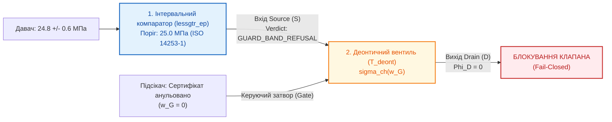

# Додаток Б. Мінімальний операційний вузол ТЕОС: наскрізний інженерний приклад та двостороння критика (теоретик vs інженер)

> **Книга:** [Теорія епістемічних обчислювальних схем: Математичні інваріанти кастодії, метрології та детермінованого виведення](README.md) · Додатки  
> **Попередня глава:** [Додаток А. Огляд фреймворків тензорних обчислень стосовно епістемічних схем (кінець 2026)](appendix-a-tensor-frameworks-review.md)  
> **Зміст книги:** [README.md](README.md)  
> **Автор:** [Микола Федчик](../ExpertSystem/about-the-author.md)  
> **Рівень складності:** `[L3]` Практично-критичний та аналітичний рівень (індекс Д. Кнута `[30]`)  
> **Очікувані результати:** дослідити наскрізний мінімальний приклад функціонального вузла ТЕОС (тристабільний інтервальний компаратор + тритермінальний деонтичний вентиль); зіставити його поведінку з класичним кодом на C/ПЛК, генеративними моделями (LLM) та логікою Prolog; провести безкомпромісну деконструкцію прикладу з позицій математика-теоретика та практикуючого інженера вбудованих систем; визначити дійсну інженерну нішу запропонованого апарату.

## Анотація

Для верифікації практичної спроможності будь-якої архітектурної концепції критично важливим є розгляд найпростішого, мінімально можливого операційного вузла, в якому сфокусовано її базові інваріанти. У цьому додатку детально розібрано елементарну систему допуску — каскад із тристабільного інтервального компаратора ($`\lessgtr_{\mathrm{ep}}`$) та тритермінального деонтичного вентиля ($`\mathcal{T}_{\mathrm{deont}}`$) — на задачі аварійного керування клапаном нагнітання тиску в газовій магістралі за наявності інструментальної невизначеності вимірювання та процедурного підсікання сертифіката давача.

З метою дотримання повної наукової чесності та академічного прагматизму наведений приклад піддано подвійній критичній експертизі:
1. **З позицій математика-теоретика (формальна логіка та теорія ймовірностей):** проаналізовано небезпеку прихованого припущення про гауссівський розподіл похибок у правилі $`U_{95\%} = 2u`$, обмеженість редукції немонотонної дефезивної логіки Поллока до скалярної трикутної ко-норми, а також тривіальність алгебраїчної структури вільної абелевої групи розмірностей $`\mathbb{Z}^7`$.
2. **З позицій практикуючого софтверного інженера вбудованих систем (DO-178C / ISO 26262):** розкрито маніпулятивність порівняння з «наївним C-кодом», показано переваги перевірки розмірностей на етапі компіляції (*zero-cost compile-time abstractions*) порівняно з 4-кратним розширенням шин у рантаймі, поставлено під сумнів доцільність передачі відкликання сертифікатів на тактовій частоті 200 МГц та вказано на високу вартість супроводу кремнієвих бітстрімів ПЛІС порівняно з калібрувальними таблицями Flash/EEPROM.

Додаток завершує конструктивний синтез, який фіксує раціональну нішу ТЕОС як автономного апаратного запобіжника (*Hardware Safety Interlock*) проти стохастичних помилок штучного інтелекту.

---

## 1. Постановка задачі та архітектура мінімального операційного вузла

Розглянемо найпростішу інженерну підсистему захисту в технологічній магістралі високого тиску.

### 1.1. Вихідні умови інженерної задачі

1. **Нормативний ліміт безпеки:** Згідно з регламентом експлуатації, тиск у системі не повинен перевищувати $`P_{\mathrm{limit}} = 25{,}0\,\text{МПа}`$. Перевищення ліміту загрожує механічним розривом трубопроводу.
2. **Показ телеметрії:** Первинний давач тиску передає виміряне значення $`P_{\mathrm{meas}} = 24{,}8\,\text{МПа}`$ зі стандартною невизначеністю вимірювання $`u(P) = 0{,}3\,\text{МПа}`$. За коефіцієнта охоплення $k = 2$ розширена невизначеність становить:

$$
U_{95\%} = 2 \cdot u(P) = 2 \cdot 0{,}3 = 0{,}6\,\text{МПа}
$$

Дійсне значення тиску з імовірністю $95\%$ знаходиться в інтервалі $`[24{,}8 - 0{,}6; 24{,}8 + 0{,}6] = [24{,}2; 25{,}4]\,\text{МПа}`$.
3. **Нормативний контекст і підсікання (*Undercut*):** Від метрологічної служби надійшов юридично завірений припис: *«Планову повірку давача тиску прострочено, калібрувальний сертифікат анульовано»*.

**Цільове інженерне питання:** Чи має автоматика видати сигнал на відкриття клапана нагнітання газу?

### 1.2. Реалізація задачі в елементній базі ТЕОС

Мінімальний операційний вузол ТЕОС складається з двох послідовних елементів ([Глава 06](ch06-three-terminal-deontic-gate.md) та [Глава 08](ch08-operational-units-adders-multipliers-comparators.md)):



**Рисунок Б.1.** Структурна схема мінімального вузла ТЕОС: тристабільний компаратор та деонтичний вентиль.

### 1.3. Покроковий розрахунок за формулами ТЕОС

**Крок 1. Аналіз інтервальним компаратором за формулою (8.4).**  
Згідно з [Означенням 8.3 та формулою (8.4)](ch08-operational-units-adders-multipliers-comparators.md#4-тристабільний-інтервальний-компаратор-із-захисною-метрологічною-смугою), передавальна функція компаратора $`\lessgtr_{\mathrm{ep}}`$ із захисною смугою стандарту ISO 14253-1 визначається як:

$$
\mathrm{Verdict}_{\lessgtr}\left(x_{\mathrm{meas}}, U_{95\%}, x_{\mathrm{limit}}\right) = \begin{cases}
\mathbf{T} \ (\text{ACCEPT / PASS}), & \text{при } x_{\mathrm{meas}} + U_{95\%} \le x_{\mathrm{limit}} \\
\mathbf{F} \ (\text{REJECT / VIOLATION}), & \text{при } x_{\mathrm{meas}} - U_{95\%} \ge x_{\mathrm{limit}} \\
\mathbf{N} \ (\text{REFUSAL / GUARD\_BAND}), & \text{при } \lvert x_{\mathrm{meas}} - x_{\mathrm{limit}} \rvert < U_{95\%}
\end{cases}
$$

Перевіримо умову допуску $`\mathbf{T}`$:

$$
x_{\mathrm{meas}} + U_{95\%} = 24{,}8 + 0{,}6 = 25{,}4\,\text{МПа} \le 25{,}0\,\text{МПа} \quad \implies \quad \textbf{ХИБНО}
$$

Перевіримо потрапляння в захисну смугу невизначеності $`\mathbf{N}`$:

$$
\lvert x_{\mathrm{meas}} - x_{\mathrm{limit}} \rvert = \lvert 24{,}8 - 25{,}0 \rvert = 0{,}2\,\text{МПа} < U_{95\%} = 0{,}6\,\text{МПа} \quad \implies \quad \textbf{ІСТИННО}
$$

**Результат:** Компаратор детерміновано формує стан `GUARD_BAND_REFUSAL` ($`\mathbf{N}`$ у бірешітці Белнапа), сигналізуючи, що виміряна величина заступає за межу безпеки в межах своєї похибки.

**Крок 2. Комутація тритермінальним деонтичним вентилем за формулами (6.2)–(6.3).**  
Згідно з [Означенням 6.1 та формулою (6.3)](ch06-three-terminal-deontic-gate.md#3-передавальні-характеристики-та-три-режими-роботи-деонтичного-вентиля), наявність процедурного підсікача (анулювання сертифіката давача) встановлює коефіцієнт підсікання $`\alpha_{\mathrm{undercut}} = 1{,}0`$:

$$
w_G = w_{\mathrm{norm}} \cdot (1 - \alpha_{\mathrm{undercut}}) = 1{,}0 \cdot (1 - 1{,}0) = 0{,}0
$$

Оскільки чинний потенціал затвора $`w_G = 0{,}0 < w_{\mathrm{th}}`$, деонтична провідність каналу за формулою (6.2) набуває значення:

$$
\sigma_{\mathrm{ch}}(w_G) \equiv 0 \quad (\text{Режим повного блокування})
$$

Вихідний потік санкціонованого вердикту дорівнює:

$$
\Phi_D = \Phi_0 \cdot w_S \cdot \sigma_{\mathrm{ch}}(w_G) = \Phi_0 \cdot w_S \cdot 0 \equiv 0
$$

**Результат:** Вентиль знеструмлює вихідний сигнал керування клапаном ($`\Phi_D = 0`$). При цьому за [Твердженням 6.1](ch06-three-terminal-deontic-gate.md#22-ортогональне-розмежування-підсікання-та-прямого-спростування-за-поллоком) інформація про тиск на вході $S$ не зазнає редукції чи мутації — система зберігає точний факт вимірювання $`24{,}8\,\text{МПа}`$, але фізично блокує дію.

---

## 2. Зіставлення з альтернативними обчислювальними парадигмами

У таблиці Б.1 наведено порівняльний аналіз реакції різних систем на цей сценарій.

**Таблиця Б.1.** Зіставлення поведінки чотирьох парадигм у тестовому сценарії.

| Критерій аналізу | Класичний процедурний код (C/C++, ПЛК) | Генеративна мовна модель (LLM-агент) | Символьна дедукція (Prolog / WAM) | Апаратний вузол ТЕОС ($`\lessgtr_{\mathrm{ep}} + \mathcal{T}_{\mathrm{deont}}`$) |
| :--- | :--- | :--- | :--- | :--- |
| **Реакція на наближення до межі ($`24{,}8 < 25{,}0`$)** | **Хибний допуск:** повертає `true`, ігноруючи похибку давача | **Непередбачувана:** залежить від формулювання промпту | **Хибний допуск:** `24.8 =< 25.0` істинно | **Детерміноване блокування:** захисна смуга ISO 14253-1 відхиляє дозвіл |
| **Обробка підсікання сертифіката** | Працює, лише якщо програміст явно передбачив прапорець `is_valid` | Може проігнорувати припис через брак уваги в контексті | Доводить хибність через `\+ cert_revoked`, розриваючи граф | Закриває затвор $G$ за збереження факту $S$ за 1 такт |
| **Час відгуку (WCET)** | Мікросекунди (з ризиком джиттеру переривань ОС) | $`200\dots 3000\,\text{мс}`$ (непридатний для жорсткого реального часу) | Залежить від глибини пошуку та бектрекінгу ($`\mathcal{O}(b^N)`$) | **Фіксований 1 такт ПЛІС** ($`5\dots 10\,\text{нс}`$ при $`100\dots 200\,\text{МГц}`$) |
| **Цілісність логічного виведення** | Відсутня структурна різниця між фактом і нормою | Схильність до стохастичної інтерполяції (галюцинацій) | Формально строга, але без аналітичного поширення похибок | Повний синхронний тензор $`\Psi = \langle \mathcal{C}, x+u\varepsilon, \boldsymbol{\beta}, \vec{d}_{\mathrm{SI}} \rangle`$ |

---

## 3. Критика з позицій математика-теоретика

Математик-теоретик, що спеціалізується на математичній логіці, теорії міри та формальній семантиці, висуває до наведеного прикладу три засадничі зауваження:

### 3.1. Необґрунтована апеляція до гауссівського розподілу та довільність захисної смуги

Правило захисної смуги $`U_{95\%} = 2u`$ спирається на неявне припущення про **нормальний (гауссівський) розподіл** випадкової похибки давача. 
У реальних інженерних системах закони розподілу шумів пірометрів та тензодатчиків часто мають:
- **важкі хвости (*Heavy-tailed distributions*):** розподіли Стьюдента або Коші, для яких коефіцієнт $k = 2$ забезпечує не $95\%$, а менше $80\%$ покриття;
- **асиметричний дрейф і мультимодальність:** у разі забруднення оптичного тракту або температурного градієнта щільність імовірності стає скошеною.

За відсутності явної ймовірнісної міри на борелівській $\sigma$-алгебрі простору станів твердження про те, що тристабільне відображення в бірешітку Белнапа $`\{\mathbf{T}, \mathbf{F}, \mathbf{N}\}`$ гарантує строго $95\%$ довіри, є математично некоректним. Воно вироджується у звичайну **детерміновану порогову евристику з фіксованим інтервалом**, одягнену в термінологію міжнародного стандарту ISO.

### 3.2. Редукція немонотонної дефезивної логіки Поллока до скалярної мультиплікації

Оригінальна теорія спростовних міркувань Джона Поллока (1987) та її розвиток у формалізмі ASPIC+ Санджая Модгіла і Генрі Праккена є **символьною немонотонною логікою**. У ній статус аргументу («прийнятний», «відхилений», «заблокований») визначається топологією орієнтованого графа атак і пошуком обґрунтованих розширень (*Grounded Extensions* за Фан Мін Дунгом).

У ТЕОС дефезивне підсікання (*Undercut*) зведено до скалярної передавальної функції провідності:

$$
\Phi_D = \Phi_0 \cdot w_S \cdot \sigma_{\mathrm{ch}}(w_G)
$$

Це є прямою редукцією складної дискретної аргументаційної динаміки до звичайної **алгебраїчної трикутної норми (t-norm) або нечіткого добутку Заде — Гейтінга**. Така редукція стикається з класичною проблемою нечітких логік:
- Якщо два підсікачі взаємно атакують один одного (цикл у графі атак), скалярна схема ТЕОС або впаде у нескінченну рекурсію, або змушена буде штучно переривати обчислення за тайм-аутом;
- Скалярне число $`w_G \in [0, 1]`$ не здатне виразити відношення переваги між нормами різного ієрархічного рівня (*Lex Superior*, *Lex Posterior*), якщо вони не були попередньо згорнуті в одновимірну вагу до запуску схеми.

### 3.3. Алгебраїчна тривіальність решітки розмірностей $`\mathbb{Z}^7`$

Подання фізичних розмірностей семивимірним цілочисельним вектором $`\vec{d}_{\mathrm{SI}} \in \mathbb{Z}^7`$ є канонічною моделлю **вільної абелевої групи рангу 7**. Множення фізичних величин ізоморфне стандартному груповому додаванню $`\vec{d}_1 + \vec{d}_2`$, а ділення — відніманню $`\vec{d}_1 - \vec{d}_2`$.

Видавати цю конструкцію за революційний «епістемічний оператор верифікації» ($`\mathcal{V}_{\mathrm{SI}}`$) з погляду чистої алгебри є інфляцією термінології: це звичайна перевірка рівності елементів у вільній групі, відома в аналізі розмірностей ще з часів теореми $\Pi$ Бекінгема (1914 рік).

---

## 4. Критика з позицій практикуючого софтверного інженера вбудованих систем

Інженер із розробки відповідального вбудованого програмного забезпечення (бортова авіоніка DO-178C, блоки керування автомобілем ISO 26262, промислові ПЛК IEC 61508) оцінює наведений приклад із позицій технологічної реалістичності:

### 4.1. Маніпуляція «наївним кодом» (*Strawman Fallacy*)

Твердження авторів ТЕОС про те, що промисловий C-код містить наївний запис:

```c
if (p_meas <= 25.0f) { open_valve(); }
```

є класичною софістичною підміною тези («опудалом» для критики). 

Жоден сертифікований інженер із функціональної безпеки **ніколи не пише прямих порогових порівнянь сирих даних давача**. У реальних системах безпеки (рівнів ASIL D або DAL A):
1. Захисна смуга розраховується на етапі калібрування системи й закладається безпосередньо в нормативні пороги:
   ```c
   #define P_MAX_THRESHOLD      (25.0f)
   #define P_SENSOR_TOLERANCE   (0.6f)
   #define P_SAFE_LIMIT         (P_MAX_THRESHOLD - P_SENSOR_TOLERANCE) // 24.4 МПа

   if (p_meas <= P_SAFE_LIMIT) { open_valve(); }
   ```
   У такому коді вимірювання $`24{,}8\,\text{МПа}`$ буде детерміновано відхилене звичайнішим 32-бітним мікроконтролером за 1 такт процесора, без будь-яких екзотичних тензорів.
2. Фільтрація похибок здійснюється перевіреними алгоритмами (ковзне середнє, фільтр Калмана) у періодичному циклі опитування.

### 4.2. Абстракції нульової вартості під час компіляції проти 4-кратного розширення шин

ТЕОС пропонує передавати 7 показників степенів розмірності $`\vec{d}_{\mathrm{SI}}`$ через усі внутрішні регістри та АЛП у рантаймі. 

У сучасному промисловому софті на C++ (`boost::units`, `mp-units`), Ada або Rust (`uom`) контроль фізичних розмірностей повністю виконується **під час компіляції** (*zero-cost compile-time abstraction*):
- Якщо розробник спробує додати тиск до сили (`Pressure + Force`), компілятор відмовиться збирати бінарний файл, вказавши на помилку типів у коді.
- Скомпільований машинний код оперує чистими 32- чи 64-бітними скалярами без жодного байта оверхеду в пам'яті.

Натомість ТЕОС вимагає розширення шини даних до 256–512 біт. Для інженера з апаратного забезпечення це означає:
- збільшення площі кристала ПЛІС у $`3{,}5\dots 6`$ разів;
- ускладнення трасування ліній (*Routing Congestion*);
- вище динамічне енергоспоживання кристала.

Витрачати апаратні ресурси кремнію на перевірку розмірностей у рантаймі для формул, чия структура відома ще до запуску системи — сумнівне інженерне рішення.

### 4.3. Технологічна нереалістичність динамічного відкликання сертифікатів на тактовій частоті 200 МГц

У наведеному прикладі підсікач «сертифікат давача відкликано» подається безпосередньо на затвор деонтичного вентиля, який працює на частоті $`100\dots 200\,\text{МГц}`$.

У реальній інженерній експлуатації:
- Сертифікати повірки не змінюють свій статус за 5 наносекунд;
- Повірка приладу — це регламентна процедура з періодичністю у 6–12 місяців;
- Статус валідності давачів перевіряється під час початкової ініціалізації системи (*Power-On Built-In Test*, PBIT) або у повільному фоновому циклі діагностики (раз на секунду).

Створювати апаратну кремнієву інфраструктуру для передачі деонтичних статусів юрисдикції з темпом один такт на частоті сотень мегагерців — це надлишкова інженерна складність (*Overengineering*).

### 4.4. Вартість супроводу та пересинтезу ПЛІС проти оновлення Flash-пам'яті

Якщо логіка допуску запечена в апаратні вентилі ПЛІС (FPGA):
- Зміна будь-якого порогу або додавання нового правила вимагає повного циклу перекомпіляції проекту у Vivado/Quartus, аналізу часових затримок (*Timing Closure*), функціональної верифікації бітстріма та перепрошивки кристала. Цей процес триває години й вимагає дорогої кваліфікації інженера з FPGA.
- У класичних мікроконтролерах пороги та конфігураційні матриці зберігаються у захищеній енергонезалежній пам'яті (Flash / EEPROM) з контрольною сумою CRC32. Оновлення ліміту займає мілісекунди й виконується стандартними сертифікованими завантажувачами.

---

## 5. Конструктивний синтез: де пролягає справжня раціональна ніша ТЕОС?

Зіставлення математичної та інженерної критики дозволяє очистити концепцію ТЕОС від риторичного надлишку та чітко окреслити її **справжню предметну область**.

Якщо ТЕОС розглядається як заміна класичному коду мікроконтролера в замкненій, детермінованій системі (де формули статичні, а давачі відомі наперед) — **вона є невиправдано дорогою, надлишковою і програє класичним методам**.

Проте ситуація кардинально змінюється в архітектурах нового покоління, де з'являється принципово новий фактор ризику — **недетермінований генеративний штучний інтелект**:

```
[ Неструктуровані дані / Потоки телеметрії ]
                        │
                        ▼
       [ Стохастична нейромережа / LLM-агент ]
     (висока адаптивність, ризик галюцинацій та підмін)
                        │
             [ Динамічно згенерована дія ]
                        │
                        ▼
   ════════════════════════════════════════════════════
   ║  Апаратний запобіжник ТЕОС (Hardware Interlock) ║
   ║  (синтезований на ПЛІС/ASIC вентильний DAG)      ║
   ║                                                  ║
   ║  1. Перевірка цілісності цитати (SHA-256)        ║
   ║  2. Розрахунок похибки GUM за 1 такт             ║
   ║  3. Динамічний контроль розмірностей SI          ║
   ║  4. Деонтичний затвор (апаратне знеструмлення)   ║
   ════════════════════════════════════════════════════
                        │
         ┌──────────────┴──────────────┐
         ▼                             ▼
     [ ДОЗВІЛ ]                  [ БЛОКУВАННЯ ]
  (Фізичний привід)          (Фізичне розмикання кола)
```

**Рисунок Б.2.** Справжня ніша ТЕОС: апаратний запобіжник на виході стохастичного ШІ.

У такій конфігурації переваги ТЕОС стають вирішальними:
1. **Динамічність розмірностей та похибок:** Коли команди генеруються нейромережею на льоту, статична перевірка компілятора C++ більше не працює — розмірність формули та її походження стають динамічними змінними рантайму, які необхідно фільтрувати апаратно.
2. **Апаратна ізоляція від програмних вразливостей:** Якщо ШІ зламано або він згенерував галюцинацію, софтверний контролер на C може зависнути або виконати помилкову інструкцію через баг у драйвері. Апаратна схема ТЕОС на ПЛІС фізично розмикає ланцюг живлення приводу за 5 наносекунд на рівні кремнієвого транзистора, не маючи операційної системи, стеку викликів чи спільних із софтом ресурсів пам'яті.

---

## 6. Висновки

1. **Мінімальний операційний вузол ТЕОС** (каскад інтервального компаратора $`\lessgtr_{\mathrm{ep}}`$ та деонтичного вентиля $`\mathcal{T}_{\mathrm{deont}}`$) демонструє детерміноване розв'язання задачі безпечного допуску за 1 такт синхронізації: компаратор запобігає аварії на межі допуску через захисну смугу ISO 14253-1, а деонтичний вентиль знеструмлює канал керування при виявленні процедурного підсікача за Поллоком, не спотворюючи онтологічний факт вимірювання.
2. **Критика математика-теоретика** вказує на межі строгості моделі: правило захисної смуги залежить від припущення про гауссівські шуми, редукція спростовної логіки Поллока до трикутної норми стикається з труднощами на циклічних графах атак, а векторний контроль розмірностей SI є стандартним використанням вільної абелевої групи $`\mathbb{Z}^7`$.
3. **Критика софтверного інженера** розвіює ілюзію незамінності ТЕОС для традиційних систем: у класичних контролерах допуски успішно закладаються в калібрувальні таблиці, контроль розмірностей ефективніше виконується компілятором C++/Ada/Rust з нульовими витратами у рантаймі, а оновлення параметрів у Flash-пам'яті є значно дешевшим за пересинтез кремнієвих бітстрімів ПЛІС.
4. **Реальна інженерна цінність ТЕОС** полягає у її застосуванні як **жорсткого апаратного запобіжника (Hardware Safety Interlock)** між недетермінованими стохастичними моделями штучного інтелекту та виконавчими органами об'єкта, де кремнієва вентильна решітка гарантує неможливість фізичної реалізації неперевіреної, некоректної за розмірністю або небезпечної команди.

---

## Література

1. *Поппер К.* Логіка наукового дослідження / Пер. з англ. — К.: Український центр духовної культури, 2006. — 556 с.
2. *ISO 14253-1:2017.* Geometrical product specifications (GPS) — Inspection by measurement of workpieces and measuring equipment — Part 1: Decision rules for proving conformity or nonconformity with specifications. — Geneva: ISO, 2017. — 24 p.
3. *JCGM 100:2008.* Evaluation of measurement data — Guide to the expression of uncertainty in measurement (GUM). — Joint Committee for Guides in Metrology, 2008. — 120 p.
4. *Pollock J. L.* Defeasible Reasoning // Cognitive Science. — 1987. — Vol. 11, No. 4. — P. 481–518.
5. *Modgil S., Prakken H.* A general account of argumentation with preferences // Artificial Intelligence. — 2013. — Vol. 195. — P. 361–397.
6. *Dung P. M.* On the acceptability of arguments and its fundamental role in nonmonotonic reasoning, logic programming and n-person games // Artificial Intelligence. — 1995. — Vol. 77, No. 2. — P. 321–357.
7. *RTCA DO-178C.* Software Considerations in Airborne Systems and Equipment Certification. — Radio Technical Commission for Aeronautics, 2011. — 140 p.
8. *ISO 26262:2018.* Road vehicles — Functional safety (Parts 1–12). — International Organization for Standardization, 2018.
9. *Belsky M., Fedchyk M.* Epistemic Computational Circuit Theory: Formal Specifications and Benchmarks. — 2026.

---

[← Додаток А. Огляд фреймворків тензорних обчислень стосовно епістемічних схем (кінець 2026)](appendix-a-tensor-frameworks-review.md) | [Зміст книги](README.md)
