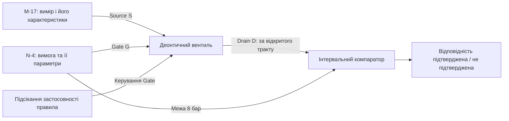
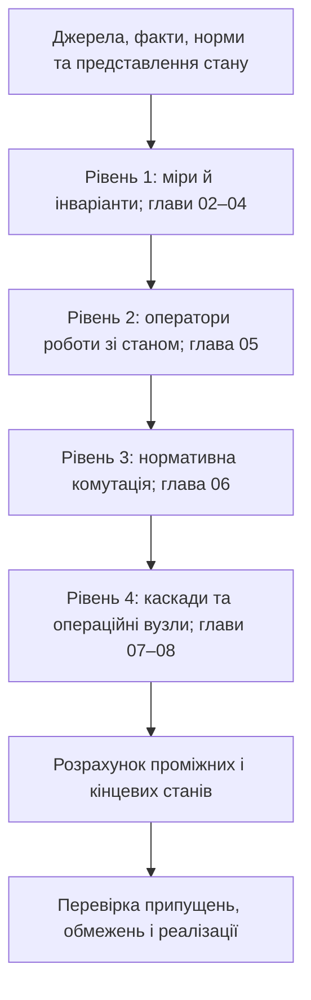

# Глава 01. Теоретичні засади: від булевих вентилів до доказових обчислювальних схем

> **Книга:** [Теорія епістемічних обчислювальних схем: Математичні інваріанти кастодії, метрології та детермінованого виведення](README.md) · Частина 1. Математичні основи епістемічних схем  
> **Попередня глава:** [Зміст та архітектура монографії](README.md)  
> **Наступна глава:** [Глава 02. Фундаментальні кількісні міри та рівняння атенюації достовірності в обчислювальних схемах](ch02-quantitative-measures-and-credibility-attenuation.md)  
> **Зміст книги:** [README.md](README.md)  
> **Автор:** [Микола Мартинович Федчик](../ExpertSystem/about-the-author.md)  
> **Потрібні знання:** арифметичні операції, інтервали, одиниці фізичних величин і початкове уявлення про логічні умови. Графи, дуальні числа та чотиризначні стани пояснюються в тексті.  
> **Після опрацювання глави читач зможе:** розрізняти систему, схему й стан; відокремлювати факт, джерело та норму; прочитати склад епістемічного тензора; виконати наведений розрахунок і пояснити його обмеження.

## Анотація

Глава вводить предмет Теорії епістемічних обчислювальних схем (ТЕОС) через одну інженерну задачу: як отримати результат, не втративши відомостей про його джерела, невизначеність і застосовані правила. Спочатку визначено обчислювальну систему, дані, факт, норму та стан. Далі показано, як у ТЕОС ці складники пов'язуються орієнтованим графом операторів і як виконати теоретичний розрахунок до вибору апаратури.

Наскрізний навчальний приклад поєднує інтервал тиску, тритермінальний деонтичний вентиль та компаратор. На ньому розрізнено числове значення, застосовність правила й підтвердження відповідності вимозі. Потім розглянуто інваріанти, умови часових оцінок, способи реалізації та обмеження. Модельні числа не є вимірюваннями пристрою; облік походження не ототожнюється з істинністю. Главу завершують завдання із відповідями, путівник подальшим матеріалом і словник.

## 1. Вступ. Предмет теорії епістемічних обчислювальних схем та призначення монографії

Предмет ТЕОС зручно пояснити на відмінності між числом і висновком, який на його підставі можна зробити. Нехай прилад повідомив тиск 7,8 бар, а навчальна вимога встановлює межу 8 бар. Порівняння двох чисел ще не відповідає на питання, чи враховано похибку приладу, звідки взято межу та чи застосовне це правило до заданого режиму.

**Означення (Обчислювальна система).** *Обчислювальною системою* називається організована сукупність взаємодіючих засобів, яка реалізує задані перетворення вхідних даних у результати відповідно до визначених правил подання даних і виконання операцій.

В інженерному описі системи зазначають входи, представлення даних, операції, зв'язки компонентів і форму результату. За потреби система зберігає проміжні дані та внутрішній стан. Вона може бути цифровою, аналоговою або змішаною. Наприклад, мікроконтролер із пам'яттю, інтерфейсом введення й програмою перерахунку коду АЦП у температуру є обчислювальною системою: код — вхід, перерахунок — операція, температура — результат.

**Обчислювальна схема** описує операції та спрямовані зв'язки передавання даних між ними. Це спосіб подання організації обчислень, а не синонім усієї системи. Далі вузлами графа називатимемо оператори або джерела, а ребрами — зв'язки, якими передаються їхні результати.

**Означення 1.1 (Теорія епістемічних обчислювальних схем).** *Теорією епістемічних обчислювальних схем (ТЕОС)* називається математична та комп'ютерно-інженерна дисципліна, яка вивчає топологічні інваріанти збереження кастодії, поширення інтервальної метрологічної невизначеності, параконсистентної агрегації та тритермінальної деонтичної комутації багатовимірних тензорів стану в орієнтованих обчислювальних графах над незмінними першоджерелами.

Для першого прочитання складники означення мають такий інженерний зміст:

- **Кастодія** — простежувана прив'язка даних до конкретного незмінного запису джерела.
- **Поширення невизначеності** — перенесення характеристик неточності входів на результати відповідно до заданої моделі.
- **Параконсистентна агрегація** — оброблення суперечливих свідчень без дозволу виводити з однієї суперечності будь-яке твердження.
- **Деонтична комутація** — застосування норми через окремий керуючий вхід, без переписування самого факту.
- **Топологічний інваріант** — властивість, яка зберігається при з'єднанні операторів за визначених правил. Її потрібно сформулювати й обґрунтувати; назва «інваріант» цього не замінює.

ТЕОС досліджує спільне передавання цих характеристик у стані та їх зміну в операторах. Це ширший предмет, ніж перевірка одного порогу або певний програмний шлюз.

### 1.1. Дані, джерело, факт, норма та стан

Щоб побудувати схему, потрібно спочатку розділити об'єкти задачі. Число, твердження про вимір і вимога до допустимого тиску виконують різні ролі, навіть якщо всі вони зберігаються в одному комп'ютері.

**Таблиця 1.1. Об'єкти наскрізного навчального прикладу.**

| Об'єкт | Приклад | Роль у розрахунку |
| :--- | :--- | :--- |
| Дані | Номінал 7,8 бар, стандартна невизначеність 0,1 бар, гарантована півширина 0,3 бар | Задані характеристики виміру; дві характеристики неточності не підміняють одна одну |
| Джерело факту | Запис вимірювання `M-17`, версія 1 | Дає можливість установити, який саме запис використано |
| Факт | «У записі `M-17` повідомлено вимір тиску з указаними характеристиками» | Твердження, яке подається на інформаційний вхід |
| Норма | «Для розглядуваного режиму потрібно підтвердити тиск не вище 8 бар» | Задана вимога; у прикладі має окреме джерело `N-4`, версія 1 |
| Висновок | «За наданими даними відповідність межі 8 бар підтверджена / не підтверджена» | Результат застосування операторів до факту й норми |

`M-17` і `N-4` — умовні ідентифікатори навчального прикладу, не реальні протоколи чи стандарти. Стандартну невизначеність 0,1 бар і гарантовану півширину 0,3 бар тут **окремо задано**; одну не обчислено з іншої.

Незмінність джерела означає фіксацію його версії та байтів. Дескриптор кастодії вказує документ, діапазон байтів і геш. Перевірка відповідності байтів очікуваному гешу встановлює цілісність щодо цього еталона, але сама не доводить достовірності вимірювання, автентичності видавця або правильності тлумачення документа.

**Стан** — сукупність характеристик даних у певному вузлі схеми. У ТЕОС для нього використано структурований носій, названий епістемічним тензором стану.

**Означення 1.2 (Епістемічний тензор стану).** *Епістемічним тензором стану* в довільному перерізі обчислювального тракту ТЕОС називається впорядкована четвірка величин, подана формулою (1.2).

$$
\Psi =
\left\langle \mathcal{C},\quad w+u\,\varepsilon,\quad
\boldsymbol{\beta},\quad \vec{d}_{\mathrm{SI}}\right\rangle.
$$

**Формула (1.2).** Початковий запис чотирикомпонентного епістемічного тензора стану.

Тут:

- $`\mathcal C=(\mathrm{doc\_id},[i_{\mathrm{start}},i_{\mathrm{end}}),h_{\mathrm{SHA256}})`$ — дескриптор кастодії: ідентифікатор документа, цілі байтові межі $`0\le i_{\mathrm{start}}<i_{\mathrm{end}}`$ у межах документа та очікуваний 256-бітний геш SHA-256;
- $`w\in[0,1]`$ — безрозмірний нормований потенціал достовірності в рейтинговій формі запису;
- $`\varepsilon`$ — формальна одиниця дуальної алгебри, для якої $`\varepsilon^2=0`$; вона дозволяє переносити коефіцієнти чутливості крізь арифметичні операції [[7]](#src-7);
- $`\boldsymbol\beta=(\mu^+,\mu^-)\in[0,1]^2`$ — окремі оцінки підтримки «за» й «проти»; для початкових прикладів нижче використано лише значення 0 та 1;
- $`\vec d_{\mathrm{SI}}=[d_L,d_M,d_T,d_I,d_\Theta,d_N,d_J]^T\in\mathbb Z^7`$ — цілі показники степенів одиниць довжини, маси, часу, сили струму, температури, кількості речовини та сили світла [[19]](#src-19).

**Числову складову потрібно типізувати.** Для фізичної величини замість $w$ використовується її значення $x$ в одиницях цієї величини, а $u\ge0$ означає стандартну невизначеність у тих самих одиницях за прийнятою моделлю GUM [[15]](#src-15). У рейтинговій формі $w+u\varepsilon$ зміст коефіцієнта $u$ потребує окремого означення: назва «дуальне число» не перетворює невизначеність рейтингу на метрологічну невизначеність тиску. У цій главі метрологічні обчислення стосуються форми $x+u\varepsilon$.

Для запису тиску `M-17` повний стан має кастодію $`\mathcal C_M`$, числову складову $`7{,}8+0{,}1\varepsilon`$ бар, підтримку повідомлення $`\boldsymbol\beta_M=(1,0)`$ і вектор розмірності $`\vec d_p=(-1,1,-2,0,0,0,0)^T`$, оскільки тиск має розмірність $`\text{кг}\cdot\text{м}^{-1}\cdot\text{с}^{-2}`$. Отже, $`\Psi_p=\langle\mathcal C_M,\,(7{,}8+0{,}1\varepsilon)\,\text{бар},\,(1,0),\,\vec d_p\rangle`$. Гарантований інтервал $`[7{,}5;8{,}1]`$ бар задається додатково; сам коефіцієнт $u=0{,}1$ бар не визначає його без додаткових припущень.

Назва «тензор стану» тут позначає прийнятий носій із різнотипними полями. Правила операцій над ним потрібно задавати явно; вони не випливають автоматично з назви.

Для логічного прочитання стану спочатку достатньо чотирьох крайніх пар підтримки [[5]](#src-5).

**Таблиця 1.3. Чотири стани свідчень для одного й того самого твердження.**

| Пара підтримки | Стан | Інженерне прочитання |
| :---: | :--- | :--- |
| (0,0) | Невідомо, `N` | Немає підтримки ані твердження, ані його заперечення |
| (1,0) | Підтверджено, `T` | Підтримано твердження без підтримки заперечення |
| (0,1) | Спростовано, `F` | Підтримано заперечення без підтримки твердження |
| (1,1) | Суперечність, `B` | Підтримано обидва знаки |

Стани стосуються **конкретного твердження**. Повідомлення «прилад записав 7,8 бар» може мати стан `T`, тоді як твердження «тиск не перевищує 8 бар» ще не підтверджене через похибку. Часткове перекриття інтервалу з межею саме по собі не означає двох зустрічних доказів. Дробові оцінки підтримки та їх порогове відображення розглянуто в [главі 04](ch04-belnap-bilattice-tnorms-and-dual-metrology.md).

### 1.2. Епістемічна обчислювальна система та порядок теоретичного розрахунку

Епістемічна система пов'язує вже визначені джерела, стани й правила в організацію обчислень. Це дозволяє розрахувати, як змінюються характеристики даних від входу до висновку, а не лише виконати одну арифметичну операцію.

#### 1.2.1. Система, її стан та обчислювальна схема

Для опису системи потрібно відрізняти носій даних від операторів, які його перетворюють.

**Означення (Епістемічна обчислювальна система).** *Епістемічною обчислювальною системою в ТЕОС* називається обчислювальна система, у якій дані подано багатовимірними тензорами стану, а їх перетворення організовано в орієнтованому графі операторів із явно заданими правилами обліку походження, поширення невизначеності, агрегації свідчень і застосування норм.

У такому графі суматор агрегує входи, мультиплікатор обчислює добуток величин, компаратор зіставляє результат із межею, а деонтичний вентиль керує застосуванням норми. Назва оператора ще не визначає його поведінки: потрібно вказати передавальну функцію, одиниці, логічні стани та правила перенесення кастодії.

**Принцип 1.1 (Демаркація носія істинності та керуючої норми).** Факт подається на інформаційний вхід *Source* ($S$), норма та її підсікання — на керуючий вхід *Gate* ($G$), а результат комутації отримується на виході *Drain* ($D$). Зміна застосовності норми не переписує первинного факту. Термін «деонтичний» стосується приписів: дозволу, заборони або обов'язку.

Це три функціональні порти, а не три взаємозамінні значення. Запис виміру відповідає на питання «що повідомлено», норма — «яку вимогу застосувати», результат — «що отримано після її застосування».

#### 1.2.2. Від постановки задачі до розрахованого результату

Теоретичний розрахунок визначає наслідки заданої моделі до вибору програмної або апаратної реалізації. Для ациклічної схеми вузли обчислюють у порядку залежностей: спочатку входи, потім оператори, яким ці входи потрібні. Ациклічність означає відсутність спрямованого шляху, який повертається до свого початку; для циклів потрібна окрема семантика.

1. **Поставити питання.** Назвати шукану величину або висновок і критерій його підтвердження.
2. **Задати входи.** Указати версії джерел, числові значення, одиниці, зміст невизначеності, підтримку та норми.
3. **З'єднати оператори.** Для кожного вузла визначити його входи, вихід і передавальне правило.
4. **Розрахувати проміжні стани.** Не підміняти похибку рейтингом, повтор джерела — незалежним свідченням, а чинність норми — виконанням її вимоги.
5. **Прочитати кінцевий результат.** Вказати, що підтверджено, які підстави використано й що лишилося невідомим.

Розрахунок можна виконати вручну або програмою. Обидва способи перевіряють наслідки однаково заданих рівнянь; фактичний час пристрою та правильність вихідних припущень цим не встановлюються.

#### 1.2.3. Навчальний розрахунок виміру та нормативної комутації

Наскрізний приклад має відповісти на одне питання: чи підтверджено відповідність виміру тиску межі 8 бар. Застосуємо нормативний вентиль до повідомлення про вимір, а потім інтервальний компаратор до переданих даних. Порти та порядок операцій показано на схемі 1.4.

**Схема 1.4.** З'єднання операторів у навчальному прикладі; закритий вентиль не передає повідомлення до наступного вузла.

**Крок 1 — задати параметри комутації.** Для повідомлення приймаємо рейтинг $`w_S=0{,}90`$, для норми — $`w_{\mathrm{norm}}=0{,}84`$. Це безрозмірні задані параметри в межах $[0,1]$, не ймовірності й не показання приладу. Провідність описуємо передавальною функцією з [глави 06](ch06-three-terminal-deontic-gate.md#3-передавальні-характеристики-та-три-режими-роботи-деонтичного-вентиля):

$$
w_G=w_{\mathrm{norm}}(1-\alpha),\qquad
\sigma_{\mathrm{ch}}(w_G)=
\begin{cases}
0,&w_G<w_{\mathrm{th}},\\
\sigma_{\max}\dfrac{w_G-w_{\mathrm{th}}}{w_{\mathrm{sat}}-w_{\mathrm{th}}},
&w_{\mathrm{th}}\le w_G<w_{\mathrm{sat}},\\
\sigma_{\max},&w_G\ge w_{\mathrm{sat}}.
\end{cases}
$$

**Формула (1.5).** Керуючий потенціал і передавальна характеристика навчального деонтичного вентиля.

Тут $`w_G\in[0,1]`$ — результуючий потенціал керування; $`\alpha\in[0,1]`$ — коефіцієнт підсікання правила; $`0<w_{\mathrm{th}}<w_{\mathrm{sat}}\le1`$ — поріг відкриття й рівень насичення; $`0<\sigma_{\max}\le1`$ — максимальна провідність. Усі параметри безрозмірні. Це обрана модель оператора, не наслідок фізичного закону Ома.

Задаємо $`\alpha=0`$, $`w_{\mathrm{th}}=0{,}60`$, $`w_{\mathrm{sat}}=0{,}90`$ і $`\sigma_{\max}=1`$. Тоді $`w_G=0{,}84`$, отже використовується середня гілка: $`\sigma_{\mathrm{ch}}=(0{,}84-0{,}60)/(0{,}90-0{,}60)=0{,}80`$.

**Крок 2 — розрахувати модельний потік.** Щоб оцінити вихід саме цього вентиля, приймаємо окреме правило:

$$
\Phi_D=\Phi_0\,\sigma_{\mathrm{ch}}(w_G)\,w_S.
$$

**Формула (1.6).** Модельний вихідний потік відкритого деонтичного тракту.

Тут $`\Phi_0>0`$ — задана опорна частота в транзакціях за такт; $`\Phi_D\ge0`$ має ті самі одиниці; $`w_S`$ і $`\sigma_{\mathrm{ch}}`$ — уже визначені безрозмірні множники. За $`\Phi_0=1`$ транзакція/такт отримуємо $`\Phi_D=1\cdot0{,}80\cdot0{,}90=0{,}72`$ транзакції/такт. Це розрахунок за прийнятою політикою, не виміряна пропускна здатність.

**Крок 3 — перевірити переданий інтервал.** Для гарантованої півширини $U=0{,}3$ бар інтервал $`[x-U,x+U]=[7{,}5;8{,}1]`$ бар перетинає межу. Компаратор тому **не підтверджує відповідності**, хоча повідомлення пройшло через нормативний вентиль. Відкритий тракт означає можливість застосувати правило, не позитивний результат порівняння.

**Крок 4 — простежити зміну умов.** Менша гарантована похибка або підсікання правила дають різні наслідки, зведені в таблиці 1.7.

**Таблиця 1.7. Остаточні результати трьох навчальних сценаріїв.**

| Сценарій | Передавання через вентиль | Перевірка межі | Кінцеве прочитання |
| :--- | :--- | :--- | :--- |
| $U=0{,}3$ бар, $\alpha=0$ | Відкрито; модельний потік 0,72 транзакції/такт | Верхня межа 8,1 бар перевищує 8 бар | Відповідність не підтверджена |
| Обґрунтовано інший вхід $U=0{,}1$ бар, $\alpha=0$ | Відкрито; параметри комутації незмінні | $`[7{,}7;7{,}9]`$ бар повністю нижче межі | Відповідність підтверджена в межах заданої моделі |
| $U=0{,}1$ бар, $\alpha=1$ | $`w_G=0`$, провідність і потік нульові | До компаратора немає дозволеного переходу через цей вентиль | Цей тракт не видає підтвердження |

Другий рядок означає інший, окремо обґрунтований вхід, а не довільне звуження невизначеності обчислювачем. У третьому рядку запис `M-17` не змінюється: скасовано застосування правила, а не значення виміру. У всіх сценаріях вихідний запис має зберігати посилання на використані джерела факту й норми. Таблиця не встановлює безпеки реального приводу чи установки.

### 1.3. Історична спадкоємність апаратних розширень

Історія спеціалізованих блоків допомагає відділити обчислювальну модель від способу її реалізації. Булева алгебра й релейні схеми Шеннона [[1]](#src-1), [[2]](#src-2), аналогові обчислення та апаратні прискорювачі показують різні способи виконувати задані операції. Проте історична аналогія сама по собі не доводить переваги нового блока.

АЛП виконує арифметику, FPU — операції з плаваючою комою, MMU — перетворення адрес і перевірку прав доступу, криптографічні модулі — визначені операції з ключами та підписами. Для кожного блока окремо задають функції, інтерфейс і часові характеристики. Так само апаратне втілення операторів ТЕОС потребує конкретного формату слова, обсягу пам'яті та часового аналізу.

Схемотехнічні назви ТЕОС — «потенціал», «провідність», «потік» — допомагають описати оператори. Вони не роблять рейтинг електричною напругою, а транзакцію — зарядом. Рівняння електричних кіл [[3]](#src-3), [[4]](#src-4) тут можуть бути джерелом інтуїції, але математичне перенесення властивостей потребує явного відображення величин та операцій.

### 1.4. Форм-фактори втілення епістемічних систем

Спосіб реалізації обирають після визначення потрібних операторів і вимог до системи. Та сама модель може досліджуватися вручну, виконуватися програмно або частково переноситися в апаратуру.

1. **Програмний виконавець.** Обробляє структуровані стани й правила на звичайній обчислювальній платформі. Збереження метаданих є вимогою до типів та інтерфейсів, а не принциповою неможливістю для цифрового процесора.
2. **Спеціалізована схема на ПЛІС або ASIC.** Реалізує вибраний набір операторів. Однотактність, розрядність і затримки встановлюють для конкретної схеми та платформи; вони не випливають із назви ТЕОС.
3. **Людино-машинний комплекс.** Застосовує інструменти підготовки даних і правил, а також інженерну перевірку джерел та інтерпретацій. Мовна модель може допомагати готувати кандидати, але не є обов'язковою складовою математичного розрахунку.

> [!NOTE]
> **Чотири конструктивні рішення, розглянуті в цій главі**
> 1. У монографії автором запропоновано передавати значення разом із кастодією, невизначеністю, станом свідчень і розмірністю.
> 2. Авторська операторна модель розділяє вхід факту, керування нормою та вихід, не ототожнюючи їхні ролі.
> 3. Теоретичний розрахунок схеми відокремлено від вимірювання властивостей її реалізації.
> 4. Подальші інваріанти розглядаються за явних передумов; жоден із них лише через назву не встановлює істинності джерел.

## 2. Межі числового результату без відомостей про його підстави

Межа «голого числа» виникає тоді, коли інтерфейс залишає результат, але відкидає потрібні для його оцінювання характеристики. У наскрізному прикладі числа 7,8 і 8 дають точкове порівняння, але не відповідь з урахуванням інтервалу $[7{,}5;8{,}1]$ бар.

У межах книги «епістемічною сліпотою» називається саме недостатність такого представлення: з одного значення неможливо відновити відкинуті відомості про джерело, похибку та правило. Це не означає, що булева алгебра забороняє зберігати додаткові поля або що цифровий комп'ютер принципово не може їх обробляти.

Потрібно відрізняти три помилки:

- **Втрата походження:** відомий результат, але не встановлено, який запис його обґрунтовує.
- **Помилка перетворення:** джерело відоме, проте з нього неправильно виділено факт або застосовано правило.
- **Хибне джерело:** запис збережено точно, але його зміст не відповідає дійсності.

Приклад Геттієра [[14]](#src-14) нагадує, що випадково правильна відповідь і належно обґрунтоване знання не тотожні. Однак збереження посилання теж не є достатньою умовою істинності: воно дозволяє перевіряти підстави, а не автоматично виправляє їх.

Апаратний збій, наприклад SEU, є ще іншим класом відмови. Облік кастодії не замінює захисту пам'яті, каналів передавання чи аналізу відмов апаратури.

## 3. Інженерні потреби та вимоги до обчислень

Потреба в додаткових характеристиках результату визначається задачею. Для приблизного пошуку інформації одні вимоги, для перевірки дозування або обмеження режиму установки — інші. Від цього залежить, які поля стану й оператори взагалі потрібні.

В авіоніці та автомобільних системах стандарти DO-178C і ISO 26262 задають процеси забезпечення відповідних властивостей систем [[18]](#src-18), [[17]](#src-17). Вони не приписують саме ТЕОС. У вимірювальних задачах потрібні належна модель невизначеності й правило оцінювання відповідності [[15]](#src-15), [[16]](#src-16); у нормативному аналізі — чинна версія правила та перевірка винятків.

Для розрахунку схеми це перетворюється на конкретні вимоги:

1. Кожний використаний факт і норма мають визначене походження.
2. Операції над фізичними величинами враховують одиниці та прийняту модель невизначеності.
3. Суперечливі свідчення й підсікання правила не зливаються в одну причину відмови.
4. Результат містить умови свого застосування та явно показує непідтвердженість.

Такі вимоги можна реалізувати різними технологіями. Завдання ТЕОС — досліджувати їхню спільну операторну організацію. Правило «утриматися від підтвердження за браку підстав» не встановлює саме по собі, що повинен робити реальний привід: безпечну дію визначають окремим аналізом небезпек.

## 4. Вибір обчислювальної моделі та її обмеження

Вибір моделі потребує розрізнення представлення даних, способу пошуку результату та апаратного виконання. Вони пов'язані, але проблема на одному рівні не доводить неспроможності іншого.

### 4.1. Умовні переходи та аналіз часу виконання

Час виконання важливий, коли результат має бути отримано до встановленого строку. Умовні переходи, пам'ять, кеші та конкуренція за ресурси можуть ускладнювати його оцінку. Проте не кожний `if` компілюється в перехід, а помилка прогнозування не перетворює WCET на випадкову величину: WCET є верхньою межею за заданою моделлю платформи та її станів.

Безрозгалужувальне або потокове виконання може спростити окремі частини аналізу, але не усуває витрат пам'яті, введення-виведення та синхронізації. Для ТЕОС ці витрати потрібно враховувати так само, як для іншої реалізації.

### 4.2. Пошук альтернатив і обчислення готової схеми

Пошук потрібного доказу та обчислення вже заданого тракту — різні задачі. Експоненційна оцінка доречна для конкретної моделі повного обходу дерева, а не для всіх символьних рушіїв.

$$
V(N,b)=\sum_{k=0}^{N}b^k=\frac{b^{N+1}-1}{b-1}
=\Theta(b^N).
$$

**Формула (1.8).** Число відвіданих вузлів повного дерева з фіксованим розгалуженням.

Тут $N\ge0$ — ціла глибина дерева, $b\ge2$ — фіксоване ціле число дочірніх вузлів, $V$ — безрозмірна кількість вузлів. Оцінка припускає відвідування **всього** дерева та сталу вартість оброблення вузла. За $N=3$ і $b=2$ маємо $V=1+2+4+8=15$; рання зупинка після знайденого результату може потребувати менше роботи.

WAM описує виконання Prolog із пошуком і поверненнями [[11]](#src-11). Rete розв'язує іншу задачу — ефективне зіставлення багатьох шаблонів із багатьма об'єктами [[12]](#src-12); це не той самий алгоритм обходу дерева доказів. Також не слід ототожнювати SAT — здійсненність пропозиційної формули — з будь-яким логічним виведенням.

Скомпільована схема може усувати повторний пошук у визначеному фрагменті. Але тоді потрібно врахувати час компіляції, розмір схеми та припустимі зміни входів. Саме це порівнюють, а не лише час проходження готового ланцюга.

### 4.3. Суперечність у даних та вибір логіки

Суперечність важливо подати явно, якщо різні джерела підтримують протилежні твердження. У класичному відношенні логічного слідування із суперечливих засновків випливає будь-який висновок. Це властивість числення, а не твердження, що довільна цифрова схема при конфлікті норм зазнає короткого замикання.

Параконсистентний підхід дозволяє зберегти обидва знаки підтримки без такого вибуху. Для прикладу два повідомлення про чинність одного дозволу дають стан `B`; це відрізняється від `N`, коли немає жодного повідомлення. Оператор має визначити, як ці стани впливають на його вихід. Саме тут чотири стани таблиці 1.3 мають практичний зміст.

### 4.4. Скалярна оцінка та різні властивості даних

Скаляр корисний для конкретної визначеної характеристики, але не повинен приховано замінювати кілька різних. Оцінка підтримки 0,7 не повідомляє, чи величина задана в барах або паскалях, чи чинна норма та які джерела використано.

Нечітка належність [[6]](#src-6), імовірність події, стандартна невизначеність і рейтинг довіри мають різний зміст. ТЕОС має задавати їхні ролі й допустимі операції, а не вважати взаємозамінними лише тому, що деякі числа лежать у $[0,1]$.

### 4.5. Підготовка знань та виконання формалізованої моделі

Підготовка правил із природної мови передує їхньому обчисленню, але не є тією самою задачею. Людина, спеціалізований парсер або мовна модель можуть неправильно виділити умову чи пропустити виняток. Подальший точний розрахунок цього не виправляє.

Для прикладу речення «межа 8 бар, крім випробувального режиму» не можна перетворювати на безумовну межу іншого режиму, відкинувши частину тексту. Геш цитати може збігатися навіть за такої помилки інтерпретації.

Звідси випливають дві окремі перевірки: чи правильно побудовано формальну модель і чи правильно її обчислено. Трансформер не є обов'язковим для заданого вручну графа; SMT-рушій може встановити нездійсненність суперечливих обмежень, а не виконувати довільну дію. Вибір інструмента не замінює перевірки його конкретної семантики.

## 5. Організація епістемічної обчислювальної схеми

Організація схеми пов'язує простий розрахунок §1.2 з подальшим математичним апаратом книги. Для розширення прикладу потрібно окремо визначити числові міри, правила перенесення стану, види операторів і спосіб їх з'єднання.

**Діаграма 1.9.** Навчальна карта розвитку моделі: наступний рівень спирається на означення попереднього.

У [главі 02](ch02-quantitative-measures-and-credibility-attenuation.md) задаються рейтинги й коефіцієнти ослаблення, у [главі 03](ch03-topological-conservation-invariants.md) — умови їх перенесення та обліку. [Глава 04](ch04-belnap-bilattice-tnorms-and-dual-metrology.md) розглядає логічну й метрологічну складові. Далі вводяться оператори, їхні передавальні функції та каскадні з'єднання.

Ця послідовність не є доказом можливості автоматично транслювати будь-який документ у скінченну ефективну схему. Для кожного класу правил потрібні визначена мова, семантика та межі компіляції.

## 6. Інваріанти та властивості за визначених передумов

Інваріант потрібен, щоб локальні правила операторів давали передбачувану властивість з'єднаної схеми. У цій главі розглянуто прості облікові й часові випадки; їх не слід автоматично поширювати на довільні графи або фізичну істинність.

### 6.1. Баланс транзакцій та збереження походження

Баланс перевіряє повноту обліку повідомлень за скінченне вікно. Щоб не приховати буферизацію чи розгалуження, потрібно врахувати чергу й явно створені копії.

**Твердження 1.1 (Вузлова умова обліку транзакцій).** Якщо для одного вузла визначено однакову одиницю обліку, враховано всі входи, виходи, створення, відбраковування та запас у черзі, то їхній баланс має вигляд:

$$
N_{\mathrm{in}}+N_{\mathrm{created}}+Q_{\mathrm{before}}
=N_{\mathrm{out}}+N_{\mathrm{rejected}}+Q_{\mathrm{after}}.
$$

**Формула (1.10).** Баланс кількостей транзакцій у вузлі.

Усі величини — невід'ємні цілі кількості повідомлень за те саме вікно: $`N_{\mathrm{in}}`$ — прийняті, $`N_{\mathrm{created}}`$ — явно створені, $`N_{\mathrm{out}}`$ — відправлені, $`N_{\mathrm{rejected}}`$ — відбраковані; $`Q_{\mathrm{before}}`$ і $`Q_{\mathrm{after}}`$ — початкова й кінцева черги. Одиниця — транзакція, не ймовірність або «кількість істини».

Наприклад, 10 прийнятих повідомлень без початкової черги й створення копій можна розподілити на 7 відправлених, 2 відбраковані та 1 у кінцевій черзі: $10=7+2+1$. Якщо зроблено чотири копії одного повідомлення, облік має відобразити три додаткові створення, а походження всіх копій лишається спільним.

Для стаціонарного випадку без створення й зміни черги поділ на тривалість дає вхідний потік, рівний сумі вихідного та відбракованого. За нульового входу, створення й початкового запасу вихід нульовий. Але ненульовий збалансований потік може містити хибно інтерпретоване повідомлення.

Збереження кастодії потребує ще окремого правила: оператор не повинен приписувати результату джерело, якого немає серед дозволених підстав. Для ациклічного графа це можна перевіряти від входів до виходів. **Баланс транзакцій, цілісність байтів і правильність логічного переходу — різні властивості.** Їх розмежування продовжено в [главі 09, §5](ch09-scientific-critique-and-applicability-limits.md#5-четвертий-рубіж-критики-проблема-семантичного-розриву-компіляції-та-криптографічної-кастодії).

### 6.2. Лінійний обхід фіксованого послідовного каскаду

Для вже побудованого ланцюга можна розрахувати наскрізну провідність і затримку без пошуку альтернатив. Це вужча задача, ніж пошук або компіляція доказу.

**Твердження 1.2 (Умовна лінійна часова оцінка каскаду).** Для послідовного каскаду з фіксованими нормованими провідностями та заданими затримками ступенів:

$$
\sigma_{\mathrm{total}}=\prod_{k=1}^{N}\sigma_k,\qquad
\tau_{\mathrm{prop}}=\sum_{k=1}^{N}\tau_k.
$$

**Формула (1.11).** Провідність і час проходження заданого послідовного каскаду.

Тут ціле $N\ge1$ — число ступенів; $`\sigma_k\in[0,1]`$ — безрозмірна нормована провідність ступеня; $`\tau_k>0`$ — його затримка в однакових для всієї суми одиницях, наприклад модельних тактах. Добуток описує лише множення цих коефіцієнтів, без додаткових втрат або джерел між ступенями.

Для трьох ступенів із провідностями 1, 0,8 та 0,5 отримуємо 0,4. Якщо кожен потребує одного модельного такту, сумарна затримка — 3 такти. Заміна середньої провідності нулем зануляє добуток; час надходження нового стану до кінця тракту залежить від розташування регістрів та способу блокування.

Оцінка $`\Theta(N)`$ для часу потребує сталих нижньої та верхньої меж затримки ступеня, незалежних від $N$. Вона не встановлює час у наносекундах і не перетворює довільну задачу пошуку на лінійну. Межі компіляції й обмежені класи правил розглянуто в [главі 07](ch07-multi-stage-cascades-and-linear-complexity.md) та [главі 09, §4](ch09-scientific-critique-and-applicability-limits.md#4-третій-рубіж-критики-теорема-кука--левіна-та-просторово-часова-амортизація-складності).

### 6.3. Визначеність моделі та часові властивості реалізації

Визначеність обчислення означає однаковий результат за однакових входів і правил. Часова гарантія додатково потребує моделі виконання. Відсутність умовних переходів може прибрати певні затримки, але не доводить WCET усього пристрою.

Потрібно назвати початок і кінець відліку: приймання даних, перевірка джерел, обчислення операторів, передавання результату та реакція приводу — різні стадії. Твердження «один такт» має супроводжуватися конкретною операцією, розрядністю, частотою й підтвердженням часової умови.

### 6.4. Поширення невизначеності та перевірка розмірності

Метрологічний оператор має переносити невизначеність відповідно до фізичної функції, а не лише копіювати поле $u$. Дуальні числа точно переносять похідні в точній арифметиці; перетворення цих похідних на невизначеність потребує вхідної моделі та, для кількох вимірів, коваріацій.

У простому лінійному перерахунку $y=2x$ із точним безрозмірним множником 2 маємо $u(y)=2u(x)$. Для $x=7{,}8$ бар і $u(x)=0{,}1$ бар виходять $y=15{,}6$ бар та $u(y)=0{,}2$ бар. Це навчальне масштабування величини, не зміна фізичного тиску. Для нелінійної функції перший диференціал не є автоматично точною межею скінченної похибки.

Вектор SI дозволяє перевірити розмірнісну сумісність, наприклад не додавати тиск до сили. Проте однакова розмірність не встановлює однакової одиниці, масштабу чи предметного змісту. Перетворення барів у паскалі та розрізнення фізичних величин із однаковою розмірністю потребують додаткових правил.

### 6.5. Пряме спростування та підсікання застосовності правила

Види спростування потрібно розділяти, оскільки вони змінюють різні частини задачі [[8]](#src-8), [[9]](#src-9). Заперечення твердження про вимір — не те саме, що скасування правила, за яким вимір оцінюється.

У навчальному прикладі зустрічне свідчення щодо запису `M-17` змінює стан підтримки відповідного твердження. Повне підсікання норми `N-4` натомість зануляє провідність за формулою (1.5), не змінюючи 7,8 бар у джерелі. Операторна ізоляція цих ролей задає спосіб обчислення; захист пам'яті джерел і прав доступу реалізують окремо.

### 6.6. Повтори джерел та агрегація суперечливих свідчень

Агрегатор має відрізняти нове джерело від копії старого. Для десяти точних копій `M-17` можна зберегти одну ідентичність і десять маршрутів доставлення; це не десять незалежних вимірів.

Ідемпотентний облік відомої ідентичності усуває її повторний внесок у відповідній моделі. Але різні геші не доводять незалежності: перекази можуть мати спільного невідомого предка. Так само стан `B` означає підтримку обох знаків, а не обов'язково рівність числових оцінок або потоків. Політики рейтингів, нормування й арбітражу потрібно задавати окремо; їх наведено в подальших главах.

## 7. Інженерні компроміси та межі застосовності

Межі потрібні для вибору задач, у яких модель корисна й достатня. Додаткові поля та оператори не усувають усіх причин помилки й самі створюють витрати.

### 7.1. Підготовка джерел і формальних правил

Формальний розрахунок починається після визначення фактів, норм, одиниць, операторів і топології. Підготовка такого опису може бути трудомісткою; зміна правила може потребувати перебудови частини схеми. Її вартість не можна приховувати, порівнюючи лише час виконання.

Коди оцінювання джерел, зокрема розглядувані у зв'язку зі STANAG [[20]](#src-20), не можна без обґрунтування перетворювати на метрологічні похибки або ймовірності.

### 7.2. Непідтвердженість і вартість відмови

Непідтверджений результат є змістовною відповіддю, але може бути незручним для користувача або системи керування. У прикладі інтервал $[7{,}5;8{,}1]$ бар не дозволяє підтвердити межу 8 бар, хоча реальний тиск міг бути нижчим за неї.

Потрібно визначити подальшу дію: уточнити вимір, звернутися до іншого джерела, змінити режим або передати питання людині. Автоматична заборона будь-якої фізичної дії не є універсально безпечною стратегією.

### 7.3. Розрядність стану й обсяг походження

Розмір слова визначається конкретними полями, їх точністю та способом зберігання походження. Скінченний геш або посилання не вміщує всю історію доказу; потрібне окреме сховище чи явне обмеження її обсягу.

Тому в цій главі не встановлюється універсальна розрядність 128–512 біт. Формат треба розраховувати для обраної задачі; вплив на пам'ять, смугу передавання та площу апаратури перевіряють окремо.

### 7.4. Цілісність, інтерпретація та істинність джерела

Незмінний документ може містити помилку; правильна цитата може бути неправильно витлумачена. Збереження кастодії робить ці випадки простежуваними, але не виправляє їх.

Потрібні належні правила довіри, перевірка інтерпретації, калібрування вимірювань і зовнішня експертиза. Вихід схеми слід читати як висновок із названих підстав, а не як незалежний доказ безпомилковості світу.

### 7.5. Природна мова та інтерфейс формальної схеми

Інтерфейс природною мовою потребує перетворення запитання й джерел на формальну задачу. Це може бути ручний процес, спеціалізований парсер або модель із перевіркою людиною.

Розрахунок уже заданої схеми не доводить якості цього перетворення. Так само похибка екстрактора не є підставою змінювати правила арифметики чи логіки в самому виконавці.

## 8. Порівняння способів організації обчислень

Коректне порівняння потребує однакової задачі та однакового рівня опису. Булева алгебра є математичним апаратом, цифрова схемотехніка — способом реалізації, а ТЕОС задає організацію стану й операторів. Це не взаємовиключні альтернативи.

**Таблиця 1.12. Порівняння представлень та організації обчислення для тієї самої задачі.**

| Критерій | Лише скаляр і точкове правило | Звичайна система з явними метаданими | Операторна модель ТЕОС |
| :--- | :--- | :--- | :--- |
| Вхід | Значення 7,8 і межа 8 | Значення, інтервал, одиниця, джерело, правило | Ті самі відомості організовано як стани й окремі порти операторів |
| Невизначеність | Не врахована в цьому інтерфейсі | Розраховується за явно заданим методом | Поширюється операторами за визначеною метрологічною моделлю |
| Походження | Зі значення не відновлюється | Може зберігатися в структурах та журналі | Є складником стану й правил його перенесення |
| Суперечність | Одного `bool` недостатньо для чотирьох станів | Можна зберігати окремі ознаки підтримки | Параконсистентна складова визначається явно |
| Факт і норма | Можуть бути змішані в одній умові | Можуть бути розведені типами й інтерфейсами | Розведені ролями Source і Gate |
| Задана схема | Може бути простою арифметичною програмою | Може виконуватися інтерпретатором або скомпільованим кодом | Обчислюється як граф оголошених операторів |
| Час і ресурси | Залежать від реалізації | Залежать від реалізації | Також потребують окремого розрахунку й перевірки |
| Непідтверджена відповідність | Може бути прихована точковим порівнянням | Може бути виражена явно | Має бути виражена за прийнятим контрактом виходу |

Таблиця не доводить переваги ТЕОС над будь-якою звичайною системою. Вона показує предмет порівняння: чи задано необхідні характеристики, як вони переносяться і як перевіряється результат. Реалізацію ТЕОС можна побудувати на тих самих цифрових елементах, що й іншу систему.

## 9. Самоперевірка та подальше вивчення

Самоперевірка має показати, чи читач може самостійно пройти від даних до обґрунтованої відповіді. Нижче достатньо означень і чисел цієї глави; нових операторів для розв'язання завдань не потрібно.

### 9.1. Завдання

1. Для повідомлення «тиск 7,8 бар» назвіть дані, джерело, факт і норму. Чого бракує для підтвердження межі 8 бар?
2. Поясніть різницю між $u=0{,}1$ бар і гарантованою півшириною $U=0{,}3$ бар. Чи можна з першого числа без інших припущень отримати друге?
3. За незмінних порогів прикладу обчисліть провідність для $`w_G=0{,}75`$ і модельний потік за $`w_S=0{,}90`$, $`\Phi_0=1`$ транзакція/такт. Чи підтверджує ненульовий потік відповідність тиску?
4. Для виміру $`7{,}8\pm0{,}3`$ бар з гарантованими межами перевірте вимоги «не більше 8 бар» і «не більше 8,2 бар».
5. Два джерела підтримують протилежні твердження про застосовність одного правила. Який це стан? Чим він відрізняється від відсутності обох повідомлень?
6. Розрахуйте каскад із провідностями 1, 0,8, 0,5 та затримками 1, 2, 1 модельний такт. Що зміниться за підсікання середнього вентиля?
7. Чи доводить збіг геша джерела правильність висновку, який із нього отримано? Назвіть дві можливі помилки, що лишаються.

### 9.2. Орієнтири для перевірки відповідей

Відповіді потрібні для перевірки ходу міркування, а не лише кінцевого числа.

1. Потрібні характеристики невизначеності, одиниця, конкретні записи джерела й вимоги та умови застосування правила. Саме число ще не є всією задачею.
2. $u$ — стандартна невизначеність, $U$ — гарантована півширина в цьому прикладі. Зв'язок між ними не задано універсальним множником.
3. Провідність $`(0{,}75-0{,}60)/(0{,}90-0{,}60)=0{,}5`$, потік 0,45 транзакції/такт. Для відповідності окремо перевіряється інтервал.
4. Інтервал $[7{,}5;8{,}1]$ бар: першу вимогу не підтверджено, другу підтверджено за заданих жорстких меж.
5. `B=(1,1)` — суперечливі свідчення; `N=(0,0)` — відсутність підтримки обох знаків.
6. Провідність 0,4, затримка 4 такти. Підсікання зануляє добуток; час реакції потрібно визначати за моделлю поширення зміни.
7. Ні. Можливі хибний зміст джерела та неправильне застосування або виділення правила з правильних байтів.

### 9.3. Навігаційна карта глав монографії

Подальше читання розгортає оператори, які в цій главі використано лише в мінімальному навчальному фрагменті.

- [Глава 02](ch02-quantitative-measures-and-credibility-attenuation.md) — кількісні міри, рейтинги, ослаблення й умови числових політик.
- [Глава 03](ch03-topological-conservation-invariants.md) — облік у мережі, походження та умови композиції.
- [Глава 04](ch04-belnap-bilattice-tnorms-and-dual-metrology.md) — бірешітка Белнапа, t-норми й метрологічний апарат.
- [Глава 05](ch05-temporal-interdomain-and-verification-operators.md) — темпоральні, міждоменні та верифікаційні оператори.
- [Глава 06](ch06-three-terminal-deontic-gate.md) — передавальні характеристики нормативного вентиля та підсікання.
- [Глава 07](ch07-multi-stage-cascades-and-linear-complexity.md) — каскади, арбітраж і межі часових оцінок.
- [Глава 08](ch08-operational-units-adders-multipliers-comparators.md) — суматори, мультиплікатори й інтервальні компаратори.
- [Глава 09](ch09-scientific-critique-and-applicability-limits.md) — контрприклади, припущення та межі застосовності.

## Висновки

1. Обчислювальна система реалізує задані перетворення даних; схема описує їхню організацію, а стан — характеристики даних у певному вузлі.
2. У ТЕОС разом із числовою складовою розглядаються кастодія, невизначеність, підтримка «за/проти» та розмірність; факт і керуюча норма мають різні ролі.
3. Теоретичний розрахунок потребує визначених входів, операторів і топології. У наскрізному прикладі застосовна норма не означає автоматичного підтвердження відповідності виміру.
4. Інваріанти обліку й умовна лінійність каскаду мають конкретні передумови; вони не встановлюють істинності джерел або апаратного WCET.
5. Перевірка моделі, правильність її формалізації та властивості фізичної реалізації — окремі задачі. Подальші глави деталізують кожну з них, не підмінюючи одну іншою.

## Словник

| Термін | Англійський еквівалент | Визначення |
| :--- | :--- | :--- |
| **Обчислювальна система** | *Computing System* | Організована сукупність засобів, що перетворює входи на результати за визначеними правилами; [означення](#computing-system). |
| **Епістемічна обчислювальна система** | *Epistemic Computing System* | Система зі структурованими станами й операторами обліку походження, невизначеності, свідчень і норм; [§1.2](#epistemic-computing-system). |
| **ТЕОС** | *Epistemic Computational Circuit Theory* | Дисципліна, предмет якої задано означенням 1.1; не тотожна одному виконавцю чи пристрою. |
| **Епістемічна сліпота** | *Epistemic Blindness* | У цій книзі — недостатність представлення, з якого втрачено потрібні відомості про підстави результату. |
| **Епістемічний тензор стану** | *Epistemic State Tensor* | Чотирикомпонентний носій за формулою (1.2) з явно типізованою числовою складовою. |
| **Побайтова кастодія** | *Byte-Exact Custody* | Прив'язка до конкретної версії, байтового діапазону й геша джерела; не самостійний доказ істинності. |
| **Параконсистентність** | *Paraconsistency* | Оброблення суперечностей без виведення з однієї суперечності будь-якого твердження. |
| **Деонтична норма** | *Deontic Norm* | Припис щодо дозволу, заборони або обов'язку, відокремлений від описового факту. |
| **Тритермінальний деонтичний вентиль** | *Three-Terminal Deontic Gate* | Оператор із ролями Source — факт, Gate — нормативне керування, Drain — вихід комутації. |
| **Підсікання** | *Undercut* | Скасування застосовності переходу від підстав до висновку без обов'язкового заперечення самих підстав [[8]](#src-8). |
| **Пряме спростування** | *Rebuttal* | Підтримка твердження, протилежного відповідному висновку. |
| **Інваріант** | *Invariant* | Властивість, що зберігається за явно визначених операцій і передумов. |
| **Інтервальний компаратор** | *Interval Comparator* | Оператор перевірки відношення заданого інтервалу до допуску з урахуванням його одиниці. |
| **Верифікатор розмірності SI** | *SI Dimensionality Verifier* | Перевіряє сумісність показників розмірності; не замінює перетворення одиниць або предметних типів. |
| **Захисна смуга** | *Guard Band* | Частина правила оцінювання відповідності, що враховує невизначеність; не універсальний доказ нульового ризику [[16]](#src-16). |
| **Асиметричний морфізм кастодії** | *Asymmetric Custody Morphism* | У ТЕОС — оператор одностороннього перенесення підстав; його математичні та апаратні умови потрібно задавати окремо. |

## Абревіатури

| Абревіатура | Розшифрування та зміст |
| :--- | :--- |
| **АЦП (ADC)** | Аналого-цифровий перетворювач: подає вимірюваний сигнал цифровим кодом. |
| **АЛП (ALU)** | Арифметико-логічний пристрій: виконує визначені арифметичні й логічні операції. |
| **ПЛІС (FPGA)** | Програмована логічна інтегральна схема. |
| **ТЕОС (ECCT)** | Теорія епістемічних обчислювальних схем. |
| **ASIC** | Application-Specific Integrated Circuit — спеціалізована інтегральна схема. |
| **ASIL** | Automotive Safety Integrity Level — рівень повноти автомобільної функціональної безпеки за ISO 26262. |
| **DAG** | Directed Acyclic Graph — спрямований ациклічний граф. |
| **EPU / KPU** | Epistemic / Knowledge Processing Unit — назви спеціалізованого процесора знань; не свідчення існування сертифікованого виробу. |
| **FCA** | Formal Concept Analysis — аналіз формальних понять. |
| **FPU** | Floating-Point Unit — блок операцій із плаваючою комою. |
| **GUM** | Guide to the Expression of Uncertainty in Measurement — настанова JCGM 100:2008 [[15]](#src-15). |
| **LLM** | Large Language Model — велика мовна модель. |
| **MMU** | Memory Management Unit — блок керування пам'яттю. |
| **SAT** | Propositional Satisfiability — задача здійсненності пропозиційної формули. |
| **SEU** | Single Event Upset — одиночний збій стану комірки або тригера внаслідок дії частинки. |
| **SI** | Système International d'Unités — Міжнародна система одиниць [[19]](#src-19). |
| **SRR / ZHR** | Позначення показників стійкості до підлабузництва та непідтверджених відповідей у подальших главах; значення потребують визначених метрик і протоколу. |
| **WAM** | Warren Abstract Machine — абстрактна машина виконання Prolog [[11]](#src-11). |
| **WCET** | Worst-Case Execution Time — верхня межа часу виконання за заданою моделлю платформи та входів. |

## Джерела

1. George Boole. [*An Investigation of the Laws of Thought, on Which Are Founded the Mathematical Theories of Logic and Probabilities*](https://www.cambridge.org/core/books/an-investigation-of-the-laws-of-thought/3D532B3FB348FE2BD5AD3EC86168E3F6). London: Walton and Maberly, 1854 (перевидання Cambridge University Press, 2009).
2. Claude E. Shannon. [*A Symbolic Analysis of Relay and Switching Circuits*](https://doi.org/10.1109/T-AIEE.1938.5057767). *Transactions of the American Institute of Electrical Engineers*, 57(12), 713–723, 1938.
3. Gustav Kirchhoff. [*Ueber den Durchgang eines elektrischen Stromes durch eine Ebene, insbesondere durch eine kreisförmige*](https://doi.org/10.1002/andp.18451400402). *Annalen der Physik und Chemie*, 140(4), 497–514, 1845.
4. Georg Simon Ohm. [*Die galvanische Kette, mathematisch bearbeitet*](https://doi.org/10.5479/sil.354716.39088005838644). Berlin: T. H. Riemann, 1827.
5. Nuel D. Belnap. [*A Useful Four-Valued Logic*](https://doi.org/10.1007/978-94-010-1161-7_2). У кн.: J. M. Dunn, G. Epstein (ред.), *Modern Uses of Multiple-Valued Logic*, Dordrecht: D. Reidel Publishing, 5–37, 1977.
6. Lotfi A. Zadeh. [*Fuzzy Sets*](https://doi.org/10.1016/S0019-9958(65)90241-X). *Information and Control*, 8(3), 338–353, 1965.
7. William Kingdon Clifford. [*Preliminary Sketch of Biquaternions*](https://doi.org/10.1112/plms/s1-4.1.381). *Proceedings of the London Mathematical Society*, s1-4(1), 381–395, 1873.
8. John L. Pollock. [*Defeasible Reasoning*](https://doi.org/10.1207/s15516709cog1104_4). *Cognitive Science*, 11(4), 481–518, 1987.
9. Sanjay Modgil, Henry Prakken. [*The ASPIC+ Framework for Structured Defeasible Argumentation: A Tutorial*](https://doi.org/10.1080/19462166.2013.869766). *Argument & Computation*, 5(1), 31–62, 2014.
10. Karl Popper. [*The Logic of Scientific Discovery*](https://www.routledge.com/The-Logic-of-Scientific-Discovery/Popper/p/book/9780415278447). London: Hutchinson, 1959 (нім. оригінал *Logik der Forschung*, Wien: Julius Springer, 1934).
11. David H. D. Warren. [*An Abstract Prolog Instruction Set*](https://www.sri.com/wp-content/uploads/2021/12/309.pdf). Technical Note 309, Artificial Intelligence Center, SRI International, Menlo Park, 1983.
12. Charles L. Forgy. [*Rete: A Fast Algorithm for the Many Pattern/Many Object Pattern Match Problem*](https://doi.org/10.1016/0004-3702(82)90020-0). *Artificial Intelligence*, 19(1), 17–37, 1982.
13. О. Г. Івахненко, В. Г. Лапа. [*Кибернетические предсказывающие устройства*](https://openlibrary.org/works/OL5532645W). Київ: Наукова думка, 1965 (англ. вид.: A. G. Ivakhnenko, V. G. Lapa, *Cybernetics and Forecasting Techniques*, New York: American Elsevier, 1967).
14. Edmund L. Gettier. [*Is Justified True Belief Knowledge?*](https://doi.org/10.1093/analys/23.6.121). *Analysis*, 23(6), 121–123, 1963.
15. JCGM. [*Evaluation of Measurement Data — Guide to the Expression of Uncertainty in Measurement (GUM)*](https://doi.org/10.59161/JCGM100-2008E). JCGM 100:2008, BIPM / ISO / IEC, 2008.
16. ISO. [*ISO 14253-1:2017. Geometrical product specifications (GPS) — Inspection by measurement of workpieces and measuring equipment — Part 1: Decision rules for verifying conformity or nonconformity with specifications*](https://www.iso.org/standard/70137.html). Geneva: International Organization for Standardization, 2017.
17. ISO. [*ISO 26262:2018. Road vehicles — Functional safety*](https://www.iso.org/standard/68383.html). 2nd Edition, Geneva: International Organization for Standardization, 2018.
18. RTCA / EUROCAE. [*DO-178C / ED-12C: Software Considerations in Airborne Systems and Equipment Certification*](https://www.rtca.org/). Washington, D.C.: RTCA, Inc., 2011.
19. BIPM. [*The International System of Units (SI)*](https://www.bipm.org/en/publications/si-brochure). 9th Edition, Sèvres: Bureau International des Poids et Mesures, 2019 (v3.01, 2024).
20. NATO Standardization Office. [*STANAG 2022 / AJP-2.1: Allied Joint Doctrine for Intelligence Procedures (Evaluation of Source Reliability and Information Credibility)*](https://nso.nato.int/). Brussels: NATO, Edition B, 2016.

---

[← Зміст книги](README.md) | [Глава 02. Фундаментальні кількісні міри та рівняння атенюації достовірності →](ch02-quantitative-measures-and-credibility-attenuation.md)
