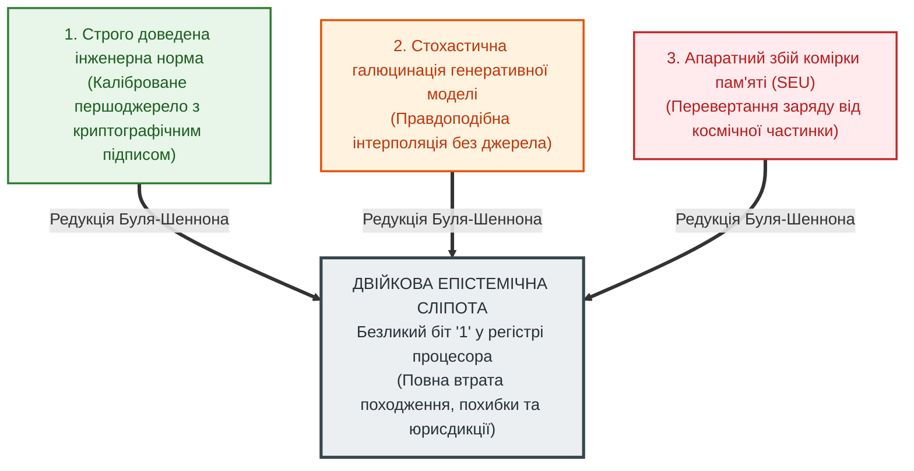

# Глава 01. Теоретичні засади: від булевих вентилів до доказових обчислювальних схем

> **Книга:** [Теорія епістемічних обчислювальних схем: Математичні інваріанти кастодії, метрології та детермінованого виведення](README.md) · Частина 1. Математичні основи епістемічних схем  
> **Попередня глава:** [Зміст та архітектура монографії](README.md)  
> **Наступна глава:** [Глава 02. Фундаментальні кількісні міри та рівняння атенюації достовірності в обчислювальних схемах](ch02-quantitative-measures-and-credibility-attenuation.md)  
> **Зміст книги:** [README.md](README.md)  
> **Автор:** [Микола Федчик](../ExpertSystem/about-the-author.md)  
> **Рівень складності та оптимальне вивчення:** `[L1]` Базовий інженерно-концептуальний (індекс Д. Кнута `[15]`) · *Маршрут:* Обов'язкове вступне ядро для всіх інженерних і дослідницьких треків; 1 прохід  
> **Очікувані результати:** пояснити причину епістемічної сліпоти класичної цифрової схемотехніки після редукції Буля–Шеннона; сформулювати структуру епістемічного тензора стану та чотирирівневу ієрархію епістемічних обчислювальних схем; оцінити інженерні переваги, компроміси й межі застосовності нової теорії порівняно з булевою логікою, аналоговою обробкою сигналів та стохастичними мовними моделями.

## Анотація

У першій главі подано цілісний семантичний аналіз і синтез **Теорії епістемічних обчислювальних схем (ТЕОС)** — науково-інженерної дисципліни на перетині теорії алгебраїчних і потокових обчислювальних схем, інтервальної метрології та формальної епістемології. Виклад побудовано за класичною діалектичною фабулою наукового дослідження: **Вступ — Криза — Потреба — Проблема — Пропозиція — Переваги — Недоліки — Порівняння — Висновки**.

Розкрито історичні витоки кризи довіри до сучасних обчислювальних систем, зумовленої двійковою редукцією Джорджа Буля [[1]](#src-1) та Клода Шеннона [[2]](#src-2), яка ототожнила змістову істинність твердження з наявністю бінарного стану в регістрі. Показано, чому у відповідальних інженерних доменах (авіоніка DO-178C [[18]](#src-18), автомобільна безпека ISO 26262 [[17]](#src-17), клінічна медицина, енергетика та право) ціна непідтвердженого біта є неприйнятною, а традиційне процедурне програмування, пошукові символьні рушії класу Prolog [[11]](#src-11) та генеративні мовні моделі заходять у структурний глухий кут. Сформульовано центральну наукову пропозицію роботи: перехід від безликого біта до чотирикомпонентного епістемічного тензора стану, який обробляється у потоковому обчислювальному графі за топологічними інваріантами збереження кастодії, адитивності метрологічної деградації [[15]](#src-15), небулевої бірешітки Белнапа [[5]](#src-5) та деонтичного комутування на тритермінальних вентилях. Главу завершують зведена порівняльна таблиця чотирьох обчислювальних парадигм, узагальнені висновки, термінологічний словник, перелік абревіатур та бібліографія першоджерел.

---

## 1. Вступ. Предмет теорії епістемічних обчислювальних схем та призначення монографії

Розвиток теорії обчислювальних систем визначається еволюцією базових математичних абстракцій елементарного операційного вузла. У середині XIX століття в інженерних науках та математичній фізиці сформувався апарат балансових рівнянь у розгалужених мережах (Густав Кірхгоф [[3]](#src-3), Георг Ом [[4]](#src-4)). Через століття, у 1938 році, Клод Шеннон [[2]](#src-2) довів, що замикання й розмикання релейних перемикачів ізоморфно описується двозначною символьною алгеброю логіки Джорджа Буля [[1]](#src-1). Так виникла класична теорія булевих схем (*Boolean Circuits*), яка стала фундаментом сучасної цифрової мікроелектроніки.

У другій чверті XXI століття інженерія критичних систем зіткнулася з фундаментальним обмеженням булевої та скалярної арифметичної абстракції. Сучасні процесори виконують мільярди операцій з плаваючою комою за секунду, проте **на рівні елементарних вентилів та регістрів АЛП вони не зберігають інформації про походження числа з верифікованого першоджерела, величину інструментальної похибки вимірювання та нормативну чинність правила, застосованого до цього факту**.

Ця монографія систематизує математичний та архітектурний апарат **Теорії епістемічних обчислювальних схем (ТЕОС)** (англ. *Epistemic Computational Circuit Theory*).

**Означення 1.1 (Теорія епістемічних обчислювальних схем).** *Теорією епістемічних обчислювальних схем (ТЕОС)* називається математична та комп'ютерно-інженерна дисципліна, яка вивчає топологічні інваріанти збереження кастодії, поширення інтервальної метрологічної невизначеності, параконсистентної агрегації та тритермінальної деонтичної комутації багатовимірних тензорів стану в орієнтованих обчислювальних графах над незмінними першоджерелами.

В основі монографії лежить строгий алгебраїчний ізоморфізм узагальнених потокових мереж: **детерміноване логічне виведення та перевірка доказів проектуються не як евристичний перебір дерев з поверненням і не як стохастичне генерування токенів, а як синхронне проходження тензора стану крізь скомпільовану потокову обчислювальну схему**. У такій схемі:
- верифіковане першоджерело (стаття закону, пункт інженерного стандарту, сертифікований показ давача) характеризується початковим **нормованим потенціалом достовірності** $`w_0 \in [0, 1]`$ із криптографічно захищеним дескриптором кастодії;
- інтенсивність передачі побайтово верифікованих транзакцій крізь переріз графа за такт утворює **потік верифікації** $`\Phi \ge 0`$;
- семантична неоднозначність, опосередкованість джерела або інструментальна невизначеність вимірювання за стандартом JCGM GUM [[15]](#src-15) кількісно вирається **коефіцієнтом деградації (дисипації)** $`D \ge 0`$, який адитивно знижує результуючу провідність тракту;
- хибні пресупозиції запиту та спроби зворотної мутації аксіом блокуються **асиметричними спрямованими морфізмами кастодії**;
- а дозвіл чи заборона на застосування норми реалізується **тритермінальними деонтичними вентилями**, де емпіричний факт подається на онтологічний вхід (*Source*), деонтична модальність норми чи процедурний підсікач Поллока [[8]](#src-8) — на керуючий затвор (*Gate*), а санкціонований вердикт знімається з виходу (*Drain*).

> [!IMPORTANT]
> **Методологічне застереження: статус інженерних метафор та формальних моделей у ТЕОС**
> 1. **Евристична роль схемотехнічних та фізичних метафор:** Поняття «потік верифікації», «потенціал достовірності», «деонтичний вентиль», «затвор», «атенюація» та «дисипація втрат» використовуються в цій праці як **проєктно-інженерні та структурно-ізоморфні метафори**. Вони покликані активізувати системну інтуїцію розробника комп'ютерних систем, спираючись на добре досліджені закони теорії кіл і потокових графів.
> 2. **Академічно-прагматична демаркація:** Інформація, семантичне значення та логічна чинність **не є матеріальними фізичними субстанціями**. Логічний «потік» $\Phi$ є екстенсивною транзакційною мірою частоти перевірок (запитів/такт), а не переміщенням речовини; «потенціал» $w$ — це безрозмірна нормована оцінка довіри; а «дисипативні втрати» $`L_{\mathrm{diss}}`$ — це штрафний функціонал інформаційних втрат у просторі прийняття рішень, а не термодинамічне виділення тепла за принципом Ландауера (детально формалізовано у [Главі 09, Розділ 2](ch09-scientific-critique-and-applicability-limits.md#2-перший-рубіж-критики-проблема-категорійної-демаркації-та-парадокс-розгалуження-інформації)).
> 3. **Статус дослідження та промислові реалії:** ТЕОС є концептуальною теоретичною монографією та експериментальною дизайн-гіпотезою спеціалізованого процесора знань (KPU), а не сертифікованим промисловим стандартом. Класична інженерія успішно розв'язує контроль розмірностей статично під час компіляції (`boost::units`, Ada), фільтрацію шумів — фільтрами Калмана та мажоритуванням 2oo3 (IEC 61508), а авіоніку — верифікованими скінченними автоматами (SCADE Suite). ТЕОС досліджує теоретичну границю апаратної інтеграції метаданих і має практичну перспективу насамперед як **жорсткий кремнієвий запобіжник (Hardware Safety Interlock)** проти недетермінованих галюцинацій штучного інтелекту. Наведені в книзі часові та апаратні показники відображають **формальні моделі, симуляційні мікротести та лабораторні прототипи**, а не серійні промислові випробування.

**Навіщо читати цю книгу і кому вона адресована?**
1. **Дослідникам штучного інтелекту та архітекторам експертних систем** книга пропонує конструктивний спосіб подолати проблему галюцинацій та випадків Геттієра [[14]](#src-14) не через евристичне фільтрування виходу нейромережі, а через алгебраїчну заборону виникнення ненульового вихідного потоку без вхідного потоку верифікованої кастодії.
2. **Розробникам процесорних архітектур, ПЛІС (FPGA) та спеціалізованих чипів (ASIC)** книга дає формальну елементну базу для створення апаратних процесорів знань (*Epistemic Processing Units*, EPU), які виконують багатоходову нормативну дедукцію за лінійний час без розгалужень конвеєра.
3. **Інженерам із функціональної безпеки, метрологам та системним аналітикам** монографія надає строгий інструментарій, у якому вимоги стандартів ISO 26262 [[17]](#src-17), RTCA DO-178C [[18]](#src-18), ISO 14253-1 [[16]](#src-16) та система фізичних розмірностей SI [[19]](#src-19) вбудовані безпосередньо в оператори провідності самої обчислювальної схеми.

### 1.1. Дві обчислювальні парадигми: класична синтаксична машина проти епістемічної системи

Для формування цілісного інженерного розуміння дисципліни необхідно чітко розмежувати фундаментальну природу класичного обчислення та епістемічного процесу:

1. **Класична обчислювальна система (синтаксичний перетворювач):**
   - Усі класичні архітектури — від універсальної машини Тюрінга та конвеєрів фон Неймана до суперкомп'ютерів, GPU та сучасних нейромережевих прискорювачів (NPU) — оперують виключно **синтаксичними примітивами**: бітами ($0, 1$) або скалярними числами з плаваючою комою (IEEE 754 `float32`, `float64`).
   - Мета класичної системи — обчислити функцію $f(X) \to Y$. Проте апаратні вузли класичного процесора принципово пізнавально сліпі: вони не знають, звідки надійшло число (з каліброваного давача чи галюцинації нейромережі), якою є його фізична розмірність і чи не прострочено юридичне право на використання правила. Істинність результату винесена за межі машини й цілком покладається на зовнішнього програміста чи оператора.

2. **Епістемічна обчислювальна система (доказовий верифікатор):**
   - Її базовою неподільною одиницею комутації є не скалярний біт, а **чотирикомпонентний епістемічний тензор стану** $`\Psi = \langle \mathcal{C}, w + u\varepsilon, \boldsymbol{\beta}, \vec{d}_{\mathrm{SI}} \rangle`$.
   - Мета епістемічної системи — не просто виконати перетворення сигналу, а **гарантувати збереження інваріантів доказовості**: унеможливити додавання фізично несумісних величин ($`\Delta \vec{d}_{\mathrm{SI}} \neq \vec{0}`$), автоматично транслювати інструментальну невизначеність за стандартом JCGM GUM і фізично блокувати вихід при надходженні нормативного підсікача за Поллоком. Вона відповідає не на питання *«Як швидше обчислити?»*, а на питання *«Чи маємо ми доведене право виконати дію у фізичному світі?»*.

### 1.2. Історична спадкоємність апаратних розширень: чому це не наукова фантастика

Ідея апаратного втілення логіко-метрологічних перевірок або побудови спеціалізованого процесора знань (*Knowledge Processing Unit*, KPU) на перший погляд може видатися футуристичною гіпотезою. Проте аналіз історії комп'ютерної інженерії доводить: **це закономірний, черговий етап еволюції комп'ютерних архітектур, що повторює логіку попередніх десятиліть**:

- **1940–1950-ті роки (Цілочисельне АЛП):** Спочатку операції додавання цілих чисел виконувалися програмними підпрограмами з пересилкою бітів. Згодом інженери запекли суматор безпосередньо в кремній (Арифметико-логічний пристрій, АЛП).
- **1970–1980-ті роки (Апаратний захист пам'яті — MMU):** Прямий доступ користувацьких програм до фізичної пам'яті спричиняв фатальні аварії операційних систем. Архітектори розробили блок керування пам'яттю (*Memory Management Unit*, MMU), який апаратно перевіряє права доступу до сторінок за 1 такт, унеможливлюючи пошкодження ядра софтом.
- **1980-ті роки (Апаратна математика — FPU / x87):** Програмна емуляція дійсних чисел була занадто повільною для інженерних розрахунків. З'явився окремий математичний співпроцесор (*Floating-Point Unit*, FPU).
- **2000–2010-ті роки (Апаратна довіра — TPM / HSM / Secure Enclave):** Програмне зберігання ключів шифрування уразливе до атак нульового дня. Індустрія створила апаратні криптографічні модулі (TPM) та ізольовані кремнієві анклави (ARM TrustZone, Intel SGX), які апаратно підписують транзакції.
- **2020-ті роки (Апаратне машинне навчання — NPU / TPU):** Для масивного матричного множення GEMM у глибокому навчанні універсальні процесори виявилися неефективними — з'явилися нейропроцесори (NPU).
- **Сучасний етап (Апаратний епістемічний запобіжник — EPU / Safety Interlock):** Масове впровадження стохастичного штучного інтелекту у фізичне керування породило ризик катастрофічних аварій через галюцинації. Подібно до того, як MMU апаратно захищає пам'ять від помилок програміста, **епістемічний блок ТЕОС на рівні кремнієвих вентилів захищає фізичний об'єкт від галюцинацій нейромережі**, роблячи неможливим відкриття небезпечного клапана чи рух приводу без повної перевірки доказових інваріантів.

### 1.3. Форм-фактори втілення епістемічних систем

Залежно від класу відповідальності та обчислювальних обмежень системи, принципи ТЕОС реалізуються у трьох практичних інженерних форм-факторах:

1. **Апаратний кремнієвий запобіжник (Hardware Safety Interlock на ПЛІС/ASIC):**
   Спеціалізований ациклічний вентильний DAG, синтезований у кремнії (ПЛІС Xilinx/Altera або ASIC). Увімкнений безпосередньо у фізичний розрив між нейромережевим планувальником (ШІ) та виконавчими приводами. За 1 такт синхронізації ($5\dots 10\,\text{нс}$) на частотах $100\dots 200\,\text{МГц}$ він фізично знеструмлює лінію керування приводом, якщо пакет ШІ не містить валідного хешу походження $\mathcal{C}$, порушує розмірність SI або входить у захисну смугу метрологічної невизначеності ISO 14253-1. У ньому повністю відсутня операційна система, яку можна зламати чи підвісити.
2. **Формально верифіковане мікроядро / Безпечний рантайм (OS / Runtime Level):**
   Програмне середовище жорсткого реального часу (на базі ідей мікроядра seL4 або безалокаційного рантайму C/Rust/Go). Кожна змінна передається як неподільний типізований маркер прав та кастодії (*Capability Token*), що містить структуру похибки GUM та вектор $`\vec{d}_{\mathrm{SI}}`$, блокуючи некоректні операції на рівні машинних інструкцій.
3. **Дволанковий людино-машинний комплекс (AI Perception + Epistemic Auditor):**
   Архітектура для юридичних, регуляторних та діагностичних експертних систем (GovTech, медицина, комплайнс). Стохастичні мовні моделі (LLM) застосовуються виключно офлайн для швидкого видобування та структурування фактів із неструктурованого тексту, тоді як фінальний аудит і юридично неспростовний висновок формує детермінований верифікатор ТЕОС із повною побайтовою простежуваністю до статей законів чи нормативних стандартів.

> [!NOTE]
> **Чотири наукові положення, що виносяться на захист у Главі 01**
> 1. **Формалізація феномену двійкової епістемічної сліпоти:** строго показано, що класична редукція Буля — Шеннона ціною відмови від дескриптора походження, метрологічної похибки та деонтичної модальності зробила елементарні операції цифрового АЛП нечутливими до різниці між верифікованим фактом, стохастичною інтерполяцією та апаратним збоєм.
> 2. **Синтез чотирикомпонентного епістемічного тензора стану:** на основі теорії узагальнених потокових графів запропоновано заміну скалярного біта ортогональним кортежем $`\Psi = \langle \mathcal{C}, w + u\varepsilon, \boldsymbol{\beta}, \vec{d}_{\mathrm{SI}} \rangle`$, що об'єднує криптографічну кастодію Меркла, дуальну алгебру Кліффорда, бірешітку Белнапа та решітку фізичних одиниць SI.
> 3. **Діалектична демаркація та класифікація обмежень методу:** виконано системний аналіз нової дисципліни за вісьмома науково-методологічними категоріями (Вступ — Криза — Потреба — Проблема — Пропозиція — Переваги — Недоліки — Порівняння), із явним визначенням ціни офлайн-компіляції та розрядності апаратних шин.
> 4. **Принцип надбудовного алгебраїчного ізоморфізму:** доведено, що теорія епістемічних обчислювальних схем не ототожнює інформацію з фізичним зарядом, а утворює детермінований верифікаційний шар поверх цифрових КМОН-вентилів та регістрів ПЛІС.
> *Керування рантаймом / Інженерний інваріант:* Жоден сигнал у схемі ТЕОС не допускається до виконавчого компаратора без криптографічно валідного дескриптора кастодії в рантаймі ($`\mathrm{ZHR}_{\mathrm{runtime}} = 1{,}0`$), скінченної міри невизначеності та колінеарного вектора розмірності SI.

---

## 2. Криза. Вісімдесят вісім років епістемічної сліпоти цифрової ери

Коли сучасна мовна модель упевненим тоном цитує неіснуючу статтю кодексу або вигадує хибний поріг спрацювання запобіжного клапана, причину зазвичай шукають у недосконалості навчальної вибірки чи стохастичній природі алгоритму вибірки токенів. Проте такий погляд є неповним. Фундаментальна проблема сучасної інформатики зародилася задовго до появи глибокого навчання — у мить, коли логічне числення було зведене до синтаксичних операцій над двома анонімними символами.

У 1854 році Джордж Буль у монографії *«Дослідження законів мислення»* [[1]](#src-1) запропонував алгебраїзацію класичної логіки, замінивши змістовні судження бінарними змінними зі значеннями $1$ (істина) та $0$ (хиба). Через вісімдесят чотири роки, у 1938 році, Клод Шеннон у праці *«Символьний аналіз релейних і перемикальних схем»* [[2]](#src-2) поставив у взаємно однозначну відповідність булевим операціям кон'юнкції, диз'юнкції та заперечення послідовне й паралельне з'єднання контактів релейних схем.

Ця математична редукція забезпечила універсальність та високу тактову частоту цифрових інтегральних схем. Проте абстрагування від семантичного контексту зумовило фундаментальне структурне обмеження, яке в межах цієї монографії визначається як **феномен двійкової епістемічної сліпоти** (рисунок 1.1).

**Рисунок 1.1.** Феномен двійкової епістемічної сліпоти після редукції Буля–Шеннона: злиття доведеного факту, стохастичної вигадки та фізичного збою в один нерозрізненний стан регістра.

Як показано на рисунку 1.1, усередині класичного арифметико-логічного пристрою (АЛП) стан логічної одиниці у тригері є анонімним. Апаратний вентиль `AND` або `OR` не має структурної змоги розрізнити три протилежні ситуації:
1. Одиниця надійшла з офіційного, побайтово звіреного тексту міжнародного стандарту безпеки.
2. Одиниця виникла внаслідок стохастичної галюцинації великої мовної моделі або неперевіреного джерела.
3. Одиниця утворилася через тепловий шум, електромагнітну заваду на шині або влучання іонізуючої частинки у затвор КМОН-транзистора (*Single Event Upset*, SEU).

Доки комп'ютери виконували роль пасивних калькуляторів під безпосереднім наглядом людини, епістемічна сліпота апаратури компенсувалася експертизою інженера. Програміст сам знав, що змінна `pressure_limit` взята з конкретного стандарту ISO, сам стежив за розмірностями у формулах і сам відповідав за кожне розгалуження `if`.

Проте із масовим впровадженням автономних агентів та генеративного штучного інтелекту ця компенсація зникла. Виникла триєдина **криза сучасних обчислень**:
- **Амнезія походження (Provenance Amnesia):** перетворення первинних документів на векторні вкладення та матриці ваг знищує причинно-наслідковий зв'язок між вихідним твердженням і тим конкретним байтовим рядком першоджерела, який обґрунтовує його чинність.
- **Техногенні випадки Геттієра:** навіть коли стохастична система випадково видає правильне числове значення, його внутрішнє обґрунтування може спиратися на скасовану ревізію документа або хибну пресупозицію, що неможливо виявити простим тестуванням виходу [[14]](#src-14).
- **Катастрофічна асиметрія верифікації:** вартість машинної генерації зовні правдоподібного, але внутрішньо дефектного інженерного звіту наближається до нуля, тоді як трудовитрати людини-експерта на побайтову перевірку кожного посилання й перерахунку похибок зростають лавиноподібно.

---

## 3. Потреба. Відповідальні інженерні домени з неприйнятною ціною непідтвердженого висновку

У розважальних, побутових та суто пошукових сервісах статистична апроксимація є цілком прийнятною: якщо рекомендаційна стрічка запропонує читачеві менш вдалу книгу або перекладач допустить стилістичну неточність, система не зазнає аварії. Але в основі сучасної технологічної інфраструктури лежать галузі, де **право на твердження визначає безпеку людей, фізичну цілісність об'єктів та верховенство права**:

1. **Авіоніка, космонавтика та функціональна безпека транспорту (RTCA DO-178C [[18]](#src-18), ISO 26262 ASIL-D [[17]](#src-17)):** бортовий обчислювач не може ухвалювати рішення про маневр ухилення або екстрене гальмування на підставі некаліброваної евристичної оцінки моделі. Він потребує строгого метрологічного обліку довірчих інтервалів кожного давача та миттєвого переходу у безпечний стан при втраті цілісності каналу даних.
2. **Доказова медицина та клінічна підтримка рішень:** розрахунок інфузійної терапії чи перевірка сумісності препаратів вимагають однозначної прив'язки до чинних клінічних протоколів, безпомилкового контролю фізичних одиниць дозування [[19]](#src-19) та автоматичного блокування рекомендації за наявності хоча б одного абсолютного протипоказання.
3. **Критична енергетика та оборонні інформаційні системи (STANAG 2022 [[20]](#src-20)):** в умовах активної інформаційної протидії автоматизована система управління мусить алгоритмічно обмежувати потенціал непрямих повідомлень із ненадійних джерел, не дозволяючи масованому дублюванню повідомлень («луна-камері») імітувати достовірний факт.
4. **Нормативний комплаєнс, юриспруденція та фінансовий аудит:** кожне рішення про допуск фінансової операції або відповідність проекту будівельним нормам зобов'язане супроводжуватися криптографічним сертифікатом, який доводить чинність застосованої норми на момент події та відсутність підсікаючих винятків [[8]](#src-8).

Отже, сформувалася об'єктивна **потреба** у переході від інформаційно-пошукових та генеративних систем до **детермінованих схем доказового виведення**, здатних забезпечити чотири обов'язкові інженерні контракти:
- *контракт невідчужуваної кастодії* (кожен висновок структурно несе в собі криптографічний дескриптор свого першоджерела);
- *контракт наскрізної метрології та розмірнісної безпеки* (похибки за ISO GUM [[15]](#src-15) та розмірності SI [[19]](#src-19) обчислюються одночасно з логічним виведенням);
- *контракт безінерційного нормативного керування* (відкликання норми або активація винятку за один такт блокує тракт висновку);
- *контракт захисної відмови за замовчуванням* (*Fail-Closed Gate*: за браку даних, перевищення похибки або паритету суперечливих норм система гарантовано утримується від хибного дозволу).

---

## 4. Проблема. Структурні обмеження процедурного коду, пошукових рушіїв та скалярної логіки

Чому сформульовану потребу неможливо задовольнити простим нарощуванням обчислювальної потужності або написанням додаткового імперативного коду? Семантичний аналіз виявляє **фундаментальну наукову проблему**: між структурою доказового знання та архітектурою класичних обчислювальних моделей існує структурне протиріччя, яке проявляється у чотирьох обмеженнях.

### 4.1. Обмеження імперативного програмування та скидання процесорного конвеєра

У традиційному програмному забезпеченні інженер реалізує перевірку правил через вкладені каскади умовних операторів `if-else` або `switch`. При цьому відбувається змішування двох ортогональних сутностей: самого емпіричного факту і нормативного права на його застосування. На мікроархітектурному рівні суперскалярного процесора кожен такий оператор компілюється в інструкцію умовного переходу. Коли система перевіряє сотні контекстно-залежних правил і винятків, апаратний прогнозатор переходів (*Branch Predictor*) неминуче помиляється. Кожна помилка прогнозу викликає скидання конвеєра команд (*Pipeline Flush*), перетворюючи час виконання у найгіршому випадку (*Worst-Case Execution Time*, WCET) на випадкову величину, неприйнятну для жорстких систем реального часу.

### 4.2. Обмеження класичних символьних рушіїв та комбінаторний вибух пошуку

Класичні системи логічного програмування та продукційного виведення першого покоління (мови класу Prolog на базі абстрактної машини Девіда Воррена WAM [[11]](#src-11) та мережі зіставлення шаблонів Чарльза Форгі Rete [[12]](#src-12)) відокремили декларативну базу правил від рушія. Проте сам процес багатоходової дедукції у них побудовано як **пошук у глибину з поверненнями (Backtracking) на дереві розв'язків**. Якщо тракт обґрунтування налічує $N$ послідовних кроків, а в кожному вузлі сходяться в середньому $b$ альтернативних правил, часова складність пошуку зростає за експоненційним законом (формула (1.1)):

$$
T_{\mathrm{search}}(N, b) = \Theta\left(b^N\right)
$$

**Формула (1.1).** Експоненційна асимптотика часу пошуку з поверненнями у класичних деревах резолюційного виведення.

Тут:
- $`T_{\mathrm{search}}`$ — кількість елементарних кроків уніфікації та перевірки вузлів дерева (безрозмірна величина або такти процесора);
- $`N \in \mathbb{N}^+`$ — глибина дедуктивного тракту (кількість послідовно застосованих правил);
- $`b > 1`$ — середній коефіцієнт розгалуження правил у базі знань.

Вже при глибині $N = 20$ та коефіцієнті розгалуження $b = 3$ кількість станів становить $`3^{20} \approx 3{,}49 \times 10^9`$ операцій. Замість синхронного обчислення вздовж готового доказового тракту машина витрачає мільярди тактів на перебір тупикових гілок.

### 4.3. Обмеження класичної булевої алгебри та дедуктивний вибух за суперечності

Двозначна булева логіка [[1]](#src-1) спирається на закон виключеного третього та закон непротиріччя. У реальному ж інженерному чи правовому корпусі документів колізії є неминучими: відомча інструкція може дозволяти тимчасовий режим роботи, який заборонений загальним галузевим стандартом. У класичному численні предикатів поява двох суперечливих засновків $A$ та $\neg A$ активує принцип вибуху Дунса Скота (*Ex Falso Quodlibet*): із суперечності формально виводиться довільне твердження $B$. Класичний логічний вентиль не здатний відокремити ситуацію повної відсутності даних (епістемічний вакуум) від ситуації зіткнення двох вагомих доказів протилежного знаку (епістемічна колізія).

### 4.4. Обмеження скалярної нечіткості та втрата багатовимірної структури

Спроби замінити дискретні нулі й одиниці неперервною дійсною величиною або скалярною функцією належності Лотфі Заде [[6]](#src-6) $`\mu \in [0, 1]`$ також не розв'язують проблеми. Скалярне число у звичайному суматорі є сліпим до джерела свого потенціалу: рівень $`0{,}70`$ може означати як часткове виконання обов'язкового закону, так і повне виконання другорядної рекомендації або ж просте підсумовування ста копій одного неперевіреного повідомлення. Згортання багатовимірної епістемічної природи знання в одне скалярне число знищує інформацію про походження, похибку та нормативну модальність.

### 4.5. Криза міркування у нейролінгвістичних системах та подвійний бар'єр експертних систем

Практичні спроби подолати крихкість класичного штучного інтелекту шляхом переходу до сучасних нейролінгвістичних моделей (LLM, RAG, автономні агенти з ланцюжками міркувань *Chain-of-Thought*) виявили ще глибший методологічний розкол — **подвійний бар'єр інженерії знань**:

1. **Бар'єр екстракції знань (Hermeneutic Problem):** перетворення неструктурованого тексту стандартів, нормативів та інструкцій природною мовою у формальні правила є неперервною, контекстно-залежною статистичною задачею. Спроби побудувати жорсткі детерміністичні парсери природної мови зазнають краху через полісемію та багатозначність людського мовлення. Для екстракції об'єктивно потрібні статистичні трансформерні моделі, обмежені замкненими граматиками (GBNF) та верифіковані людиною в циклі керування (*Human-in-the-Loop*).
2. **Бар'єр детермінованого міркування (Reasoning Bottleneck):** щойно знання екстраговано, виникає потреба в їх багатоходовому логічному виведенні (*Inference / Reasoning*). Наївне делегування міркування самій мовній моделі призводить до епістемічної катастрофи: статистична авторегресія генерує стохастично правдоподібні, але логічно хибні тексти («галюцинації дедукції»), не здатна гарантувати ліміт часу відгуку (WCET) і позбавлена апарату строгого доведення.

Спроба ж побудувати гібридну систему, де нейролінгвістичний екстрактор передає видобуті правила у класичний символічний рушій (Prolog, CLIPS, SMT Z3), натрапляє на нездоланний **імпедансний розрив**:
- Екстрактор природної мови неминуче генерує правила з локальними неточностями, взаємними колізіями або шумом інтерпретації;
- Класичний символічний рушій реагує на будь-яку колізію активацією принципу вибуху (*Ex Falso Quodlibet*) або зривається в експоненційний перебір дерева резолюцій ($`\Theta(b^N)`$).

У результаті сучасні експертні системи залишаються малоефективними: вони або «гнучкі, але брехливі» (нейронні моделі), або «строгі, але крихкі та нескінченно повільні» (символічні дерева пошуку).

Вихід із цієї кризи вимагає рішучого схемотехнічного повороту: **аналогії з цифровою схемотехнікою, картами Карно та апаратною мінімізацією логіки**. У цифровій схемотехніці ніхто не інтерпретує логічні рівняння програмним перебором у рантаймі — таблиці істинності мінімізуються заздалегідь і синтезуються у статичні вентильні схеми. Відповідно, для подолання кризи міркування потрібна **нова епістемічна алгебра та компіляція знань (Knowledge Compilation)**: перехід від динамічного пошуку в просторі станів до топологічного поширення сигналу по статично скомпільованій схемі, де параконсистентність ізолює суперечності, а дуальні числа забезпечують аналітичну метрологію.

**Формулювання наукової проблеми:** як побудувати таку формальну теорію та елементну базу обчислень, у якій би кожен сигнал нерозривно переносив власне криптографічне походження, метрологічну невизначеність, параконсистентний статус і фізичну розмірність, а багатоходове виведення виконувалося з лінійною обчислювальною складністю $`\Theta(N)`$ у спрямованому ациклічному графі без пошукового перебору та ризику галюцинацій?

---

## 5. Пропозиція. Теорія епістемічних обчислювальних схем як формальний синтез доказів

Для розв'язання цієї проблеми пропонується **Теорія епістемічних обчислювальних схем (ТЕОС)**. Першим кроком нової теорії є заміна скалярного булевого біта на структурований багатовимірний носій — **Епістемічний тензор стану**.

**Означення 1.2 (Епістемічний тензор стану).** *Епістемічним тензором стану* в довільному перерізі обчислювального тракту ТЕОС називається впорядкована четвірка величин, що задається формулою (1.2):

$$
\Psi = \left\langle \mathcal{C}, \quad w + u\,\varepsilon, \quad \boldsymbol{\beta}, \quad \vec{d}_{\mathrm{SI}} \right\rangle
$$

**Формула (1.2).** Канонічне представлення епістемічного тензора стану в обчислювальному каналі ТЕОС.

Тут:
- $`\mathcal{C} = (\mathrm{doc\_id}, [i_{\mathrm{start}}, i_{\mathrm{end}}), h_{\mathrm{SHA256}})`$ — дескриптор побайтової кастодії першоджерела (числовий ідентифікатор документа, напіввідкритий байтовий інтервал цитати у спільній пам'яті хоста та криптографічний відбиток SHA-256);
- $`x + u\,\varepsilon \in \mathbb{D}`$ (або для безрозмірних нормативних ваг $`w + u\,\varepsilon \in \mathbb{D}`$) — дуальний метрологічний потенціал над алгеброю дуальних чисел Вільяма Кліффорда [[7]](#src-7) з нільпотентною одиницею $`\varepsilon^2 = 0`$, де дійсна частина відображає виміряну фізичну величину $`x \in \mathbb{R}`$ (або безрозмірний нормований потенціал достовірності $`w \in [0, 1]`$, що відповідає додатній проекції $`\mu^+`$ при $`\vec{d}_{\mathrm{SI}} = \vec{0}`$), а дуальна частина $`u \ge 0`$ — стандартну невизначеність за JCGM GUM [[15]](#src-15);
- $`\boldsymbol{\beta} = (\mu^+, \mu^-) \in [0, 1]^2`$ — двокомпонентний вектор істинності у чотиризначній бірешітці Нюела Белнапа [[5]](#src-5), де $`\mu^+`$ кількісно виражає силу незалежних свідчень «ЗА», а $`\mu^-`$ — силу незалежних свідчень «ПРОТИ»;
- $`\vec{d}_{\mathrm{SI}} = [d_L, d_M, d_T, d_I, d_\Theta, d_N, d_J]^T \in \mathbb{Z}^7`$ — цілочисельний вектор показників степенів семи основних одиниць Міжнародної системи SI [[19]](#src-19) (довжина, маса, час, сила електричного струму, термодинамічна температура, кількість речовини, сила світла).

**Принцип 1.1 (Демаркація носія істинності та керуючої норми).** У будь-якому вузлі епістемічної обчислювальної схеми емпіричний або текстуальний факт з кастодією $`\mathcal{C}`$ подається на інформаційний вхід джерела (*Source*) та утворює потік верифікаційних транзакцій до виходу вердикту (*Drain*), тоді як деонтична норма (обов'язок, дозвіл, заборона) та аргументаційні підсікачі Поллока [[8]](#src-8) діють виключно на ізольованому керуючому вході затвора (*Gate*), модулюючи провідність тракту без права змінювати або фальсифікувати сам вхідний факт.

Синтез систем доказового виведення в ТЕОС розгортається на чотирьох ієрархічних рівнях складності (рисунок 1.2).

```mermaid
flowchart TD
    accTitle: Рисунок 1.2. Чотирирівнева ієрархія синтезу в Теорії епістемічних обчислювальних схем
    accDescr: Структурна декомпозиція ТЕОС від базових кількісних мір і топологічних інваріантів збереження (Рівень 1) через темпоральні, міждоменні й верифікаційні оператори (Рівень 2) і тритермінальні деонтичні вентилі (Рівень 3) до каскадних схем та операційних вузлів (Рівень 4).

    subgraph L1 ["Рівень 1. Фундаментальні міри та інваріанти збереження (Глави 02-04)"]
        Atten["Рівняння атенюації достовірності:\nКоефіцієнт деградації D та функціонал втрат"]
        Invariants["Три топологічні інваріанти збереження:\n1. Вузловий баланс потоків кастодії\n2. Адитивність деградації та дисперсій уздовж шляху\n3. Деонтично-модальна ортогональність вентиля"]
        Belnap["Небулева алгебра провідності:\nЧотиризначна бірешітка Белнапа,\nт-норма Гамахера та дуальні числа Кліффорда"]
    end

    subgraph L2 ["Рівень 2. Темпоральні, міждоменні та верифікаційні оператори (Глава 05)"]
        Temporal["Темпоральні та міждоменні оператори:\nБета-інтегратор прецедентів, Фільтр інерції канону,\nМорфізм Галуа FCA + 1-WL, Обмежувач STANAG 2022"]
        Verifiers["Оператори структурної верифікації тензора:\nВекторний верифікатор розмірностей SI,\nКриптографічний предикат SHA-256, Попперівський генератор"]
    end

    subgraph L3 ["Рівень 3. Тритермінальні деонтичні вентилі (Глава 06)"]
        Morphism["Асиметричний спрямований морфізм кастодії:\nОдноспрямоване поширення аксіоми\nта блокування зворотного підлабузництва"]
        Gate["Тритермінальний деонтичний вентиль:\nРозділення онтології та деонтики\n(Source - Факт, Gate - Норма, Drain - Вердикт)"]
    end

    subgraph L4 ["Рівень 4. Каскадні топології та операційні вузли (Глави 07-08)"]
        Cascades["Багатокаскадні схеми з N вентилів:\nПослідовні тракти дедукції та Диференційні арбітри\nзмагального виведення Pro et Contra"]
        OpUnits["Функціональні операційні вузли:\nНелінійний суматор Ейнштейна-Гамахера,\nДуальний мультиплікатор, Інтервальний компаратор"]
    end

    L1 ==> L2 ==> L3 ==> L4

    classDef l1Style fill:#e8eaf6,stroke:#283593,stroke-width:2px,color:#1a237e;
    classDef l2Style fill:#e0f2f1,stroke:#00695c,stroke-width:2px,color:#004d40;
    classDef l3Style fill:#fff8e1,stroke:#f57f17,stroke-width:2px,color:#e65100;
    classDef l4Style fill:#e8f5e9,stroke:#2e7d32,stroke-width:2px,color:#1b5e20;

    class Atten,Invariants,Belnap l1Style;
    class Temporal,Verifiers l2Style;
    class Morphism,Gate l3Style;
    class Cascades,OpUnits l4Style;
```

**Рисунок 1.2.** Чотирирівнева ієрархія синтезу в Теорії епістемічних обчислювальних схем: від фундаментальних інваріантів збереження до функціональних операційних вузлів.

Як показано на рисунку 1.2, запропонована теорія дозволяє транслювати нормативно-технічний корпус документів у **спрямований ациклічний граф епістемічної схеми**. Така схема має строго розраховуваний коефіцієнт деградації $`D`$, прогнозований поріг активації деонтичних вентилів і вбудований захист від колізій імен між несумісними поняттями різних предметних областей.

---

## 6. Переваги. Фундаментальні властивості епістемічних обчислювальних схем

Застосування апарату ТЕОС забезпечує шість інженерних переваг над традиційними програмними та нейромережевими архітектурами.

### 6.1. Конструктивна неможливість виникнення галюцинацій у вузлах схеми

У класичній булевій схемі хибний сигнал на вході не відрізняється від істинного. В епістемічній обчислювальній схемі кожен переріз тракту характеризується інтенсивним потенціалом достовірності $`w \in [0, 1]`$, екстенсивним потоком верифікованих транзакцій кастодії $`\Phi \ge 0`$ (кількістю тензорів стану $`\Psi`$ з підтвердженим дескриптором $`\mathcal{C}`$, що проходять крізь переріз за такт синхронізації) та коефіцієнтом деградації $`D \ge 0`$ (повна аксіоматика цих трьох мір виводиться у [Главі 02](ch02-quantitative-measures-and-credibility-attenuation.md), а мережеві теореми — у [Главі 03](ch03-topological-conservation-invariants.md)). Завдяки цьому виконується фундаментальне вузлове обмеження збереження кастодії.

**Твердження 1.1 (Вузлова умова недопущення безпідставного висновку).** У будь-якому внутрішньому вузлі епістемічної обчислювальної схеми без первинних джерел аксіоматичної кастодії сумарний вихідний потік верифікованих транзакцій не може перевищувати суми вхідних верифікованих потоків за вирахуванням дисипативного відсіву (формула (1.3)):

$$
\sum_{k=1}^{m} \Phi_{\mathrm{in}, k} - \sum_{j=1}^{n} \Phi_{\mathrm{out}, j} - \Phi_{\mathrm{leak}} = 0 \implies \sum_{j=1}^{n} \Phi_{\mathrm{out}, j} \le \sum_{k=1}^{m} \Phi_{\mathrm{in}, k}
$$

**Формула (1.3).** Перший топологічний інваріант збереження (вузловий баланс потоків верифікованих транзакцій у графі виведення, структурний аналог закону збереження потоку в мережі [[3]](#src-3)).

Тут:
- $`\Phi_{\mathrm{in}, k} \ge 0`$ — вхідний потік верифікованих транзакцій $k$-ї гілки, що несе підтверджену кастодію першоджерела, $`\text{такт}^{-1}`$;
- $`\Phi_{\mathrm{out}, j} \ge 0`$ — вихідний потік верифікованих транзакцій $j$-ї гілки висновку, $`\text{такт}^{-1}`$;
- $`\Phi_{\mathrm{leak}} \ge 0`$ — потік відбракованих або дисипативно втрачених транзакцій через семантичну неоднозначність чи метрологічну відмову, $`\text{такт}^{-1}`$.

*Інженерний наслідок:* якщо на входах вузла відсутній потік побайтово підтвердженої кастодії ($`\sum \Phi_{\mathrm{in}, k} = 0`$), то за формулою (1.3) невід'ємний вихідний потік тотожно дорівнює нулю ($`\Phi_{\mathrm{out}} \equiv 0`$). Галюцинація (твердження без першоджерела) структурно не може з'явитися на виході схеми, що забезпечує конструктивне виконання інваріанта шлюзу нульових галюцинацій ($`\mathrm{ZHR}_{\mathrm{runtime}} = 1{,}0`$).

> [!NOTE]
> **Демаркація наскрізної доказовості та факторизація ZHR**
> Інваріант $`\mathrm{ZHR}_{\mathrm{runtime}} = 1{,}0`$ діє у строго криптографічному сенсі: рантайм схеми гарантує, що жодне твердження не сформується без валідного гешу та посилання на байтовий діапазон у сховищі. Водночас це не означає абсолютної безпомилковості всієї системи: наскрізна якість рішень факторизується на апаратний рантайм та якість офлайн-компілятора норм:
> $`\mathrm{ZHR}_{\mathrm{end\text{-}to\text{-}end}} = \mathrm{ZHR}_{\mathrm{runtime}}(\mathcal{P}_{\mathrm{SHA}}) \cdot \mathcal{F}_{\mathrm{compile}}`$
> Якщо інженер чи синтаксичний парсер допустили семантичну помилку під час первинного перекладу тексту закону в граф, схема детерміновано відтворить цю помилку з ідеальним збереженням криптографічної кастодії. Детально цю межу досліджено у [Главі 09, Розділ 5](ch09-scientific-critique-and-applicability-limits.md#5-четвертий-рубіж-критики-чи-гарантує-криптографічна-кастодія-істинність-знань).

### 6.2. Лінійна часова складність багатоходової дедукції замість комбінаторного вибуху

На противагу експоненційному бектрекінгу за формулою (1.1), у ТЕОС послідовне правило з $N$ нормативних передумов синтезується як **послідовний каскад $N$ тритермінальних деонтичних вентилів**, де вихід кожного попереднього вентиля з'єднаний з інформаційним входом наступного.

**Твердження 1.2 (Лінійна часова оцінка послідовного каскаду).** Наскрізна нормована провідність $`\sigma_{\mathrm{total}}`$ та сумарний час поширення сигналу $`\tau_{\mathrm{prop}}`$ крізь послідовний каскад із $N$ деонтичних вентилів визначаються формулою (1.4):

$$
\sigma_{\mathrm{total}} = \prod_{k=1}^{N} \sigma_k\left(w_{G, k}\right), \qquad \tau_{\mathrm{prop}} = \sum_{k=1}^{N} \tau_{\mathrm{switch}, k} = \Theta(N)
$$

**Формула (1.4).** Співвідношення наскрізної мультиплікативної провідності та лінійного часу затримки послідовного дедуктивного каскаду деонтичних вентилів.

Тут:
- $`\sigma_k(w_{G, k}) \in [0, 1]`$ — безрозмірна нормована провідність тракту $k$-го вентиля як функція потенціалу його нормативного входу керування $`w_{G, k}`$;
- $`\tau_{\mathrm{switch}, k} > 0`$ — фіксований апаратний час обчислення одного каскаду (в тактах синхронізації або наносекундах).

Якщо хоча б одна норма на проміжному керуючому вході $`G_k`$ скасована або не виконується ($`w_{G, k} < w_{\mathrm{th}} \implies \sigma_k = 0`$), добуток у формулі (1.4) перетворюється на нуль, і весь тракт переходить у стан блокування за лінійний час $`\Theta(N)`$ без пошукового перебору.

> [!NOTE]
> **Математична умова досяжності лінійного часу та теорема Кука — Левіна**
> Співвідношення $`\tau_{\mathrm{prop}} = \Theta(N)`$ не скасовує фундаментальну теорему Кука — Левіна про NP-повну природу задачі логічного виведення (SAT). Лінійний час досягається виключно завдяки **просторово-часовій амортизації складності**: комбінаторне зіставлення правил переноситься у фазу статичної офлайн-компіляції нормативної бази знань. Як строго доведено у [Главі 07](ch07-multi-stage-cascades-and-linear-complexity.md) та верифіковано в [Главі 09, Розділ 4](ch09-scientific-critique-and-applicability-limits.md#4-третій-рубіж-критики-чи-скасовує-теорема-про-лінійну-складність-np-повноту-логічного-виведення), лінійна складність у рантаймі без експоненційного розростання розміру схеми гарантується **лише для стратифікованих баз норм із обмеженою деревною шириною графа ($`w \le w_{\max}`$)**. Для довільних нестратифікованих чи циклічних правил комбінаторна складність проявляється під час компіляції схеми.

### 6.3. Усунення розгалужень потоку команд та детермінований час відгуку

Оскільки керування провідністю вентиля здійснюється арифметичною модуляцією на вході $`G`$, а не програмними інструкціями умовного переходу, обчислювальний тракт не містить точок розгалуження потоку команд. Це усуває штрафи за неправильне передбачення переходів (*Branch Misprediction Penalty*) і забезпечує суворо детермінований верхній час виконання (WCET), необхідний для сертифікації систем за стандартами RTCA DO-178C [[18]](#src-18) та ISO 26262 [[17]](#src-17).

### 6.4. Однотактова аналітична метрологія та розмірнісна безпека

Завдяки використанню дуальних чисел Кліффорда [[7]](#src-7) та 7-вимірних векторів розмірностей SI [[19]](#src-19) у тензорі стану (формула (1.2)), функціональні вузли ТЕОС (суматори, мультиплікатори, компаратори) одночасно з обчисленням самої величини знаходять точні похідні першого порядку для поширення інструментальної похибки за JCGM GUM [[15]](#src-15). Водночас вхідний **векторний верифікатор розмірностей SI** миттєво блокує тракт при спробі скласти або порівняти фізично неоднорідні величини (наприклад, тиск у паскалях та силу у ньютонах).

### 6.5. Структурне розділення видів спростування за Поллоком та відсікання софізмів

Як показав Джон Поллок у теорії спростовних міркувань [[8]](#src-8) та розвинули Санджай Модгіл і Генрі Праккен у системі ASPIC+ [[9]](#src-9), існує фундаментальна різниця між прямим спростуванням факту (*Rebutting Defeater*) та підсіканням застосовності правила (*Undercutting Defeater*). У ТЕОС це розмежування отримує пряму операторну реалізацію:
- *Rebuttal* діє як зустрічний потік у протилежному плечі симетричного диференційного арбітра;
- *Undercut* діє як блокуючий потенціал на керуючому вході затвора $`G`$ тритермінального деонтичного вентиля, перекриваючи тракт висновку, але залишаючи незмінним первинний факт на вході $`S`$;
- а **асиметричний морфізм кастодії** блокує будь-яку спробу змінити аксіоматичне джерело зворотним тиском з боку користувача чи зовнішнього інтерфейсу.

### 6.6. Нелінійний захист від ефекту «луна-камери» та паритетний арбітраж колізій

В **Епістемічному суматорі** корельовані або дубльовані джерела автоматично дисконтуються за графом спільного походження, а незалежні непрямі свідчення агрегуються за гіперболічною трикутною ко-нормою Ейнштейна — Гамахера, де верхньою асимптотою виступає одиничний потенціал прямої кастодії ($`w = 1{,}0`$). Тому жодна скінченна кількість непрямих переказів не здатна досягти статусу первинного закону. Якщо ж у диференційному арбітрі стикаються два рівносильні докази протилежного знаку, схема не зазнає логічного вибуху, а врівноважує плечі у стані `PARITY` (точка білатеральної суперечності бірешітки Белнапа [[5]](#src-5)).

---

## 7. Недоліки. Інженерні компроміси, накладні витрати та межі застосовності

Відповідно до принципу наукової фальсифікованості Карла Поппера [[10]](#src-10) та критерію зовнішнього доповнення Олексія Івахненка [[13]](#src-13), жодна формальна система не є позбавленою внутрішніх обмежень. Переваги ТЕОС досягаються ціною п'яти суттєвих інженерних компромісів, які архітектор зобов'язаний враховувати перед вибором цієї парадигми.

### 7.1. Висока трудомісткість первинної компіляції знань (амортизація складності у фазу компіляції)

На відміну від генеративних моделей, які індексують сирі нерозмічені тексти, епістемічна схема потребує попередньої **формальної компіляції корпусу першоджерел**: декомпозиції норм на атомарні предикати, обчислення байтових зміщень кастодії, призначення кодів достовірності STANAG 2022 [[20]](#src-20) та оголошення розмірностей SI [[19]](#src-19). Як строго доведено в главі 09, усунення пошукового перебору в рантаймі досягається за рахунок перенесення задачі канонічного синтезу графа у фазу компіляції знань.

### 7.2. Консерватизм захисної відмови та відсутність генеративної евристичності

Епістемічна обчислювальна схема за своєю конструкцією є **машиною суворої перевірки нормативного допуску, а не інструментом художньої творчості чи вільного асоціативного пошуку**. Якщо запит виходить за межі наявних першоджерел або виміряна величина потрапляє у захисну смугу метрологічної невизначеності компаратора за ISO 14253-1 [[16]](#src-16), схема детерміновано блокує вихід (`REFUSAL`). Там, де від системи очікують написання есе або висування інтуїтивних припущень без доказів, апарат ТЕОС не застосовується.

### 7.3. Розширення бітової ширини комутаційних шин та апаратна надмірність

Перехід від однобітного булевого провідника до передачі повного тензора стану $`\Psi`$ за формулою (1.2) вимагає від 128 до 512 біт на один канал (ідентифікатор кастодії, межі байтів, дуальна пара чисел для значення й похибки, вектор Белнапа та 7-вимірний вектор SI). При реалізації на ПЛІС (FPGA) або в спеціалізованому кремнії (ASIC) це пропорційно збільшує площу трасування міжз'єднань та енергоспоживання регістрових блоків порівняно з елементарними булевими вентилями.

### 7.4. Нечутливість криптографічної кастодії до змістовних помилок самого законодавця

Криптографічний предикат побайтової кастодії гарантує автентичність цитати та точність виконання затвердженого правила. Проте **криптографічна цілісність першоджерела не тотожна його фізичній чи науковій безпомилковості**: якщо комітет зі стандартизації або парламент затвердив в офіційному документі хибний коефіцієнт, схема ТЕОС детерміновано відтворить цю офіційну норму. Виявлення таких помилок вимагає перехресного зіставлення з фізичними інваріантами та зовнішнього аудиту людиною-експертом.

### 7.5. Необхідність вхідного нейро-символьного каскаду для роботи з природною мовою

Оператори ТЕОС оперують формалізованими тензорами стану. Якщо користувач звертається до системи неструктурованою розмовною мовою, перед вхідними вузлами епістемічної схеми необхідно встановити допоміжний рецепторний модуль (синтаксичний аналізатор або локальну мовну модель). Цей модуль перетворює природномовне запитання на формальний вектор кандидатів (рівень *Relevance*), але повністю позбавлений права обходити деонтичні вентилі чи генерувати власну кастодію (рівень *Eligibility*).

---

## 8. Порівняння. Чотири обчислювальні парадигми у дзеркалі інженерних критеріїв

Для цілісного позиціонування нової теорії зіставимо булеву алгебру [[1]](#src-1), класичну цифрову схемотехніку [[2]](#src-2), аналогову обробку сигналів та Теорію епістемічних обчислювальних схем за вісьмома визначальними інженерними критеріями (таблиця 1.1).

**Таблиця 1.1.** Порівняльний аналіз класичних обчислювальних парадигм із Теорією епістемічних обчислювальних схем.

| Критерій порівняння | Булева алгебра (Дж. Буль, 1854) | Цифрова схемотехніка (К. Шеннон, 1938) | Аналогова обробка сигналів | Теорія епістемічних обчислювальних схем (ТЕОС) |
| :--- | :--- | :--- | :--- | :--- |
| **1. Елементарний носій сигналу** | Абстрактні символи $`\{0, 1\}`$ | Дискретні рівні напруги у провіднику | Неперервна скалярна величина $`x(t)`$ | **Епістемічний тензор стану $`\Psi`$ за формулою (1.2)** |
| **2. Пам'ять про походження факту** | Відсутня (аксіоми анонімні) | Відсутня (біт не зберігає родоводу) | Відсутня (сигнал невіддільний від шуму) | **Апаратна побайтова кастодія $`\mathcal{C}`$ із предикатом SHA-256** |
| **3. Базова алгебра станів** | Двозначна булева решітка $`\mathbb{B}_2`$ | Двійкова алгебра з третім станом `Hi-Z` | Поле дійсних чисел $`\mathbb{R}`$ | **Чотиризначна бірешітка Белнапа $`\mathcal{B}_4`$ + дуальні числа $`\mathbb{D}`$** |
| **4. Облік похибки та розмірності** | Відсутній (бінарна дихотомія) | Лише технологічний запас завадостійкості | Стохастичний тепловий шум і дрейф нуля | **Аналітична похибка ISO GUM [[15]](#src-15) + верифікатор SI ($`\mathbb{Z}^7`$) [[19]](#src-19)** |
| **5. Механізм керування нормою** | Матеріальна імплікація змішує факт і правило | Дерева булевих вентилів та умовні переходи | Аналогові ключі та порогові компаратори | **Тритермінальний деонтичний вентиль: розділення факту ($S$) і норми ($G$)** |
| **6. Реакція на колізію норм** | Дедуктивний вибух (*Ex Falso Quodlibet*) | Коротке замикання або гонитва сигналів | Насичення підсилювача до межі діапазону | **Диференційний арбітраж: стан паритету у точці $`\mathbf{B} = (1, 1)`$** |
| **7. Складність дедукції глибини $N$** | Експоненційна $`\Theta(b^N)`$ при пошуку | Залежить від розгалужень програмного коду | Неперервний перехідний процес з накопиченням шуму | **Лінійна $`\Theta(N)`$ тактів у послідовному каскаді вентилів** |
| **8. Захист від галюцинацій і луни** | Не передбачений | Не передбачений | Лінійне накопичення похибки суматором | **Інваріант збереження потоку (1.3) + ко-норма Ейнштейна — Гамахера** |

Дані таблиці 1.1 демонструють фундаментальний методологічний висновок: **Теорія епістемічних обчислювальних схем не скасовує цифрову схемотехніку, а утворює над нею вищий епістемічний рівень абстракції**. Так само, як цифровий логічний вентиль фізично складається з аналогових КМОН-транзисторів, але проектується інженером у термінах дискретної булевої логіки, деонтичні вентилі, верифікатори розмірностей і суматори ТЕОС фізично виконуються на цифрових регістрах процесора або логічних комірках ПЛІС, але проектуються й розраховуються за інваріантами збереження кастодії та поширення невизначеності.

---

## 9. Висновки та путівник монографією

Підсумуємо результати семантичного аналізу і синтезу, виконаного в першій главі:

1. **Історичний діагноз:** 88-річне домінування парадигми Буля–Шеннона принесло високу швидкодію цифрових машин, але породило феномен двійкової епістемічної сліпоти, за якого обчислювальний тракт не відрізняє побайтово доведену аксіому від стохастичної галюцинації чи радіаційного збою пам'яті.
2. **Критична потреба:** у доменах високої відповідальності (авіоніка, автономний транспорт, клінічна медицина, енергетика, оборона та право) використання систем без гарантованої кастодії першоджерел, автоматичного обліку метрологічної невизначеності та детермінованої захисної відмови є інженерно неприпустимим.
3. **Корінь наукової проблеми:** ні процедурний код із умовними переходами, ні класичні машини логічного виведення з експоненційним бектрекінгом $`\Theta(b^N)`$, ні двозначна булева логіка, схильна до дедуктивного вибуху при колізіях, не здатні одночасно забезпечити повноту доказового родоводу та лінійний час відгуку в реальному часі.
4. **Сутність пропозиції ТЕОС:** заміна скалярного біта на чотирикомпонентний епістемічний тензор стану $`\Psi`$ (кастодія, дуальний потенціал із похибкою ISO GUM, параконсистентний вектор Белнапа та вектор розмірності SI) дозволяє проектувати системи виведення як спрямовані ациклічні схеми з темпоральними, міждоменними, верифікаційними та тритермінальними деонтичними операторами.
5. **Баланс переваг та обмежень:** ТЕОС гарантує конструктивне відсікання галюцинацій у рантаймі, лінійну швидкодію каскадів $`\Theta(N)`$, відсутність скидань процесорного конвеєра та стійкість до софізмів ціною вищих витрат на первинну компіляцію баз знань, розширення розрядності шин даних і консервативної відмови в умовах неповноти знань.

### Навігаційна карта глав монографії

Подальший виклад книги послідовно розгортає всі чотири рівні ієрархії ТЕОС, подані на рисунку 1.2:
- **[Глава 02](ch02-quantitative-measures-and-credibility-attenuation.md)** вводить систему фундаментальних кількісних мір (нормований потенціал достовірності, потік транзакцій верифікації, коефіцієнт метрологічної та семантичної деградації, продуктивність і функціонал втрат) та виводить рівняння атенюації достовірності у послідовному тракті.
- **[Глава 03](ch03-topological-conservation-invariants.md)** формулює три топологічні інваріанти збереження для вузлів і шляхів обчислювального графа, встановлюючи суворі умови консервативності кастодії та адитивності дисперсій.
- **[Глава 04](ch04-belnap-bilattice-tnorms-and-dual-metrology.md)** розбудовує небулевий математичний апарат на основі раціональної трикутної норми Гамахера, чотиризначної бірешітки Белнапа та дуальної алгебри Кліффорда.
- **[Глава 05](ch05-temporal-interdomain-and-verification-operators.md)** описує частотний коефіцієнт чутливості схеми, дискретно-часові Бета-інтегратори прецедентів і фільтри інерції канону, оператори міждоменного гомоморфізму решіток Галуа та три спеціалізовані оператори верифікації тензора стану (векторний верифікатор розмірностей SI, криптографічний предикат побайтової кастодії та генератор попперівських контрприкладів).
- **[Глава 06](ch06-three-terminal-deontic-gate.md)** присвячена математичній моделі асиметричного морфізму кастодії та тритермінального деонтичного вентиля, що реалізує апаратне розділення факту, деонтичної норми та контраргументів Поллока.
- **[Глава 07](ch07-multi-stage-cascades-and-linear-complexity.md)** досліджує синтез багатокаскадних лінійних дедуктивних схем та параконсистентних диференційних арбітрів для колізійних норм.
- **[Глава 08](ch08-operational-units-adders-multipliers-comparators.md)** присвячена конструюванню високорівневих операційних вузлів: нелінійного суматора на базі ко-норми Ейнштейна — Гамахера з дедуплікацією за графом походження, однотактового дуального мультиплікатора та інтервального компаратора із захисною смугою за ISO 14253-1.
- **[Глава 09](ch09-scientific-critique-and-applicability-limits.md)** викладає систематичну наукову критику, контрприклади та строгі межі застосовності теорії: розв'язання парадоксу розгалуження інформації через буферні повторювачі, критерій нелінійності Гессе для дуальної метрології та теорему про амортизацію NP-складності у фазу компіляції.

---

## Словник

| Термін | Англійський еквівалент | Визначення |
| :--- | :--- | :--- |
| **Теорія епістемічних обчислювальних схем (ТЕОС)** | *Epistemic Computational Circuit Theory (ECCT)* | Науково-інженерна дисципліна, що моделює і проектує процеси доказового логічного виведення як спрямовані обчислювальні схеми з інваріантами збереження кастодії, метрологічної деградації та деонтичної комутації. |
| **Епістемічна сліпота** | *Epistemic Blindness* | Властивість класичних булевих та цифрових схем, за якої стан біта не зберігає інформації про першоджерело, похибку вимірювання та нормативну чинність сигналу. |
| **Епістемічний тензор стану** | *Epistemic State Tensor* | Чотирикомпонентний носій сигналу в ТЕОС, що об'єднує дескриптор побайтової кастодії, дуальний потенціал із невизначеністю ISO GUM, вектор бірешітки Белнапа та вектор розмірності SI. |
| **Побайтова кастодія** | *Byte-Exact Custody* | Криптографічно захищена прив'язка кожного елементарного факту чи правила до незмінного байтового діапазону першоджерела у пам'яті хоста. |
| **Асиметричний морфізм кастодії** | *Asymmetric Custody Morphism* | Двотермінальний спрямований оператор ТЕОС, який передає кастодію від аксіоми до висновку і блокує зворотну модифікацію аксіоматичної бази з боку запиту користувача. |
| **Тритермінальний деонтичний вентиль** | *Three-Terminal Deontic Gate* | Базовий оператор ТЕОС із входами онтологічного джерела (*Source*), деонтичного керування (*Gate*) та виходом вердикту (*Drain*), де норма на вході керування модулює провідність тракту. |
| **Підсікаючий дефітер** | *Undercutting Defeater* | Вид контраргументу за Дж. Поллоком, який скасовує правомірність переходу від засновку до висновку (блокує керуючий вхід вентиля), не заперечуючи істинності самого вхідного факту. |
| **Спростовуючий дефітер** | *Rebutting Defeater* | Вид контраргументу за Дж. Поллоком, який висуває прямий зустрічний доказ протилежного висновку і розв'язується у симетричному диференційному арбітрі. |
| **Векторний верифікатор розмірностей SI** | *SI Dimensionality Verifier* | Спеціалізований оператор ТЕОС, який перевіряє 7-вимірні вектори показників степенів фізичних одиниць SI та блокує тракт при спробі некоректного додавання чи порівняння різнорідних величин. |
| **Захисна смуга компаратора** | *Metrological Guard Band* | Зона навколо нормативного порогу шириною у подвоєну розширену невизначеність вимірювання (за ISO 14253-1), потрапляння в яку переводить компаратор ТЕОС у стан захисної відмови. |

---

## Абревіатури

| Абревіатура | Розшифрування | Опис |
| :--- | :--- | :--- |
| **АЛП (ALU)** | Арифметико-логічний пристрій (*Arithmetic Logic Unit*) | Базовий вузол класичного процесора, що виконує двійкові арифметичні та булеві операції без обліку кастодії. |
| **ПЛІС (FPGA)** | Програмована логічна інтегральна схема (*Field-Programmable Gate Array*) | Напівпровідникова матриця для апаратного синтезу паралельних каскадів епістемічних схем. |
| **ТЕОС (ECCT)** | Теорія епістемічних обчислювальних схем (*Epistemic Computational Circuit Theory*) | Предмет цієї монографії: формальна теорія синтезу детермінованих мереж доказового виведення. |
| **ASIL** | Automotive Safety Integrity Level | Рівень повноти функціональної безпеки дорожніх транспортних засобів за стандартом ISO 26262 (від A до найвищого D). |
| **ASIC** | Application-Specific Integrated Circuit | Спеціалізована інтегральна схема для кремнієвої реалізації епістемічних процесорів знань. |
| **DAG** | Directed Acyclic Graph | Спрямований ациклічний граф, що задає топологію скомпільованої епістемічної обчислювальної схеми. |
| **EPU** | Epistemic Processing Unit | Спеціалізований процесор знань, побудований на елементній базі ТЕОС. |
| **FCA** | Formal Concept Analysis | Аналіз формальних понять (решітки Галуа), що використовується в операторі міждоменного відображення ТЕОС. |
| **GUM** | Guide to the Expression of Uncertainty in Measurement | Міжнародна настанова JCGM 100:2008 з обчислення та вираження невизначеності вимірювань. |
| **SEU** | Single Event Upset | Одиночний радіаційний збій комірки пам'яті або тригера внаслідок влучання високоенергетичної частинки. |
| **SI** | Système International d'Unités | Міжнародна система одиниць фізичних величин із сімома основними розмірностями. |
| **SRR** | Sycophancy Resistance Rate | Показник стійкості системи до тиску підлабузництва та софізмів (цільовий інваріант асиметричного морфізму кастодії дорівнює $`1{,}0`$). |
| **WAM** | Warren Abstract Machine | Канонічна абстрактна машина виконання мови Prolog з пошуком у глибину та бектрекінгом. |
| **WCET** | Worst-Case Execution Time | Гарантована верхня межа часу виконання задачі у найгіршому випадку для систем жорсткого реального часу. |
| **ZHR** | Zero-Hallucination Rate | Конструктивний інваріант шлюзу допуску ($`\mathrm{ZHR}_{\mathrm{runtime}} = 1{,}0`$), за якого кожне вихідне твердження має ненульовий вхідний потік побайтово підтвердженої кастодії. |

---

## Джерела

1. George Boole. [*An Investigation of the Laws of Thought, on Which Are Founded the Mathematical Theories of Logic and Probabilities*](https://www.cambridge.org/core/books/an-investigation-of-the-laws-of-thought/3D532B3FB348FE2BD5AD3EC86168E3F6). London: Walton and Maberly, 1854 (перевидання Cambridge University Press, 2009).
2. Claude E. Shannon. [*A Symbolic Analysis of Relay and Switching Circuits*](https://doi.org/10.1109/T-AIEE.1938.5057767). *Transactions of the American Institute of Electrical Engineers*, 57(12), 713–723, 1938.
3. Gustav Kirchhoff. [*Ueber den Durchgang eines elektrischen Stromes durch eine Ebene, insbesondere durch eine kreisförmige*](https://doi.org/10.1002/andp.18451400402). *Annalen der Physik und Chemie*, 140(4), 497–514, 1845.
4. Georg Simon Ohm. [*Die galvanische Kette, mathematisch bearbeitet*](https://doi.org/10.5479/sil.354716.39088005838644). Berlin: T. H. Riemann, 1827.
5. Nuel D. Belnap. [*A Useful Four-Valued Logic*](https://doi.org/10.1007/978-94-010-1161-7_2). У кн.: J. M. Dunn, G. Epstein (ред.), *Modern Uses of Multiple-Valued Logic*, Dordrecht: D. Reidel Publishing, 5–37, 1977.
6. Lotfi A. Zadeh. [*Fuzzy Sets*](https://doi.org/10.1016/S0019-9958(65)90241-X). *Information and Control*, 8(3), 338–353, 1965.
7. William Kingdon Clifford. [*Preliminary Sketch of Biquaternions*](https://doi.org/10.1112/plms/s1-4.1.381). *Proceedings of the London Mathematical Society*, s1-4(1), 381–395, 1873.
8. John L. Pollock. [*Defeasible Reasoning*](https://doi.org/10.1207/s15516709cog1104_4). *Cognitive Science*, 11(4), 481–518, 1987.
9. Sanjay Modgil, Henry Prakken. [*The ASPIC+ Framework for Structured Defeasible Argumentation: A Tutorial*](https://doi.org/10.1080/19462166.2013.869766). *Argument & Computation*, 5(1), 31–62, 2014.
10. Karl Popper. [*The Logic of Scientific Discovery*](https://www.routledge.com/The-Logic-of-Scientific-Discovery/Popper/p/book/9780415278447). London: Hutchinson, 1959 (нім. оригінал *Logik der Forschung*, Wien: Julius Springer, 1934).
11. David H. D. Warren. [*An Abstract Prolog Instruction Set*](https://www.sri.com/wp-content/uploads/2021/12/309.pdf). Technical Note 309, Artificial Intelligence Center, SRI International, Menlo Park, 1983.
12. Charles L. Forgy. [*Rete: A Fast Algorithm for the Many Pattern/Many Object Pattern Match Problem*](https://doi.org/10.1016/0004-3702(82)90020-0). *Artificial Intelligence*, 19(1), 17–37, 1982.
13. О. Г. Івахненко, В. Г. Лапа. [*Кибернетические предсказывающие устройства*](https://openlibrary.org/works/OL5532645W). Київ: Наукова думка, 1965 (англ. вид.: A. G. Ivakhnenko, V. G. Lapa, *Cybernetics and Forecasting Techniques*, New York: American Elsevier, 1967).
14. Edmund L. Gettier. [*Is Justified True Belief Knowledge?*](https://doi.org/10.1093/analys/23.6.121). *Analysis*, 23(6), 121–123, 1963.
15. JCGM. [*Evaluation of Measurement Data — Guide to the Expression of Uncertainty in Measurement (GUM)*](https://doi.org/10.59161/JCGM100-2008E). JCGM 100:2008, BIPM / ISO / IEC, 2008.
16. ISO. [*ISO 14253-1:2017. Geometrical product specifications (GPS) — Inspection by measurement of workpieces and measuring equipment — Part 1: Decision rules for verifying conformity or nonconformity with specifications*](https://www.iso.org/standard/70137.html). Geneva: International Organization for Standardization, 2017.
17. ISO. [*ISO 26262:2018. Road vehicles — Functional safety*](https://www.iso.org/standard/68383.html). 2nd Edition, Geneva: International Organization for Standardization, 2018.
18. RTCA / EUROCAE. [*DO-178C / ED-12C: Software Considerations in Airborne Systems and Equipment Certification*](https://www.rtca.org/). Washington, D.C.: RTCA, Inc., 2011.
19. BIPM. [*The International System of Units (SI)*](https://www.bipm.org/en/publications/si-brochure). 9th Edition, Sèvres: Bureau International des Poids et Mesures, 2019 (v3.01, 2024).
20. NATO Standardization Office. [*STANAG 2022 / AJP-2.1: Allied Joint Doctrine for Intelligence Procedures (Evaluation of Source Reliability and Information Credibility)*](https://nso.nato.int/). Brussels: NATO, Edition B, 2016.

---

[← Зміст книги](README.md) | [Глава 02. Фундаментальні кількісні міри та рівняння атенюації достовірності →](ch02-quantitative-measures-and-credibility-attenuation.md)
