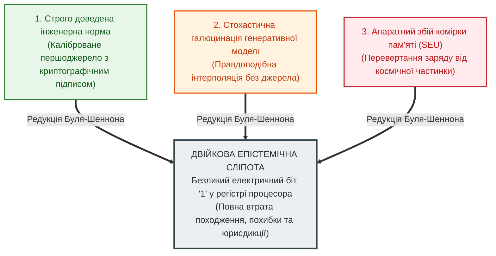

# Глава 01. Концептуальний маніфест: Від булевих вентилів до схемотехніки істини

> **Книга:** [Теорія епістемічних кіл: Схемотехніка доказових обчислень та апаратного виведення](README.md) · Частина I: Основи теорії епістемічних кіл  
> **Попередня глава:** [Зміст та архітектура монографії](README.md)  
> **Наступна глава:** [Глава 02. Четвірка фундаментальних величин та Закон Ома для епістеміки](ch02-fundamental-quantities-and-ohms-law.md)  
> **Зміст книги:** [README.md](README.md)  
> **Автор:** [Микола Федчик](../ExpertSystem/about-the-author.md)  
> **Рівень складності та оптимальне вивчення:** `[L1]` Базовий інженерно-концептуальний (індекс Д. Кнута `[15]`) · *Маршрут:* Обов'язкове вступне ядро для всіх інженерних і дослідницьких треків; 1 прохід  
> **Очікувані результати:** пояснити причину епістемічної сліпоти класичної цифрової схемотехніки після редукції Буля–Шеннона; сформулювати структуру епістемічного тензора стану та чотирирівневу ієрархію епістемічних кіл; оцінити інженерні переваги, компроміси й межі застосовності нової теорії порівняно з булевою логікою, аналоговою електронікою та стохастичними мовними моделями.

## Анотація

У першій главі подано цілісний семантичний аналіз і синтез **Теорії епістемічних ланцюгів (ТЕЛ)** — нової науково-інженерної дисципліни на перетині теоретичної електротехніки, кібернетики, метрології та формальної епістемології. Виклад побудовано за класичною діалектичною фабулою наукового дослідження: **Вступ — Криза — Потреба — Проблема — Пропозиція — Переваги — Недоліки — Порівняння — Висновки**.

Розкрито історичні витоки кризи довіри до сучасних обчислювальних систем, зумовленої двійковою редукцією Джорджа Буля [[1]](#src-1) та Клода Шеннона [[2]](#src-2), яка ототожнила змістову істинність твердження з наявністю електричного потенціалу у провіднику. Показано, чому у відповідальних інженерних доменах (авіоніка DO-178C [[18]](#src-18), автомобільна безпека ISO 26262 [[17]](#src-17), клінічна медицина, енергетика та право) ціна непідтвердженого біта є неприйнятною, а традиційне процедурне програмування, пошукові символьні рушії класу Prolog [[11]](#src-11) та генеративні мовні моделі заходять у структурний глухий кут. Сформульовано фундаментальну пропозицію автора: перехід від безликого біта до чотирикомпонентного епістемічного тензора стану, який рухається замкненим колом за законами збереження кастодії, метрологічного опору [[15]](#src-15), небулевої бірешітки Белнапа [[5]](#src-5) та деонтичного комутування на тритермінальних епістемічних тріодах. Главу завершують зведена порівняльна таблиця чотирьох обчислювальних парадигм, узагальнені висновки, термінологічний словник, перелік абревіатур та бібліографія першоджерел.

---

## 1. Вступ. Народження схемотехніки істини та призначення монографії

У кожній зрілій інженерній науці настає переломний момент, коли старий понятійний апарат перестає вміщувати складність явищ, якими людина прагне керувати. Саме так у середині XIX століття описова механіка важелів і шестерень поступилася місцем класичній термодинаміці та електродинаміці: інженерам знадобилося рахувати не просто геометрію руху, а баланс енергії, коефіцієнт корисної дії, падіння напруги за законом Георга Ома [[4]](#src-4) та розподіл струмів у розгалужених колах за правилами Густава Кірхгофа [[3]](#src-3). За сто років по тому, у 1938 році, двадцятиоднорічний Клод Шеннон [[2]](#src-2) здійснив другий переворот: він довів, що замикання й розмикання електромеханічних телефонних реле ізоморфно описується символьною алгеброю логіки Джорджа Буля [[1]](#src-1). Так народилася цифрова схемотехніка, яка дала людству мікропроцесори, глобальні мережі та сучасну кремнієву цивілізацію.

Сьогодні, у другій чверті XXI століття, інженерія знань опинилася перед необхідністю третього тектонічного зсуву. Ми навчилися будувати обчислювальні кластери екзафлопсної потужності та тренувати нейронні мережі з трильйонами синаптичних ваг, проте потрапили у глибоку епістемологічну пастку: **сучасні комп'ютери вміють блискавично перемножувати числа й генерувати правдоподібні тексти, але на рівні своїх базових вентилів та регістрів вони абсолютно не знають, що таке доведена істина, з якого першоджерела походить факт, яку інструментальну похибку має вимірювання і чи зберігає чинність правова норма, застосована до цього факту**.

Ця монографія засновує й систематизує нову міждисциплінарну галузь — **Теорію епістемічних ланцюгів (ТЕЛ)**, або **Епістемічну схемотехніку** (англ. *Epistemic Circuit Theory*, *Epistemic Schematics*).

**Означення 1.1 (Теорія епістемічних ланцюгів).** *Теорією епістемічних ланцюгів (ТЕЛ)* автор монографії називає фізико-кібернетичну та математичну дисципліну, яка вивчає закони збереження, розсіювання, трансформації та тритермінальної деонтичної комутації потоків доказової істинності у формалізованих мережах виведення над незмінними першоджерелами.

Центральна ідея книги є водночас радикальною і природною для кожного інженера: **логічне виведення та перевірка доказів у критичних системах повинні проектуватися не як евристичний перебір дерев і не як імовірнісне вгадування слів, а як розрахунок та синтез замкненого електричного кола**. У такому колі:
- верифіковане першоджерело (стаття закону, пункт інженерного стандарту, сертифікований показ датчика) виступає **джерелом епістемічної електрорушійної сили (ЕРС)** з криптографічно захищеною кастодією;
- поширення обґрунтування від засновку до фінального вердикту утворює **епістемічний струм**;
- кожна нечіткість терміна, непрямий переказ або інструментальна невизначеність вимірювання за стандартом JCGM GUM [[15]](#src-15) діє як **епістемічний опір та імпеданс**, на якому неминуче розсіюється потенціал достовірності («джоулеве тепло сумніву»);
- риторичні софізми, маніпуляції та тиск конформізму відсікаються односпрямованими **епістемічними діодами**;
- а дозвіл чи заборона на застосування норми керується активними тритермінальними приладами — **епістемічними тріодами (транзисторами)**, де факт подається на витік (*Source*), деонтична норма чи процесуальний підсікач Поллока [[8]](#src-8) — на затвор (*Gate*), а санкціонований вердикт знімається зі стоку (*Drain*).

**Навіщо читати цю книгу і кому вона адресована?**
1. **Дослідникам штучного інтелекту та архітекторам експертних систем** книга пропонує конструктивний спосіб подолати проблему галюцинацій та випадків Геттієра [[14]](#src-14) не через нескінченне цензурування виходу нейромережі, а через фізико-математичну заборону виникнення струму на виході без вхідного струму кастодії.
2. **Розробникам процесорних архітектур, ПЛІС (FPGA) та спеціалізованих чипів (ASIC)** книга дає готову елементну базу для створення апаратних процесорів знань (*Epistemic Processing Units*, EPU), які виконують багатоходову нормативну дедукцію за лінійний час без розгалужень конвеєра.
3. **Інженерам із функціональної безпеки, метрологам та системним аналітикам** монографія надає строгий інструментарій, у якому вимоги стандартів ISO 26262 [[17]](#src-17), RTCA DO-178C [[18]](#src-18), ISO 14253-1 [[16]](#src-16) та система фізичних розмірностей SI [[19]](#src-19) вбудовані безпосередньо в закони провідності самої обчислювальної схеми.

> [!NOTE]
> **Чотири фундаментальні положення авторського внеску Миколи Федчика у Главі 01**
> 1. **Формалізація феномену двійкової епістемічної сліпоти:** строго показано, що класична редукція Буля — Шеннона ціною відмови від дескриптора походження, метрологічної похибки та деонтичної модальності зробила елементарні операції цифрового АЛП нечутливими до різниці між верифікованим фактом, стохастичною інтерполяцією та апаратним збоєм.
> 2. **Синтез чотирикомпонентного епістемічного тензора стану:** на основі теорії узагальнених зв'язкових графів (Bond Graphs за Г. Пейнтером) запропоновано заміну скалярного біта ортогональним кортежем $`\Psi = \langle \mathcal{C}, V_{\mathrm{ep}} + u\varepsilon, \boldsymbol{\beta}, \vec{d}_{\mathrm{SI}} \rangle`$, що об'єднує криптографічну кастодію Меркла, дуальну алгебру Кліффорда, бірешітку Белнапа та решітку фізичних одиниць SI.
> 3. **Діалектична демаркація та класифікація обмежень методу:** виконано системний аналіз нової дисципліни за вісьмома науково-методологічними категоріями (Вступ — Криза — Потреба — Проблема — Пропозиція — Переваги — Недоліки — Порівняння), із явним визначенням ціни офлайн-компіляції та розрядності апаратних шин.
> 4. **Принцип надбудовного алгебраїчного ізоморфізму:** доведено, що епістемічна схемотехніка не ототожнює інформацію з фізичним зарядом, а утворює детермінований верифікаційний шар поверх цифрових КМОН-вентилів та регістрів ПЛІС.
> *Керування рантаймом / Інженерний інваріант:* Жоден сигнал у колі ТЕЛ не допускається до виконавчого компаратора без криптографічно валідного дескриптора кастодії в рантаймі ($`\mathrm{ZHR}_{\mathrm{runtime}} = 1.0`$), скінченної міри невизначеності та колінеарного вектора розмірності SI.

---

## 2. Криза. Вісімдесят вісім років епістемічної сліпоти цифрової ери

Коли сучасна мовна модель упевненим тоном цитує неіснуючу статтю кодексу або вигадує хибний поріг спрацювання запобіжного клапана, причину зазвичай шукають у недосконалості навчальної вибірки чи стохастичній природі алгоритму вибірки токенів. Проте такий погляд є поверховим. Фундаментальна криза сучасної інформатики зародилася задовго до появи глибокого навчання — у мить, коли людство домовилося вважати логіку суто синтаксичною грою з двома символами.

У 1854 році Джордж Буль у монографії *«Дослідження законів мислення»* [[1]](#src-1) запропонував алгебраїзацію класичної логіки, замінивши змістовні судження бінарними змінними зі значеннями $1$ (істина) та $0$ (хиба). Через вісімдесят чотири роки, у 1938 році, Клод Шеннон у праці *«Символьний аналіз релейних і перемикальних схем»* [[2]](#src-2) поставив у взаємно однозначну відповідність булевим операціям кон'юнкції, диз'юнкції та заперечення послідовне й паралельне з'єднання контактів електромагнітних реле.

Ця математична редукція забезпечила універсальність та високу тактову частоту цифрових інтегральних схем. Проте абстрагування від семантичного контексту зумовило фундаментальне структурне обмеження, яке в межах цієї монографії визначається як **феномен двійкової епістемічної сліпоти** (рисунок 1.1).

**Рисунок 1.1.** Феномен двійкової епістемічної сліпоти після редукції Буля–Шеннона: злиття доведеного факту, стохастичної вигадки та фізичного збою в один нерозрізненний стан регістра.

Погляньмо на рисунок 1.1 очима фізика-схемотехніка. Усередині класичного арифметико-логічного пристрою (АЛП) високий рівень напруги у тригері (логічна одиниця) є абсолютно анонімним. Апаратний вентиль `AND` або `OR` не має жодної фізичної змоги розрізнити три діаметрально протилежні ситуації:
1. Одиниця надійшла з офіційного, побайтово звіреного тексту міжнародного стандарту безпеки.
2. Одиниця виникла внаслідок стохастичної галюцинації великої мовної моделі або неперевіреної чутки з мережі.
3. Одиниця утворилася через тепловий шум, електромагнітну заваду на шині або влучання іонізуючої частинки у затвор КМОН-транзистора (*Single Event Upset*, SEU).

Доки комп'ютери виконували роль пасивних калькуляторів під безпосереднім наглядом людини, епістемічна сліпота заліза компенсувалася свідомістю інженера. Програміст сам знав, що змінна `pressure_limit` взята з ГОСТу чи стандарту ISO, сам стежив за розмірностями у формулах і сам відповідав за кожне розгалуження `if`.

Проте у 2020-х роках, із масовим впровадженням автономних агентів та генеративного штучного інтелекту, ця компенсація зникла. Виникла триєдина **криза сучасних обчислень**:
- **Амнезія походження (Provenance Amnesia):** перетворення первинних документів на розмиті векторні вкладення та матриці ваг безповоротно знищує причинно-наслідковий зв'язок між вихідним твердженням і тим конкретним байтовим рядком першоджерела, який дав йому право на існування.
- **Техногенні випадки Геттієра:** навіть коли стохастична система випадково видає правильне числове значення, його внутрішнє обґрунтування може спиратися на скасовану ревізію документа або хибну пресупозицію, що неможливо виявити простим тестуванням виходу [[14]](#src-14).
- **Катастрофічна асиметрія верифікації:** вартість машинної генерації зовні переконливого, але внутрішньо дефектного інженерного звіту наближається до нуля, тоді як трудовитрати людини-експерта на побайтову перевірку кожного посилання й перерахунку похибок зростають лавиноподібно.

---

## 3. Потреба. Відповідальні інженерні домени з неприйнятною ціною непідтвердженого висновку

У розважальних, побутових та суто пошукових сервісах статистична апроксимація є цілком прийнятною: якщо рекомендаційна стрічка запропонує читачеві менш вдалу книгу або перекладач допустить стилістичну неточність, система не зазнає аварії. Але в фундаменті сучасної технологічної цивілізації лежать галузі, де **право на твердження є питанням життя, фізичної цілісності об'єктів та верховенства права**:

1. **Авіоніка, космонавтика та функціональна безпека транспорту (RTCA DO-178C [[18]](#src-18), ISO 26262 ASIL-D [[17]](#src-17)):** бортовий обчислювач не може ухвалювати рішення про маневр ухилення або екстрене гальмування на підставі некаліброваної «впевненості» моделі. Він потребує строгого метрологічного обліку довірчих інтервалів кожного датчика та миттєвого переходу у безпечний стан при втраті цілісності каналу даних.
2. **Доказова медицина та клінічна підтримка рішень:** розрахунок інфузійної терапії чи перевірка сумісності препаратів вимагають абсолютної прив'язки до чинних клінічних протоколів, безпомилкового контролю фізичних одиниць дозування [[19]](#src-19) та автоматичного блокування рекомендації за наявності хоча б одного абсолютного протипоказання.
3. **Критична енергетика та військова кібернетика (STANAG 2022 [[20]](#src-20)):** в умовах активної інформаційної протидії та радіоелектронного придушення автоматизована система управління військами чи енергомережею мусить апаратно обмежувати потенціал непрямих повідомлень із ненадійних джерел, не дозволяючи масованому інформаційному вкиду («луна-камері») імітувати достовірний факт.
4. **Нормативний комплаєнс, юриспруденція та фінансовий аудит:** кожне рішення про допуск фінансової операції або відповідність проекту будівельним нормам зобов'язане супроводжуватися невідкличним криптографічним сертифікатом, який доводить чинність застосованої норми на момент події та відсутність підсікаючих винятків [[8]](#src-8).

Отже, сформувалася гостра об'єктивна **потреба** у переході від інформаційно-пошукових та генеративних систем до **детермінованих машин виведення істини**, здатних забезпечити чотири обов'язкові інженерні контракти:
- *контракт невідчужуваної кастодії* (кожен висновок фізично несе в собі криптографічний доказ свого першоджерела);
- *контракт наскрізної метрології та розмірнісної безпеки* (похибки за ISO GUM [[15]](#src-15) та розмірності SI [[19]](#src-19) обчислюються одночасно з логічним виведенням);
- *контракт безінерційного нормативного керування* (відкликання норми або активація винятку миттєво розмикає ланцюг висновку);
- *контракт захисної відмови за замовчуванням* (*Fail-Closed Gate*: за браку даних, перевищення похибки або паритету суперечливих норм система гарантовано утримується від хибного дозволу).

---

## 4. Проблема. Структурне безсилля процедурного коду, класичної логіки та аналогових схем

Чому ж сформульовану потребу неможливо задовольнити простим нарощуванням потужності існуючих комп'ютерів або написанням ще більшої кількості програмного коду? Семантичний аналіз виявляє **фундаментальну наукову проблему**: між природою доказового знання та архітектурою класичних обчислювальних моделей існує нездоланне структурне протиріччя, яке проявляється у чотирьох глухих кутах.

### 4.1. Глухий кут імперативного програмування та руйнування процесорного конвеєра

У традиційному програмному забезпеченні інженер-програміст намагається реалізувати перевірку правил через вкладені каскади умовних операторів `if-else` або `switch`. При цьому відбувається фатальне змішування двох ортогональних сутностей: самого факту і нормативного права на його застосування. На мікроархітектурному рівні суперскалярного процесора кожен такий оператор компілюється в інструкцію умовного переходу. Коли система перевіряє сотні контекстно-залежних правил і винятків, апаратний прогнозатор переходів (*Branch Predictor*) неминуче помиляється. Кожна помилка прогнозу викликає повне скидання конвеєра команд (*Pipeline Flush*), перетворюючи час виконання у найгіршому випадку (*Worst-Case Execution Time*, WCET) на непередбачувану випадкову величину, неприпустиму для жорстких систем реального часу.

### 4.2. Глухий кут класичних символьних рушіїв та комбінаторний вибух пошуку

Класичні системи логічного програмування та продукційного виведення першого покоління (мови класу Prolog на базі абстрактної машини Девіда Воррена WAM [[11]](#src-11) та мережі зіставлення шаблонів Чарльза Форгі Rete [[12]](#src-12)) відокремили декларативну базу правил від рушія. Проте сам процес багатоходової дедукції у них побудовано як **пошук у глибину з поверненнями (Backtracking) на дереві розв'язків**. Якщо ланцюг обґрунтування налічує $N$ послідовних кроків, а в кожному вузлі сходяться в середньому $b$ альтернативних правил, часова складність пошуку зростає за експоненційним законом (формула (1.1)):

$$
T_{\mathrm{search}}(N, b) = \Theta\left(b^N\right)
$$

**Формула (1.1).** Експоненційна асимптотика часу пошуку з поверненнями у класичних деревах резолюційного виведення.

Тут:
- $`T_{\mathrm{search}}`$ — кількість елементарних кроків уніфікації та перевірки вузлів дерева (безрозмірнісна величина або такти процесора);
- $`N \in \mathbb{N}^+`$ — глибина дедуктивного ланцюга (кількість послідовно застосованих правил);
- $`b > 1`$ — середній коефіцієнт розгалуження правил у базі знань.

Вже при скромній глибині $N = 20$ та коефіцієнті розгалуження $b = 3$ кількість станів становить $`3^{20} \approx 3{,}49 \times 10^9`$ операцій. Замість миттєвої комутації готового доказового тракту машина витрачає мільярди тактів на перебір тупикових гілок.

### 4.3. Глухий кут класичної булевої алгебри та дедуктивний вибух за суперечності

Двозначна булева логіка [[1]](#src-1) спирається на закон виключеного третього та закон непротиріччя. У реальному ж інженерному чи правовому корпусі документів колізії є неминучими: відомча інструкція може дозволяти тимчасовий режим роботи, який заборонений загальним галузевим стандартом. У класичному численні предикатів поява двох суперечливих засновків $A$ та $\neg A$ активує принцип вибуху Дунса Скота (*Ex Falso Quodlibet*): із суперечності формально виводиться довільне твердження $B$. Класичний логічний вентиль не здатний відокремити ситуацію повної відсутності даних (епістемічний вакуум) від ситуації зіткнення двох вагомих доказів протилежного знаку (епістемічна колізія).

### 4.4. Глухий кут класичної аналогової електроніки та скалярної нечіткості

Спроби замінити дискретні нулі й одиниці неперервною аналоговою напругою або скалярною функцією належності Лотфі Заде [[6]](#src-6) $`\mu \in [0, 1]`$ також не розв'язують проблеми. Звичайна напруга в аналоговому суматорі є сліпою до джерела свого потенціалу: рівень $`0{,}70\text{ В}`$ може означати як часткове виконання обов'язкового закону, так і повне виконання другорядної рекомендації або ж просте підсумовування ста копій однієї неперевіреної чутки. Згортання багатовимірної епістемічної природи знання в одне скалярне число знищує інформацію про походження, похибку та нормативну модальність.

**Формулювання наукової проблеми:** як побудувати таку формальну теорію та елементну базу обчислень, у якій би кожен сигнал нерозривно переносив власне криптографічне походження, метрологічну невизначеність, параконсистентний статус і фізичну розмірність, а багатоходове виведення виконувалося з лінійною швидкістю поширення хвилі в електричному колі без пошукового перебору та ризику галюцинацій?

---

## 5. Пропозиція. Теорія епістемічних ланцюгів як фізико-кібернетичний синтез доказів

Для розв'язання цієї проблеми автор пропонує **Теорію епістемічних ланцюгів (ТЕЛ)**. Першим фундаментальним кроком нової теорії є заміна безликого булевого біта на структурований багатовимірний носій — **Епістемічний Тензор Стану**.

**Означення 1.2 (Епістемічний тензор стану).** *Епістемічним тензором стану* в довільному перерізі провідного тракту ТЕЛ називається впорядкована четвірка величин, що задається формулою (1.2):

$$
\Psi = \left\langle \mathcal{C}, \quad V_{\mathrm{ep}} + u\,\varepsilon, \quad \boldsymbol{\beta}, \quad \vec{d}_{\mathrm{SI}} \right\rangle
$$

**Формула (1.2).** Канонічне представлення епістемічного тензора стану в провідному каналі ТЕЛ.

Тут:
- $`\mathcal{C} = (\mathrm{doc\_id}, [i_{\mathrm{start}}, i_{\mathrm{end}}), h_{\mathrm{SHA256}})`$ — дескриптор побайтової кастодії першоджерела (числовий ідентифікатор документа, напіввідкритий байтовий інтервал цитати у спільній пам'яті хоста та криптографічний відбиток SHA-256);
- $`V_{\mathrm{ep}} + u\,\varepsilon \in \mathbb{D}`$ — дуальний метрологічний потенціал над алгеброю дуальних чисел Вільяма Кліффорда [[7]](#src-7) з нільпотентною одиницею $`\varepsilon^2 = 0`$, де дійсна частина $`V_{\mathrm{ep}} \in [0, 1]\text{ eV}`$ відображає епістемічну напругу (достовірність або виміряну величину), а дуальна частина $`u \ge 0`$ — стандартну невизначеність за JCGM GUM [[15]](#src-15);
- $`\boldsymbol{\beta} = (\mu^+, \mu^-) \in [0, 1]^2`$ — двокомпонентний вектор істинності у чотиризначній бірешітці Нюела Белнапа [[5]](#src-5), де $`\mu^+`$ кількісно виражає силу незалежних свідчень «ЗА», а $`\mu^-`$ — силу незалежних свідчень «ПРОТИ»;
- $`\vec{d}_{\mathrm{SI}} = [d_L, d_M, d_T, d_I, d_\Theta, d_N, d_J]^T \in \mathbb{Z}^7`$ — цілочисельний вектор показників степенів семи основних одиниць Міжнародної системи SI [[19]](#src-19) (довжина, маса, час, сила електричного струму, термодинамічна температура, кількість речовини, сила світла).

**Принцип 1.1 (Демаркація носія істинності та керуючої норми).** За авторською моделлю М. Федчика, у будь-якому вузлі епістемічного кола емпіричний або текстуальний факт з кастодією $`\mathcal{C}`$ утворює силовий потік між витоком і стоком, тоді як деонтична норма (обов'язок, дозвіл, заборона) та аргументаційні підсікачі Поллока [[8]](#src-8) діють виключно на ізольованому керуючому електроді затвора, модулюючи провідність каналу без права змінювати або фальсифікувати сам вхідний факт.

Синтез систем доказового виведення в ТЕЛ розгортається на чотирьох ієрархічних рівнях складності (рисунок 1.2).

```mermaid
flowchart TD
    accTitle: Рисунок 1.2. Чотирирівнева ієрархія синтезу в Теорії епістемічних ланцюгів
    accDescr: Структурна декомпозиція ТЕЛ від базових фізико-кібернетичних величин і законів збереження (Рівень 1) через пасивні й унікальні прилади (Рівень 2) і тритермінальні ес-тріоди (Рівень 3) до каскадних схем та операційних вузлів (Рівень 4).

    subgraph L1 ["Рівень 1. Фундаментальні величини та закони збереження (Глави 02-04)"]
        Ohm["Закон Ома для епістеміки\nДисипація визначеності та джоулеві втрати"]
        Kirchhoff["Три закони збереження Федчика:\n1. Баланс струмів кастодії у вузлі\n2. Баланс потенціалів у замкненій петлі\n3. Закон неспадної епістемічної ентропії"]
        Belnap["Небулева алгебра провідності:\nЧотиризначна бірешітка Белнапа\nта дуальні числа Кліффорда"]
    end

    subgraph L2 ["Рівень 2. Пасивні, реактивні та унікальні прилади (Глава 05)"]
        Passive["Фізико-кібернетичні аналоги:\nРезистор R_ep, Конденсатор прецедентів C_ep,\nІндуктивність канону L_ep, Трансформатор FCA,\nСтабілітрон STANAG 2022, Запобіжник SHA-256"]
        Unique["Унікальні прилади без фізичних аналогів:\nРозмірнісна призма SI, Надпровідний замок кастодії,\nПопперівський мультивібратор-фальсифікатор"]
    end

    subgraph L3 ["Рівень 3. Активні напівпровідникові аналоги (Глава 06)"]
        Diode["Епістемічний діод:\nОдноспрямоване випрямлення істини\nта блокування зворотного конформізму"]
        Triode["Епістемічний тріод (транзистор):\nТритермінальне деонтичне комутування\n(Source - Факт, Gate - Норма, Drain - Вердикт)"]
    end

    subgraph L4 ["Рівень 4. Каскадні топології та операційні вузли (Глави 07-08)"]
        Cascades["Багатокаскадні схеми з N тріодів:\nПослідовні лінії дедукції та Диференційні пари\nзмагального арбітражу Pro et Contra"]
        OpUnits["Функціональні операційні вузли:\nРелятивістський суматор, Дуальний мультиплікатор,\nГістерезисний метрологічний компаратор"]
    end

    L1 ==> L2 ==> L3 ==> L4

    classDef l1Style fill:#e8eaf6,stroke:#283593,stroke-width:2px,color:#1a237e;
    classDef l2Style fill:#e0f2f1,stroke:#00695c,stroke-width:2px,color:#004d40;
    classDef l3Style fill:#fff8e1,stroke:#f57f17,stroke-width:2px,color:#e65100;
    classDef l4Style fill:#e8f5e9,stroke:#2e7d32,stroke-width:2px,color:#1b5e20;

    class Ohm,Kirchhoff,Belnap l1Style;
    class Passive,Unique l2Style;
    class Diode,Triode l3Style;
    class Cascades,OpUnits l4Style;
```

**Рисунок 1.2.** Чотирирівнева ієрархія інженерного синтезу в Теорії епістемічних ланцюгів: від фундаментальних законів збереження до функціональних операційних блоків.

Як показано на рисунку 1.2, запропонована теорія дозволяє транслювати будь-який корпус нормативно-технічної документації у **принципову епістемічну схему**. Така схема має строго розраховуваний імпеданс, прогнозований поріг відкриття затворів і вбудований захист від коротких замикань між несумісними поняттями різних предметних областей.

---

## 6. Переваги. Фундаментальні здобутки епістемічної схемотехніки

Застосування апарату ТЕЛ забезпечує шість фундаментальних інженерних переваг над традиційними програмними та нейромережевими архітектурами.

### 6.1. Фізична неможливість виникнення галюцинацій у вузлах кола

У класичній булевій схемі хибний сигнал на вході не відрізняється від істинного. В епістемічній схемотехніці виконується сформульоване автором фундаментальне вузлове обмеження.

**Твердження 1.1 (Вузлова умова недопущення безпідставного висновку).** У будь-якому вузлі епістемічного кола без внутрішніх джерел первинної кастодії сумарний вихідний струм доказовості не може перевищувати суми вхідних верифікованих струмів за вирахуванням струму витоку невизначеності на землю (формула (1.3)):

$$
\sum_{k=1}^{m} I_{\mathrm{in}, k} - \sum_{j=1}^{n} I_{\mathrm{out}, j} - I_{\mathrm{leak}} = 0 \implies \sum_{j=1}^{n} I_{\mathrm{out}, j} \le \sum_{k=1}^{m} I_{\mathrm{in}, k}
$$

**Формула (1.3).** Перший закон збереження Федчика (вузловий баланс струмів доказовості, аналог першого закону Кірхгофа [[3]](#src-3)).

Тут:
- $`I_{\mathrm{in}, k} \ge 0`$ — вхідний епістемічний струм $k$-ї гілки, що несе верифіковану кастодію першоджерела, $`\mathrm{eA}`$;
- $`I_{\mathrm{out}, j} \ge 0`$ — вихідний епістемічний струм $j$-ї гілки висновку, $`\mathrm{eA}`$;
- $`I_{\mathrm{leak}} \ge 0`$ — струм дисипативного витоку через семантичну неоднозначність або метрологічні втрати, $`\mathrm{eA}`$.

*Інженерний наслідок:* якщо на входах вузла відсутній струм побайтово підтвердженої кастодії ($`\sum I_{\mathrm{in}, k} = 0`$), то за формулою (1.3) невід'ємний вихідний струм тотожно дорівнює нулю ($`I_{\mathrm{out}} \equiv 0`$). Галюцинація (твердження без першоджерела) фізично не може з'явитися на виході кола, що забезпечує конструктивне виконання інваріанта шлюзу нульових галюцинацій.

### 6.2. Лінійна часова складність багатоходової дедукції замість комбінаторного вибуху

На противагу експоненційному бектрекінгу за формулою (1.1), у ТЕЛ послідовне правило з $N$ нормативних передумов синтезується як **послідовний каскад $N$ епістемічних тріодів**, де стік кожного попереднього приладу з'єднаний із витоком наступного.

**Твердження 1.2 (Лінійна часова оцінка послідовного каскаду).** Наскрізна провідність $`\sigma_{\mathrm{total}}`$ та сумарний час поширення сигналу $`\tau_{\mathrm{prop}}`$ крізь послідовний каскад із $N$ епістемічних тріодів визначаються формулою (1.4):

$$
\sigma_{\mathrm{total}} = \prod_{k=1}^{N} \sigma_k\left(V_{G, k}\right), \qquad \tau_{\mathrm{prop}} = \sum_{k=1}^{N} \tau_{\mathrm{switch}, k} = \Theta(N)
$$

**Формула (1.4).** Закон наскрізної провідності та лінійного часу затримки послідовного дедуктивного каскаду епістемічних тріодів.

Тут:
- $`\sigma_k(V_{G, k}) \in [0, 1]\text{ eS}`$ — провідність каналу $k$-го тріода як функція потенціалу його нормативного затвора $`V_{G, k}`$;
- $`\tau_{\mathrm{switch}, k} > 0`$ — фіксований апаратний час перемикання одного каскаду (в тактах синхронізації або наносекундах).

Якщо хоча б одна норма на проміжному затворі $`G_k`$ скасована або не виконується ($`V_{G, k} < V_{\mathrm{th}} \implies \sigma_k = 0`$), добуток у формулі (1.4) миттєво перетворюється на нуль, і весь ланцюг переходить у режим відсічки за лінійний час $`\Theta(N)`$ без жодного перебору.

### 6.3. Імунітет до скидання конвеєра процесора та детермінований час відгуку

Оскільки керування провідністю тріода здійснюється подачею потенціалу на затвор, а не програмними інструкціями умовного переходу, обчислювальний тракт не містить точок розгалуження потоку команд. Це повністю усуває штрафи за неправильне передбачення переходів (*Branch Misprediction Penalty*) і забезпечує суворо детермінований верхній час виконання (WCET), необхідний для сертифікації систем за стандартами RTCA DO-178C [[18]](#src-18) та ISO 26262 [[17]](#src-17).

### 6.4. Однотактова аналітична метрологія та розмірнісна безпека

Завдяки використанню дуальних чисел Кліффорда [[7]](#src-7) та 7-вимірних векторів розмірностей SI [[19]](#src-19) у тензорі стану (формула (1.2)), функціональні вузли ТЕЛ (суматори, мультиплікатори, компаратори) одночасно з обчисленням самої величини знаходять точні похідні поширення інструментальної похибки за JCGM GUM [[15]](#src-15). Водночас вхідна **Розмірнісна призма SI** миттєво розмикає коло при спробі скласти або порівняти фізично неоднорідні величини (наприклад, тиск у паскалях та силу у ньютонах).

### 6.5. Схемотехнічне розділення видів спростування за Поллоком та відсікання софізмів

Як показав Джон Поллок у теорії спростовних міркувань [[8]](#src-8) та розвинули Санджай Модгіл і Генрі Праккен у системі ASPIC+ [[9]](#src-9), існує фундаментальна різниця між прямим спростуванням факту (*Rebutting Defeater*) та підсіканням застосовності правила (*Undercutting Defeater*). У ТЕЛ це розмежування вперше отримало пряме фізичне втілення:
- *Rebuttal* діє як зустрічний струм у силовому колі стоку диференційної пари;
- *Undercut* діє як замикаючий потенціал на керуючому затворі ес-тріода, перекриваючи канал висновку, але залишаючи неторканим первинний факт у витоці;
- а **епістемічний діод** блокує будь-яку спробу змінити аксіоматичне джерело зворотним тиском з боку користувача чи зовнішнього інтерфейсу.

### 6.6. Релятивістський захист від ефекту «луна-камери» та паритетний арбітраж колізій

В **Епістемічному Суматорі** корельовані або дубльовані джерела автоматично шунтуються груповим опором, а незалежні непрямі свідчення складаються за релятивістським законом, де роль швидкості світла відіграє одиничний потенціал прямої кастодії. Тому жодна кількість вторинних переказів не здатна досягти статусу первинного закону. Якщо ж у диференційному каскаді стикаються два рівносильні докази протилежного знаку, схема не зазнає логічного вибуху, а врівноважує плечі у стані `PARITY` (точка суперечності бірешітки Белнапа [[5]](#src-5)).

---

## 7. Недоліки. Інженерні компроміси, накладні витрати та межі застосовності

Відповідно до принципу наукової фальсифікованості Карла Поппера [[10]](#src-10) та критерію зовнішнього доповнення Олексія Івахненка [[13]](#src-13), жодна формальна система не є позбавленою внутрішніх обмежень. Переваги ТЕЛ досягаються ціною п'яти суттєвих інженерних компромісів, які архітектор зобов'язаний враховувати перед вибором цієї парадигми.

### 7.1. Висока трудомісткість первинної компіляції знань (проблема «холодного старту»)

На відміну від генеративних моделей, які можуть індексувати сирі нерозмічені тексти, епістемічне коло потребує попередньої **кристалізації корпусу першоджерел**: декомпозиції норм на атомарні предикати, обчислення байтових зміщень кастодії, призначення кодів достовірності STANAG 2022 [[20]](#src-20) та оголошення розмірностей SI [[19]](#src-19). Навіть за використання автоматизованих компіляторів знань побудова та верифікація принципової епістемічної схеми вимагає високої культури системного аналізу.

### 7.2. Консерватизм захисної відмови та відсутність генеративної уяви

Епістемічний ланцюг за своєю конструкцією є **машиною суворої перевірки допуску, а не інструментом художньої творчості чи вільного асоціативного пошуку**. Якщо запит виходить за межі наявних першоджерел або виміряна величина потрапляє у захисну смугу метрологічної невизначеності компаратора за ISO 14253-1 [[16]](#src-16), схема безапеляційно блокує вихід (`REFUSAL`). Там, де від системи очікують написання есе, генерації метафор або висування сміливих інтуїтивних припущень без доказів, апарат ТЕЛ не застосовується.

### 7.3. Розширення бітової ширини комутаційних шин та апаратна надмірність

Перехід від однобітного булевого провідника до передачі повного тензора стану $`\Psi`$ за формулою (1.2) вимагає від 128 до 512 біт на один канал (ідентифікатор кастодії, межі байтів, дуальна пара чисел для значення й похибки, вектор Белнапа та 7-вимірний вектор SI). При реалізації на ПЛІС (FPGA) або в спеціалізованому кремнії (ASIC) це пропорційно збільшує площу трасування міжз'єднань та енергоспоживання регістрових блоків порівняно з елементарними булевими вентилями.

### 7.4. Нечутливість криптографічної кастодії до змістовних помилок самого законодавця

Надпровідний замок кастодії гарантує побайтову автентичність цитати та точність виконання затвердженого правила. Проте **криптографічна цілісність першоджерела не тотожна його фізичній чи науковій безпомилковості**: якщо комітет зі стандартизації або парламент затвердив в офіційному документі хибний коефіцієнт, схема ТЕЛ детерміновано відтворить цю офіційну норму. Виявлення таких помилок вимагає перехресного зіставлення з фізичними інваріантами та зовнішнього аудиту людиною-експертом.

### 7.5. Необхідність вхідного нейро-символьного каскаду для роботи з природною мовою

Елементи ТЕЛ оперують формалізованими тензорами стану. Якщо користувач звертається до системи неструктурованою розмовною мовою, перед вхідними клемами епістемічного кола необхідно встановити допоміжний рецепторний модуль (синтаксичний аналізатор або локальну мовну модель). Цей модуль виконує роль вхідної антени: він перетворює природномовне запитання на формальний вектор кандидатів, але повністю позбавлений права обходити затвори чи генерувати власну кастодію.

---

## 8. Порівняння. Чотири обчислювальні парадигми у дзеркалі інженерних критеріїв

Для цілісного позиціонування нової теорії зіставимо булеву алгебру [[1]](#src-1), класичну цифрову схемотехніку [[2]](#src-2), аналогову електроніку та Теорію епістемічних ланцюгів за вісьмома визначальними інженерними критеріями (таблиця 1.1).

**Таблиця 1.1.** Порівняльний аналіз класичних обчислювальних та схемотехнічних парадигм із Теорією епістемічних ланцюгів.

| Критерій порівняння | Булева алгебра (Дж. Буль, 1854) | Цифрова схемотехніка (К. Шеннон, 1938) | Аналогова схемотехніка | Теорія епістемічних ланцюгів (М. Федчик, 2026) |
| :--- | :--- | :--- | :--- | :--- |
| **1. Елементарний носій сигналу** | Абстрактні символи $`\{0, 1\}`$ | Дискретні рівні напруги у провіднику | Неперервна скалярна напруга $`V(t)`$ | **Епістемічний тензор стану $`\Psi`$ за формулою (1.2)** |
| **2. Пам'ять про походження факту** | Відсутня (аксіоми анонімні) | Відсутня (біт не зберігає родоводу) | Відсутня (сигнал невіддільний від шуму) | **Апаратна побайтова кастодія $`\mathcal{C}`$ із замком SHA-256** |
| **3. Базова алгебра станів** | Двозначна булева решітка $`\mathbb{B}_2`$ | Двійкова алгебра з третім станом `Hi-Z` | Поле дійсних чисел $`\mathbb{R}`$ | **Чотиризначна бірешітка Белнапа $`\mathcal{B}_4`$ + дуальні числа $`\mathbb{D}`$** |
| **4. Облік похибки та розмірності** | Відсутній (бінарна дихотомія) | Лише технологічний запас завадостійкості | Стохастичний тепловий шум і дрейф нуля | **Аналітична похибка ISO GUM [[15]](#src-15) + призма SI ($`\mathbb{Z}^7`$) [[19]](#src-19)** |
| **5. Механізм керування нормою** | Матеріальна імплікація змішує факт і правило | Дерева булевих вентилів та умовні переходи | Аналогові ключі та порогові компаратори | **Тритермінальний ес-тріод: розділення факту ($S$) і деонтики ($G$)** |
| **6. Реакція на колізію норм** | Дедуктивний вибух (*Ex Falso Quodlibet*) | Коротке замикання або гонитва сигналів | Насичення підсилювача до шини живлення | **Диференційний арбітраж: стан паритету у точці $`\mathbf{B} = (1, 1)`$** |
| **7. Складність дедукції глибини $N$** | Експоненційна $`\Theta(b^N)`$ при пошуку | Залежить від розгалужень програмного коду | Миттєвий перехідний процес з накопиченням шуму | **Лінійна $`\Theta(N)`$ тактів у послідовному каскаді тріодів** |
| **8. Захист від галюцинацій і луни** | Не передбачений | Не передбачений | Лінійне накопичення помилки суматором | **Перший закон збереження (формула (1.3)) + суматор Ейнштейна** |

Дані таблиці 1.1 демонструють фундаментальний методологічний висновок: **Теорія епістемічних ланцюгів не скасовує цифрову чи аналогову схемотехніку, а утворює над ними вищий епістемічний рівень абстракції**. Так само, як цифровий інвертор фізично складається з аналогових КМОН-транзисторів, але проектується інженером у термінах дискретної булевої логіки, епістемічні тріоди, призми й суматори фізично виконуються на цифрових регістрах процесора або логічних комірках ПЛІС, але проектуються й розраховуються за законами збереження кастодії та достовірності.

---

## 9. Висновки та путівник монографією

Підсумуємо результати семантичного аналізу і синтезу, виконаного в першій главі:

1. **Історичний діагноз:** 88-річне домінування парадигми Буля–Шеннона принесло безпрецедентну швидкодію цифрових машин, але породило феномен двійкової епістемічної сліпоти, за якого обчислювальний тракт не відрізняє побайтово доведену аксіому від стохастичної галюцинації чи радіаційного збою пам'яті.
2. **Критична потреба:** у доменах високої відповідальності (авіоніка, автономний транспорт, клінічна медицина, енергетика, оборона та право) використання систем без гарантованої кастодії першоджерел, автоматичного обліку метрологічної невизначеності та детермінованої захисної відмови є інженерно неприпустимим.
3. **Корінь наукової проблеми:** ні процедурний код із умовними переходами, ні класичні машини логічного виведення з експоненційним бектрекінгом $`\Theta(b^N)`$, ні двозначна булева логіка, схильна до дедуктивного вибуху при колізіях, не здатні одночасно забезпечити повноту доказового родоводу та лінійний час відгуку в реальному часі.
4. **Сутність пропозиції ТЕЛ:** заміна скалярного біта на чотирикомпонентний епістемічний тензор стану $`\Psi`$ (кастодія, дуальний потенціал із похибкою ISO GUM, параконсистентний вектор Белнапа та вектор розмірності SI) дозволяє проектувати системи виведення як замкнені кола з пасивними, реактивними, унікальними та активними тритермінальними приладами.
5. **Баланс переваг та обмежень:** ТЕЛ гарантує конструктивне відсікання галюцинацій, лінійну швидкодію каскадів $`\Theta(N)`$, відсутність скидань процесорного конвеєра та стійкість до софізмів ціною вищих витрат на первинну компіляцію баз знань, розширення розрядності шин даних і консервативної відмови в умовах неповноти знань.

### Навігаційна карта глав монографії

Подальший виклад книги послідовно розгортає всі чотири рівні ієрархії ТЕЛ, подані на рисунку 1.2:
- **[Глава 02](ch02-fundamental-quantities-and-ohms-law.md)** вводить систему фундаментальних величин (епістемічну напругу, струм, опір, провідність, потужність і дисипативні втрати) та виводить закон Ома для ділянки й повного епістемічного кола.
- **[Глава 03](ch03-fedchyk-conservation-laws.md)** формулює три закони збереження Федчика для вузлів і замкнених петель ланцюга, встановлюючи суворі енергетичні межі поширення доказів.
- **[Глава 04](ch04-non-boolean-fuzzy-and-belnap-circuit-math.md)** розбудовує небулевий математичний апарат ТЕЛ на основі трикутних норм, чотиризначної бірешітки Белнапа та дуальної алгебри Кліффорда.
- **[Глава 05](ch05-passive-reactive-and-unique-epistemic-components.md)** описує комплексний епістемічний імпеданс, реактивні елементи прецедентної пам'яті та інерції канону, міждоменні трансформатори й три унікальні прилади, що не мають аналогів у фізиці (Розмірнісну призму SI, Криптографічний надпровідний замок кастодії та Попперівський мультивібратор).
- **[Глава 06](ch06-epistemic-triode-and-transistor.md)** присвячена фізиці та вольт-амперним характеристикам епістемічного діода й тритермінального епістемічного тріода (транзистора), що реалізує апаратне розділення факту та деонтичної норми.
- **[Глава 07](ch07-multi-stage-cascades-and-linear-complexity.md)** досліджує синтез багатокаскадних лінійних дедуктивних схем та диференційних пар для змагального арбітражу колізійних норм.
- **[Глава 08](ch08-operational-units-adders-multipliers-comparators.md)** присвячена конструюванню високорівневих операційних вузлів: релятивістського суматора на базі ко-норми Ейнштейна з дедуплікацією за графом походження, однотактового дуального мультиплікатора та гістерезисного метрологічного компаратора за ISO 14253-1.
- **[Глава 09](ch09-scientific-critique-and-applicability-limits.md)** викладає систематичну наукову критику, контрприклади та строгі межі застосовності теорії: розв'язання парадоксу розгалуження інформації через буферні повторювачі, критерій нелінійності Гессе для дуальної метрології та теорему про амортизацію NP-складності у фазу компіляції.

---

## Словник

| Термін | Англійський еквівалент | Визначення |
| :--- | :--- | :--- |
| **Теорія епістемічних ланцюгів (ТЕЛ)** | *Epistemic Circuit Theory (ECT)* | Науково-інженерна дисципліна, що моделює і проектує процеси доказового логічного виведення як замкнені кола з законами збереження кастодії, метрологічного опору та деонтичної комутації. |
| **Епістемічна сліпота** | *Epistemic Blindness* | Властивість класичних булевих та цифрових схем, за якої електричний стан біта не зберігає інформації про першоджерело, похибку вимірювання та нормативну чинність сигналу. |
| **Епістемічний тензор стану** | *Epistemic State Tensor* | Чотирикомпонентний носій сигналу в ТЕЛ, що об'єднує дескриптор побайтової кастодії, дуальний потенціал із невизначеністю ISO GUM, вектор бірешітки Белнапа та вектор розмірності SI. |
| **Побайтова кастодія** | *Byte-Exact Custody* | Криптографічно захищена прив'язка кожного елементарного факту чи правила до незмінного байтового діапазону першоджерела у пам'яті хоста. |
| **Епістемічний діод** | *Epistemic Diode* | Двотермінальний нелінійний прилад ТЕЛ з односпрямованою провідністю, який пропускає струм доказу від аксіоми до висновку і блокує зворотний тиск конформізму та софізмів. |
| **Епістемічний тріод (транзистор)** | *Epistemic Triode / Transistor* | Тритермінальний активний прилад ТЕЛ із виводами витоку (*Source*), стоку (*Drain*) та затвора (*Gate*), у якому нормативний сигнал на затворі керує провідністю каналу доказовості. |
| **Підсікаючий дефітер** | *Undercutting Defeater* | Вид контраргументу за Дж. Поллоком, який руйнує правомірність переходу від засновку до висновку (замикає затвор тріода), не заперечуючи істинності самого вхідного факту. |
| **Спростовуючий дефітер** | *Rebutting Defeater* | Вид контраргументу за Дж. Поллоком, який висуває прямий зустрічний доказ протилежного висновку і розв'язується на диференційній парі тріодів. |
| **Розмірнісна призма SI** | *SI Dimensionality Prism* | Унікальний компонент ТЕЛ, який перевіряє 7-вимірні вектори показників степенів фізичних одиниць SI та розмикає коло при спробі некоректного додавання чи порівняння різнорідних величин. |
| **Захисна смуга компаратора** | *Metrological Guard Band* | Зона навколо нормативного порогу шириною у подвоєну розширену невизначеність вимірювання (за ISO 14253-1), потрапляння в яку переводить компаратор ТЕЛ у стан захисної відмови. |

---

## Абревіатури

| Абревіатура | Розшифрування | Опис |
| :--- | :--- | :--- |
| **АЛП (ALU)** | Арифметико-логічний пристрій (*Arithmetic Logic Unit*) | Базовий вузол класичного процесора, що виконує двійкові арифметичні та булеві операції без обліку кастодії. |
| **ЕРС (EMF)** | Електрорушійна сила (*Electromotive Force*) | В епістемічній схемотехніці — первинний потенціал верифікованого першоджерела знань ($`1{,}0\text{ eV}`$). |
| **ПЛІС (FPGA)** | Програмована логічна інтегральна схема (*Field-Programmable Gate Array*) | Напівпровідникова матриця для апаратного синтезу паралельних каскадів епістемічних кіл. |
| **ТЕЛ (ECT)** | Теорія епістемічних ланцюгів (*Epistemic Circuit Theory*) | Предмет цієї монографії; інша назва — Епістемічна схемотехніка (*Epistemic Schematics*). |
| **ASIL** | Automotive Safety Integrity Level | Рівень повноти функціональної безпеки дорожніх транспортних засобів за стандартом ISO 26262 (від A до найвищого D). |
| **ASIC** | Application-Specialized Integrated Circuit | Спеціалізована інтегральна схема для кремнієвої реалізації епістемічних процесорів знань. |
| **EPU** | Epistemic Processing Unit | Спеціалізований процесор знань, побудований на елементній базі ТЕЛ. |
| **FCA** | Formal Concept Analysis | Аналіз формальних понять (решітки Галуа), що використовується в осерді міждоменного трансформатора ТЕЛ. |
| **GUM** | Guide to the Expression of Uncertainty in Measurement | Міжнародна настанова JCGM 100:2008 з обчислення та вираження невизначеності вимірювань. |
| **SEU** | Single Event Upset | Одиночний радіаційний збій комірки пам'яті або тригера внаслідок влучання високоенергетичної частинки. |
| **SI** | Système International d'Unités | Міжнародна система одиниць фізичних величин із сімома основними розмірностями. |
| **SRR** | Sycophancy Resistance Rate | Показник стійкості системи до тиску підлабузництва та софізмів (цільовий інваріант діода ТЕЛ дорівнює $`1{,}0`$). |
| **WAM** | Warren Abstract Machine | Канонічна абстрактна машина виконання мови Prolog з пошуком у глибину та бектрекінгом. |
| **WCET** | Worst-Case Execution Time | Гарантована верхня межа часу виконання задачі у найгіршому випадку для систем жорсткого реального часу. |
| **ZHR** | Zero-Hallucination Rate | Конструктивний інваріант шлюзу допуску ($`\mathrm{ZHR} = 1{,}0`$), за якого кожне вихідне твердження має ненульовий вхідний струм побайтово підтвердженої кастодії. |

---

## Джерела

1. George Boole. [*An Investigation of the Laws of Thought, on Which Are Founded the Mathematical Theories of Logic and Probabilities*](https://www.cambridge.org/core/books/an-investigation-of-the-laws-of-thought/3D532B3FB348FE2BD5AD3EC86168E3F6). London: Walton and Maberly, 1854 (перевидання Cambridge University Press, 2009).
2. Claude E. Shannon. [*A Symbolic Analysis of Relay and Switching Circuits*](https://doi.org/10.1109/T-AIEE.1938.5057767). *Transactions of the American Institute of Electrical Engineers*, 57(12), 713–723, 1938.
3. Gustav Kirchhoff. [*Ueber den Durchgang eines elektrischen Stromes durch eine Ebene, insbesondere durch eine kreisförmige*](https://doi.org/10.1002/andp.18451400402). *Annalen der Physik und Chemie*, 140(4), 497–514, 1845.
4. Georg Simon Ohm. [*Die galvanische Kette, mathematisch bearbeitet*](https://doi.org/10.5479/sil.354716.39088005838644). Berlin: T. H. Riemann, 1827.
5. Nuel D. Belnap. [*A Useful Four-Valued Logic*](https://doi.org/10.1007/978-94-010-1161-7_2). У кн.: J. M. Dunn, G. Epstein (ред.), *Modern Uses of Multiple-Valued Logic*, Dordrecht: D. Reidel Publishing, 5–37, 1977.
6. Lotfi A. Zadeh. [*Fuzzy Sets*](https://doi.org/10.1016/S0019-9958(65)90241-X). *Information and Control*, 8(3), 338–353, 1965.
7. William Kingdon Clifford. [*Preliminary Sketch of Biquaternions*](https://doi.org/10.1112/plms/s1-4.1.381). *Proceedings of the London Mathematical Society*, s1-4(1), 381–395, 1873.
8. John L. Pollock. [*Defeasible Reasoning*](https://doi.org/10.1207/s15516709cog1104_4). *Cognitive Science*, 11(4), 481–518, 1987.
9. Sanjay Modgil, Henry Prakken. [*The ASPIC+ Framework for Structured Defeasible Argumentation: A Tutorial*](https://doi.org/10.1007/s10506-014-9158-2). *Argument & Computation*, 5(1), 31–62, 2014.
10. Karl Popper. [*The Logic of Scientific Discovery*](https://www.routledge.com/The-Logic-of-Scientific-Discovery/Popper/p/book/9780415278447). London: Hutchinson, 1959 (нім. оригінал *Logik der Forschung*, Wien: Julius Springer, 1934).
11. David H. D. Warren. [*An Abstract Prolog Instruction Set*](https://www.sri.com/wp-content/uploads/2021/12/309.pdf). Technical Note 309, Artificial Intelligence Center, SRI International, Menlo Park, 1983.
12. Charles L. Forgy. [*Rete: A Fast Algorithm for the Many Pattern/Many Object Pattern Match Problem*](https://doi.org/10.1016/0004-3702(82)90020-0). *Artificial Intelligence*, 19(1), 17–37, 1982.
13. О. Г. Івахненко, В. Г. Лапа. [*Кибернетические предсказывающие устройства*](https://openlibrary.org/works/OL5532645W). Київ: Наукова думка, 1965 (англ. вид.: A. G. Ivakhnenko, V. G. Lapa, *Cybernetics and Forecasting Techniques*, New York: American Elsevier, 1967).
14. Edmund L. Gettier. [*Is Justified True Belief Knowledge?*](https://doi.org/10.1093/analys/23.6.121). *Analysis*, 23(6), 121–123, 1963.
15. JCGM. [*Evaluation of Measurement Data — Guide to the Expression of Uncertainty in Measurement (GUM)*](https://doi.org/10.59161/JCGM100-2008E). JCGM 100:2008, BIPM / ISO / IEC, 2008.
16. ISO. [*ISO 14253-1:2017. Geometrical product specifications (GPS) — Inspection by measurement of workpieces and measuring equipment — Part 1: Decision rules for verifying conformity or nonconformity with specifications*](https://www.iso.org/standard/70137.html). Geneva: International Organization for Standardization, 2017.
17. ISO. [*ISO 26262:2018. Road vehicles — Functional safety*](https://www.iso.org/standard/68383.html). 2nd Edition, Geneva: International Organization for Standardization, 2018.
18. RTCA / EUROCAE. [*DO-178C / ED-12C: Software Considerations in Airborne Systems and Equipment Certification*](https://www.rtca.org/). Washington, D.C.: RTCA, Inc., 2011.
19. BIPM. [*The International System of Units (SI)*](https://www.bipm.org/en/publications/si-brochure). 9th Edition, Sèvres: Bureau International des Poids et Mesures, 2019 (v3.01, 2024).
20. NATO Standardization Office. [*STANAG 2022 / AJP-2.1: Allied Joint Doctrine for Intelligence Procedures (Evaluation of Source Reliability and Information Credibility)*](https://nso.nato.int/). Brussels: NATO, Edition B, 2016.

---

[← Зміст книги](README.md) | [Глава 02. Четвірка фундаментальних величин та Закон Ома для епістеміки →](ch02-fundamental-quantities-and-ohms-law.md)
