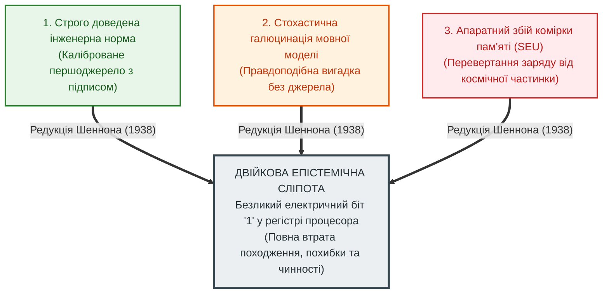
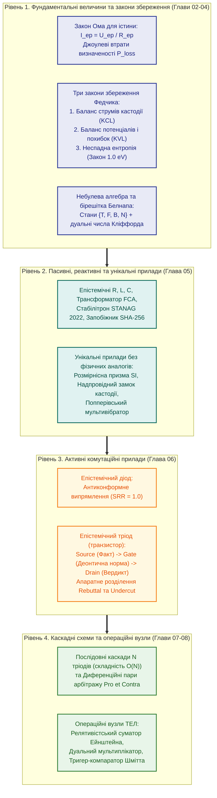

# Глава 01. Концептуальний маніфест: Від булевих вентилів до схемотехніки істини

> [!NOTE]
> **Чотири фундаментальні положення авторського внеску Миколи Федчика**
> 1. Розкрито природу «епістемічної сліпоти» класичної цифрової схемотехніки та булевої алгебри, які заради швидкодії редукували доведений науковий факт, імовірнісну здогадку та випадковий апаратний шум до одного безликого біта `1`.
> 2. Закладено цілісну парадигму Теорії епістемічних ланцюгів (ТЕЛ / Epistemic Circuit Theory / Epistemic Schematics) — інженерної дисципліни, у якій логічне виведення проектується й розраховується за законами збереження, опору та комутації доказів.
> 3. Проведено системний семантичний аналіз і синтез нової теорії за повною діалектичною фабулою «Криза — Потреба — Проблема — Пропозиція — Переваги — Недоліки — Порівняння — Висновки».
> 4. Сформульовано демаркаційні межі ТЕЛ, включаючи її інженерні компроміси, накладні витрати на кастодію та закони співпраці з людиною-експертом і стохастичними мовними моделями.

---

## 1. Вступ. Народження схемотехніки істини: навіщо читати цю книгу

У кожній зрілій інженерній науці настає момент, коли старий математичний апарат перестає вміщувати складність реального світу. Саме так у середині XIX століття описова механіка поступилася місцем термодинаміці, коли інженерам знадобилося рахувати не просто рух важелів, а перетворення енергії, ККД та невідворотне розсіювання тепла. Саме так у 1938 році класична електротехніка породила цифрову схемотехніку, коли двадцятиоднорічний Клод Шеннон показав, що замикання й розмикання телефонних реле точно описується рівняннями булевої алгебри.

Сьогодні ми стоїмо на порозі третього тектонічного зсуву. Людство навчилося перекачувати ексабайти даних і будувати нейронні мережі з трильйонами параметрів, але опинилося в парадоксальній пастці: **наші обчислювальні машини вміють блискавично маніпулювати знаками, проте на фізичному та логічному рівнях вони абсолютно не знають, що таке доведена істина, звідки взявся факт і чи має право конкретна норма застосовуватися в даних умовах**.

Ця книга присвячена новій науково-інженерній дисципліні — **Теорії епістемічних ланцюгів (ТЕЛ)**, або **Епістемічній схемотехніці** (*Epistemic Circuit Theory / Epistemic Schematics*).

Про що ця теорія у своїй суті? Вона про те, що **знання, доказ, похибка вимірювання та нормативний дозвіл підкоряються суворим фізико-кібернетичним законам збереження й комутації**, разюче подібним до законів класичної електродинаміки, але багатшим за них. У ТЕЛ ми перестаємо розглядати міркування машини як непередбачувану генерацію тексту або як блукання в лабіринті логічних дерев. Натомість ми проектуємо міркування як **замкнене епістемічне коло**:
- де першоджерело закону, стандарту чи каліброваного датчика виступає **джерелом епістемічної електрорушійної сили (ЕРС)** з побайтово захищеною кастодією;
- де рух обґрунтованого висновку від засновку до вердикту є **епістемічним струмом**;
- де кожна нечіткість формулювання, інструментальна похибка чи непряма інтерпретація діє як **епістемічний опір та імпеданс**, на якому неминуче розсіюється визначеність («джоулеве тепло сумніву»);
- де софізми, маніпуляції та тиск конформізму блокуються односпрямованими **епістемічними діодами**;
- а дозвіл чи заборона на застосування правила керується тритермінальними активними приладами — **епістемічними тріодами (транзисторами)**, на затвори яких подається деонтична норма.

**Заради чого варто читати цю книгу?**
- **Архітекторам штучного інтелекту та розробникам експертних систем** книга дає математичний і схемотехнічний фундамент для створення систем з інваріантом нульових галюцинацій ($`\mathrm{ZHR} = 1{,}0`$), які фізично не здатні вигадати неіснуючий факт.
- **Інженерам вбудованих систем, апаратури (FPGA/ASIC) та критичної інфраструктури** вона відкриває спосіб замінити повільний програмний пошук у глибину на апаратні каскади лінійної складності $`O(N)`$ із повністю детермінованим часом відгуку (WCET).
- **Фахівцям із функціональної безпеки (ISO 26262, DO-178C, IEC 61508), метрологам та аудиторам права** вона пропонує єдину мову, у якій довірчі інтервали ISO GUM, розмірності фізичних величин SI та колізії юридичних норм стають елементами однієї розрахункової схеми.

Щоб читач міг свідомо оцінити масштаб цієї парадигми, розгорнемо її за класичною логікою глибокого системного дослідження: від витоків історичної кризи — через усвідомлення потреби й формулювання наукової проблеми — до архітектурної пропозиції, її переваг, чесного аналізу недоліків і порівняння з усіма попередніми обчислювальними епохами.

---

## 2. Криза. Вісімдесят вісім років «епістемічної сліпоти» цифрової ери

Щоб зрозуміти причину сучасної кризи довіри до штучного інтелекту, недостатньо аналізувати архітектуру трансформерів чи градієнтний спуск. Корінь хвороби лежить значно глибше — у самому фундаменті цифрових обчислень, закладеному в 1854 році Джорджем Булем у праці *«Дослідження законів мислення»* та втіленому в метал Клодом Шенноном у 1938 році.

Шеннон стояв перед прагматичною інженерною задачею: створити надійні релейно-контактні схеми для автоматичної телефонної комутації та диференціальних аналізаторів. Для цього він здійснив геніальну за своєю простотою редукцію: **він ототожнив філософську категорію «Істина» із замкненим контактом реле (наявністю напруги `1`), а категорію «Хиба» — з розімкненим контактом (відсутністю напруги `0`)**.

Ця редукція подарувала людству кремнієву цивілізацію. Але разом із нею в саму ДНК комп'ютерної інженерії було вбудовано перворідний гріх — **двійкову епістемічну сліпоту**:

Протягом перших сімдесяти років комп'ютерної ери ця сліпота залишалася майже непомітною. Чому? Тому що комп'ютер використовувався як слухняний арифмометр: людина-програміст і людина-інженер брали на себе всю роботу з перевірки достовірності вхідних даних, узгодження розмірностей фізичних величин і тлумачення законів. Машина лише перемножувала матриці й перекладала байти з однієї комірки в іншу.

Проте у 2020-х роках ситуація вибухнула. Коли на фундамент епістемічно сліпої цифрової апаратури встановили велетенські стохастичні мовні моделі (LLM), виникла системна криза:
1. **Смерть межі між фактом і вигадкою:** для процесора й оперативної пам'яті токен, згенерований як випадкова інтерполяція ваг нейромережі, має точно такий самий електричний статус, як і рядок чинного закону або показання авіаційного висотоміра.
2. **Втрата родоводу знання (Provenance Amnesia):** під час проходження крізь тисячі шарів матричного множення або булевих вентилів сигнал повністю втрачає зв'язок із конкретним байтовим діапазоном документа, який його породив.
3. **Асиметрія верифікації:** згенерувати правдоподібний інженерний чи юридичний звіт із прихованою помилкою коштує частки секунди, тоді як людині-експерту, щоб знайти цю помилку та перевірити всі посилання, потрібні дні виснажливої праці.

Цифрова машина, побудована за лекалами 1938 року, виявилася епістемічним дальтоніком: вона бачить яскравість електричного імпульсу, але не бачить кольору його істинності.

---

## 3. Потреба. Коли ціна непідтвердженого біта стає неприйнятною

Чи всюди ця сліпота є критичною? Ні. Коли алгоритм рекомендує художній фільм на вечір, генерує рекламний слоган або малює ілюстрацію, помилка не несе загрози життю чи праву. У світі розваг та креативних індустрій достатньо статистичної правдоподібності.

Але існує інший світ — **світ відповідальної інженерії, безпеки, медицини, оборони та права**, де ціна одного непідтвердженого біта вимірюється людськими життями, руйнуванням інфраструктури або судовими вироками:
- **Автономний транспорт і авіоніка (ISO 26262 ASIL-D, RTCA DO-178C):** система керування гальмами чи курсом літака не має права спиратися на «середньостатистичну думку» моделі або приймання сигналу датчика, чий довірчий інтервал похибки перетнув межу безпеки.
- **Клінічна медицина та фармакологія:** призначення дози препарату вимагає бездоганної перевірки протипоказань за чинним клінічним протоколом, точного перерахунку одиниць вимірювання (міліграми на кілограм маси тіла проти мікрограмів на мілілітр) і негайної зупинки при виявленні конфлікту призначень.
- **Енергетика, промислова автоматика та військова кібернетика:** в умовах радіоелектронної боротьби, спуфінгу навігації та інформаційних вкидів система підтримки прийняття рішень мусить миттєво відокремлювати підтверджені розвіддані класу `A1` від неперевірених чуток класу `F6` (за шкалою STANAG 2022) і ніколи не дозволяти десяти повторам однієї чутки переважити один прямий інструментальний вимір.
- **Юриспруденція, фінансовий аудит і регуляторний комплаєнс:** жоден аудитор не прийме відповідь «система так вважає, бо так зійшлися ваги». Потрібен криптографічно захищений сертифікат доведення: *яка стаття закону, у якій редакції, на підставі яких первинних документів дозволила цю дію, і чому виняток із правила тут не спрацював*.

Отже, об'єктивна суспільна та інженерна **потреба** полягає у створенні обчислювальної архітектури, яка забезпечує чотири непорушні гарантії:
1. **Нерозривну кастодію першоджерела:** жоден висновок не може з'явитися на виході, якщо він не несе в собі прямої адреси та незмінного криптографічного відбитка первинного факту.
2. **Метрологічну та розмірнісну чесність:** кожна операція над числами зобов'язана автоматично перераховувати похибку вимірювання та контролювати фізичну розмірність величин.
3. **Нормативну керованість у реальному часі:** зміна закону, скасування стандарту або поява підсікаючого винятку повинні миттєво, за один такт, перекривати відповідний канал виведення без перенавчання всієї системи.
4. **Кваліфіковану відмову за замовчуванням (`Fail-Closed Gate`):** там, де знання неповне, похибка надмірна або норми суперечать одна одній, машина зобов'язана чесно зупинитися і назвати точну причину відмови.

---

## 4. Проблема. Чому класичний софт, булева логіка та аналогові схеми безсилі

Чому ж цю потребу не вдається задовольнити в межах існуючих комп'ютерних парадигм? Семантичний аналіз показує, що ми зіткнулися не з нестачею обчислювальної потужності, а з **фундаментальною науковою проблемою — структурною несумісністю класичних моделей обчислень із законами епістемології**. Спроби вирішити цю задачу старими методами незмінно заходять у чотири глухі кути:

### 4.1. Глухий кут процедурного програмування (`if-else` та деградація конвеєра)
Коли інженер намагається закодувати складні нормативні правила звичайними умовними операторами `if-else` у процедурному коді, знання намертво змішується з потоком керування. На рівні мікропроцесора кожна перевірка правила перетворюється на інструкцію умовного переходу (`cmp`, `jne`). Коли правил стають тисячі, а умови залежать від динамічного контексту, апаратний блок передбачення переходів (*Branch Predictor*) постійно помиляється. Процесор змушений раз у раз скидати конвеєр (*Pipeline Flush*), втрачаючи детермінізм часу виконання, а сам код перетворюється на непідтримуваний лабіринт, де неможливо відокремити сам факт від дозволу на його використання.

### 4.2. Глухий кут класичних символьних систем (комбінаторний вибух $`O(b^N)`$)
Класичні машини логічного виведення Першої хвилі ШІ (Prolog, абстрактна машина Воррена WAM, продукційні системи RETE) відокремили правила від коду, але побудували виведення як **пошук із поверненнями (Backtracking) у дереві станів**. Якщо нормативний ланцюг має глибину $N$ кроків, а на кожному кроці є $b$ альтернативних правил, час пошуку зростає експоненційно — як $`O(b^N)`$. Вже при $N = 20$ та $b = 3$ простір перебору сягає $`3^{20} \approx 3{,}48 \times 10^9`$ вузлів. У критичних системах реального часу таке зависання є фатальним.

### 4.3. Глухий кут класичної булевої алгебри (принцип вибуху *Ex Falso Quodlibet*)
Двозначна булева логіка є радикально нестійкою до суперечностей. За класичним законом Дунса Скота $`(A \land \neg A) \implies B`$, якщо у великій базі законодавства чи інженерних стандартів з'являється хоча б одна колізія (один параграф дозволяє дію $A$, а інший забороняє її), класичне логічне числення зазнає дедуктивного вибуху: з суперечності формально виводиться будь-яке безглузде твердження $B$. Булів вентиль не вміє розрізняти стан «немає жодних даних» і стан «є два рівносильні протилежні докази».

### 4.4. Глухий кут аналогової схемотехніки та нечітких систем першого покоління
Класична аналогова електроніка та рання нечітка логіка Заде замінили сходинку `0/1` на неперервну напругу $`V(t) \in [0, 1]`$. Проте звичайна аналогова напруга в проводі так само не має пам'яті про своє походження: ми не знаємо, чому на виході операційного підсилювача з'явилося $`0{,}65\text{ В}`$ — чи це ослаблений сигнал істинного стандарту, чи це сума теплових шумів десяти несправних датчиків. Ба більше, лінійний суматор напруг легко вводиться в оману інформаційним шумом, дозволяючи ста слабким чуткам скластися у високий вихідний потенціал.

**Суть наукової проблеми:** як створити такий математичний і схемотехнічний базис, який би поєднав швидкість та детермінізм апаратних електричних кіл із нерозривною криптографічною кастодією першоджерел, метрологією похибок та стійкістю до суперечностей?

---

## 5. Пропозиція. Теорія епістемічних ланцюгів (ТЕЛ): фізико-кібернетичний синтез доказів

Відповіддю на сформульовану проблему є розроблена в цій книзі **Теорія епістемічних ланцюгів (ТЕЛ)**.

Фундаментальна пропозиція ТЕЛ полягає у зміні самого носія інформації. Ми відмовляємося від безликого булевого біта $`b \in \{0, 1\}`$ та безликої скалярної напруги $`V \in \mathbb{R}`$. Елементарним носієм сигналу в кожній точці епістемічного кола стає структурований **Епістемічний Тензор Стану $\Psi$**:

$$
\Psi = \left\langle \mathcal{C}, \quad V_{\mathrm{ep}} + u\,\varepsilon, \quad \boldsymbol{\beta}, \quad \vec{d}_{\mathrm{SI}} \right\rangle
$$

де кожна компонента виконує свою незамінну фізико-кібернетичну роль:
1. **Вектор кастодії $`\mathcal{C}`$:** незмінна адреса першоджерела у спільній пам'яті (`doc_id`, точні байтові межі `byte_start..byte_end` та криптографічний геш SHA-256). Це «заряд» носія: без нього струм істинності дорівнює нулю.
2. **Дуальний метрологічний потенціал $`V_{\mathrm{ep}} + u\,\varepsilon`$ (де $`\varepsilon^2 = 0`$):** поєднання номінальної достовірності факту $`V_{\mathrm{ep}}`$ та його стандартної невизначеності $u$ за міжнародним стандартом ISO GUM, що дозволяє автоматично обчислювати похідні похибок на льоту.
3. **Чотиризначний вектор Белнапа $`\boldsymbol{\beta} = (\mu^+, \mu^-) \in [0, 1]^2`$:** незалежний облік ступеня підтвердження «ЗА» ($`\mu^+`$) та ступеня спростування «ПРОТИ» ($`\mu^-`$), що назавжди усуває вибух суперечностей.
4. **Вектор фізичної розмірності $`\vec{d}_{\mathrm{SI}} \in \mathbb{Z}^7`$:** показники степенів семи базових одиниць системи SI (метр, кілограм, секунда, ампер, кельвін, моль, кандела), які унеможливлюють додавання метрів до секунд або вольтів до паскалів.

Над цим носієм ТЕЛ вибудовує струнку чотирирівневу ієрархію інженерного синтезу:

Завдяки цій архітектурі будь-яка нормативна база знань — чи то стандарт авіаційної безпеки, чи то податковий кодекс, чи то проектна документація ядерного реактора — компілюється у **принципову епістемічну схему**, параметри якої можна точно розрахувати, протестувати генератором попперівських імпульсів і виконати апаратно за лінійний час.

---

## 6. Переваги. Шість фундаментальних здобутків епістемічної схемотехніки

Перехід від традиційного програмування та стохастичних моделей до ТЕЛ дає шість якісних переваг, кожна з яких підкріплена строгим математичним інваріантом:

### 6.1. Фізична неможливість галюцинацій ($`\mathrm{ZHR} = 1{,}0`$)
У булевій схемі хибна одиниця на вході вільно стає істиною на виході. В епістемічному колі діє **Перший закон збереження Федчика (баланс струмів доказовості у вузлі)**:

$$
\sum_{k=1}^{m} I_{\mathrm{in}, k} - \sum_{j=1}^{n} I_{\mathrm{out}, j} - I_{\mathrm{leak}} = 0 \implies \sum I_{\mathrm{out}} \le \sum I_{\mathrm{in}}
$$

Вихідний струм вердикту не може виникнути з вакууму. Якщо вхідне твердження не має побайтово верифікованої кастодії в пам'яті хоста, криптографічний надпровідний замок миттєво переходить у стан ідеального діелектрика ($`R_{\mathrm{lock}} = \infty`$), і схема детерміновано видає типізовану відмову `REFUSAL`.

### 6.2. Лінійна складність дедукції $`O(N)`$ замість комбінаторного вибуху $`O(b^N)`$
У ТЕЛ багатоходове правило глибиною $N$ реалізується не через рекурсивний пошук із поверненнями, а як **послідовний каскад $N$ епістемічних тріодів**, де стік попереднього тріода живить витік наступного:

$$
\sigma_{\mathrm{total}} = \prod_{k=1}^N \sigma_k(V_{G, k}), \qquad \tau_{\mathrm{prop}} = \sum_{k=1}^N \tau_{\mathrm{switch}, k} = O(N) \text{ тактів}
$$

Сигнал проходить крізь каскад як електромагнітна хвиля в лінії передачі. Навіть якщо ланцюг містить 50 послідовних нормативних перевірок, час його проходження становить рівно 50 тактів (частки мікросекунди), а обрив будь-якого одного затвора миттєво знеструмлює вихід.

### 6.3. Імунітет до скидання конвеєра процесора (*Branch Misprediction Immunity*)
В епістемічному тріоді перевірка чинності норми не використовує інструкцій умовного переходу процесора. Нормативний потенціал подається безпосередньо на **Затвор (Gate)** як керуючий сигнал провідності каналу. Потік команд залишається абсолютно лінійним, що гарантує жорстко передбачуваний час виконання у найгіршому випадку (*Deterministic Worst-Case Execution Time, WCET*) для систем реального часу.

### 6.4. Однотактова мікрометрологія ISO GUM та захист від розмірнісних аварій
Епістемічний мультиплікатор та компаратор оперують дуальними числами Кліффорда $`V + u\,\varepsilon`$. Це дозволяє за один такт обчислювати як сам результат формули, так і точну похідну поширення похибки вимірювань за стандартом ISO GUM без чисельних ітерацій чи методу Монте-Карло. Одночасно вхідна **Розмірнісна Призма SI** апаратно блокує будь-яку спробу скласти або порівняти величини з різними фізичними розмірностями, унеможливлюючи катастрофи на кшталт втрати апарата *Mars Climate Orbiter*.

### 6.5. Абсолютна стійкість до софізмів ($`\mathrm{SRR} = 1{,}000000`$) та розділення *Rebuttal* і *Undercut*
- **Епістемічний діод** пропускає потік обґрунтування виключно в прямому напрямку — від аксіоми до висновку. Будь-який зворотний тиск користувача («Ти помиляєшся, погодься зі мною!», «Інші експерти кажуть інакше») прикладається у зворотному напрямку й наштовхується на нескінченний зворотний опір діода.
- **Епістемічний тріод** вперше на рівні схемотехніки розділив два типи контраргументів Джона Поллока: пряме спростування факту (*Rebuttal*) діє у силовому колі стоку, тоді як процесуальне підсікання застосовності норми (*Undercutting Defeater*) замикає керуючий затвор $G$, не знищуючи істинності самого факту у витоці $S$.

### 6.6. Захист від ефекту «луна-камери» та паритетний арбітраж колізій
Завдяки релятивістському закону додавання потенціалів в **Епістемічному Суматорі** та груповому дисконтуванню корельованих джерел ($`w_i = 1/\sqrt{\lvert G_k \rvert}`$), сто передруків однієї непрямої чутки ніколи не перевищать потенціалу одного прямого першоджерела $`1{,}0\text{ eV}`$. А при зіткненні двох рівносильних протилежних норм **диференційний каскад ес-тріодів** замість логічного краху фіксує збалансований стан паритету `QUALIFIED_NONANSWER (PARITY)`.

---

## 7. Недоліки, інженерні компроміси та межі застосовності ТЕЛ

Наукова чесність та попперівська методологія вимагають прямо назвати ціну, яку інженер платить за абсолютні гарантії ТЕЛ. Як у термодинаміці неможливий вічний двигун, так в інформатиці неможлива система, що дає 100-відсоткову доказовість без жодних витрат. Теорія епістемічних ланцюгів має п'ять об'єктивних обмежень та інженерних компромісів:

### 7.1. Висока вартість первинної кристалізації схем («Холодний старт»)
Стохастичну мовну модель можна швидко заповнити сирими неструктурованими текстами. Епістемічне коло, навпаки, вимагає попередньої **інженерної компіляції знань**: виділення атомарних фактів, встановлення точних байтових меж кастодії, оголошення фізичних розмірностей SI та побудови топології затворів і діодів. Хоча сучасні компілятори знань автоматизують цей процес, підготовка верифікованої бази знань для ТЕЛ потребує значно вищої інженерної дисципліни на етапі проектування.

### 7.2. Радикальна жорсткість відмови (`Fail-Closed Rigidity`)
Епістемічний ланцюг за своєю природою є **консервативним верифікатором, а не генератором фантазій**. Якщо користувач ставить запитання, для якого в жодному підключеному джерелі немає підтвердженої кастодії, або якщо похибка датчика потрапила у захисну смугу компаратора (*Guard Band*), схема безкомпромісно повертає відмову `REFUSAL`. У задачах, де потрібна вільна художня творчість, поетична метафора або інтуїтивний мозковий штурм без оглядки на факти, чиста схема ТЕЛ буде свідомо мовчати.

### 7.3. Збільшення розрядності шин та апаратних ресурсів
У класичній цифровій логіці один провідник переносить 1 біт. В епістемічній схемотехніці кожна лінія переносить повний тензор стану $\Psi$ (дескриптор кастодії, дуальну пару чисел з рухомою комою або фіксованою точкою, вектор Белнапа та 7-вимірний вектор розмірностей SI — сумарно від 128 до 512 біт на один сигнал). Це збільшує площу комутаційних матриць у FPGA/ASIC та обсяг регістрових файлів в обмін на те, що кожен такт виконує роботу цілого програмного конвеєра верифікації.

### 7.4. Чутливість до якості канону (*Garbage-In in Canon*)
Криптографічний замок кастодії $`\mathcal{L}_{\mathrm{SHA}}`$ гарантує, що жоден байт нормативного документа не був підмінений і що висновок строго випливає з тексту закону. Але якщо сам законодавець або автор технічного стандарту припустився змістовної помилки у затвердженому тексті офіційного документа, схема ТЕЛ чесно й точно виконає цю помилкову норму. Хоча попперівський мультивібратор допомагає виявити внутрішні суперечності між різними документами на етапі аудиту, остаточна відповідальність за істинність первинних аксіом завжди залишається за людиною-експертом.

### 7.5. Потреба у вхідному лінгвістичному перетворювачі для природної мови
Саме ядро ТЕЛ працює з уже виділеними предикатами, параметрами та тензорами стану. Якщо вхідний запит надходить від людини у довільній розмовній формі з друкарськими помилками чи сленгом, перед епістемічним колом необхідно встановити вхідний «антенний каскад» (парсер або локальну допоміжну мовну модель), який переведе людську фразу у формальний вектор запиту, не маючи при цьому жодного права втручатися у роботу затворів чи підробляти кастодію.

---

## 8. Порівняння. Чотири обчислювальні парадигми у дзеркалі інженерних критеріїв

Підсумуємо семантичний аналіз, зіставивши Теорію епістемічних ланцюгів із трьома класичними парадигмами схемотехніки та логіки за сімома фундаментальними критеріями:

| Критерій порівняння | Булева алгебра (Дж. Буль, 1854) | Цифрова схемотехніка (К. Шеннон, 1938) | Аналогова схемотехніка | Теорія епістемічних ланцюгів (ТЕЛ, 2026) |
| :--- | :--- | :--- | :--- | :--- |
| **1. Елементарний носій сигналу** | Абстрактні символи $`\{0, 1\}`$ | Рівні напруги (0 В / 3,3 В) | Неперервна напруга $V(t)$ | **Епістемічний тензор стану $`\Psi = \langle \mathcal{C}, V+u\varepsilon, \boldsymbol{\beta}, \vec{d}_{\mathrm{SI}} \rangle`$** |
| **2. Пам'ять про походження факту** | Відсутня (аксіоми безіменні) | Відсутня (біт не знає автора) | Відсутня (шум невіддільний від сигналу) | **Апаратна побайтова кастодія $`\mathcal{C}`$ із замком SHA-256** |
| **3. Математична алгебра станів** | Двозначна решітка $`\mathbb{B}_2 = \{0, 1\}`$ | Двійкова логіка з третім станом `Hi-Z` | Поле дійсних чисел $`\mathbb{R}`$ | **Чотиризначна бірешітка Белнапа $`\mathcal{B}_4`$ + дуальні числа $`\mathbb{D}`$** |
| **4. Облік похибки та розмірності** | Відсутній (дихотомія «так/ні») | Лише запас завадостійкості у вольтах | Стохастичний тепловий шум, дрейф нуля | **Аналітична похибка ISO GUM + Розмірнісна призма SI ($`\mathbb{Z}^7`$)** |
| **5. Механізм керування нормою** | Імплікація змішує факт і правило | Каскади вентилів та умовні переходи | Аналогові ключі та компаратори | **Тритермінальний ес-тріод: розділення факту ($S$) і деонтики ($G$)** |
| **6. Реакція на колізію ($`A \land \neg A`$)** | Дедуктивний вибух (*Ex Falso Quodlibet*) | Коротке замикання або гонитва фронтів | Насичення підсилювача до шини живлення | **Диференційний арбітраж: стан `PARITY` у точці $`\mathbf{B} = (1, 1)`$** |
| **7. Захист від галюцинацій і луни** | Не передбачений | Не передбачений | Лінійне накопичення помилки | **Перший закон Федчика ($`\mathrm{ZHR}=1{,}0`$) + суматор Ейнштейна** |

Як видно з таблиці, ТЕЛ не скасовує цифрову чи аналогову електроніку — вона піднімається над ними на наступний системний поверх. Подібно до того, як цифрові вентилі Шеннона фізично побудовані з аналогових напівпровідникових транзисторів, але підкоряються власній дискретній алгебрі, **прилади епістемічної схемотехніки реалізуються поверх цифрових регістрів і кремнієвих ядер (CPU/FPGA/ASIC), але підкоряються законам збереження доказовості та кастодії**.

---

## 9. Висновки та путівник книгою

1. **Криза сучасної інженерії знань є схемотехнічною за своєю природою:** неможливо побудувати безгалюцинаційний штучний інтелект, доки елементарна клітинка обчислень не вміє відрізнити перевірений факт від випадкового шуму.
2. **Теорія епістемічних ланцюгів перетворює епістемологію на точну розрахункову науку:** введення епістемічної напруги, струму, опору, імпедансу та законів збереження дозволяє проектувати системи логічного виведення з тією ж математичною строгістю, з якою радіоінженер проектує підсилювач чи фільтр високої частоти.
3. **Універсальність та відкритість архітектури:** попри вищу складність початкової компіляції схем і розширену розрядність шин, ТЕЛ є єдиною парадигмою, що гарантує лінійний час дедукції $`O(N)`$, побайтову трасованість до першоджерел та метрологічний самоконтроль у критичних доменах.

### Логічний маршрут наступних глав книги:

- У **[Главі 02](ch02-fundamental-quantities-and-ohms-law.md)** ми введемо шість фундаментальних фізико-кібернетичних величин ТЕЛ (кастодію, потенціал, струм, опір, потужність та джоулеві втрати невизначеності) і виведемо **закон Ома для ділянки та повного кола істини**.
- У **[Главі 03](ch03-fedchyk-conservation-laws.md)** буде сформульовано й доведено **три закони збереження Федчика** (вузловий баланс струмів доказовості, петльовий баланс потенціалів у замкненому колі та закон неспадної епістемічної ентропії), які ставлять нездоланний фізичний бар'єр для генерації галюцинацій та логічних софізмів.
- У **[Главі 04](ch04-non-boolean-fuzzy-and-belnap-circuit-math.md)** ми розгорнемо **небулевий математичний апарат ТЕЛ**: поєднання нечітких Т-норм, чотиризначної бірешітки Белнапа $`\mathcal{B}_4`$ для роботи з суперечностями та алгебри дуальних чисел Кліффорда для автоматичного диференціювання похибок.
- У **[Главі 05](ch05-passive-reactive-and-unique-epistemic-components.md)** ми дослідимо **елементну базу ТЕЛ**: реактивні компоненти пам'яті та інерції канону (конденсатор, індуктивність, міждоменний трансформатор FCA, стабілітрон STANAG 2022) і три унікальні прилади, що не мають аналогів у фізиці (Розмірнісну призму SI, Криптографічний надпровідний замок кастодії та Попперівський мультивібратор).
- У **[Главі 06](ch06-epistemic-triode-and-transistor.md)** ми детально розберемо серце активної схемотехніки — **тритермінальний епістемічний тріод (транзистор)**, його вольт-амперні характеристики, режими відсічки й насичення та фізику розділення контраргументів *Rebuttal* і *Undercut*.
- У **[Главі 07](ch07-multi-stage-cascades-and-linear-complexity.md)** ми перейдемо до синтезу **багатокаскадних схем з $N$ ес-тріодів**: послідовних дедуктивних ліній із часом поширення $`O(N)`$ та диференційних пар для змагального арбітражу суперечливих норм.
- Нарешті, у **[Главі 08](ch08-operational-units-adders-multipliers-comparators.md)** ми зберемо з елементарних приладів високорівневі **функціональні операційні вузли**: Релятивістський суматор Ейнштейна із захистом від «луна-камери», Однотактовий дуальний мультиплікатор та Гістерезисний метрологічний компаратор (тригер Шмітта за ISO 14253-1).
