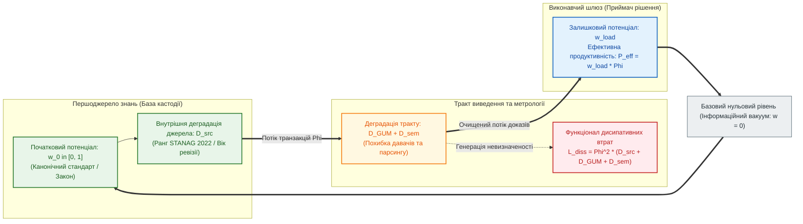

# Глава 02. Фундаментальні кількісні міри та рівняння атенюації достовірності в обчислювальних схемах

> **Книга:** [Теорія епістемічних обчислювальних схем: Математичні інваріанти кастодії, метрології та детермінованого виведення](README.md) · Частина I: Математичні основи епістемічних схем  
> **Попередня глава:** [← Глава 01. Концептуальний маніфест: від булевих вентилів до доказових обчислювальних схем](ch01-manifesto-and-epistemic-gap.md)  
> **Наступна глава:** [Глава 03. Топологічні інваріанти збереження та розрахунок мереж доказового виведення →](ch03-fedchyk-conservation-laws.md)  
> **Зміст книги:** [Повернутися до змісту](README.md)  
> **Автор:** [Микола Федчик](../ExpertSystem/about-the-author.md)  
> **Рівень складності:** `[L2 — Інженерно-математичний рівень]` *(За класифікацією Д. Кнута: параметризація інтенсивних та екстенсивних змінних потокових мереж, квадратичні функціонали метрологічних втрат за JCGM GUM та розрахунок дільників достовірності)*  
> **Очікувані результати:** Читач засвоїть систему шести строгих кількісних характеристик епістемічної обчислювальної схеми (початковий нормативний потенціал, залишковий потенціал достовірності, потік верифікаційних транзакцій, коефіцієнт метрологічно-семантичної деградації, нормовану провідність та квадратичний функціонал інформаційних втрат), вивчить рівняння гіперболічної та лінійної атенюації достовірності вздовж тракту передачі й виконає розрахунок тракту аварійного скидання тиску в гідравлічній системі.

---

## Анотація

Друга глава встановлює систему кількісних мір Теорії епістемічних обчислювальних схем. Досліджується фундаментальна методологічна проблема класичної інженерії знань — скалярний синкретизм, за якого одним числом намагаються одночасно описати юридичну або нормативну силу першоджерела, обчислювальну інтенсивність потоку запитів та інструментальну невизначеність каналу передачі даних. Показано, чому без ортогонального розділення інтенсивних та екстенсивних змінних неможливо строго розрахувати деградацію достовірності у багатоланкових системах підтримки рішень.

На основі математичного формалізму узагальнених потокових мереж і зв'язкових графів Генрі Пейнтера [[6]](#src-6) введено систему шести взаємопов'язаних безрозмірних і потокових величин: початковий нормативний потенціал першоджерела $`w_0 \in [0, 1]`$ [[4]](#src-4), залишковий потенціал вузла $`w \in [0, 1]`$, потік верифікаційних транзакцій $`\Phi \ge 0`$, адитивний коефіцієнт деградації (дисипації) тракту $`D \ge 0`$ за стандартом JCGM GUM [[5]](#src-5), нормовану провідність ланки $`\sigma \in (0, 1]`$, продуктивність санкціонованої дії $`P_{\mathrm{eff}}`$ та квадратичний функціонал інформаційних втрат $`L_{\mathrm{diss}}`$ [[1]](#src-1), [[2]](#src-2), [[3]](#src-3). Виведено визначальні рівняння атенюації потенціалу та обмеження пропускної здатності в однорідній ланці й замкненому конвеєрі верифікації. Теоретичний апарат проілюстровано числовим інженерним розрахунком тракту аварійного скидання тиску в гідравлічній системі.

---

> [!NOTE]
> **Чотири фундаментальні положення авторського внеску Миколи Федчика у Главі 02**
> 1. **Декомпозиція скалярної впевненості на інтенсивні та екстенсивні змінні:** усунено понятійний синкретизм класичних факторів впевненості (MYCIN) шляхом розділення інтенсивного потенціалу достовірності $`w \in [0, 1]`$, екстенсивного потоку верифікаційних транзакцій $`\Phi`$ та адитивного коефіцієнта деградації тракту $`D \ge 0`$.
> 2. **Трьохкомпонентна модель коефіцієнта деградації тракту:** формалізовано адитивну структуру деградації $`D = D_{\mathrm{src}} + D_{\mathrm{GUM}} + D_{\mathrm{sem}}`$, яка поєднує ранг надійності джерела за STANAG 2022, квадрат відносної розширеної невизначеності вимірювання $`(U_{95\%}/\Delta_{\mathrm{tol}})^2`$ за JCGM GUM та семантичні втрати парсингу.
> 3. **Рівняння атенюації достовірності та пропускної здатності верифікатора:** встановлено строгу гіперболічну залежність залишкового потенціалу достовірності на виході ланки від сумарного коефіцієнта деградації тракту.
> 4. **Квадратичний функціонал інформаційної дисипації:** обґрунтовано штрафний функціонал втрат $`L_{\mathrm{diss}} = \Phi^2 \cdot D`$, який доводить, що форсування частоти генерації висновків крізь ланки з високою невизначеністю призводить до квадратичного зростання ентропійного шуму.
> *Керування рантаймом / Інженерний інваріант:* Якщо внаслідок ослаблення на внутрішніх і зовнішніх коефіцієнтах деградації залишковий потенціал достовірності на вході виконавчого шлюзу падає нижче нормативного порогу допуску ($`w_{\mathrm{load}} < w_{\min}`$), шлюз детерміновано блокує видачу дозволу (`REFUSAL`).

---

## 1. Постановка проблеми: скалярний синкретизм у класичних моделях нечіткого виведення

В інженерії знань, експертних системах першого покоління та сучасних імовірнісних моделях традиційно панував **скалярний синкретизм** — прагнення виразити стан знання одним безрозмірним дійсним числом: «коефіцієнтом упевненості» (*Certainty Factor*) у системі MYCIN [[8]](#src-8), апостеріорною ймовірністю або скалярною вагою ребра у графі. Таке зведення різнорідних характеристик до одного скаляра породжує три фундаментальні математичні дефекти:
1. **Нерозрізненність нормативного статусу правила та метрологічної якості каналу:** однакова числова оцінка $`0{,}50`$ приписується і факультативній рекомендації (`MAY`), виміряній ідеальним еталонним приладом, і категоричній вимозі стандарту безпеки (`SHALL`), переданій через давач зі значною похибкою.
2. **Відсутність зв'язку між достовірністю та обчислювальною пропускною здатністю:** класична логіка не містить змінної потоку, яка б дозволяла обліковувати кількість верифікованих транзакцій за одиницю часу та навантаження на шину пам'яті.
3. **Відсутність кількісної міри інформаційної дисипації:** у генеративних мовних моделях видача тисяч токенів за секунду за відсутності опори на першоджерела інтерпретується як висока швидкодія, хоча з погляду теорії інформації Клода Шеннона [[3]](#src-3) це режим генерації ентропії за нульової корисної інформаційної роботи.

Як відомо з теорії загальних систем і зв'язкових графів Генрі Пейнтера [[6]](#src-6) (та класичних праць з математичного аналізу потокових мереж [[1]](#src-1), [[2]](#src-2)), будь-який процес транспортування й верифікації ресурсу в мережі вимагає щонайменше трьох незалежних параметрів: **інтенсивного потенціалу** (нормативної сили та достовірності), **екстенсивного потоку** (швидкості передачі верифікованих пакетів) та **коефіцієнта опору середовища** (міри деградації сигналу).

---

## 2. Система шести базових кількісних величин епістемічної обчислювальної схеми

Формалізуємо шість базових кількісних величин, що описують стан і динаміку довільної ланки епістемічної обчислювальної схеми (таблиця 2.1).

**Таблиця 2.1.** Фундаментальні кількісні величини Теорії епістемічних обчислювальних схем та їхні математичні області визначення.

| Величина обчислювальної схеми | Символ | Область значень та розмірність | Системний ізоморфізм у теорії потокових графів | Математичний та інженерний зміст у системі виведення |
| :--- | :---: | :---: | :---: | :--- |
| **1. Нормований потенціал достовірності** | $`w_0, \ w`$ | Безрозмірна величина $`[0, 1]`$ | Інтенсивна змінна потенціалу (*Effort*) | Імперативна сила першоджерела $`w_0`$ та залишковий рівень достовірності у вузлі $`w`$ |
| **2. Потік верифікаційних транзакцій** | $`\Phi`$ | Транзакцій за такт $`[\text{такт}^{-1}]`$ | Екстенсивна змінна потоку (*Flow*) | Інтенсивність проходження побайтово верифікованих дескрипторів кастодії крізь переріз схеми |
| **3. Коефіцієнт деградації (опору)** | $`D`$ | Безрозмірна невід'ємна міра $`[0, \infty)`$ | Дисипативний опір ланки (*Resistance*) | Сукупне ослаблення доказу через метрологічну похибку JCGM GUM, семантичну нечіткість і застарілість |
| **4. Нормована провідність ланки** | $`\sigma`$ | Безрозмірний коефіцієнт $`(0, 1]`$ | Коефіцієнт передачі ланки (*Conductance*) | Частка потенціалу достовірності, що зберігається після проходження ланки: $`\sigma = 1 / (1 + D)`$ |
| **5. Ефективна продуктивність дії** | $`P_{\mathrm{eff}}`$ | Верифікованих дій за такт | Корисна потужність (*Effective Power*) | Добуток залишкової достовірності на потік транзакцій: $`P_{\mathrm{eff}} = w_{\mathrm{load}} \cdot \Phi`$ |
| **6. Функціонал дисипативних втрат** | $`L_{\mathrm{diss}}`$ | Штрафна міра ентропії за такт | Квадратична функція дисипації (*Loss*) | Швидкість накопичення невизначеності в тракті при форсуванні потоку: $`L_{\mathrm{diss}} = \Phi^2 \cdot D`$ |

На рисунку 2.1 зображено структурну схему елементарного конвеєра верифікації, в якому взаємодіють усі шість величин таблиці 2.1.

**Рисунок 2.1.** Структурна схема елементарного тракту епістемічної обчислювальної схеми з розділенням джерела кастодії, дисипативної лінії передачі та виконавчого шлюзу.

---

## 3. Потенціал достовірності та адитивна структура коефіцієнта деградації

### 3.1. Нормований потенціал достовірності першоджерела

За точку нульового відліку потенціалу ($`w_{\mathrm{null}} = 0`$) в обчислювальній схемі приймається стан повного інформаційного вакууму — твердження, не підкріплене жодним дескриптором кастодії. За точку одиничного потенціалу ($`w_0 = 1{,}00`$) приймається пряма побайтова кастодія чинного нормативного акта або еталонного вимірювання у спільній пам'яті хоста.

**Означення 2.1 (Початковий та залишковий потенціал достовірності).** *Початковим потенціалом достовірності* $`w_0 \in [0, 1]`$ називається апріорна нормативна вага першоджерела до проходження через тракт перерахунку. *Різницею потенціалів (падінням достовірності)* $`\Delta w_{AB}`$ на ділянці схеми між вузлами $A$ і $B$ називається величина ослаблення потенціалу на елементах деградації цієї ділянки (формула (2.1)):

$$
\Delta w_{AB} = w_A - w_B = w_0 - w_{\mathrm{load}}
$$

**Формула (2.1).** Визначення спаду потенціалу достовірності між вхідним і вихідним вузлами ланки обчислювальної схеми.

Тут:
- $`w_A, w_B \in [0, 1]`$ — безрозмірні потенціали достовірності у вхідному вузлі $A$ та вихідному вузлі $B$;
- $`w_0 \in [0, 1]`$ — початковий потенціал первинного документа або еталонного вимірювача;
- $`w_{\mathrm{load}} \in [0, w_0]`$ — залишковий потенціал на вході виконавчого шлюзу.

Відповідно до модальної ієрархії інженерних вимог RFC 2119 [[4]](#src-4) та стандартів функціональної безпеки ISO 26262 [[7]](#src-7), джерела знань градуюються за початковим потенціалом $`w_0`$:
- **Імперативна норма прямої дії ($`w_0 = 1{,}00`$):** закони, вимоги безпеки класу ASIL-D, модальні оператори `MUST`, `SHALL`, `REQUIRED`, підкріплені незмінним побайтовим зрізом у пам'яті хоста.
- **Нормативна рекомендація високої надійності ($`w_0 \in [0{,}70; 0{,}85]`$):** галузеві настанови з операторами `SHOULD`, `RECOMMENDED` або перевірені свідчення за шкалою STANAG 2022 [[6]](#src-6) (рівні `A1`–`B2`).
- **Дорадча або факультативна інформація ($`w_0 \le 0{,}30`$):** необов'язкові опції `MAY`, `OPTIONAL` та вторинні огляди, чий потенціал завідомо нижчий від порогу спрацювання виконавчих шлюзів критичної дії ($`w_{\min} \approx 0{,}75`$).

### 3.2. Трьохкомпонентна структура коефіцієнта деградації

Будь-який реальний канал отримання, вимірювання та інтерпретації даних вносить невизначеність, яка описується безрозмірним невід'ємним **коефіцієнтом деградації** $`D`$.

**Означення 2.2 (Повний коефіцієнт деградації ділянки схеми).** *Коефіцієнтом деградації (дисипативного опору)* $`D \ge 0`$ називається адитивна величина, що кількісно характеризує ступінь розсіювання достовірності сигналу на ділянці схеми і складається з трьох складових за формулою (2.2):

$$
D = D_{\mathrm{src}} + D_{\mathrm{GUM}} + D_{\mathrm{sem}} = D_{\mathrm{src}} + \left(\frac{U_{95\%}}{\Delta_{\mathrm{tol}}}\right)^2 + D_{\mathrm{sem}}
$$

**Формула (2.2).** Трьохкомпонентна адитивна структура коефіцієнта деградації тракту виведення.

Тут:
- $`D_{\mathrm{src}} \ge 0`$ — внутрішній коефіцієнт деградації самого джерела знань (залежить від рангу надійності джерела за STANAG 2022 [[6]](#src-6) та часу старіння редакції документа; для чинного первинного стандарту з прямою кастодією $`D_{\mathrm{src}} = 0`$);
- $`D_{\mathrm{GUM}} = (U_{95\%} / \Delta_{\mathrm{tol}})^2 \ge 0`$ — метрологічний коефіцієнт деградації вимірювального каналу, рівний квадрату відношення розширеної невизначеності вимірювання $`U_{95\%}`$ за JCGM GUM [[5]](#src-5) до ширини нормативного поля допуску $`\Delta_{\mathrm{tol}}`$;
- $`D_{\mathrm{sem}} \ge 0`$ — семантичний коефіцієнт деградації непрямого перекладу або евристичного парсингу (для прямого побайтового читання з відображеної пам'яті хоста $`D_{\mathrm{sem}} = 0`$).

---

## 4. Рівняння атенюації достовірності та квадратичний функціонал втрат

### 4.1. Гіперболічний закон ослаблення достовірності в ланці

Розглянемо проходження потоку верифікації крізь ланку з коефіцієнтом деградації $`D`$ на виконавчий шлюз із нормованим вхідним навантаженням $`D_{\mathrm{load}} = 1{,}00`$. За ізоморфізмом потокового дільника потенціалу (аналогічно до класичного рівняння Георга Ома для послідовного ланцюга [[1]](#src-1)) формулюється фундаментальне співвідношення атенюації.

**Твердження 2.1 (Рівняння атенюації достовірності та пропускної здатності тракту).** Залишковий потенціал достовірності $`w_{\mathrm{load}}`$ на вході виконавчого шлюзу та нормований потік верифікації $`\Phi`$ прямо пропорційні початковому потенціалу першоджерела $`w_0`$ і обернено пропорційні одиниці плюс сумарний коефіцієнт деградації тракту $`D = D_{\mathrm{src}} + D_{\mathrm{GUM}} + D_{\mathrm{sem}}`$ (формула (2.3)):

$$
w_{\mathrm{load}} = w_0 \cdot \sigma = \frac{w_0}{1 + D_{\mathrm{src}} + D_{\mathrm{GUM}} + D_{\mathrm{sem}}}, \qquad \Phi = \Phi_0 \cdot \frac{w_0}{1 + D}
$$

**Формула (2.3).** Рівняння гіперболічної атенюації залишкового потенціалу достовірності та обмеження потоку верифікації.

Тут:
- $`\sigma = 1 / (1 + D) \in (0, 1]`$ — нормована провідність (коефіцієнт збереження достовірності) тракту;
- $`\Phi_0 > 0`$ — номінальна тактова пропускна здатність шини верифікації при нульовій деградації ($`\text{такт}^{-1}`$);
- $`w_{\mathrm{load}} \in [0, w_0]`$ — результуючий потенціал достовірності, який фактично доходить до виконавчого шлюзу після всіх метрологічних та семантичних втрат.

З формули (2.3) випливають три канонічні режими роботи тракту виведення:
1. **Режим бездисипативної передачі ($`D_{\mathrm{src}} = 0, \ D_{\mathrm{GUM}} = 0, \ D_{\mathrm{sem}} = 0 \implies \sigma = 1{,}00`$):** коли система звертається безпосередньо до незмінного образа стандарту у спільній пам'яті хоста за точним криптографічним ключем кастодії та оперує точними константами, втрати відсутні ($`\Delta w = 0`$), і вихідний потенціал дорівнює повному потенціалу закону ($`w_{\mathrm{load}} = w_0 = 1{,}00`$).
2. **Режим захисного блокування ($`D \to \infty \implies \sigma = 0`$):** якщо контрольна сума SHA-256 цитати не збігається, давач вийшов з ладу або джерело невідоме, коефіцієнт деградації стає нескінченним, провідність падає до нуля ($`w_{\mathrm{load}} = 0, \ \Phi = 0`$), і система детерміновано переходить у стан `REFUSAL`.
3. **Режим деградації на неперевірених припущеннях ($`D_{\mathrm{src}} + D_{\mathrm{sem}} \gg 1 \implies w_{\mathrm{load}} \ll w_{\min}`$):** характерний для неконтрольованих генеративних моделей, коли опосередкованість переказів велика і залишковий потенціал падає нижче порогу безпеки.

### 4.2. Ефективна продуктивність, функціонал інформаційних втрат та ККД тракту

Щоб кількісно оцінити співвідношення між корисною роботою системи прийняття рішень та обсягом породжуваної невизначеності, введемо енергетично-інформаційні функціонали потокового графа [[2]](#src-2), [[6]](#src-6).

**Твердження 2.2 (Баланс ефективної продуктивності та квадратичної дисипації).** Ефективна продуктивність верифікованих дій на шлюзі $`P_{\mathrm{eff}}`$, квадратичний функціонал інформаційних втрат у тракті $`L_{\mathrm{diss}}`$ та інформаційний коефіцієнт корисної дії тракту $`\eta_{\mathrm{ep}}`$ визначаються співвідношеннями (формула (2.4)):

$$
P_{\mathrm{eff}} = w_{\mathrm{load}} \cdot \Phi, \qquad L_{\mathrm{diss}} = \Phi^2 \cdot \left(D_{\mathrm{src}} + D_{\mathrm{GUM}} + D_{\mathrm{sem}}\right), \qquad \eta_{\mathrm{ep}} = \frac{w_{\mathrm{load}}}{w_0} = \frac{1}{1 + D}
$$

**Формула (2.4).** Рівняння ефективної продуктивності, квадратичного функціоналу дисипативних втрат та інформационного ККД тракту виведення.

Тут:
- $`P_{\mathrm{eff}} \ge 0`$ — ефективна продуктивність легітимно санкціонованих рішень за такт;
- $`L_{\mathrm{diss}} \ge 0`$ — штрафний функціонал інформаційної дисипації (швидкість накопичення ентропії та невизначеності в тракті);
- $`\eta_{\mathrm{ep}} \in (0, 1]`$ — інформаційний ККД лінії виведення (частка первинного потенціалу достовірності, збережена на виході).

Формула (2.4) дає строге математичне пояснення ефекту лавиноподібної деградації авторегресійних мовних моделей при довгих ланцюжках міркувань без зовнішньої верифікації (*Chain-of-Thought Collapse*): коли система намагається лінійно збільшити швидкість генерації суджень ($`\Phi \uparrow`$) через ланки з ненульовою семантичною деградацією ($`D_{\mathrm{sem}} > 0`$), функціонал інформаційних втрат $`L_{\mathrm{diss}} = \Phi^2 D_{\mathrm{sem}}`$ зростає **квадратично**, витісняючи достовірний сигнал.

---

## 5. Навчальний інженерний приклад: розрахунок тракту аварійного клапана

Продемонструємо практичне застосування кількісного апарату Глави 02 на задачі метрологічного допуску в системі безпеки хімічного реактора.

### 5.1. Вихідні умови задачі

Автоматизована система безпеки хімічного реактора контролює умову відкриття аварійного скидного клапана за чинним галузевим регламентом безпеки. Відомі такі параметри тракту:
1. **Першоджерело норми:** затверджений регламент безпеки містить імперативну вимогу (`SHALL`) з побайтовою кастодією у спільній пам'яті хоста: початковий потенціал достовірності $`w_0 = 1{,}00`$, внутрішня деградація чинного першоджерела $`D_{\mathrm{src}} = 0{,}00`$.
2. **Семантичний тракт:** правило скомпільовано у бінарний пакет знань без евристичних переказів, отже семантична деградація лінії $`D_{\mathrm{sem}} = 0{,}00`$.
3. **Метрологічний канал давача тиску:** ширина допустимого поля похибки за регламентом становить $`\Delta_{\mathrm{tol}} = 10{,}0\text{ кПа}`$. Розглянемо два експлуатаційні сценарії (при номінальній тактовій пропускній здатності шини $`\Phi_0 = 1{,}00\text{ такт}^{-1}`$):
   - *Сценарій А (Штатний калібрований давач):* розширена невизначеність вимірювання за JCGM GUM [[5]](#src-5) дорівнює $`U_{95\%, A} = 2{,}0\text{ кПа}`$.
   - *Сценарій Б (Деградований давач після перегріву):* розширена невизначеність зросла до $`U_{95\%, B} = 6{,}0\text{ кПа}`$.
4. **Нормативний поріг виконавчого шлюзу:** мінімально допустимий залишковий потенціал достовірності для автоматичного санкціонування відкриття клапана за контрактом безпеки становить $`w_{\min} = 0{,}80`$.

Потрібно розрахувати коефіцієнт метрологічної деградації $`D_{\mathrm{GUM}}`$, залишковий потенціал $`w_{\mathrm{load}}`$, потік $`\Phi`$, функціонал втрат $`L_{\mathrm{diss}}`$, ККД $`\eta_{\mathrm{ep}}`$ та визначити вердикт шлюзу у сценаріях А і Б.

### 5.2. Покроковий розрахунок

**Крок 1. Розрахунок для Сценарію А (калібрований давач):**
1. За формулою (2.2) знаходимо безрозмірний коефіцієнт метрологічної деградації:

$$
D_{\mathrm{GUM}, A} = \left(\frac{2{,}0}{10{,}0}\right)^2 = 0{,}0400
$$

2. За рівнянням атенюації (формула (2.3)) визначаємо залишковий потенціал достовірності на шлюзі та потік верифікації:

$$
w_{\mathrm{load}, A} = \frac{1{,}00}{1 + 0{,}0400} \approx 0{,}9615, \qquad \Phi_A = 1{,}00 \cdot 0{,}9615 = 0{,}9615\text{ такт}^{-1}
$$

3. За формулою (2.4) обчислюємо ефективну продуктивність, функціонал дисипативних втрат та інформаційний ККД:

$$
P_{\mathrm{eff}, A} = 0{,}9615 \cdot 0{,}9615 \approx 0{,}9245, \qquad L_{\mathrm{diss}, A} = (0{,}9615)^2 \cdot 0{,}0400 \approx 0{,}0370, \qquad \eta_{\mathrm{ep}, A} = 96{,}15\%
$$

Оскільки $`w_{\mathrm{load}, A} = 0{,}9615 \ge w_{\min} = 0{,}80`$, виконавчий шлюз формує вердикт **`ACCEPT`** (команда на клапан санкціонована).

**Крок 2. Розрахунок для Сценарію Б (деградований давач):**
1. За формулою (2.2) коефіцієнт метрологічної деградації зростає у дев'ять разів:

$$
D_{\mathrm{GUM}, B} = \left(\frac{6{,}0}{10{,}0}\right)^2 = 0{,}3600
$$

2. За формулою (2.3) залишковий потенціал достовірності та потік на шлюзі падають до:

$$
w_{\mathrm{load}, B} = \frac{1{,}00}{1 + 0{,}3600} \approx 0{,}7353, \qquad \Phi_B = 0{,}7353\text{ такт}^{-1}
$$

3. За формулою (2.4) функціонал втрат зростає більш ніж у п'ять разів ($`L_{\mathrm{diss}, B} = (0{,}7353)^2 \cdot 0{,}3600 \approx 0{,}1946`$), а інформаційний ККД тракту падає до $`\eta_{\mathrm{ep}, B} = 73{,}53\%`$.

Оскільки $`w_{\mathrm{load}, B} = 0{,}7353 < w_{\min} = 0{,}80`$, залишкового потенціалу достовірності недостатньо для подолання порогу безпеки. Система детерміновано блокує автоматичний дозвіл і видає типізовану відмову **`REFUSAL (METROLOGICAL_DEGRADATION)`**, переводячи реактор на резервний канал вимірювання.

---

## Висновки

1. **Усунення скалярного синкретизму:** розщеплення абстрактної «впевненості» на інтенсивний потенціал достовірності $`w`$, екстенсивний потік верифікаційних транзакцій $`\Phi`$ та адитивний коефіцієнт деградації $`D`$ дозволяє роздільно обліковувати нормативну силу першоджерела та метрологічну якість тракту передачі даних.
2. **Гіперболічний закон атенюації достовірності:** залишковий потенціал достовірності у послідовному тракті визначається нормованою провідністю $`\sigma = 1 / (1 + D)`$, де коефіцієнт деградації $`D`$ адитивно підсумовує ненадійність джерела за STANAG 2022, квадрат відносної похибки за JCGM GUM та семантичні втрати.
3. **Квадратичний закон інформаційної дисипації:** згідно з функціоналом $`L_{\mathrm{diss}} = \Phi^2 D`$, прискорення потоку висновків крізь ланки з високою невизначеністю призводить до квадратичного зростання інформаційних втрат.
4. **Аналітична прогнозованість відмови:** розрахунок коефіцієнта атенюації дозволяє детерміновано визначити межу інструментальної похибки давача, за якої автоматичне прийняття рішення має бути заблоковане.

---

## Словник

| Термін | Англійський еквівалент | Визначення |
| :--- | :--- | :--- |
| **Початковий потенціал достовірності** | *Initial Credibility Potential* | Максимальна апріорна нормативна вага першоджерела $`w_0 \in [0, 1]`$ до врахування втрат у тракті передачі та вимірювання. |
| **Залишковий потенціал достовірності** | *Residual Credibility Potential* | Рівень достовірності $`w_{\mathrm{load}} \in [0, 1]`$, що зберігається на вході виконавчого шлюзу після атенюації на елементах деградації. |
| **Потік верифікаційних транзакцій** | *Verification Transaction Flow* | Кількість побайтово верифікованих дескрипторів кастодії $`\Phi`$, що передаються крізь переріз обчислювальної схеми за один такт. |
| **Коефіцієнт деградації (дисипації)** | *Degradation / Dissipation Coefficient* | Безрозмірна адитивна міра $`D \ge 0`$ ослаблення доказу внаслідок метрологічної невизначеності, семантичної неоднозначності та старіння джерела. |
| **Нормована провідність ланки** | *Normalized Link Conductance* | Коефіцієнт передачі достовірності ланки $`\sigma = 1 / (1 + D) \in (0, 1]`$, обернений до одиниці плюс коефіцієнт деградації. |
| **Ефективна продуктивність дії** | *Effective Action Throughput* | Добуток залишкового потенціалу достовірності на потік транзакцій $`P_{\mathrm{eff}} = w_{\mathrm{load}} \cdot \Phi`$. |
| **Функціонал дисипативних втрат** | *Dissipative Loss Functional* | Квадратична штрафна функція $`L_{\mathrm{diss}} = \Phi^2 D`$, що оцінює швидкість генерації інформаційної ентропії в неточному тракті. |
| **Бездисипативна передача** | *Lossless Provenance Transfer* | Ідеальний режим роботи тракту з нульовою деградацією ($`D = 0, \ \sigma = 1`$), за якого висновок спирається безпосередньо на незмінний зріз пам'яті хоста й точні константи. |

---

## Абревіатури

| Абревіатура | Розшифрування | Опис |
| :--- | :--- | :--- |
| **ККД** | Коефіцієнт корисної дії (*Information Efficiency*) | Відношення залишкового потенціалу достовірності на виконавчому шлюзі до початкового потенціалу першоджерела $`\eta_{\mathrm{ep}} = w_{\mathrm{load}} / w_0`$. |
| **ТЕОС** | Теорія епістемічних обчислювальних схем (*Epistemic Computational Circuit Theory*) | Математична теорія розрахунку та синтезу потокових схем доказових обчислень. |
| **ASIL** | Automotive Safety Integrity Level | Рівень повноти автомобільної безпеки за стандартом ISO 26262. |
| **CF** | Certainty Factor | Скалярний коефіцієнт упевненості в історичній експертній системі MYCIN. |
| **GUM** | Guide to the Expression of Uncertainty in Measurement | Міжнародний стандарт JCGM 100:2008 оцінювання та вираження невизначеності вимірювань. |
| **STANAG 2022** | NATO Standardization Agreement 2022 | Міжнародна шкала оцінювання надійності джерел та достовірності розвідувальних і аудитних свідчень. |

---

## Джерела

1. Georg Simon Ohm. [*Die galvanische Kette, mathematisch bearbeitet*](https://doi.org/10.5479/sil.354716.39088005838644). Berlin: T. H. Riemann, 1827. (Класичний прототип лінійних рівнянь балансу потенціалу та опору в потокових мережах).
2. James Prescott Joule. [*On the Production of Heat by Voltaic Electricity*](https://doi.org/10.1098/rspl.1837.0229). *Proceedings of the Royal Society of London*, 4, 280–282, 1840.
3. Claude E. Shannon. [*A Mathematical Theory of Communication*](https://doi.org/10.1002/j.1538-7305.1948.tb01338.x). *Bell System Technical Journal*, 27(3), 379–423, 1948.
4. Scott Bradner. [*Key words for use in RFCs to Indicate Requirement Levels*](https://doi.org/10.17487/RFC2119). BCP 14, IETF RFC 2119, 1997.
5. JCGM. [*Evaluation of Measurement Data — Guide to the Expression of Uncertainty in Measurement (GUM)*](https://doi.org/10.59161/JCGM100-2008E). JCGM 100:2008, BIPM / ISO / IEC, 2008.
6. Henry M. Paynter. *Analysis and Design of Engineering Systems*. Cambridge, MA: MIT Press, 1961. (Теорія міждоменних енергетичних та інформаційних зв'язкових графів — Bond Graphs).
7. ISO. [*ISO 26262:2018. Road vehicles — Functional safety*](https://www.iso.org/standard/68383.html). 2nd Edition, Geneva: International Organization for Standardization, 2018.
8. Bruce G. Buchanan, Edward H. Shortliffe (ред.). [*Rule-Based Expert Systems: The MYCIN Experiments of the Stanford Heuristic Programming Project*](https://www.shortliffe.net/Buchanan-Shortliffe-1984/MYCIN%20Book.htm). Reading, MA: Addison-Wesley, 1984.

---

[← Глава 01. Концептуальний маніфест: від булевих вентилів до доказових обчислювальних схем](ch01-manifesto-and-epistemic-gap.md) | [Зміст книги](README.md) | [Глава 03. Топологічні інваріанти збереження та розрахунок мереж доказового виведення →](ch03-fedchyk-conservation-laws.md)
