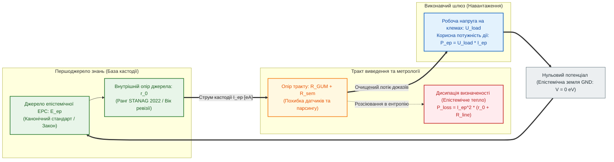

# Глава 02. Четвірка фундаментальних величин та Закон Ома для епістеміки

> **Книга:** [Теорія епістемічних кіл: Схемотехніка доказових обчислень та апаратного виведення](README.md) · Частина I: Основи теорії епістемічних кіл  
> **Попередня глава:** [Глава 01. Концептуальний маніфест: Від булевих вентилів до схемотехніки істини](ch01-manifesto-and-epistemic-gap.md)  
> **Наступна глава:** [Глава 03. Три закони Федчика та топологічний розрахунок кіл](ch03-fedchyk-conservation-laws.md)  
> **Зміст книги:** [README.md](README.md)  
> **Автор:** [Микола Федчик](../ExpertSystem/about-the-author.md)  
> **Рівень складності та оптимальне вивчення:** `[L2]` Прикладний інженерно-фізичний (індекс Д. Кнута `[22]`) · *Маршрут:* Базове ядро всіх треків; 1–2 проходи з розв'язанням розрахункового прикладу  
> **Очікувані результати:** оперувати шістьма фундаментальними фізико-кібернетичними величинами ТЕЛ (напруга, струм, опір, провідність, потужність і теплові втрати визначеності); застосовувати закон Ома для ділянки та повного епістемічного кола; розраховувати падіння достовірності й коефіцієнт корисної дії доказового тракту на практичних інженерних прикладах.

## Анотація

Друга глава закладає метрологічний та фізико-кібернетичний фундамент Теорії епістемічних ланцюгів. Розглядається фундаментальна проблема сучасної інженерії знань — відсутність кількісних мір, які б дозволяли відокремити нормативну силу першоджерела від інтенсивності потоку висновків та інструментальної чи герменевтичної невизначеності тракту передачі. Показано, чому без розмежування цих величин неможливо розрахувати деградацію достовірності у багатоланкових системах прийняття рішень.

Для вирішення цієї проблеми автором введено строгу систему шести взаємопов'язаних величин: епістемічну електрорушійну силу та напругу [[4]](#src-4), епістемічний струм кастодії, метрологічний опір за стандартом JCGM GUM [[5]](#src-5), нормативну провідність, виконавчу потужність та дисипативні втрати («епістемічне тепло»). Сформульовано й обґрунтовано закон Ома для однорідної ділянки та повного замкненого епістемічного кола [[1]](#src-1), а також закон Джоуля–Ленца для обчислення ентропійного розсіювання визначеності [[2]](#src-2), [[3]](#src-3). Теоретичний апарат проілюстровано наскрізним навчальним прикладом інженерного розрахунку тракту аварійного скидання тиску в гідравлічній системі. Главу завершують висновки, словник термінів, перелік абревіатур та бібліографія.

---

## 1. Вступ та постановка проблеми: чому інженерії знань бракувало власної метрології

Коли інженер-електрик проектує лінію електропередачі або каскад підсилювача, він ніколи не плутає електрорушійну силу генератора з силою струму в навантаженні або з опором мідного дроту. Ще у 1827 році Георг Сімон Ом у фундаментальній праці *«Гальванічне коло, опрацьоване математично»* [[1]](#src-1) довів, що ці три величини пов'язані суворим фізичним законом, і жодна з них не може підмінити іншу: висока напруга при розімкненому ключі не створює струму, а величезний струм при проходженні крізь великий опір перетворює корисну енергію джерела на руйнівне джоулеве тепло [[2]](#src-2).

В інженерії знань, експертних системах та системах штучного інтелекту протягом десятиліть панувала протилежна картина — **понятійний синкретизм**. Розробники традиційно намагалися описати стан знання одним безрозмірним числом: «коефіцієнтом упевненості» (*Certainty Factor*) у системі MYCIN [[8]](#src-8), апостеріорною ймовірністю або скалярною вагою ребра у графі. Це негайно породжувало три нерозв'язні інженерні проблеми:
1. **Нерозрізненність статусу норми та якості каналу:** однакова числова оцінка $`0{,}50`$ приписувалася і факультативній рекомендації, виміряній ідеальним приладом, і категоричній вимозі закону безпеки, переданій через зашумлений або непрямий канал.
2. **Неможливість розрахунку пропускної здатності та виконавчої дії:** класична логіка не мала величини, яка б пов'язувала нормативний потенціал правила зі швидкістю генерації побайтово перевірених висновків у реальному часі.
3. **Невидимість дисипативних втрат («теплової смерті» міркування):** у стохастичних мовних моделях генерація тисяч токенів за секунду без опори на першоджерела сприймалася як висока продуктивність, хоча з фізико-кібернетичного погляду це режим короткого замикання через високий опір невизначеності, де вся обчислювальна робота витрачається на нагрівання контексту інформаційним шумом [[3]](#src-3).

Щоб перетворити побудову доказових систем із ремесла на точну інженерну науку, необхідно розщепити аморфне поняття «довіри» на канонічну систему фізико-кібернетичних величин.

> [!NOTE]
> **Чотири фундаментальні положення авторського внеску Миколи Федчика у Главі 02**
> 1. **Система шести базових величин ТЕЛ:** введено фізико-кібернетичний базис епістемічного кола — напругу нормативного напору, струм кастодії, опір невизначеності, деонтичну провідність, виконавчу потужність та дисипативне тепло.
> 2. **Закон Ома для ділянки та повного епістемічного кола:** встановлено кількісну залежність потоку доведених висновків від відношення нормативної електрорушійної сили першоджерела до суми внутрішнього опору джерела та зовнішнього опору тракту виведення.
> 3. **Закон епістемічної дисипації (аналог закону Джоуля–Ленца):** доведено, що потужність втрат визначеності зростає пропорційно квадрату інтенсивності потоку непідтверджених суджень, помноженому на метрологічний опір тракту.
> 4. **Критерій коефіцієнта корисної дії (ККД) доказового тракту:** виведено умову узгодження внутрішнього опору бази знань із опором виконавчого шлюзу для запобігання деградації потенціалу нижче порогу відсічки.
> *Керування рантаймом / Інженерний інваріант:* Якщо внаслідок падіння напруги на внутрішньому та зовнішньому опорах невизначеності залишковий потенціал вузла стає меншим за нормативний поріг допуску, шлюз детерміновано блокує видачу вердикту.

---

## 2. Ізоморфізм між електродинамікою та епістемологією: система величин ТЕЛ

В основу Теорії епістемічних ланцюгів покладено строгий структурний ізоморфізм між переносом електричного заряду в потенціальному полі та переносом побайтово верифікованої кастодії в нормативному просторі доказів (таблиця 2.1).

**Таблиця 2.1.** Фундаментальні фізико-кібернетичні величини Теорії епістемічних ланцюгів та їхні класичні електродинамічні аналоги.

| Епістемічна величина | Символ | Одиниця вимірювання ТЕЛ | Класичний аналог | Фізико-кібернетичний зміст у доказовій системі |
| :--- | :---: | :---: | :---: | :--- |
| **1. Епістемічна ЕРС та напруга** | $`\mathcal{E}_{\mathrm{ep}}, \ U_{\mathrm{ep}}`$ | Епістем-Вольт $`[\mathrm{eV}]`$ | Напруга $`U \ [\text{В}]`$ | Імперативний напір першоджерела та різниця потенціалів достовірності між вузлами кола |
| **2. Епістемічний струм** | $`I_{\mathrm{ep}}`$ | Епістем-Ампер $`[\mathrm{eA}]`$ | Сила струму $`I \ [\text{А}]`$ | Інтенсивність потоку побайтово верифікованих атомів кастодії за одиницю часу |
| **3. Епістемічний опір** | $`R_{\mathrm{ep}}`$ | Епістем-Ом $`[\mathrm{e}\Omega]`$ | Електричний опір $`R \ [\Omega]`$ | Сукупне гальмування доказу через метрологічну похибку, семантичну нечіткість і застарілість |
| **4. Епістемічна провідність** | $`G_{\mathrm{ep}}`$ | Епістем-Сіменс $`[\mathrm{eS}]`$ | Провідність $`G \ [\text{См}]`$ | Ступінь нормативної відкритості правила або каналу передачі доказів: $`G_{\mathrm{ep}} = 1 / R_{\mathrm{ep}}`$ |
| **5. Корисна потужність** | $`P_{\mathrm{ep}}`$ | Епістем-Ват $`[\mathrm{eW}]`$ | Активна потужність $`P \ [\text{Вт}]`$ | Юридично-інженерна дієздатність: швидкість виконання легітимно санкціонованих дій |
| **6. Дисипативне тепло** | $`P_{\mathrm{loss}}`$ | Епістем-Ват $`[\mathrm{eW}]`$ | Джоулеве тепло $`Q_{\mathrm{loss}} \ [\text{Вт}]`$ | Розсіювання визначеності та зростання інформаційної ентропії Шеннона [[3]](#src-3) на опорах тракту |

На рисунку 2.1 зображено елементарне замкнене епістемічне коло, в якому взаємодіють усі шість величин таблиці 2.1.

**Рисунок 2.1.** Структурна схема повного замкненого епістемічного кола з розділенням джерела кастодії, дисипативного тракту передачі та корисного навантаження виконавчого шлюзу.

Розглянемо математичну природу кожної величини цього кола детально.

---

## 3. Епістемічна електрорушійна сила, напруга та опір невизначеності

### 3.1. Епістемічний потенціал та нормативна напруга

У класичній електростатиці потенціал точки визначається роботою переміщення одиничного заряду. В епістемічній схемотехніці за точку нульового потенціалу («епістемічну землю», $`V_{\mathrm{GND}} = 0\text{ eV}`$) приймається стан повного інформаційного вакууму — твердження, не підкріплене жодним першоджерелом.

**Означення 2.1 (Епістемічна ЕРС та напруга).** *Епістемічною електрорушійною силою (ЕРС)* $`\mathcal{E}_{\mathrm{ep}} \in [0, 1]\text{ eV}`$ називається граничний нормативний потенціал першоджерела в режимі холостого ходу (до проходження через зашумлені тракти обробки). *Епістемічною напругою* $`U_{AB}`$ між двома вузлами кола $A$ і $B$ називається різниця їхніх епістемічних потенціалів (формула (2.1)):

$$
U_{AB} = V_A - V_B = \mathcal{E}_{\mathrm{ep}} - \Delta U_{\mathrm{drop}}
$$

**Формула (2.1).** Визначення епістемічної напруги між вузлами кола через початкову ЕРС першоджерела та падіння потенціалу на опорах тракту.

Тут:
- $`V_A, V_B \in [0, 1]\text{ eV}`$ — епістемічні потенціали достовірності у вхідному вузлі $A$ та вихідному вузлі $B$;
- $`\mathcal{E}_{\mathrm{ep}} \in [0, 1]\text{ eV}`$ — нормативна ЕРС первинного документа або еталонного вимірювача;
- $`\Delta U_{\mathrm{drop}} \ge 0`$ — сумарне падіння потенціалу достовірності на елементах опору між вузлами $A$ і $B$, $`\mathrm{eV}`$.

Відповідно до модальної ієрархії інженерних вимог RFC 2119 [[4]](#src-4) та стандартів функціональної безпеки ISO 26262 [[7]](#src-7), джерела знань градуюються за своєю номінальною ЕРС:
- **Категоричний імператив ($`\mathcal{E}_{\mathrm{ep}} = 1{,}00\text{ eV}`$):** закони прямої дії, вимоги безпеки класу ASIL-D, модальні оператори `MUST`, `SHALL`, `REQUIRED`, підкріплені незмінним побайтовим зрізом у пам'яті хоста.
- **Сильна нормативна рекомендація ($`\mathcal{E}_{\mathrm{ep}} \in [0{,}70; 0{,}85]\text{ eV}`$):** галузеві настанови з операторами `SHOULD`, `RECOMMENDED` або перевірені свідчення високої надійності за шкалою STANAG 2022 [[6]](#src-6) (рівні `A1`–`B2`).
- **Дорадча або факультативна інформація ($`\mathcal{E}_{\mathrm{ep}} \le 0{,}30\text{ eV}`$):** необов'язкові опції `MAY`, `OPTIONAL`, експертні припущення та вторинні огляди, чий потенціал завідомо нижчий від порогу спрацювання виконавчих механізмів критичної дії ($`V_{\mathrm{th}} \approx 0{,}75\text{ eV}`$).

### 3.2. Адитивна структура епістемічного опору

Чому потенціал $`V_B`$ на виході реального ланцюга майже завжди менший за початкову ЕРС першоджерела $`\mathcal{E}_{\mathrm{ep}}`$? Тому що будь-який реальний канал отримання та інтерпретації даних чинить **епістемічний опір** $`R_{\mathrm{ep}}`$.

**Означення 2.2 (Повний епістемічний опір ділянки кола).** *Епістемічним опором* $`R_{\mathrm{ep}} \ge 0`$ називається фізико-кібернетична величина, що кількісно характеризує ступінь розсіювання достовірності сигналу на ділянці кола і складається з трьох послідовних складових за формулою (2.2):

$$
R_{\mathrm{ep}} = r_0 + R_{\mathrm{GUM}} + R_{\mathrm{sem}} = r_0 + R_{\mathrm{ref}} \cdot \left(\frac{U_{95\%}}{\Delta_{\mathrm{tol}}}\right)^2 + R_{\mathrm{sem}}
$$

**Формула (2.2).** Трьохкомпонентна структура повного епістемічного опору тракту виведення.

Тут:
- $`r_0 \ge 0`$ — внутрішній опір самого джерела знань (залежить від рангу надійності джерела за STANAG 2022 [[6]](#src-6) та часу старіння редакції документа; для чинного первинного стандарту з прямою кастодією $`r_0 = 0\text{ e}\Omega`$);
- $`R_{\mathrm{GUM}} \ge 0`$ — метрологічний опір вимірювального каналу, пропорційний квадрату відношення розширеної невизначеності вимірювання $`U_{95\%}`$ за JCGM GUM [[5]](#src-5) до ширини поля допуску $`\Delta_{\mathrm{tol}}`$, $`\mathrm{e}\Omega`$;
- $`R_{\mathrm{ref}} > 0`$ — питомий еталонний опір калібрування шлюзу (зазвичай нормується як $`R_{\mathrm{ref}} = 1{,}00\text{ e}\Omega`$);
- $`R_{\mathrm{sem}} \ge 0`$ — семантичний опір перекладу, розбору або непрямого посилання (для прямого побайтового читання з відображеної пам'яті хоста $`R_{\mathrm{sem}} = 0\text{ e}\Omega`$).

---

## 4. Закон Ома для епістеміки та закон дисипації визначеності

### 4.1. Закон Ома для однорідної ділянки та повного кола

Потік доведених висновків у системі визначається кількістю верифікованих атомів кастодії $`N_{\mathrm{cust}}`$, що успішно проходять крізь поперечний переріз тракту виведення за одиницю часу: $`I_{\mathrm{ep}} = dN_{\mathrm{cust}} / dt`$.

**Твердження 2.1 (Закон Ома для повного епістемічного кола).** Сила епістемічного струму $`I_{\mathrm{ep}}`$ у замкненому колі виведення прямо пропорційна нормативній електрорушійній силі першоджерела $`\mathcal{E}_{\mathrm{ep}}`$ і обернено пропорційна сумі зовнішнього опору навантаження й тракту $`R_{\mathrm{ext}} = R_{\mathrm{GUM}} + R_{\mathrm{sem}} + R_{\mathrm{load}}`$ та внутрішнього опору джерела $`r_0`$ (формула (2.3)):

$$
I_{\mathrm{ep}} = \frac{\mathcal{E}_{\mathrm{ep}}}{R_{\mathrm{ext}} + r_0}, \qquad U_{\mathrm{load}} = \mathcal{E}_{\mathrm{ep}} - I_{\mathrm{ep}} \cdot \left(r_0 + R_{\mathrm{GUM}} + R_{\mathrm{sem}}\right)
$$

**Формула (2.3).** Закон Ома для повного замкненого епістемічного кола та рівняння залишкової напруги на клемах виконавчого шлюзу.

Тут:
- $`I_{\mathrm{ep}} \ge 0`$ — результуючий струм доведених висновків у колі, $`\mathrm{eA}`$;
- $`R_{\mathrm{load}} > 0`$ — вхідний опір виконавчого шлюзу (нормативне навантаження приймача рішення), $`\mathrm{e}\Omega`$;
- $`U_{\mathrm{load}} \in [0, \mathcal{E}_{\mathrm{ep}}]\text{ eV}`$ — корисна епістемічна напруга, яка фактично доходить до затвора або виконавчого механізму після всіх втрат у тракті.

З формули (2.3) негайно випливають три фундаментальні режими роботи будь-якої інтелектуальної системи:
1. **Режим епістемічної надпровідності ($`r_0 = 0, \ R_{\mathrm{GUM}} = 0, \ R_{\mathrm{sem}} = 0`$):** коли система звертається безпосередньо до незмінного образа стандарту у спільній пам'яті хоста за точним криптографічним ключем кастодії і оперує точними константами, втрати в лінії відсутні ($`\Delta U_{\mathrm{drop}} = 0`$), а напруга на виході дорівнює повній ЕРС закону ($`U_{\mathrm{load}} = \mathcal{E}_{\mathrm{ep}} = 1{,}00\text{ eV}`$).
2. **Режим апаратної відсічки / ізолятора ($`R_{\mathrm{ep}} \to \infty`$):** якщо геш цитати не збігається, датчик вийшов за межі калібрування або джерело невідоме, опір ділянки стає нескінченним, струм падає до нуля ($`I_{\mathrm{ep}} = 0`$), і система безпечно переходить у стан `REFUSAL`.
3. **Режим внутрішнього короткого замикання на шумі ($`R_{\mathrm{load}} \to 0, \ r_0 + R_{\mathrm{sem}} \gg 1`$):** характерний для неконтрольованих генеративних моделей, коли вхідний поріг критики на виході відсутній, але внутрішній опір неперевіреного джерела величезний. Тоді напруга достовірності на виході падає до нуля ($`U_{\mathrm{load}} \to 0`$), а вся енергія виділяється всередині моделі у вигляді інформаційного тепла.

### 4.2. Виконавча потужність, епістемічне тепло та ККД тракту виведення

Подібно до класичної фізики, де потужність електричного струму визначає здатність двигуна виконувати механічну роботу [[2]](#src-2), в епістемічній схемотехніці вводиться поняття корисної потужності та теплових втрат.

**Твердження 2.2 (Закон балансу потужності та епістемічного тепла).** Повна потужність джерела знань $`P_{\mathrm{total}} = \mathcal{E}_{\mathrm{ep}} I_{\mathrm{ep}}`$ розкладається на корисну виконавчу потужність на шлюзі навантаження $`P_{\mathrm{ep}}`$ та дисипативну потужність втрат визначеності («епістемічне тепло») $`P_{\mathrm{loss}}`$, яка зростає квадратично зі струмом (формула (2.4)):

$$
P_{\mathrm{ep}} = U_{\mathrm{load}} \cdot I_{\mathrm{ep}}, \qquad P_{\mathrm{loss}} = I_{\mathrm{ep}}^2 \cdot \left(r_0 + R_{\mathrm{GUM}} + R_{\mathrm{sem}}\right), \qquad \eta_{\mathrm{ep}} = \frac{P_{\mathrm{ep}}}{P_{\mathrm{total}}} = \frac{U_{\mathrm{load}}}{\mathcal{E}_{\mathrm{ep}}}
$$

**Формула (2.4).** Рівняння корисної виконавчої потужності, джоулевих втрат визначеності та епістемічного коефіцієнта корисної дії (ККД) тракту.

Тут:
- $`P_{\mathrm{ep}} \ge 0`$ — корисна епістемічна потужність, що визначає легітимну здатність системи санкціонувати дію, $`\mathrm{eW}`$;
- $`P_{\mathrm{loss}} \ge 0`$ — потужність дисипативних втрат (швидкість генерації інформаційної ентропії та сумніву в тракті), $`\mathrm{eW}`$;
- $`\eta_{\mathrm{ep}} \in [0, 1]`$ — епістемічний ККД лінії виведення (частка первинного потенціалу достовірності, збережена на виході).

Формула (2.4) дає суворе математичне пояснення феномену деградації великих мовних моделей при саморефлексії або довгих ланцюжках міркувань без зовнішньої кастодії (*Chain-of-Thought Collapse*): коли модель намагається збільшити потік генерованих токенів ($`I_{\mathrm{ep}} \uparrow`$) через високий семантичний опір неперевірених припущень ($`R_{\mathrm{sem}} \gg 0`$), втрати визначеності $`P_{\mathrm{loss}} = I_{\mathrm{ep}}^2 R_{\mathrm{sem}}`$ зростають квадратично, миттєво «перепалюючи» достовірність висновку.

---

## 5. Навчальний інженерний приклад: розрахунок епістемічного кола аварійного клапана

Продемонструємо практичне застосування теоретичного апарату Глави 02 на конкретній інженерній задачі.

### 5.1. Вихідні умови задачі

Нехай автоматизована система безпеки хімічного реактора контролює умову відкриття аварійного скидного клапана за чинним галузевим регламентом безпеки. Відомі такі параметри схеми:
1. **Першоджерело норми:** затверджений регламент безпеки містить імперативну вимогу (`SHALL`) з побайтовою кастодією у спільній пам'яті хоста: номінальна ЕРС становить $`\mathcal{E}_{\mathrm{ep}} = 1{,}00\text{ eV}`$, внутрішній опір чинного першоджерела $`r_0 = 0{,}00\text{ e}\Omega`$.
2. **Семантичний тракт:** правило скомпільовано у бінарний пакет знань без евристичних переказів, отже семантичний опір лінії $`R_{\mathrm{sem}} = 0{,}00\text{ e}\Omega`$.
3. **Метрологічний канал датчика тиску:** ширина допустимого поля похибки за регламентом становить $`\Delta_{\mathrm{tol}} = 10{,}0\text{ кПа}`$. Розглянемо два експлуатаційні сценарії:
   - *Сценарій А (Штатний калібрований датчик):* розширена невизначеність вимірювання за JCGM GUM [[5]](#src-5) дорівнює $`U_{95\%, A} = 2{,}0\text{ кПа}`$.
   - *Сценарій Б (Деградований датчик після перегріву):* розширена невизначеність зросла до $`U_{95\%, B} = 6{,}0\text{ кПа}`$.
4. **Параметри виконавчого шлюзу:** еталонний опір $`R_{\mathrm{ref}} = 1{,}00\text{ e}\Omega`$, вхідний опір навантаження виконавчого шлюзу $`R_{\mathrm{load}} = 1{,}00\text{ e}\Omega`$. Мінімальний поріг напруги достовірності для санкціонування відкриття клапана за контрактом безпеки становить $`U_{\mathrm{min}} = 0{,}80\text{ eV}`$.

Потрібно розрахувати метрологічний опір $`R_{\mathrm{GUM}}`$, струм $`I_{\mathrm{ep}}`$, напругу на шлюзі $`U_{\mathrm{load}}`$, теплові втрати $`P_{\mathrm{loss}}`$, ККД $`\eta_{\mathrm{ep}}`$ та визначити вердикт системи у сценаріях А і Б.

### 5.2. Покроковий розрахунок

**Крок 1. Розрахунок для Сценарію А (калібрований датчик):**
1. За формулою (2.2) знаходимо метрологічний опір:

$$
R_{\mathrm{GUM}, A} = 1{,}00 \cdot \left(\frac{2{,}0}{10{,}0}\right)^2 = 1{,}00 \cdot 0{,}04 = 0{,}04\text{ e}\Omega
$$

2. За законом Ома (формула (2.3)) визначаємо струм у колі та робочу напругу на виконавчому шлюзі:

$$
I_{\mathrm{ep}, A} = \frac{1{,}00}{1{,}00 + 0{,}04 + 0{,}00} \approx 0{,}9615\text{ eA}, \qquad U_{\mathrm{load}, A} = 1{,}00 - 0{,}9615 \cdot 0{,}04 \approx 0{,}9615\text{ eV}
$$

3. За формулою (2.4) обчислюємо корисну потужність, дисипативні втрати та ККД:

$$
P_{\mathrm{ep}, A} = 0{,}9615 \cdot 0{,}9615 \approx 0{,}9245\text{ eW}, \qquad P_{\mathrm{loss}, A} = (0{,}9615)^2 \cdot 0{,}04 \approx 0{,}0370\text{ eW}, \qquad \eta_{\mathrm{ep}, A} = 96{,}15\%
$$

Оскільки $`U_{\mathrm{load}, A} = 0{,}9615\text{ eV} \ge U_{\mathrm{min}} = 0{,}80\text{ eV}`$, шлюз формує вердикт **`ACCEPT`** (команда на клапан санкціонована з високим запасом достовірності).

**Крок 2. Розрахунок для Сценарію Б (деградований датчик):**
1. За формулою (2.2) метрологічний опір зростає квадратично:

$$
R_{\mathrm{GUM}, B} = 1{,}00 \cdot \left(\frac{6{,}0}{10{,}0}\right)^2 = 1{,}00 \cdot 0{,}36 = 0{,}36\text{ e}\Omega
$$

2. За формулою (2.3) струм і залишкова напруга на клемах шлюзу становлять:

$$
I_{\mathrm{ep}, B} = \frac{1{,}00}{1{,}00 + 0{,}36} \approx 0{,}7353\text{ eA}, \qquad U_{\mathrm{load}, B} = 1{,}00 - 0{,}7353 \cdot 0{,}36 \approx 0{,}7353\text{ eV}
$$

3. За формулою (2.4) потужність втрат зростає більш ніж у п'ять разів ($`P_{\mathrm{loss}, B} \approx 0{,}1946\text{ eW}`$), а ККД тракту падає до $`\eta_{\mathrm{ep}, B} = 73{,}53\%`$.

Оскільки $`U_{\mathrm{load}, B} = 0{,}7353\text{ eV} < U_{\mathrm{min}} = 0{,}80\text{ eV}`$, залишкової напруги недостатньо для подолання порогу безпеки. Система детерміновано блокує автоматичний дозвіл і видає типізовану відмову **`REFUSAL (METROLOGICAL_VOLTAGE_DROP)`**, переводячи реактор на резервний канал вимірювання.

---

## Висновки

1. **Подолання скалярного синкретизму:** розщеплення абстрактної «впевненості» на шість фізико-кібернетичних величин (ЕРС, напругу, струм, опір, потужність і теплові втрати) вперше дає змогу окремо обліковувати юридичну силу першоджерела та технічну якість тракту передачі даних.
2. **Універсальність закону Ома для епістеміки:** потік доведених висновків у будь-якій експертній системі лімітується повним опором кола, який включає внутрішній опір авторитетності джерела, квадратичний метрологічний опір похибок за JCGM GUM та семантичний опір інтерпретації.
3. **Фізична природа інформаційного перегріву:** згідно із законом дисипації $`P_{\mathrm{loss}} = I_{\mathrm{ep}}^2 R_{\mathrm{ep}}`$, прискорення генерації висновків за високого опору невизначеності не створює корисної виконавчої потужності, а призводить до квадратичного зростання ентропійного тепла (галюцинацій).
4. **Інженерна розраховуваність безпеки:** як показано у навчальному прикладі, простий розрахунок дільника епістемічної напруги дозволяє до мілісекунди передбачити момент, коли деградація точності датчика робить автоматичне рішення неприпустимим.

---

## Словник

| Термін | Англійський еквівалент | Визначення |
| :--- | :--- | :--- |
| **Епістемічна електрорушійна сила (ЕРС)** | *Epistemic Electromotive Force* | Максимальний початковий потенціал достовірності першоджерела в режимі холостого ходу до віднімання втрат у тракті виведення. |
| **Епістемічна напруга** | *Epistemic Voltage* | Різниця потенціалів достовірності між двома вузлами епістемічного кола, вимірювана в епістем-вольтах $`[\mathrm{eV}]`$. |
| **Епістемічний струм** | *Epistemic Current* | Кількість побайтово верифікованих атомів кастодії, що передаються крізь переріз каналу виведення за одиницю часу $`[\mathrm{eA}]`$. |
| **Епістемічний опір** | *Epistemic Resistance* | Міра протидії проходженню доказового струму, зумовлена метрологічною невизначеністю, семантичною неоднозначністю та застарілістю джерела $`[\mathrm{e}\Omega]`$. |
| **Епістемічна провідність** | *Epistemic Conductance* | Величина, обернена до епістемічного опору, що характеризує пропускну здатність нормативного каналу $`[\mathrm{eS}]`$. |
| **Епістемічна потужність** | *Epistemic Power* | Добуток робочої напруги достовірності на струм кастодії, що визначає здатність системи легітимно санкціонувати виконавчу дію $`[\mathrm{eW}]`$. |
| **Епістемічне тепло** | *Epistemic Heat / Dissipation* | Дисипативна потужність втрат визначеності на опорах кола, що перетворює потенціал першоджерела на інформаційну ентропію. |
| **Епістемічна надпровідність** | *Epistemic Superconductivity* | Ідеальний режим роботи тракту виведення з нульовим опором ($`R_{\mathrm{ep}} = 0`$), за якого висновок спирається безпосередньо на незмінний зріз пам'яті хоста і точні константи. |

---

## Абревіатури

| Абревіатура | Розшифрування | Опис |
| :--- | :--- | :--- |
| **ЕРС (EMF)** | Електрорушійна сила (*Electromotive Force*) | Номінальний потенціал первинного джерела знань у розімкненому колі. |
| **ККД** | Коефіцієнт корисної дії (*Efficiency*) | Відношення корисної епістемічної потужності на виконавчому шлюзі до повної потужності першоджерела. |
| **ТЕЛ** | Теорія епістемічних ланцюгів (*Epistemic Circuit Theory*) | Фізико-кібернетична теорія розрахунку та синтезу доказових систем. |
| **CF** | Certainty Factor | Скалярний коефіцієнт упевненості в історичній експертній системі MYCIN. |
| **eA** | Епістем-Ампер (*Epistemic Ampere*) | Одиниця вимірювання сили епістемічного струму (потоку верифікованих фактів за секунду). |
| **eS** | Епістем-Сіменс (*Epistemic Siemens*) | Одиниця вимірювання епістемічної провідності каналу виведення. |
| **eV** | Епістем-Вольт (*Epistemic Volt*) | Нормована одиниця вимірювання епістемічного потенціалу та напруги на відрізку $`[0, 1]`$. |
| **eW** | Епістем-Ват (*Epistemic Watt*) | Одиниця вимірювання корисної епістемічної потужності та дисипативних втрат. |
| **GND** | Ground (Епістемічна земля) | Вузол нульового потенціалу достовірності ($`V = 0\text{ eV}`$), що відповідає повній відсутності доказів. |
| **GUM** | Guide to the Expression of Uncertainty in Measurement | Міжнародний стандарт JCGM 100:2008 оцінювання невизначеності вимірювань. |

---

## Джерела

1. Georg Simon Ohm. [*Die galvanische Kette, mathematisch bearbeitet*](https://doi.org/10.5479/sil.354716.39088005838644). Berlin: T. H. Riemann, 1827.
2. James Prescott Joule. [*On the Production of Heat by Voltaic Electricity*](https://doi.org/10.1098/rspl.1837.0229). *Proceedings of the Royal Society of London*, 4, 280–282, 1840.
3. Claude E. Shannon. [*A Mathematical Theory of Communication*](https://doi.org/10.1002/j.1538-7305.1948.tb01338.x). *Bell System Technical Journal*, 27(3), 379–423, 1948.
4. Scott Bradner. [*Key words for use in RFCs to Indicate Requirement Levels*](https://doi.org/10.17487/RFC2119). BCP 14, IETF RFC 2119, 1997.
5. JCGM. [*Evaluation of Measurement Data — Guide to the Expression of Uncertainty in Measurement (GUM)*](https://doi.org/10.59161/JCGM100-2008E). JCGM 100:2008, BIPM / ISO / IEC, 2008.
6. NATO Standardization Office. [*STANAG 2022 / AJP-2.1: Allied Joint Doctrine for Intelligence Procedures*](https://nso.nato.int/). Brussels: NATO, Edition B, 2016.
7. ISO. [*ISO 26262:2018. Road vehicles — Functional safety*](https://www.iso.org/standard/68383.html). 2nd Edition, Geneva: International Organization for Standardization, 2018.
8. Bruce G. Buchanan, Edward H. Shortliffe (ред.). [*Rule-Based Expert Systems: The MYCIN Experiments of the Stanford Heuristic Programming Project*](https://www.shortliffe.net/Buchanan-Shortliffe-1984/MYCIN%20Book.htm). Reading, MA: Addison-Wesley, 1984.

---

[← Глава 01. Концептуальний маніфест](ch01-manifesto-and-epistemic-gap.md) | [Зміст книги](README.md) | [Глава 03. Три закони Федчика та топологічний розрахунок кіл →](ch03-fedchyk-conservation-laws.md)
