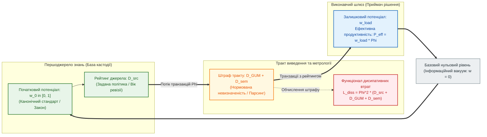

# Глава 02. Фундаментальні кількісні міри та рівняння атенюації достовірності в обчислювальних схемах

> **Книга:** [Теорія епістемічних обчислювальних схем: Математичні інваріанти кастодії, метрології та детермінованого виведення](README.md) · Частина 1. Математичні основи епістемічних схем  
> **Попередня глава:** [← Глава 01. Теоретичні засади: від булевих вентилів до доказових обчислювальних схем](ch01-foundations-and-epistemic-gap.md)  
> **Наступна глава:** [Глава 03. Топологічні інваріанти збереження та розрахунок мереж доказового виведення →](ch03-topological-conservation-invariants.md)  
> **Зміст книги:** [Повернутися до змісту](README.md)  
> **Автор:** [Микола Мартинович Федчик](../ExpertSystem/about-the-author.md) 
> **Рівень складності:** `[L2 — Інженерно-математичний рівень]` *(За класифікацією автора: безрозмірні рейтинги, облік потоку транзакцій, поширення невизначеності та умовні алгебричні тотожності)* 
> **Очікувані результати:** Читач відрізнятиме вимірювану невизначеність від проєктного рейтингу, перевірить розмірності шести груп величин таблиці 2.1, обчислить умовну атенюацію та пояснить, чому її алгебра не доводить імовірнісного калібрування чи квадратичного зростання реальних помилок.

---

## Анотація

Друга глава визначає кількісну модель для обліку походження даних, вимірювальної невизначеності та потоку запитів в експертній системі. Якщо нормативну обов'язковість правила, якість вимірювання й швидкодію звести до одного числа, шлюз допуску втратить підстави для пояснення відмови. Тому ці характеристики потрібно зберігати окремо; запропонований скалярний рейтинг є додатковим інструментом аналізу, а не заміною нормативної перевірки, метрологічної моделі чи вимірювання продуктивності.

За аналогією зі зв'язковими графами Генрі Пейнтера [[6]](#src-6) у цій монографії автором запропоновано шість груп величин: рейтинг $`w_0,w\in[0,1]`$, потік $`\Phi\ge0`$, сумарний штраф $`D\ge0`$, коефіцієнт передачі $`\sigma\in(0,1]`$, зважений потік $`P_{\mathrm{eff}}`$ та квадратичний штраф $`L_{\mathrm{diss}}`$. JCGM GUM [[5]](#src-5) обґрунтовує оцінювання невизначеності вимірювання, але не перетворення цієї невизначеності на достовірність висновку. Гіперболічну залежність і квадратичну цільову функцію тут задано як модельні припущення. Наведено навчальний розрахунок та відтворювані контрприклади; промислову безпеку, новизну й емпіричне калібрування ці результати не засвідчують.

---

> [!NOTE]
> **Чотири положення авторської моделі та їхній доказовий статус**
> 1. **Означення / проєктна політика:** рейтинг, потік і штраф обліковуються окремо. Назва «потенціал достовірності» не робить рейтинг імовірністю істинності.
> 2. **Означення / некалібрована гіпотеза застосовності:** суму $`D = D_{\mathrm{src}} + D_{\mathrm{GUM}} + D_{\mathrm{sem}}`$ обрано для спільної штрафної шкали; її емпіричну адекватність не встановлено. GUM не задає цієї суми.
> 3. **Проєктна політика / умовна алгебрична тотожність:** вибір $`\sigma=1/(1+D)`$ задає атенюацію; адитивність у координаті $`g(w)=1/w-1`$ еквівалентна нуль-параметричній t-нормі Гамахера, але не незалежній імовірнісній кон'юнкції. Залежність потоку від рейтингу є окремою політикою обмеження частоти.
> 4. **Означення / спростоване універсальне твердження:** $`L_{\mathrm{diss}}=\Phi^2D`$ є обраним квадратичним штрафом. Висновок про обов'язкове квадратичне зростання реальної ентропії або кількості помилок не випливає з нього; контрприклад наведено нижче.
> *Керування рантаймом / Інженерний інваріант:* Порівняння $`w_{\mathrm{load}}<w_{\min}`$ задає відмову лише в оголошеній політиці. Перевірки чинності норми, кастодії та допустимості дії залишаються окремими обов'язковими умовами.

---

## 1. Постановка проблеми: скалярний синкретизм у класичних моделях нечіткого виведення

Проблема скалярного синкретизму виникає в експертній системі тоді, коли один показник починають використовувати для несумісних задач: нормативного допуску, оцінювання вимірювання та планування виконання. Коефіцієнт упевненості MYCIN [[8]](#src-8), імовірність і вага ребра мають різні означення; наявність скаляра сама собою не є дефектом цих методів. Небезпеку становлять такі помилки застосування:
1. **Нерозрізненність нормативного статусу правила та метрологічної якості каналу:** однакова числова оцінка $`0{,}50`$ приписується і факультативній рекомендації (`MAY`), виміряній ідеальним еталонним приладом, і категоричній вимозі стандарту безпеки (`SHALL`), переданій через давач зі значною похибкою.
2. **Підміна вимірювання продуктивності оцінкою знання:** логічний вердикт не повідомляє кількості перевірок за секунду. Потік потрібно вимірювати окремо, а залежність потоку від рейтингу — задавати або експериментально встановлювати.
3. **Підміна змістової достовірності ентропією:** швидкість токенів не вимірює правильності висновку. Ентропія Шеннона [[3]](#src-3) характеризує розподіл повідомлень, а не їхню істинність чи нормативну правомірність.

Зв'язкові графи [[6]](#src-6) використано як аналогію для організації обліку, а не як доказ необхідності саме цих змінних. Закони Ома й Джоуля [[1]](#src-1), [[2]](#src-2) стосуються фізичних величин; переносити їх на істинність тверджень без додаткових припущень не можна. Потік є швидкістю зміни лічильника транзакцій, а не екстенсивним запасом; нормативний статус правила потрібно зберігати незалежно від будь-якого рейтингу.

---

## 2. Система шести базових кількісних величин епістемічної обчислювальної схеми

Шість груп величин у таблиці 2.1 потрібні для роздільного обліку якості даних і навантаження на тракт експертної системи. Без перевірки одиниць штраф легко помилково прочитати як число аварій або ентропію. Тому фізично оцінювані параметри вимірювання, лічильники транзакцій і проєктні рейтинги нижче розрізнено явно.

**Таблиця 2.1.** Фундаментальні кількісні величини Теорії епістемічних обчислювальних схем та їхні математичні області визначення.

| Величина обчислювальної схеми | Символ | Область значень та розмірність | Аналогія з потоковими графами | Математичний та інженерний зміст у системі виведення |
| :--- | :---: | :---: | :---: | :--- |
| **1. Нормований потенціал достовірності** | $`w_0, \ w`$ | Безрозмірна величина $`[0, 1]`$ | Рейтинг, аналог потенціалу | Призначена вага та її ослаблене значення; не нормативна модальність і не калібрована ймовірність |
| **2. Потік верифікаційних транзакцій** | $`\Phi`$ | Транзакцій за такт $`[\text{такт}^{-1}]`$ | Екстенсивна змінна потоку (*Flow*) | Інтенсивність проходження побайтово верифікованих дескрипторів кастодії крізь переріз схеми |
| **3. Коефіцієнт деградації (опору)** | $`D`$ | Безрозмірна невід'ємна міра $`[0, \infty)`$ | Проєктний штраф | Сума явно нормованих рейтингів, не безпосередньо вимірювана «втрата істини» |
| **4. Нормована провідність ланки** | $`\sigma`$ | Безрозмірний коефіцієнт $`(0, 1]`$ | Коефіцієнт передачі ланки (*Conductance*) | Частка потенціалу достовірності, що зберігається після проходження ланки: $`\sigma = 1 / (1 + D)`$ |
| **5. Ефективна продуктивність дії** | $`P_{\mathrm{eff}}`$ | Зважених транзакцій за такт, $`[\text{такт}^{-1}]`$ | Зважений потік | $`P_{\mathrm{eff}} = w_{\mathrm{load}} \cdot \Phi`$; без калібрування не є очікуваною кількістю правильних дій |
| **6. Функціонал дисипативних втрат** | $`L_{\mathrm{diss}}`$ | Квадрат частоти, $`[\text{такт}^{-2}]`$ | Квадратичний штраф | $`L_{\mathrm{diss}} = \Phi^2 \cdot D`$; не ентропія, не енергія і не частота помилок |

> [!NOTE]
> **Методологічне застереження: про статус змінних $`P_{\mathrm{eff}}`$ та $`L_{\mathrm{diss}}`$**
> 1. Поняття «потужність» і «дисипація» є лише аналогією. За безрозмірного $`D`$ добуток $`\Phi^2D`$ має розмірність оберненого квадрата часу; його не можна додавати до $`P_{\mathrm{eff}}`$ як член фізичного балансу.
> 2. Для порівняння безрозмірних штрафів можна використати $`(\Phi/\Phi_0)^2D`$, де $`\Phi_0>0`$ — однакова опорна частота для всіх порівнюваних трактів. Для отримання частоти потрібний додатковий множник із розмірністю часу, але й він не забезпечує калібрування ризику.
> 3. Квадратичність обраної цільової функції є означенням; твердження про таку саму залежність аварій, помилок чи ентропії потребує окремих спостережень і моделі.

На рисунку 2.1 зображено структурну схему елементарного конвеєра верифікації, в якому взаємодіють усі шість величин таблиці 2.1.

**Рисунок 2.1.** Структурна схема елементарного тракту епістемічної обчислювальної схеми з розділенням джерела кастодії, дисипативної лінії передачі та виконавчого шлюзу.

---

## 3. Потенціал достовірності та адитивна структура коефіцієнта деградації

### 3.1. Нормований потенціал достовірності першоджерела

Потенціал достовірності першоджерела потрібний у цій моделі для порівняння призначених ваг, а не для вимірювання юридичної сили чи істинності. Нульовий рейтинг $`w_{\mathrm{null}}=0`$ можна призначити непідтвердженому твердженню; це не означає, що твердження хибне. Значення $`w_0=1`$ є верхньою опорною оцінкою політики. Побайтова кастодія підтверджує походження й цілісність, але не гарантує правильності документа, застосовності норми або нульової невизначеності еталона. Компоненти стану $`\Psi`$ з [Глави 01](ch01-foundations-and-epistemic-gap.md), формула (1.2), потрібно перевіряти окремо.

**Означення 2.1 (Початковий та залишковий потенціал достовірності).** *Початковим потенціалом* $`w_0\in[0,1]`$ називається призначений безрозмірний рейтинг до врахування штрафів. *Залишковим потенціалом* називається його значення після модельної атенюації. Різниця у формулі (2.1) описує одну пасивну ланку, для якої $`w_A=w_0`$ і $`w_B=w_{\mathrm{load}}`$:

$$
\Delta w_{AB} = w_A - w_B = w_0 - w_{\mathrm{load}}
$$

**Формула (2.1).** Визначення спаду потенціалу достовірності між вхідним і вихідним вузлами ланки обчислювальної схеми.

Тут:
- $`w_A, w_B \in [0, 1]`$ — безрозмірні потенціали достовірності у вхідному вузлі $A$ та вихідному вузлі $B$;
- $`w_0 \in [0, 1]`$ — початковий рейтинг первинного документа або вимірювальних даних;
- $`w_{\mathrm{load}} \in [0, w_0]`$ — залишковий потенціал на вході виконавчого шлюзу.

Наприклад, при $`w_A=0{,}9`$ і $`w_B=0{,}6`$ спад дорівнює $`0{,}3`$. Це різниця рейтингів, а не 30-відсоткова ймовірність помилки; результат дозволяє порівняти тракти лише за однакової політики шкалювання.

RFC 2119 [[4]](#src-4) визначає модальності `MUST`, `SHOULD` і `MAY`, але не присвоює їм значень $`1{,}00`$, $`0{,}70–0{,}85`$ чи $`0{,}30`$. ISO 26262 [[7]](#src-7) також не використано тут як джерело числового перетворення ASIL на рейтинг. Раніше наведені числа є лише можливим вибором політики, а не вимогами цих документів. Для числового прикладу нижче прийнято $`w_0=1`$ без емпіричного калібрування.

Оцінювання надійності джерела та достовірності повідомлення, яке пов'язують зі STANAG 2022, не визначає нормативної обов'язковості повідомлення. Категорії `A1`–`B2` не можна без обґрунтування переводити в імовірності або прирівнювати до `SHALL`/`SHOULD`. Первинний текст цієї шкали в наведеному наборі перевірених джерел відсутній; числового перетворення з неї тут не задано. Обов'язкове правило не стає факультативним через погану якість вимірювання, а необов'язкова опція не стає обов'язковою через високу надійність джерела.

### 3.2. Трикомпонентна структура коефіцієнта деградації

Трикомпонентна структура коефіцієнта деградації дозволяє окремо показати, який штраф призначено джерелу, вимірюванню та інтерпретації. У реальній експертній системі ці чинники можуть залежати один від одного; просте додавання без правил нормування здатне двічі врахувати одну причину. Тому формула (2.2) є означенням спільної штрафної шкали, а її здатність передбачати помилки залишається некаліброваною гіпотезою.

**Означення 2.2 (Повний коефіцієнт деградації ділянки схеми).** *Коефіцієнтом деградації* $`D\ge0`$ називається сума скінченних невід'ємних безрозмірних штрафів, шкали яких явно задано. У цій моделі обрано формулу (2.2):

$$
D = D_{\mathrm{src}} + D_{\mathrm{GUM}} + D_{\mathrm{sem}} = D_{\mathrm{src}} + \left(\frac{U_{95\%}}{\Delta_{\mathrm{tol}}}\right)^2 + D_{\mathrm{sem}}
$$

**Формула (2.2).** Трикомпонентна адитивна структура коефіцієнта деградації тракту виведення.

Тут:
- $`D_{\mathrm{src}}\ge0`$ — призначений штраф джерела; правило залежності від віку чи перевірок потрібно задати окремо. Нуль є припущенням прикладу, не наслідком наявності контрольної суми;
- $`D_{\mathrm{GUM}}=(U_{95\%}/\Delta_{\mathrm{tol}})^2\ge0`$ — обраний рейтинг вимірювальної невизначеності. Позначення не означає, що таку формулу визначає GUM;
- $`U_{95\%}\ge0`$ — розширена невизначеність із заявленим приблизно 95-відсотковим охопленням, у тих самих одиницях, що й $`\Delta_{\mathrm{tol}}>0`$. За GUM її отримують як $`U=ku_c`$, де $`u_c\ge0`$ — сумарна стандартна невизначеність, а $`k>0`$ — коефіцієнт охоплення. Значення $`k=2`$ дає приблизно 95% лише за належних припущень про розподіл та оцінку дисперсії [[10]](#src-10);
- $`\Delta_{\mathrm{tol}}`$ — явно обрана ширина поля допуску, не виміряне значення і не стандартна невизначеність. Тому їхнє відношення не є відносною невизначеністю вимірюваної величини в термінології GUM;
- $`D_{\mathrm{sem}}\ge0`$ — призначений штраф інтерпретації. Пряме читання байтів усуває спотворення копіювання, але не доводить правильної інтерпретації; нульовий штраф потребує окремого припущення.

Наприклад, $`U_{95\%}=2\text{ кПа}`$ і $`\Delta_{\mathrm{tol}}=10\text{ кПа}`$ дають рейтинг $`0{,}04`$, а не 4-відсоткову ймовірність помилки. Якщо вимірювання залежить від кількох входів, спочатку потрібно обчислити їхню сумарну невизначеність із коваріаціями за GUM [[9]](#src-9), а вже потім застосовувати обране нормування. Додавання рейтингів джерела й парсингу не замінює цього розрахунку.

---

## 4. Рівняння атенюації достовірності та квадратичний функціонал втрат

### 4.1. Гіперболічний закон ослаблення достовірності в ланці

Гіперболічна атенюація задає спосіб зменшення рейтингу перед шлюзом допуску, коли штраф зростає. Для цього в авторській моделі обрано коефіцієнт $`\sigma=1/(1+D)`$; його не виведено з фізичного закону Ома. Без окремої перевірки на даних ця функція є політикою шкалювання, а не законом деградації істинності.

**Твердження 2.1 (Рівняння атенюації достовірності та пропускної здатності тракту).** За означенням $`w_{\mathrm{load}}=w_0\sigma`$ та **додатковою політикою** обмеження частоти $`\Phi=\Phi_0w_{\mathrm{load}}`$ отримуємо формулу (2.3). Перша рівність визначає рейтинг, друга задає частоту планувальника; вона не є теоремою про фізичну пропускну здатність верифікатора:

$$
w_{\mathrm{load}} = w_0 \cdot \sigma = \frac{w_0}{1 + D_{\mathrm{src}} + D_{\mathrm{GUM}} + D_{\mathrm{sem}}}, \qquad \Phi = \Phi_0 \cdot \frac{w_0}{1 + D}
$$

**Формула (2.3).** Визначення гіперболічної атенюації та окремої політики обмеження потоку.

Тут:
- $`\sigma = 1 / (1 + D) \in (0, 1]`$ — нормована провідність (коефіцієнт збереження достовірності) тракту;
- $`\Phi_0 > 0`$ — скінченна опорна частота політики ($`\text{такт}^{-1}`$), яку не можна перевищувати без перевірки доступної пропускної здатності;
- $`w_{\mathrm{load}} \in [0, w_0]`$ — обчислений рейтинг на вході шлюзу.

Фактичний потік вимірюється як число завершених транзакцій, поділене на тривалість спостереження: $`\Phi=N/T`$, де ціле $`N\ge0`$, а $`T>0`$ вимірюється в тактах або секундах. Перевірка 100 транзакцій за 20 тактів дає 5 транзакцій за такт незалежно від призначеного рейтингу. Політика (2.3) може обмежувати цей потік, але сам рейтинг не сповільнює обчислення.

Транзакція є лічильною одиницею. Для переходу від тактів до секунд потрібно знати тривалість такту $`\tau>0`$ у секундах: числове значення частоти за такт ділиться на $`\tau`$. Відповідно, $`P_{\mathrm{eff}}`$ масштабується як обернений час, а $`L_{\mathrm{diss}}`$ — як обернений квадрат часу; без однакової часової бази їхні числові значення не можна порівнювати між системами.

З означення випливають такі умовні режими:
1. **Нульовий штраф:** якщо всі три складові дорівнюють нулю, то $`\sigma=1`$ і $`w_{\mathrm{load}}=w_0`$. Це не доводить безпомилковості джерела.
2. **Граничне ослаблення:** при $`D\to\infty`$ маємо $`\sigma\to0`$, але для кожного скінченного $`D`$ коефіцієнт додатний. Пошкодження кастодії потрібно обробляти окремою типізованою відмовою, не обчисленням із числовою нескінченністю. Нуль допустимого потоку не означає, що машина фізично не здатна перевіряти транзакції.
3. **Порогове рішення:** для $`w_{\min}>0`$ умова допуску в цій моделі еквівалентна $`D\le w_0/w_{\min}-1`$. Якщо $`w_0<w_{\min}`$, жодного допустимого невід'ємного штрафу немає. Наприклад, при $`w_0=1`$ і $`w_{\min}=0{,}8`$ межа дорівнює $`0{,}25`$; це наслідок політики, не встановлена межа безпеки.

### 4.2. Ефективна продуктивність, функціонал інформаційних втрат та ККД тракту

Ефективна продуктивність і функціонал втрат у цій моделі потрібні для порівняння режимів за явно обраною цільовою функцією. Без розрізнення зваженого потоку й фактичного числа правильних дій експертна система може видати рейтинг за виміряну надійність. Тому добуток рейтингу на частоту та квадратичний штраф нижче визначено окремо, без твердження про фізичний баланс енергії.

**Твердження 2.2 (Баланс ефективної продуктивності та квадратичної дисипації).** Історичну назву «баланс» збережено, але формула (2.4) містить **означення модельних показників**, не закон збереження. Відношення $`\eta_{\mathrm{ep}}`$ визначене лише для $`w_0>0`$:

$$
P_{\mathrm{eff}} = w_{\mathrm{load}} \cdot \Phi, \qquad L_{\mathrm{diss}} = \Phi^2 \cdot \left(D_{\mathrm{src}} + D_{\mathrm{GUM}} + D_{\mathrm{sem}}\right), \qquad \eta_{\mathrm{ep}} = \frac{w_{\mathrm{load}}}{w_0} = \frac{1}{1 + D}, \quad w_0>0
$$

**Формула (2.4).** Рівняння ефективної продуктивності, квадратичного функціоналу дисипативних втрат та інформаційного ККД тракту виведення.

Тут:
- $`P_{\mathrm{eff}}\ge0`$ — зважений потік у транзакціях за такт. Інтерпретація як очікуваного потоку правильних дій потребувала б окремого ймовірнісного калібрування $`w_{\mathrm{load}}`$;
- $`L_{\mathrm{diss}}\ge0`$ — обраний штраф із розмірністю $`\text{такт}^{-2}`$, не швидкість ентропії в бітах за такт;
- $`\eta_{\mathrm{ep}}\in(0,1]`$ — частка збереженого рейтингу, а не фізичний ККД. При $`w_0=0`$ відношення $`0/0`$ не визначене, хоча $`\sigma`$ й далі обчислюється.

Щоб відокремити алгебру композиції від імовірнісного змісту, перевіримо, яке правило для двох нормованих рейтингів відповідає додаванню штрафів. Для $`a,b\in(0,1]`$ уведемо генератор $`g(w)=1/w-1`$; його значення невід'ємні й безрозмірні. Пряме підставлення дає:

$$
g^{-1}(g(a)+g(b))=
\frac{1}{1+(1/a-1)+(1/b-1)}
=\frac{ab}{a+b-ab}=H_0(a,b).
$$

**Формула (2.5).** Умовна тотожність адитивного генератора та нуль-параметричної t-норми Гамахера.

Тут $`g^{-1}(d)=1/(1+d)`$ для $`d\ge0`$, $`H_0`$ — наведена функція композиції, а $`a,b`$ — нормовані коефіцієнти передачі, не два повторно враховані початкові рейтинги $`w_0`$. На межі нуля функцію продовжено як $`H_0(0,b)=H_0(a,0)=0`$; сам генератор у нулі не є скінченним. Доведення тотожності — зведення знаменника до спільного; воно не спирається на спостереження.

Для $`a=b=0{,}8`$ маємо $`g(a)=g(b)=0{,}25`$, суму $`0{,}5`$ та $`H_0(a,b)=2/3`$. Натомість для двох незалежних подій з імовірностями $`0{,}8`$ імовірність спільного настання дорівнює $`0{,}64`$. Отже, тотожність не калібрує рейтинг як імовірність. Навіть два звичайні послідовні множники передачі дають $`0{,}8^2=0{,}64`$: їхній еквівалентний штраф дорівнює $`D_1+D_2+D_1D_2=0{,}5625`$, а не $`0{,}5`$. Адитивний бюджет однієї ланки й каскад множників — різні моделі; автоматично ототожнювати їх не можна.

При фіксованому $`D`$ подвоєння частоти збільшує **цей штраф** учетверо — це алгебричний наслідок означення. Звідси не випливає пояснення деградації авторегресійних міркувань. Якщо одночасно застосувати політику (2.3), штраф дорівнює $`\Phi_0^2w_0^2D/(1+D)^2`$: при $`w_0=1`$, $`\Phi_0=1\text{ такт}^{-1}`$ та $`D=1`$ він становить $`0{,}25\text{ такт}^{-2}`$, а при $`D=9`$ — лише $`0{,}09\text{ такт}^{-2}`$. Отже, він навіть не є монотонною мірою деградації за такої політики обмеження потоку.

Для перевірки універсального твердження про квадратичні втрати достатньо оголосити іншу допустиму модель: кожна транзакція має однакову задану ймовірність помилки $`p`$. Потрібний результат — очікуване **число помилок**, а не штраф чи оцінка істинності. Лінійність математичного сподівання дає:

$$
\mathbb{E}[K_N]=\sum_{i=1}^{N}\mathbb{E}[I_i]=Np.
$$

**Формула (2.6).** Лінійне очікуване число помилок за сталих граничних імовірностей.

Тут $`N\ge0`$ — ціла кількість транзакцій за фіксоване вікно спостереження, $`I_i\in\{0,1\}`$ — індикатор помилки транзакції $`i`$, $`K_N`$ — їхня сума, а $`p\in[0,1]`$ — однакова припущена ймовірність помилки кожної транзакції; $`\mathbb{E}`$ позначає математичне сподівання. Незалежність не потрібна для цієї рівності; незалежні випробування Бернуллі є одним достатнім прикладом. За синтетичного $`p=0{,}01`$ значення $`N=100,200,400`$ дають очікування $`1,2,4`$, а не $`1,4,16`$. Це контрприклад універсальному квадратичному закону, не твердження, що реальні помилки завжди лінійні, і не спосіб калібрування $`w`$.

---

## 5. Навчальний інженерний приклад: розрахунок тракту аварійного клапана

Навчальний приклад клапана показує, як задана невизначеність перетворюється на рейтинг і порогове рішення **в межах обраної моделі**. У [Главі 01](ch01-foundations-and-epistemic-gap.md) уведено стан $`\Psi`$ з походженням та невизначеністю даних; тут розглянуто лише один його вимірювальний тракт. Без самого значення тиску, правила спрацювання, аналізу небезпек і перевірки виконавчого механізму цей розрахунок не дозволяє санкціонувати реальне відкриття клапана. У наступних главах приклад розширено до розгалуження ([Глава 03](ch03-topological-conservation-invariants.md)) та арбітра колізій ([Глава 04](ch04-belnap-bilattice-tnorms-and-dual-metrology.md)).

### 5.1. Вихідні умови задачі

Вихідні умови задачі є синтетичними: розглянуто умовний тракт давача тиску та шлюзу, без даних реального реактора. Числа потрібні для перевірки арифметики й наслідків політики, а не для визначення промислових порогів безпеки:
1. **Першоджерело норми:** затверджений регламент безпеки містить імперативну вимогу (`SHALL`) з побайтовою кастодією у спільній пам'яті хоста: початковий потенціал достовірності $`w_0 = 1{,}00`$, внутрішня деградація чинного першоджерела $`D_{\mathrm{src}} = 0{,}00`$.
2. **Семантичний тракт:** для прикладу припущено правильну інтерпретацію правила та $`D_{\mathrm{sem}} = 0{,}00`$. Сам факт компіляції чи побайтового читання цього не доводить.
3. **Метрологічний канал давача тиску:** припущено ширину допустимого поля $`\Delta_{\mathrm{tol}} = 10{,}0\text{ кПа}`$. Розглянемо два сценарії при опорній частоті політики $`\Phi_0 = 1{,}00\text{ такт}^{-1}`$:
   - *Сценарій А:* припущено $`U_{95\%, A} = 2{,}0\text{ кПа}`$.
   - *Сценарій Б:* припущено $`U_{95\%, B} = 6{,}0\text{ кПа}`$. Це не виміряні наслідки перегріву. Для обох сценаріїв припускається, що коефіцієнт охоплення й модель розподілу належно обґрунтовано; звітів калібрування тут немає.
4. **Поріг навчальної політики:** прийнято $`w_{\min} = 0{,}80`$. Це не нормативна вимога й не калібрований рівень надійності.

Потрібно розрахувати коефіцієнт метрологічної деградації $`D_{\mathrm{GUM}}`$, залишковий потенціал $`w_{\mathrm{load}}`$, потік $`\Phi`$, функціонал втрат $`L_{\mathrm{diss}}`$, ККД $`\eta_{\mathrm{ep}}`$ та визначити вердикт шлюзу у сценаріях А і Б.

### 5.2. Покроковий розрахунок

Покроковий розрахунок перевіряє формули (2.2)–(2.4) на оголошених вхідних даних. Частоти нижче отримано за необов'язковою політикою (2.3), а не виміряно на верифікаторі. У вердиктах порівнюється лише рейтинг; інші умови допуску тут не перевіряються.

**Крок 1. Розрахунок для Сценарію А:**
1. За формулою (2.2) знаходимо безрозмірний коефіцієнт метрологічної деградації:

$$
D_{\mathrm{GUM}, A} = \left(\frac{2{,}0}{10{,}0}\right)^2 = 0{,}0400
$$

**Формула (2.7).** Метрологічний рейтинг сценарію А; чисельник і знаменник мають одиницю кПа, результат безрозмірний.

2. За рівнянням атенюації (формула (2.3)) визначаємо залишковий потенціал достовірності на шлюзі та потік верифікації:

$$
w_{\mathrm{load}, A} = \frac{1{,}00}{1 + 0{,}0400} \approx 0{,}9615, \qquad \Phi_A = 1{,}00 \cdot 0{,}9615 = 0{,}9615\text{ такт}^{-1}
$$

**Формула (2.8).** Рейтинг і модельна частота сценарію А.

3. За формулою (2.4) обчислюємо ефективну продуктивність, функціонал дисипативних втрат та інформаційний ККД:

$$
P_{\mathrm{eff}, A} \approx 0{,}9246\text{ такт}^{-1}, \qquad L_{\mathrm{diss}, A} \approx 0{,}0370\text{ такт}^{-2}, \qquad \eta_{\mathrm{ep}, A} \approx 96{,}15\%
$$

**Формула (2.9).** Зважений потік, квадратичний штраф і частка збереженого рейтингу сценарію А; округлення виконано після розрахунку з повною точністю.

Оскільки $`w_{\mathrm{load}, A}\approx0{,}9615\ge w_{\min}=0{,}80`$, **лише перевірка рейтингу** дає навчальний результат `ACCEPT`. Це не дозвіл на реальну команду клапану.

**Крок 2. Розрахунок для Сценарію Б:**
1. За формулою (2.2) коефіцієнт метрологічної деградації зростає у дев'ять разів:

$$
D_{\mathrm{GUM}, B} = \left(\frac{6{,}0}{10{,}0}\right)^2 = 0{,}3600
$$

**Формула (2.10).** Безрозмірний метрологічний рейтинг сценарію Б.

2. За формулою (2.3) залишковий потенціал достовірності та потік на шлюзі падають до:

$$
w_{\mathrm{load}, B} = \frac{1{,}00}{1 + 0{,}3600} \approx 0{,}7353, \qquad \Phi_B = 0{,}7353\text{ такт}^{-1}
$$

**Формула (2.11).** Рейтинг і модельна частота сценарію Б.

3. За формулою (2.4) отримуємо $`P_{\mathrm{eff}, B}\approx0{,}5407\text{ такт}^{-1}`$, штраф $`L_{\mathrm{diss}, B}\approx0{,}1946\text{ такт}^{-2}`$ та частку збереженого рейтингу $`\eta_{\mathrm{ep}, B}\approx73{,}53\%`$. Зростання штрафу більш ніж уп'ятеро стосується цих двох наборів припущень, не реального числа помилок.

Оскільки $`w_{\mathrm{load}, B}\approx0{,}7353<w_{\min}=0{,}80`$, перевірка рейтингу дає `REFUSAL (METROLOGICAL_DEGRADATION)`. Вибір резервного каналу й безпечної дії потребує окремого правила; з цієї арифметики він не випливає.

**Перевірка корельованих вимірювань.** Якщо тиск оцінюється сумою двох вхідних величин $`Y=X_1+X_2`$, потрібна дисперсія суми, а не сума довільних рейтингів. Для лінійної моделі закон поширення невизначеності [[9]](#src-9) дає точний вираз:

$$
u_c^2(Y)=u_1^2+u_2^2+2\rho u_1u_2.
$$

**Формула (2.12).** Стандартна невизначеність суми з урахуванням кореляції.

Тут $`u_1,u_2\ge0`$ — стандартні невизначеності входів у кПа, $`\rho\in[-1,1]`$ — їхня кореляція, а $`u_c^2(Y)`$ — дисперсія в кПа². За $`u_1=u_2=1\text{ кПа}`$ і $`\rho=0{,}8`$ результат дорівнює $`1+1+1{,}6=3{,}6\text{ кПа}^2`$, а не $`2\text{ кПа}^2`$ за припущення нульової кореляції. За додаткового навчального припущення $`k=2`$ та ширини допуску 10 кПа обраний рейтинг становить $`4\cdot3{,}6/100=0{,}144`$, а без коваріації — $`0{,}08`$. Отже, спочатку потрібно врахувати спільні джерела невизначеності; обидва рейтинги все ще не є ймовірностями правильного вердикту.

**Відтворювана перевірка.** Пакет [teosquant](src/teosquant/quant.go) реалізує саме формули цієї глави та контрприклади, не змінюючи механізму виведення чи допуску. З каталогу `src/` виконуються `go test -v ./teosquant ./cmd/teosquant`, `go vet ./teosquant ./cmd/teosquant` та `go run ./cmd/teosquant`. Команда друкує детермінований JSON зі статусом `synthetic_conditional_calculations_not_empirical_calibration`, припущеннями й одиницями. Тести перевіряють точну раціональну тотожність $`2/3\ne16/25`$, числову сітку композицій, коваріацію, лінійне очікування помилок, обидва сценарії та недопустимі входи. Вихід є обчислювальним свідченням умовних тверджень, а не експериментальним калібруванням рейтингів.

---

## Висновки

1. **Роздільний облік:** нормативний статус, кастодію, невизначеність і продуктивність потрібно зберігати окремо. Рейтинг $`w`$ їх не замінює; $`\Phi`$ є вимірюваною частотою або заданою частотою політики, а $`D`$ — проєктним штрафом.
2. **Умовна алгебра:** вибір $`\sigma=1/(1+D)`$ задає гіперболічну шкалу. Адитивний генератор відповідає композиції Гамахера, не незалежній кон'юнкції; звичайний каскад множників потребує перехресних членів. Емпіричної адекватності цієї шкали не встановлено.
3. **Метрологічна межа:** GUM визначає поширення невизначеності з коваріаціями та умови охоплення, але не калібрує достовірність висновку. Призначені рейтинги джерела й семантики не є дисперсіями.
4. **Межа квадратичної моделі:** $`L_{\mathrm{diss}}=\Phi^2D`$ має розмірність квадрата частоти й задає штраф, не закон ентропії. Контрприклад зі сталим $`p`$ дає лінійне очікування помилок; порогова відмова в прикладі є рішенням оголошеної політики, не доказом промислової безпеки.

---

## Словник

| Термін | Англійський еквівалент | Визначення |
| :--- | :--- | :--- |
| **Початковий потенціал достовірності** | *Initial Credibility Potential* | Призначений рейтинг $`w_0\in[0,1]`$ до врахування штрафів; не нормативна модальність і не калібрована ймовірність. |
| **Залишковий потенціал достовірності** | *Residual Credibility Potential* | Ослаблений рейтинг $`w_{\mathrm{load}}\in[0,w_0]`$ на вході шлюзу за обраною моделлю. |
| **Потік верифікаційних транзакцій** | *Verification Transaction Flow* | Кількість побайтово верифікованих дескрипторів кастодії $`\Phi`$, що передаються крізь переріз обчислювальної схеми за один такт. |
| **Коефіцієнт деградації (дисипації)** | *Degradation / Dissipation Coefficient* | Безрозмірний сумарний штраф $`D\ge0`$ на явно заданій спільній шкалі; його адитивність є припущенням моделі. |
| **Нормована провідність ланки** | *Normalized Link Conductance* | Коефіцієнт передачі достовірності ланки $`\sigma = 1 / (1 + D) \in (0, 1]`$, обернений до одиниці плюс коефіцієнт деградації. |
| **Ефективна продуктивність дії** | *Effective Action Throughput* | Зважений потік $`P_{\mathrm{eff}}=w_{\mathrm{load}}\Phi`$, не виміряне число правильних дій. |
| **Функціонал дисипативних втрат** | *Dissipative Loss Functional* | Обраний штраф $`L_{\mathrm{diss}}=\Phi^2D`$ із розмірністю квадрата частоти; не ентропія. |
| **Бездисипативна передача** | *Lossless Provenance Transfer* | Умовний режим $`D=0,\sigma=1`$, що зберігає рейтинг; правильність і застосовність першоджерела перевіряються окремо. |

---

## Абревіатури

| Абревіатура | Розшифрування | Опис |
| :--- | :--- | :--- |
| **ККД** | Коефіцієнт корисної дії (*Information Efficiency*) | У цій моделі — частка рейтингу $`\eta_{\mathrm{ep}}=w_{\mathrm{load}}/w_0`$ лише для $`w_0>0`$; не фізична ефективність. |
| **ТЕОС** | Теорія епістемічних обчислювальних схем (*Epistemic Computational Circuit Theory*) | Математична теорія розрахунку та синтезу потокових схем доказових обчислень. |
| **ASIL** | Automotive Safety Integrity Level | Рівень повноти автомобільної безпеки за стандартом ISO 26262. |
| **CF** | Certainty Factor | Скалярний коефіцієнт упевненості в історичній експертній системі MYCIN. |
| **GUM** | Guide to the Expression of Uncertainty in Measurement | Міжнародний стандарт JCGM 100:2008 оцінювання та вираження невизначеності вимірювань. |
| **STANAG 2022** | NATO Standardization Agreement 2022 | Згаданий контекст оцінювання джерел і повідомлень; не шкала нормативної сили, імовірностей чи числових штрафів цієї глави. |

---

## Джерела

1. Georg Simon Ohm. [*Die galvanische Kette, mathematisch bearbeitet*](https://doi.org/10.5479/sil.354716.39088005838644). Berlin: T. H. Riemann, 1827. (Класичний прототип лінійних рівнянь балансу потенціалу та опору в потокових мережах).
2. James Prescott Joule. [*On the Production of Heat by Voltaic Electricity*](https://doi.org/10.1098/rspl.1837.0229). *Proceedings of the Royal Society of London*, 4, 280–282, 1840.
3. Claude E. Shannon. [*A Mathematical Theory of Communication*](https://doi.org/10.1002/j.1538-7305.1948.tb01338.x). *Bell System Technical Journal*, 27(3), 379–423, 1948.
4. Scott Bradner. [*Key words for use in RFCs to Indicate Requirement Levels*](https://doi.org/10.17487/RFC2119). BCP 14, IETF RFC 2119, 1997.
5. JCGM. [*Evaluation of Measurement Data — Guide to the Expression of Uncertainty in Measurement (GUM)*](https://doi.org/10.59161/JCGM100-2008E). JCGM 100:2008, BIPM / ISO / IEC, 2008.
6. Henry M. Paynter. *Analysis and Design of Engineering Systems*. Cambridge, MA: MIT Press, 1961. (Теорія міждоменних енергетичних та інформаційних зв'язкових графів — Bond Graphs).
7. ISO. [*ISO 26262:2018. Road vehicles — Functional safety*](https://www.iso.org/standard/68383.html). 2nd Edition, Geneva: International Organization for Standardization, 2018.
8. Bruce G. Buchanan, Edward H. Shortliffe (ред.). [*Rule-Based Expert Systems: The MYCIN Experiments of the Stanford Heuristic Programming Project*](https://www.shortliffe.net/Buchanan-Shortliffe-1984/MYCIN%20Book.htm). Reading, MA: Addison-Wesley, 1984.
9. NIST. [*Combining uncertainty components*](https://physics.nist.gov/cuu/Uncertainty/combination.html). Пояснення закону поширення невизначеності, коваріацій та умов спрощення до некорельованих входів.
10. NIST. [*Expanded uncertainty and coverage factor*](https://physics.nist.gov/cuu/Uncertainty/coverage.html). Означення розширеної невизначеності й умови наближеного 95-відсоткового охоплення при коефіцієнті 2.

---

[← Глава 01. Теоретичні засади: від булевих вентилів до доказових обчислювальних схем](ch01-foundations-and-epistemic-gap.md) | [Зміст книги](README.md) | [Глава 03. Топологічні інваріанти збереження та розрахунок мереж доказового виведення →](ch03-topological-conservation-invariants.md)
