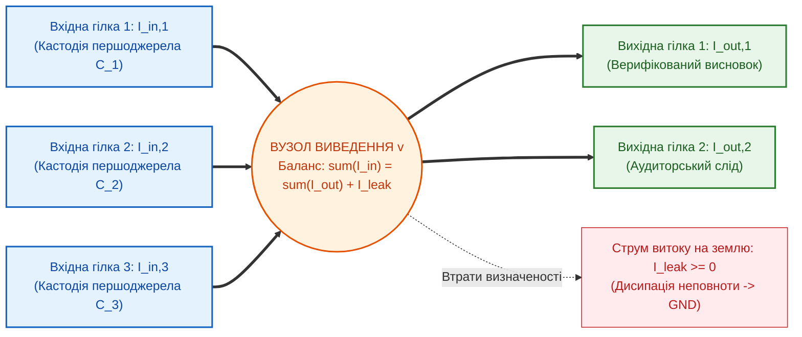

# Глава 03. Три закони Федчика та топологічний розрахунок кіл

> **Книга:** [Теорія епістемічних кіл: Схемотехніка доказових обчислень та апаратного виведення](README.md) · Частина I: Основи теорії епістемічних кіл  
> **Попередня глава:** [Глава 02. Четвірка фундаментальних величин та Закон Ома для епістеміки](ch02-fundamental-quantities-and-ohms-law.md)  
> **Наступна глава:** [Глава 04. Небулева математика ТЕЛ: від нечітких множин до дуальних бірешіток провідності](ch04-non-boolean-fuzzy-and-belnap-circuit-math.md)  
> **Зміст книги:** [README.md](README.md)  
> **Автор:** [Микола Федчик](../ExpertSystem/about-the-author.md)  
> **Рівень складності та оптимальне вивчення:** `[L3]` Формально-математичний та топологічний (індекс Д. Кнута `[30]`) · *Маршрут:* Базове ядро всіх треків; 2 проходи з опрацюванням балансу вузлів і петель  
> **Очікувані результати:** формулювати й застосовувати три закони збереження Федчика для розрахунку довільних графів логічного виведення; доводити конструктивний інваріант нульових галюцинацій через вузловий баланс струмів кастодії; розраховувати накопичення метрологічної невизначеності вздовж замкненої петлі на дуальних числах Кліффорда.

## Анотація

У третій главі розроблено топологічний метод розрахунку розгалужених мереж доказового виведення. Показано, що у складних нормативно-технічних системах знання утворює не поодинокий лінійний провідник, а багатозв'язний граф із десятками вузлів злиття, розгалуження та перехресного контролю. У традиційних системах штучного інтелекту відсутність законів збереження у таких графах призводить до трьох критичних патологій: самочинного породження неіснуючих фактів у вузлах (галюцинацій), неконтрольованого накопичення похибок у замкнених циклах міркувань та підміни законного права на дію простою наявністю емпіричного спостереження [[7]](#src-7).

Як фундаментальне вирішення цієї проблеми сформульовано й математично обґрунтовано **три закони збереження Федчика**, що виступають епістемічними узагальненнями законів Густава Кірхгофа [[1]](#src-1) та другого начала термодинаміки Рудольфа Клаузіуса [[2]](#src-2): (1) закон вузлового балансу струмів доказовості, який перетворює вимогу нульових галюцинацій на закон збереження кастодії; (2) закон падіння достовірності та балансу дисперсій уздовж замкненої петлі за стандартом JCGM GUM [[3]](#src-3) над алгеброю дуальних чисел Кліффорда [[4]](#src-4); (3) закон деонтично-модального тріодного керування, що закріплює ортогональність між буттям і повинністю [[6]](#src-6). Наведено детальний навчальний приклад топологічного розрахунку двопетльової схеми допуску авіаційного вузла. Главу завершують висновки, словник, перелік абревіатур та бібліографія.

---

## 1. Вступ та постановка проблеми: патології розгалужених мереж без законів збереження

Закон Ома, виведений у [Главі 02](ch02-fundamental-quantities-and-ohms-law.md), ідеально описує поодиноку однорідну ділянку тракту виведення. Проте реальні інженерні стандарти, юридичні кодекси та клінічні протоколи ніколи не зводяться до одного ізольованого правила. Вони утворюють складну просторову мережу — топологічну схему, у якій одні висновки розгалужуються на кілька підсистем, інші зливаються у спільних вузлах агрегації, а треті проходять крізь петлі зворотного зв'язку та взаємної верифікації.

В електродинаміці перехід від окремого провідника до розгалуженої мережі став можливим у 1845 році, коли двадцятиоднорічний Густав Кірхгоф опублікував свої знамениті два закони для вузлів і замкнених петель електричного кола [[1]](#src-1). Закони Кірхгофа спиралися на фундаментальні інваріанти фізики: заряд не може виникнути нізвідки у вузлі, а робота потенціального поля вздовж замкненого шляху є строго визначеною.

Чому ж традиційні графи знань, продукційні мережі та багатоагентні системи мовних моделей постійно руйнуються при масштабуванні? Тому що в них **відсутні топологічні закони збереження**:
1. **Патологія вузлової генерації фікцій:** у стохастичному графі або ланцюжку агентів проміжний вузол може видати на вихід «новий факт», якого не було в жодному з вхідних потоків першоджерел. З погляду фізики це еквівалентно появі електричного струму з порожнечі всупереч закону збереження заряду.
2. **Патологія циркуляційного самопідсилення:** коли два неточні правила або два агенти посилаються один на одного по колу, у класичних евристичних мережах їхня суб'єктивна «впевненість» може резонансно зростати до одиниці замість того, щоб затухати на опорах невизначеності.
3. **Патологія натуралістичної помилки Юма [[6]](#src-6):** класичні графи даних не розрізняють силові гілки фактів («що фізично відбулося») та керуючі лінії деонтичних норм («чи дозволено це законом» [[7]](#src-7)), дозволяючи емпіричному спостереженню автоматично ставати нормативним приписом.

Для усунення цих трьох патологій у Теорії епістемічних ланцюгів встановлюються три фундаментальні закони збереження.

> [!NOTE]
> **Три фундаментальні закони збереження в епістемічних колах за моделлю Миколи Федчика**
> 1. **Перший закон (Вузловий баланс струмів кастодії):** алгебраїчна сума вихідних струмів верифікованих тверджень у будь-якому пасивному вузлі схеми не може перевищувати суми вхідних струмів побайтово підтвердженої кастодії за вирахуванням дисипативного струму витоку на землю.
> 2. **Другий закон (Петльовий баланс потенціалів та похибок):** спад епістемічного потенціалу вздовж будь-якого шляху виведення точно дорівнює накопиченій метрологічній та семантичній невизначеності, яка обчислюється детерміновано за один такт на дуальних числах Кліффорда.
> 3. **Третій закон (Деонтично-модальне тріодне керування):** наявність потенціалу факту на витоку є необхідною, але недостатньою умовою проходження струму до стоку; провідність каналу відкривається виключно тоді, коли потенціал деонтичної норми на затворі перевищує поріг відсічки.
> *Керування рантаймом / Інженерний інваріант:* Порушення балансу кастодії у вузлі, перевищення допустимого падіння потенціалу в петлі або падіння напруги затвора нижче порогу відсічки негайно переводить відповідну гілку кола у стан нескінченного опору (захисна відмова Fail-Closed).

---

## 2. Перший закон Федчика: баланс струмів доказовості у вузлі

Розглянемо довільний вузол епістемічного кола $v$, у якому сходяться $m$ вхідних гілок із верифікованими потоками свідчень і з якого виходять $p$ гілок похідних тверджень (рисунок 3.1).

**Рисунок 3.1.** Баланс вхідних, вихідних та дисипативних струмів у вузлі епістемічного кола згідно з першим законом збереження.

**Твердження 3.1 (Перший закон збереження — вузловий баланс кастодії).** У будь-якому вузлі $v$ епістемічного кола, який не містить первинного сертифікованого джерела ЕРС, сума вихідних струмів доказовості дорівнює сумі вхідних струмів кастодії за вирахуванням невід'ємного струму дисипативного витоку на землю $`I_{\mathrm{leak}} \ge 0`$ (формула (3.1)):

$$
\sum_{k=1}^{m} I_{\mathrm{in}, k} - \sum_{j=1}^{p} I_{\mathrm{out}, j} - I_{\mathrm{leak}} = 0 \implies \sum_{j=1}^{p} I_{\mathrm{out}, j} \le \sum_{k=1}^{m} I_{\mathrm{in}, k}
$$

**Формула (3.1).** Рівняння першого закону збереження Федчика у дисипативній та інтегральній формах (узагальнення першого закону Кірхгофа [[1]](#src-1) та інформаційної нерівності обробки даних [[5]](#src-5)).

Тут:
- $`I_{\mathrm{in}, k} \ge 0`$ — вхідний епістемічний струм $k$-ї гілки, підтверджений криптографічним дескриптором кастодії $`\mathcal{C}_k`$, $`\mathrm{eA}`$;
- $`I_{\mathrm{out}, j} \ge 0`$ — вихідний епістемічний струм $j$-ї гілки похідного висновку, $`\mathrm{eA}`$;
- $`I_{\mathrm{leak}} = V_v / R_{\mathrm{shunt}} \ge 0`$ — струм витоку на нульову шину землі через шунтуючий опір неповноти або фільтрації $`R_{\mathrm{shunt}}`$, $`\mathrm{eA}`$.

### 2.1. Доведення схемотехнічного інваріанта нульових галюцинацій

З формули (3.1) випливає фундаментальний наслідок для безпеки штучного інтелекту. Припустімо, що на входах вузла $v$ відсутні будь-які побайтово підтверджені свідчення з бази знань, тобто $`I_{\mathrm{in}, k} = 0`$ для всіх $`k \in \{1, \dots, m\}`$. Оскільки в епістемічному колі струми кастодії та струм витоку є суворо невід'ємними величинами ($`I_{\mathrm{out}, j} \ge 0, \ I_{\mathrm{leak}} \ge 0`$), нерівність $`\sum_{j=1}^{p} I_{\mathrm{out}, j} \le 0`$ має єдиний розв'язок (формула (3.2)):

$$
\forall k: I_{\mathrm{in}, k} = 0 \implies \forall j: I_{\mathrm{out}, j} \equiv 0, \qquad R_{\mathrm{node}} \to \infty \implies \mathrm{Verdict} = \mathrm{REFUSAL}
$$

**Формула (3.2).** Умова повного знеструмлення виходу та переходу вузла в режим захисної відмови за відсутності вхідної кастодії.

Тут:
- $`R_{\mathrm{node}}`$ — еквівалентний вихідний опір вузла відносно шини вердикту, $`\mathrm{e}\Omega`$.

Отже, **конструктивний інваріант нульових галюцинацій ($`\mathrm{ZHR}_{\mathrm{gate}} = 1{,}00`$) у ТЕЛ є не евристичним побажанням, а прямим наслідком закону збереження струму у вузлі**: жоден вузол схеми фізично не може віддати в навантаження більше кастодії, ніж він отримав від першоджерел.

---

## 3. Другий закон Федчика: падіння достовірності вздовж замкненої петлі та автодиференціювання

Якщо перший закон контролює баланс потоків у вузлах, то другий закон описує зміну епістемічного потенціалу та накопичення похибки під час проходження сигналу вздовж послідовних ділянок та замкнених петель кола (рисунок 3.2).

```mermaid
flowchart LR
    accTitle: Рисунок 3.2. Другий закон Федчика про баланс потенціалів та накопичення невизначеності у петлі
    accDescr: Послідовне падіння потенціалу достовірності ΔV_1 та ΔV_2 вздовж шляху виведення від джерела у вузлі A через проміжний вузол B до вихідного вузла C та замикання балансу через землю.

    NodeA["Вузол A: V_A = E_ep\n(Первинне джерело кастодії)"]
    NodeB["Вузол B: V_B = V_A - dV_1\n(Проміжний каскад перерахунку)"]
    NodeC["Вузол C: V_C = V_B - dV_2\n(Клема вихідного вердикту)"]
    GND["Епістемічна земля GND (V = 0 eV)"]

    NodeA ==>|"Ділянка 1: Падіння dV_1 на опорі R_1 (ISO GUM)"| NodeB
    NodeB ==>|"Ділянка 2: Падіння dV_2 на опорі R_2 (Трансформація)"| NodeC
    NodeC ==>|"Залишковий потенціал навантаження U_load = V_C"| GND
    GND -.->|"Підйом потенціалу в джерелі +E_ep"| NodeA

    classDef node fill:#ede7f6,stroke:#512da8,stroke-width:2px,color:#311b92;
    classDef gnd fill:#eceff1,stroke:#455a64,stroke-width:1px,color:#263238;
    class NodeA,NodeB,NodeC node;
    class GND gnd;
```

**Рисунок 3.2.** Баланс підйому та спадів епістемічного потенціалу вздовж замкненої петлі виведення згідно з другим законом збереження.

**Твердження 3.2 (Другий закон збереження — петльовий баланс потенціалів та невизначеності).** Алгебраїчна сума змін епістемічного потенціалу вздовж будь-якої замкненої петлі $`\mathcal{L}`$ дорівнює нулю, а сумарне падіння потенціалу достовірності вздовж шляху з $K$ послідовних функціональних перетворень визначається комбінованою дисперсією невизначеності за стандартом JCGM GUM [[3]](#src-3) і є строго невід'ємним згідно із законом неспадної ентропії Клаузіуса–Шеннона [[2]](#src-2), [[5]](#src-5) (формула (3.3)):

$$
\oint_{\mathcal{L}} dV_{\mathrm{ep}} = \mathcal{E}_{\mathrm{ep}} - \sum_{j=1}^{K} \Delta V_j - U_{\mathrm{load}} = 0, \qquad u_c^2(y) = \sum_{j=1}^{K} \left(\frac{\partial f}{\partial x_j}\right)^2 u^2(x_j) \ge 0
$$

**Формула (3.3).** Рівняння другого закону збереження Федчика для замкненої петлі потенціалів та закону поширення стандартної невизначеності.

Тут:
- $`\Delta V_j = I_{\mathrm{ep}} R_j \ge 0`$ — падіння потенціалу достовірності на $j$-му елементі ланцюга, $`\mathrm{eV}`$;
- $`y = f(x_1, x_2, \dots, x_K)`$ — функціональна залежність вихідного інженерного параметра $y$ від вхідних вимірюваних величин $`x_j`$;
- $`\partial f / \partial x_j`$ — коефіцієнти чутливості першого порядку за стандартом JCGM GUM [[3]](#src-3);
- $`u(x_j) \ge 0`$ — стандартна невизначеність $j$-го вхідного вимірювання у відповідних фізичних одиницях;
- $`u_c(y) \ge 0`$ — комбінована стандартна невизначеність вихідного результату.

### 3.1. Однотактове обчислення чутливостей над алгеброю дуальних чисел Кліффорда

У традиційних програмних системах обчислення частинних похідних $`\partial f / \partial x_j`$ у формулі (3.3) вимагає або неточного скінченно-різницевого диференціювання, або повільного методу Монте-Карло на мільйонах ітерацій. В епістемічній схемотехніці кожен сигнал подається як гіперкомплексне дуальне число Вільяма Кліффорда [[4]](#src-4) $`X_j = x_j + u(x_j)\,\varepsilon`$ з властивістю $`\varepsilon^2 = 0`$. Тоді за розкладом Тейлора будь-який поліноміальний або аналітичний вузол кола автоматично видає точну похідну у коефіцієнті при $\varepsilon$ за один такт синхронізації (формула (3.4)):

$$
f\left(x_1 + u(x_1)\varepsilon_1, \dots, x_K + u(x_K)\varepsilon_K\right) = f(x_1, \dots, x_K) + \sum_{j=1}^{K} \frac{\partial f}{\partial x_j} u(x_j)\,\varepsilon_j
$$

**Формула (3.4).** Точне автоматичне диференціювання похибок у вузлах кола над багатовимірною дуальною алгеброю Кліффорда (де $`\varepsilon_i \varepsilon_j = 0`$).

Тут:
- $`\varepsilon_j`$ — ортогональні нільпотентні базисні одиниці незалежних джерел вимірювальної невизначеності ($`\varepsilon_j^2 = 0`$).

Другий закон також накладає **абсолютну заборону на вічний двигун істинності**: оскільки кожен опір $`R_j \ge 0`$ і кожен квадрат чутливості невід'ємний, у пасивному циклі міркувань без підключення нових незалежних першоджерел потенціал достовірності може лише монотонно спадати або залишатися сталим (у надпровідному колі), але ніколи не може самочинно зрости понад $`1{,}00\text{ eV}`$.

---

## 4. Третій закон Федчика: деонтично-модальне тріодне керування

Навіть якщо факт надійшов із бездоганного джерела (перший закон виконано) і пройшов тракт із мінімальною похибкою (другий закон виконано), це ще не означає, що система має юридичне чи інженерне право застосувати цей факт для дії. Як зазначав Девід Юм у своєму класичному принципі демаркації («гільйотина Юма» [[6]](#src-6)), із самого лише описового судження про те, що *є* (*Is*), логічно не випливає нормативне судження про те, що *повинно бути* (*Ought*). У формальній деонтичній логіці Георга Генріка фон Врігта [[7]](#src-7) для цього вводяться модальні оператори обов'язку ($\square$), дозволу ($\lozenge$) та заборони ($`\mathcal{F}`$).

В епістемічній схемотехніці ця філософська та юридична аксіома перетворюється на **Третій закон збереження Федчика — закон тритермінального розділення тракту факту і тракту норми**.

**Твердження 3.3 (Третій закон — деонтично-модальна комутація каналу).** Струм санкціонованого вердикту у колі стоку $`I_D`$ активного тритермінального вузла визначається одночасною присутністю онтологічного потенціалу факту на витоку $`V_S`$ та перевищенням деонтичного керуючого потенціалу на затворі $`V_G`$ над порогом нормативної відсічки $`V_{\mathrm{th}}`$ за формулою (3.5):

$$
I_D = g_m \cdot \max\left(0, \ V_G - V_{\mathrm{th}}\right) \cdot V_S \cdot \max\left(0, \ 1 - \frac{U_{95\%}}{\Delta_{\mathrm{tol}}}\right)
$$

**Формула (3.5).** Рівняння третього закону Федчика для керованого струму стоку в активному тритермінальному епістемічному вузлі.

Тут:
- $`I_D \ge 0`$ — вихідний струм санкціонованого рішення у колі стоку, $`\mathrm{eA}`$;
- $`V_S \in [0, 1]\text{ eV}`$ — онтологічний потенціал доведеного факту на електроді витоку (*Source*);
- $`V_G \in [0, 1]\text{ eV}`$ — деонтичний потенціал чинної норми права або стандарту на керуючому електроді затвора (*Gate*);
- $`V_{\mathrm{th}} \in (0, 1)\text{ eV}`$ — порогова напруга відкриття нормативного каналу;
- $`g_m = \partial I_D / \partial V_G > 0`$ — крутизна передавальної характеристики вузла, $`\mathrm{eS}/\mathrm{eV}`$.

З формули (3.5) випливає фундаментальне ортогональне розщеплення:
1. Якщо норма скасована, не набула чинності або заблокована процесуальним підсікачем ($`V_G \le V_{\mathrm{th}}`$), то навіть за стовідсоткової істинності факту ($`V_S = 1{,}00\text{ eV}`$) струм стоку строго дорівнює нулю ($`I_D = 0`$).
2. І навпаки: якщо закон повністю чинний і дозволяє дію ($`V_G = 1{,}00\text{ eV}`$), але емпіричний факт не підтверджений кастодією ($`V_S = 0\text{ eV}`$), вихід так само залишається знеструмленим ($`I_D = 0`$).

---

## 5. Навчальний інженерний приклад: топологічний розрахунок вузла та петлі допуску турбіни

Покажемо спільну роботу всіх трьох законів Федчика на прикладі розрахунку схеми контролю теплового режиму газової турбіни.

### 5.1. Вихідні умови розрахункової схеми

До вузла агрегації $v$ сходятся дві вхідні гілки свідчень про температуру лопаток ротора $T$:
- **Гілка 1 (Основний пірометр):** підтверджена апаратною кастодією, вхідний струм $`I_{\mathrm{in}, 1} = 0{,}60\text{ eA}`$, виміряне значення з дуальною стандартною невизначеністю $`T_1 = 850 + 3{,}0\,\varepsilon_1\text{ К}`$.
- **Гілка 2 (Термопара корпусу з перерахунком):** підтверджена кастодією, вхідний струм $`I_{\mathrm{in}, 2} = 0{,}40\text{ eA}`$. Через тепловий опір корпусу у вузлі відбувається дисипативний витік $`I_{\mathrm{leak}} = 0{,}15\text{ eA}`$ на землю.
- **Каскад обчислення теплового навантаження:** результуючий параметр напруженості обчислюється за лінійною функцією $`y = f(T_1, \Delta T_2) = T_1 + 2{,}0 \cdot \Delta T_2`$, де перепад температури $`\Delta T_2 = 40 + 2{,}0\,\varepsilon_2\text{ К}`$. Граничний допуск невизначеності (при коефіцієнті охоплення $k=2$) становить $`\Delta_{\mathrm{tol}} = 20{,}0\text{ К}`$.
- **Керуючий затвор норми безпеки:** номінальний потенціал чинного регламенту експлуатації $`V_G = 0{,}95\text{ eV}`$, поріг відсічки затвора $`V_{\mathrm{th}} = 0{,}45\text{ eV}`$, крутизна $`g_m = 2{,}0\text{ eS}/\mathrm{eV}`$, потенціал витоку у вузлі $`V_S = 0{,}85\text{ eV}`$.

### 5.2. Покрокове застосування трьох законів Федчика

**Крок 1. Застосування Першого закону (вузловий баланс струму кастодії):**
За формулою (3.1) максимально допустимий вихідний струм із вузла агрегації $v$ становить:

$$
I_{\mathrm{out}} = I_{\mathrm{in}, 1} + I_{\mathrm{in}, 2} - I_{\mathrm{leak}} = 0{,}60 + 0{,}40 - 0{,}15 = 0{,}85\text{ eA} > 0
$$

Вхідна кастодія підтверджена, вихідний струм додатний, галюцинації відсутні.

**Крок 2. Застосування Другого закону (автодиференціювання похибки у петлі):**
Підставляємо дуальні числа у функцію $`f(T_1, \Delta T_2)`$ за формулою (3.4):

$$
Y = (850 + 3{,}0\,\varepsilon_1) + 2{,}0 \cdot (40 + 2{,}0\,\varepsilon_2) = 930 + 3{,}0\,\varepsilon_1 + 4{,}0\,\varepsilon_2\text{ К}
$$

Звідси за формулою (3.3) комбінована стандартна невизначеність $`u_c(y)`$ та розширена невизначеність $`U_{95\%} = 2 u_c(y)`$ миттєво знаходяться за теоремою Піфагора для ортогональних компонент $`\varepsilon_1, \varepsilon_2`$:

$$
u_c(y) = \sqrt{3{,}0^2 + 4{,}0^2} = \sqrt{9 + 16} = 5{,}0\text{ К} \implies U_{95\%} = 2 \cdot 5{,}0 = 10{,}0\text{ К}
$$

**Крок 3. Застосування Третього закону (тріодна комутація вихідного вердикту):**
Підставляємо знайдені величини у рівняння третього закону (формула (3.5)):

$$
I_D = 2{,}0 \cdot \max(0, \ 0{,}95 - 0{,}45) \cdot 0{,}85 \cdot \left(1 - \frac{10{,}0}{20{,}0}\right) = 2{,}0 \cdot 0{,}50 \cdot 0{,}85 \cdot 0{,}50 = 0{,}425\text{ eA}
$$

Оскільки $`I_D = 0{,}425\text{ eA} > 0`$, всі три закони збереження виконано, і система видає сертифікований вердикт **`ACCEPT`** із точно обчисленим параметром $`y = 930 \pm 10{,}0\text{ К}`$. Якби ж черговий інженер відкликав дозвіл на роботу турбіни (знизивши потенціал затвора до $`V_G = 0{,}40\text{ eV} < V_{\mathrm{th}}`$), то за третім законом струм стоку миттєво обнулився б ($`I_D = 0`$) без жодної зміни показів датчиків $`T_1`$ і $`\Delta T_2`$.

---

## Висновки

1. **Топологічна замкненість теорії:** три закони збереження Федчика утворюють повну систему рівнянь для розрахунку довільних за складністю мереж доказового виведення, замінюючи евристичний перебір алгебраїчним розрахунком вузлових потенціалів та циркуляційних струмів у петлях.
2. **Конструктивна природа відсутності галюцинацій:** перший закон доводить, що в пасивних вузлах кола струм кастодії підпорядковується закону збереження, унеможливлюючи генерацію тверджень без первинних свідчень.
3. **Аналітичний контроль невизначеності за $O(1)$:** другий закон у поєднанні з дуальними числами Кліффорда забезпечує точне поширення інструментальних похибок за стандартом JCGM GUM вздовж будь-якого ланцюга формул без стохастичних симуляцій.
4. **Апаратна реалізація принципу Юма:** третій закон усуває змішування фактів і норм, виносячи деонтичну чинність правила на ізольований електрод затвора активного епістемічного приладу.

---

## Словник

| Термін | Англійський еквівалент | Визначення |
| :--- | :--- | :--- |
| **Вузол епістемічного кола** | *Epistemic Circuit Node* | Точка з'єднання трьох або більше гілок передачі доказів, у якій виконується баланс струмів кастодії за першим законом Федчика. |
| **Замкнена петля виведення** | *Closed Inference Loop* | Будь-який замкнений шлях у графі схеми, що проходить через джерело кастодії, послідовні опори перетворень та шину нульового потенціалу. |
| **Струм дисипативного витоку** | *Dissipative Leakage Current* | Частина вхідного струму доказовості у вузлі, яка відводиться на землю через шунтуючий опір неповноти або відсіivання шуму. |
| **Дуальні числа Кліффорда** | *Clifford Dual Numbers* | Гіперкомплексні числа вигляду $`a + b\varepsilon`$ (де $`\varepsilon^2 = 0`$), які використовуються в ТЕЛ для точного однотактового обчислення похідних чутливості похибок. |
| **Коефіцієнт чутливості** | *Sensitivity Coefficient* | Частинна похідна вихідної функції за вхідним параметром $`\partial f / \partial x_j`$, що визначає ваговий внесок похибки $j$-го входу у сумарну невизначеність. |
| **Крутизна характеристики** | *Epistemic Transconductance* | Параметр активного епістемічного приладу $`g_m = \partial I_D / \partial V_G`$, що показує чутливість вихідного струму вердикту до зміни потенціалу норми на затворі. |
| **Принцип демаркації Юма** | *Hume's Is–Ought Guillotine* | Фундаментальне філософсько-логічне положення про неможливість прямого виведення нормативних приписів («повинно») з емпіричних фактів («є»). |

---

## Абревіатури

| Абревіатура | Розшифрування | Опис |
| :--- | :--- | :--- |
| **AD** | Automatic Differentiation | Автоматичне диференціювання функцій у прямому режимі на основі алгебри дуальних чисел. |
| **GUM** | Guide to the Expression of Uncertainty in Measurement | Міжнародна метрологічна настанова JCGM 100:2008 (ISO/IEC Guide 98-3). |
| **KCL** | Kirchhoff's Current Law | Перший закон Кірхгофа про баланс електричних струмів у вузлі (класичний прообраз першого закону Федчика). |
| **KVL** | Kirchhoff's Voltage Law | Другий закон Кірхгофа про баланс напруг у замкненій петлі (класичний прообраз другого закону Федчика). |
| **ZHR** | Zero-Hallucination Rate | Інваріант нульових галюцинацій на виході шлюзу, що гарантується першим законом збереження кастодії. |

---

## Джерела

1. Gustav Kirchhoff. [*Ueber den Durchgang eines elektrischen Stromes durch eine Ebene, insbesondere durch eine kreisförmige*](https://doi.org/10.1002/andp.18451400402). *Annalen der Physik und Chemie*, 140(4), 497–514, 1845.
2. Rudolf Clausius. [*Ueber verschiedene für die Anwendung bequeme Formen der Hauptgleichungen der mechanischen Wärmetheorie*](https://doi.org/10.1002/andp.18652010702). *Annalen der Physik und Chemie*, 201(7), 353–400, 1865.
3. JCGM. [*Evaluation of Measurement Data — Guide to the Expression of Uncertainty in Measurement (GUM)*](https://doi.org/10.59161/JCGM100-2008E). JCGM 100:2008 (ISO/IEC Guide 98-3), BIPM / ISO / IEC, 2008.
4. William Kingdon Clifford. [*Preliminary Sketch of Biquaternions*](https://doi.org/10.1112/plms/s1-4.1.381). *Proceedings of the London Mathematical Society*, s1-4(1), 381–395, 1873.
5. Thomas M. Cover, Joy A. Thomas. [*Elements of Information Theory*](https://doi.org/10.1002/047174882X). 2nd Edition, Hoboken, NJ: John Wiley & Sons, 2006 (Data Processing Inequality, Chapter 2).
6. David Hume. [*A Treatise of Human Nature*](https://doi.org/10.1093/actrade/9780198245872.book.1). London: John Noon, 1739 (Book III, Part I, Section I; критичне видання Oxford University Press, 2000).
7. Georg Henrik von Wright. [*Deontic Logic*](https://doi.org/10.1093/mind/LX.237.1). *Mind*, 60(237), 1–15, 1951.

---

[← Глава 02. Четвірка фундаментальних величин та Закон Ома](ch02-fundamental-quantities-and-ohms-law.md) | [Зміст книги](README.md) | [Глава 04. Небулева математика ТЕЛ →](ch04-non-boolean-fuzzy-and-belnap-circuit-math.md)
