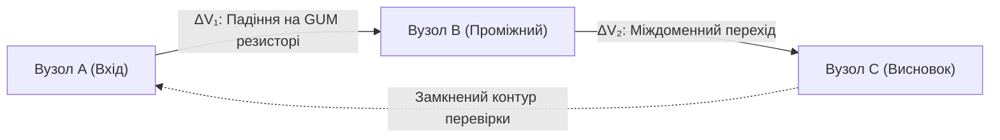

# Глава 03. Три закони Федчика та топологічний розрахунок кіл

> [!NOTE]
> **Авторський внесок Миколи Федчика**
> 1. Сформульовано Перший закон Федчика (Закон балансу струмів доказовості у вузлі) як фундаментальну умову інваріанта нульових галюцинацій $ZHR \equiv 1.000000$.
> 2. Сформульовано Другий закон Федчика (Закон контурного падіння достовірності) на основі автодиференціювання за стандартом ISO GUM та дуальних чисел Кліффорда.
> 3. Сформульовано Третій закон Федчика (Закон деонтично-модального керування каналом) для тритермінальних епістемічних приладів.

---

## 1. Вступ до топологічних методів розрахунку

У складній системі нормативних актів, детермінованих вимог та технічних специфікацій доказове виведення рідко має вигляд ізольованої формули. Воно утворює просторову мережу (граф доказів).

Епістемічна схемотехніка замінює евристичний перебір у таких мережах на **топологічний розрахунок кіл**, що підпорядковується трьом непорушним законам збереження.

---

## 2. Перший закон Федчика: Баланс струмів доказовості у вузлі

> **Формулювання:**  
> Алгебраїчна сума вихідних тверджень у будь-якому вузлі схеми виведення не може перевищувати ентропійного обсягу вхідних доведених свідчень, підтверджених побайтовою кастодією.

$$\sum_{k=1}^{n} I_{\text{in}, k} - \sum_{m=1}^{p} I_{\text{out}, m} \ge 0$$

```
               I_in,1 (Кастодія 1)
               ───────────────►──┐
                                 │
               I_in,2 (Кастодія 2)▼
               ───────────────►──┼───────────────► I_out (Вихідне твердження)
                                 │ ВУЗОЛ ВИВЕДЕННЯ
               I_in,3 (Кастодія 3)│
               ───────────────►──┘
```

### Фізико-кібернетичний зміст:
Якщо у вузлі виникає вихідний струм твердження $I_{\text{out}} > 0$ за відсутності відповідного вхідного струму кастодії ($I_{\text{in}} = 0$), опір вузла стрибкоподібно зростає до нескінченності:
$$R_{\text{node}} \to \infty \implies \text{FAIL-CLOSED (REFUSAL)}$$

Це доводить, що інваріант $ZHR \equiv 1.000000$ (Zero Hallucination Ratio) є **законом збереження істинності**, аналогічним закону збереження електричного заряду.

---

## 3. Другий закон Федчика: Контурне падіння достовірності

> **Формулювання:**  
> Алгебраїчна сума падінь потенціалів достовірності вздовж будь-якого замкненого контуру композитного доказового виведення дорівнює сумарній розширеній невизначеності вимірювань і припущень, накопиченій елементами цього контуру за стандартом ISO/IEC Guide 98-3 (GUM).

$$\oint_{\mathcal{L}} dV_{\text{ep}} = \sum_{j \in \mathcal{L}} \Delta V_j = \sum_{j \in \mathcal{L}} \left( \frac{\partial f}{\partial x_j} \right)^2 u^2(x_j)$$



Обчислення коефіцієнтів чутливості $\frac{\partial f}{\partial x_j}$ здійснюється детерміновано за фіксований час $O(1)$ через гіперкомплексну алгебру дуальних чисел Кліффорда ($x = a + b\varepsilon, \varepsilon^2 = 0$) без використання стохастичних симуляцій Монте-Карло.

---

## 4. Третій закон Федчика: Деонтично-модальне тріодне керування

> **Формулювання:**  
> Емпіричний факт на витоку ($V_S$) є необхідною, але недостатньою умовою для формування санкціонованого вердикту на стоці ($I_D$). Струм дії через канал виведення можливий тоді і лише тоді, коли нормативний керуючий потенціал на затворі ($V_G$) перевищує деонтичний поріг дії $V_{th}$.

$$I_D = g_m \cdot [V_G - V_{th}]_+ \cdot V_S \cdot \left(1 - \frac{U_{95\%}}{\Delta_{\text{tol}}}\right)$$

де:
- $[x]_+ = \max(0, x)$ — функція однозв'язної деонтичної відсічки;
- $g_m = \frac{\partial I_D}{\partial V_G}$ — епістемічна крутизна характеристики;
- $U_{95\%}$ — розширена невизначеність за ISO GUM.

Третій закон закріплює строге апаратне розділення:
$$\textbf{Онтологічний факт (Що сталося у світі)} \quad \bot \quad \textbf{Деонтичне право (Чи дозволено це застосувати)}$$
