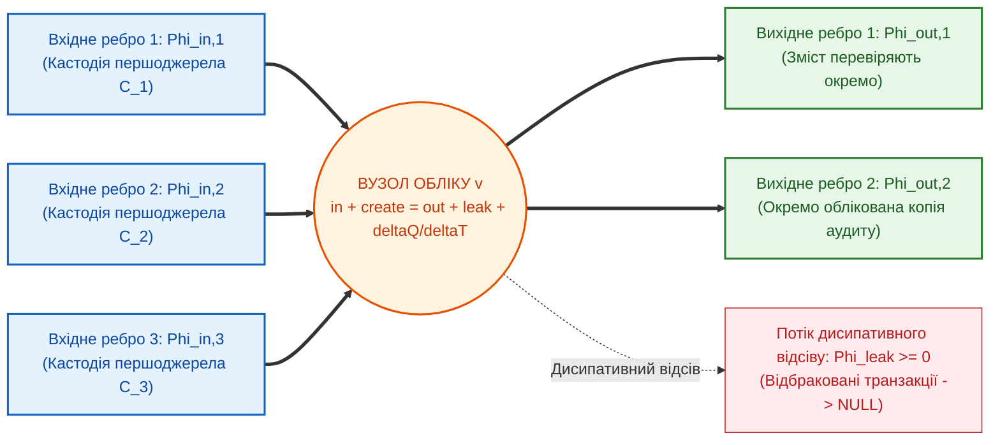

# Глава 03. Топологічні інваріанти збереження та розрахунок мереж доказового виведення

> **Книга:** [Теорія епістемічних обчислювальних схем: Математичні інваріанти кастодії, метрології та детермінованого виведення](README.md) · Частина 1. Математичні основи епістемічних схем  
> **Попередня глава:** [Глава 02. Фундаментальні кількісні міри та рівняння атенюації достовірності в обчислювальних схемах](ch02-quantitative-measures-and-credibility-attenuation.md)  
> **Наступна глава:** [Глава 04. Небулева математика епістемічних схем: бірешітка Белнапа, трикутні норми та інтервальна метрологія](ch04-belnap-bilattice-tnorms-and-dual-metrology.md)  
> **Зміст книги:** [README.md](README.md)  
> **Автор:** [Микола Мартинович Федчик](../ExpertSystem/about-the-author.md)<br>
> **Рівень складності та оптимальне вивчення:** `[L3]` Формально-математичний та топологічний (індекс Д. Кнута `[30]`) · *Маршрут:* Базове ядро всіх треків; 2 проходи з опрацюванням балансу вузлів і шляхів  
> **Очікувані результати:** відрізняти облік транзакцій від збереження походження, логічного слідування та фактичної істинності; застосовувати умовні контракти композиції вузлів; обчислювати невизначеність із урахуванням залежності входів; перевіряти окремі входи факту й нормативного дозволу.

## Анотація

Топологічний опис потрібний рушію експертної системи, щоб розгалуження й повторне злиття даних не приховували втрати походження, повторного обліку копій або підміни дозволу спостереженням. У цій главі автором запропоновано розглядати три названі «інваріанти» як різні за математичним статусом контракти: облік транзакцій, умовні правила числового перетворення та розділення входів факту й норми. Самої структури графа недостатньо для істинності висновку.

Баланс повідомлень не доводить логічного слідування; геш не перевіряє зміст джерела; правило поширення невизначеності GUM є лінійним наближенням за відповідних передумов [[3]](#src-3). Розмежування факту й нормативного припису реалізовано окремими типами входів, а не фізичним законом збереження [[6]](#src-6). На прикладі турбіни й відтворюваного Go-фрагмента показано коректну композицію та контрприклади хибних узагальнень. Повноту щодо всіх операторів ТЕОС, EARS чи ASPIC+ тут не заявлено.

---

## 1. Вступ та постановка проблеми: патології розгалужених мереж без інваріантів збереження

Розгалужена мережа виведення створює проблему, якої немає в одній ланці: одна цитата може повернутися до суматора кількома шляхами й бути помилково врахованою як кілька незалежних свідчень. Числова політика атенюації з [Глави 02](ch02-quantitative-measures-and-credibility-attenuation.md) сама цього не виявляє. Потрібні ідентичності джерел, семантика кожного оператора та окремий облік створених повідомлень.

У фізичній мережі балансують визначену екстенсивну величину, наприклад електричний заряд [[1]](#src-1). У програмній схемі повідомлення можна копіювати: рівняння балансу стає правильним лише після явного обліку створення копій, відсіву та зміни черги. Рейтинг джерела є інтенсивною оцінкою; його сума по копіях не є збережуваною величиною.

Для аналізу відмов потрібно розрізняти чотири незалежні питання:
1. **Цілісність і походження:** чи збігаються байти з довіреним еталоном і які джерела використано? Геш без довіреного еталона не автентифікує автора; походження допомагає оцінювати якість, але саме не є її доказом [[10]](#src-10).
2. **Семантичне слідування:** чи випливає саме це твердження з цитати й застосованих правил? Посилання на незмінний документ не замінює перевірки виведення.
3. **Емпірична правильність:** чи відповідають вихідні дані реальному об'єкту та чи адекватна модель вимірювання? Логічно правильне виведення з хибної посилки не робить висновок фактом.
4. **Нормативна санкція:** чи існує застосовний дозвіл саме для цієї дії, ролей, часу й юрисдикції, без чинного блокувального винятку? Описове свідчення не замінює нормативної посилки [[6]](#src-6), [[7]](#src-7).

Наведені далі три інваріанти збережено як авторські назви контрактів ТЕОС. Це не три універсальні закони істинності: перший є умовним обліковим балансом, другий поєднує обрану політику рейтингу з метрологічною моделлю, третій задає архітектурне розділення типів.

> [!NOTE]
> **Чотири наукові положення, що виносяться на захист у Главі 03**
> 1. **Обліковий контракт:** авторську модель уточнено явними членами створення копій і зміни черги; баланс перевіряє кількість транзакцій, а не їхню істинність.
> 2. **Контракт числової композиції:** відокремлено обрану монотонність рейтингу від поширення невизначеності GUM із коваріаціями; автоматичне диференціювання не отримує безумовної гарантії одного такту.
> 3. **Типізований нормативний вхід:** факт і дозвіл передаються різними типами; аналогова характеристика вентиля не замінює логічного рішення.
> 4. **Відтворюваний фрагмент:** реалізовано композицію розгалуження, злиття з дедуплікацією, чотиризначної логіки, інтервальної перевірки й наявного шлюзу факту та норми; наведено контрмоделі надмірних тверджень.
> *Керування рантаймом / Інженерний інваріант:* У підтриманому фрагменті дозвіл видається лише за позитивної несуперечливої підтримки, застосовної норми й наявного походження обох входів. Це контракт реалізації, не сертифікація фізичної системи.

---

## 2. Перший топологічний інваріант: вузловий баланс потоків верифікованої кастодії

Вузловий баланс потрібний для виявлення загублених або необліковано створених повідомлень у виконавчому тракті експертної системи. Для вузла $v$ з $m$ входами та $p$ виходами за скінченне вікно обліку рахують транзакції, а не «кількість істини». На рисунку 3.1 перевірене походження входів є окремою передумовою.



**Рисунок 3.1.** Баланс вхідних, вихідних та дисипативно відсіяних потоків транзакцій у вузлі епістемічної обчислювальної схеми.

**Твердження 3.1 (Перший топологічний інваріант збереження — вузловий баланс кастодії).** Якщо кожну подію приймання, створення, відправлення та відбракування транзакції враховано рівно один раз і немає прихованих черг, виконується формула (3.1). Нерівність «вихід не перевищує входу» є лише її окремим випадком: немає створення копій і черга не змінюється.

$$
\sum_{k=1}^{m}\Phi_{\mathrm{in},k}+\Phi_{\mathrm{create}}
-\sum_{j=1}^{p}\Phi_{\mathrm{out},j}-\Phi_{\mathrm{leak}}
=\frac{Q_{\mathrm{after}}-Q_{\mathrm{before}}}{\Delta t}
$$

**Формула (3.1).** Облік транзакцій зі створенням повідомлень і накопиченням у черзі; це не інформаційна нерівність обробки даних.

Тут:
- $`m,p\in\mathbb N_0`$ — кількості вхідних і вихідних ребер; $k,j$ — їхні індекси;
- $`\Delta t>0`$ — тривалість вікна у тактах; усі $`\Phi\ge0`$ — кількість відповідних подій, поділена на це вікно, у транзакціях/такт;
- $`\Phi_{\mathrm{in},k}`$, $`\Phi_{\mathrm{out},j}`$ — швидкості приймання й відправлення; $`\Phi_{\mathrm{create}}`$ — швидкість створення нових повідомлень, зокрема копій; $`\Phi_{\mathrm{leak}}`$ — швидкість явного відсіву;
- $`Q_{\mathrm{before}},Q_{\mathrm{after}}\in\mathbb N_0`$ — кількість повідомлень у черзі на початку й наприкінці вікна.

Доведення є підрахунком подій: кожне прийняте або створене повідомлення відправлено, відбраковано або залишено в черзі. Для двох входів, одного виходу й одного відбракування за один такт баланс дорівнює нулю за незмінної черги. Для однієї прийнятої та чотирьох відправлених копій треба облікувати три створення; інакше лічильник виявить помилку. Подальша перевірка дескриптора походження з [Глави 05](ch05-temporal-interdomain-and-verification-operators.md) відповідає іншому питанню — чи збережено прив'язку до байтів.

### 2.1. Доведення конструктивного інваріанта нульових галюцинацій у рантаймі

Назва цього підрозділу позначає початкову мету захисту від непідтверджених висновків, але вузловий баланс не доводить її в семантичному значенні. Він дає вужче твердження: за порожньої початкової черги, нульового входу та заборони створення повідомлень вихід також нульовий.

$$
\left(\forall k:\Phi_{\mathrm{in},k}=0\right)\land
\left(\Phi_{\mathrm{create}}=0\right)\land
\left(Q_{\mathrm{before}}=0\right)
\implies \forall j:\Phi_{\mathrm{out},j}=0
$$

**Формула (3.2).** Відсутність виходу у вузлі без входу, початкового запасу та створення повідомлень.

Усі позначення й одиниці успадковано з формули (3.1); невід'ємність кінцевої черги та відсіву змушує всі вихідні доданки бути нульовими. Політика `REFUSAL` за порожнього входу є додатковим правилом шлюзу, а не значенням, виведеним із кількості повідомлень.

**Контрмодель до «баланс означає істину».** Входить одна незмінена цитата «навантаження 930 К», виходить одне твердження «навантаження 900 К». Баланс $`1=1`$ виконано, геш цитати правильний, але висновок із неї не випливає. Окрема контрмодель зберігає й правильне прочитання «930 К»: якщо в заданому синтетичному світі фактичне значення становить 980 К, джерело помилкове, хоча його байти й усі логічні перетворення незмінні.

**Розгалуження не витрачає рейтинг.** Чотири точні копії запису з рейтингом $`0{,}60`$ мають по $`0{,}60`$ кожна, сумарно $`2{,}40`$. Це не порушення фізичного закону: рейтинг не є екстенсивним ресурсом. Після злиття точних копій має залишитися одне походження та той самий рейтинг. Різні геші також не доводять статистичної незалежності джерел; програмне копіювання не потребує постулату нескінченного електричного імпедансу.

> [!NOTE]
> **Методологічне уточнення: межі дії інваріанта ZHR**
> 1. **Походження:** якщо кожен оператор повертає лише об'єднання походжень своїх входів і явно наданого правила, індукція за топологічним порядком скінченного DAG доводить відсутність нових ідентифікаторів джерел на виході. Це окремий контракт операторів, не наслідок балансу.
> 2. **Логічна коректність:** якщо листові інтерпретації правильні, кожне правило семантично коректне й кожен крок перевірений, індукція доводить слідування від посилок. Для циклів додатково потрібна визначена семантика нерухомої точки або скінченний доказ; сама циркуляція підтримки ним не є.
> 3. **Фактична істинність:** вона додатково потребує істинності посилок щодо світу. Тому числову гарантію `ZHR = 1` і добуткову формулу «наскрізного ZHR» без визначених подій та ймовірнісної моделі не використовують.

---

## 3. Другий топологічний інваріант: адитивність деградації та дисперсій уздовж шляху виведення

Другий інваріант потрібний для двох різних перевірок у числовому тракті експертної системи: чи дотримано обраної політики рейтингу та яку невизначеність має обчислена величина. Їх не можна ототожнювати: зменшення невизначеності під час усереднення не є порушенням збереження, а рейтинг джерела не вимірюється в кельвінах. Рисунок 3.2 показує лише послідовність заданих змін рейтингу.

```mermaid
flowchart LR
    accTitle: Рисунок 3.2. Другий топологічний інваріант про баланс потенціалів достовірності та накопичення невизначеності вздовж шляху
    accDescr: Послідовне зниження потенціалу достовірності dw_1 та dw_2 вздовж шляху виведення від джерела у вузлі A через проміжний вузол B до вихідного вузла C.

    NodeA["Вузол A: w_A = w_0\n(Первинне джерело кастодії)"]
    NodeB["Вузол B: w_B = w_A - dw_1\n(Проміжний каскад перерахунку)"]
    NodeC["Вузол C: w_C = w_B - dw_2\n(Вузол вихідного вердикту)"]
    GND["Нульовий рівень референції (w = 0)"]

    NodeA ==>|"Ділянка 1: Обрана політика D_1 >= 0"| NodeB
    NodeB ==>|"Ділянка 2: Обрана політика D_2 >= 0"| NodeC
    NodeC ==>|"Залишковий потенціал w_load = w_C"| GND

    classDef node fill:#ede7f6,stroke:#512da8,stroke-width:2px,color:#311b92;
    classDef gnd fill:#eceff1,stroke:#455a64,stroke-width:1px,color:#263238;
    class NodeA,NodeB,NodeC node;
    class GND gnd;
```



**Рисунок 3.2.** Баланс початкового потенціалу достовірності та послідовних спадів уздовж шляху виведення згідно з другим топологічним інваріантом.

**Твердження 3.2 (Другий топологічний інваріант збереження — баланс потенціалів та адитивність дисперсій).** Для визначених значень рейтингу вздовж шляху його зміни телескопічно підсумовуються. Невід'ємність спадів є додатковою умовою обраних операторів. Для диференційовної моделі вимірювання перший порядок GUM поширює коваріаційну матрицю входів за формулою (3.3) [[3]](#src-3), [[8]](#src-8); це не закон неспадної ентропії.

$$
w_0-\sum_{j=1}^{K}(w_{j-1}-w_j)-w_{\mathrm{load}}=0,
\qquad
u_c^2(y)\approx \nabla f^{T}\Sigma\nabla f
=\sum_{i=1}^{n}\sum_{\ell=1}^{n}
\frac{\partial f}{\partial x_i}\frac{\partial f}{\partial x_\ell}\Sigma_{i\ell}\ge0
$$

**Формула (3.3).** Телескопічний облік зміни рейтингу та перше наближення поширення коваріацій; для афінної моделі друга частина є точною.

Тут:
- $`K\in\mathbb N_0`$ — кількість каскадів шляху; $`w_j\in[0,1]`$ — безрозмірний рейтинг після каскаду $j$; $`w_{\mathrm{load}}=w_K`$; $`\Delta w_j=w_{j-1}-w_j`$;
- $`n\in\mathbb N^+`$ — кількість первинних вимірюваних входів, не обов'язково рівна кількості каскадів; $`x_i`$ — їхні оцінки; $`y=f(x_1,\ldots,x_n)`$ — оцінка вихідної величини;
- $`\nabla f`$ — вектор чутливостей, обчислених у точці вхідних оцінок; компонента $`\partial f/\partial x_i`$ має одиниці виходу, поділені на одиниці входу;
- $`\Sigma_{i\ell}=\operatorname{Cov}(X_i,X_\ell)`$ — оцінена коваріація випадкових вхідних величин $`X_i,X_\ell`$, у добутку їхніх одиниць; матриця $`\Sigma`$ симетрична додатно напіввизначена, діагональ $`\Sigma_{ii}=u^2(x_i)\ge0`$;
- $`u_c(y)\ge0`$ — комбінована стандартна невизначеність в одиницях виходу. Недіагональні коваріації можуть бути від'ємними; сума всієї квадратичної форми невід'ємна.

Якщо оператори за означенням забезпечують $`w_j\le w_{j-1}`$, рейтинг не зростає і при повторному проході циклу. Без цієї локальної передумови сама топологія такого висновку не дає. Наприклад, обрана модель $`w_{\mathrm{load}}=w_0/(1+\sum_jD_j)`$ для безрозмірних $`D_j\ge0`$ задовольняє цю вимогу: за $`w_0=0{,}8`$ і двох $`D_j=0{,}25`$ результат $`0{,}8/1{,}5\approx0{,}533`$. Це перевірка політики ослаблення, не оцінка ймовірності істини.

Для некорельованих входів позадіагональні елементи нульові й залишається зважена сума дисперсій. Але при повторному злитті копій одного вимірювання $X$ з $`u(X)=1\text{ К}`$ результат $`Y=X+X`$ має $`u(Y)=2\text{ К}`$, а не $`\sqrt2\text{ К}`$: коваріацію копій не можна відкинути. Для $`Y=X-X`$ невизначеність точно нульова. Усереднення двох незалежних вимірювань з невизначеністю по 1 К дає $`1/\sqrt2\text{ К}`$; отже, дисперсія не зобов'язана зростати вздовж довільної схеми.

**Коректний зв'язок з інформаційною теорією.** Для скінченних випадкових величин $X$ (цільова властивість світу), $Y$ (спостереження) та $Z$ (оброблений результат), які утворюють марковський ланцюг $`X\to Y\to Z`$, виконується $`I(X;Z)\le I(X;Y)`$. Взаємна інформація $I$ вимірюється в бітах: результат не додає відомостей про $X$ без нового входу. Це не нерівність для кількості транзакцій або довільного рейтингу $w$ [[5]](#src-5), [[9]](#src-9). Ентропія самого результату може зменшуватись: рівноймовірний біт $Y$ має 1 біт ентропії, а стала функція $`Z=0`$ — 0 біт. Термодинамічна ентропія Клаузіуса [[2]](#src-2) не встановлює заборони такого обчислення.

**Межа аналогії з bond graphs.** У порт-гамільтонових системах композиція зберігає визначене спарювання змінних зусилля й потоку, що має зміст потужності, за відповідних умов з'єднання [[11]](#src-11). Добуток безрозмірного рейтингу на транзакції/такт має одиниці транзакцій/такт, а не ват. Без відображення станів, спарювання портів і доведення збереження цього спарювання вузол ТЕОС не є bond graph у математичному сенсі. Корисною залишається дисципліна явних портів, накопичення й джерел, а не перенесення фізичного закону на істинність.

### 3.1. Однотактове обчислення чутливостей над алгеброю дуальних чисел Кліффорда

Автоматичне диференціювання потрібне, щоб разом зі значенням функції отримати чутливості для формули (3.3), не підбираючи крок скінченних різниць. Воно доступне й звичайному програмному забезпеченню; історичний зв'язок дуальних чисел із працею Кліффорда [[4]](#src-4) не дає гарантії однотактового виконання. Термін у назві підрозділу слід розуміти як можливу властивість конкретного апаратного вузла, яку ще треба підтвердити синтезом і вимірюванням.

Для $n$ входів використовують комутативну алгебру елементів $`x_0+\sum_{j=1}^{n}a_j\varepsilon_j`$, де $`x_0,a_j\in\mathbb R`$, а формальні базисні елементи задовольняють $`\varepsilon_i\varepsilon_j=0`$ для всіх індексів. Числа $`a_j`$ — напрямні прирости у відповідних одиницях, не обов'язково стандартні невизначеності. Розширення диференційовної функції на цю алгебру дає формулу (3.4).

$$
f\left(x_1+a_1\varepsilon_1,\ldots,x_n+a_n\varepsilon_n\right)
=f(x_1,\ldots,x_n)+\sum_{j=1}^{n}\frac{\partial f}{\partial x_j}a_j\varepsilon_j
$$

**Формула (3.4).** Автоматичне диференціювання похибок першого порядку у вузлах схеми над багатовимірною дуальною алгеброю Кліффорда (де $`\varepsilon_i \varepsilon_j = 0`$).

Тут $`f,n,x_j`$ і чутливості визначено під формулою (3.3); $`a_j`$ має одиниці $`x_j`$, а $`\varepsilon_j`$ — безрозмірний формальний напрям. Нільпотентність не означає статистичної незалежності: коваріації все одно беруть із моделі джерел.

Для $`a_j=u(x_j)`$ та некорельованих входів коефіцієнти при базисі можна піднести до квадратів і додати. Для корельованих входів потрібна повна матриця з формули (3.3). Так одержують чутливості точно в алгебрі першого порядку, але не точний розподіл нелінійної функції. Наприклад, для безрозмірного $`X\sim N(0,1)`$ і $`Y=X^2`$ похідна в нулі дорівнює нулю, тоді як точна дисперсія $Y$ становить 2. Універсального порогу «помірної кривини», який сам гарантує точність для всіх моделей, тут немає.

У прямому режимі з $n$ напрямами й $L$ елементарними операціями арифметична робота за звичайного щільного подання має порядок $`O(nL)`$, а не безумовний $`O(1)`$. Навіть точний афінний розрахунок не підтверджує часові характеристики апаратури. Для суттєвої нелінійності потрібне обґрунтування наближення або поширення розподілів; отримані додаткові похідні самі не є сертифікатом точності.

---

## 4. Третій топологічний інваріант: деонтично-модальна ортогональність тритермінального вентиля

Третій інваріант потрібний на межі між обчисленим фактом і дозволом експертної системи на дію: достовірне спостереження не є нормативною посилкою. Навіть перевірені байти й прийнятна невизначеність не встановлюють чинності дозволу. Проблема переходу від *Is* до *Ought* мотивує явне представлення нормативних посилок [[6]](#src-6); деонтичні оператори обов'язку, дозволу й заборони не слід змішувати з епістемічними оцінками [[7]](#src-7).

У ТЕОС це запропоновано реалізувати розділеними портами факту та норми ([Глава 06](ch06-three-terminal-deontic-gate.md)). «Ортогональність» тут означає незалежність ролей входів, а не нульовий скалярний добуток чи статистичну незалежність. Закон збереження фізичної величини з цього не випливає.

**Твердження 3.3 (Третій топологічний інваріант — деонтично-модальна комутація тракту).** Для обраної аналогової характеристики активність вентиля можна моделювати формулою (3.5). Вона визначає запитану швидкість обслуговування, а не істинність чи сертифікований дозвіл; реальна швидкість також обмежується наявними транзакціями й ресурсами з формули (3.1).

$$
\Phi_D = g_m \cdot \max\left(0, \ w_G - w_{\mathrm{th}}\right) \cdot w_S \cdot \max\left(0, \ 1 - \frac{U_{95\%}}{\Delta_{\mathrm{tol}}}\right)
$$

**Формула (3.5).** Феноменологічна характеристика активності вентиля; не універсальний закон деонтичної логіки.

Тут:
- $`\Phi_D \ge 0`$ — запитана швидкість обслуговування у транзакціях/такт (*Drain*);
- $`w_S \in [0, 1]`$ — заданий безрозмірний рейтинг інформаційного входу (*Source*), не біт істини;
- $`w_G \in [0, 1]`$ — заданий безрозмірний параметр активності нормативного входу (*Gate*), не автоматичний доказ чинності норми;
- $`w_{\mathrm{th}} \in (0, 1)`$ — безрозмірний пороговий потенціал відкриття нормативного тракту;
- $`g_m>0`$ — масштабний коефіцієнт характеристики у транзакціях/такт; загалом він **не дорівнює** $`\partial\Phi_D/\partial w_G`$;
- $`U_{95\%}\ge0`$ — розширена невизначеність; позначення «95%» застосовне лише за обґрунтованого коефіцієнта охоплення; $`\Delta_{\mathrm{tol}}>0`$ — дозволена невизначеність у тих самих одиницях. Це не гранична температура об'єкта.

За активного нормативного входу похідна дорівнює $`g_mw_S\max(0,1-U_{95\%}/\Delta_{\mathrm{tol}})`$; у точці зламу загальна двобічна похідна може не існувати. Із моделі безпосередньо випливають лише числові властивості:
1. За $`w_G\le w_{\mathrm{th}}`$ активність нульова навіть при $`w_S=1`$. Щоб відкликання норми справді блокувало дію, потрібен окремий механізм перевірки чинності й відповідне відображення на цей вхід.
2. За $`w_S=0`$ активність також нульова. Але додатні обидва рейтинги ще не доводять відповідності ролей, допустимості температури, відсутності заборони або правильності інтерпретації.

Типізований фрагмент у [`src/teoscompose`](src/teoscompose/compose.go) відображає компоненти стану ТЕОС у перевірювані програмні об'єкти: походження — у `Origin/Reference`, дискретний стан підтримки — у `Signal`, номінал, інтервал і одиницю — у `Measurement`, нормативний вхід — у `NormPort`. Це проєкція, а не весь тензор: немає неперервного вектора підтримки, загальної алгебри SI, розподілів невизначеності чи повного графа доказу.

**Таблиця 3.6.** Семантичне відображення підтриманих операторів і межі композиції.

| Оператор | Відображення та перевірка | Що не випливає |
| :--- | :--- | :--- |
| `NewOrigin` | Перевіряє повний геш документа й геш цитати за наданими еталонами | Автентичність видавця, істинність цитати |
| `AssumeSignal` | Явно вводить припущену інтерпретацію листа; стан `UNKNOWN/FALSE/TRUE/BOTH`, рейтинг у $`[0,1]`$ | Автоматичне слідування тексту; `TRUE` означає позитивну підтримку в моделі |
| `FanOut` | Копіює стан, рейтинг та походження; створення повідомлень обліковують окремо | Нове незалежне свідчення або збереження суми рейтингів |
| `Merge` | Лише для тієї самої пропозиції: об'єднання двох ознак підтримки, точна дедуплікація посилань, максимум рейтингів | Незалежність різних джерел; це не повна S-конорма з Глави 08 |
| `And`, `Not` | Кон'юнкція за порядком істинності Белнапа та обмін ознак «за/проти»; походження об'єднується/зберігається; рейтинг кон'юнкції — мінімум, заперечення — незмінний | Усунення суперечності, калібрування рейтингу або семантична перевірка листів |
| `IntervalGuard` | Інтервал усередині замкненого допуску — `TRUE`, неперетин — `FALSE`, перетин межі — `BOTH`, інша одиниця — `UNKNOWN` | `BOTH` тут є сигналом межі, не доказом одночасної фактичної істинності двох значень |
| `Gate` | Окремі `FactPort/NormPort`; повторно використовує `evidence.EvaluateRule` та `Priority`, перевіряє ролі, одиницю, інтервал, вік і модальний стан; допускає лише `TRUE` за наявного походження обох входів | Нові нормативні пріоритети, винятки чи доказ юридичної чинності |

Інтервальний сигнал межі використовує наявну інженерну домовленість пакета `evidence`, а не претендує на тотожність між усією метрологією та логікою Белнапа ([Глава 04](ch04-belnap-bilattice-tnorms-and-dual-metrology.md)). Одиниці порівнюють як точні позначення без перетворення шкал. Модальність норми надається явно; застосовність однієї норми не замінює арбітражу множини норм.

Усі 16 пар станів перевірено окремими таблицями для кон'юнкції, інформаційного злиття та композиції факту з модальністю норми; заперечення перевірено для чотирьох станів. Тести перевіряють також асоціативність підтриманих логічних операцій на 64 трійках, збереження/відсутність походження, конфлікт версії джерела, інтервальні межі й дві наведені контрмоделі. Відтворення з каталогу `src/`:

```bash
go test ./teoscompose ./cmd/teoscompose
go vet ./teoscompose ./cmd/teoscompose
go run ./cmd/teoscompose
```

Остання команда виконує названі оператори та повертає детермінований JSON; його точний еталон — [`results.json`](src/testdata/teos-compose/results.json), який порівнюється в тесті. Чотири копії зливаються в одне посилання з рейтингом 0,60; серед п'яти сценаріїв перевірки лише `inside` отримує дозвіл, тоді як межа, вихід за допуск, інша одиниця та відсутня норма — ні. В обох контрмоделях помилково заданий або емпірично хибний лист може пройти шлюз: це навмисно відтворена межа гарантій, не прихована перевірка істинності. Тривалості, апаратну пропускну здатність і частоти помилок цими конструкціями не вимірюють.

---

## 5. Навчальний інженерний приклад: топологічний розрахунок схеми допуску турбіни

Приклад допуску турбіни показує, чому три перевірки не можна згорнути в одне додатне число. Потрібно окремо порахувати транзакції, обчислити температурний параметр із невизначеністю та перевірити дозвіл на роботу. На відміну від однієї ланки в [Главі 02](ch02-quantitative-measures-and-credibility-attenuation.md), тут є злиття двох входів. Це синтетичний навчальний розрахунок, не протокол випробувань чи сертифікація турбіни.

### 5.1. Вихідні умови розрахункової схеми

Вихідні умови визначають не лише числа, а й припущення, без яких дозвіл не випливає. Для двох каналів задано:
- **Ребро 1:** байти джерела перевірено відносно наданого еталона; за вікно 20 тактів прийнято 12 транзакцій, тобто $`\Phi_{\mathrm{in},1}=0{,}60`$ транзакції/такт. Номінал пірометра $`T_1=850\text{ К}`$, стандартна невизначеність $`u(T_1)=3\text{ К}`$.
- **Ребро 2:** прийнято 8 транзакцій за те саме вікно, тобто $`\Phi_{\mathrm{in},2}=0{,}40`$ транзакції/такт; три транзакції явно відбраковано, $`\Phi_{\mathrm{leak}}=0{,}15`$ транзакції/такт. Це облікові дані прикладу, не наслідок теплової інерції.
- **Модель вимірювання:** $`y=T_1+2\Delta T_2`$, де $`\Delta T_2=40\text{ К}`$, $`u(\Delta T_2)=2\text{ К}`$; коефіцієнт 2 безрозмірний. Входи некорельовані, систематичні поправки вже враховано. Функція афінна; номінал $y$ має одиниці температури, не механічного напруження.
- **Невизначеність:** коефіцієнт охоплення $`k=2`$, допуск розширеної невизначеності $`\Delta_{\mathrm{tol}}=20\text{ К}`$. Інтерпретація охоплення як приблизно 95% додатково припускає близький до нормального розподіл і достатньо визначену стандартну невизначеність [[8]](#src-8).
- **Аналогова характеристика:** $`w_G=0{,}95`$, $`w_{\mathrm{th}}=0{,}45`$, $`g_m=2`$ транзакції/такт, $`w_S=0{,}85`$. Рейтинг 0,85 задано окремо від швидкості транзакцій.
- **Нормативна посилка:** умовна навчальна норма `N1` дозволяє контролеру дію `run` щодо `turbine` при $`0\le y\le950\text{ К}`$. У програмній моделі її модальний стан явно `TRUE`, максимальний вік факту — 1 с, поточний — 0 с. Це не посилання на реальний експлуатаційний регламент.

### 5.2. Покрокове застосування трьох топологічних інваріантів

Покроковий розрахунок відокремлює обліковий результат від метрологічного та нормативного. Усі наведені числа одержано арифметично із заданих умов; це не вимірювання продуктивності реалізації.

**Крок 1. Застосування Першого інваріанта (вузловий баланс потоку кастодії):**
За формулою (3.1), без створення повідомлень і зміни черги, швидкість відправлення становить:

$$
\Phi_{\mathrm{out}}=\frac{12+8-3}{20}=0{,}85\ \text{транзакції/такт}
$$

**Формула (3.7).** Швидкість вихідних транзакцій за заданим журналом подій.

Тут 12 і 8 — кількості приймань, 3 — відбракувань, 20 — тривалість вікна у тактах; $`\Phi_{\mathrm{out}}`$ — загальна швидкість виходу. Перевірено лише облік: 17 повідомлень відправлено. Відсутність непідтверджених висновків із цього не випливає; збіг числа 0,85 з окремо заданим рейтингом випадковий.

**Крок 2. Застосування Другого інваріанта (автодиференціювання похибки вздовж тракту):**
Підставляємо дуальні числа у функцію $`f(T_1, \Delta T_2)`$ за формулою (3.4):

$$
Y=(850+3\varepsilon_1)\text{ К}
+2(40+2\varepsilon_2)\text{ К}
=(930+3\varepsilon_1+4\varepsilon_2)\text{ К}
$$

**Формула (3.8).** Значення й два напрямні прирости афінного температурного перетворення.

Тут $Y$ — дуальний результат, його дійсна частина $`y=930\text{ К}`$; коефіцієнти при формальних напрямах $`\varepsilon_1,\varepsilon_2`$ дорівнюють $`1\cdot3=3\text{ К}`$ і $`2\cdot2=4\text{ К}`$. Перший множник у кожному добутку є чутливістю. За нульової коваріації з формули (3.3) отримують:

$$
u_c(y)=\sqrt{3^2+4^2}\text{ К}=5\text{ К},
\qquad U_{95\%}=k\,u_c(y)=2\cdot5\text{ К}=10\text{ К}
$$

**Формула (3.9).** Стандартна й розширена невизначеності навчального результату.

Тут $`u_c(y)`$ — стандартна невизначеність, $`k=2`$ — коефіцієнт охоплення, $`U_{95\%}`$ — розширена невизначеність за зазначених передумов. Отже, для інтервальної перевірки подано $`[920,940]\text{ К}`$. Це інтервал охоплення, а не гарантована множина всіх фізично можливих значень; охоплення за межами прийнятої моделі не доведено.

**Крок 3. Застосування Третього інваріанта (деонтична комутація вихідного вердикту):**
Формула (3.5) дає числову активність:

$$
\Phi_D = 2{,}0 \cdot \max(0, \ 0{,}95 - 0{,}45) \cdot 0{,}85 \cdot \left(1 - \frac{10{,}0}{20{,}0}\right) = 2{,}0 \cdot 0{,}50 \cdot 0{,}85 \cdot 0{,}50 = 0{,}425\text{ такт}^{-1}
$$

**Формула (3.10).** Запитана активність вентиля за числовими параметрами прикладу.

Тут $`\Phi_D`$ має одиниці транзакцій/такт; решта параметрів визначена під формулою (3.5) і в умовах прикладу. Значення 0,425 не є ймовірністю, сертифікатом або автоматичним `ACCEPT`. Воно менше за доступні 0,85 транзакції/такт, але для дозволу потрібна ще логічна перевірка.

Для явно заданої `N1`, правильних ролей, віку й одиниці весь інтервал $`[920,940]\text{ К}`$ міститься у допуску $`[0,950]\text{ К}`$; стан шлюзу `TRUE`, у межах моделі `permitted=true`. Якщо змінити лише граничну температуру на 925 К, інтервал перетне межу: стан `BOTH`, дозволу немає, хоча активність 0,425 залишилася додатною. Якщо ж норму не надано, стан `UNKNOWN` і дозволу також немає. Відкликання норми має змінити її перевірений модальний стан або вилучити нормативний вхід; просте зменшення рейтингу не є перевіркою відкликання.

---

## Висновки

Три контракти корисні для проєктування експертної системи саме тоді, коли кожен перевіряє власну властивість, не підміняючи інші.

1. **Облік і походження:** баланс зі створенням повідомлень і зміною черги перевіряє ресурси; збереження посилань доводять окремим контрактом операторів. Жоден із них сам не доводить істину.
2. **Числова композиція:** телескопічна сума змін рейтингу є тотожністю; незростання рейтингу — умовою операторів. Поширення коваріацій GUM не є законом неспадної ентропії; повторне злиття копій потребує врахування залежності.
3. **Метрологічні межі:** дуальна алгебра обчислює похідні першого порядку, не гарантуючи точного нелінійного розподілу або одного такту. У прикладі афінна модель дає 930 К, стандартну невизначеність 5 К і розширену 10 К.
4. **Нормативний вхід:** типізований фрагмент допускає лише позитивну несуперечливу композицію факту й застосовної явно наданої норми. Позитивна аналогова активність не замінює цього рішення. Повного відображення всіх операторів ТЕОС, EARS чи ASPIC+ цим не побудовано.

---

## Словник

Словник розрізняє терміни обліку, метрології та нормативного рішення, щоб електротехнічна аналогія не створювала зайвих гарантій.

**Таблиця 3.11.** Терміни обмеженої моделі композиції.

| Термін | Англійський еквівалент | Визначення |
| :--- | :--- | :--- |
| **Вузол епістемічної схеми** | *Epistemic Circuit Node* | Оператор над типізованими входами й виходами з окремими контрактами обліку, походження та семантики. |
| **Шлях виведення** | *Inference Path* | Послідовність орієнтованих ребер і функціональних вузлів графа від первинного джерела кастодії до вузла вердикту. |
| **Потік дисипативного відсіву** | *Dissipative Rejection Flow* | Частина вхідного потоку транзакцій у вузлі, яка відбраковується через семантичну неповноту або перевищення похибки. |
| **Дуальні числа Кліффорда** | *Clifford Dual Numbers* | Елементи виду $`a+b\varepsilon`$, $`a,b\in\mathbb R`$, $`\varepsilon^2=0`$, для обчислення значення й першої похідної; кількість тактів залежить від реалізації. |
| **Коефіцієнт чутливості** | *Sensitivity Coefficient* | Частинна похідна вихідної функції за вхідним параметром $`\partial f / \partial x_j`$, що визначає ваговий внесок похибки $j$-го входу у сумарну невизначеність. |
| **Крутизна передавальної характеристики** | *Gate Transconductance* | Похідна $`\partial\Phi_D/\partial w_G`$ там, де вона існує; масштабний коефіцієнт $`g_m`$ у формулі (3.5) загалом не дорівнює цій похідній. |
| **Принцип демаркації Юма** | *Hume's Is–Ought Guillotine* | Фундаментальне філософсько-логічне положення про неможливість прямого виведення нормативних приписів («повинно») з описових фактів («є»). |

---

## Абревіатури

Абревіатури позначають інструменти моделі, а не додаткові доведені властивості її реалізації.

**Таблиця 3.12.** Скорочення, використані в главі.

| Абревіатура | Розшифрування | Опис |
| :--- | :--- | :--- |
| **AD** | Automatic Differentiation | Автоматичне диференціювання функцій у прямому режимі на основі алгебри дуальних чисел. |
| **DAG** | Directed Acyclic Graph | Спрямований ациклічний граф, що задає топологію скомпільованої мережі виведення. |
| **GUM** | Guide to the Expression of Uncertainty in Measurement | Міжнародна метрологічна настанова JCGM 100:2008 (ISO/IEC Guide 98-3). |
| **ZHR** | Zero-Hallucination Rate | Назва початкової цілі відсутності непідтверджених висновків; значення 1 не встановлено балансом транзакцій і в цій главі як виміряний показник не заявляється. |

---

## Джерела

Джерела підтримують окремі математичні та метрологічні положення; вони не є доказом новизни чи повноти операторного відображення ТЕОС.

1. <a id="src-1"></a>Gustav Kirchhoff. [*Ueber die Auflösung der Gleichungen, auf welche man bei der Untersuchung der linearen Vertheilung galvanischer Ströme geführt wird*](https://doi.org/10.1002/andp.18471481202). *Annalen der Physik und Chemie*, 148(12), 497–508, 1847. Історичне джерело законів електричних мереж, не теорема про істинність.
2. <a id="src-2"></a>Rudolf Clausius. [*Ueber verschiedene für die Anwendung bequeme Formen der Hauptgleichungen der mechanischen Wärmetheorie*](https://doi.org/10.1002/andp.18652010702). *Annalen der Physik und Chemie*, 201(7), 353–400, 1865.
3. <a id="src-3"></a>JCGM. [*Evaluation of Measurement Data — Guide to the Expression of Uncertainty in Measurement (GUM)*](https://doi.org/10.59161/JCGM100-2008E). JCGM 100:2008, §§5.1–5.2, 6.3; [відкритий текст BIPM](https://www.bipm.org/documents/20126/2071204/JCGM_100_2008_E.pdf).
4. <a id="src-4"></a>William Kingdon Clifford. [*Preliminary Sketch of Biquaternions*](https://doi.org/10.1112/plms/s1-4.1.381). *Proceedings of the London Mathematical Society*, s1-4(1), 381–395, 1873.
5. <a id="src-5"></a>Thomas M. Cover, Joy A. Thomas. [*Elements of Information Theory*](https://doi.org/10.1002/047174882X). 2nd Edition, Hoboken, NJ: John Wiley & Sons, 2006 (Data Processing Inequality, Chapter 2).
6. <a id="src-6"></a>David Hume. [*A Treatise of Human Nature*](https://doi.org/10.1093/actrade/9780198245872.book.1). London: John Noon, 1739 (Book III, Part I, Section I; критичне видання Oxford University Press, 2000).
7. <a id="src-7"></a>Georg Henrik von Wright. [*Deontic Logic*](https://doi.org/10.1093/mind/LX.237.1). *Mind*, 60(237), 1–15, 1951.
8. <a id="src-8"></a>Barry N. Taylor, Chris E. Kuyatt. *NIST Technical Note 1297*, 1994. [Appendix A, формула A-3: коваріації та лінійне наближення](https://www.nist.gov/pml/nist-technical-note-1297/nist-tn-1297-appendix-law-propagation-uncertainty); [§6: розширена невизначеність і умови охоплення](https://www.nist.gov/pml/nist-technical-note-1297/nist-tn-1297-6-expanded-uncertainty).
9. <a id="src-9"></a>Tsachy Weissman. [*EE376A/STATS376A, Lecture 3: Entropy, Relative Entropy, and Mutual Information*](https://web.stanford.edu/class/ee376a/files/2017-18/lecture_3.pdf). Stanford, 16 January 2018, §3: ентропія детермінованого образу та марковська умова обробки даних.
10. <a id="src-10"></a>Luc Moreau, Paolo Missier (ред.). [*PROV-DM: The PROV Data Model*](https://www.w3.org/TR/2013/REC-prov-dm-20130430/). W3C Recommendation, 30 April 2013. Походження як інформація для оцінювання якості, а не автоматичне встановлення істини.
11. <a id="src-11"></a>Arjan van der Schaft, Dimitri Jeltsema. [*Port-Hamiltonian Systems Theory: An Introductory Overview*](https://www.math.rug.nl/~arjan/DownloadVarious/PHbook.pdf). *Foundations and Trends in Systems and Control*, 1(2–3), 173–378, 2014, DOI: [10.1561/2600000002](https://doi.org/10.1561/2600000002). Композиція портів, збереження потужності й структури Дірака.

---

[← Глава 02. Фундаментальні кількісні міри та рівняння атенюації достовірності](ch02-quantitative-measures-and-credibility-attenuation.md) | [Зміст книги](README.md) | [Глава 04. Небулева математика епістемічних схем →](ch04-belnap-bilattice-tnorms-and-dual-metrology.md)
