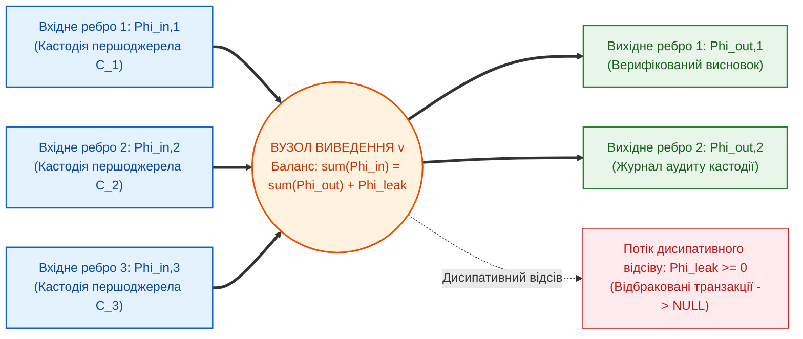
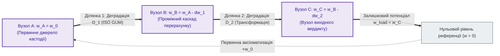

# Глава 03. Топологічні інваріанти збереження та розрахунок мереж доказового виведення

> **Книга:** [Теорія епістемічних обчислювальних схем: Математичні інваріанти кастодії, метрології та детермінованого виведення](README.md) · Частина 1. Математичні основи епістемічних схем  
> **Попередня глава:** [Глава 02. Фундаментальні кількісні міри та рівняння атенюації достовірності в обчислювальних схемах](ch02-quantitative-measures-and-credibility-attenuation.md)  
> **Наступна глава:** [Глава 04. Небулева математика епістемічних схем: бірешітка Белнапа, трикутні норми та інтервальна метрологія](ch04-belnap-bilattice-tnorms-and-dual-metrology.md)  
> **Зміст книги:** [README.md](README.md)  
> **Автор:** [Микола Федчик](../ExpertSystem/about-the-author.md)  
> **Рівень складності та оптимальне вивчення:** `[L3]` Формально-математичний та топологічний (індекс Д. Кнута `[30]`) · *Маршрут:* Базове ядро всіх треків; 2 проходи з опрацюванням балансу вузлів і шляхів  
> **Очікувані результати:** формулювати й застосовувати три топологічні інваріанти збереження для розрахунку орієнтованих графів логічного виведення; доводити конструктивний інваріант нульових галюцинацій через вузловий баланс потоків кастодії; розраховувати накопичення метрологічної невизначеності вздовж шляху виведення на дуальних числах Кліффорда.

## Анотація

У третій главі розроблено топологічний метод розрахунку розгалужених мереж доказового виведення. Показано, що у складних нормативно-технічних системах знання утворює не поодинокий лінійний тракт, а багатозв'язний спрямований граф із вузлами злиття, розгалуження та перехресної верифікації. У традиційних системах штучного інтелекту відсутність топологічних інваріантів збереження у таких графах призводить до трьох патологій: спонтанного породження непідтверджених тверджень у проміжних вузлах (галюцинацій), неконтрольованого самопідсилення оцінок достовірності в циклах міркувань та підміни нормативного дозволу простою наявністю емпіричного спостереження [[7]](#src-7).

Для усунення цих патологій сформульовано й математично обґрунтовано **три топологічні інваріанти збереження в обчислювальних схемах**, що узагальнюють рівняння балансу потоків у мережах [[1]](#src-1), інформаційну нерівність обробки даних [[5]](#src-5) та закон неспадної ентропії [[2]](#src-2): (1) інваріант вузлового балансу потоків верифікованих транзакцій, який перетворює вимогу нульових галюцинацій на закон збереження кастодії; (2) інваріант адитивності деградації та поширення дисперсій уздовж шляхів графа за стандартом JCGM GUM [[3]](#src-3) над алгеброю дуальних чисел Кліффорда [[4]](#src-4); (3) інваріант деонтично-модальної ортогональності тритермінального вентиля, що формалізує розмежування між описовим фактом і нормативним приписом [[6]](#src-6). Наведено покроковий приклад топологічного розрахунку схеми допуску газової турбіни. Главу завершують висновки, словник, перелік абревіатур та бібліографія.

---

## 1. Вступ та постановка проблеми: патології розгалужених мереж без інваріантів збереження

Рівняння атенюації достовірності, виведене у [Главі 02](ch02-quantitative-measures-and-credibility-attenuation.md), описує поодиноку однорідну ділянку тракту виведення. Проте реальні інженерні стандарти, юридичні кодекси та клінічні протоколи не зводяться до одного ізольованого правила. Вони утворюють розгалужену топологічну схему, у якій одні висновки подаються на входи кількох підсистем, інші агрегуються у спільних вузлах злиття, а треті проходять крізь тракти взаємної верифікації.

У теорії потокових графів та мережевого аналізу перехід від окремого ребра до розгалуженої мережі спирається на фундаментальні рівняння нерозривності у вузлах та балансу потенціалів уздовж шляхів [[1]](#src-1). Ці рівняння гарантують, що потік не може виникнути з порожнечі у внутрішньому вузлі мережі, а сумарна зміна потенціалу вздовж шляху однозначно визначається характеристиками пройдених ребер.

Традиційні графи знань, продукційні мережі та багатоагентні системи мовних моделей втрачають стійкість при масштабуванні саме через **відсутність топологічних інваріантів збереження**:
1. **Патологія вузлової генерації фікцій:** у стохастичному графі або ланцюжку агентів проміжний вузол може сформувати вихідне твердження, яке не спирається на жоден із вхідних потоків першоджерел. У термінах теорії мереж це еквівалентно порушенню рівняння нерозривності потоку у вузлі без джерел.
2. **Патологія циркуляційного самопідсилення:** коли два неточні правила або два агенти посилаються один на одного в циклі, у класичних евристичних мережах їхня суб'єктивна оцінка достовірності може необґрунтовано зростати до одиниці замість того, щоб монотонно атенююватися відповідно до коефіцієнтів деградації.
3. **Патологія натуралістичної помилки Юма [[6]](#src-6):** класичні графи даних не розрізняють інформаційні ребра емпіричних фактів («що фізично відбулося») та керуючі входи деонтичних норм («чи дозволено це правилом» [[7]](#src-7)), дозволяючи емпіричному спостереженню автоматично перетворюватися на нормативний дозвіл.

Для усунення цих трьох патологій у Теорії епістемічних обчислювальних схем (ТЕОС) встановлюються три топологічні інваріанти збереження.

> [!NOTE]
> **Чотири наукові положення, що виносяться на захист у Главі 03**
> 1. **Перший топологічний інваріант збереження (вузловий баланс потоків кастодії та буферизоване розгалуження):** доведено, що у будь-якому пасивному вузлі агрегації сумарний вихідний потік верифікованих транзакцій не перевищує суми вхідних потоків кастодії за вирахуванням дисипативного відсіву, тоді як розмноження інтенсивного потенціалу достовірності на $M$ паралельних правил здійснюється через буферні повторювачі з нескінченним вхідним імпедансом.
> 2. **Другий топологічний інваріант збереження (адитивність деградації та дисперсій уздовж шляху виведення):** встановлено, що спад потенціалу достовірності вздовж послідовного тракту визначається сумарним коефіцієнтом деградації та комбінованою дисперсією невизначеності за JCGM GUM, яка в області помірної кривини функції ($`\kappa_{\mathrm{nonlin}} \le \eta_{\mathrm{crit}}`$) точно обчислюється за один такт над кільцем дуальних чисел Кліффорда ($`\varepsilon^2 = 0`$).
> 3. **Третій топологічний інваріант (деонтично-модальна ортогональність вентиля за Юмом — фон Врігтом):** формалізовано тритермінальне рівняння комутації, за яким онтологічний потенціал факту на інформаційному вході та деонтичний потенціал норми на керуючому вході є мультиплікативно незалежними і не можуть компенсувати відсутність один одного.
> 4. **Топологічний метод узгодженого розрахунку доказів і похибок:** об'єднано перевірку криптографічного походження, поширення інструментальної похибки та деонтичну фільтрацію в єдину систему алгебраїчних рівнянь вузлів і шляхів графа.
> *Керування рантаймом / Інженерний інваріант:* Порушення балансу кастодії у вузлі, перевищення допустимого порогу невизначеності вздовж тракту або падіння потенціалу керуючого входу нижче порогу активації переводить відповідне ребро схеми у стан нульової провідності (захисна відмова `FAIL-CLOSED`).

---

## 2. Перший топологічний інваріант: вузловий баланс потоків верифікованої кастодії

Розглянемо довільний внутрішній вузол епістемічної обчислювальної схеми $v$, у якому сходяться $m$ вхідних ребер із верифікованими потоками свідчень і з якого виходять $p$ ребер похідних тверджень (рисунок 3.1).

**Рисунок 3.1.** Баланс вхідних, вихідних та дисипативно відсіяних потоків транзакцій у вузлі епістемічної обчислювальної схеми.

**Твердження 3.1 (Перший топологічний інваріант збереження — вузловий баланс кастодії).** У будь-якому внутрішньому вузлі $v$ епістемічної обчислювальної схеми, який не є первинним джерелом аксіоматичної кастодії, сума вихідних потоків верифікованих транзакцій дорівнює сумі вхідних потоків кастодії за вирахуванням невід'ємного потоку дисипативного відсіву $`\Phi_{\mathrm{leak}} \ge 0`$ (формула (3.1)):

$$
\sum_{k=1}^{m} \Phi_{\mathrm{in}, k} - \sum_{j=1}^{p} \Phi_{\mathrm{out}, j} - \Phi_{\mathrm{leak}} = 0 \implies \sum_{j=1}^{p} \Phi_{\mathrm{out}, j} \le \sum_{k=1}^{m} \Phi_{\mathrm{in}, k}
$$

**Формула (3.1).** Рівняння першого топологічного інваріанта збереження у дисипативній та інтегральній формах (узагальнення рівняння нерозривності потоку в мережі [[1]](#src-1) та інформаційної нерівності обробки даних [[5]](#src-5)).

Тут:
- $`\Phi_{\mathrm{in}, k} \ge 0`$ — вхідний потік верифікованих транзакцій $k$-го ребра, що переносить епістемічний тензор стану $`\Psi_k = \langle \mathcal{C}_k, x_k + u_k\varepsilon, \boldsymbol{\beta}_k, \vec{d}_k \rangle`$ ([Глава 01](ch01-foundations-and-epistemic-gap.md), формула (1.2)) із підтвердженим бінарним індикатором криптографічної кастодії $`\mathbb{I}_{\mathrm{cust}}(\mathcal{C}_k) = 1`$ (конкретну апаратно-алгоритмічну реалізацію предиката побайтової кастодії $`\mathcal{P}_{\mathrm{SHA}}`$ виведено далі у [Главі 05](ch05-temporal-interdomain-and-verification-operators.md), формула (5.6)), $`\text{такт}^{-1}`$;
- $`\Phi_{\mathrm{out}, j} \ge 0`$ — вихідний потік верифікованих транзакцій $j$-го ребра похідного висновку, $`\text{такт}^{-1}`$;
- $`\Phi_{\mathrm{leak}} \ge 0`$ — потік відбракованих транзакцій унаслідок семантичної неоднозначності, неповноти даних або перевищення метрологічного допуску, $`\text{такт}^{-1}`$.

### 2.1. Доведення конструктивного інваріанта нульових галюцинацій у рантаймі

З формули (3.1) випливає фундаментальний наслідок для верифікації систем штучного інтелекту. Припустімо, що на входах вузла $v$ відсутні будь-які побайтово підтверджені свідчення з бази знань, тобто $`\Phi_{\mathrm{in}, k} = 0`$ для всіх $`k \in \{1, \dots, m\}`$. Оскільки в обчислювальній схемі потоки транзакцій та потік відсіву є суворо невід'ємними величинами ($`\Phi_{\mathrm{out}, j} \ge 0, \ \Phi_{\mathrm{leak}} \ge 0`$), нерівність $`\sum_{j=1}^{p} \Phi_{\mathrm{out}, j} \le 0`$ має єдиний розв'язок (формула (3.2)):

$$
\forall k: \Phi_{\mathrm{in}, k} = 0 \implies \forall j: \Phi_{\mathrm{out}, j} \equiv 0, \qquad \sigma_{\mathrm{node}} = 0 \implies \mathrm{Verdict} = \mathrm{REFUSAL}
$$

**Формула (3.2).** Умова блокування виходу та переходу вузла в режим захисної відмови за відсутності вхідної кастодії.

Тут:
- $`\sigma_{\mathrm{node}} \in [0, 1]`$ — результуюча нормована провідність вузла відносно виходу вердикту.

Отже, **конструктивний інваріант нульових галюцинацій виконавчого рантайму ($`\mathrm{ZHR}_{\mathrm{runtime}} = 1{,}00`$) у ТЕОС є прямим наслідком інваріанта збереження потоку у внутрішньому вузлі**: жоден вузол схеми не може сформувати ненульовий вихідний потік верифікації без вхідного потоку кастодії від першоджерел. При цьому, як строго показано у [Главі 09](ch09-scientific-critique-and-applicability-limits.md), якщо один первинний факт необхідно подати одночасно на $M$ паралельних правил без ослаблення його інтенсивного потенціалу достовірності ($`w_{\mathrm{out}, m} = w_{\mathrm{source}}`$), у вузлі розгалуження використовується оператор буферного копіювання потенціалу, який тиражує дескриптор кастодії для $M$ незалежних транзакційних гілок.

---

## 3. Другий топологічний інваріант: адитивність деградації та дисперсій уздовж шляху виведення

Якщо перший інваріант контролює баланс потоків у вузлах, то другий інваріант описує атенюацію потенціалу достовірності та накопичення метрологічної невизначеності під час проходження тензора стану вздовж послідовних шляхів і циклів графа (рисунок 3.2).

**Рисунок 3.2.** Баланс початкового потенціалу достовірності та послідовних спадів уздовж шляху виведення згідно з другим топологічним інваріантом.

**Твердження 3.2 (Другий топологічний інваріант збереження — баланс потенціалів та адитивність дисперсій).** Уздовж будь-якого шляху $`\mathcal{P}`$ з $K$ послідовних каскадів сума спадів потенціалу достовірності $`\Delta w_j`$ та залишкового потенціалу на виході $`w_{\mathrm{load}}`$ дорівнює початковому потенціалу джерела $`w_0`$, а комбінована дисперсія невизначеності вихідної величини за стандартом JCGM GUM [[3]](#src-3) є невід'ємною квадратичною формою вхідних стандартних невизначеностей згідно із законом неспадної ентропії Клаузіуса–Шеннона [[2]](#src-2), [[5]](#src-5) (формула (3.3)):

$$
w_0 - \sum_{j=1}^{K} \Delta w_j - w_{\mathrm{load}} = 0, \qquad u_c^2(y) = \sum_{j=1}^{K} \left(\frac{\partial f}{\partial x_j}\right)^2 u^2(x_j) \ge 0
$$

**Формула (3.3).** Рівняння другого топологічного інваріанта для балансу потенціалів достовірності та поширення стандартної невизначеності вздовж шляху графа.

Тут:
- $`\Delta w_j \ge 0`$ — спад безрозмірного потенціалу достовірності на $j$-му елементі тракту з коефіцієнтом деградації $`D_j \ge 0`$;
- $`y = f(x_1, x_2, \dots, x_K)`$ — функціональна залежність вихідного інженерного параметра $y$ від вхідних вимірюваних величин $`x_j`$;
- $`\partial f / \partial x_j`$ — коефіцієнти чутливості першого порядку за стандартом JCGM GUM [[3]](#src-3);
- $`u(x_j) \ge 0`$ — стандартна невизначеність $j$-го вхідного вимірювання у відповідних фізичних одиницях;
- $`u_c(y) \ge 0`$ — комбінована стандартна невизначеність вихідного результату.

### 3.1. Однотактове обчислення чутливостей над алгеброю дуальних чисел Кліффорда

У традиційних програмних системах обчислення частинних похідних $`\partial f / \partial x_j`$ у формулі (3.3) вимагає або наближеного скінченно-різницевого диференціювання, або ресурсомісткого моделювання методом Монте-Карло. В епістемічній обчислювальній схемі друга компонента тензора стану $`\Psi_j = \langle \mathcal{C}_j, x_j + u(x_j)\varepsilon_j, \boldsymbol{\beta}_j, \vec{d}_j \rangle`$ належить комутативному кільцю багатовимірних дуальних чисел Вільяма Кліффорда [[4]](#src-4):

$$
\mathbb{D}_K = \left\{ x_0 + \sum_{j=1}^{K} u_j \varepsilon_j \;\middle|\; x_0, u_j \in \mathbb{R}, \quad \varepsilon_j \neq 0, \quad \varepsilon_i \varepsilon_j = 0 \;\;\forall i, j \in \{1, \dots, K\} \right\}
$$

Завдяки тотожності нільпотентності $`\varepsilon_i \varepsilon_j = 0`$ усі члени ряду Тейлора другого та вищих порядків автоматично перетворюються на нуль під час елементарних арифметичних операцій (розширення цієї алгебри з урахуванням ефективних ступенів свободи Велча — Саттерзвейта $`\nu_{\mathrm{eff}}`$ та її зв'язок із чотиризначною бірешіткою Белнапа розглянуто у [Главі 04](ch04-belnap-bilattice-tnorms-and-dual-metrology.md)). Тоді за розкладом Тейлора будь-який аналітичний вузол схеми автоматично обчислює точну лінійну комбінацію частинних похідних за один такт синхронізації (формула (3.4)):

$$
f\left(x_1 + u(x_1)\varepsilon_1, \dots, x_K + u(x_K)\varepsilon_K\right) = f(x_1, \dots, x_K) + \sum_{j=1}^{K} \frac{\partial f}{\partial x_j} u(x_j)\,\varepsilon_j
$$

**Формула (3.4).** Автоматичне диференціювання похибок першого порядку у вузлах схеми над багатовимірною дуальною алгеброю Кліффорда (де $`\varepsilon_i \varepsilon_j = 0`$).

Тут:
- $`\varepsilon_j`$ — ортогональні нільпотентні базисні одиниці незалежних джерел вимірювальної невизначеності ($`\varepsilon_j^2 = 0`$).

*Область застосовності лінійного наближення:* Оскільки умова $`\varepsilon_j^2 = 0`$ відкидає похідні другого та вищих порядків у ряді Тейлора, формула (3.4) дає точне значення стандартної невизначеності першого порядку за JCGM GUM для лінійних та помірно нелінійних функцій, у яких безрозмірний індекс кривини Гессе не перевищує критичного порогу ($`\kappa_{\mathrm{nonlin}} = \frac{1}{2}\lvert f''(x)/f'(x)\rvert u(x) \le \eta_{\mathrm{crit}}`$). При сильних нелінійностях використовується розширення до гіпердуальних чисел другого порядку ($`\varepsilon_1 \varepsilon_2 \neq 0`$), детально виведене у [Главі 09](ch09-scientific-critique-and-applicability-limits.md).

Другий топологічний інваріант також встановлює **неможливість самопідсилення достовірності в замкнених циклах**: оскільки кожен коефіцієнт деградації $`D_j \ge 0`$ і кожен доданок дисперсії невід'ємний, у циклі міркувань без залучення нових незалежних першоджерел потенціал достовірності може лише монотонно спадати або залишатися сталим при $`D_j = 0`$, але ніколи не може перевищити початковий рівень $`w_0 \le 1{,}00`$.

---

## 4. Третій топологічний інваріант: деонтично-модальна ортогональність тритермінального вентиля

Навіть якщо факт надійшов із автентичного джерела (перший інваріант виконано) і пройшов тракт із допустимою похибкою (другий інваріант виконано), це ще не означає, що система має нормативне право застосувати цей факт для формування виконавчого рішення. Згідно з класичним принципом демаркації Девіда Юма [[6]](#src-6), із самого лише описового судження про те, що *є* (*Is*), логічно не випливає нормативне судження про те, що *повинно бути* (*Ought*). У формальній деонтичній логіці Георга Генріка фон Врігта [[7]](#src-7) для цього вводяться модальні оператори обов'язку ($\square$), дозволу ($\lozenge$) та заборони ($`\mathcal{F}`$).

У ТЕОС ця епістемологічна аксіома формалізується як **Третій топологічний інваріант — принцип тритермінальної ортогональності інформаційного входу факту і керуючого входу норми** (повну кусково-лінійну теорію тритермінального деонтичного вентиля та розділення контраргументів Поллока побудовано далі у [Главі 06](ch06-three-terminal-deontic-gate.md)).

**Твердження 3.3 (Третій топологічний інваріант — деонтично-модальна комутація тракту).** Вихідний потік санкціонованого вердикту $`\Phi_D`$ тритермінального деонтичного вентиля визначається одночасною присутністю онтологічного потенціалу факту на інформаційному вході $`w_S`$ та перевищенням деонтичного керуючого потенціалу на вході затвора $`w_G`$ над порогом нормативної активації $`w_{\mathrm{th}}`$ за формулою (3.5):

$$
\Phi_D = g_m \cdot \max\left(0, \ w_G - w_{\mathrm{th}}\right) \cdot w_S \cdot \max\left(0, \ 1 - \frac{U_{95\%}}{\Delta_{\mathrm{tol}}}\right)
$$

**Формула (3.5).** Рівняння третього топологічного інваріанта для вихідного потоку вердикту в тритермінальному деонтичному вентилі.

Тут:
- $`\Phi_D \ge 0`$ — вихідний потік санкціонованих транзакцій на виході вентиля (*Drain*), $`\text{такт}^{-1}`$;
- $`w_S \in [0, 1]`$ — безрозмірний онтологічний потенціал доведеного факту на інформаційному вході (*Source*);
- $`w_G \in [0, 1]`$ — безрозмірний деонтичний потенціал чинної норми права або стандарту на керуючому вході (*Gate*);
- $`w_{\mathrm{th}} \in (0, 1)`$ — безрозмірний пороговий потенціал відкриття нормативного тракту;
- $`g_m = \partial \Phi_D / \partial w_G > 0`$ — коефіцієнт крутизни передавальної характеристики вентиля, $`\text{такт}^{-1}`$.

З формули (3.5) випливає строга мультиплікативна ортогональність:
1. Якщо норма скасована, не набула чинності або заблокована процедурним підсікачем ($`w_G \le w_{\mathrm{th}}`$), то навіть за абсолютної достовірності факту ($`w_S = 1{,}00`$) вихідний потік тотожно дорівнює нулю ($`\Phi_D = 0`$).
2. І навпаки: якщо норма чинна і дозволяє дію ($`w_G = 1{,}00`$), але емпіричний факт не підтверджений кастодією ($`w_S = 0`$), вихід так само залишається заблокованим ($`\Phi_D = 0`$).

---

## 5. Навчальний інженерний приклад: топологічний розрахунок схеми допуску турбіни

*Дидактична наступність наскрізного прикладу:* У [Главі 02](ch02-quantitative-measures-and-credibility-attenuation.md) ми розрахували ослаблення потенціалу достовірності $`w`$ в одній нерозгалуженій ланці давача тиску. Тепер перейдемо від одиночної ланки до **вузла злиття двох вимірювальних каналів та тритермінальної комутації** для тензорів стану $`\Psi_1, \Psi_2`$ із розмірністю термодинамічної температури $`\vec{d}_T = [0, 0, 0, 0, 1, 0, 0]^T`$ і простежимо спільну дію всіх трьох топологічних інваріантів: балансу потоків кастодії $`\Phi`$, дуального автодиференціювання похибок $`u_c(y)`$ та деонтичного керування затвором $`w_G`$.

### 5.1. Вихідні умови розрахункової схеми

До вузла агрегації $v$ сходяться два вхідні ребра свідчень про температуру лопаток ротора $T$:
- **Ребро 1 (Основний пірометр):** підтверджене апаратною кастодією, вхідний потік верифікації $`\Phi_{\mathrm{in}, 1} = 0{,}60\text{ такт}^{-1}`$, виміряне значення з дуальною стандартною невизначеністю $`T_1 = 850 + 3{,}0\,\varepsilon_1\text{ К}`$.
- **Ребро 2 (Термопара корпусу з перерахунком):** підтверджене кастодією, вхідний потік $`\Phi_{\mathrm{in}, 2} = 0{,}40\text{ такт}^{-1}`$. Через теплову інерцію корпусу у вузлі відбувається дисипативний відсів $`\Phi_{\mathrm{leak}} = 0{,}15\text{ такт}^{-1}`$.
- **Каскад обчислення теплового навантаження:** результуючий параметр напруженості обчислюється за лінійною функцією $`y = f(T_1, \Delta T_2) = T_1 + 2{,}0 \cdot \Delta T_2`$, де перепад температури $`\Delta T_2 = 40 + 2{,}0\,\varepsilon_2\text{ К}`$. Граничний допуск невизначеності (при коефіцієнті охоплення $k=2$) становить $`\Delta_{\mathrm{tol}} = 20{,}0\text{ К}`$.
- **Керуючий вхід норми безпеки:** номінальний потенціал чинного регламенту експлуатації $`w_G = 0{,}95`$, поріг активації вентиля $`w_{\mathrm{th}} = 0{,}45`$, крутизна передавальної характеристики $`g_m = 2{,}0\text{ такт}^{-1}`$, потенціал достовірності факту у вузлі $`w_S = 0{,}85`$.

### 5.2. Покрокове застосування трьох топологічних інваріантів

**Крок 1. Застосування Першого інваріанта (вузловий баланс потоку кастодії):**
За формулою (3.1) вихідний потік верифікованих транзакцій із вузла агрегації $v$ становить:

$$
\Phi_{\mathrm{out}} = \Phi_{\mathrm{in}, 1} + \Phi_{\mathrm{in}, 2} - \Phi_{\mathrm{leak}} = 0{,}60 + 0{,}40 - 0{,}15 = 0{,}85\text{ такт}^{-1} > 0
$$

Вхідна кастодія підтверджена, вихідний потік додатний, непідтверджені генерації відсутні.

**Крок 2. Застосування Другого інваріанта (автодиференціювання похибки вздовж тракту):**
Підставляємо дуальні числа у функцію $`f(T_1, \Delta T_2)`$ за формулою (3.4):

$$
Y = (850 + 3{,}0\,\varepsilon_1) + 2{,}0 \cdot (40 + 2{,}0\,\varepsilon_2) = 930 + 3{,}0\,\varepsilon_1 + 4{,}0\,\varepsilon_2\text{ К}
$$

Звідси за формулою (3.3) комбінована стандартна невизначеність $`u_c(y)`$ та розширена невизначеність $`U_{95\%} = 2 u_c(y)`$ знаходяться як евклідова норма ортогональних компонент $`\varepsilon_1, \varepsilon_2`$:

$$
u_c(y) = \sqrt{3{,}0^2 + 4{,}0^2} = \sqrt{9 + 16} = 5{,}0\text{ К} \implies U_{95\%} = 2 \cdot 5{,}0 = 10{,}0\text{ К}
$$

**Крок 3. Застосування Третього інваріанта (деонтична комутація вихідного вердикту):**
Підставляємо знайдені величини у рівняння третього інваріанта (формула (3.5)):

$$
\Phi_D = 2{,}0 \cdot \max(0, \ 0{,}95 - 0{,}45) \cdot 0{,}85 \cdot \left(1 - \frac{10{,}0}{20{,}0}\right) = 2{,}0 \cdot 0{,}50 \cdot 0{,}85 \cdot 0{,}50 = 0{,}425\text{ такт}^{-1}
$$

Оскільки $`\Phi_D = 0{,}425\text{ такт}^{-1} > 0`$, усі три топологічні інваріанти виконано, і схема формує сертифікований вердикт **`ACCEPT`** із точно обчисленим параметром $`y = 930 \pm 10{,}0\text{ К}`$. Якби ж черговий інженер відкликав регламентний дозвіл на роботу турбіни (знизивши потенціал керуючого входу до $`w_G = 0{,}40 < w_{\mathrm{th}}`$), то за третім інваріантом вихідний потік миттєво обнулився б ($`\Phi_D = 0`$) без жодної зміни емпіричних показів давачів $`T_1`$ і $`\Delta T_2`$.

---

## Висновки

1. **Топологічна замкненість теорії:** три топологічні інваріанти збереження утворюють повну систему рівнянь для розрахунку орієнтованих мереж доказового виведення, замінюючи евристичний перебір алгебраїчним розрахунком вузлових потенціалів достовірності та потоків транзакцій.
2. **Конструктивна природа відсутності галюцинацій у рантаймі:** перший інваріант доводить, що у внутрішніх вузлах схеми потік кастодії підпорядковується рівнянню нерозривності, унеможливлюючи генерацію тверджень без первинних свідчень.
3. **Аналітичний контроль невизначеності за $O(1)$:** другий інваріант у поєднанні з дуальними числами Кліффорда забезпечує точне поширення інструментальних похибок першого порядку за стандартом JCGM GUM вздовж тракту обчислень без стохастичних симуляцій.
4. **Структурна реалізація принципу Юма:** третій інваріант усуває змішування фактів і норм, відокремлюючи деонтичну чинність правила на ізольований керуючий вхід тритермінального вентиля.

---

## Словник

| Термін | Англійський еквівалент | Визначення |
| :--- | :--- | :--- |
| **Вузол епістемічної схеми** | *Epistemic Circuit Node* | Вершина орієнтованого графа виведення, у якій виконується баланс вхідних та вихідних потоків транзакцій кастодії. |
| **Шлях виведення** | *Inference Path* | Послідовність орієнтованих ребер і функціональних вузлів графа від первинного джерела кастодії до вузла вердикту. |
| **Потік дисипативного відсіву** | *Dissipative Rejection Flow* | Частина вхідного потоку транзакцій у вузлі, яка відбраковується через семантичну неповноту або перевищення похибки. |
| **Дуальні числа Кліффорда** | *Clifford Dual Numbers* | Гіперкомплексні числа вигляду $`a + b\varepsilon`$ (де $`\varepsilon^2 = 0`$), які використовуються в ТЕОС для однотактового обчислення похідних чутливості похибок. |
| **Коефіцієнт чутливості** | *Sensitivity Coefficient* | Частинна похідна вихідної функції за вхідним параметром $`\partial f / \partial x_j`$, що визначає ваговий внесок похибки $j$-го входу у сумарну невизначеність. |
| **Крутизна передавальної характеристики** | *Gate Transconductance* | Параметр тритермінального вентиля $`g_m = \partial \Phi_D / \partial w_G`$, що визначає чутливість вихідного потоку вердикту до зміни потенціалу норми на керуючому вході. |
| **Принцип демаркації Юма** | *Hume's Is–Ought Guillotine* | Фундаментальне філософсько-логічне положення про неможливість прямого виведення нормативних приписів («повинно») з описових фактів («є»). |

---

## Абревіатури

| Абревіатура | Розшифрування | Опис |
| :--- | :--- | :--- |
| **AD** | Automatic Differentiation | Автоматичне диференціювання функцій у прямому режимі на основі алгебри дуальних чисел. |
| **DAG** | Directed Acyclic Graph | Спрямований ациклічний граф, що задає топологію скомпільованої мережі виведення. |
| **GUM** | Guide to the Expression of Uncertainty in Measurement | Міжнародна метрологічна настанова JCGM 100:2008 (ISO/IEC Guide 98-3). |
| **ZHR** | Zero-Hallucination Rate | Інваріант нульових галюцинацій на виході шлюзу рантайму, що гарантується першим інваріантом збереження кастодії. |

---

## Джерела

1. Gustav Kirchhoff. [*Ueber den Durchgang eines elektrischen Stromes durch eine Ebene, insbesondere durch eine kreisförmige*](https://doi.org/10.1002/andp.18451400402). *Annalen der Physik und Chemie*, 140(4), 497–514, 1845.
2. Rudolf Clausius. [*Ueber verschiedene für die Anwendung bequeme Formen der Hauptgleichungen der mechanischen Wärmetheorie*](https://doi.org/10.1002/andp.18652010702). *Annalen der Physik und Chemie*, 201(7), 353–400, 1865.
3. JCGM. [*Evaluation of Measurement Data — Guide to the Expression of Uncertainty in Measurement (GUM)*](https://doi.org/10.59161/JCGM100-2008E). JCGM 100:2008 (ISO/IEC Guide 98-3), BIPM / ISO / IEC, 2008.
4. William Kingdon Clifford. [*Preliminary Sketch of Biquaternions*](https://doi.org/10.1112/plms/s1-4.1.381). *Proceedings of the London Mathematical Society*, s1-4(1), 381–395, 1873.
5. Thomas M. Cover, Joy A. Thomas. [*Elements of Information Theory*](https://doi.org/10.1002/047174882X). 2nd Edition, Hoboken, NJ: John Wiley & Sons, 2006 (Data Processing Inequality, Chapter 2).
6. David Hume. [*A Treatise of Human Nature*](https://doi.org/10.1093/actrade/9780198245872.book.1). London: John Noon, 1739 (Book III, Part I, Section I; критичне видання Oxford University Press, 2000).
7. Georg Henrik von Wright. [*Deontic Logic*](https://doi.org/10.1093/mind/LX.237.1). *Mind*, 60(237), 1–15, 1951.

---

[← Глава 02. Фундаментальні кількісні міри та рівняння атенюації достовірності](ch02-quantitative-measures-and-credibility-attenuation.md) | [Зміст книги](README.md) | [Глава 04. Небулева математика епістемічних схем →](ch04-belnap-bilattice-tnorms-and-dual-metrology.md)
