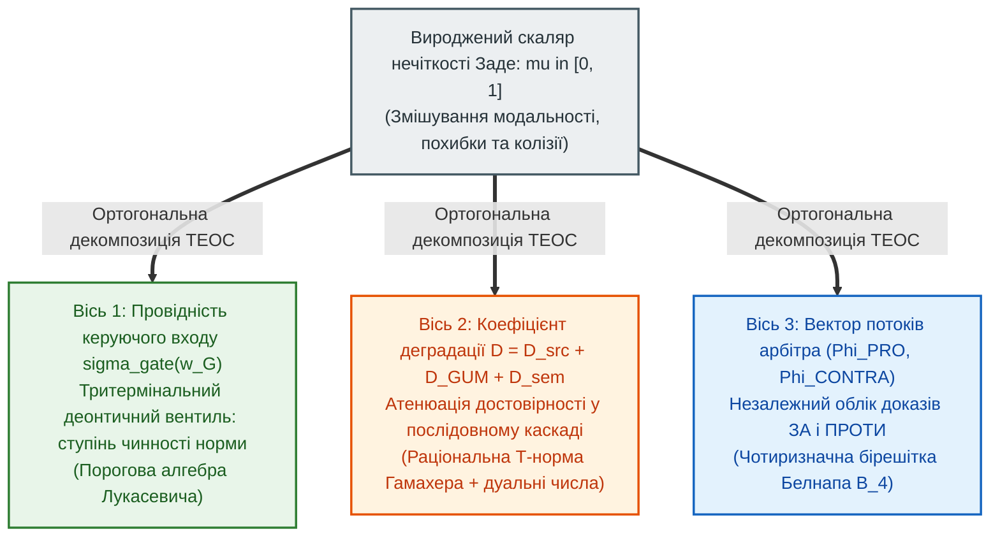

# Глава 04. Небулева математика епістемічних схем: бірешітка Белнапа, трикутні норми та інтервальна метрологія

> **Книга:** [Теорія епістемічних обчислювальних схем: Математичні інваріанти кастодії, метрології та детермінованого виведення](README.md) · Частина 1. Математичні основи епістемічних схем  
> **Попередня глава:** [Глава 03. Топологічні інваріанти збереження та розрахунок мереж доказового виведення](ch03-topological-conservation-invariants.md)  
> **Наступна глава:** [Глава 05. Оператори темпоральної агрегації, міждоменного відображення та структурної верифікації тензора стану](ch05-temporal-interdomain-and-verification-operators.md)  
> **Зміст книги:** [README.md](README.md)  
> **Автор:** [Микола Мартинович Федчик](../ExpertSystem/about-the-author.md)  
> **Рівень складності та оптимальне вивчення:** `[L3]` Формально-математичний та алгебраїчний (індекс Д. Кнута `[34]`) · *Маршрут:* Базове математичне ядро монографії; 2 проходи з розбором розрахункового прикладу  
> **Очікувані результати:** доводити непридатність скалярної нечіткої логіки Заде для систем критичної безпеки; застосовувати раціональну трикутну норму Гамахера для розрахунку послідовних каскадів з адитивними коефіцієнтами деградації; реалізовувати чотиризначну бірешітку Белнапа через синфазний та диференційний потоки транзакцій; виконувати розрахунки у порогово-квантованій деонтичній алгебрі Лукасевича.

## Анотація

Четверта глава присвячена розбудові небулевого математичного апарату Теорії епістемічних обчислювальних схем (ТЕОС). Досліджується фундаментальна наукова проблема: яким чином ввести в обчислювальні схеми неперервні градації достовірності, метрологічної точності та нормативної сили, не потрапивши при цьому в обмеження класичної скалярної нечіткої логіки Лотфі Заде [[1]](#src-1). Строго доведено три конструктивні дефекти операторів мінімуму та максимуму Заде в критичних системах: склеювання різнорідних станів в одне скалярне число, порушення закону непротиріччя та ідемпотентну сліпоту до затухання достовірності в довгих каскадах міркувань.

Для розв'язання цієї проблеми запропоновано метод **ортогонального розщеплення нечіткості** на три незалежні координати епістемічної схеми та побудовано чотири складові небулевої алгебри ТЕОС: (1) алгебраїчний ізоморфізм між адитивним додаванням коефіцієнтів деградації у послідовному тракті та раціональною трикутною нормою Горста Гамахера [[2]](#src-2), [[3]](#src-3); (2) операторну реалізацію чотиризначної параконсистентної бірешітки Нюела Белнапа [[4]](#src-4) та Мелвіна Фіттінга [[5]](#src-5) через потоки транзакцій плечей диференційного арбітра; (3) розширення тензора стану на кільце дуальних чисел Кліффорда [[7]](#src-7) з урахуванням ступенів свободи Велча–Саттерзвейта [[8]](#src-8), [[9]](#src-9); (4) порогово-квантовану деонтичну алгебру Яна Лукасевича [[6]](#src-6) для опису передавальної характеристики керуючого входу деонтичного вентиля. Роботу апарату продемонстровано на навчальному прикладі розрахунку трикаскадного тракту з колізією свідчень. Главу завершують висновки, словник, абревіатури та бібліографія.

---

## 1. Вступ та постановка проблеми: три структурні дефекти скалярної нечіткості Заде

Спроби вийти за межі двозначної булевої дихотомії $`\{0, 1\}`$ робилися в математичній логіці з початку XX століття — передусім у працях Яна Лукасевича з тризначної та багатозначної логіки [[6]](#src-6). У 1965 році Лотфі Заде опублікував статтю *«Нечіткі множини»* (*Fuzzy Sets* [[1]](#src-1)), у якій запропонував характеризувати ступінь належності елемента $x$ до нечіткого поняття $A$ дійсним числом $`\mu_A(x) \in [0, 1]`$ із базовими операціями Геделя–Заде (формула (4.1)):

$$
\mu_{A \land B}(x) = \min\left(\mu_A(x), \ \mu_B(x)\right), \qquad \mu_{A \lor B}(x) = \max\left(\mu_A(x), \ \mu_B(x)\right), \qquad \mu_{\neg A}(x) = 1 - \mu_A(x)
$$

**Формула (4.1).** Класичні операції кон'юнкції, диз'юнкції та доповнення в скалярній нечіткій логіці Заде [[1]](#src-1).

Тут:
- $`\mu_A(x), \mu_B(x) \in [0, 1]`$ — скалярні значення функцій належності для предикатів $A$ та $B$.

Нечіткі регулятори Заде знайшли широке застосування у системах автоматичного регулювання. Проте спроби покласти формулу (4.1) в основу доказових експертних систем критичної безпеки виявляють три фундаментальні структурні вади.

### 1.1. Дефект 1: колапс трьох ортогональних станів в одне скалярне число

Коли у класичній нечіткій системі змінній приписується значення $`\mu = 0{,}50`$, система втрачає здатність розрізнити, **яке саме фізичне чи епістемічне явище стоїть за цим числом**:
1. *Онтологічна проміжність самої властивості:* клапан фізично відкритий рівно на 50 % свого ходу, і цей факт виміряно лазерним енкодером із високою точністю та прямою кастодією.
2. *Метрологічна сліпота або відсутність даних:* невідомо, чи клапан відкритий, чи закритий, оскільки давач втратив живлення (інформаційний вакуум).
3. *Правова або технічна колізія:* один сертифікований давач показує повне відкриття ($`1{,}0`$), а другий такий самий давач — повне закриття ($`0{,}0`$), або ж дві чинні норми прямо суперечать одна одній.

Ототожнення достовірного напіввідкритого стану, повної відсутності даних та аварійного конфлікту давачів в один скаляр $`0{,}50`$ є неприпустимим у системах функціональної безпеки.

### 1.2. Дефект 2: порушення закону непротиріччя

Підставимо значення $`\mu_A = 0{,}50`$ у формулу кон'юнкції твердження та його прямого заперечення за правилом (4.1):

$$
\mu_{A \land \neg A} = \min(0{,}50, \ 1 - 0{,}50) = \min(0{,}50, \ 0{,}50) = 0{,}50 > 0
$$

Замість того щоб заблокувати логічно суперечливу кон'юнкцію $`A \land \neg A`$, оператор Заде пропускає на вихід половину максимальної амплітуди сигналу. У багатокаскадній схемі такий залишковий потенціал суперечності здатний хибно активувати виконавчий вузол.

### 1.3. Дефект 3: ідемпотентна сліпота до довжини каскаду та порушення адитивності деградації

Оператор мінімуму є ідемпотентним: $`\min(a, a, \dots, a) = a`$. Це означає, що тракт із двох нечітких правил зі ступенем достовірності $`0{,}80`$ і тракт зі ста послідовних непрямих правил із тим самим ступенем $`0{,}80`$ матимуть на виході ідентичну оцінку:

$$
\min_{k=1}^{100} (0{,}80) = 0{,}80
$$

Така модель ігнорує накопичення невизначеності на кожному проміжному каскаді й суперечить Другому топологічному інваріанту збереження ([Глава 03](ch03-topological-conservation-invariants.md)), за яким послідовне з'єднання ланок із ненульовою деградацією монотонно знижує результуючий потенціал достовірності.

> [!NOTE]
> **Чотири наукові положення, що виносяться на захист у Главі 04**
> 1. **Принцип ортогонального розщеплення нечіткості:** доведено необхідність заміни скалярної функції належності Заде трьома незалежними координатами схеми — провідністю керуючого входу деонтичного вентиля, коефіцієнтом метрологічної деградації на дуальних числах та двокомпонентним вектором потоків диференційного арбітра.
> 2. **Теорема про ізоморфізм адитивної деградації та трикутної норми Гамахера:** математично виведено, що адитивне додавання коефіцієнтів деградації у послідовному тракті в просторі нормованих провідностей тотожно породжує раціональну Т-норму Гамахера без ідемпотентної сліпоти.
> 3. **Операторна реалізація бірешітки Белнапа:** показано, що чотири стани логіки Белнапа однозначно кодуються парою диференційного та синфазного потоків транзакцій двох плечей змагального арбітра.
> 4. **Порогово-квантована деонтична алгебра Лукасевича для вентиля:** встановлено аналітичний зв'язок між багатозначною кон'юнкцією Лукасевича та кусково-лінійною передавальною характеристикою тритермінального деонтичного вентиля з порогом активації.
> *Керування рантаймом / Інженерний інваріант:* Схема ТЕОС структурно розрізняє нульовий синфазний потік (вакуум знань — відмова за відсутністю кастодії) та високий синфазний потік при нульовій різниці плечей (колізія норм — блокування з видачею діагностичного звіту про паритет).

---

## 2. Ортогональне розщеплення нечіткості в Теорії епістемічних обчислювальних схем

Щоб усунути виродженість скаляра Заде, у ТЕОС вводиться розкладання нечіткості на три взаємно ортогональні осі (рисунок 4.1).

**Рисунок 4.1.** Схема ортогонального розщеплення скалярної нечіткості на три незалежні координати епістемічної обчислювальної схеми.

Як видно з рисунка 4.1, класична булева алгебра та скалярна нечітка логіка виявляються граничними частковими випадками загальної теорії епістемічних схем:
- коли всі коефіцієнти деградації $`D \in \{0, \infty\}`$, а керуючі входи вентилів працюють виключно в бінарному режимі повного відкриття або блокування, схема ТЕОС редукується до **булевої логіки з контролем кастодії**;
- коли ж вентилі працюють на лінійній ділянці передавальної характеристики, а коефіцієнти деградації набувають скінченних додатних значень, виникає **повноцінна небулева математика ТЕОС**, чотири складові якої викладено у наступному розділі.

---

## 3. Чотири складові небулевого математичного апарату ТЕОС

### 3.1. Теорема про ізоморфізм адитивної деградації та трикутної норми Гамахера

Розглянемо послідовне з'єднання двох ділянок епістемічної схеми з безрозмірними коефіцієнтами деградації $`D_1 \ge 0`$ та $`D_2 \ge 0`$. Як визначено в [Главі 02](ch02-quantitative-measures-and-credibility-attenuation.md), нормована провідність ділянки $`\sigma_i \in (0, 1]`$ дорівнює одиниці за відсутності втрат ($`D_i = 0`$) і прямує до нуля при блокуванні тракту ($`D_i \to \infty`$) за взаємно однозначним перетворенням:

$$
\sigma_i = \frac{1}{1 + D_i} \iff D_i = \frac{1 - \sigma_i}{\sigma_i}
$$

**Твердження 4.1 (Ізоморфізм адитивності деградації та Т-норми Гамахера).** Якщо при послідовному з'єднанні двох каскадів їхні коефіцієнти деградації додаються за адитивним законом $`D_{12} = D_1 + D_2`$, то результуюча нормована провідність каскаду $`\sigma_{1 \odot 2}`$ точно виражається раціональною трикутною нормою Горста Гамахера [[2]](#src-2), [[3]](#src-3) з параметром $\gamma = 0$ (формула (4.2)):

$$
\sigma_{1 \odot 2} = T_{\mathrm{ep}}(\sigma_1, \sigma_2) = \frac{1}{1 + D_1 + D_2} = \frac{\sigma_1 \cdot \sigma_2}{\sigma_1 + \sigma_2 - \sigma_1 \cdot \sigma_2}
$$

**Формула (4.2).** Епістемічна трикутна норма провідності послідовного каскаду (раціональний добуток Гамахера).

Тут:
- $`\sigma_1, \sigma_2 \in [0, 1]`$ — нормовані провідності першого та другого послідовно з'єднаних каскадів;
- $`T_{\mathrm{ep}}(\sigma_1, \sigma_2) \in [0, 1]`$ — результуюча наскрізна провідність двокаскадного тракту.

*Доведення.* Підставимо вирази $`D_1 = (1 - \sigma_1)/\sigma_1`$ та $`D_2 = (1 - \sigma_2)/\sigma_2`$ у формулу $`\sigma_{1 \odot 2} = 1 / (1 + D_1 + D_2)`$:

$$
\sigma_{1 \odot 2} = \frac{1}{1 + \frac{1 - \sigma_1}{\sigma_1} + \frac{1 - \sigma_2}{\sigma_2}} = \frac{\sigma_1 \sigma_2}{\sigma_1 \sigma_2 + (1 - \sigma_1)\sigma_2 + (1 - \sigma_2)\sigma_1} = \frac{\sigma_1 \sigma_2}{\sigma_1 + \sigma_2 - \sigma_1 \sigma_2}
$$

Для довільної кількості $N$ послідовних каскадів із коефіцієнтами деградації $`D_1, \dots, D_N`$ індуктивне застосування формули (4.2) дає замкнений вираз (формула (4.3)):

$$
\sigma_{1 \odot \dots \odot N} = \frac{1}{1 + \sum_{k=1}^{N} D_k} = \frac{1}{1 + \sum_{k=1}^{N} \frac{1 - \sigma_k}{\sigma_k}}
$$

**Формула (4.3).** Закон атенюації нормованої провідності в послідовному каскаді з $N$ елементів.

Тут:
- $`N \in \mathbb{N}^+`$ — кількість послідовно з'єднаних ланок виведення.

Формула (4.3) усуває ідемпотентний дефект Заде: якщо кожен каскад має неідеальну провідність $`\sigma_k = 0{,}80`$ (тобто коефіцієнт деградації $`D_k = 0{,}25`$), то для двох каскадів провідність знижується до $`1 / (1 + 0{,}50) \approx 0{,}667`$, а для ста каскадів — до $`1 / (1 + 25) \approx 0{,}0385`$, строго виконуючи Другий топологічний інваріант збереження.

### 3.2. Чотиризначна бірешітка Белнапа у потоках диференційного арбітра

У 1977 році Нюел Белнап у праці *«Корисна чотиризначна логіка»* [[4]](#src-4) показав, що обчислювальна система, яка отримує відомості з кількох незалежних джерел, повинна оперувати чотирма станами: **$`\mathbf{T}`$** (*True* — є лише свідчення «за»), **$`\mathbf{F}`$** (*False* — є лише свідчення «проти»), **$`\mathbf{N}`$** (*None* — немає жодних свідчень) та **$`\mathbf{B}`$** (*Both* — одночасно надійшли вагомі свідчення «за» і «проти»). Мелвін Фіттінг узагальнив цю структуру до теорії бірешіток [[5]](#src-5), де кожен елемент впорядковується за двома ортогональними відношеннями: порядком істинності $`\le_t`$ (від $`\mathbf{F}`$ до $`\mathbf{T}`$) та порядком інформативності $`\le_k`$ (від вакууму $`\mathbf{N}`$ до колізії $`\mathbf{B}`$).

У ТЕОС бірешітка Белнапа–Фіттінга реалізується через потоки верифікаційних транзакцій двох плечей симетричного диференційного арбітра: потік підтвердження $`\Phi_{\mathrm{PRO}} \ge 0`$ та потік спростування $`\Phi_{\mathrm{CONTRA}} \ge 0`$ (формула (4.4)):

$$
\Delta \Phi_{\mathrm{diff}} = \Phi_{\mathrm{PRO}} - \Phi_{\mathrm{CONTRA}}, \qquad \Phi_{\Sigma} = \Phi_{\mathrm{PRO}} + \Phi_{\mathrm{CONTRA}}
$$

**Формула (4.4).** Визначення диференційного потоку істинності та синфазного потоку інформативності в бірешітці ТЕОС.

Тут:
- $`\Delta \Phi_{\mathrm{diff}} \in [-\Phi_{\max}, +\Phi_{\max}]\text{ такт}^{-1}`$ — різницевий (диференційний) потік, що визначає координату вздовж осі істинності $`\le_t`$;
- $`\Phi_{\Sigma} \in [0, 2\Phi_{\max}]\text{ такт}^{-1}`$ — сумарний (синфазний) потік обох плечей, що визначає координату вздовж осі інформаційної наповненості $`\le_k`$.

Таблиця 4.1 задає порогове кодування двох незалежних ознак підтримки у чотири стани Белнапа при $`\Phi_{\mathrm{th}} > 0`$. Це відображення числових потоків у дискретні стани, а не взаємно однозначне відображення: різним парам потоків відповідає той самий стан. Стан свідчень ще не є нормативним дозволом; винятки та пріоритети перевіряються окремо.

**Таблиця 4.1.** Операторне кодування чотиризначної бірешітки Белнапа через диференційний та синфазний потоки арбітра.

| Стан бірешітки Белнапа | Потоки плечей $`(\Phi_{\mathrm{PRO}}, \ \Phi_{\mathrm{CONTRA}})`$ | Диференційний потік $`\Delta \Phi_{\mathrm{diff}}`$ | Синфазний потік $`\Phi_{\Sigma}`$ | Вердикт шлюзу ТЕОС |
| :---: | :---: | :---: | :---: | :--- |
| **$`\mathbf{T}`$ (Істина)** | $`\Phi_{\mathrm{PRO}} \ge \Phi_{\mathrm{th}}, \quad \Phi_{\mathrm{CONTRA}} < \Phi_{\mathrm{th}}`$ | $`\Delta \Phi_{\mathrm{diff}} > 0`$ | $`\Phi_{\Sigma} \ge \Phi_{\mathrm{th}}`$ | Позитивна підтримка без порогової негативної; не автоматичний `ALLOW` |
| **$`\mathbf{F}`$ (Хиба)** | $`\Phi_{\mathrm{PRO}} < \Phi_{\mathrm{th}}, \quad \Phi_{\mathrm{CONTRA}} \ge \Phi_{\mathrm{th}}`$ | $`\Delta \Phi_{\mathrm{diff}} < 0`$ | $`\Phi_{\Sigma} \ge \Phi_{\mathrm{th}}`$ | Негативна підтримка без порогової позитивної |
| **$`\mathbf{N}`$ (Вакуум)** | $`\Phi_{\mathrm{PRO}} < \Phi_{\mathrm{th}}, \quad \Phi_{\mathrm{CONTRA}} < \Phi_{\mathrm{th}}`$ | $`\lvert\Delta \Phi_{\mathrm{diff}}\rvert < \Phi_{\mathrm{th}}`$ | $`0 \le \Phi_{\Sigma} < 2\Phi_{\mathrm{th}}`$ | Недостатня порогова підтримка обох знаків |
| **$`\mathbf{B}`$ (Колізія)** | $`\Phi_{\mathrm{PRO}} \ge \Phi_{\mathrm{th}}, \quad \Phi_{\mathrm{CONTRA}} \ge \Phi_{\mathrm{th}}`$ | Знак і близькість до нуля не визначені | $`\Phi_{\Sigma} \ge 2 \Phi_{\mathrm{th}}`$ | Підтримано обидва знаки; не обов'язково числовий паритет |

Наприклад, при порозі $`0{,}20\,\text{такт}^{-1}`$ потоки $`0{,}21`$ і $`0{,}19\,\text{такт}^{-1}`$ дають стан $`\mathbf{T}`$, хоча різниця $`0{,}02\,\text{такт}^{-1}`$ менша за поріг. Потоки $`0{,}80`$ і $`0{,}30\,\text{такт}^{-1}`$ дають $`\mathbf{B}`$ з різницею $`0{,}50\,\text{такт}^{-1}`$, а не паритет. Тому обидва біти підтримки слід визначати за потоками плечей; однієї різниці або однієї суми недостатньо для повної класифікації.

### 3.3. Метрологічне розширення тензора стану та формула Велча–Саттерзвейта

Для точного обчислення розширеної невизначеності $`U_{95\%} = k_{95\%}(\nu_{\mathrm{eff}}) \cdot u_c(y)`$ за стандартом JCGM GUM [[8]](#src-8) при скінченній кількості спостережень дуальна компонента потенціалу Кліффорда [[7]](#src-7) доповнюється ефективним числом ступенів свободи $`\nu_{\mathrm{eff}}`$, яке розраховується у вузлах агрегації за формулою Бернарда Велча та Франкліна Саттерзвейта [[9]](#src-9) (формула (4.5)):

> [!NOTE]
> **Методологічне обмеження: область валідності дуальної алгебри першого порядку**
> Алгебра дуальних чисел $`\mathbb{D}_1`$ ($x + u\varepsilon$ при $\varepsilon^2 = 0$) точно обчислює першу похідну в точній арифметиці, але не повну невизначеність нелінійного виходу. Індекс нижче є лише локальним індикатором за ненульової першої похідної, а не достатньою умовою точності:
> $`\kappa_{\mathrm{nonlin}} = \frac{1}{2}\left|\frac{f''(x)}{f'(x)}\right|u(x) \le \eta_{\mathrm{crit}}`$
> Потрібно перевіряти залишкові члени на всьому інтервалі або поширювати розподіл; гіпердуальні числа дають другі похідні, але самі по собі не усувають порогові злами й не обчислюють треті похідні. Контрприклад низького індексу з великою похибкою наведено в [главі 09, §3](ch09-scientific-critique-and-applicability-limits.md#3-другий-рубіж-критики-межі-лінійної-дуальної-метрології-при-сильних-нелінійностях); чинні статуси зібрано в [реєстрі тверджень](claims-and-evidence.md).

$$
\nu_{\mathrm{eff}} = \frac{u_c^4(y)}{\sum_{j=1}^{K} \frac{\left(\frac{\partial f}{\partial x_j} u(x_j)\right)^4}{\nu_j}}
$$

**Формула (4.5).** Співвідношення Велча–Саттерзвейта для ефективного числа ступенів свободи у багатоканальному вузлі ТЕОС.

Тут:
- $`\nu_j \in \mathbb{N}^+`$ — число ступенів свободи $j$-го вимірювального каналу (для оцінок типу А за $`n_j`$ незалежними вимірами $`\nu_j = n_j - 1`$; для інформаційних оцінок типу В із відомими межами $`\nu_j \to \infty`$);
- $`u_c(y)`$ — комбінована стандартна невизначеність на виході вузла.

### 3.4. Порогово-квантована деонтична алгебра Лукасевича для керуючого входу вентиля

Коли на керуючий вхід тритермінального деонтичного вентиля діє сукупність із $M$ нормативних умов та підсікаючих обставин із ваговими коефіцієнтами $`\alpha_m`$, передавальна характеристика керуючого входу описується узагальненою кон'юнкцією Яна Лукасевича [[6]](#src-6) з порогом активації $`w_{\mathrm{th}}`$ та рівнем насичення $`w_{\mathrm{sat}}`$ (формула (4.6)):

$$
\sigma_{\mathrm{gate}}\left(w_{G, 1}, \dots, w_{G, M}\right) = \max\left(0, \ \min\left(1, \ \frac{\sum_{m=1}^{M} \alpha_m w_{G, m} - w_{\mathrm{th}}}{w_{\mathrm{sat}} - w_{\mathrm{th}}}\right)\right)
$$

**Формула (4.6).** Кусково-лінійна функція провідності керуючого входу деонтичного вентиля в пороговій алгебрі Лукасевича.

Тут:
- $`\sigma_{\mathrm{gate}} \in [0, 1]`$ — безрозмірний коефіцієнт відкриття нормативного вентиля;
- $`w_{G, m} \in [0, 1]`$ — безрозмірні потенціали окремих деонтичних умов на багатовходовому затворі (для дозволяючих норм $`\alpha_m > 0`$, для підсікаючих дефітерів $`\alpha_m < 0`$);
- $`w_{\mathrm{th}} < w_{\mathrm{sat}}`$ — безрозмірний поріг відкриття тракту та потенціал повного насичення вентиля.

---

## 4. Навчальний інженерний приклад: розрахунок небулевого каскаду з колізією свідчень

*Дидактична наступність наскрізного прикладу:* У [Главах 02](ch02-quantitative-measures-and-credibility-attenuation.md) і [03](ch03-topological-conservation-invariants.md) ми розглядали односпрямовані тракти, у яких усі вхідні свідчення підтверджували одну й ту саму гіпотезу ($`\boldsymbol{\beta} = (\mu^+, 0)`$ у тензорі стану $`\Psi = \langle \mathcal{C}, x + u\varepsilon, \boldsymbol{\beta}, \vec{d}_{\mathrm{SI}} \rangle`$). Тепер задіємо третю компоненту тензора стану $`\Psi`$ — двовимірний вектор бірешітки Белнапа $`\boldsymbol{\beta} = (\mu^+, \mu^-)`$ — і розрахуємо схему, в якій послідовний двокаскадний тракт підтвердження (`PRO`, що підпорядковується Т-нормі Гамахера та пороговій алгебрі Лукасевича) стикається із зустрічним потоком спростування (`CONTRA`).

### 4.1. Вихідні дані

1. **Послідовний тракт підтвердження («ЗА», плече PRO):** складається з двох послідовних каскадів — ультразвукового контролю (коефіцієнт деградації $`D_1 = 0{,}25`$) та рентгенографічного аналізу (коефіцієнт деградації $`D_2 = 0{,}25`$). Початковий потік верифікації при одиничній провідності становить $`\Phi_0 = 1{,}00\text{ такт}^{-1}`$.
2. **Керуючий вхід плеча PRO:** має базовий дозвіл стандарту $`w_{G, 1} = 0{,}90`$ ($`\alpha_1 = +1{,}0`$) та часткове зауваження щодо вологості цеху $`w_{G, 2} = 0{,}20`$ ($`\alpha_2 = -1{,}0`$). Параметри вентиля: $`w_{\mathrm{th}} = 0{,}30`$, $`w_{\mathrm{sat}} = 0{,}80`$.
3. **Зустрічне плече заперечення («ПРОТИ», плече CONTRA):** зовнішній інспектор зафіксував відхилення режиму термообробки, що формує в плечі `CONTRA` зустрічний потік $`\Phi_{\mathrm{CONTRA}} = 0{,}50\text{ такт}^{-1}`$. Поріг чутливості диференційного арбітра $`\Phi_{\mathrm{th}} = 0{,}20\text{ такт}^{-1}`$, мінімальний поріг переваги одного плеча над іншим для автоматичного допуску $`\Delta \Phi_{\mathrm{pref}} = 0{,}15\text{ такт}^{-1}`$.

### 4.2. Покроковий розрахунок

**Крок 1. Розрахунок провідності двокаскадного тракту PRO за Т-нормою Гамахера:**
Нормовані провідності окремих каскадів становлять:

$$
\sigma_1 = \sigma_2 = \frac{1}{1 + 0{,}25} = 0{,}80
$$

За формулою (4.2) наскрізна провідність послідовного з'єднання дорівнює:

$$
\sigma_{1 \odot 2} = T_{\mathrm{ep}}(0{,}80, \ 0{,}80) = \frac{0{,}80 \cdot 0{,}80}{0{,}80 + 0{,}80 - 0{,}64} = \frac{0{,}64}{0{,}96} \approx 0{,}6667
$$

*(Зауважимо: класична формула Заде (4.1) дала б $`\min(0{,}80, 0{,}80) = 0{,}80`$, проігнорувавши деградацію на другому каскаді).*

**Крок 2. Розрахунок відкриття вентиля за пороговою алгеброю Лукасевича:**
Підставляємо потенціали керуючого входу у формулу (4.6):

$$
\sigma_{\mathrm{gate}} = \max\left(0, \ \min\left(1, \ \frac{0{,}90 - 0{,}20 - 0{,}30}{0{,}80 - 0{,}30}\right)\right) = \frac{0{,}40}{0{,}50} = 0{,}80
$$

Тоді результуючий потік плеча підтвердження становить:

$$
\Phi_{\mathrm{PRO}} = \Phi_0 \cdot \sigma_{1 \odot 2} \cdot \sigma_{\mathrm{gate}} = 1{,}00 \cdot 0{,}6667 \cdot 0{,}80 \approx 0{,}5333\text{ такт}^{-1}
$$

**Крок 3. Аналіз стану в бірешітці Белнапа:**
За формулою (4.4) знаходимо диференційний та синфазний потоки арбітра:

$$
\Delta \Phi_{\mathrm{diff}} = \Phi_{\mathrm{PRO}} - \Phi_{\mathrm{CONTRA}} = 0{,}5333 - 0{,}5000 = +0{,}0333\text{ такт}^{-1}, \qquad \Phi_{\Sigma} = 0{,}5333 + 0{,}5000 = 1{,}0333\text{ такт}^{-1}
$$

Звіряємо результат за таблицею 4.1: обидва потоки перевищують поріг $`\Phi_{\mathrm{th}} = 0{,}20\text{ такт}^{-1}`$, синфазний потік високий ($`\Phi_{\Sigma} = 1{,}0333\text{ такт}^{-1}`$), але модуль різницевого потоку менший за необхідний запас переваги ($`\lvert \Delta \Phi_{\mathrm{diff}} \rvert = 0{,}0333\text{ такт}^{-1} < \Delta \Phi_{\mathrm{pref}} = 0{,}15\text{ такт}^{-1}`$). Отже, схема перебуває у стані **$`\mathbf{B}`$ (Колізія)** і виносить безпечний вердикт **`QUALIFIED_NONANSWER (PARITY)`**, призначаючи додаткову лабораторну експертизу партії.

---

## Висновки

1. **Непридатність скалярної нечіткості для критичних систем:** зведення достовірності до одного дійсного числа $`\mu \in [0, 1]`$ у класичній теорії Заде призводить до змішування проміжного фізичного стану, інформаційного вакууму та колізії норм, а також порушує закон непротиріччя.
2. **Ортогональна тривимірна декомпозиція:** ТЕОС розкладає нечіткість на провідність керуючого входу деонтичного вентиля (алгебра Лукасевича), коефіцієнт деградації каскаду (Т-норма Гамахера та дуальні числа Кліффорда) і двокомпонентний потік диференційного арбітра (бірешітка Белнапа).
3. **Математичне обґрунтування Т-норми Гамахера:** адитивне додавання коефіцієнтів деградації $`D_{12} = D_1 + D_2`$ у просторі нормованих провідностей точно породжує раціональну трикутну норму Гамахера, забезпечуючи монотонне загасання опосередкованих трактів.
4. **Структурна діагностика суперечностей:** одночасне обчислення диференційного та синфазного потоків дозволяє схемі за один такт відрізнити відсутність доказів ($`\mathbf{N}`$) від зіткнення протилежних аргументів ($`\mathbf{B}`$).

---

## Словник

| Термін | Англійський еквівалент | Визначення |
| :--- | :--- | :--- |
| **Трикутна норма (Т-норма)** | *Triangular Norm (t-norm)* | Бінарна комутативна, асоціативна й монотонна операція на відрізку $`[0, 1]`$ з нейтральним елементом $1$, що узагальнює логічну кон'юнкцію. |
| **Т-норма Гамахера** | *Hamacher t-norm* | Раціональна трикутна норма вигляду $`ab / (a + b - ab)`$, яка в ТЕОС ізоморфно описує провідність двох послідовно з'єднаних ланок з адитивною деградацією. |
| **Бірешітка Белнапа** | *Belnap Four-Valued Bilattice* | Чотиризначна алгебраїчна структура $`\{\mathbf{T}, \mathbf{F}, \mathbf{N}, \mathbf{B}\}`$ з двома частковими порядками: за ступенем істинності та за обсягом інформації. |
| **Диференційний потік** | *Differential Flow* | Різниця потоків плеча підтвердження та плеча спростування $`\Delta \Phi_{\mathrm{diff}} = \Phi_{\mathrm{PRO}} - \Phi_{\mathrm{CONTRA}}`$, що визначає знак і силу переваги аргументу. |
| **Синфазний потік** | *Common-Mode Flow* | Сума потоків обох плечей диференційного арбітра $`\Phi_{\Sigma} = \Phi_{\mathrm{PRO}} + \Phi_{\mathrm{CONTRA}}`$, що вимірює сумарну насиченість вузла доказами. |
| **Алгебра Лукасевича** | *Łukasiewicz Many-Valued Logic* | Багатозначна логічна система з лінійно усіченими операціями, яка в ТЕОС описує модуляцію провідності керуючого входу деонтичного вентиля. |
| **Формула Велча–Саттерзвейта** | *Welch–Satterthwaite Equation* | Метрологічне співвідношення для розрахунку ефективного числа ступенів свободи комбінованої дисперсії кількох вимірювальних каналів. |

---

## Абревіатури

| Абревіатура | Розшифрування | Опис |
| :--- | :--- | :--- |
| **ПХ** | Передавальна характеристика (*Transfer Characteristic*) | Залежність вихідної провідності або потоку деонтичного вентиля від потенціалу на його керуючому вході. |
| **CONTRA** | Аргументаційне плече заперечення (*Contra Branch*) | Інвертуюче плече диференційного арбітра, на яке подаються спростовуючі докази. |
| **FOUR** | Чотиризначний простір істинності Белнапа (*Four-Valued Logic Space*) | Позначення носія бірешітки станів $`\{\mathbf{T}, \mathbf{F}, \mathbf{N}, \mathbf{B}\}`$. |
| **PRO** | Аргументаційне плече підтвердження (*Pro Branch*) | Пряме плече диференційного арбітра, на яке подаються підтримуючі докази. |

---

## Джерела

1. Lotfi A. Zadeh. [*Fuzzy Sets*](https://doi.org/10.1016/S0019-9958(65)90241-X). *Information and Control*, 8(3), 338–353, 1965.
2. Horst Hamacher. [*Über logische Aggregationen nicht-binär explizierter Entscheidungskriterien*](https://openlibrary.org/books/OL4253752M). Frankfurt am Main: Rita G. Fischer Verlag, 1978.
3. Erich Peter Klement, Radko Mesiar, Endre Pap. [*Triangular Norms*](https://doi.org/10.1007/978-94-015-9540-7). Dordrecht: Kluwer Academic Publishers (Springer), 2000.
4. Nuel D. Belnap. [*A Useful Four-Valued Logic*](https://doi.org/10.1007/978-94-010-1161-7_2). У кн.: J. M. Dunn, G. Epstein (ред.), *Modern Uses of Multiple-Valued Logic*, Dordrecht: D. Reidel Publishing, 5–37, 1977.
5. Melvin Fitting. [*Bilattices and the Semantics of Logic Programming*](https://doi.org/10.1016/0743-1066(91)90038-Q). *The Journal of Logic Programming*, 11(1–2), 91–116, 1991.
6. Jan Łukasiewicz, Alfred Tarski. [*Untersuchungen über den Aussagenkalkül*](https://philpapers.org/rec/UKAUID). *Comptes Rendus des Séances de la Société des Sciences et des Lettres de Varsovie*, Classe III, 23, 30–50, 1930.
7. William Kingdon Clifford. [*Preliminary Sketch of Biquaternions*](https://doi.org/10.1112/plms/s1-4.1.381). *Proceedings of the London Mathematical Society*, s1-4(1), 381–395, 1873.
8. JCGM. [*Evaluation of Measurement Data — Guide to the Expression of Uncertainty in Measurement (GUM)*](https://doi.org/10.59161/JCGM100-2008E). JCGM 100:2008, BIPM / ISO / IEC, 2008 (Annex G: Degrees of freedom and levels of confidence).
9. Franklin E. Satterthwaite. [*An Approximate Distribution of Estimates of Variance Components*](https://doi.org/10.2307/3002019). *Biometrics Bulletin*, 2(6), 110–114, 1946.

---

[← Глава 03. Топологічні інваріанти збереження та розрахунок мереж доказового виведення](ch03-topological-conservation-invariants.md) | [Зміст книги](README.md) | [Глава 05. Оператори темпоральної агрегації, міждоменного відображення та структурної верифікації →](ch05-temporal-interdomain-and-verification-operators.md)
