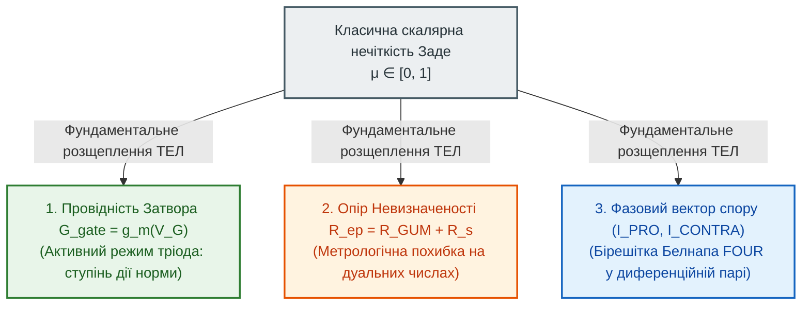

# Глава 04. Небулева математика ТЕЛ: від нечітких множин до дуальних бірешіток провідності

> [!NOTE]
> **Чотири фундаментальні положення авторського внеску Миколи Федчика**
> 1. Доведено фундаментальну неповноту скалярної нечіткої логіки Заде ($\mu \in [0, 1]$) у системах критичної безпеки та виконано ортогональне розщеплення нечіткості на три фізичні координати кола: провідність затвора $`G(V_G)`$, опір невизначеності $`R_{\mathrm{ep}}`$ та фазовий баланс диференційної пари $\Delta V$.
> 2. Встановлено точний фізико-математичний ізоморфізм між каскадуванням опорів у ТЕЛ та параметризованою трикутною нормою Хамахера $`T_{\mathrm{ep}}(\tilde{\sigma}_1, \tilde{\sigma}_2)`$.
> 3. Реалізовано чотиризначну бірешітку Ньюта Белнапа ($`\mathcal{FOUR} = \{\mathbf{T}, \mathbf{F}, \mathbf{N}, \mathbf{B}\}`$) через синфазний та диференційний струми пари ес-тріодів.
> 4. Побудовано алгебру Епістемічного Тензора Стану $`\Psi = \langle \mathcal{C}, V_{\mathrm{ep}} + u_c\varepsilon, \nu_{\mathrm{eff}} \rangle`$ над кільцем дуальних чисел Кліффорда та квантованою логікою Лукасевича з порогом відсічки.

---

## 1. Критика класичної нечіткої логіки Заде з позицій ТЕЛ

У 1965 році Лотфі Заде запропонував теорію нечітких множин (Fuzzy Logic), замінивши бінарну характеристичну функцію $`\{0, 1\}`$ неперервною функцією належності $`\mu_A(x) \in [0, 1]`$ з операціями:

$$\mu_{A \land B} = \min(\mu_A, \mu_B), \qquad \mu_{A \lor B} = \max(\mu_A, \mu_B), \qquad \mu_{\neg A} = 1 - \mu_A$$

З погляду **Теорії епістемічних ланцюгів (ТЕЛ)** класична нечітка логіка має три фатальні дефекти, які унеможливлюють її пряме застосування в доказових експертних системах:

### 1.1. Дефект 1: Колапс трьох різних фізичних станів у одне скалярне число
Скалярна величина $\mu = 0.5$ у Заде нерозрізненно склеює три ортогональні явища:
1. **Онтологічну проміжність властивості:** «Двигун прогрітий наполовину» (100% достовірний вимір проміжного фізичного стану).
2. **Метрологічну похибку вимірювання:** «Прилад показує тиск, але має похибку $\pm 50\%$».
3. **Повну відсутність знань або колізію законів:** «Невідомо, чи норма чинна» або «Дві норми прямо суперечать одна одній».

### 1.2. Дефект 2: Порушення закону несуперечності
При $`\mu_A = 0.5`$ у системі Заде виконується:

$$\mu_{A \land \neg A} = \min(0.5, 1 - 0.5) = 0.5 \neq 0$$

Тобто пряме логічне протиріччя не блокує схему, а продовжує генерувати ненульовий вихідний сигнал.

### 1.3. Дефект 3: Ідемпотентна сліпота до довжини каскаду
Оскільки $\min(0.8, 0.8, \dots, 0.8) = 0.8$, ланцюг із 100 послідовних нечітких правил у Заде не накопичує затухання! Це суперечить **Другому закону Федчика** (падіння достовірності вздовж замкненої петлі на опорах невизначеності).

---

## 2. Ортогональне розщеплення нечіткості в ТЕЛ

ТЕЛ усуває виродженість скаляра $\mu \in [0, 1]$, розкладаючи його на **три фізично незалежні параметри епістемічного кола**:

- **Булева логіка $`\{0, 1\}`$** — це окремий граничний випадок ТЕЛ, коли ес-тріод працює виключно у **ключовому режимі** (між повною відсічкою $`V_G < V_{th}`$ та жорстким насиченням $`V_G \ge V_{\mathrm{sat}}`$).
- **Нечітка логіка** — це робота ес-тріода на **активній (лінійній) ділянці вольт-амперної характеристики**, де провідність каналу плавно модулюється крутизною $`g_m`$.

---

## 3. Чотири стовпи небулевого математичного апарату ТЕЛ

### 3.1. Т-норма Хамахера як фізичний закон послідовного каскадування провідностей
Замість ідемпотентного оператора $`\min(\mu_1, \mu_2)`$ послідовне з'єднання двох каскадів у ТЕЛ підпорядковується закону додавання опорів $`R_{\mathrm{total}} = R_1 + R_2`$. 

Якщо виразити нормовану провідність каскаду як $`\tilde{\sigma}_i = \frac{1}{1 + R_i} \in (0, 1]`$, то результуюча провідність послідовного з'єднання точно збігається з **раціональною Т-нормою Хамахера (Hamacher Product)**:

$$\tilde{\sigma}_{1 \odot 2} = T_{\mathrm{ep}}(\tilde{\sigma}_1, \tilde{\sigma}_2) = \frac{\tilde{\sigma}_1 \cdot \tilde{\sigma}_2}{\tilde{\sigma}_1 + \tilde{\sigma}_2 - \tilde{\sigma}_1 \tilde{\sigma}_2}$$

* **Фізичні властивості оператора $`T_{\mathrm{ep}}`$:**
  1. **Надпровідність ($`R_1 = R_2 = 0 \iff \tilde{\sigma}_1 = \tilde{\sigma}_2 = 1`$):** $`T_{\mathrm{ep}}(1, 1) = 1`$ (відсутність втрат).
  2. **Апаратна відсічка ($`R = \infty \iff \tilde{\sigma} = 0`$):** $`T_{\mathrm{ep}}(\tilde{\sigma}_1, 0) = 0`$ (`FAIL-CLOSED`).
  3. **Дисипація на каскадах:** при $`\tilde{\sigma}_1 = \tilde{\sigma}_2 = 0.8`$ маємо $`T_{\mathrm{ep}}(0.8, 0.8) = 0.667 < 0.8`$. Кожен проміжний каскад із ненульовим опором закономірно знижує вихідний потенціал достовірності.

---

### 3.2. Чотиризначна бірешітка Белнапа у диференційній парі
У 1977 році Ньют Белнап побудував чотиризначну логіку для комп'ютерних мереж із неповними та суперечливими даними: $`\mathcal{FOUR} = \{\mathbf{T}, \mathbf{F}, \mathbf{N}, \mathbf{B}\}`$.

У ТЕЛ бірешітка Белнапа отримує точну схемотехнічну реалізацію через струми плечей диференційного каскаду ес-тріодів $`(I_{\mathrm{PRO}}, I_{\mathrm{CONTRA}})`$ та сумарний синфазний струм $`I_{\Sigma} = I_{\mathrm{PRO}} + I_{\mathrm{CONTRA}}`$:

| Стан Белнапа | Струми плечей $`(I_{\mathrm{PRO}}, I_{\mathrm{CONTRA}})`$ | Синфазний струм $`I_{\Sigma}`$ | Апаратний вердикт ТЕЛ |
| :---: | :---: | :---: | :--- |
| **$\mathbf{T}$ (True)** | $`I_{\mathrm{PRO}} > I_{th}, \quad I_{\mathrm{CONTRA}} = 0`$ | $`I_{\Sigma} > 0`$ | `ACCEPT` (Доведено «ЗА») |
| **$\mathbf{F}$ (False)** | $`I_{\mathrm{PRO}} = 0, \quad I_{\mathrm{CONTRA}} > I_{th}`$ | $`I_{\Sigma} > 0`$ | `REJECT` (Доведено «ПРОТИ») |
| **$\mathbf{N}$ (Neither)** | $`I_{\mathrm{PRO}} = 0, \quad I_{\mathrm{CONTRA}} = 0`$ | $`I_{\Sigma} \equiv 0`$ (Обрив) | `REFUSAL` (Вакуум знань / Кастодія відсутня) |
| **$\mathbf{B}$ (Both)** | $`I_{\mathrm{PRO}} \approx I_{\mathrm{CONTRA}} > I_{th}`$ | $`I_{\Sigma} \gg 0, \ \Delta V \approx 0`$ | `QUALIFIED_NONANSWER` (`PARITY` / Колізія норм) |

Завдяки синфазному струму $`I_{\Sigma}`$ схема миттєво відрізняє **відсутність даних ($`\mathbf{N}, I_{\Sigma}=0`$)** від **гострого конфлікту законів ($`\mathbf{B}, I_{\Sigma} \gg 0, \Delta V = 0`$)**, чого не здатна зробити жодна скалярна нечітка система.

---

### 3.3. Епістемічний тензор стану над кільцем дуальних чисел Кліффорда
Замість дійсного числа $\mu \in [0, 1]$ кожен сигнал у колі ТЕЛ описується **Епістемічним Тензором Стану** над кільцем гіперкомплексних дуальних чисел $`\mathbb{D} = \{a + b\varepsilon \mid \varepsilon^2 = 0\}`$:

$$\Psi = \left\langle \mathcal{C}, \quad V_{\mathrm{ep}} + u_c(V)\varepsilon, \quad \nu_{\mathrm{eff}} \right\rangle$$

де:
- $`\mathcal{C} \in \mathbb{B}^*`$ — вектор побайтової кастодії першоджерела;
- $`V_{\mathrm{ep}} \in [0, 1]`$ — основний потенціал достовірності;
- $`u_c(V)\varepsilon`$ — дуальна компонента стандартної невизначеності за ISO GUM;
- $`\nu_{\mathrm{eff}} \in \mathbb{R}^+`$ — ефективне число ступенів свободи Велча–Саттерзвейта.

При проходженні сигналу $\Psi$ через нелінійну передавальну характеристику тріода $f(V)$ за правилом алгебри Кліффорда автоматично обчислюється точне перенесення похибки за один такт:

$$f(V_{\mathrm{ep}} + u_c\varepsilon) = f(V_{\mathrm{ep}}) + \frac{\partial f}{\partial V_{\mathrm{ep}}} u_c \varepsilon$$

---

### 3.4. Порогово-квантована деонтична алгебра Лукасевича
Для опису роботи Затвора ес-тріода під дією сукупності пом'якшувальних чи обтяжувальних умов ТЕЛ використовує багатозначну алгебру Яна Лукасевича з фізичним зміщенням на напругу відсічки $`V_{th}`$:

$$I_D = g_m \cdot \max\left(0, \ \min\left(1, \ \sum_{m=1}^{M} w_m V_{G, m} - V_{th}\right)\right) \cdot V_S$$

Ця формула об'єднує кусково-лінійну вольт-амперну характеристику напівпровідникового польового транзистора із суворою аксіоматикою багатозначної логіки Лукасевича.
