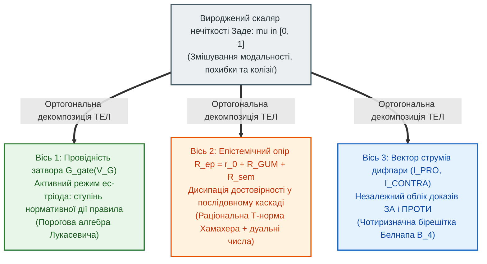

# Глава 04. Небулева математика ТЕЛ: від нечітких множин до дуальних бірешіток провідності

> **Книга:** [Теорія епістемічних кіл: Схемотехніка доказових обчислень та апаратного виведення](README.md) · Частина I: Основи теорії епістемічних кіл  
> **Попередня глава:** [Глава 03. Три закони Федчика та топологічний розрахунок кіл](ch03-fedchyk-conservation-laws.md)  
> **Наступна глава:** [Глава 05. Пасивні, реактивні та унікальні компоненти ТЕЛ](ch05-passive-reactive-and-unique-epistemic-components.md)  
> **Зміст книги:** [README.md](README.md)  
> **Автор:** [Микола Федчик](../ExpertSystem/about-the-author.md)  
> **Рівень складності та оптимальне вивчення:** `[L3]` Формально-математичний та алгебраїчний (індекс Д. Кнута `[34]`) · *Маршрут:* Базове математичне ядро монографії; 2 проходи з розбором розрахункового прикладу  
> **Очікувані результати:** доводити непридатність скалярної нечіткої логіки Заде для систем критичної безпеки; застосовувати раціональну трикутну норму Хамахера для розрахунку послідовних каскадів опорів; реалізовувати чотиризначну бірешітку Белнапа через синфазний та диференційний струми; виконувати розрахунки у порогово-квантованій деонтичній алгебрі Лукасевича.

## Анотація

Четверта глава присвячена розбудові небулевого математичного апарату Теорії епістемічних ланцюгів. Досліджується фундаментальна наукова проблема: яким чином ввести в схемотехніку неперервні градації достовірності, метрологічної точності та нормативної сили, не потрапивши при цьому в пастки класичної скалярної нечіткої логіки Лотфі Заде [[1]](#src-1). Суворо доведено три конструктивні дефекти операторів мінімуму та максимуму Заде в критичних системах: склеювання різнорідних фізичних станів в одне скалярне число, порушення закону непротиріччя та ідемпотентну сліпоту до затухання сигналу в довгих каскадах міркувань.

Для розв'язання цієї проблеми автором запропоновано метод **ортогонального розщеплення нечіткості** на три незалежні фізичні координати епістемічного кола та побудовано чотири стовпи небулевої алгебри ТЕЛ: (1) точний ізоморфізм між каскадуванням опорів невизначеності та раціональною трикутною нормою Хорста Хамахера [[2]](#src-2), [[3]](#src-3); (2) фізичну реалізацію чотиризначної параконсистентної бірешітки Нюела Белнапа [[4]](#src-4) та Мелвіна Фіттінга [[5]](#src-5) через струми плечей диференційної пари; (3) розширення тензора стану на кільце дуальних чисел Кліффорда [[7]](#src-7) з урахуванням ступенів свободи Велча–Саттерзвейта [[8]](#src-8), [[9]](#src-9); (4) порогово-квантовану деонтичну алгебру Яна Лукасевича [[6]](#src-6) для опису вольт-амперної характеристики затвора. Роботу апарату продемонстровано на навчальному прикладі розрахунку трикаскадного тракту з колізією свідчень. Главу завершують висновки, словник, абревіатури та бібліографія.

---

## 1. Вступ та постановка проблеми: три фатальні дефекти скалярної нечіткості Заде

Спроби вийти за тісні рамки двозначної булевої дихотомії $`\{0, 1\}`$ робилися в математичній логіці з початку XX століття — передусім у працях Яна Лукасевича з тризначної та нескінченнозначної логіки [[6]](#src-6). У 1965 році Лотфі Заде опублікував знамениту статтю *«Нечіткі множини»* (*Fuzzy Sets* [[1]](#src-1)), у якій запропонував характеризувати ступінь належності елемента $x$ до розмитого поняття $A$ дійсним числом $`\mu_A(x) \in [0, 1]`$ із базовими операціями Геделя–Заде (формула (4.1)):

$$
\mu_{A \land B}(x) = \min\left(\mu_A(x), \ \mu_B(x)\right), \qquad \mu_{A \lor B}(x) = \max\left(\mu_A(x), \ \mu_B(x)\right), \qquad \mu_{\neg A}(x) = 1 - \mu_A(x)
$$

**Формула (4.1).** Класичні операції кон'юнкції, диз'юнкції та доповнення в скалярній нечіткій логіці Заде [[1]](#src-1).

Тут:
- $`\mu_A(x), \mu_B(x) \in [0, 1]`$ — скалярні значення функцій належності для предикатів $A$ та $B$.

Нечіткі регулятори Заде блискуче зарекомендували себе у побутовій автоматиці та плавному керуванні електроприводами. Проте спроби покласти формулу (4.1) в основу доказових експертних систем критичної безпеки незмінно призводили до небезпечних помилок. З позицій Теорії епістемічних ланцюгів скалярна нечіткість Заде страждає на три фундаментальні структурні вади.

### 1.1. Дефект 1: колапс трьох ортогональних фізичних станів у одне скалярне число

Коли у класичній нечіткій системі змінній приписується значення $`\mu = 0{,}50`$, система повністю втрачає здатність відповісти на запитання, **яке саме фізичне чи епістемічне явище стоїть за цим числом**:
1. *Онтологічна проміжність самої властивості:* клапан фізично відкритий рівно на 50 % свого ходу, і цей факт виміряно лазерним енкодером із абсолютною точністю та прямою кастодією.
2. *Метрологічна сліпота або шум:* невідомо, чи клапан відкритий, чи закритий, оскільки датчик втратив живлення (повний вакуум знань).
3. *Гостра правова або технічна колізія:* один сертифікований датчик показує повне відкриття ($`1{,}0`$), а другий такий самий датчик — повне закриття ($`0{,}0`$), або ж дві чинні норми прямо суперечать одна одній.

Склеювання достовірного напіввідкритого стану, повної відсутності даних та аварійного конфлікту датчиків в один скаляр $`0{,}50`$ є грубим порушенням інженерної безпеки.

### 1.2. Дефект 2: руйнування закону непротиріччя та просочування хиби

Підставимо значення $`\mu_A = 0{,}50`$ у формулу кон'юнкції твердження та його прямого заперечення за правилом (4.1):

$$
\mu_{A \land \neg A} = \min(0{,}50, \ 1 - 0{,}50) = \min(0{,}50, \ 0{,}50) = 0{,}50 > 0
$$

Замість того щоб заблокувати логічно суперечливу кон'юнкцію $`A \land \neg A`$, вентиль Заде пропускає на вихід половину максимальної амплітуди сигналу! У багатокаскадній схемі такий паразитний струм суперечності здатний хибно відкрити виконавчий механізм.

### 1.3. Дефект 3: ідемпотентна сліпота до довжини каскаду та порушення другого закону Федчика

Оператор мінімуму є ідемпотентним: $`\min(a, a, \dots, a) = a`$. Це означає, що ланцюг із двох нечітких правил зі ступенем достовірності $`0{,}80`$ і ланцюг зі ста послідовних непрямих правил із тим самим ступенем $`0{,}80`$ матимуть на виході ідентичну оцінку:

$$
\min_{k=1}^{100} (0{,}80) = 0{,}80
$$

Така модель ігнорує неминуче накопичення невизначеності на кожному посереднику і прямо суперечить Другому закону збереження Федчика ([Глава 03](ch03-fedchyk-conservation-laws.md)), за яким послідовне з'єднання опорів обов'язково збільшує спад потенціалу достовірності.

> [!NOTE]
> **Чотири фундаментальні положення авторського внеску Миколи Федчика у Главі 04**
> 1. **Принцип ортогонального розщеплення нечіткості:** доведено необхідність заміни скалярної функції належності Заде трьома незалежними координатами кола — активною провідністю затвора тріода, метрологічним опором на дуальних числах та двовимірним фазовим вектором струмів диференційної пари.
> 2. **Теорема про ізоморфізм послідовного опору та трикутної норми Хамахера:** математично виведено, що класичний закон додавання послідовних опорів у просторі нормованих провідностей тотожно породжує раціональну Т-норму Хамахера без ідемпотентної сліпоти.
> 3. **Схемотехнічна реалізація бірешітки Белнапа:** показано, що чотири стани логіки Белнапа однозначно кодуються парою диференційного та синфазного струмів двох плечей епістемічного каскаду.
> 4. **Порогово-квантована деонтична алгебра Лукасевича для затвора:** встановлено аналітичний зв'язок між багатозначною імплікацією Лукасевича та вольт-амперною характеристикою польового епістемічного транзистора з напругою відсічки.
> *Керування рантаймом / Інженерний інваріант:* Схема ТЕЛ апаратно розрізняє нульовий синфазний струм (вакуум знань — відмова за відсутністю кастодії) та високий синфазний струм при нульовій різниці плечей (колізія норм — блокування з видачею звіту про паритет).

---

## 2. Ортогональне розщеплення нечіткості в Теорії епістемічних ланцюгів

Щоб усунути виродженість скаляра Заде, у ТЕЛ вводиться фундаментальне геометричне й фізичне розкладання нечіткості на три взаємно ортогональні осі (рисунок 4.1).

**Рисунок 4.1.** Схема ортогонального розщеплення скалярної нечіткості на три фізично незалежні координати епістемічного кола.

Як видно з рисунка 4.1, класична булева алгебра та нечітка логіка виявляються лише частковими проекціями загальної теорії кіл:
- коли всі опори $`R_{\mathrm{ep}} \in \{0, \infty\}`$, а затвори тріодів працюють виключно в ключовому режимі насичення або відсічки, схема ТЕЛ редукується до **булевої логіки з контролем кастодії**;
- коли ж тріоди працюють на лінійній ділянці вольт-амперної характеристики, а опори набувають скінченних додатних значень, виникає **повноцінна небулева схемотехніка ТЕЛ**, чотири математичні стовпи якої викладено у наступному розділі.

---

## 3. Чотири стовпи небулевого математичного апарату ТЕЛ

### 3.1. Теорема про ізоморфізм каскадування опорів і трикутної норми Хамахера

Розглянемо послідовне з'єднання двох ділянок епістемічного кола з безрозмірними нормованими опорами невизначеності $`R_1 \ge 0`$ та $`R_2 \ge 0`$ (віднесеними до еталонного опору $`R_{\mathrm{ref}} = 1\text{ e}\Omega`$). Введемо нормовану провідність ділянки $`\tilde{\sigma}_i \in (0, 1]`$, яка дорівнює одиниці в режимі надпровідності ($`R_i = 0`$) і прямує до нуля при розриві кола ($`R_i \to \infty`$) за взаємно однозначним перетворенням:

$$
\tilde{\sigma}_i = \frac{1}{1 + R_i} \iff R_i = \frac{1 - \tilde{\sigma}_i}{\tilde{\sigma}_i}
$$

**Твердження 4.1 (Ізоморфізм послідовного додавання опорів та Т-норми Хамахера).** Якщо при послідовному з'єднанні двох каскадів їхні епістемічні опори додаються за класичним законом електротехніки $`R_{12} = R_1 + R_2`$, то результуюча нормована провідність каскаду $`\tilde{\sigma}_{1 \odot 2}`$ точно виражається раціональною трикутною нормою Хорста Хамахера [[2]](#src-2), [[3]](#src-3) з параметром $\gamma = 0$ (формула (4.2)):

$$
\tilde{\sigma}_{1 \odot 2} = T_{\mathrm{ep}}(\tilde{\sigma}_1, \tilde{\sigma}_2) = \frac{1}{1 + R_1 + R_2} = \frac{\tilde{\sigma}_1 \cdot \tilde{\sigma}_2}{\tilde{\sigma}_1 + \tilde{\sigma}_2 - \tilde{\sigma}_1 \cdot \tilde{\sigma}_2}
$$

**Формула (4.2).** Епістемічна трикутна норма провідності послідовного каскаду (раціональний добуток Хамахера).

Тут:
- $`\tilde{\sigma}_1, \tilde{\sigma}_2 \in [0, 1]`$ — нормовані провідності першого та другого послідовно з'єднаних каскадів;
- $`T_{\mathrm{ep}}(\tilde{\sigma}_1, \tilde{\sigma}_2) \in [0, 1]`$ — результуюча наскрізна провідність двокаскадного ланцюга.

*Доведення.* Підставимо вирази $`R_1 = (1 - \tilde{\sigma}_1)/\tilde{\sigma}_1`$ та $`R_2 = (1 - \tilde{\sigma}_2)/\tilde{\sigma}_2`$ у формулу $`\tilde{\sigma}_{1 \odot 2} = 1 / (1 + R_1 + R_2)`$:

$$
\tilde{\sigma}_{1 \odot 2} = \frac{1}{1 + \frac{1 - \tilde{\sigma}_1}{\tilde{\sigma}_1} + \frac{1 - \tilde{\sigma}_2}{\tilde{\sigma}_2}} = \frac{\tilde{\sigma}_1 \tilde{\sigma}_2}{\tilde{\sigma}_1 \tilde{\sigma}_2 + (1 - \tilde{\sigma}_1)\tilde{\sigma}_2 + (1 - \tilde{\sigma}_2)\tilde{\sigma}_1} = \frac{\tilde{\sigma}_1 \tilde{\sigma}_2}{\tilde{\sigma}_1 + \tilde{\sigma}_2 - \tilde{\sigma}_1 \tilde{\sigma}_2}
$$

Для довільної кількості $N$ послідовних каскадів з опорами $`R_1, \dots, R_N`$ індуктивне застосування формули (4.2) дає замкнений інженерний вираз (формула (4.3)):

$$
\tilde{\sigma}_{1 \odot \dots \odot N} = \frac{1}{1 + \sum_{k=1}^{N} \frac{1 - \tilde{\sigma}_k}{\tilde{\sigma}_k}}
$$

**Формула (4.3).** Закон загасання нормованої провідності в послідовному каскаді з $N$ елементів.

Тут:
- $`N \in \mathbb{N}^+`$ — кількість послідовно з'єднаних ланок міркування.

Формула (4.3) повністю усуває ідемпотентний дефект Заде: якщо кожен каскад має неідеальну провідність $`\tilde{\sigma}_k = 0{,}80`$ (тобто опір $`R_k = 0{,}25\text{ e}\Omega`$), то для двох каскадів провідність падає до $`1 / (1 + 0{,}50) = 0{,}667`$, а для ста каскадів — до $`1 / (1 + 25) \approx 0{,}0385`$, строго виконуючи Другий закон Федчика!

### 3.2. Чотиризначна бірешітка Белнапа у струмах диференційної пари

У 1977 році Нюел Белнап у праці *«Корисна чотиризначна логіка»* [[4]](#src-4) показав, що комп'ютерна система, яка отримує відомості з кількох незалежних джерел, повинна оперувати чотирма станами: **$`\mathbf{T}`$** (*True* — є лише свідчення «за»), **$`\mathbf{F}`$** (*False* — є лише свідчення «проти»), **$`\mathbf{N}`$** (*None* — немає жодних свідчень) та **$`\mathbf{B}`$** (*Both* — одночасно надійшли вагомі свідчення «за» і «проти»). Пізніше Мелвін Фіттінг узагальнив цю структуру до теорії бірешіток [[5]](#src-5), де кожен елемент впорядковується за двома ортогональними відношеннями: порядком істинності $`\le_t`$ (від $`\mathbf{F}`$ до $`\mathbf{T}`$) та порядком інформативності чи обізнаності $`\le_k`$ (від вакууму $`\mathbf{N}`$ до колізії $`\mathbf{B}`$).

В епістемічній схемотехніці бірешітка Белнапа–Фіттінга реалізується фізично через струми двох плечей диференційного каскаду ес-тріодів: струм підтвердження $`I_{\mathrm{PRO}} \ge 0`$ та струм спростування $`I_{\mathrm{CONTRA}} \ge 0`$ (формула (4.4)):

$$
\Delta I_{\mathrm{diff}} = I_{\mathrm{PRO}} - I_{\mathrm{CONTRA}}, \qquad I_{\Sigma} = I_{\mathrm{PRO}} + I_{\mathrm{CONTRA}}
$$

**Формула (4.4).** Визначення диференційного струму істинності та синфазного струму інформативності в бірешітці ТЕЛ.

Тут:
- $`\Delta I_{\mathrm{diff}} \in [-I_{\max}, +I_{\max}]\text{ eA}`$ — різницевий (диференційний) струм, що визначає координату вздовж осі істинності $`\le_t`$;
- $`I_{\Sigma} \in [0, 2I_{\max}]\text{ eA}`$ — сумарний (синфазний) струм обох плечей, що визначає координату вздовж осі інформаційної наповненості $`\le_k`$.

Таблиця 4.1 встановлює взаємно однозначну відповідність між алгеброю Белнапа та режимами роботи диференційного каскаду ТЕЛ (при пороговому струмі чутливості $`I_{\mathrm{th}} > 0`$).

**Таблиця 4.1.** Схемотехнічне кодування чотиризначної бірешітки Белнапа через диференційний та синфазний струми каскаду.

| Стан бірешітки Белнапа | Струми плечей $`(I_{\mathrm{PRO}}, \ I_{\mathrm{CONTRA}})`$ | Диференційний струм $`\Delta I_{\mathrm{diff}}`$ | Синфазний струм $`I_{\Sigma}`$ | Апаратний вердикт шлюзу ТЕЛ |
| :---: | :---: | :---: | :---: | :--- |
| **$`\mathbf{T}`$ (Істина)** | $`I_{\mathrm{PRO}} \ge I_{\mathrm{th}}, \quad I_{\mathrm{CONTRA}} < I_{\mathrm{th}}`$ | $`\Delta I_{\mathrm{diff}} \ge I_{\mathrm{th}} > 0`$ | $`I_{\Sigma} \ge I_{\mathrm{th}}`$ | **`ACCEPT`** (Підтверджено доказами «ЗА») |
| **$`\mathbf{F}`$ (Хиба)** | $`I_{\mathrm{PRO}} < I_{\mathrm{th}}, \quad I_{\mathrm{CONTRA}} \ge I_{\mathrm{th}}`$ | $`\Delta I_{\mathrm{diff}} \le -I_{\mathrm{th}} < 0`$ | $`I_{\Sigma} \ge I_{\mathrm{th}}`$ | **`REJECT`** (Спростовано доказами «ПРОТИ») |
| **$`\mathbf{N}`$ (Вакуум)** | $`I_{\mathrm{PRO}} < I_{\mathrm{th}}, \quad I_{\mathrm{CONTRA}} < I_{\mathrm{th}}`$ | $`\Delta I_{\mathrm{diff}} \approx 0`$ | $`I_{\Sigma} \approx 0`$ | **`REFUSAL (NO_EVIDENCE)`** (Обрив кастодії) |
| **$`\mathbf{B}`$ (Колізія)** | $`I_{\mathrm{PRO}} \ge I_{\mathrm{th}}, \quad I_{\mathrm{CONTRA}} \ge I_{\mathrm{th}}`$ | $`\lvert \Delta I_{\mathrm{diff}} \rvert < \Delta I_{\mathrm{pref}}`$ | $`I_{\Sigma} \ge 2 I_{\mathrm{th}}`$ | **`QUALIFIED_NONANSWER (PARITY)`** (Колізія норм) |

Погляньмо на рядки $`\mathbf{N}`$ та $`\mathbf{B}`$ таблиці 4.1: в обох випадках різницевий вихідний сигнал наближається до нуля ($`\Delta I_{\mathrm{diff}} \approx 0`$). Скалярна система Заде сліпо ототожнює їх. Проте в ТЕЛ **амперметр у спільному колі витоку вимірює синфазний струм $`I_{\Sigma}`$**: при $`I_{\Sigma} \approx 0`$ система фіксує інформаційний вакуум ($`\mathbf{N}`$), а при $`I_{\Sigma} \ge 2I_{\mathrm{th}}`$ — зіткнення двох потужних зустрічних доказів ($`\mathbf{B}`$) і передає колізію на вищий рівень юрисдикції.

### 3.3. Метрологічне розширення тензора стану та формула Велча–Саттерзвейта

Для точного обчислення розширеної невизначеності $`U_{95\%} = k_{95\%}(\nu_{\mathrm{eff}}) \cdot u_c(y)`$ за стандартом JCGM GUM [[8]](#src-8) при скінченній кількості спостережень дуальна компонента потенціалу Кліффорда [[7]](#src-7) доповнюється ефективним числом ступенів свободи $`\nu_{\mathrm{eff}}`$, яке розраховується у вузлах злиття за апроксимацією Бернарда Велча та Франкліна Саттерзвейта [[9]](#src-9) (формула (4.5)):

$$
\nu_{\mathrm{eff}} = \frac{u_c^4(y)}{\sum_{j=1}^{K} \frac{\left(\frac{\partial f}{\partial x_j} u(x_j)\right)^4}{\nu_j}}
$$

**Формула (4.5).** Співвідношення Велча–Саттерзвейта для ефективного числа ступенів свободи у багатоканальному вузлі ТЕЛ.

Тут:
- $`\nu_j \in \mathbb{N}^+`$ — число ступенів свободи $j$-го вимірювального каналу (для оцінок типу А за $`n_j`$ незалежними вимірами $`\nu_j = n_j - 1`$; для інформаційних оцінок типу В із відомими межами $`\nu_j \to \infty`$);
- $`u_c(y)`$ — комбінована стандартна невизначеність на виході вузла.

### 3.4. Порогово-квантована деонтична алгебра Лукасевича для керуючого затвора

Коли на керуючий затвор епістемічного тріода діє сукупність із $M$ нормативних умов та підсікаючих обставин із вагами $`w_m`$, передавальна характеристика затвора описується узагальненою кон'юнкцією Яна Лукасевича [[6]](#src-6) з фізичним порогом відсічки $`V_{\mathrm{th}}`$ та напругою насичення $`V_{\mathrm{sat}}`$ (формула (4.6)):

$$
\sigma_{\mathrm{gate}}\left(V_{G, 1}, \dots, V_{G, M}\right) = \max\left(0, \ \min\left(1, \ \frac{\sum_{m=1}^{M} w_m V_{G, m} - V_{\mathrm{th}}}{V_{\mathrm{sat}} - V_{\mathrm{th}}}\right)\right)
$$

**Формула (4.6).** Кусково-лінійна функція провідності затвора епістемічного тріода в пороговій алгебрі Лукасевича.

Тут:
- $`\sigma_{\mathrm{gate}} \in [0, 1]`$ — безрозмірний коефіцієнт відкриття нормативного затвора;
- $`V_{G, m} \in [0, 1]\text{ eV}`$ — потенціали окремих деонтичних умов на багатозатворному вході (для дозволяючих норм $`w_m > 0`$, для підсікаючих дефітерів $`w_m < 0`$);
- $`V_{\mathrm{th}} < V_{\mathrm{sat}}`$ — порогова напруга відкриття каналу та напруга повного ключового насичення тріода, $`\mathrm{eV}`$.

---

## 4. Навчальний інженерний приклад: розрахунок небулевого каскаду з колізією свідчень

Розглянемо практичну задачу атестації партії титанових кріплень для авіаційного крила за допомогою апарату небулевої математики ТЕЛ.

### 4.1. Вихідні дані

1. **Послідовний тракт підтвердження («ЗА», плече PRO):** складається з двох послідовних каскадів — ультразвукового контролю (опір $`R_1 = 0{,}25\text{ e}\Omega`$) та рентгенографічного аналізу (опір $`R_2 = 0{,}25\text{ e}\Omega`$). Початковий струм бездоганної кастодії при одиничній провідності становить $`I_0 = 1{,}00\text{ eA}`$.
2. **Керуючий затвор плеча PRO:** має базовий дозвіл стандарту $`V_{G, 1} = 0{,}90\text{ eV}`$ ($`w_1 = +1{,}0`$) та часткове зауваження щодо вологості цеху $`V_{G, 2} = 0{,}20\text{ eV}`$ ($`w_2 = -1{,}0`$). Параметри тріода: $`V_{\mathrm{th}} = 0{,}30\text{ eV}`$, $`V_{\mathrm{sat}} = 0{,}80\text{ eV}`$.
3. **Зустрічне плече заперечення («ПРОТИ», плече CONTRA):** зовнішній інспектор подав скаргу про можливе порушення режиму термообробки, яка створила в плечі `CONTRA` зустрічний струм $`I_{\mathrm{CONTRA}} = 0{,}50\text{ eA}`$. Поріг чутливості диференційного каскаду $`I_{\mathrm{th}} = 0{,}20\text{ eA}`$, мінімальний поріг переваги одного плеча над іншим для одноосібного рішення $`\Delta I_{\mathrm{pref}} = 0{,}15\text{ eA}`$.

### 4.2. Покроковий розрахунок

**Крок 1. Розрахунок пасивної провідності двокаскадного тракту PRO за Т-нормою Хамахера:**
Нормовані провідності окремих каскадів становлять:

$$
\tilde{\sigma}_1 = \tilde{\sigma}_2 = \frac{1}{1 + 0{,}25} = 0{,}80
$$

За формулою (4.2) наскрізна провідність послідовного з'єднання дорівнює:

$$
\tilde{\sigma}_{1 \odot 2} = T_{\mathrm{ep}}(0{,}80, \ 0{,}80) = \frac{0{,}80 \cdot 0{,}80}{0{,}80 + 0{,}80 - 0{,}64} = \frac{0{,}64}{0{,}96} \approx 0{,}6667
$$

*(Зауважимо: класична формула Заде (4.1) помилково дала б $`\min(0{,}80, 0{,}80) = 0{,}80`$, проігнорувавши опір другого каскаду).*

**Крок 2. Розрахунок відкриття затвора за пороговою алгеброю Лукасевича:**
Підставляємо потенціали затвора у формулу (4.6):

$$
\sigma_{\mathrm{gate}} = \max\left(0, \ \min\left(1, \ \frac{0{,}90 - 0{,}20 - 0{,}30}{0{,}80 - 0{,}30}\right)\right) = \frac{0{,}40}{0{,}50} = 0{,}80
$$

Тоді результуючий струм плеча підтвердження становить:

$$
I_{\mathrm{PRO}} = I_0 \cdot \tilde{\sigma}_{1 \odot 2} \cdot \sigma_{\mathrm{gate}} = 1{,}00 \cdot 0{,}6667 \cdot 0{,}80 \approx 0{,}5333\text{ eA}
$$

**Крок 3. Аналіз стану в бірешітці Белнапа:**
За формулою (4.4) знаходимо диференційний та синфазний струми пари:

$$
\Delta I_{\mathrm{diff}} = I_{\mathrm{PRO}} - I_{\mathrm{CONTRA}} = 0{,}5333 - 0{,}5000 = +0{,}0333\text{ eA}, \qquad I_{\Sigma} = 0{,}5333 + 0{,}5000 = 1{,}0333\text{ eA}
$$

Звіряємо результат за таблицею 4.1: обидва струми перевищують поріг $`I_{\mathrm{th}} = 0{,}20\text{ eA}`$, синфазний струм високий ($`I_{\Sigma} = 1{,}0333\text{ eA}`$), але модуль різницевого струму менший за необхідний запас переваги ($`\lvert \Delta I_{\mathrm{diff}} \rvert = 0{,}0333\text{ eA} < \Delta I_{\mathrm{pref}} = 0{,}15\text{ eA}`$). Отже, система перебуває у стані **$`\mathbf{B}`$ (Колізія)** і виносить безпечний вердикт **`QUALIFIED_NONANSWER (PARITY)`**, призначаючи додаткову руйнівну вибіркову експертизу партії.

---

## Висновки

1. **Непридатність скалярної нечіткості для критичних систем:** зведення істинності до одного дійсного числа $`\mu \in [0, 1]`$ у класичній теорії Заде призводить до змішування проміжного фізичного стану, інформаційного вакууму та колізії норм, а також порушує закон непротиріччя.
2. **Ортогональна тривимірна декомпозиція:** ТЕЛ розкладає нечіткість на провідність нормативного затвора (алгебра Лукасевича), дисипативний опір каскаду (Т-норма Хамахера та дуальні числа Кліффорда) і двокомпонентний струм диференційної пари (бірешітка Белнапа).
3. **Фізичне обґрунтування Т-норми Хамахера:** послідовне додавання опорів невизначеності $`R_{12} = R_1 + R_2`$ в просторі нормованих провідностей точно породжує раціональну трикутну норму Хамахера, забезпечуючи суворе затухання недостовірних ланцюгів.
4. **Апаратна діагностика суперечностей:** одночасний вимір диференційного та синфазного струмів дозволяє схемі миттєво відрізнити відсутність доказів ($`\mathbf{N}`$) від зіткнення протилежних аргументів ($`\mathbf{B}`$).

---

## Словник

| Термін | Англійський еквівалент | Визначення |
| :--- | :--- | :--- |
| **Трикутна норма (Т-норма)** | *Triangular Norm (t-norm)* | Бінарна комутативна, асоціативна й монотонна операція на відрізку $`[0, 1]`$ з нейтральним елементом $1$, що узагальнює логічну кон'юнкцію. |
| **Т-норма Хамахера** | *Hamacher t-norm* | Раціональна трикутна норма вигляду $`ab / (a + b - ab)`$, яка в ТЕЛ ізоморфно описує провідність двох послідовно з'єднаних опорів. |
| **Бірешітка Белнапа** | *Belnap Four-Valued Bilattice* | Чотиризначна алгебраїчна структура $`\{\mathbf{T}, \mathbf{F}, \mathbf{N}, \mathbf{B}\}`$ з двома частковими порядками: за ступенем істинності та за обсягом інформації. |
| **Диференційний струм** | *Differential Current* | Різниця струмів плеча підтвердження та плеча спростування $`\Delta I_{\mathrm{diff}} = I_{\mathrm{PRO}} - I_{\mathrm{CONTRA}}`$, що визначає знак і силу переваги аргументу. |
| **Синфазний струм** | *Common-Mode Current* | Сума струмів обох плечей диференційної пари $`I_{\Sigma} = I_{\mathrm{PRO}} + I_{\mathrm{CONTRA}}`$, що вимірює сумарну насиченість вузла доказами. |
| **Алгебра Лукасевича** | *Łukasiewicz Many-Valued Logic* | Багатозначна логічна система з лінійно усіченими операціями, яка в ТЕЛ описує модуляцію провідності затвора тріода над порогом відсічки. |
| **Формула Велча–Саттерзвейта** | *Welch–Satterthwaite Equation* | Метрологічне співвідношення для розрахунку ефективного числа ступенів свободи комбінованої дисперсії кількох вимірювальних каналів. |

---

## Абревіатури

| Абревіатура | Розшифрування | Опис |
| :--- | :--- | :--- |
| **ВАХ** | Вольт-амперна характеристика (*Current–Voltage Characteristic*) | Залежність вихідного струму стоку епістемічного приладу від напруги на його електродах. |
| **CONTRA** | Аргументаційне плече заперечення (*Contra Branch*) | Інвертуюче плече диференційного каскаду, на яке подаються спростовуючі докази. |
| **FOUR** | Чотиризначний простір істинності Белнапа (*Four-Valued Logic Space*) | Позначення носія бірешітки станів $`\{\mathbf{T}, \mathbf{F}, \mathbf{N}, \mathbf{B}\}`$. |
| **PRO** | Аргументаційне плече підтвердження (*Pro Branch*) | Пряме плече диференційного каскаду, на яке подаються підтримуючі докази. |

---

## Джерела

1. Lotfi A. Zadeh. [*Fuzzy Sets*](https://doi.org/10.1016/S0019-9958(65)90241-X). *Information and Control*, 8(3), 338–353, 1965.
2. Horst Hamacher. [*Über logische Aggregationen nicht-binär explizierter Entscheidungskriterien*](https://openlibrary.org/books/OL4253752M). Frankfurt am Main: Rita G. Fischer Verlag, 1978.
3. Erich Peter Klement, Radko Mesiar, Endre Pap. [*Triangular Norms*](https://doi.org/10.1007/978-94-015-9540-7). Dordrecht: Kluwer Academic Publishers (Springer), 2000.
4. Nuel D. Belnap. [*A Useful Four-Valued Logic*](https://doi.org/10.1007/978-94-010-1161-7_2). У кн.: J. M. Dunn, G. Epstein (ред.), *Modern Uses of Multiple-Valued Logic*, Dordrecht: D. Reidel Publishing, 5–37, 1977.
5. Melvin Fitting. [*Bilattices and the Semantics of Logic Programming*](https://doi.org/10.1016/0743-1066(91)90038-Q). *The Journal of Logic Programming*, 11(1–2), 91–116, 1991.
6. Jan Łukasiewicz, Alfred Tarski. [*Untersuchungen über den Aussagenkalkül*](https://philpapers.org/rec/UKAUID). *Comptes Rendus des Séances de la Société des Sciences et des Lettres de Varsovie*, Classe III, 23, 30–50, 1930.
7. William Kingdon Clifford. [*Preliminary Sketch of Biquaternions*](https://doi.org/10.1112/plms/s1-4.1.381). *Proceedings of the London Mathematical Society*, s1-4(1), 381–395, 1873.
8. JCGM. [*Evaluation of Measurement Data — Guide to the Expression of Uncertainty in Measurement (GUM)*](https://doi.org/10.59161/JCGM100-2008E). JCGM 100:2008, BIPM / ISO / IEC, 2008 (Annex G: Degrees of freedom and levels of confidence).
9. Franklin E. Satterthwaite. [*An Approximate Distribution of Estimates of Variance Components*](https://doi.org/10.2307/3002019). *Biometrics Bulletin*, 2(6), 110–114, 1946.

---

[← Глава 03. Три закони Федчика та топологічний розрахунок кіл](ch03-fedchyk-conservation-laws.md) | [Зміст книги](README.md) | [Глава 05. Пасивні, реактивні та унікальні компоненти ТЕЛ →](ch05-passive-reactive-and-unique-epistemic-components.md)
