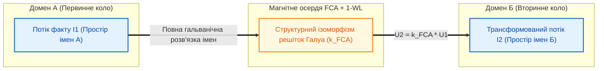

# Глава 05. Пасивні, реактивні та унікальні компоненти ТЕЛ: Імпеданс, Трансформатори доменів та Розмірнісні призми

> [!NOTE]
> **Три фундаментальні положення авторського внеску Миколи Федчика**
> 1. Введено поняття комплексного епістемічного імпедансу $`Z_{\mathrm{ep}} = R_{\mathrm{ep}} + j X_{\mathrm{ep}}`$, що об'єднує активний метрологічний опір із реактивними елементами динаміки знань у часі.
> 2. Формалізовано моделі епістемічного конденсатора (прецедентний інтегратор свідчень), епістемічної індуктивності (нормативна інерція канону *Stare Decisis*), міждоменного трансформатора з гальванічною розв'язкою та стабілітрона STANAG 2022.
> 3. Створено клас унікальних приладів ТЕЛ, що не мають фізичних аналогів у класичній електроніці: Розмірнісна призма SI ($`\vec{d} \in \mathbb{Z}^7`$), Криптографічний надпровідний замок кастодії та Попперівський мультивібратор-фальсифікатор.

---

## 1. Динаміка знань у часі та комплексний епістемічний імпеданс

Епістемічний резистор $`R_{\mathrm{ep}}`$ описує миттєве статичне розсіювання визначеності в ланцюгу. Проте реальні бази знань, судові системи та інженерні системи безпеки функціонують у часі: вони накопичують емпіричний досвід та опираються хаотичним коливанням інтерпретацій.

Для опису часової динаміки в ТЕЛ вводиться **комплексний епістемічний імпеданс**:

$$
Z_{\mathrm{ep}}(\omega) = R_{\mathrm{ep}} + j X_{\mathrm{ep}}(\omega) = R_{\mathrm{ep}} + j \left( \omega L_{\mathrm{ep}} - \frac{1}{\omega C_{\mathrm{ep}}} \right)
$$

де $\omega$ — частота зміни вхідних свідчень або перегляду нормативних трактувань.

---

## 2. Реактивні та захисні компоненти (Фізико-кібернетичні аналоги)

| Компонент ТЕЛ | Символ | Рівняння динаміки | Фізико-кібернетична функція |
| :--- | :---: | :--- | :--- |
| **1. Епістемічний конденсатор** | $`C_{\mathrm{ep}}`$ | $`U(t) = \frac{1}{C_{\mathrm{ep}}} \int_0^t I(\tau)\,d\tau`$ | Інтегратор прецедентів і спостережень (Бета-накопичення) |
| **2. Епістемічна індуктивність** | $`L_{\mathrm{ep}}`$ | $`U_L = -L_{\mathrm{ep}} \frac{dI}{dt}`$ | Нормативна інерція канону (*Stare Decisis*), захист від стрибків |
| **3. Епістемічний трансформатор** | $`Tr_{\mathrm{ep}}`$ | $`U_2 = k_{\mathrm{FCA}} \cdot U_1`$ | Міждоменний перенос знань із гальванічною розв'язкою імен |
| **4. Епістемічний стабілітрон** | $`D_{\mathrm{Zener}}`$ | $`U_{\max} \le V_{\mathrm{STANAG}}`$ | Обмеження стелі довіри до непрямих джерел (STANAG 2022) |
| **5. Епістемічний запобіжник** | $`F_{\mathrm{ep}}`$ | $`I_{\mathrm{fault}} > I_{\mathrm{crit}} \implies R = \infty`$ | Незворотне відключення пакета при порушенні SHA-256 підпису |

### 2.1. Епістемічний конденсатор — прецедентна пам'ять

Поодиноке непряме спостереження (короткий імпульс струму $I(t)$) не може миттєво змінити стан системи. Конденсатор інтегрує послідовність незалежних підтверджень у часі (відповідно до оновлення параметрів Бета-розподілу $`\alpha \leftarrow \alpha + w_i`$), плавно піднімаючи потенціал вузла до порогу відкриття затвора $`V_{\mathrm{th}}`$.
- Одночасно конденсатор шунтує високочастотний шум (одиничні випадкові збої датчиків або інформаційні вкиди) на землю.

### 2.2. Епістемічна індуктивність — інерція канону (*Stare Decisis*)

У праві та стандартах безпеки діє принцип правової визначеності та консерватизму канону. Індуктивність чинить опір різким змінам струму ($`\frac{dI}{dt} \gg 0`$):

$$
U_L = -L_{\mathrm{ep}} \frac{dI}{dt}
$$

Якщо нове трактування намагається миттєво перевернути усталену практику, на індуктивності виникає зустрічна епістемічна ЕРС самоіндукції, яка блокує імпульсну зміну доти, доки новий доказ не прикладе достатню постійну напругу протягом тривалого часу.

### 2.3. Епістемічний трансформатор — міждоменний міст з гальванічною розв'язкою

Пряме електричне з'єднання двох різних предметних областей (наприклад, *Гідравліки* та *Електродинаміки*, або *RFC 3986* та *RFC 9110*) призводить до логічного короткого замикання — помилки почетверіння термінів (*Quaternio Terminorum*), коли омонімічні терміни мають різний зміст.

Епістемічний трансформатор передає енергію доказу без прямого змішування словників через «магнітне осердя» структурного ізоморфізму решіток Галуа (FCA + 1-WL). Локальні колізії першого домену гальванічно ізольовані від другого домену.

### 2.4. Епістемічний стабілітрон (діод Зенера) та запобіжник

- **Стабілітрон ($`D_{\mathrm{Zener}}`$):** встановлює жорсткий поріг насичення потенціалу для вторинних джерел згідно зі шкалою розвідувальної достовірності STANAG 2022. Наприклад, свідчення класу `B2` стабілізується на рівні $`V_Z = 0.75\,\text{eV}`$ і ніколи не може досягти потенціалу первинного стандарту $`1.0\,\text{eV}`$.
- **Запобіжник ($`F_{\mathrm{ep}}`$):** при виявленні невідповідності контрольної суми контейнера знань миттєво розплавляє вхідний контакт, переводячи базу знань у карантин.

---

## 3. Унікальні компоненти ТЕЛ, що не мають аналогів у фізичній електроніці

Оскільки носій сигналу в ТЕЛ — це не безликий електрон, а структурований **Епістемічний Тензор Стану $\Psi$**, у схемотехніці істини виникають три прилади, неможливі в класичній фізиці:

### 3.1. Розмірнісна призма SI

У звичайній електроніці всі напруги мають однакову фізичну розмірність Вольта. В експертній системі сигнали несуть параметри різних фізичних величин (тиск у Паскалях, час у секундах, температуру в Кельвінах).

Розмірнісна призма контролює 7-вимірний вектор показників степенів системи SI:

$$
\vec{d} = [L, M, T, I, \Theta, N, J]^T \in \mathbb{Z}^7
$$

- При спробі подати на входи суматора або компаратора сигнали з різними розмірностями ($`\vec{d}_1 \neq \vec{d}_2`$), призма заломлює потік у лінію апаратного переривання `DimensionalityFault` з опором $R = \infty$.

### 3.2. Криптографічний надпровідний замок кастодії

Дискретний елемент верифікації, опір якого визначається криптографічною тотожністю байтового зрізу в спільній пам'яті хоста:

$$
R_{\mathrm{lock}}(\mathcal{C}) = \begin{cases}
0 \ (\text{Надпровідність}), & \text{якщо } \mathrm{SHA256}(\mathrm{mmap}[i_{\mathrm{start}} \dots i_{\mathrm{end}}]) \equiv h_{\mathrm{expected}} \\
\infty \ (\text{Ідеальний діелектрик}), & \text{інакше}
\end{cases}
$$

Жоден інший прилад у природі не змінює свій опір від $0$ до $\infty$ при зміні одного символу в тексті закону.

### 3.3. Попперівський Мультивібратор-Фальсифікатор (Popperian Stress Oscillator)

Активний автогенератор, який генерує в коло синтетичні імпульси-контрприклади, інвертовані пресупозиції та граничні збурення параметрів. Використовується для автоматичного випробування схеми на зворотний пробій діодів та стійкість каскадів до фальсифікації за Карлом Поппером.
