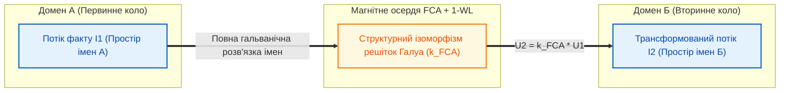

# Глава 05. Пасивні, реактивні та унікальні компоненти епістемічних кіл: імпеданс, трансформатори доменів та розмірнісні призми

> **Книга:** [Теорія епістемічних кіл: Схемотехніка доказових обчислень та апаратного виведення](README.md)
> **Попередня глава:** [← Глава 04. Небулева математика епістемічних кіл: алгебра Белнапа, нечіткі норми та інтервальна метрологія](ch04-non-boolean-fuzzy-and-belnap-circuit-math.md)
> **Наступна глава:** [Глава 06. Епістемічний тріод та тритермінальне деонтичне комутування →](ch06-epistemic-triode-and-transistor.md)
> **Зміст книги:** [Повернутися до змісту](README.md)
> **Автор:** Микола Федчик
> **Рівень складності:** `[L3 — Дослідницький рівень]` *(За класифікацією Д. Кнута: строга теорія комплексного епістемічного імпедансу, гальванічної розв'язки онтологій через решітки Галуа та фізично унікальних приладів багатовимірного тензора стану)*
> **Очікувані результати:** Читач опанує математику комплексного епістемічного імпедансу в частотній області, зрозуміє фізику реактивного інтегрування прецедентів на епістемічному конденсаторі та нормативної інерції канону на епістемічній індуктивності, вивчить принцип гальванічної розв'язки просторів імен через епістемічний трансформатор та засвоїть будову трьох унікальних компонентів, які не мають аналогів у фізичній електроніці (розмірнісної призми, криптографічного надпровідного замка кастодії та попперівського мультивібратора-фальсифікатора), закріпивши теорію на інженерному розрахунку RC-інтегратора прецедентів.

---

## Анотація

У п'ятій главі елементна база теорії епістемічних кіл розширюється від статичних резистивних ланцюгів до повного спектра реактивних, захисних та фізично унікальних приладів. Ми показуємо, що реальні бази знань, судові системи та промислові тракти безпеки функціонують у змінному часі, де свідчення надходять імпульсно, а нормативні канони опираються хаотичним коливанням інтерпретацій. За аналогією з символічним методом Олівера Гевісайда [[1]](#src-1) та комплексною теорією кіл Чарльза Протеуса Штейнметца [[2]](#src-2), вводиться фундаментальне поняття комплексного епістемічного імпедансу $`Z_{\mathrm{ep}}(\omega) = R_{\mathrm{ep}} + j X_{\mathrm{ep}}(\omega)`$. У першій частині глави формалізуються п'ять фізико-кібернетичних реактивних і захисних компонентів: епістемічний конденсатор (прецедентний інтегратор спостережень за Бета-розподілом), епістемічна індуктивність (нормативна інерція канону *Stare Decisis*), епістемічний трансформатор (міждоменний міст на базі аналізу формальних понять Рудольфа Вілле та Бернхарда Гантера [[3]](#src-3) і тесту Вейсфейлера — Лемана [[4]](#src-4), що запобігає логічному короткому замиканню *Quaternio Terminorum*), епістемічний стабілітрон (обмежувач потенціалу непрямих свідчень за шкалою STANAG 2022 [[5]](#src-5)) та епістемічний запобіжник. У другій частині вводяться три унікальні прилади, існування яких неможливе у класичній електроніці, але необхідне для транспортування багатовимірного епістемічного тензора стану: розмірнісна призма одиниць SI [[6]](#src-6), криптографічний надпровідний замок кастодії [[7]](#src-7) та попперівський мультивібратор-фальсифікатор [[8]](#src-8). Наприкінці глави наведено покроковий інженерний розрахунок RC-інтегратора прецедентів та криптографічного захисту при верифікації промислового обладнання.

---

> [!NOTE]
> **Чотири фундаментальні положення авторського внеску Миколи Федчика у Главі 05**
> 1. **Комплексний епістемічний імпеданс у частотній області:** введено операторний опір $`Z_{\mathrm{ep}}(\omega) = R_{\mathrm{ep}} + j(\omega L_{\mathrm{ep}} - 1/(\omega C_{\mathrm{ep}}))`$, який у межах ізоморфізму зв'язкових графів об'єднує статичний метрологічний опір ланки з динамічним опором накопичення прецедентів та нормативної інерції у часі.
> 2. **Дискретно-часові моделі реактивних елементів знань:** формалізовано моделі епістемічного конденсатора як байєсівського Бета-інтегратора незалежних спостережень та епістемічної індуктивності як диференційного стабілізатора канону (*Stare Decisis*) при спробах стрибкоподібної ревізії правил.
> 3. **Міждоменний трансформатор з офлайн-компільованим осердям та розмірнісним блокуванням:** розроблено модель чотириполюсника, який переносить доказовий потенціал між ізоморфними підрешітками Галуа без змішування просторів імен і в парі з розмірнісною призмою SI блокує хибні структурні аналогії.
> 4. **Тріада спеціалізованих компонентів багатовимірного тензора стану:** формалізовано три елементи верифікації, специфічні для обробки кортежу $`\Psi`$ — розмірнісну призму системи SI, криптографічний надпровідний замок кастодії рантайму та попперівський мультивібратор-фальсифікатор.
> *Керування рантаймом / Інженерний інваріант:* Будь-яка спроба подати на вхід адитивного чи порівняльного вузла тензори з неколінеарними векторами розмірностей $`\vec{d}_1 \neq \vec{d}_2`$ або порушеним хешем байтового зрізу в рантаймі переводить відповідну призму чи замок у стан нескінченного опору $`R \to \infty`$, блокуючи обчислення.

---

## 1. Проблема часової динаміки знань та комплексний епістемічний імпеданс

Активний епістемічний резистор $`R_{\mathrm{ep}}`$, досліджений у попередніх главах, описує миттєве статичне розсіювання визначеності в елементарній ланці за сталого режиму. Проте реальні бази знань, судово-експертні системи та інженерні тракти безпеки функціонують у нестаціонарному часовому середовищі:
1. Поодиноке непряме спостереження (короткий імпульс струму свідчень $`I(t)`$) не повинно миттєво перемикати критичні виконавчі механізми, оскільки воно може бути випадковим викидом або шумом давача. Системі необхідний **інерційний накопичувач прецедентів**.
2. Фундаментальні закони, технічні регламенти та судові доктрини мають володіти **нормативною консервативністю** (принцип *Stare Decisis*): вони повинні опиратися високочастотним коливанням трактувань і кон'юнктурним спробам миттєвого перегляду правил.

Подібно до того, як Олівер Гевісайд [[1]](#src-1) у 1880-х роках узагальнив закон Ома на диференціальні оператори змінного струму, а Чарльз Протеус Штейнметц [[2]](#src-2) у 1893 році запровадив метод комплексних амплітуд, у теорії епістемічних кіл вводиться поняття комплексного епістемічного імпедансу.

**Означення 5.1 (Комплексний епістемічний імпеданс).** Комплексним епістемічним імпедансом $`Z_{\mathrm{ep}}(\omega)`$ називається відношення комплексної амплітуди епістемічної напруги до комплексної амплітуди струму свідчень на частоті оновлення доказів $`\omega`$, яке складається з активного метрологічного опору $`R_{\mathrm{ep}}`$ та реактивного епістемічного опору (реактансу) $`X_{\mathrm{ep}}(\omega)`$.

**Формула (5.1).** Комплексний епістемічний імпеданс у частотній області:

$$
Z_{\mathrm{ep}}(\omega) = R_{\mathrm{ep}} + j X_{\mathrm{ep}}(\omega) = R_{\mathrm{ep}} + j \left( \omega L_{\mathrm{ep}} - \frac{1}{\omega C_{\mathrm{ep}}} \right)
$$

Тут:
- $`Z_{\mathrm{ep}}(\omega)`$ — повний комплексний епістемічний імпеданс ланки ($`\text{e}\Omega`$);
- $`R_{\mathrm{ep}} \ge 0`$ — активний метрологічний та інференційний опір, що відповідає за незворотне розсіювання визначеності в землю ($`\text{e}\Omega`$);
- $`X_{\mathrm{ep}}(\omega)`$ — сумарний реактивний епістемічний опір ($`\text{e}\Omega`$);
- $`\omega \ge 0`$ — кутова частота надходження нових свідчень або спроб перегляду нормативних правил (рад/с або рад/такт);
- $`L_{\mathrm{ep}} \ge 0`$ — епістемічна індуктивність нормативного канону;
- $`C_{\mathrm{ep}} > 0`$ — епістемічна ємність прецедентного накопичувача;
- $`j = \sqrt{-1}`$ — уявна одиниця, що позначає фазовий зсув між потоком сирих спостережень та усталеним потенціалом нормативного визнання.

---

## 2. Реактивні та захисні компоненти: фізико-кібернетичні аналоги

П'ять базових реактивних і захисних компонентів епістемічної схемотехніки та їхні визначальні рівняння систематизовано у Таблиці 5.1.

**Таблиця 5.1.** Реактивні та захисні компоненти теорії епістемічних кіл

| Компонент епістемічного кола | Позначення | Визначальне рівняння динаміки | Фізико-кібернетична функція у процесорі знань |
| :--- | :---: | :--- | :--- |
| **1. Епістемічний конденсатор** | $`C_{\mathrm{ep}}`$ | $`U_C(t) = \frac{1}{C_{\mathrm{ep}}} \int_0^t I(\tau)\,d\tau`$ | Прецедентний інтегратор спостережень (Бета-накопичення) та фільтр високочастотного шуму |
| **2. Епістемічна індуктивність** | $`L_{\mathrm{ep}}`$ | $`U_L(t) = -L_{\mathrm{ep}} \frac{dI(t)}{dt}`$ | Нормативна інерція канону (*Stare Decisis*), придушення імпульсних ревізій правил |
| **3. Епістемічний трансформатор** | $`Tr_{\mathrm{ep}}`$ | $`U_2 = k_{\mathrm{FCA}} \cdot U_1`$, $`\mathcal{N}_1 \cap \mathcal{N}_2 = \varnothing`$ | Міждоменне перенесення доказів із повною гальванічною розв'язкою просторів імен |
| **4. Епістемічний стабілітрон** | $`D_{\mathrm{Zener}}`$ | $`U_{\mathrm{out}} = \min(U_{\mathrm{in}}, V_{\mathrm{STANAG}})`$ | Жорстке обмеження стелі потенціалу для непрямих і вторинних джерел за STANAG 2022 |
| **5. Епістемічний запобіжник** | $`F_{\mathrm{ep}}`$ | $`I_{\mathrm{fault}} > I_{\mathrm{crit}} \implies R_F = \infty`$ | Незворотне розмикання та карантин пакета знань при порушенні криптографічного підпису |

### 2.1. Епістемічний конденсатор як прецедентна пам'ять

У завданнях технічної діагностики та емпіричної розвідки поодиноке непряме спостереження не володіє достатньою енергією для миттєвого відкриття деонтичного затвора. Епістемічний конденсатор ємністю $`C_{\mathrm{ep}}`$ інтегрує послідовність незалежних підтверджень у часі відповідно до байєсівського оновлення параметрів апостеріорного Бета-розподілу $`\mathrm{Beta}(\alpha, \beta)`$.

**Формула (5.2).** Динаміка заряду епістемічного конденсатора в послідовному RC-колі прецедентів:

$$
U_C(t) = U_{\max} \cdot \left( 1 - \exp\left( -\frac{t}{\tau_{\mathrm{ep}}} \right) \right), \qquad \tau_{\mathrm{ep}} = R_{\mathrm{ep}} \cdot C_{\mathrm{ep}}
$$

Тут:
- $`U_C(t)`$ — накопичений потенціал емпіричної достовірності на обкладках конденсатора у момент часу $`t`$ (еВ);
- $`U_{\max}`$ — граничний потенціал джерела спостережень (еВ);
- $`\tau_{\mathrm{ep}} = R_{\mathrm{ep}} C_{\mathrm{ep}}`$ — епістемічна стала часу інтегрування, що визначає тривалість накопичення прецедентів до досягнення порогу спрацювання $`V_{\mathrm{th}}`$.

Одночасно в паралельному ввімкненні конденсатор шунтує високочастотні завади ($`\omega \to \infty \implies \lvert X_C \rvert = 1/(\omega C_{\mathrm{ep}}) \to 0`$) на спільну шину землі, захищаючи логічне ядро від поодиноких спорадичних збоїв датчиків або інформаційних вкидів.

### 2.2. Епістемічна індуктивність та нормативна інерція канону

У юриспруденції та інженерії функціональної безпеки діє фундаментальний принцип правової визначеності та консерватизму канону (*Stare Decisis* — «стояти на вирішеному»). Епістемічна котушка індуктивності $`L_{\mathrm{ep}}`$, увімкнена послідовно в шину нормативних правил, пропускає сталі перевірені норми без падіння напруги ($`\omega = 0 \implies X_L = 0`$), але чинить величезний опір різким змінам струму інтерпретацій ($`dI/dt \gg 0`$).

**Формула (5.3).** Епістемічна рушійна сила самоіндукції нормативного канону:

$$
\mathcal{E}_L(t) = -L_{\mathrm{ep}} \cdot \frac{dI(t)}{dt}
$$

Тут:
- $`\mathcal{E}_L(t)`$ — зустрічна епістемічна рушійна сила самоіндукції, спрямована проти миттєвої ревізії чинної норми (еВ);
- $`L_{\mathrm{ep}}`$ — коефіцієнт нормативної індуктивності, пропорційний ієрархічному рангу документа (конституційний закон або міжнародний стандарт безпеки має $`L_{\mathrm{ep}} \gg 1`$, тоді як локальна інструкція має малу індуктивність);
- $`dI(t)/dt`$ — швидкість зміни доказового потоку.

Якщо нова інтерпретація намагається стрибкоподібно скасувати усталену практику, на котушці виникає зустрічний імпульс самоіндукції $`\mathcal{E}_L`$, який блокує перемикання каскаду доти, доки новий доказ не прикладе стабільну підтверджену напругу протягом нормативно визначеного часу ревізії.

### 2.3. Епістемічний трансформатор та гальванічна розв'язка просторів імен

Пряме «гальванічне» з'єднання двох різних предметних областей (наприклад, перенесення теорем *гідродинаміки* в *електродинаміку*, або пряме склеювання термінів мережевих стандартів *RFC 3986* та *RFC 9110*) неминуче призводить до **логічного короткого замикання** — класичної логічної хиби почетверіння термінів (*Quaternio Terminorum*), коли омонімічні імена сутностей у різних словниках мають відмінний денотат або різну фізичну природу.

Для безпечного міждоменного перенесення знань використовується **епістемічний трансформатор** $`Tr_{\mathrm{ep}}`$, будову якого зображено на Рисунку 5.1.

**Рисунок 5.1.** Схема епістемічного трансформатора з гальванічною розв'язкою просторів імен через решітку Галуа

**Означення 5.2 (Епістемічний трансформатор).** Епістемічним трансформатором $`Tr_{\mathrm{ep}}`$ називається чотириполюсник з двома гальванічно ізольованими обмотками предметних словників $`\mathcal{N}_1 \cap \mathcal{N}_2 = \varnothing`$, пов'язаними через спільне алгебраїчне осердя формального концептуального аналізу (Formal Concept Analysis, FCA) за Вілле — Гантером [[3]](#src-3) та структурного хешування графів Вейсфейлера — Лемана (1-WL) [[4]](#src-4).

**Формула (5.4).** Рівняння трансформації міждоменного потенціалу:

$$
U_2 = k_{\mathrm{FCA}} \cdot U_1, \qquad k_{\mathrm{FCA}} = \frac{\lvert \mathfrak{B}(\mathbb{K}_1) \cong_{1\text{-WL}} \mathfrak{B}(\mathbb{K}_2) \rvert}{\max\left(\lvert \mathfrak{B}(\mathbb{K}_1) \rvert, \lvert \mathfrak{B}(\mathbb{K}_2) \rvert\right)} \in [0, 1]
$$

Тут:
- $`U_1, U_2`$ — епістемічні напруги у первинному (донорському) та вторинному (акцепторному) доменах (еВ);
- $`k_{\mathrm{FCA}} \in [0, 1]`$ — коефіцієнт структурного зв'язку (взаємної індуктивності) решіток формальних понять Галуа $`\mathfrak{B}(\mathbb{K}_1)`$ та $`\mathfrak{B}(\mathbb{K}_2)`$, обчислений через частку ізоморфних за тестом 1-WL вузлів.

Завдяки повній гальванічній розв'язці жодна локальна лексична омонімія першого домену не може проникнути у другий домен: через «магнітне осердя» решітки Галуа передається виключно структурна топологія відношень. *Обчислювальне та семантичне обмеження:* оскільки задача побудови повної решітки Галуа має у найгіршому випадку експоненційну складність (#P-повнота), матриця коефіцієнтів $`k_{\mathrm{FCA}}`$ обчислюється виключно на етапі офлайн-компіляції міждоменного мосту для обмежених локальних підрешіток, а для унеможливлення випадкових ізоморфізмів між фізично несумісними поняттями вторинна обмотка трансформатора обов'язково каскадується з розмірнісною призмою SI (детально в [Главі 09](ch09-scientific-critique-and-applicability-limits.md)).

### 2.4. Епістемічний стабілітрон та криптографічний запобіжник

1. **Епістемічний стабілітрон (діод Зенера $`D_{\mathrm{Zener}}`$):** У розвідувальних та аудиторських системах непрямі свідчення класифікуються за матрицею надійності джерела та достовірності інформації STANAG 2022 [[5]](#src-5) (від `A1` до `F6`). Стабілітрон Зенера, увімкнений паралельно вузлу непрямого джерела, жорстко фіксує верхню стелю потенціалу пробою $`V_Z = V_{\mathrm{STANAG}}`$. Наприклад, для повідомлення класу `B2` («зазвичай надійне джерело, ймовірно правдивий факт») напруга стабілізується на рівні $`V_Z = 0.75\,\text{еВ}`$: навіть якщо таке джерело надішле тисячу повідомлень, потенціал вузла ніколи не перевищить $`0.75\,\text{еВ}`$ і не досягне рівня первинного стандарту $`1.00\,\text{еВ}`$.
2. **Епістемічний запобіжник ($`F_{\mathrm{ep}}`$):** Встановлюється на вході монтування кожного бінарного контейнера знань. Якщо під час фонової верифікації виявляється розбіжність дерева хешів Меркла або спроба несанкціонованої модифікації сторінки пам'яті, струм помилки $`I_{\mathrm{fault}} > I_{\mathrm{crit}}`$ миттєво «перепалює» плавкий елемент ($`R_F \to \infty`$), незворотно від'єднуючи скомпрометований контейнер від шини виконання.

---

## 3. Унікальні компоненти теорії епістемічних кіл, що не мають аналогів у фізичній електроніці

У класичній радіоелектроніці носієм сигналу в усіх провідниках є безликий електрон, позбавлений внутрішньої семантичної пам'яті. Натомість у теорії епістемічних кіл у провідниках циркулює структурований **Епістемічний Тензор Стану** $`\Psi = \langle \mathcal{C}, V_{\mathrm{ep}} + u\varepsilon, \vec{d} \rangle`$. Саме ця багатовимірна природа носія породжує три фундаментальні прилади, які неможливо побудувати в звичайній фізичній електроніці.

### 3.1. Розмірнісна призма одиниць Міжнародної системи

У звичайній електричній схемі всі напруги мають однакову фізичну розмірність Вольта, тому будь-які два проводи можна під'єднати до суматора. В інженерній експертній системі сигнали репрезентують різнорідні фізичні величини: тиск у Паскалях (Па), силу в Ньютонах (Н), температуру в Кельвінах (К) або час у секундах (с). Додавання або порівняння тиску з температурою є грубою фізичною помилкою.

**Означення 5.3 (Розмірнісна призма).** Розмірнісною призмою $`\mathcal{P}_{\mathrm{SI}}`$ називається вхідний селективний елемент операційного вузла, який перевіряє колінеарність семивимірних цілочисельних векторів показників степенів основних одиниць Міжнародної системи SI (BIPM SI Brochure [[6]](#src-6)) вхідних тензорів.

**Формула (5.5).** Умова провідності розмірнісної призми у семивимірній решітці SI:

$$
\vec{d} = [d_L, d_M, d_T, d_I, d_\Theta, d_N, d_J]^T \in \mathbb{Z}^7, \qquad R_{\mathrm{prism}}(\vec{d}_1, \vec{d}_2) = \begin{cases} 0, & \text{якщо } \vec{d}_1 \equiv \vec{d}_2 \\ \infty \ (\text{DimensionalityFault}), & \text{якщо } \vec{d}_1 \neq \vec{d}_2 \end{cases}
$$

Тут:
- $`d_L, d_M, d_T, d_I, d_\Theta, d_N, d_J \in \mathbb{Z}`$ — цілі показники степенів семи основних розмірностей SI: довжини ($`\mathsf{L}`$, метр), маси ($`\mathsf{M}`$, кілограм), часу ($`\mathsf{T}`$, секунда), сили електричного струму ($`\mathsf{I}`$, ампер), термодинамічної температури ($`\mathsf{\Theta}`$, кельвін), кількості речовини ($`\mathsf{N}`$, моль) та сили світла ($`\mathsf{J}`$, кандела);
- $`R_{\mathrm{prism}}(\vec{d}_1, \vec{d}_2)`$ — опір призми для адитивних та порівняльних операцій ($`\text{e}\Omega`$).

При спробі подати на входи суматора або компаратора величини з різними розмірностями (наприклад, силу $`\vec{d}_F = [1, 1, -2, 0, 0, 0, 0]^T`$ та тиск $`\vec{d}_P = [-1, 1, -2, 0, 0, 0, 0]^T`$), розмірнісна призма миттєво заломлює потік у лінію апаратного переривання `DimensionalityFault` з опором $`R_{\mathrm{prism}} = \infty`$.

### 3.2. Криптографічний надпровідний замок кастодії

**Твердження 5.1 (Дискретний фазовий перехід криптографічного замка кастодії).** *Криптографічний замок кастодії $`\mathcal{L}_{\mathrm{SHA}}`$ реалізує безгістерезисний квантовий фазовий перехід між станом ідеальної надпровідності ($`R_{\mathrm{lock}} = 0`$) та станом абсолютного діелектрика ($`R_{\mathrm{lock}} = \infty`$) залежно від побітової тотожності криптографічного дайджесту SHA-256 (NIST FIPS 180-4 [[7]](#src-7)) байтового діапазону першоджерела в пам'яті.*

**Формула (5.6).** Функція опору криптографічного надпровідного замка кастодії:

$$
R_{\mathrm{lock}}(\mathcal{C}) = \begin{cases}
0 \ (\text{Епістемічна надпровідність}), & \text{якщо } \mathrm{SHA256}\left(\mathrm{Mem}[b_{\mathrm{start}} \dots b_{\mathrm{end}}]\right) \equiv h_{\mathrm{expected}} \\
\infty \ (\text{Абсолютний ізолятор}), & \text{якщо } \mathrm{SHA256}\left(\mathrm{Mem}[b_{\mathrm{start}} \dots b_{\mathrm{end}}]\right) \neq h_{\mathrm{expected}}
\end{cases}
$$

Тут:
- $`\mathrm{Mem}[b_{\mathrm{start}} \dots b_{\mathrm{end}}]`$ — незмінний байтовий зріз документа першоджерела у спільній пам'яті між зміщеннями $`b_{\mathrm{start}}`$ та $`b_{\mathrm{end}}`$;
- $`h_{\mathrm{expected}} \in \{0, 1\}^{256}`$ — еталонний 256-бітний криптографічний хеш доказового фрагмента;
- $`R_{\mathrm{lock}}(\mathcal{C})`$ — внутрішній опір замка кастодії ($`\text{e}\Omega`$).

Жоден фізичний напівпровідник у природі не змінює свій опір від нуля до нескінченності при зміні одного біта (наприклад, заміни коми на крапку або цифри `3` на `8`) у тексті закону на відстані мільйонів байтів. Завдяки лавинному ефекту функції SHA-256 будь-яке спотворення цитати у спільній пам'яті змінює щонайменше половину бітів дайджесту і миттєво розриває надпровідне коло. При цьому слід строго розрізняти інваріант цілісності рантайму ($`\mathrm{ZHR}_{\mathrm{runtime}} = 1.0`$), який гарантується замком $`\mathcal{L}_{\mathrm{SHA}}`$, та семантичну вірність первинної компіляції тексту в схему ($`\mathcal{F}_{\mathrm{compile}}`$), межі якої досліджено у [Главі 09](ch09-scientific-critique-and-applicability-limits.md).

### 3.3. Попперівський мультивібратор-фальсифікатор

Згідно з критерієм фальсифікованості наукових теорій Карла Поппера [[8]](#src-8), жодна інженерна схема виведення не може вважатися надійною, доки вона не витримала цілеспрямованих спроб спростування. **Попперівський мультивібратор-фальсифікатор** — це активний тестовий автогенератор релаксаційних імпульсів, під'єднаний до діагностичної шини епістемічного кола. У режимі апаратного стрес-тестування (Hardware-in-the-Loop) мультивібратор періодично інжектує у вхідні вузли:
- синтетичні запити з хибними пресупозиціями (перевірка зворотного опору діодів $`R_{\mathrm{rev}} = \infty`$ на коефіцієнт відсікання софізмів $`\mathrm{SRR} = 1.0`$);
- граничні метрологічні збурення на межі довірчих інтервалів $`\pm U_{95\%}`$ (перевірка спрацювання захисної смуги компараторів);
- мутовані байтові зрізи з пошкодженим одним бітом (перевірка миттєвого розмикання замків кастодії $`\mathcal{L}_{\mathrm{SHA}}`$).

---

## 4. Навчальний інженерний приклад: розрахунок ємнісного інтегратора прецедентів, стабілітрона достовірності та розмірнісної призми

Розглянемо практичну задачу проєктування вхідного епістемічного тракту моніторингу віброакустичної деградації підшипника турбонасосного агрегату.

### 4.1. Вихідні інженерні дані

1. **Джерело спостережень та стабілітрон STANAG 2022:** Дані надходять від автоматизованого акустичного класифікатора класу надійності `B2` за шкалою STANAG 2022 [[5]](#src-5). Паралельно входу встановлено епістемічний стабілітрон $`D_{\mathrm{Zener}}`$ з напругою стабілізації $`V_Z = U_{\max} = 0.75\,\text{еВ}`$.
2. **Параметри RC-інтегратора прецедентів:** Щоб уникнути хибної зупинки турбонасоса від поодинокого акустичного удару, вхідне коло містить активний резистор лінії $`R_{\mathrm{ep}} = 2.0\,\text{е}\Omega`$ та епістемічний конденсатор прецедентної пам'яті ємністю $`C_{\mathrm{ep}} = 2.5\,\text{еФ}`$ (одиниця епістемічної ємності, де $`\tau_{\mathrm{ep}} = R_{\mathrm{ep}} C_{\mathrm{ep}}`$ вимірюється у тактах спостережень).
3. **Поріг відкриття затвора аварійної сигналізації:** Деонтичний затвор наступного каскаду налаштовано на поріг спрацювання $`V_{\mathrm{th}} = 0.65\,\text{еВ}`$.
4. **Контроль розмірностей SI:** На вузол порівняння віброприскорення подається сигнал давача $`\Psi_1`$ в одиницях $`\text{м/с}^2`$ та помилково підключений сигнал тахометра $`\Psi_2`$ в одиницях частоти обертання $`\text{с}^{-1}`$ (Гц).

### 4.2. Покроковий розрахунок

**Крок 1. Обчислення епістемічної сталої часу та перевірка поодинокого імпульсу ($`t = 1`$ такт).**
За Формулою (5.2) обчислюємо сталу часу RC-інтегратора прецедентів:

$$
\tau_{\mathrm{ep}} = R_{\mathrm{ep}} \cdot C_{\mathrm{ep}} = 2.0 \times 2.5 = 5.0\text{ тактів}
$$

Нехай у початковий момент відбувся поодинокий акустичний викид тривалістю $`t = 1`$ такт. Напруга на конденсаторі становитиме:

$$
U_C(1) = 0.75 \cdot \left( 1 - \exp\left( -\frac{1.0}{5.0} \right) \right) = 0.75 \cdot (1 - e^{-0.2}) \approx 0.75 \times 0.1813 = 0.1360\,\text{еВ}
$$

Оскільки $`U_C(1) = 0.1360\,\text{еВ} < V_{\mathrm{th}} = 0.65\,\text{еВ}`$, поодинокий імпульс успішно поглинається конденсатором і не викликає помилкового спрацювання захисту.

**Крок 2. Визначення необхідної кількості послідовних прецедентів для досягнення порогу $`V_{\mathrm{th}}`$.**
Розв'яжемо рівняння Формули (5.2) відносно часу $`t`$, необхідного для заряджання конденсатора до порогового потенціалу $`U_C(t) \ge V_{\mathrm{th}} = 0.65\,\text{еВ}`$ при стелі стабілітрона $`U_{\max} = 0.75\,\text{еВ}`$:

$$
0.65 = 0.75 \cdot \left( 1 - \exp\left( -\frac{t}{5.0} \right) \right) \implies \exp\left( -\frac{t}{5.0} \right) = 1 - \frac{0.65}{0.75} = \frac{0.10}{0.75} \approx 0.1333
$$

Логарифмуючи обидві частини, отримуємо:

$$
t_{\mathrm{trig}} = -5.0 \cdot \ln(0.1333) \approx 5.0 \times 2.0149 = 10.07\text{ тактів} \implies N_{\mathrm{min}} = 11\text{ тактів}
$$

Отже, лише після 11 послідовних незалежних підтверджень аномалії потенціал прецедентного конденсатора досягне $`U_C(11) \approx 0.6669\,\text{еВ} > 0.65\,\text{еВ}`$ і відкриє затвор тривоги. Якби ж поріг вимагав $`V_{\mathrm{th}} = 0.80\,\text{еВ}`$, то через обмеження стабілітрона STANAG 2022 ($`V_Z = 0.75\,\text{еВ}`$) таке непряме джерело класу `B2` взагалі ніколи не змогло б самостійно відкрити затвор без залучення первинного інструментального вимірювання класу `A1`.

**Крок 3. Спрацювання розмірнісної призми $`\mathcal{P}_{\mathrm{SI}}`$ при колізії фізичних величин.**
Запишемо семивимірні вектори розмірностей SI за Формулою (5.5) для віброприскорення $`a`$ ($`\text{м}\cdot\text{с}^{-2}`$) та частоти обертання $`f`$ ($`\text{с}^{-1}`$):

$$
\vec{d}_a = [1, 0, -2, 0, 0, 0, 0]^T, \qquad \vec{d}_f = [0, 0, -1, 0, 0, 0, 0]^T
$$

Перевірка колінеарності у вхідній призмі компаратора виявляє розбіжність за координатами довжини ($`d_L: 1 \neq 0`$) та часу ($`d_T: -2 \neq -1`$):

$$
\vec{d}_a \neq \vec{d}_f \implies R_{\mathrm{prism}}(\vec{d}_a, \vec{d}_f) = \infty \implies \text{Вердикт: REFUSAL (DimensionalityFault)}
$$

Розмірнісна призма миттєво розриває коло і блокує фізично безглузде порівняння прискорення з частотою ще до початку арифметичних операцій.

---

## Висновки

1. Введення комплексного епістемічного імпедансу $`Z_{\mathrm{ep}}(\omega) = R_{\mathrm{ep}} + j(\omega L_{\mathrm{ep}} - 1/(\omega C_{\mathrm{ep}}))`$ переносить класичний частотний аналіз кіл Гевісайда — Штейнметца на процеси еволюції знань у часі, дозволяючи кількісно проєктувати фільтри інформаційного шуму та стабілізатори нормативної практики.
2. Епістемічний конденсатор $`C_{\mathrm{ep}}`$ забезпечує прецедентну інтеграцію непрямих спостережень згідно з байєсівським Бета-накопиченням, а епістемічна індуктивність $`L_{\mathrm{ep}}`$ реалізує правовий та інженерний принцип консерватизму канону (*Stare Decisis*), генеруючи зустрічну ЕРС самоіндукції проти імпульсних ревізій правил.
3. Епістемічний трансформатор $`Tr_{\mathrm{ep}}`$ на базі решіток Галуа (FCA) та структурного тесту Вейсфейлера — Лемана (1-WL) розв'язує проблему міждоменного перенесення знань із повною гальванічною розв'язкою словників, унеможливлюючи логічне коротке замикання *Quaternio Terminorum*.
4. Завдяки багатовимірній структурі Епістемічного Тензора Стану створено три унікальні компоненти, неможливі в класичній електроніці: розмірнісну призму системи SI $`\mathcal{P}_{\mathrm{SI}}`$, криптографічний надпровідний замок кастодії $`\mathcal{L}_{\mathrm{SHA}}`$ та попперівський мультивібратор-фальсифікатор, які гарантують фізичну, криптографічну та фальсифікаційну стійкість схеми виведення.

---

## Словник

| Термін | Англійський еквівалент | Визначення |
| :--- | :--- | :--- |
| **Гальванічна розв'язка доменів** | Domain Galvanic Isolation | Передача структурної доказової енергії між двома предметними областями через ізоморфізм решіток Галуа без прямого перетину їхніх просторів імен. |
| **Епістемічна індуктивність** | Epistemic Inductance | Реактивний елемент кола, що характеризує нормативну інерцію канону та генерує зустрічну напругу при спробах різкої зміни потоку трактувань. |
| **Епістемічний імпеданс** | Complex Epistemic Impedance | Комплексний опір ланки виведення змінному потоку свідчень, що поєднує активні метрологічні втрати та реактивну пам'ять прецедентів і канонів. |
| **Епістемічний конденсатор** | Epistemic Capacitor | Реактивний накопичувальний елемент, який інтегрує послідовність незалежних спостережень у часі та шунтує високочастотні інформаційні викиди на землю. |
| **Криптографічний замок кастодії** | Cryptographic Custody Lock | Дискретний прилад верифікації, що перебуває у стані надпровідності при збігу хешу SHA-256 байтового зрізу першоджерела і миттєво переходить у стан ідеального ізолятора при зміні будь-якого біта. |
| **Почетверіння термінів** | Quaternio Terminorum | Логічна хиба силогізму (логічне коротке замикання), спричинена використанням омонімічного середнього терміна у двох різних значеннях без гальванічної розв'язки словників. |
| **Розмірнісна призма** | SI Dimensionality Prism | Вхідний селективний елемент операційного вузла, який перевіряє тотожність семивимірних векторів фізичних розмірностей SI і розриває коло при їх колізії. |

---

## Абревіатури

| Абревіатура | Розшифрування | Опис |
| :--- | :--- | :--- |
| **1-WL** | 1-Dimensional Weisfeiler-Leman Test | Одновимірний алгоритм Вейсфейлера — Лемана для перевірки структурного ізоморфізму графів методом ітеративного колірного уточнення. |
| **BIPM** | Bureau International des Poids et Mesures | Міжнародне бюро мір і ваг — міжурядова організація, що підтримує Міжнародну систему одиниць SI. |
| **FCA** | Formal Concept Analysis | Аналіз формальних понять — математична теорія побудови решіток Галуа з бінарних матриць «об'єкт — ознака». |
| **FIPS** | Federal Information Processing Standards | Федеральні стандарти обробки інформації США (зокрема стандарт криптографічного хешування FIPS 180-4). |
| **SI** | Système International d'Unités | Міжнародна система одиниць, заснована на семи фундаментальних фізичних розмірностях. |
| **STANAG 2022** | NATO Standardization Agreement 2022 | Стандарт НАТО для оцінювання надійності джерел (літери A–F) та достовірності розвідувальних даних (цифри 1–6). |

---

## Джерела

1. **Heaviside, O.** *Electrical Papers* (Vols. 1–2). — London : Macmillan and Co., 1892. (Оригінальні праці 1885–1887 рр. про операторне числення та поняття електричного імпедансу).
2. **Steinmetz, C. P.** Complex Quantities and Their Use in Electrical Engineering // *Proceedings of the International Electrical Congress, Chicago*. — New York : AIEE, 1893. — P. 33–74.
3. **Ganter, B., Wille, R.** *Formal Concept Analysis: Mathematical Foundations*. — Berlin, Heidelberg : Springer-Verlag, 1999. — 284 p. — DOI: 10.1007/978-3-642-59830-2.
4. **Weisfeiler, B., Leman, A.** The Reduction of a Graph to Canonical Form and the Algebra Which Appears Therein // *NTI, Series 2*. — 1968. — Vol. 9. — P. 12–16.
5. **NATO STANAG 2022 (Edition 8) / AJP-2.1.** *Intelligence Procedures: Evaluation of Source Reliability and Information Credibility*. — Brussels : NATO Standardization Office (NSO), 2016.
6. **BIPM.** *The International System of Units (SI) : 9th Edition*. — Sèvres : Bureau International des Poids et Mesures, 2019. — 216 p. — ISBN 978-92-822-2272-0.
7. **NIST FIPS PUB 180-4.** *Secure Hash Standard (SHS)*. — Gaithersburg, MD : National Institute of Standards and Technology, 2015. — DOI: 10.6028/NIST.FIPS.180-4.
8. **Popper, K. R.** *Logik der Forschung: Zur Erkenntnistheorie der modernen Naturwissenschaft*. — Wien : Julius Springer, 1935 (English edition: *The Logic of Scientific Discovery*, London : Hutchinson, 1959).

---

[← Глава 04. Небулева математика епістемічних кіл: алгебра Белнапа, нечіткі норми та інтервальна метрологія](ch04-non-boolean-fuzzy-and-belnap-circuit-math.md) | [Зміст книги](README.md) | [Глава 06. Епістемічний тріод та тритермінальне деонтичне комутування →](ch06-epistemic-triode-and-transistor.md)
