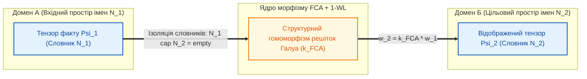

# Глава 05. Оператори темпоральної агрегації, міждоменного відображення та структурної верифікації тензора стану

> **Книга:** [Теорія епістемічних обчислювальних схем: Математичні інваріанти кастодії, метрології та детермінованого виведення](README.md) · Частина 2. Базові оператори верифікації та деонтичні вентилі  
> **Попередня глава:** [Глава 04. Небулева математика епістемічних схем: бірешітка Белнапа, трикутні норми та інтервальна метрологія](ch04-belnap-bilattice-tnorms-and-dual-metrology.md)  
> **Наступна глава:** [Глава 06. Тритермінальний деонтичний вентиль та асиметричне комутування нормативних правил](ch06-three-terminal-deontic-gate.md)  
> **Зміст книги:** [README.md](README.md)  
> **Автор:** [Микола Федчик](../ExpertSystem/about-the-author.md)  
> **Рівень складності та оптимальне вивчення:** `[L3]` Дослідницький формально-алгебраїчний (індекс Д. Кнута `[35]`) · *Маршрут:* Базове ядро всіх треків; 2 проходи з опрацюванням розрахункового прикладу  
> **Очікувані результати:** опанувати частотний аналіз операторів темпоральної чутливості у дискретному часі; розраховувати накопичення прецедентів у байєсівському Бета-інтеграторі та демпфування імпульсних ревізій у стабілізаторі нормативної інерції канону; проектувати міждоменні морфізми на базі решіток Галуа з ізоляцією просторів імен; застосовувати оператори верифікації багатовимірного тензора стану (векторний верифікатор розмірностей SI, криптографічний предикат побайтової кастодії та генератор попперівських контрприкладів).

## Анотація

У п'ятій главі елементна база Теорії епістемічних обчислювальних схем (ТЕОС) розширюється від статичних безінерційних трактів до повного класу темпоральних, міждоменних, обмежувальних та структурно-верифікаційних операторів. Показано, що реальні бази знань, правові системи та промислові тракти безпеки функціонують у дискретному часі, де емпіричні свідчення надходять серіями спостережень, а нормативні канони мають бути захищені від спорадичних коливань інтерпретацій. За допомогою операторного числення [[1]](#src-1) та частотного аналізу лінійних динамічних систем [[2]](#src-2) вводиться комплексний частотний оператор деградації тракту $`Z_{\mathrm{ep}}(\omega) = D + j X_{\mathrm{ep}}(\omega)`$.

У першій частині глави формалізуються п'ять темпоральних, міждоменних та обмежувальних операторів: (1) темпоральний Бета-інтегратор прецедентів; (2) диференційний стабілізатор нормативної інерції канону (*Stare Decisis*); (3) оператор міждоменного морфізму на базі аналізу формальних понять Рудольфа Вілле та Бернхарда Гантера [[3]](#src-3) і тесту ізоморфізму графів Вейсфейлера — Лемана [[4]](#src-4), що запобігає логічній хибі почетверіння термінів (*Quaternio Terminorum*); (4) оператор порогового обмеження потенціалу непрямих свідчень за шкалою STANAG 2022 [[5]](#src-5); (5) предикат карантинного блокування контейнера знань. У другій частині вводяться три спеціалізовані оператори структурної верифікації багатовимірного тензора стану: векторний верифікатор фізичних розмірностей SI [[6]](#src-6), криптографічний предикат побайтової кастодії [[7]](#src-7) та генератор попперівських контрприкладів [[8]](#src-8). Наприкінці глави наведено покроковий інженерний розрахунок темпорального інтегратора прецедентів та контролю розмірностей при діагностиці промислового агрегату.

---

> [!NOTE]
> **Чотири наукові положення, що виносяться на захист у Главі 05**
> 1. **Комплексний частотний оператор чутливості тракту:** введено комплексну передавальну характеристику деградації $`Z_{\mathrm{ep}}(\omega) = D + j(\omega \tau_L - 1/(\omega \tau_C))`$, яка об'єднує статичний коефіцієнт метрологічної деградації ланки з динамічними характеристиками накопичення прецедентів та інерції нормативного канону у дискретному часі.
> 2. **Дискретно-часові оператори темпоральної агрегації знань:** формалізовано моделі темпорального Бета-інтегратора незалежних спостережень та диференційного стабілізатора нормативного канону (*Stare Decisis*) при спробах стрибкоподібної ревізії правил.
> 3. **Оператор міждоменного морфізму решіток Галуа з ізоляцією просторів імен:** розроблено модель чотириполюсного оператора відображення, який переносить потенціал достовірності між ізоморфними підрешітками Галуа без змішування локальних словників і в композиції з верифікатором розмірностей SI блокує хибні семантичні аналогії.
> 4. **Тріада операторів структурної верифікації тензора стану:** формалізовано три ортогональні предикати перевірки кортежу $`\Psi`$ — векторний верифікатор системи SI, криптографічний предикат побайтової кастодії рантайму та генератор попперівських фальсифікаційних тестів.
> *Керування рантаймом / Інженерний інваріант:* Будь-яка спроба подати на вхід адитивного чи порівняльного вузла тензори з неколінеарними векторами розмірностей $`\vec{d}_1 \neq \vec{d}_2`$ або порушеним дайджестом байтового зрізу в рантаймі миттєво обнуляє провідність відповідного оператора ($`\sigma = 0`$), блокуючи подальше обчислення.

---

## 1. Проблема часової динаміки знань та частотний оператор чутливості тракту

Статичний коефіцієнт деградації $`D`$, досліджений у попередніх главах, описує миттєву атенюацію достовірності в елементарній ланці за стаціонарного режиму. Проте реальні бази знань, судово-експертні системи та інженерні тракти безпеки функціонують у нестаціонарному часовому середовищі:
1. Поодиноке непряме спостереження (короткий імпульс потоку свідчень $`\Phi(t)`$) не повинно за один такт перемикати критичні виконавчі механізми, оскільки воно може бути спорадичним викидом давача. Схемі необхідний **темпоральний інтегратор прецедентів**.
2. Фундаментальні закони, технічні регламенти та судові доктрини мають володіти **нормативною консервативністю** (принцип *Stare Decisis*): вони повинні опиратися високочастотним коливанням інтерпретацій і спробам миттєвого перегляду правил без достатньої тривалості підтвердження.

Спираючись на операторне числення Олівера Гевісайда [[1]](#src-1) та частотний метод аналізу лінійних систем [[2]](#src-2), у ТЕОС вводиться поняття комплексного частотного оператора деградації.

**Означення 5.1 (Комплексний частотний оператор деградації тракту).** *Комплексним частотним оператором деградації* $`Z_{\mathrm{ep}}(\omega)`$ називається комплексна характеристика ланки на частоті оновлення доказів $`\omega`$, дійсна частина якої дорівнює статичному коефіцієнту деградації $`D`$, а уявна частина визначає частотно-залежну темпоральну складову $`X_{\mathrm{ep}}(\omega)`$.

$$
Z_{\mathrm{ep}}(\omega) = D + j X_{\mathrm{ep}}(\omega) = D + j \left( \omega \tau_L - \frac{1}{\omega \tau_C} \right)
$$

**Формула (5.1).** Комплексний частотний оператор деградації тракту у частотній області.

Тут:
- $`Z_{\mathrm{ep}}(\omega)`$ — безрозмірний комплексний оператор деградації ланки на нормованій кутовій частоті $`\omega`$;
- $`D \ge 0`$ — статичний коефіцієнт метрологічної та семантичної деградації ланки;
- $`X_{\mathrm{ep}}(\omega)`$ — безрозмірна темпоральна (частотно-залежна) складова оператора;
- $`\omega \ge 0`$ — безрозмірна кутова частота надходження нових свідчень або спроб перегляду нормативних правил (рад/такт);
- $`\tau_L \ge 0`$ — постійна часу нормативної інерції канону (у тактах);
- $`\tau_C > 0`$ — постійна часу накопичення прецедентного інтегратора (у тактах);
- $`j = \sqrt{-1}`$ — уявна одиниця, що відображає фазове запізнення між потоком первинних спостережень та усталеним потенціалом нормативного визнання.

---

## 2. Темпоральні, міждоменні та обмежувальні оператори

П'ять базових темпоральних, міждоменних та обмежувальних операторів ТЕОС і їхні визначальні співвідношення систематизовано у таблиці 5.1.

**Таблиця 5.1.** Темпоральні, міждоменні та обмежувальні оператори теорії епістемічних обчислювальних схем.

| Оператор епістемічної схеми | Позначення | Визначальне співвідношення | Функціональне призначення у процесорі знань |
| :--- | :---: | :--- | :--- |
| **1. Темпоральний Бета-інтегратор** | $`\mathcal{I}_{\mathrm{Beta}}`$ | $`w_C(t) = w_{\max}\left(1 - e^{-t/\tau_{\mathrm{ep}}}\right)`$ | Прецедентне накопичення незалежних спостережень та фільтрація високочастотного шуму |
| **2. Стабілізатор інерції канону** | $`\mathcal{S}_{\mathrm{canon}}`$ | $`\Delta w_L(t) = -\tau_L \frac{d\Phi(t)}{dt}`$ | Нормативна інерція канону (*Stare Decisis*), демпфування імпульсних ревізій правил |
| **3. Оператор міждоменного морфізму** | $`\mathcal{M}_{\mathrm{FCA}}`$ | $`w_2 = k_{\mathrm{FCA}} \cdot w_1`$, $`\mathcal{N}_1 \cap \mathcal{N}_2 = \varnothing`$ | Міждоменне перенесення доказів із повною ізоляцією локальних просторів імен |
| **4. Обмежувач потенціалу джерела** | $`\mathcal{K}_{\mathrm{STANAG}}`$ | $`w_{\mathrm{out}} = \min(w_{\mathrm{in}}, w_{\mathrm{STANAG}})`$ | Верхнє обмеження потенціалу достовірності для непрямих джерел за шкалою STANAG 2022 |
| **5. Предикат карантину контейнера** | $`\mathcal{Q}_{\mathrm{Merkle}}`$ | $`\Delta_{\mathrm{Merkle}} \neq 0 \implies \sigma_Q = 0`$ | Незворотне блокування та ізоляція контейнера знань при порушенні кореня дерева Меркла |

### 2.1. Темпоральний Бета-інтегратор як прецедентна пам'ять

У завданнях технічної діагностики та емпіричного моніторингу поодиноке непряме спостереження не є достатнім для миттєвого відкриття деонтичного вентиля. Темпоральний інтегратор $`\mathcal{I}_{\mathrm{Beta}}`$ акумулює послідовність незалежних підтверджень у часі відповідно до байєсівського оновлення параметрів апостеріорного Бета-розподілу $`\mathrm{Beta}(\alpha_t, \beta_t)`$.

$$
w_C(t) = w_{\max} \cdot \left( 1 - \exp\left( -\frac{t}{\tau_{\mathrm{ep}}} \right) \right), \qquad \tau_{\mathrm{ep}} = (1 + D) \cdot \tau_C
$$

**Формула (5.2).** Динаміка накопичення потенціалу достовірності в темпоральному інтеграторі прецедентів.

Тут:
- $`w_C(t) \in [0, 1]`$ — накопичений безрозмірний потенціал емпіричної достовірності на виході інтегратора у такт часу $`t`$;
- $`w_{\max} \in (0, 1]`$ — граничний потенціал джерела спостережень;
- $`\tau_{\mathrm{ep}} > 0`$ — ефективна постійна часу інтегрування (у тактах), що визначає необхідну тривалість серії прецедентів до досягнення порогу активації вентиля $`w_{\mathrm{th}}`$.

Одночасно інтегратор виконує функцію фільтра нижніх частот ($`\omega \to \infty \implies 1/(\omega \tau_C) \to 0`$), придушуючи поодинокі спорадичні викиди давачів або непідтверджені інформаційні імпульси.

### 2.2. Стабілізатор нормативної інерції канону

У правових системах та інженерії функціональної безпеки діє принцип стабільності нормативної бази (*Stare Decisis*). Диференційний стабілізатор інерції канону $`\mathcal{S}_{\mathrm{canon}}`$, увімкнений у тракт нормативних правил, пропускає стаціонарні перевірені норми без ослаблення ($`\omega = 0 \implies \omega \tau_L = 0`$), але створює протидіючий спад потенціалу при різких змінах інтенсивності трактувань ($`d\Phi/dt \gg 0`$).

$$
\Delta w_L(t) = -\tau_L \cdot \frac{d\Phi(t)}{dt}
$$

**Формула (5.3).** Диференційний спад потенціалу в стабілізаторі нормативної інерції канону.

Тут:
- $`\Delta w_L(t)`$ — зустрічний спад безрозмірного потенціалу, що перешкоджає миттєвій ревізії чинної норми;
- $`\tau_L \ge 0`$ — постійна часу нормативної інерції, пропорційна ієрархічному рангу нормативного акта (міжнародний стандарт безпеки має $`\tau_L \gg 1`$, тоді як локальна оперативна інструкція має мале значення $`\tau_L`$);
- $`d\Phi(t)/dt`$ — швидкість зміни потоку транзакцій нової інтерпретації.

Якщо нова інтерпретація намагається стрибкоподібно скасувати усталену норму, оператор $`\mathcal{S}_{\mathrm{canon}}`$ генерує гальмівний спад потенціалу $`\Delta w_L`$, який утримує вентиль від перемикання доти, доки новий доказ не діятиме стабільно протягом нормативно визначеного інтервалу ревізії.

### 2.3. Оператор міждоменного морфізму решіток Галуа та ізоляція просторів імен

Пряме об'єднання термінів двох різних предметних областей (наприклад, механічне перенесення предикатів гідродинаміки в теплотехніку або пряме склеювання локальних термінів різних мережевих специфікацій) призводить до класичної логічної хиби почетверіння термінів (*Quaternio Terminorum*), коли омонімічні імена сутностей у різних словниках мають відмінний денотат або різну фізичну розмірність.

Для коректного міждоменного перенесення висновків у ТЕОС використовується **оператор міждоменного морфізму решіток Галуа** $`\mathcal{M}_{\mathrm{FCA}}`$, структуру якого подано на рисунку 5.1.

**Рисунок 5.1.** Схема оператора міждоменного морфізму з повною ізоляцією просторів імен через гомоморфізм решіток Галуа.

**Означення 5.2 (Оператор міждоменного морфізму решіток Галуа).** *Оператором міждоменного морфізму* $`\mathcal{M}_{\mathrm{FCA}}`$ називається чотириполюсний оператор відображення між двома неперетинними предметними словниками $`\mathcal{N}_1 \cap \mathcal{N}_2 = \varnothing`$, який переносить потенціал достовірності пропорційно до міри структурного ізоморфізму решіток формальних понять Галуа (Formal Concept Analysis, FCA) за Вілле — Гантером [[3]](#src-3) та колірного уточнення графів Вейсфейлера — Лемана (1-WL) [[4]](#src-4).

$$
w_2 = k_{\mathrm{FCA}} \cdot w_1, \qquad k_{\mathrm{FCA}} = \frac{\lvert \mathfrak{B}(\mathbb{K}_1) \cong_{1\text{-WL}} \mathfrak{B}(\mathbb{K}_2) \rvert}{\max\left(\lvert \mathfrak{B}(\mathbb{K}_1) \rvert, \lvert \mathfrak{B}(\mathbb{K}_2) \rvert\right)} \in [0, 1]
$$

**Формула (5.4).** Рівняння трансформації міждоменного потенціалу достовірності.

Тут:
- $`w_1, w_2 \in [0, 1]`$ — безрозмірні потенціали достовірності у вихідному (донорському) та цільовому (акцепторному) доменах;
- $`k_{\mathrm{FCA}} \in [0, 1]`$ — коефіцієнт структурної відповідності решіток формальних понять Галуа $`\mathfrak{B}(\mathbb{K}_1)`$ та $`\mathfrak{B}(\mathbb{K}_2)`$, обчислений через частку ізоморфних за тестом 1-WL вузлів.

Завдяки ізоляції просторів імен ($`\mathcal{N}_1 \cap \mathcal{N}_2 = \varnothing`$) лексична омонімія першого домену не проникає у другий домен: через ядро морфізму передається лише перевірена структурна топологія відношень. *Обчислювальне та семантичне обмеження:* оскільки задача побудови повної решітки Галуа у найгіршому випадку є `#P`-повною, матриця коефіцієнтів $`k_{\mathrm{FCA}}`$ обчислюється виключно на етапі офлайн-компіляції міждоменного відображення для скінченних локальних підрешіток, а для унеможливлення хибних ізоморфізмів між фізично несумісними поняттями вихід оператора $`\mathcal{M}_{\mathrm{FCA}}`$ обов'язково каскадується з векторним верифікатором розмірностей SI (детально в [Главі 09](ch09-scientific-critique-and-applicability-limits.md)).

### 2.4. Оператор порогового обмеження STANAG 2022 та предикат карантину контейнера

1. **Оператор порогового обмеження потенціалу непрямих джерел ($`\mathcal{K}_{\mathrm{STANAG}}`$):** У розвідувальних та аудиторських системах непрямі свідчення класифікуються за матрицею надійності джерела та достовірності інформації STANAG 2022 [[5]](#src-5) (від `A1` до `F6`). Оператор $`\mathcal{K}_{\mathrm{STANAG}}`$ встановлює жорстку верхню межу потенціалу $`w_{\mathrm{out}} = \min(w_{\mathrm{in}}, w_{\mathrm{STANAG}})`$. Наприклад, для повідомлення класу `B2` («зазвичай надійне джерело, ймовірно правдивий факт») верхня межа фіксується на рівні $`w_{\mathrm{STANAG}} = 0{,}75`$: навіть за багаторазового повторення повідомлення потенціал вузла не перевищить $`0{,}75`$ і не досягне рівня первинного стандарту $`1{,}00`$.
2. **Предикат карантинного блокування контейнера ($`\mathcal{Q}_{\mathrm{Merkle}}`$):** Розміщується на вході монтування кожного бінарного контейнера знань. Якщо під час перевірки виявляється розбіжність кореневого хешу дерева Меркла або спроба несанкціонованої модифікації сторінки пам'яті, провідність предиката незворотно обнуляється ($`\sigma_Q = 0`$), ізолюючи скомпрометований контейнер від тракту виконання.

---

## 3. Спеціалізовані оператори структурної верифікації багатовимірного тензора стану

Оскільки в обчислювальних схемах ТЕОС передається структурований **Епістемічний тензор стану** $`\Psi = \langle \mathcal{C}, w + u\varepsilon, \boldsymbol{\beta}, \vec{d}_{\mathrm{SI}} \rangle`$, для верифікації його компонент необхідні три спеціалізовані оператори, які не мають аналогів у класичній скалярній логіці.

### 3.1. Векторний верифікатор фізичних розмірностей Міжнародної системи SI

В інженерній експертній системі числові поля тензора стану репрезентують різнорідні фізичні величини: тиск у паскалях (Па), силу в ньютонах (Н), температуру в кельвінах (К) або час у секундах (с). Додавання або порівняння тиску з температурою є грубою розмірнісною помилкою.

**Означення 5.3 (Векторний верифікатор розмірностей SI).** *Векторним верифікатором розмірностей* $`\mathcal{V}_{\mathrm{SI}}`$ називається вхідний предикатний оператор адитивного або порівняльного вузла, який перевіряє покомпонентну рівність семивимірних цілочисельних векторів показників степенів основних одиниць Міжнародної системи SI (BIPM SI Brochure [[6]](#src-6)) вхідних тензорів.

$$
\vec{d} = [d_L, d_M, d_T, d_I, d_\Theta, d_N, d_J]^T \in \mathbb{Z}^7, \qquad \sigma_{\mathrm{SI}}(\vec{d}_1, \vec{d}_2) = \begin{cases} 1, & \text{якщо } \vec{d}_1 \equiv \vec{d}_2 \\ 0 \ (\text{DimensionalityFault}), & \text{якщо } \vec{d}_1 \neq \vec{d}_2 \end{cases}
$$

**Формула (5.5).** Функція провідності векторного верифікатора розмірностей у семивимірній решітці SI.

Тут:
- $`d_L, d_M, d_T, d_I, d_\Theta, d_N, d_J \in \mathbb{Z}`$ — цілі показники степенів семи основних розмірностей SI: довжини ($`\mathsf{L}`$, метр), маси ($`\mathsf{M}`$, кілограм), часу ($`\mathsf{T}`$, секунда), сили електричного струму ($`\mathsf{I}`$, ампер), термодинамічної температури ($`\mathsf{\Theta}`$, кельвін), кількості речовини ($`\mathsf{N}`$, моль) та сили світла ($`\mathsf{J}`$, кандела);
- $`\sigma_{\mathrm{SI}}(\vec{d}_1, \vec{d}_2) \in \{0, 1\}`$ — бінарна провідність верифікатора для операцій додавання, віднімання та порівняння.

При спробі подати на входи суматора або компаратора величини з різними розмірностями (наприклад, силу $`\vec{d}_F = [1, 1, -2, 0, 0, 0, 0]^T`$ та тиск $`\vec{d}_P = [-1, 1, -2, 0, 0, 0, 0]^T`$), оператор $`\mathcal{V}_{\mathrm{SI}}`$ за один такт обнуляє провідність тракту ($`\sigma_{\mathrm{SI}} = 0`$) і формує типізоване переривання `DimensionalityFault`.

### 3.2. Криптографічний предикат побайтової кастодії

**Твердження 5.1 (Дискретна умова провідності криптографічного предиката кастодії).** *Криптографічний предикат побайтової кастодії $`\mathcal{P}_{\mathrm{SHA}}`$ реалізує дискретну функцію допуску між станом повної провідності ($`\sigma_{\mathrm{SHA}} = 1`$) та станом повного блокування ($`\sigma_{\mathrm{SHA}} = 0`$) залежно від побітової тотожності криптографічного дайджесту SHA-256 (NIST FIPS 180-4 [[7]](#src-7)) байтового діапазону першоджерела в пам'яті хоста.*

$$
\sigma_{\mathrm{SHA}}(\mathcal{C}) = \begin{cases}
1, & \text{якщо } \mathrm{SHA256}\left(\mathrm{Mem}[b_{\mathrm{start}} \dots b_{\mathrm{end}}]\right) \equiv h_{\mathrm{expected}} \\
0 \ (\text{CustodyFault}), & \text{якщо } \mathrm{SHA256}\left(\mathrm{Mem}[b_{\mathrm{start}} \dots b_{\mathrm{end}}]\right) \neq h_{\mathrm{expected}}
\end{cases}
$$

**Формула (5.6).** Функція провідності криптографічного предиката побайтової кастодії.

Тут:
- $`\mathrm{Mem}[b_{\mathrm{start}} \dots b_{\mathrm{end}}]`$ — незмінний байтовий зріз документа першоджерела у спільній пам'яті між зміщеннями $`b_{\mathrm{start}}`$ та $`b_{\mathrm{end}}`$;
- $`h_{\mathrm{expected}} \in \{0, 1\}^{256}`$ — еталонний 256-бітний криптографічний дайджест доказового фрагмента;
- $`\sigma_{\mathrm{SHA}}(\mathcal{C}) \in \{0, 1\}`$ — провідність предиката кастодії.

Завдяки лавинному ефекту функції `SHA-256` будь-яке спотворення цитати у спільній пам'яті (наприклад, зміна одного символу чи цифри) змінює в середньому половину бітів дайджесту і за один такт блокує тракт. При цьому слід строго розрізняти інваріант цілісності рантайму ($`\mathrm{ZHR}_{\mathrm{runtime}} = 1{,}0`$), який гарантується предикатом $`\mathcal{P}_{\mathrm{SHA}}`$, та семантичну точність первинної компіляції тексту в схему ($`\mathcal{F}_{\mathrm{compile}}`$), межі якої досліджено у [Главі 09](ch09-scientific-critique-and-applicability-limits.md).

### 3.3. Генератор попперівських контрприкладів і фальсифікаційних тестів

Згідно з методологією фальсифікаціонізму Карла Поппера [[8]](#src-8), жодна інженерна схема виведення не може вважатися верифікованою, доки вона не пройшла цілеспрямованих випробувань на спростування. **Генератор попперівських контрприкладів** $`\mathcal{G}_{\mathrm{Popper}}`$ — це діагностичний оператор, під'єднаний до тестової шини епістемічної схеми. У режимі верифікації (Hardware-in-the-Loop) генератор періодично подає на вхідні вузли:
- синтетичні запити з хибними пресупозиціями (перевірка асиметричних морфізмів кастодії на коефіцієнт стійкості до софізмів $`\mathrm{SRR} = 1{,}0`$);
- граничні метрологічні збурення на межі довірчих інтервалів $`\pm U_{95\%}`$ (перевірка спрацювання захисної смуги інтервальних компараторів);
- мутовані байтові зрізи з інвертованим одним бітом (перевірка миттєвого блокування предикатів кастодії $`\mathcal{P}_{\mathrm{SHA}}`$).

---

## 4. Навчальний інженерний приклад: розрахунок темпорального інтегратора прецедентів, обмежувача STANAG 2022 та верифікатора розмірностей SI

Розглянемо задачу проектування вхідного епістемічного тракту моніторингу віброакустичної деградації підшипника турбонасосного агрегату.

### 4.1. Вихідні інженерні дані

1. **Джерело спостережень та обмежувач STANAG 2022:** Дані надходять від автоматизованого акустичного класифікатора класу надійності `B2` за шкалою STANAG 2022 [[5]](#src-5). На вході встановлено пороговий обмежувач $`\mathcal{K}_{\mathrm{STANAG}}`$ з верхньою межею потенціалу $`w_{\mathrm{STANAG}} = w_{\max} = 0{,}75`$.
2. **Параметри темпорального інтегратора прецедентів:** Щоб уникнути хибної зупинки турбонасоса від поодинокого акустичного удару, вхідний тракт має коефіцієнт деградації $`D = 1{,}0`$ та базову постійну часу інтегратора $`\tau_C = 2{,}5\text{ такту}`$ (де результуюча постійна часу $`\tau_{\mathrm{ep}} = (1 + D)\tau_C`$ вимірюється у тактах спостережень).
3. **Поріг відкриття вентиля аварійної сигналізації:** Деонтичний вентиль наступного каскаду налаштовано на поріг активації $`w_{\mathrm{th}} = 0{,}65`$.
4. **Контроль розмірностей SI:** На вузол порівняння віброприскорення подається тензор давача $`\Psi_1`$ в одиницях $`\text{м/с}^2`$ та помилково підключений тензор тахометра $`\Psi_2`$ в одиницях частоти обертання $`\text{с}^{-1}`$ (Гц).

### 4.2. Покроковий розрахунок

**Крок 1. Обчислення ефективної постійної часу та перевірка поодинокого імпульсу ($`t = 1`$ такт).**
За формулою (5.2) обчислюємо ефективну постійну часу темпорального інтегратора прецедентів:

$$
\tau_{\mathrm{ep}} = (1 + D) \cdot \tau_C = (1 + 1{,}0) \times 2{,}5 = 5{,}0\text{ тактів}
$$

Нехай у початковий момент відбувся поодинокий акустичний викид тривалістю $`t = 1`$ такт. Накопичений потенціал достовірності становитиме:

$$
w_C(1) = 0{,}75 \cdot \left( 1 - \exp\left( -\frac{1{,}0}{5{,}0} \right) \right) = 0{,}75 \cdot (1 - e^{-0{,}2}) \approx 0{,}75 \times 0{,}1813 = 0{,}1360
$$

Оскільки $`w_C(1) = 0{,}1360 < w_{\mathrm{th}} = 0{,}65`$, поодинокий викид фільтрується інтегратором і не викликає помилкового спрацювання захисту.

**Крок 2. Визначення необхідної кількості послідовних прецедентів для досягнення порогу $`w_{\mathrm{th}}`$.**
Розв'яжемо рівняння формули (5.2) відносно кількості тактів $`t`$, необхідної для досягнення порогового потенціалу $`w_C(t) \ge w_{\mathrm{th}} = 0{,}65`$ при обмеженні $`w_{\max} = 0{,}75`$:

$$
0{,}65 = 0{,}75 \cdot \left( 1 - \exp\left( -\frac{t}{5{,}0} \right) \right) \implies \exp\left( -\frac{t}{5{,}0} \right) = 1 - \frac{0{,}65}{0{,}75} = \frac{0{,}10}{0{,}75} \approx 0{,}1333
$$

Логарифмуючи обидві частини, отримуємо:

$$
t_{\mathrm{trig}} = -5{,}0 \cdot \ln(0{,}1333) \approx 5{,}0 \times 2{,}0149 = 10{,}07\text{ тактів} \implies N_{\mathrm{min}} = 11\text{ тактів}
$$

Отже, лише після 11 послідовних незалежних підтверджень аномалії потенціал інтегратора досягне $`w_C(11) \approx 0{,}6669 > 0{,}65`$ і відкриє деонтичний вентиль тривоги. Якби ж нормативний поріг вимагав $`w_{\mathrm{th}} = 0{,}80`$, то через пороговий обмежувач STANAG 2022 ($`w_{\mathrm{STANAG}} = 0{,}75`$) таке непряме джерело класу `B2` ніколи не змогло б самостійно відкрити вентиль без залучення первинного інструментального вимірювання класу `A1`.

**Крок 3. Спрацювання векторного верифікатора розмірностей $`\mathcal{V}_{\mathrm{SI}}`$ при колізії фізичних величин.**
Запишемо семивимірні вектори розмірностей SI за формулою (5.5) для віброприскорення $`a`$ ($`\text{м}\cdot\text{с}^{-2}`$) та частоти обертання $`f`$ ($`\text{с}^{-1}`$):

$$
\vec{d}_a = [1, 0, -2, 0, 0, 0, 0]^T, \qquad \vec{d}_f = [0, 0, -1, 0, 0, 0, 0]^T
$$

Перевірка покомпонентної рівності у вхідному верифікаторі компаратора виявляє розбіжність за координатами довжини ($`d_L: 1 \neq 0`$) та часу ($`d_T: -2 \neq -1`$):

$$
\vec{d}_a \neq \vec{d}_f \implies \sigma_{\mathrm{SI}}(\vec{d}_a, \vec{d}_f) = 0 \implies \text{Вердикт: REFUSAL (DimensionalityFault)}
$$

Верифікатор розмірностей миттєво блокує тракт і запобігає некоректному порівнянню прискорення з частотою до початку арифметичних операцій.

---

## Висновки

1. Введення комплексного частотного оператора деградації $`Z_{\mathrm{ep}}(\omega) = D + j(\omega \tau_L - 1/(\omega \tau_C))`$ поширює частотний аналіз динамічних систем на процеси еволюції знань у дискретному часі, дозволяючи розраховувати фільтри інформаційного шуму та стабілізатори нормативної практики.
2. Темпоральний Бета-інтегратор $`\mathcal{I}_{\mathrm{Beta}}`$ забезпечує прецедентне накопичення непрямих спостережень згідно з байєсівським Бета-розподілом, а стабілізатор інерції канону $`\mathcal{S}_{\mathrm{canon}}`$ реалізує принцип стабільності нормативної бази (*Stare Decisis*), демпфуючи імпульсні ревізії правил.
3. Оператор міждоменного морфізму $`\mathcal{M}_{\mathrm{FCA}}`$ на базі решіток Галуа (FCA) та тесту ізоморфізму графів Вейсфейлера — Лемана (1-WL) розв'язує проблему міждоменного перенесення знань із повною ізоляцією локальних просторів імен, унеможливлюючи логічну хибу *Quaternio Terminorum*.
4. Завдяки багатовимірній структурі епістемічного тензора стану формалізовано три спеціалізовані оператори верифікації: векторний верифікатор розмірностей SI $`\mathcal{V}_{\mathrm{SI}}`$, криптографічний предикат побайтової кастодії $`\mathcal{P}_{\mathrm{SHA}}`$ та генератор попперівських контрприкладів $`\mathcal{G}_{\mathrm{Popper}}`$, які гарантують розмірнісну, криптографічну та тестову стійкість схеми виведення.

---

## Словник

| Термін | Англійський еквівалент | Визначення |
| :--- | :--- | :--- |
| **Ізоляція просторів імен** | *Namespace Isolation* | Передача структурних співвідношень між двома предметними областями через гомоморфізм решіток Галуа без прямого перетину їхніх локальних словників. |
| **Стабілізатор інерції канону** | *Canonical Inertia Stabilizer* | Диференційний темпоральний оператор схеми, що характеризує консервативність нормативного канону (*Stare Decisis*) та демпфує різкі зміни потоку інтерпретацій. |
| **Частотний оператор деградації** | *Complex Frequency Degradation Operator* | Комплексна характеристика ланки виведення у частотній області, що поєднує статичну метрологічну деградацію та темпоральну динаміку прецедентів і канонів. |
| **Темпоральний Бета-інтегратор** | *Temporal Beta-Integrator* | Накопичувальний оператор, який інтегрує послідовність незалежних спостережень у часі та фільтрує високочастотні інформаційні викиди. |
| **Криптографічний предикат кастодії** | *Cryptographic Custody Predicate* | Дискретний оператор верифікації, що має одиничну провідність при збігу дайджесту SHA-256 байтового зрізу першоджерела і миттєво обнуляє провідність при зміні будь-якого біта. |
| **Почетверіння термінів** | *Quaternio Terminorum* | Логічна хиба силогізму, спричинена використанням омонімічного середнього терміна у двох різних значеннях без ізоляції просторів імен. |
| **Векторний верифікатор розмірностей** | *SI Dimensionality Verifier* | Вхідний селективний предикат операційного вузла, який перевіряє тотожність семивимірних векторів фізичних розмірностей SI і блокує тракт при їх розбіжності. |

---

## Абревіатури

| Абревіатура | Розшифрування | Опис |
| :--- | :--- | :--- |
| **1-WL** | 1-Dimensional Weisfeiler-Leman Test | Одновимірний алгоритм Вейсфейлера — Лемана для перевірки структурного ізоморфізму графів методом ітеративного колірного уточнення. |
| **BIPM** | Bureau International des Poids et Mesures | Міжнародне бюро мір і ваг — міжурядова організація, що підтримує Міжнародну систему одиниць SI. |
| **FCA** | Formal Concept Analysis | Аналіз формальних понять — математична теорія побудови решіток Галуа з бінарних матриць «об'єкт — ознака». |
| **FIPS** | Federal Information Processing Standards | Федеральні стандарти обробки інформації США (зокрема стандарт криптографічного хешування FIPS 180-4). |
| **SI** | Système International d'Unités | Міжнародна система одиниць, заснована на семи фундаментальних фізичних розмірностях. |
| **STANAG 2022** | NATO Standardization Agreement 2022 | Стандарт НАТО для оцінювання надійності джерел (літери A–F) та достовірності даних (цифри 1–6). |

---

## Джерела

1. **Heaviside, O.** *Electrical Papers* (Vols. 1–2). — London : Macmillan and Co., 1892. (Операторне числення лінійних динамічних систем).
2. **Steinmetz, C. P.** Complex Quantities and Their Use in Electrical Engineering // *Proceedings of the International Electrical Congress, Chicago*. — New York : AIEE, 1893. — P. 33–74.
3. **Ganter, B., Wille, R.** *Formal Concept Analysis: Mathematical Foundations*. — Berlin, Heidelberg : Springer-Verlag, 1999. — 284 p. — DOI: 10.1007/978-3-642-59830-2.
4. **Weisfeiler, B., Leman, A.** The Reduction of a Graph to Canonical Form and the Algebra Which Appears Therein // *NTI, Series 2*. — 1968. — Vol. 9. — P. 12–16.
5. **NATO STANAG 2022 (Edition 8) / AJP-2.1.** *Intelligence Procedures: Evaluation of Source Reliability and Information Credibility*. — Brussels : NATO Standardization Office (NSO), 2016.
6. **BIPM.** *The International System of Units (SI) : 9th Edition*. — Sèvres : Bureau International des Poids et Mesures, 2019. — 216 p. — ISBN 978-92-822-2272-0.
7. **NIST FIPS PUB 180-4.** *Secure Hash Standard (SHS)*. — Gaithersburg, MD : National Institute of Standards and Technology, 2015. — DOI: 10.6028/NIST.FIPS.180-4.
8. **Popper, K. R.** *Logik der Forschung: Zur Erkenntnistheorie der modernen Naturwissenschaft*. — Wien : Julius Springer, 1935 (English edition: *The Logic of Scientific Discovery*, London : Hutchinson, 1959).

---

[← Глава 04. Небулева математика епістемічних схем: бірешітка Белнапа, трикутні норми та інтервальна метрологія](ch04-belnap-bilattice-tnorms-and-dual-metrology.md) | [Зміст книги](README.md) | [Глава 06. Тритермінальний деонтичний вентиль та асиметричне комутування нормативних правил →](ch06-three-terminal-deontic-gate.md)
