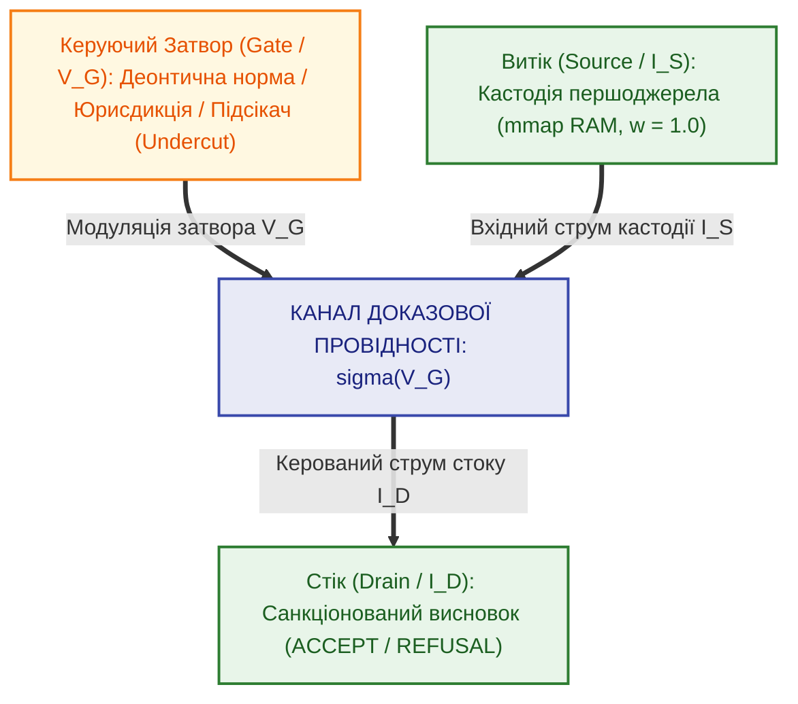
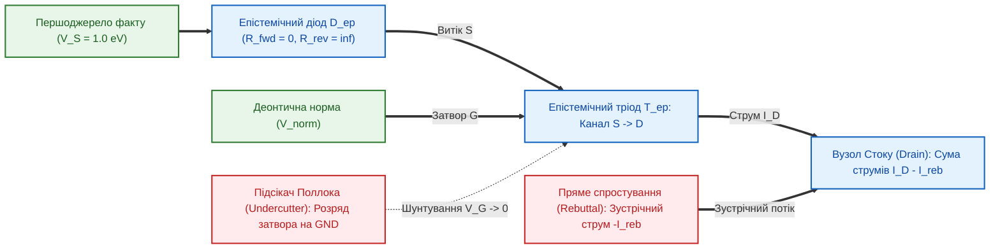

# Глава 06. Епістемічний тріод та тритермінальне деонтичне комутування

> **Книга:** [Теорія епістемічних кіл: Схемотехніка доказових обчислень та апаратного виведення](README.md)
> **Попередня глава:** [← Глава 05. Пасивні, реактивні та унікальні компоненти епістемічних кіл: імпеданс, трансформатори доменів та розмірнісні призми](ch05-passive-reactive-and-unique-epistemic-components.md)
> **Наступна глава:** [Глава 07. Багатокаскадні схеми епістемічних тріодів та лінійна обчислювальна складність →](ch07-multi-stage-cascades-and-linear-complexity.md)
> **Зміст книги:** [Повернутися до змісту](README.md)
> **Автор:** Микола Федчик
> **Рівень складності:** `[L3 — Дослідницький рівень]` *(За класифікацією Д. Кнута: напівпровідникова фізика та математичне моделювання активного тритермінального приладу деонтичної комутації, формалізація підсікачів Поллока та вольт-амперних характеристик)*
> **Очікувані результати:** Читач засвоїть архітектуру центрального активного приладу теорії епістемічних кіл — тритермінального епістемічного тріода (транзистора), зрозуміє фундаментальну фізичну різницю між прямим спростуванням факту у колі стоку та нормативним підсіканням правила на керуючому затворі, вивчить математику трьох режимів роботи тріода (відсічки, активної метрологічної модуляції та ключового насичення) і розв'яже практичну задачу деонтичної комутації медичного дозатора за наявності процедурного підсікача.

---

## Анотація

Шоста глава присвячена головному активному приладу теорії епістемічних кіл — тритермінальному епістемічному тріоду (транзистору), який усуває хронічну ваду класичних експертних систем: змішування емпіричної істинності фактів із нормативною чинністю правил їх застосування. Спираючись на винахід напівпровідникового транзистора Джоном Бардіном, Волтером Браттейном та Вільямом Шоклі [[1]](#src-1), деонтичну логіку Георга Генріка фон Врігта [[2]](#src-2) та епістемологічну теорію спростовних міркувань Джона Поллока [[3]](#src-3), ми показуємо, що будь-який крок нормативного допуску є тритермінальною операцією, у якій потенціал деонтичного затвора керує провідністю каналу між витоком верифікованої кастодії першоджерела та стоком санкціонованого вердикту. Доведено фундаментальну схемотехнічну теорему про апаратне розділення двох класів контраргументів у формалізмі ASPIC+ [[4]](#src-4): пряме спростування (*Rebutting Defeater*) діє як зустрічний струм у силовому колі стоку, тоді як підсікач правила (*Undercutting Defeater*) подається через односторонній епістемічний діод на керуючий затвор, миттєво перекриваючи канал виведення без знищення первинного факту в пам'яті. Повністю виведено вольт-амперні характеристики епістемічного тріода, крутизну його передавальної характеристики $`g_m`$ [[6]](#src-6) та проілюстровано їхню роботу на числовому інженерному прикладі блокування інфузійного дозатора при втраті чинності сертифіката калібрування.

---

> [!NOTE]
> **Чотири фундаментальні положення авторського внеску Миколи Федчика у Главі 06**
> 1. Розроблено архітектуру тритермінального активного епістемічного приладу (епістемічного тріода / польового транзистора) з гальванічно розділеними терміналами Витоку (Source — носій кастодії факту), Стоку (Drain — санкціонований вердикт) та Затвора (Gate — деонтична норма або юрисдикція).
> 2. Здійснено строге фізико-схемотехнічне розмежування двох класів ураження аргументів за Джоном Поллоком: пряме спростування (*Rebuttal*) змодельовано як колізію зустрічних струмів у вузлі стоку, а підсікання (*Undercut*) — як спад керуючого потенціалу на затворі, що переводить канал у стан нескінченного опору без модифікації факту у витоку.
> 3. Введено модель одностороннього епістемічного діода у ланцюзі затвора та витоку з нескінченним зворотним опором $`R_{\mathrm{rev}} = \infty`$, що апаратно унеможливлює зворотний інференційний пробій (зворотну мутацію фактів під тиском бажаного нормативного висновку).
> 4. Аналітично визначено три робочі режими епістемічного тріода — режим гарантованої відсічки ($`V_G < V_{\mathrm{th}}`$), активний метрологічний режим лінійної модуляції з крутизною $`g_m = \partial I_D / \partial V_G`$ та режим ключового насичення ($`V_G \ge V_{\mathrm{sat}}`$).
> *Керування рантаймом / Інженерний інваріант:* Жоден верифікований факт із потенціалом витоку $`V_S = 1.00\,\text{еВ}`$ не має права створити ненульовий струм стоку $`I_D > 0`$, якщо потенціал деонтичного затвора перебуває нижче порогу нормативної легітимності $`V_G < V_{\mathrm{th}}`$ (апаратний інваріант `FAIL-CLOSED`).

---

## 1. Проблема змішування фактів і норм та концепція тритермінального приладу

У класичних продукційних системах (`IF A THEN B`), логічному програмуванні та ймовірнісних мережах емпіричний факт («Давач зафіксував тиск $`P = 12\,\text{МПа}`$») і нормативне правило («За стандартом безпеки дозволено відкрити клапан при $`P > 10\,\text{МПа}`$») записуються в одну плоску кон'юнктивну формулу. Таке «двополюсне» змішування породжує тяжкі епістемічні аномалії:
1. Якщо правило втрачає юридичну чинність (наприклад, наказ скасовано або збіг термін повірки приладу), плоска логічна система або продовжує видавати хибний дозвіл, або намагається «знизити ймовірність» самого фізичного факту.
2. Порушується принцип ізоляції носія кастодії від нормативної інтерпретації: емпіричний протокол вимірювання залишається стовідсотково істинним історичним документом навіть тоді, коли змінюється законодавство.

Щоб розв'язати цю фундаментальну суперечність, у теорії епістемічних кіл за аналогією з відкриттям транзисторного ефекту Бардіном, Браттейном і Шоклі (1947–1948) [[1]](#src-1) та деонтичною модальною логікою фон Врігта (1951) [[2]](#src-2) вводиться тритермінальний активний напівпровідниковий прилад — **епістемічний тріод (транзистор)**.

**Означення 6.1 (Епістемічний тріод).** Епістемічним тріодом (або польовим епістемічним транзистором) називається тритермінальний активний елемент епістемічного кола з виводами Витоку ($`S`$), Стоку ($`D`$) та Затвора ($`G`$), у якому провідність силового доказового каналу $`\sigma_{\mathrm{ch}}(V_G)`$ між витоком емпіричного факту та стоком виконавчого вердикту нелінійно модулюється незалежним деонтичним потенціалом затвора $`V_G`$.

Структурну топологію тритермінального епістемічного тріода подано на Рисунку 6.1.

**Рисунок 6.1.** Топологія тритермінального епістемічного тріода (транзистора) з деонтичним керуванням каналу провідності

### 1.1. Функціональне призначення трьох терміналів

1. **Витік / Емітер ($`S`$, Source):** Силовий вхідний електрод, на який подається первинний емпіричний факт або дослівна цитата, закріплена у спільній пам'яті криптографічним вектором кастодії $`\mathcal{C}_S`$ з потенціалом $`V_S \in (0, 1.0]\,\text{еВ}`$.
2. **Стік / Колектор ($`D`$, Drain):** Силовий вихідний електрод, з якого знімається санкціонований струм висновку $`I_D`$ та вихідний потенціал $`V_D`$ для подачі на наступний каскад або виконавчий компаратор.
3. **Затвор / База ($`G`$, Gate):** Високоімпедансний керуючий електрод, на який подається потенціал чинності деонтичної норми $`V_G`$ (оператори обов'язковості $`\square \text{Obligatory}`$, дозволу $`\lozenge \text{Permitted}`$ за фон Врігтом [[2]](#src-2), статус юрисдикції, часовий інтервал дії стандарту або сигнал процедурного підсікача).

---

## 2. Схемотехнічна фізика контраргументів Поллока та епістемічний діод

У класичній праці 1987 року «Спростовні міркування» (*Defeasible Reasoning*) Джон Поллок [[3]](#src-3), а згодом Санджай Модгіл і Генрі Праккен у формалізмі ASPIC+ [[4]](#src-4) та Фан Мін Дунг в абстрактній теорії аргументації [[5]](#src-5) довели, що заперечення в раціональному дискурсі поділяються на два фундаментально відмінні класи:
- **Пряме спростування (*Rebutting Defeater*):** атакує безпосередньо *висновок* іншого аргументу, висуваючи протилежне фактичне твердження $`\neg \varphi`$ (наприклад, один давач показує перевищення тиску, а резервний давач показує норму).
- **Підсікання правила (*Undercutting Defeater*):** не заперечує істинність вхідного факту і не доводить протилежний висновок, але руйнує *inferential link* — правомірність самого переходу від засновку до висновку (наприклад: «Показання давача тиску справді дорівнюють 12 МПа у протоколі, але пломбу калібрування давача зірвано, тому правило перерахунку не застосовується»).

У традиційному програмному забезпеченні обидва види атак намагалися моделювати однаковими вагами або правилами заперечення. У теорії епістемічних кіл вони отримують **принципово різну фізичну реалізацію**, зображену на Рисунку 6.2.

**Рисунок 6.2.** Схемотехнічне розмежування підсікання на затворі (Undercut) та прямого спростування в колі стоку (Rebuttal) за наявності захисного епістемічного діода

**Твердження 6.1 (Ортогональність підсікання та спростування в епістемічному тріоді).** *У тритермінальному епістемічному тріоді підсікач Поллока (Undercutter) діє виключно в керуючому колі затвора $`G`$, знижуючи потенціал $`V_G`$ нижче порогу відсічки $`V_{\mathrm{th}}`$ і обнуляючи провідність каналу $`\sigma_{\mathrm{ch}}(V_G) \to 0`$ при повному збереженні потенціалу факту на витоку ($`V_S = \text{const}`$). Натомість пряме спростування (Rebuttal) діє виключно у силовому вузлі стоку $`D`$ як зустрічний струм протилежної полярності $`-I_{\mathrm{reb}}`$.*

### 2.1. Односторонній епістемічний діод та захист від зворотного пробою

Щоб високий деонтичний потенціал затвора або зустрічний струм у колі стоку ніколи не змогли сфабрикувати чи спотворити первинний факт у джерелі, витік тріода захищений **епістемічним діодом** $`D_{\mathrm{ep}}`$.

**Означення 6.2 (Епістемічний діод).** Епістемічним діодом $`D_{\mathrm{ep}}`$ називається двополюсний нелінійний елемент з асиметричною провідністю, який пропускає доказовий струм виключно у прямому напрямку від верифікованого першоджерела до висновку і має нескінченний опір у зворотному напрямку (від гіпотетичного висновку або пресупозиції запиту до факту).

**Формула (6.1).** Кусково-лінійна характеристика опору ідеального епістемічного діода:

$$
R_{\mathrm{diode}}(\Delta V) = \begin{cases}
0 \ (\text{Пряме зміщення } \text{Факт} \to \text{Висновок}), & \text{при } \Delta V = V_{\mathrm{source}} - V_{\mathrm{node}} > 0 \\
\infty \ (\text{Блокування пресупозицій}), & \text{при } \Delta V \le 0
\end{cases}
$$

Тут:
- $`\Delta V = V_{\mathrm{source}} - V_{\mathrm{node}}`$ — різниця епістемічних потенціалів між анодом першоджерела та катодом робочого вузла (еВ);
- $`R_{\mathrm{diode}}(\Delta V)`$ — диференційний опір діода ($`\text{e}\Omega`$).

Завдяки $`R_{\mathrm{rev}} = \infty`$ забезпечується абсолютний коефіцієнт відсікання софізмів ($`\mathrm{SRR} = 1.0000`$): жодне навідне запитання з хибною пресупозицією («Чому стандарт дозволяє перевищення тиску?») не може «проштовхнути» струм у зворотному напрямку і змусити систему підтвердити вигаданий факт.

---

## 3. Вольт-амперні характеристики та три режими роботи епістемічного тріода

Провідність каналу епістемічного тріода залежить від співвідношення між чинним потенціалом деонтичного затвора $`V_G`$, порогом нормативної легітимності $`V_{\mathrm{th}}`$ та потенціалом повного нормативного насичення $`V_{\mathrm{sat}}`$ ($`0 < V_{\mathrm{th}} < V_{\mathrm{sat}} \le 1.0\,\text{еВ}`$).

**Формула (6.2).** Передавальна функція провідності каналу епістемічного тріода:

$$
\sigma_{\mathrm{ch}}(V_G) = \begin{cases}
0, & \text{якщо } V_G < V_{\mathrm{th}} \quad (\text{Режим відсічки}) \\
\sigma_{\max} \cdot \left( \frac{V_G - V_{\mathrm{th}}}{V_{\mathrm{sat}} - V_{\mathrm{th}}} \right), & \text{якщо } V_{\mathrm{th}} \le V_G < V_{\mathrm{sat}} \quad (\text{Активний метрологічний режим}) \\
\sigma_{\max}, & \text{якщо } V_G \ge V_{\mathrm{sat}} \quad (\text{Режим ключового насичення})
\end{cases}
$$

Тут:
- $`\sigma_{\mathrm{ch}}(V_G)`$ — деонтична провідність каналу між витоком і стоком ($`\text{e}\Omega^{-1}`$);
- $`V_G \in [0, 1.0]`$ — чинний потенціал деонтичного затвора з урахуванням дії підсікачів (еВ);
- $`V_{\mathrm{th}}`$ — пороговий потенціал відкриття затвора (мінімальний рівень нормативної легітимності правила, еВ);
- $`V_{\mathrm{sat}}`$ — потенціал насичення, за якого правило діє як безумовний імператив без атенюації (еВ);
- $`\sigma_{\max} = 1 / R_{\mathrm{on}}`$ — максимальна провідність відкритого каналу ($`\text{e}\Omega^{-1}`$).

**Формула (6.3).** Результуючий потенціал затвора за наявності процедурного підсікача Поллока:

$$
V_G = V_{\mathrm{norm}} \cdot (1 - \alpha_{\mathrm{undercut}}), \qquad \alpha_{\mathrm{undercut}} \in [0, 1]
$$

Тут:
- $`V_{\mathrm{norm}} \in [0, 1.0]`$ — апріорний потенціал чинності нормативного правила у базі знань (еВ);
- $`\alpha_{\mathrm{undercut}} \in [0, 1]`$ — коефіцієнт ураження затвора підсікачем Поллока (при повному підсіканні $`\alpha_{\mathrm{undercut}} = 1.0 \implies V_G = 0`$).

**Формула (6.4).** Вихідний доказовий струм стоку епістемічного тріода:

$$
I_D = \sigma_{\mathrm{ch}}(V_G) \cdot V_S
$$

Тут:
- $`I_D`$ — санкціонований струм висновку у колі стоку;
- $`V_S`$ — вхідний потенціал емпіричного факту на витоку тріода (еВ).

**Формула (6.5).** Нормативна крутизна (транспровідність) епістемічного тріода в активному режимі:

$$
g_m = \frac{\partial I_D}{\partial V_G} = \frac{\sigma_{\max} \cdot V_S}{V_{\mathrm{sat}} - V_{\mathrm{th}}}
$$

Тут:
- $`g_m`$ — нормативна крутизна характеристики тріода, яка кількісно визначає чутливість вихідного струму висновку до малих змін деонтичного потенціалу затвора або метрологічної невизначеності правила за стандартом JCGM GUM [[6]](#src-6).

Систематизацію трьох режимів роботи епістемічного тріода наведено у Таблиці 6.1.

**Таблиця 6.1.** Режими роботи тритермінального епістемічного тріода

| Режим роботи приладу | Умова потенціалу на затворі | Провідність каналу $`\sigma_{\mathrm{ch}}`$ та струм стоку $`I_D`$ | Епістемічна інтерпретація та вердикт рантайму |
| :--- | :---: | :--- | :--- |
| **1. Режим відсічки (Cut-off)** | $`V_G < V_{\mathrm{th}}`$ | $`\sigma_{\mathrm{ch}} = 0`$, $`I_D \equiv 0`$ | Норма нечинна або уражена підсікачем Поллока: стан `FAIL-CLOSED (REFUSAL)` |
| **2. Активний метрологічний режим** | $`V_{\mathrm{th}} \le V_G < V_{\mathrm{sat}}`$ | $`0 < \sigma_{\mathrm{ch}} < \sigma_{\max}`$, $`I_D = g_m (V_G - V_{\mathrm{th}})`$ | Диспозитивна або умовно-придатна норма: струм пропорційно модулюється крутизною $`g_m`$ |
| **3. Режим насичення (Saturation)** | $`V_G \ge V_{\mathrm{sat}}`$ | $`\sigma_{\mathrm{ch}} = \sigma_{\max}`$, $`I_D = \sigma_{\max} V_S`$ | Імперативна норма повністю чинна: факт безперешкодно проходить до стоку (`ACCEPT`) |

---

## 4. Навчальний інженерний приклад: комутація медичного дозатора за наявності процедурного підсікача

Розглянемо роботу тритермінального епістемічного тріода у системі керування автоматичним інфузійним дозатором інтенсивної терапії, де рішення про введення препарату спирається на оптичний давач концентрації глюкози в крові.

### 4.1. Вихідні інженерні дані

1. **Термінал Витоку ($`S`$):** В оптичному буфері пам'яті зафіксовано верифіковане вимірювання концентрації глюкози з криптографічно валідним протоколом кастодії $`V_S = 1.00\,\text{еВ}`$.
2. **Параметри епістемічного тріода:** Максимальна провідність відкритого каналу $`\sigma_{\max} = 1.00\,\text{е}\Omega^{-1}`$, поріг нормативної відсічки затвора $`V_{\mathrm{th}} = 0.60\,\text{еВ}`$, потенціал імперативного насичення $`V_{\mathrm{sat}} = 0.90\,\text{еВ}`$.
3. **Клінічний протокол на Затворі ($`G`$):** Базовий деонтичний потенціал клінічного правила дозування становить $`V_{\mathrm{norm}} = 0.95\,\text{еВ}`$.
4. **Досліджувані експлуатаційні ситуації:**
   - *Ситуація А (Штатна робота):* Сертифікат метрологічної повірки оптичного сенсора чинний, підсікачі відсутні ($`\alpha_{\mathrm{undercut}} = 0.00`$).
   - *Ситуація Б (Диспозитивне застереження):* Термін дії калібрувального розчину наближається до границі, що створює частковий процедурний підсікач $`\alpha_{\mathrm{undercut}} = 0.20`$.
   - *Ситуація В (Атака підсікачем Поллока):* Надходить системне повідомлення про порушення температурного режиму зберігання реагенту оптичного сенсора, що генерує сильний процедурний підсікач $`\alpha_{\mathrm{undercut}} = 0.50`$.

### 4.2. Покроковий розрахунок

**Крок 1. Обчислення нормативної крутизни тріода в активній області.**
За Формулою (6.5) знаходимо транспровідність приладу $`g_m`$:

$$
g_m = \frac{\sigma_{\max} \cdot V_S}{V_{\mathrm{sat}} - V_{\mathrm{th}}} = \frac{1.00 \times 1.00}{0.90 - 0.60} = \frac{1.00}{0.30} \approx 3.3333\,\text{е}\Omega^{-1}
$$

**Крок 2. Аналіз Ситуації А (Штатна робота, $`\alpha_{\mathrm{undercut}} = 0.00`$).**
За Формулою (6.3) потенціал затвора становить $`V_G = 0.95 \times (1 - 0.00) = 0.95\,\text{еВ}`$. Оскільки $`V_G = 0.95\,\text{еВ} \ge V_{\mathrm{sat}} = 0.90\,\text{еВ}`$, тріод працює у **режимі ключового насичення**:

$$
\sigma_{\mathrm{ch}}(0.95) = \sigma_{\max} = 1.00\,\text{е}\Omega^{-1} \implies I_D = 1.00 \times 1.00 = 1.00 \quad (\text{Вердикт: ACCEPT})
$$

**Крок 3. Аналіз Ситуації Б (Частковий підсікач, $`\alpha_{\mathrm{undercut}} = 0.20`$).**
Потенціал затвора знижується до:

$$
V_G = 0.95 \times (1 - 0.20) = 0.76\,\text{еВ}
$$

Оскільки $`V_{\mathrm{th}} = 0.60\,\text{еВ} \le 0.76\,\text{еВ} < V_{\mathrm{sat}} = 0.90\,\text{еВ}`$, тріод переходить в **активний метрологічний режим**. За Формулою (6.2) та (6.4) обчислюємо провідність та струм стоку:

$$
\sigma_{\mathrm{ch}}(0.76) = 1.00 \cdot \left( \frac{0.76 - 0.60}{0.90 - 0.60} \right) = \frac{0.16}{0.30} \approx 0.5333\,\text{е}\Omega^{-1}, \qquad I_D = 0.5333 \times 1.00 = 0.5333
$$

Струм стоку ослаблений майже вдвічі: дозатор переходить у режим обмеженої підтримувальної подачі з вимогою підтвердження черговим лікарем.

**Крок 4. Аналіз Ситуації В (Критичний підсікач Поллока, $`\alpha_{\mathrm{undercut}} = 0.50`$).**
Потенціал затвора падає до:

$$
V_G = 0.95 \times (1 - 0.50) = 0.475\,\text{еВ} < V_{\mathrm{th}} = 0.60\,\text{еВ}
$$

Оскільки потенціал затвора впав нижче порогу відсічки $`V_{\mathrm{th}}`$, тріод миттєво закривається (**режим відсічки**):

$$
\sigma_{\mathrm{ch}}(0.475) = 0 \implies I_D = 0.00 \quad (\text{Вердикт: FAIL-CLOSED REFUSAL / UNDERCUT})
$$

При цьому первинний запис вимірювання на витоку ($`V_S = 1.00\,\text{еВ}`$) завдяки захисному епістемічному діоду $`D_{\mathrm{ep}}`$ залишається недоторканим в історії хвороби для подальшого аудиту, але виконавчий канал подачі препарату повністю знеструмлено.

---

## Висновки

1. Тритермінальний епістемічний тріод (транзистор) усуває фундаментальну ваду двополюсних продукційних систем, фізично відокремлюючи силовий канал проходження верифікованого факту (Витік — Стік) від керуючого електрода нормативної легітимності (Затвор).
2. Апаратна реалізація теорії аргументації Поллока — Праккена (ASPIC+) на епістемічному тріоді дає змогу обробляти підсікачі правил (*Undercutting Defeaters*) через модуляцію потенціалу затвора $`V_G`$ без руйнування чи фальсифікації первинних фактів у пам'яті.
3. Захисний епістемічний діод із нескінченним зворотним опором ($`R_{\mathrm{rev}} = \infty`$) гарантує односпрямованість дедуктивного потоку та 100% захист від зворотного інференційного пробою при атаках запитами з хибними пресупозиціями.
4. Наявність трьох чітко розмежованих режимів роботи (відсічки, активної метрологічної модуляції з крутизною $`g_m`$ та ключового насичення) перетворює епістемічний тріод на універсальний будівельний блок для синтезу багатокаскадних логічних схем та диференційних арбітрів.

---

## Словник

| Термін | Англійський еквівалент | Визначення |
| :--- | :--- | :--- |
| **Деонтичний затвор** | Deontic Gate | Керуючий термінал епістемічного тріода, потенціал якого визначається юридичною або технічною чинністю норми і модулює провідність каналу виведення. |
| **Епістемічний діод** | Epistemic Diode | Двополюсний напівпровідниковий елемент односторонньої провідності, який пропускає струм від факту до висновку і блокує зворотне поширення пресупозицій. |
| **Епістемічний тріод (транзистор)** | Epistemic Triode / Transistor | Тритермінальний активний прилад із виводами Витоку, Стоку та Затвора, призначений для деонтичної комутації та метрологічної модуляції доказового струму. |
| **Нормативна крутизна** | Normative Transconductance | Похідна струму стоку за потенціалом затвора в активному режимі, що вимірює чутливість висновку до зміни нормативної чинності правила. |
| **Підсікач Поллока** | Undercutting Defeater | Аргументаційна атака, яка не заперечує істинність засновку, але скасовує придатність правила переходу від засновку до висновку шляхом розряджання затвора. |
| **Пряме спростування** | Rebutting Defeater | Аргументаційна атака, спрямована безпосередньо проти істинності висновку шляхом генерації зустрічного струму протилежної полярності у вузлі стоку. |
| **Режим відсічки** | Cut-off Regime | Стан повного закриття каналу епістемічного тріода при падінні потенціалу затвора нижче порогового рівня легітимності. |

---

## Абревіатури

| Абревіатура | Розшифрування | Опис |
| :--- | :--- | :--- |
| **ASPIC+** | Argumentation Service Platform with Instantiated Components | Формальна метатеорія структурованої аргументації з суворими та спростовними правилами й двома типами атак. |
| **FET** | Field-Effect Transistor | Польовий транзистор — фізичний прототип тритермінального епістемічного тріода з керуванням провідністю каналу полем затвора. |
| **GUM** | Guide to the Expression of Uncertainty in Measurement | Міжнародна настанова JCGM 100:2008 з оцінювання та вираження невизначеності вимірювань. |
| **OSCAR** | Objective Self-Conscious Automated Reasoner | Когнітивна архітектура спростовних міркувань Джона Поллока, у якій вперше формалізовано підсікачі. |
| **SRR** | Sophism Rejection Rate | Коефіцієнт відсікання софізмів і запитів із хибними пресупозиціями (інваріант $`\mathrm{SRR} = 1.0`$). |

---

## Джерела

1. **Bardeen, J., Brattain, W. H.** The Transistor, A Semi-Conductor Triode // *Physical Review*. — 1948. — Vol. 74, No. 2. — P. 230–231. (Також: **Shockley, W.** The Theory of p-n Junctions in Semiconductors and p-n Junction Transistors // *Bell System Technical Journal*, 1949, Vol. 28, P. 435–489).
2. **Wright, G. H. von.** Deontic Logic // *Mind*. — 1951. — Vol. 60, No. 237. — P. 1–15. — DOI: 10.1093/mind/LX.237.1.
3. **Pollock, J. L.** Defeasible Reasoning // *Cognitive Science*. — 1987. — Vol. 11, No. 4. — P. 481–518. — DOI: 10.1207/s15516709cog1104_4.
4. **Modgil, S., Prakken, H.** The ASPIC+ framework for structured argumentation: a tutorial // *Argument & Computation*. — 2014. — Vol. 5, No. 1. — P. 31–62. — DOI: 10.1080/19462166.2013.869766.
5. **Dung, P. M.** On the acceptability of arguments and its fundamental role in nonmonotonic reasoning, logic programming and n-person games // *Artificial Intelligence*. — 1995. — Vol. 77, No. 2. — P. 321–357.
6. **JCGM 100:2008 (GUM 1995 with minor corrections).** *Evaluation of measurement data — Guide to the expression of uncertainty in measurement*. — Sèvres : Joint Committee for Guides in Metrology, 2008.

---

[← Глава 05. Пасивні, реактивні та унікальні компоненти епістемічних кіл: імпеданс, трансформатори доменів та розмірнісні призми](ch05-passive-reactive-and-unique-epistemic-components.md) | [Зміст книги](README.md) | [Глава 07. Багатокаскадні схеми епістемічних тріодів та лінійна обчислювальна складність →](ch07-multi-stage-cascades-and-linear-complexity.md)
