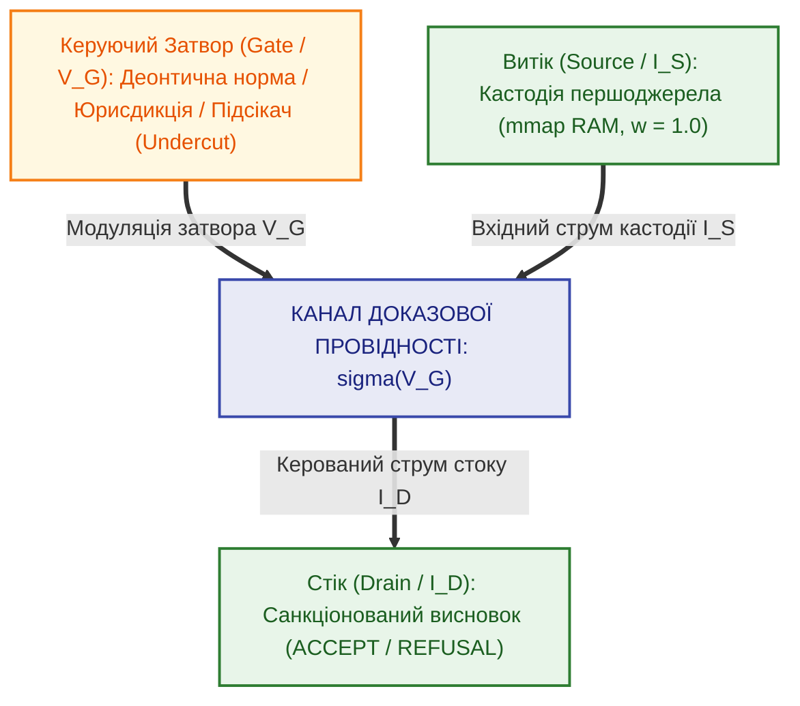

# Глава 06. Епістемічний тріод та тритермінальне деонтичне комутування

> [!NOTE]
> **Три фундаментальні положення авторського внеску Миколи Федчика**
> 1. Розроблено архітектуру тритермінального активного епістемічного приладу (епістемічного тріода/транзистора) з виводами Source (кастодія), Drain (вердикт) та Gate (деонтика).
> 2. Апаратно розділено два класи аргументаційних контраргументів: Rebuttal (зустрічний струм у колі стоку) та Undercutting Defeater (модуляція потенціалу затвора).
> 3. Визначено три режими роботи епістемічного транзистора: відсічка ($`V_G < V_{\mathrm{th}}`$), ключове насичення ($`V_G \ge V_{\mathrm{sat}}`$) та активний метрологічний режим.

---

## 1. Концепція тритермінального приладу

У класичній двійковій схемотехніці транзистор використовується або як аналоговий підсилювач напруги, або як ключ у логічних схемах.
В **епістемічній схемотехніці** епістемічний тріод є активним приладом, призначеним для керування струмом істинності стороннім нормативним сигналом.

### 1.1. Термінали приладу

1. **Витік / Емітер ($S$, Source):** Вхідний електрод, на який подається первинний доведений факт, зафіксований у пам'яті хоста апаратним регістром кастодії ($`V_S \equiv 1.0\,\text{eV}`$).
2. **Стік / Колектор ($D$, Drain):** Вихідний електрод, з якого знімається санкціонований вердикт або виконавча команда ($`I_D`$).
3. **Затвор / База ($G$, Gate):** Керуючий електрод, на який подається нормативний статус правила, деонтичний оператор ($\square$ обов'язково, $\lozenge$ дозволено) або сигнал аргументаційного підсікача (Undercutter).

---

## 2. Фізика розрізнення прямого спростування та підсікання норми

Теорія аргументації Джона Поллока (система OSCAR / ASPIC+) вказує на існування двох типів ураження аргументів:
- **Пряме спростування (Rebuttal):** коли один факт суперечить іншому факту.
- **Підсікання (Undercut):** коли заперечується не сам факт, а зв'язок між засновком і висновком.

У класичному софті обидва типи намагалися кодувати через однакові списки суперечностей. В епістемічній схемотехніці вони мають **принципово різну фізику**:

1. **Rebuttal** — це зустрічний струм у колі стоку, що розв'язується через баланс потенціалів на диференційній парі.
2. **Undercut** — це зміна керуючого потенціалу на **Затворі** ($`V_G`$). Підсікач перекриває канал провідності, розриваючи зв'язок між витоком і стоком. Сам факт залишається абсолютно істинним у пам'яті хоста, але струм висновку падає до нуля.

---

## 3. Вольт-амперні характеристики та режими роботи

| Режим роботи | Умова потенціалу затвора | Поведінка каналу виведення |
| :--- | :---: | :--- |
| **1. Режим відсічки (Cut-off)** | $`V_G < V_{\mathrm{th}}`$ | Канал перекрито: $`I_D \equiv 0 \implies \text{FAIL-CLOSED (REFUSAL)}`$ |
| **2. Режим насичення (Saturation)** | $`V_G \ge V_{\mathrm{sat}}`$ | Канал повністю відкрито: факт безперешкодно санкціонується |
| **3. Активний метрологічний режим** | $`V_{\mathrm{th}} \le V_G < V_{\mathrm{sat}}`$ | Струм модулюється крутизною $`g_m`$ відповідно до похибки ISO GUM |

Крутизна характеристики $`g_m = \frac{\partial I_D}{\partial V_G}`$ кількісно описує динамічну чутливість експертної системи до зміни нормативних умов або появи судових прецедентів.
