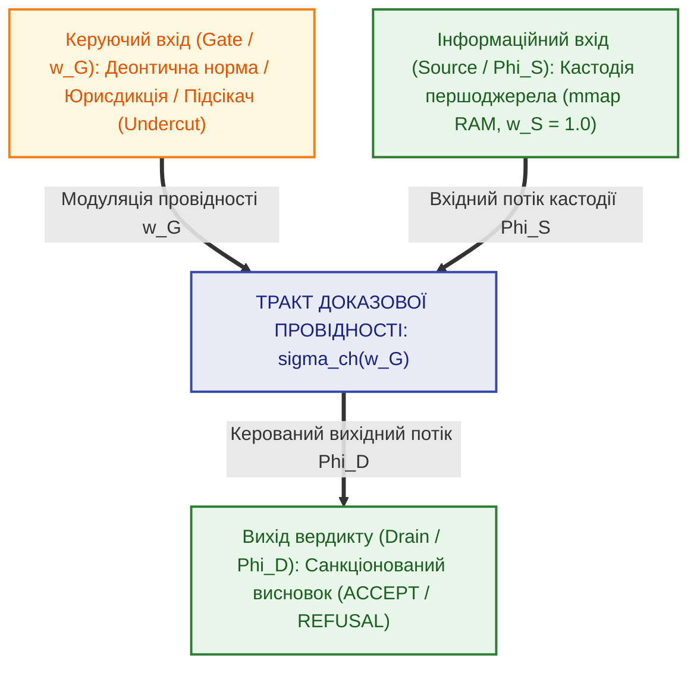
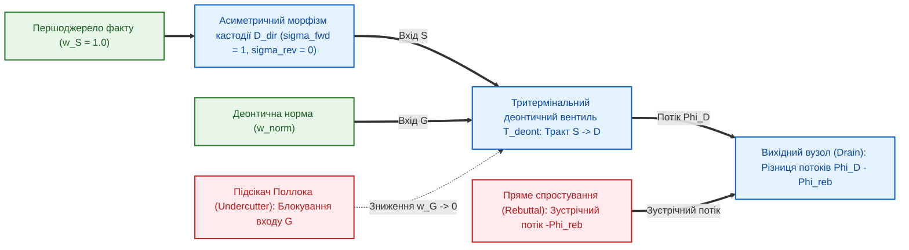

# Глава 06. Тритермінальний деонтичний вентиль та асиметричне комутування нормативних правил

> **Книга:** [Теорія епістемічних обчислювальних схем: Математичні інваріанти кастодії, метрології та детермінованого виведення](README.md) · Частина 2. Базові оператори верифікації та деонтичні вентилі  
> **Попередня глава:** [Глава 05. Оператори темпоральної агрегації, міждоменного відображення та структурної верифікації тензора стану](ch05-temporal-interdomain-and-verification-operators.md)  
> **Наступна глава:** [Глава 07. Багатокаскадні дедуктивні схеми та лінійна обчислювальна складність](ch07-multi-stage-cascades-and-linear-complexity.md)  
> **Зміст книги:** [README.md](README.md)  
> **Автор:** [Микола Федчик](../ExpertSystem/about-the-author.md)  
> **Рівень складності та оптимальне вивчення:** `[L3]` Дослідницький формально-алгебраїчний (індекс Д. Кнута `[35]`) · *Маршрут:* Базове ядро всіх треків; 2 проходи з опрацюванням розрахункового прикладу  
> **Очікувані результати:** засвоїти математичну модель базового оператора комутації ТЕОС — тритермінального деонтичного вентиля; обґрунтувати структурну різницю між прямим спростуванням факту на виході та нормативним підсіканням правила на керуючому вході; розраховувати три режими роботи вентиля (блокування, активної метрологічної модуляції та насичення) і розв'язувати задачу деонтичної комутації медичного дозатора за наявності процедурного підсікача.

## Анотація

Шоста глава присвячена центральному комутаційному оператору Теорії епістемічних обчислювальних схем (ТЕОС) — **тритермінальному деонтичному вентилю**, який усуває структурний дефект класичних продукційних систем: змішування емпіричної істинності фактів із нормативною чинністю правил їх застосування. Спираючись на теорію тритермінальних керованих вентилів [[1]](#src-1), деонтичну логіку Георга Генріка фон Врігта [[2]](#src-2) та епістемологічну теорію спростовних міркувань Джона Поллока [[3]](#src-3), показано, що будь-який крок нормативного допуску є тритермінальною операцією, у якій потенціал керуючого деонтичного входу модулює провідність тракту між інформаційним входом верифікованої кастодії першоджерела та виходом санкціонованого вердикту.

Доведено теорему про структурне розділення двох класів контраргументів у формалізмі ASPIC+ [[4]](#src-4): пряме спростування (*Rebutting Defeater*) діє як зустрічний потік у вузлі виходу, тоді як підсікач правила (*Undercutting Defeater*) подається на керуючий вхід затвора, перекриваючи тракт виведення без модифікації первинного факту в пам'яті. Для захисту аксіоматичних джерел від зворотної мутації під тиском хибних пресупозицій запиту введено двотермінальний **асиметричний спрямований морфізм кастодії**. Виведено передавальні характеристики деонтичного вентиля, коефіцієнт його нормативної крутизни $`g_m`$ [[6]](#src-6) та проілюстровано їхню роботу на числовому інженерному прикладі блокування інфузійного дозатора при втраті чинності сертифіката калібрування.

---

> [!NOTE]
> **Чотири наукові положення, що виносяться на захист у Главі 06**
> 1. **Тритермінальна комутація над чотирикомпонентним тензором стану:** на відміну від скалярних вентилів у рекурентних нейромережах (LSTM/GRU), які перемножують навчені ваги без дескрипторів походження, розроблено оператор тритермінального деонтичного вентиля з інформаційним входом Джерела (Source — носій кастодії факту $`\mathcal{C}_S`$), виходом Вердикту (Drain — санкціонований тензор висновку) та керуючим входом Затвора (Gate — деонтична модальність норми або юрисдикція).
> 2. **Топологічне розмежування контраргументів Поллока (ASPIC+):** здійснено строге операторне розділення двох класів ураження аргументів — пряме спростування (*Rebuttal*) діє як зустрічний потік у вихідному вузлі диференційного арбітра, тоді як підсікання (*Undercut*) знижує потенціал керуючого входу нижче порогу активації без модифікації первинного факту на інформаційному вході.
> 3. **Асиметричний спрямований морфізм кастодії:** формалізовано односторонній оператор передачі кастодії з нульовою зворотною провідністю $`\sigma_{\mathrm{rev}} = 0`$, що алгоритмічно унеможливлює зворотну мутацію аксіоматичних фактів під тиском пресупозицій запиту ($`\mathrm{SRR} = 1{,}0`$).
> 4. **Кусково-лінійна параметризація режимів роботи вентиля:** аналітично визначено три робочі області деонтичного вентиля в пороговій алгебрі Лукасевича — область блокування ($`w_G < w_{\mathrm{th}}`$), активну метрологічну область із крутизною $`g_m = \partial \Phi_D / \partial w_G`$ та область насичення ($`w_G \ge w_{\mathrm{sat}}`$).
> *Керування рантаймом / Інженерний інваріант:* Жоден верифікований факт із потенціалом джерела $`w_S = 1{,}00`$ не формує ненульовий вихідний потік $`\Phi_D > 0`$, якщо потенціал керуючого деонтичного входу перебуває нижче порогу нормативної легітимності $`w_G < w_{\mathrm{th}}`$ (інваріант `FAIL-CLOSED`).

---

## 1. Проблема змішування фактів і норм та концепція тритермінального вентиля

У класичних продукційних системах (`IF A THEN B`), логічному програмуванні та ймовірнісних мережах емпіричний факт («Давач зафіксував тиск $`P = 12\,\text{МПа}`$») і нормативне правило («За стандартом безпеки дозволено відкрити клапан при $`P > 10\,\text{МПа}`$») записуються в одну плоску кон'юнктивну формулу. Таке двополюсне змішування породжує структурні аномалії:
1. Якщо правило втрачає юридичну чинність (наприклад, регламент скасовано або збіг термін повірки приладу), плоска логічна система або продовжує видавати несанкціонований дозвіл, або намагається штучно змінити оцінку достовірності самого фізичного факту.
2. Порушується принцип ізоляції носія кастодії від нормативної інтерпретації: емпіричний протокол вимірювання залишається достовірним історичним записом у пам'яті навіть тоді, коли змінюється нормативний припис.

Щоб розв'язати цю суперечність, у ТЕОС на основі принципу тритермінальної керованої провідності [[1]](#src-1) та деонтичної модальної логіки фон Врігта [[2]](#src-2) вводиться базовий оператор нормативної комутації — **тритермінальний деонтичний вентиль**.

**Означення 6.1 (Тритермінальний деонтичний вентиль).** *Тритермінальним деонтичним вентилем* $`\mathcal{T}_{\mathrm{deont}}: (\Psi_S, \Psi_G) \mapsto \Psi_D`$ називається оператор епістемічної обчислювальної схеми над чотирикомпонентними тензорами стану $`\Psi = \langle \mathcal{C}, x + u\varepsilon, \boldsymbol{\beta}, \vec{d}_{\mathrm{SI}} \rangle`$ з інформаційним входом Джерела ($`S`$), виходом Вердикту ($`D`$) та керуючим входом Затвора ($`G`$), у якому провідність тракту $`\sigma_{\mathrm{ch}}(w_G)`$ між входом емпіричного факту $`\Psi_S`$ та виходом виконавчого вердикту $`\Psi_D`$ нелінійно модулюється незалежним деонтичним потенціалом керуючого входу $`w_G`$.

Структурну топологію тритермінального деонтичного вентиля подано на рисунку 6.1.

**Рисунок 6.1.** Топологія тритермінального деонтичного вентиля з нормативним керуванням провідності тракту.

### 1.1. Функціональне призначення трьох терміналів вентиля

1. **Інформаційний вхід джерела ($`S`$, Source):** Вхідний термінал, на який подається первинний емпіричний факт або дослівна цитата, закріплена у спільній пам'яті криптографічним дескриптором кастодії $`\mathcal{C}_S`$ з безрозмірним потенціалом достовірності $`w_S \in (0, 1{,}0]`$.
2. **Вихід вердикту ($`D`$, Drain):** Вихідний термінал, з якого знімається санкціонований потік транзакцій висновку $`\Phi_D`$ та вихідний потенціал $`w_D`$ для подачі на наступний каскад або виконавчий компаратор.
3. **Керуючий вхід затвора ($`G`$, Gate):** Ізольований керуючий термінал, на який подається безрозмірний потенціал чинності деонтичної норми $`w_G \in [0, 1{,}0]`$ (оператори обов'язковості $`\square \text{Obligatory}`$, дозволу $`\lozenge \text{Permitted}`$ за фон Врігтом [[2]](#src-2), статус юрисдикції, часовий інтервал дії стандарту або сигнал процедурного підсікача).

---

## 2. Асиметричний морфізм кастодії та операторна модель контраргументів Поллока

### 2.1. Двотермінальний асиметричний спрямований морфізм кастодії та захист від пресупозицій

Перш ніж подати тензор факту $`\Psi_S`$ на вхід тритермінального вентиля, необхідно гарантувати, що високий потенціал на керуючому вході або зустрічний потік у вихідному вузлі не зможуть модифікувати первинний факт у джерелі. Для цього інформаційний вхід вентиля захищається елементарним двополюсним оператором — **асиметричним спрямованим морфізмом кастодії** $`\mathcal{D}_{\mathrm{dir}}`$.

**Означення 6.2 (Асиметричний спрямований морфізм кастодії).** *Асиметричним спрямованим морфізмом кастодії* $`\mathcal{D}_{\mathrm{dir}}`$ називається двотермінальний нелінійний оператор з односторонньою провідністю, який передає потік кастодії виключно у прямому напрямку від верифікованого першоджерела до висновку і має нульову провідність у зворотному напрямку (від гіпотетичного висновку або пресупозиції запиту до аксіоматичної бази).

$$
\sigma_{\mathrm{dir}}(\Delta w) = \begin{cases}
1 \ (\text{Пряме поширення } \text{Аксіома} \to \text{Висновок}), & \text{при } \Delta w = w_{\mathrm{source}} - w_{\mathrm{node}} > 0 \\
0 \ (\text{Блокування зворотної мутації}), & \text{при } \Delta w \le 0
\end{cases}
$$

**Формула (6.1).** Кусково-лінійна характеристика провідності ідеального асиметричного морфізму кастодії.

Тут:
- $`\Delta w = w_{\mathrm{source}} - w_{\mathrm{node}}`$ — різниця безрозмірних потенціалів достовірності між входом першоджерела та робочим вузлом схеми;
- $`\sigma_{\mathrm{dir}}(\Delta w) \in \{0, 1\}`$ — спрямована провідність морфізму.

Завдяки умові $`\sigma_{\mathrm{rev}} = 0`$ забезпечується одиничний коефіцієнт стійкості до софізмів і підлабузництва ($`\mathrm{SRR} = 1{,}0000`$): жодне навідне запитання з хибною пресупозицією («Чому стандарт дозволяє перевищення тиску?») не може індукувати зворотний потік і змусити схему підтвердити неіснуючий факт.

### 2.2. Ортогональне розмежування підсікання та прямого спростування за Поллоком

У класичній праці «Спростовні міркування» (*Defeasible Reasoning*, 1987) Джон Поллок [[3]](#src-3), а згодом Санджай Модгіл і Генрі Праккен у формалізмі ASPIC+ [[4]](#src-4) та Фан Мін Дунг в абстрактній теорії аргументації [[5]](#src-5) довели, що заперечення в раціональному виведенні поділяються на два фундаментально відмінні класи:
- **Пряме спростування (*Rebutting Defeater*):** атакує безпосередньо *висновок* іншого аргументу, висуваючи протилежне фактичне твердження $`\neg \varphi`$ (наприклад, один давач показує перевищення тиску, а резервний давач показує норму).
- **Підсікання правила (*Undercutting Defeater*):** не заперечує істинність вхідного факту і не доводить протилежний висновок, але скасовує *inferential link* — правомірність самого переходу від засновку до висновку (наприклад: «Показання давача тиску справді дорівнюють 12 МПа у протоколі, але пломбу калібрування давача пошкоджено, тому правило перерахунку не застосовується»).

У традиційному програмному забезпеченні обидва види атак нерідко моделювалися однаковими числовими штрафами. У ТЕОС вони отримують **структурно ортогональну операторну реалізацію**, зображену на рисунку 6.2.

**Рисунок 6.2.** Операторне розмежування підсікання на керуючому вході (*Undercut*) та прямого спростування у вихідному вузлі (*Rebuttal*) за наявності асиметричного морфізму кастодії.

**Твердження 6.1 (Ортогональність підсікання та спростування в деонтичному вентилі).** *У тритермінальному деонтичному вентилі підсікач Поллока (Undercutter) діє виключно на керуючому вході $`G`$, знижуючи потенціал $`w_G`$ нижче порогу активації $`w_{\mathrm{th}}`$ і обнуляючи провідність тракту $`\sigma_{\mathrm{ch}}(w_G) \to 0`$ при повному збереженні потенціалу факту на інформаційному вході ($`w_S = \text{const}`$). Натомість пряме спростування (Rebuttal) діє виключно у вихідному вузлі $`D`$ як зустрічний потік протилежного знаку $`-\Phi_{\mathrm{reb}}`$.*

---

## 3. Передавальні характеристики та три режими роботи деонтичного вентиля

Нормована провідність тракту тритермінального деонтичного вентиля залежить від співвідношення між чинним потенціалом керуючого входу $`w_G`$, порогом нормативної легітимності $`w_{\mathrm{th}}`$ та потенціалом повного нормативного насичення $`w_{\mathrm{sat}}`$ ($`0 < w_{\mathrm{th}} < w_{\mathrm{sat}} \le 1{,}0`$).

$$
\sigma_{\mathrm{ch}}(w_G) = \begin{cases}
0, & \text{якщо } w_G < w_{\mathrm{th}} \quad (\text{Режим блокування}) \\
\sigma_{\max} \cdot \left( \frac{w_G - w_{\mathrm{th}}}{w_{\mathrm{sat}} - w_{\mathrm{th}}} \right), & \text{якщо } w_{\mathrm{th}} \le w_G < w_{\mathrm{sat}} \quad (\text{Активний метрологічний режим}) \\
\sigma_{\max}, & \text{якщо } w_G \ge w_{\mathrm{sat}} \quad (\text{Режим насичення})
\end{cases}
$$

**Формула (6.2).** Передавальна функція провідності тракту тритермінального деонтичного вентиля.

Тут:
- $`\sigma_{\mathrm{ch}}(w_G) \in [0, 1]`$ — безрозмірна деонтична провідність тракту між входом $`S`$ і виходом $`D`$;
- $`w_G \in [0, 1{,}0]`$ — чинний потенціал керуючого входу з урахуванням дії підсікачів;
- $`w_{\mathrm{th}}`$ — пороговий потенціал відкриття вентиля (мінімальний рівень нормативної легітимності правила);
- $`w_{\mathrm{sat}}`$ — потенціал насичення, за якого правило діє як безумовний імператив без атенюації;
- $`\sigma_{\max} = 1 / (1 + D_{\mathrm{on}}) \in (0, 1]`$ — максимальна провідність відкритого тракту.

$$
w_G = w_{\mathrm{norm}} \cdot (1 - \alpha_{\mathrm{undercut}}), \qquad \alpha_{\mathrm{undercut}} \in [0, 1]
$$

**Формула (6.3).** Результуючий потенціал керуючого входу за наявності процедурного підсікача Поллока.

Тут:
- $`w_{\mathrm{norm}} \in [0, 1{,}0]`$ — апріорний потенціал чинності нормативного правила у базі знань;
- $`\alpha_{\mathrm{undercut}} \in [0, 1]`$ — коефіцієнт ураження правила підсікачем Поллока (при повному підсіканні $`\alpha_{\mathrm{undercut}} = 1{,}0 \implies w_G = 0`$).

$$
\Phi_D = \Phi_0 \cdot \sigma_{\mathrm{ch}}(w_G) \cdot w_S
$$

**Формула (6.4).** Вихідний потік верифікованих транзакцій деонтичного вентиля (при номінальній тактовій пропускній здатності $`\Phi_0 = 1\text{ такт}^{-1}`$).

Тут:
- $`\Phi_D \ge 0`$ — санкціонований потік висновку на виході вентиля ($`\text{такт}^{-1}`$);
- $`w_S \in [0, 1]`$ — вхідний безрозмірний потенціал емпіричного факту на інформаційному вході вентиля.

$$
g_m = \frac{\partial \Phi_D}{\partial w_G} = \frac{\Phi_0 \cdot \sigma_{\max} \cdot w_S}{w_{\mathrm{sat}} - w_{\mathrm{th}}}
$$

**Формула (6.5).** Нормативна крутизна передавальної характеристики деонтичного вентиля в активному режимі.

Тут:
- $`g_m`$ — нормативна крутизна вентиля ($`\text{такт}^{-1}`$), яка кількісно визначає чутливість вихідного потоку висновку до малих змін деонтичного потенціалу на керуючому вході або метрологічної невизначеності правила за стандартом JCGM GUM [[6]](#src-6).

Систематизацію трьох режимів роботи тритермінального деонтичного вентиля наведено у таблиці 6.1.

**Таблиця 6.1.** Режими роботи тритермінального деонтичного вентиля.

| Режим роботи вентиля | Умова потенціалу на вході $`G`$ | Провідність тракту $`\sigma_{\mathrm{ch}}`$ та потік $`\Phi_D`$ | Епістемічна інтерпретація та вердикт рантайму |
| :--- | :---: | :---: | :--- |
| **1. Режим блокування (Cut-off)** | $`w_G < w_{\mathrm{th}}`$ | $`\sigma_{\mathrm{ch}} = 0`$, $`\Phi_D \equiv 0`$ | Норма нечинна або уражена підсікачем Поллока: стан `FAIL-CLOSED (REFUSAL)` |
| **2. Активний метрологічний режим** | $`w_{\mathrm{th}} \le w_G < w_{\mathrm{sat}}`$ | $`0 < \sigma_{\mathrm{ch}} < \sigma_{\max}`$, $`\Phi_D = g_m (w_G - w_{\mathrm{th}})`$ | Диспозитивна або умовно-придатна норма: потік пропорційно модулюється крутизною $`g_m`$ |
| **3. Режим насичення (Saturation)** | $`w_G \ge w_{\mathrm{sat}}`$ | $`\sigma_{\mathrm{ch}} = \sigma_{\max}`$, $`\Phi_D = \Phi_0 \sigma_{\max} w_S`$ | Імперативна норма повністю чинна: факт безперешкодно проходить на вихід (`ACCEPT`) |

---

## 4. Навчальний інженерний приклад: комутація медичного дозатора за наявності процедурного підсікача

*Дидактична наступність наскрізного прикладу:* Після того як у [Главі 05](ch05-temporal-interdomain-and-verification-operators.md) вхідний тензор стану $`\Psi_S = \langle \mathcal{C}_S, x_S + u_S\varepsilon, \boldsymbol{\beta}_S, \vec{d}_S \rangle`$ пройшов темпоральну фільтрацію та перевірку розмірностей SI і кастодії `SHA-256`, він подається через асиметричний морфізм $`\mathcal{D}_{\mathrm{dir}}`$ на інформаційний вхід $`S`$ одиночного тритермінального деонтичного вентиля $`\mathcal{T}_{\mathrm{deont}}`$. Розглянемо його роботу у схемі керування автоматичним інфузійним дозатором інтенсивної терапії (розмірність концентрації $`\vec{d}_S = [-3, 0, 0, 0, 0, 1, 0]^T`$, моль/м³) і простежимо всі три режими передавальної характеристики вентиля при появі процедурного підсікача Поллока (*Undercut*). У наступній [Главі 07](ch07-multi-stage-cascades-and-linear-complexity.md) такі елементарні вентилі будуть з'єднані у багатокаскадний дедуктивний тракт глибини $N$.

### 4.1. Вихідні інженерні дані

1. **Інформаційний вхід джерела ($`S`$):** В буфері пам'яті зафіксовано верифіковане вимірювання концентрації глюкози з криптографічно валідним протоколом кастодії $`w_S = 1{,}00`$ при номінальному потоці $`\Phi_0 = 1{,}00\text{ такт}^{-1}`$.
2. **Параметри деонтичного вентиля:** Максимальна нормована провідність відкритого тракту $`\sigma_{\max} = 1{,}00`$, поріг нормативної активації $`w_{\mathrm{th}} = 0{,}60`$, потенціал імперативного насичення $`w_{\mathrm{sat}} = 0{,}90`$.
3. **Клінічний протокол на керуючому вході ($`G`$):** Базовий деонтичний потенціал клінічного правила дозування становить $`w_{\mathrm{norm}} = 0{,}95`$.
4. **Досліджувані експлуатаційні ситуації:**
   - *Ситуація А (Штатна робота):* Сертифікат метрологічної повірки оптичного сенсора чинний, підсікачі відсутні ($`\alpha_{\mathrm{undercut}} = 0{,}00`$).
   - *Ситуація Б (Диспозитивне застереження):* Термін дії калібрувального розчину наближається до границі, що створює частковий процедурний підсікач $`\alpha_{\mathrm{undercut}} = 0{,}20`$.
   - *Ситуація В (Ураження підсікачем Поллока):* Надходить системне повідомлення про порушення температурного режиму зберігання реагенту оптичного сенсора, що генерує сильний процедурний підсікач $`\alpha_{\mathrm{undercut}} = 0{,}50`$.

### 4.2. Покроковий розрахунок

**Крок 1. Обчислення нормативної крутизни вентиля в активній області.**
За формулою (6.5) знаходимо крутизну передавальної характеристики $`g_m`$:

$$
g_m = \frac{\Phi_0 \cdot \sigma_{\max} \cdot w_S}{w_{\mathrm{sat}} - w_{\mathrm{th}}} = \frac{1{,}00 \times 1{,}00 \times 1{,}00}{0{,}90 - 0{,}60} = \frac{1{,}00}{0{,}30} \approx 3{,}3333\text{ такт}^{-1}
$$

**Крок 2. Аналіз Ситуації А (Штатна робота, $`\alpha_{\mathrm{undercut}} = 0{,}00`$).**
За формулою (6.3) потенціал керуючого входу становить $`w_G = 0{,}95 \times (1 - 0{,}00) = 0{,}95`$. Оскільки $`w_G = 0{,}95 \ge w_{\mathrm{sat}} = 0{,}90`$, вентиль працює у **режимі насичення**:

$$
\sigma_{\mathrm{ch}}(0{,}95) = \sigma_{\max} = 1{,}00 \implies \Phi_D = 1{,}00\text{ такт}^{-1} \quad (\text{Вердикт: ACCEPT})
$$

**Крок 3. Аналіз Ситуації Б (Частковий підсікач, $`\alpha_{\mathrm{undercut}} = 0{,}20`$).**
Потенціал керуючого входу знижується до:

$$
w_G = 0{,}95 \times (1 - 0{,}20) = 0{,}76
$$

Оскільки $`w_{\mathrm{th}} = 0{,}60 \le 0{,}76 < w_{\mathrm{sat}} = 0{,}90`$, вентиль переходить в **активний метрологічний режим**. За формулами (6.2) та (6.4) обчислюємо провідність та вихідний потік:

$$
\sigma_{\mathrm{ch}}(0{,}76) = 1{,}00 \cdot \left( \frac{0{,}76 - 0{,}60}{0{,}90 - 0{,}60} \right) = \frac{0{,}16}{0{,}30} \approx 0{,}5333, \qquad \Phi_D = 0{,}5333\text{ такт}^{-1}
$$

Вихідний потік зменшений майже вдвічі: дозатор переходить у режим обмеженої підтримувальної подачі з вимогою підтвердження черговим лікарем.

**Крок 4. Аналіз Ситуації В (Критичний підсікач Поллока, $`\alpha_{\mathrm{undercut}} = 0{,}50`$).**
Потенціал керуючого входу падає до:

$$
w_G = 0{,}95 \times (1 - 0{,}50) = 0{,}475 < w_{\mathrm{th}} = 0{,}60
$$

Оскільки потенціал керуючого входу впав нижче порогу активації $`w_{\mathrm{th}}`$, вентиль за один такт переходить у **режим блокування**:

$$
\sigma_{\mathrm{ch}}(0{,}475) = 0 \implies \Phi_D = 0{,}00\text{ такт}^{-1} \quad (\text{Вердикт: FAIL-CLOSED REFUSAL / UNDERCUT})
$$

При цьому первинний запис вимірювання на інформаційному вході ($`w_S = 1{,}00`$) завдяки асиметричному морфізму кастодії $`\mathcal{D}_{\mathrm{dir}}`$ залишається незмінним у журналі аудиту, але виконавчий тракт подачі препарату повністю заблоковано.

---

## Висновки

1. Тритермінальний деонтичний вентиль усуває структурну ваду двополюсних продукційних систем, відокремлюючи інформаційний тракт проходження верифікованого факту (Джерело — Вихід) від керуючого входу нормативної легітимності (Затвор).
2. Операторна реалізація теорії аргументації Поллока — Праккена (ASPIC+) на деонтичному вентилі дає змогу обробляти підсікачі правил (*Undercutting Defeaters*) через модуляцію потенціалу керуючого входу $`w_G`$ без руйнування чи фальсифікації первинних фактів у пам'яті.
3. Асиметричний спрямований морфізм кастодії з нульовою зворотною провідністю ($`\sigma_{\mathrm{rev}} = 0`$) гарантує односпрямованість дедуктивного тракту та захист від зворотної мутації аксіом при атаках запитами з хибними пресупозиціями.
4. Наявність трьох чітко розмежованих режимів роботи (блокування, активної метрологічної модуляції з крутизною $`g_m`$ та насичення) перетворює тритермінальний деонтичний вентиль на базовий елемент для синтезу багатокаскадних дедуктивних схем та диференційних арбітрів.

---

## Словник

| Термін | Англійський еквівалент | Визначення |
| :--- | :--- | :--- |
| **Керуючий деонтичний вхід** | *Deontic Control Gate* | Керуючий термінал деонтичного вентиля, потенціал якого визначається юридичною або технічною чинністю норми і модулює провідність тракту виведення. |
| **Асиметричний морфізм кастодії** | *Asymmetric Custody Morphism* | Двотермінальний оператор односторонньої провідності, який передає кастодію від факту до висновку і блокує зворотне поширення пресупозицій. |
| **Тритермінальний деонтичний вентиль** | *Three-Terminal Deontic Gate* | Оператор ТЕОС із входами Джерела, Затвора та виходом Вердикту, призначений для деонтичної комутації та метрологічної модуляції потоку верифікації. |
| **Нормативна крутизна** | *Normative Transconductance* | Похідна вихідного потоку вердикту за потенціалом керуючого входу в активному режимі, що вимірює чутливість висновку до зміни нормативної чинності правила. |
| **Підсікач Поллока** | *Undercutting Defeater* | Аргументаційна атака, яка не заперечує істинність засновку, але скасовує придатність правила переходу від засновку до висновку шляхом зниження потенціалу на керуючому вході вентиля. |
| **Пряме спростування** | *Rebutting Defeater* | Аргументаційна атака, спрямована безпосередньо проти істинності висновку шляхом генерації зустрічного потоку протилежного знаку у вихідному вузлі. |
| **Режим блокування** | *Cut-off Regime* | Стан повного закриття тракту деонтичного вентиля при падінні потенціалу керуючого входу нижче порогового рівня легітимності. |

---

## Абревіатури

| Абревіатура | Розшифрування | Опис |
| :--- | :--- | :--- |
| **ASPIC+** | Argumentation Service Platform with Instantiated Components | Формальна метатеорія структурованої аргументації з суворими та спростовними правилами й двома типами контраргументів. |
| **GUM** | Guide to the Expression of Uncertainty in Measurement | Міжнародна настанова JCGM 100:2008 з оцінювання та вираження невизначеності вимірювань. |
| **OSCAR** | Objective Self-Conscious Automated Reasoner | Когнітивна архітектура спростовних міркувань Джона Поллока, у якій формалізовано підсікачі. |
| **SRR** | Sycophancy Resistance Rate | Коефіцієнт стійкості до софізмів і запитів із хибними пресупозиціями (інваріант $`\mathrm{SRR} = 1{,}0`$). |

---

## Джерела

1. **Bardeen, J., Brattain, W. H.** The Transistor, A Semi-Conductor Triode // *Physical Review*. — 1948. — Vol. 74, No. 2. — P. 230–231. (Також: **Shockley, W.** The Theory of p-n Junctions in Semiconductors and p-n Junction Transistors // *Bell System Technical Journal*, 1949, Vol. 28, P. 435–489).
2. **Wright, G. H. von.** Deontic Logic // *Mind*. — 1951. — Vol. 60, No. 237. — P. 1–15. — DOI: 10.1093/mind/LX.237.1.
3. **Pollock, J. L.** Defeasible Reasoning // *Cognitive Science*. — 1987. — Vol. 11, No. 4. — P. 481–518. — DOI: 10.1207/s15516709cog1104_4.
4. **Modgil, S., Prakken, H.** The ASPIC+ framework for structured argumentation: a tutorial // *Argument & Computation*. — 2014. — Vol. 5, No. 1. — P. 31–62. — DOI: 10.1080/19462166.2013.869766.
5. **Dung, P. M.** On the acceptability of arguments and its fundamental role in nonmonotonic reasoning, logic programming and n-person games // *Artificial Intelligence*. — 1995. — Vol. 77, No. 2. — P. 321–357.
6. **JCGM 100:2008 (GUM 1995 with minor corrections).** *Evaluation of measurement data — Guide to the expression of uncertainty in measurement*. — Sèvres : Joint Committee for Guides in Metrology, 2008.

---

[← Глава 05. Оператори темпоральної агрегації, міждоменного відображення та структурної верифікації](ch05-temporal-interdomain-and-verification-operators.md) | [Зміст книги](README.md) | [Глава 07. Багатокаскадні дедуктивні схеми та лінійна обчислювальна складність →](ch07-multi-stage-cascades-and-linear-complexity.md)
