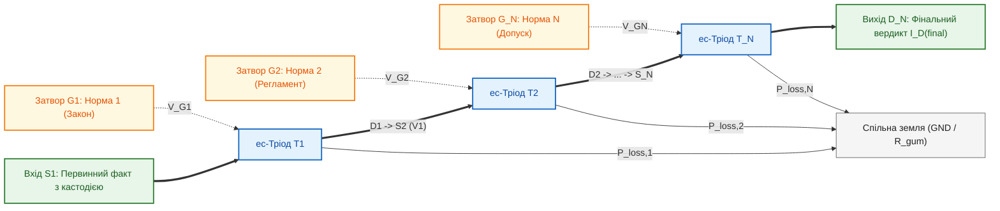
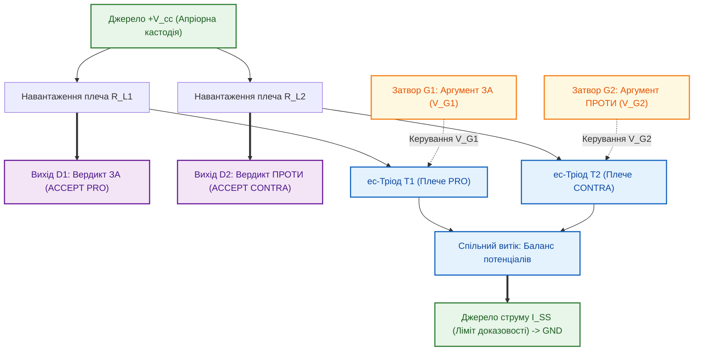

# Глава 07. Багатокаскадні схеми епістемічних тріодів та лінійна обчислювальна складність

> **Книга:** [Теорія епістемічних кіл: Схемотехніка доказових обчислень та апаратного виведення](README.md)
> **Попередня глава:** [← Глава 06. Епістемічний тріод та тритермінальне деонтичне комутування](ch06-epistemic-triode-and-transistor.md)
> **Наступна глава:** [Глава 08. Функціональні операційні вузли епістемічних кіл: релятивістські суматори, дуальні мультиплікатори та гістерезисні компаратори →](ch08-operational-units-adders-multipliers-comparators.md)
> **Зміст книги:** [Повернутися до змісту](README.md)
> **Автор:** Микола Федчик
> **Рівень складності:** `[L3 — Дослідницький рівень]` *(За класифікацією Д. Кнута: асимптотичний аналіз складності багатокаскадного дедуктивного виведення, схемотехніка послідовних каскадів і диференційних пар зі спільним джерелом струму)*
> **Очікувані результати:** Читач зрозуміє причину експоненційного комбінаторного вибуху в класичних машинах логічного виведення з поверненням, опанує топологію та математичний апарат послідовного дедуктивного каскаду з $N$ епістемічних тріодів із гарантованою лінійною часовою складністю $`\Theta(N)`$, вивчить будову диференційного каскаду зі спільним генератором струму для змагального арбітражу колізійних норм і виконає повний інженерний розрахунок п'ятикаскадного авіаційного сертифікаційного ланцюга.

---

## Анотація

Сьома глава присвячена синтезу багатокаскадних інтегральних схем із дискретних епістемічних тріодів для розв'язання двох головних обчислювальних проблем великих баз знань: експоненційного комбінаторного вибуху під час багатоходового виведення та детермінованого арбітражу колізій між конкуруючими нормами. Ми показуємо, що класичні символьні машини на базі резолюції Робінсона [[1]](#src-1) та абстрактної машини Воррена (WAM) [[2]](#src-2) при перевірці ланцюга глибиною $N$ виконують пошук із поверненням (бектрекінг) у дереві станів зі складністю $`\mathcal{O}(b^N)`$, що унеможливлює їхнє використання в системах жорсткого реального часу. У першій частині глави розроблено топологію **послідовного дедуктивного каскаду** з $N$ епістемічних тріодів, де стік кожного попереднього тріода безпосередньо живить витік наступного. Доведено теорему про лінійний час поширення фронту хвилі істинності $`\tau_{\mathrm{prop}} = \Theta(N)`$ тактів, сформульовано інваріант наскрізної провідності та закон автоматичної акумуляції складеної криптографічної кастодії. У другій частині глави за аналогією з класичними балансовими диференційними підсилювачами Грея та Меєра [[5]](#src-5) створено схему **диференційного епістемічного каскаду** зі спільним джерелом струму $`I_{\mathrm{SS}}`$, який за один такт здійснює апаратний арбітраж змагальних аргументів «За» і «Проти» у формалізмі Дунга — Праккена [[3]](#src-3), [[4]](#src-4) з автоматичним переходом у стан `QUALIFIED_NONANSWER (PARITY)` за відсутності достатньої переваги. Наприкінці глави наведено покроковий розрахунок п'ятикаскадного нормативного ланцюга допуску бортового модуля за стандартом RTCA DO-178C [[6]](#src-6).

---

> [!NOTE]
> **Чотири фундаментальні положення авторського внеску Миколи Федчика у Главі 07**
> 1. Розроблено топологію послідовного дедуктивного каскаду з $N$ епістемічних тріодів, яка замінює експоненційний комбінаторний пошук із поверненням $`\mathcal{O}(b^N)`$ на пряме поширення хвилі доказового потенціалу з гарантованою лінійною складністю $`\Theta(N)`$ тактів.
> 2. Сформульовано закон наскрізної провідності багатокаскадного ланцюга $`\sigma_{\mathrm{total}} = \prod_{k=1}^N \sigma_k(V_{G,k})`$ та правило кумулятивного розсіювання метрологічної невизначеності, за яким закриття будь-якого проміжного затвора миттєво знеструмлює весь наступний тракт.
> 3. Введено операцію некоммутативної криптографічної акумуляції складеної кастодії $`\mathcal{C}_{\mathrm{final}} = \mathcal{C}_1 \oplus \mathcal{C}_2 \oplus \dots \oplus \mathcal{C}_N`$, що формує нерозривний аудиторський слід проходження факту крізь усі $N$ нормативних каскадів.
> 4. Створено схемотехнічну архітектуру диференційного епістемічного каскаду на парі узгоджених тріодів зі спільним генератором струму $`I_{\mathrm{SS}}`$, яка виконує апаратний арбітраж суперечливих норм і детектує зону епістемічного паритету за один такт.
> *Керування рантаймом / Інженерний інваріант:* У будь-якому диференційному каскаді сума струмів плечей «За» і «Проти» суворо обмежена струмом спільного джерела кастодії ($`I_{D1} + I_{D2} \le I_{\mathrm{SS}}`$), а при різниці керуючих потенціалів затворів у межах зони нечутливості $`\lvert V_{G1} - V_{G2} \rvert \le \Delta V_{\mathrm{pref}}`$ обидва односторонні виходи блокуються з вердиктом `QUALIFIED_NONANSWER (PARITY)`.

---

## 1. Проблема експоненційного вибуху в класичних системах багатоходового виведення

У реальних інженерних, юридичних та авіаційних регламентах сертифікаційний висновок рідко виводиться за один крок: зазвичай він спирається на глибокий ієрархічний ланцюг із $N$ послідовних норм (федеральний закон $\to$ галузевий техрегламент $\to$ базовий стандарт безпеки $\to$ специфікація випробувань $\to$ допуск конкретного вузла).

У класичних машинах логічного виведення, заснованих на принципі резолюції Джона Алана Робінсона (1965) [[1]](#src-1) та абстрактній машині Девіда Воррена для мови Prolog (WAM, 1983) [[2]](#src-2), перевірка такого ланцюга реалізується через пошук у глибину з поверненням (chronological backtracking). Якщо на кожному з $N$ рівнів існує в середньому $b > 1$ альтернативних правил або уніфікацій, часова складність пошуку зростає експоненційно:

$$
T_{\mathrm{WAM}}(N) = \mathcal{O}(b^N)
$$

При глибині ланцюга $N = 20$ і середньому розгалуженні $b = 4$ кількість станів перевищує $`10^{12}`$, що викликає комбінаторне зависання процесора і робить класичні продукційні системи непридатними для апаратних систем безпеки з жорстким лімітом часу відгуку (WCET).

Теорія епістемічних кіл розв'язує цю проблему радикально: замість перебору дерева гіпотез у часі попередній компілятор кристалізує нормативні зв'язки у топологію з'єднань провідників, а під час виконання (в рантаймі) крізь кристалізовану схему поширюється пряма електромагнітна хвиля доказового потенціалу.

---

## 2. Послідовний дедуктивний каскад епістемічних тріодів

**Означення 7.1 (Послідовний дедуктивний каскад).** Послідовним дедуктивним каскадом порядку $N$ називається лінійне з'єднання $N$ епістемічних тріодів $`T_1, T_2, \dots, T_N`$, у якому силовий стік $`D_k`$ кожного $k$-го тріода ($`1 \le k < N`$) безпосередньо підключений до витоку $`S_{k+1}`$ наступного $(k+1)$-го тріода, а на затвори $`G_1, G_2, \dots, G_N`$ подаються незалежні потенціали чинності норм відповідних ієрархічних рівнів.

Схемотехнічну топологію послідовного каскаду з $N$ епістемічних тріодів зображено на Рисунку 7.1.

**Рисунок 7.1.** Схема послідовного дедуктивного каскаду з $N$ епістемічних тріодів зі спільною шиною заземлення втрат

### 2.1. Математичні інваріанти послідовного каскаду

**Твердження 7.1 (Лінійна складність та наскрізна провідність послідовного каскаду).** *У послідовному дедуктивному каскаді з $N$ епістемічних тріодів результуючий сигнал висновку на стоці $`D_N`$ формується за детермінований лінійний час $`\tau_{\mathrm{prop}} = \Theta(N)`$ тактів без жодного повернення (бектрекінгу), причому наскрізна провідність каскаду дорівнює добутку провідностей усіх $N$ каналів і перетворюється на нуль при закритті хоча б одного затвора.*

**Формула (7.1).** Наскрізна провідність та вихідна напруга послідовного каскаду з $N$ тріодів:

$$
\sigma_{\mathrm{total}} = \prod_{k=1}^N \tilde{\sigma}_k(V_{G, k}), \qquad V_{D, N} = V_{S, 1} \cdot \prod_{k=1}^N \tilde{\sigma}_k(V_{G, k}) - \sum_{k=1}^N \Delta V_{\mathrm{loss}, k}
$$

Тут:
- $`\tilde{\sigma}_k(V_{G, k}) = \sigma_{\mathrm{ch}, k}(V_{G, k}) / \sigma_{\max, k} \in [0, 1]`$ — нормований безрозмірний коефіцієнт передачі $k$-го тріода, визначений за Формулою (6.2);
- $`V_{S, 1} \in (0, 1.0]`$ — вхідний потенціал первинного факту на витоку першого каскаду (еВ);
- $`\Delta V_{\mathrm{loss}, k} \ge 0`$ — падіння потенціалу визначеності на активному метрологічному опорі $k$-го каскаду, що відводиться в шину землі (еВ);
- $`V_{D, N}`$ — фінальний епістемічний потенціал на виході $N$-го каскаду (еВ).

Якщо на будь-якому проміжному рівні $`m \in \{1, \dots, N\}`$ норма скасована або уражена підсікачем Поллока ($`V_{G, m} < V_{\mathrm{th}, m} \implies \tilde{\sigma}_m = 0`$), добуток миттєво обнуляється ($`\sigma_{\mathrm{total}} = 0`$), розриваючи весь ланцюг виведення.

**Формула (7.2).** Лінійний час поширення фронту хвилі виведення крізь $N$-каскадний тракт:

$$
\tau_{\mathrm{prop}}(N) = \sum_{k=1}^N \tau_{\mathrm{switch}, k} = N \cdot \tau_{\mathrm{gate}} = \Theta(N)
$$

Тут:
- $`\tau_{\mathrm{switch}, k}`$ — апаратна затримка перемикання $k$-го епістемічного тріода (рівна $`\tau_{\mathrm{gate}} = 1`$ такту синхронізації процесора знань);
- $`\tau_{\mathrm{prop}}(N)`$ — повний час проходження сигналу від входу $`S_1`$ до виходу $`D_N`$.

**Формула (7.3).** Некомутативна акумуляція складеного вектора кастодії вздовж каскаду:

$$
\mathcal{C}_{\mathrm{final}} = \mathcal{C}_{\mathrm{fact}} \oplus \mathcal{C}_{\mathrm{norm}, 1} \oplus \mathcal{C}_{\mathrm{norm}, 2} \oplus \dots \oplus \mathcal{C}_{\mathrm{norm}, N}
$$

Тут:
- $`\mathcal{C}_{\mathrm{fact}}`$ — криптографічний дескриптор кастодії первинного емпіричного факту на вході $`S_1`$;
- $`\mathcal{C}_{\mathrm{norm}, k}`$ — криптографічний дескриптор кастодії нормативного правила, прикладеного до затвора $`G_k`$ на $k$-му кроці;
- $`\oplus`$ — оператор впорядкованого зчеплення хешів Меркла, який зберігає повну хронологічну трасу проходження доказу крізь усі $N$ каскадів.

---

## 3. Диференційний каскад для змагальної аргументації

У складних нормативних базах знань часто виникають колізії, коли один чинний регламент дозволяє певну дію (аргумент «За» — `PRO`), а інший регламент або застереження безпеки забороняє її (аргумент «Проти» — `CONTRA`). У теорії абстрактної аргументації Дунга [[3]](#src-3) та структурній системі ASPIC+ [[4]](#src-4) для цього будуються графи атак і обчислюються допустимі розширення (extensions).

У теорії епістемічних кіл змагальний арбітраж двох конкуруючих норм реалізується апаратно за один такт за допомогою **диференційного каскаду** на парі ідентичних епістемічних тріодів $`T_1`$ та $`T_2`$, витоки яких об'єднані та підключені до спільного генератора струму кастодії $`I_{\mathrm{SS}}`$ (за аналогією з класичним диференційним підсилювачем Еклза — Джордана та аналоговими інтегральними каскадами Грея — Меєра [[5]](#src-5)). Схему диференційного каскаду подано на Рисунку 7.2.

**Рисунок 7.2.** Схема диференційного каскаду на парі епістемічних тріодів зі спільним генератором струму для змагального арбітражу

**Означення 7.2 (Диференційний епістемічний каскад).** Диференційним епістемічним каскадом називається симетрична балансова схема з двох епістемічних тріодів $`T_1`$ (плече `PRO`) і $`T_2`$ (плече `CONTRA`) зі спільним вузлом витоків, живленим від генератора фіксованого доказового струму $`I_{\mathrm{SS}}`$, яка перерозподіляє струм між плечима пропорційно різниці нормативних потенціалів на затворах $`\Delta V_G = V_{G1} - V_{G2}`$.

**Твердження 7.2 (Закон збереження струму у спільному витоку та придушення синфазних завад).** *У диференційному епістемічному каскаді сума доказових струмів обох змагальних плечей у будь-який момент часу не перевищує струму спільного джерела кастодії ($`I_{D1} + I_{D2} = I_{\mathrm{SS}}`$), а будь-яка синфазна зміна потенціалів обох затворів ($`V_{G1} \leftarrow V_{G1} + \delta`$, $`V_{G2} \leftarrow V_{G2} + \delta`$) взаємно компенсується і не змінює диференційного балансу вердикту.*

**Формула (7.4).** Перерозподіл струмів у плечах диференційного епістемічного каскаду:

$$
I_{D1} = \frac{I_{\mathrm{SS}}}{1 + \exp\left( -\frac{V_{G1} - V_{G2}}{V_{\mathrm{scale}}} \right)}, \qquad I_{D2} = I_{\mathrm{SS}} - I_{D1} = \frac{I_{\mathrm{SS}}}{1 + \exp\left( +\frac{V_{G1} - V_{G2}}{V_{\mathrm{scale}}} \right)}
$$

Тут:
- $`I_{D1}, I_{D2}`$ — доказові струми у плечі `PRO` ($`T_1`$) та плечі `CONTRA` ($`T_2`$);
- $`I_{\mathrm{SS}}`$ — повний струм спільного джерела кастодії у вузлі витоків;
- $`V_{G1}, V_{G2}`$ — потенціали затворів конкуруючих норм з урахуванням їхнього ієрархічного пріоритету *Lex Superior* / *Lex Specialis* (еВ);
- $`V_{\mathrm{scale}} > 0`$ — крутизна диференційного перемикання (параметр чутливості арбітра, еВ).

**Формула (7.5).** Порогове правило арбітражу диференційного каскаду з зоною паритету:

$$
\mathrm{Verdict}_{\mathrm{diff}}(V_{G1}, V_{G2}) = \begin{cases}
\mathbf{ACCEPT(PRO)}, & \text{при } V_{G1} - V_{G2} > \Delta V_{\mathrm{pref}} \\
\mathbf{ACCEPT(CONTRA)}, & \text{при } V_{G2} - V_{G1} > \Delta V_{\mathrm{pref}} \\
\mathbf{QUALIFIED\_NONANSWER(PARITY)}, & \text{при } \lvert V_{G1} - V_{G2} \rvert \le \Delta V_{\mathrm{pref}}
\end{cases}
$$

Тут:
- $`\Delta V_{\mathrm{pref}} > 0`$ — мінімально необхідний поріг нормативної переваги (різниця юридичної сили або метрологічної достовірності, еВ), необхідний для одностороннього перекидання струму в одне з плечей.

Порівняння класичного пошуку з поверненням та багатокаскадної епістемічної схемотехніки узагальнено в Таблиці 7.1.

**Таблиця 7.1.** Порівняння класичних машин резолюції (Prolog / WAM) та багатокаскадних схем епістемічних тріодів

| Критерій порівняння | Класичні машини виведення (Prolog / WAM) | Багатокаскадні схеми епістемічних тріодів |
| :--- | :--- | :--- |
| **Часова складність ланцюга глибини $N$** | Експоненційна $`\mathcal{O}(b^N)`$ через бектрекінг у дереві станів | Суворо лінійна $`\Theta(N)`$ тактів поширення фронту хвилі |
| **Реакція на скасування проміжної норми** | Потребує повного перегляду дерева або викликає зациклення | Миттєве закриття $k$-го затвора ($`\sigma_{\mathrm{total}} = 0`$) за 1 такт |
| **Арбітраж суперечливих норм** | Евристичне впорядкування правил (ризик залежності від порядку рядків) | Балансовий диференційний каскад із точним детектуванням паритету |
| **Аудиторська трасованість ланцюга** | Стек викликів зникає після завершення запиту | Автоматична акумуляція складеного вектора кастодії $`\mathcal{C}_{\mathrm{final}}`$ |

---

## 4. Навчальний інженерний приклад: розрахунок п'ятикаскадного нормативного ланцюга та диференційного арбітражу авіаційного допуску

Розглянемо інженерну задачу автоматизованої сертифікаційної перевірки бортового обчислювального модуля системи керування польотом згідно з вимогами стандарту безпеки ПЗ авіоніки RTCA DO-178C (рівень критичності DAL A) [[6]](#src-6).

### 4.1. Вихідні інженерні дані

1. **Послідовний дедуктивний каскад ($`N = 5`$ рівнів):**
   - Вхідний факт $`S_1`$: Протокол 100% структурного покриття коду за критерієм MC/DC у спільній пам'яті з потенціалом $`V_{S,1} = 1.00\,\text{еВ}`$.
   - Усі 5 тріодів мають однакові порогові параметри: $`V_{\mathrm{th}} = 0.60\,\text{еВ}`$, $`V_{\mathrm{sat}} = 0.90\,\text{еВ}`$, активні втрати на каскад $`\Delta V_{\mathrm{loss}, k} = 0.02\,\text{еВ}`$.
   - Потенціали затворів 5 рівнів нормативної ієрархії:
     - $`G_1`$ (Базовий регламент льотної придатності): $`V_{G,1} = 0.95\,\text{еВ}`$;
     - $`G_2`$ (Стандарт RTCA DO-178C DAL A): $`V_{G,2} = 0.92\,\text{еВ}`$;
     - $`G_3`$ (Специфікація трасованості вимог високого рівня): $`V_{G,3} = 0.90\,\text{еВ}`$;
     - $`G_4`$ (Протокол верифікації об'єктного коду): $`V_{G,4} = 0.84\,\text{еВ}`$;
     - $`G_5`$ (Допуск конфігураційного білду): $`V_{G,5} = 0.91\,\text{еВ}`$.
2. **Диференційний каскад арбітражу колізії:**
   На виході послідовного каскаду виникає нормативна колізія між правилом штатного допуску до польоту (плече `PRO`, $`V_{G1}`$) та спеціальною директивою льотної придатності щодо температурного обмеження процесора (плече `CONTRA`, $`V_{G2}`$). Параметри диференційної пари: $`I_{\mathrm{SS}} = 1.00`$, масштаб чутливості $`V_{\mathrm{scale}} = 0.05\,\text{еВ}`$, поріг переваги $`\Delta V_{\mathrm{pref}} = 0.08\,\text{еВ}`$.

### 4.2. Покроковий розрахунок

**Крок 1. Обчислення коефіцієнтів передачі кожного з 5 тріодів послідовного каскаду.**
Перевіряємо режим роботи кожного тріода за Формулою (6.2) при $`V_{\mathrm{th}} = 0.60\,\text{еВ}`$ та $`V_{\mathrm{sat}} = 0.90\,\text{еВ}`$:
- Для тріодів $`T_1, T_2, T_3, T_5`$ потенціали затворів задовольняють умову $`V_{G,k} \ge 0.90\,\text{еВ}`$ (режим насичення), тому їхні нормовані коефіцієнти передачі дорівнюють одиниці:

$$
\tilde{\sigma}_1 = \tilde{\sigma}_2 = \tilde{\sigma}_3 = \tilde{\sigma}_5 = 1.0000
$$

- Тріод $`T_4`$ має потенціал затвора $`V_{G,4} = 0.84\,\text{еВ} \in [0.60, 0.90)`$ і працює в активному метрологічному режимі:

$$
\tilde{\sigma}_4(0.84) = \frac{0.84 - 0.60}{0.90 - 0.60} = \frac{0.24}{0.30} = 0.8000
$$

**Крок 2. Обчислення наскрізної провідності, часу затримки та вихідного потенціалу 5-каскадного ланцюга.**
За Формулою (7.1) та (7.2) знаходимо наскрізну провідність, вихідну напругу $`V_{D,5}`$ і час проходження сигналу:

$$
\sigma_{\mathrm{total}} = 1.0 \times 1.0 \times 1.0 \times 0.8000 \times 1.0 = 0.8000
$$

$$
V_{D, 5} = 1.00 \times 0.8000 - 5 \times 0.02 = 0.8000 - 0.1000 = 0.7000\,\text{еВ}, \qquad \tau_{\mathrm{prop}}(5) = 5\text{ тактів}
$$

Отже, рівно за 5 тактів синхронізації сигнал проходить крізь усі 5 рівнів сертифікації, формуючи на виході потенціал $`V_{D,5} = 0.7000\,\text{еВ}`$ та складений вектор кастодії $`\mathcal{C}_{\mathrm{final}} = \mathcal{C}_{\mathrm{fact}} \oplus \mathcal{C}_1 \oplus \mathcal{C}_2 \oplus \mathcal{C}_3 \oplus \mathcal{C}_4 \oplus \mathcal{C}_5`$.

**Крок 3. Диференційний арбітраж у стані паритету норм.**
Нехай отриманий сигнал подається на затвор плеча `PRO` ($`V_{G1} = 0.7000\,\text{еВ}`$), а конкуруюча тимчасова інструкція на затворі `CONTRA` має потенціал $`V_{G2} = 0.6600\,\text{еВ}`$. Перевіряємо різницю потенціалів за Формулою (7.5):

$$
\lvert V_{G1} - V_{G2} \rvert = \lvert 0.7000 - 0.6600 \rvert = 0.0400\,\text{еВ} \le \Delta V_{\mathrm{pref}} = 0.0800\,\text{еВ}
$$

Оскільки різниця не перевищує порогу нормативної переваги, диференційний каскад блокує обидва односторонні дозволи і видає чесний вердикт `QUALIFIED_NONANSWER (PARITY)`, вимагаючи залучення норми вищого ієрархічного рангу.

**Крок 4. Диференційний арбітраж при надходженні імперативної директиви льотної придатності (*Lex Specialis*).**
Нехай на затвор `CONTRA` надходить обов'язкова директива безпеки вищого пріоритету з потенціалом $`V_{G2} = 0.9000\,\text{еВ}`$. Тоді:

$$
V_{G2} - V_{G1} = 0.9000 - 0.7000 = 0.2000\,\text{еВ} > \Delta V_{\mathrm{pref}} = 0.0800\,\text{еВ}
$$

За Формулою (7.4) струми у плечах диференційної пари розподіляються так:

$$
I_{D1} = \frac{1.00}{1 + \exp\left( -\frac{0.70 - 0.90}{0.05} \right)} = \frac{1.00}{1 + e^{4.0}} \approx 0.0180, \qquad I_{D2} = 1.00 - 0.0180 = 0.9820
$$

Майже весь струм кастодії ($`98.2\%`$) за один такт перекидається у плече $`T_2`$, і система детерміновано фіксує вердикт `ACCEPT(CONTRA)` (заборона вильоту до усунення температурної невідповідності).

---

## Висновки

1. Заміна динамічного пошуку в дереві резолюцій на попередньо скомпільований послідовний каскад із $N$ епістемічних тріодів знижує часову складність багатоходового дедуктивного виведення з експоненційної $`\mathcal{O}(b^N)`$ до суворо лінійної $`\Theta(N)`$ тактів.
2. Закон наскрізної мультиплікативної провідності $`\sigma_{\mathrm{total}} = \prod_{k=1}^N \tilde{\sigma}_k(V_{G,k})`$ гарантує миттєве переривання всього дедуктивного ланцюга при відкликанні або підсіканні будь-якої проміжної норми на будь-якому рівні ієрархії.
3. Некомутативна акумуляція векторів кастодії $`\mathcal{C}_{\mathrm{final}}`$ вздовж послідовного каскаду створює незнищенний криптографічний сертифікат, який побайтово документує як первинний факт, так і кожну з $N$ застосованих норм.
4. Диференційний каскад на парі епістемічних тріодів зі спільним генератором струму $`I_{\mathrm{SS}}`$ перетворює змагальну аргументацію Дунга — Праккена на балансову фізичну схему, яка за один такт розв'язує колізії за правилами *Lex Superior* / *Lex Specialis* або детектує стан нормативного паритету.

---

## Словник

| Термін | Англійський еквівалент | Визначення |
| :--- | :--- | :--- |
| **Акумуляція складеної кастодії** | Composite Custody Accumulation | Послідовне криптографічне зчеплення дескрипторів кастодії первинного факту та всіх проміжних норм під час проходження сигналу крізь каскад. |
| **Диференційний епістемічний каскад** | Differential Epistemic Cascade | Балансова схема з двох епістемічних тріодів зі спільним джерелом струму, призначена для апаратного арбітражу суперечливих аргументів «За» і «Проти». |
| **Зона нормативного паритету** | Normative Parity Zone | Діапазон близькості потенціалів конкуруючих затворів, у межах якого диференційний каскад блокує односторонній вибір і повертає кваліфіковану відмову. |
| **Комбінаторний вибух бектрекінгу** | Backtracking Combinatorial Explosion | Експоненційне зростання кількості проміжних станів і часу пошуку з поверненням у класичних машинах логічного виведення при збільшенні глибини ланцюга правил. |
| **Наскрізна провідність каскаду** | End-to-End Cascade Conductance | Результуюча провідність послідовного ланцюга тріодів, рівна добутку нормованих провідностей усіх його елементарних ступенів. |
| **Послідовний дедуктивний каскад** | Sequential Deductive Cascade | Лінійна багатоступенева схема, де стік кожного попереднього тріода живить витік наступного, забезпечуючи перевірку ланцюга норм за лінійний час. |
| **Спільне джерело струму кастодії** | Common-Mode Custody Current Tail | Генератор фіксованого доказового струму в спільному витоку диференційної пари, який обмежує сумарну потужність конкуруючих плечей. |

---

## Абревіатури

| Абревіатура | Розшифрування | Опис |
| :--- | :--- | :--- |
| **CMRR** | Common-Mode Rejection Ratio | Коефіцієнт придушення синфазного сигналу в диференційному каскаді. |
| **DAL** | Design Assurance Level | Рівень гарантії проєктування в авіаційному стандарті DO-178C (від DAL E до найвищого DAL A). |
| **DO-178C** | Software Considerations in Airborne Systems and Equipment Certification | Міжнародний авіаційний стандарт RTCA щодо сертифікації бортового програмного забезпечення. |
| **MC/DC** | Modified Condition / Decision Coverage | Модифікований критерій покриття умов і рішень при верифікації критичного коду рівня DAL A. |
| **WAM** | Warren Abstract Machine | Абстрактна стекова машина Девіда Воррена (1983) для виконання програм мовою Prolog із хронологічним бектрекінгом. |
| **WCET** | Worst-Case Execution Time | Гарантований найгірший час виконання операції в системах жорсткого реального часу. |

---

## Джерела

1. **Robinson, J. A.** A Machine-Oriented Logic Based on the Resolution Principle // *Journal of the ACM*. — 1965. — Vol. 12, No. 1. — P. 23–41. — DOI: 10.1145/321250.321253.
2. **Warren, D. H. D.** *An Abstract Prolog Instruction Set* : Technical Note 309. — Menlo Park, CA : SRI International, 1983. — 30 p.
3. **Dung, P. M.** On the acceptability of arguments and its fundamental role in nonmonotonic reasoning, logic programming and n-person games // *Artificial Intelligence*. — 1995. — Vol. 77, No. 2. — P. 321–357. — DOI: 10.1016/0004-3702(94)00041-X.
4. **Modgil, S., Prakken, H.** The ASPIC+ framework for structured argumentation: a tutorial // *Argument & Computation*. — 2014. — Vol. 5, No. 1. — P. 31–62.
5. **Gray, P. R., Hurst, P. J., Lewis, S. H., Meyer, R. G.** *Analysis and Design of Analog Integrated Circuits* (5th Edition). — Hoboken, NJ : John Wiley & Sons, 2009. — 896 p. (Глава 4: Диференційні каскади зі спільним джерелом струму).
6. **RTCA DO-178C / EUROCAE ED-12C.** *Software Considerations in Airborne Systems and Equipment Certification*. — Washington, DC : Radio Technical Commission for Aeronautics (RTCA), 2011.

---

[← Глава 06. Епістемічний тріод та тритермінальне деонтичне комутування](ch06-epistemic-triode-and-transistor.md) | [Зміст книги](README.md) | [Глава 08. Функціональні операційні вузли епістемічних кіл: релятивістські суматори, дуальні мультиплікатори та гістерезисні компаратори →](ch08-operational-units-adders-multipliers-comparators.md)
