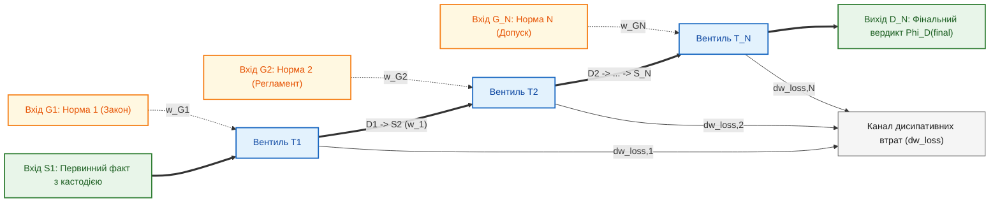
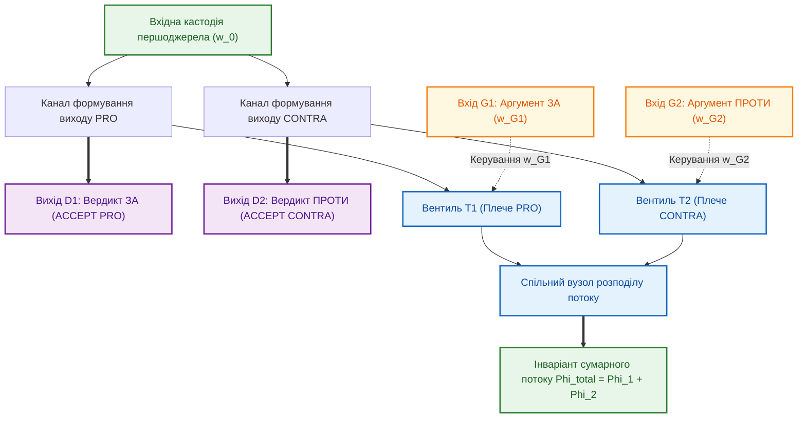

# Глава 07. Багатокаскадні дедуктивні схеми та лінійна обчислювальна складність

> **Книга:** [Теорія епістемічних обчислювальних схем: Математичні інваріанти кастодії, метрології та детермінованого виведення](README.md) · Частина 3. Багатокаскадні схеми та функціональні операційні вузли  
> **Попередня глава:** [Глава 06. Тритермінальний деонтичний вентиль та асиметричне комутування нормативних правил](ch06-three-terminal-deontic-gate.md)  
> **Наступна глава:** [Глава 08. Функціональні операційні вузли епістемічних схем: нелінійні суматори, дуальні мультиплікатори та інтервальні компаратори](ch08-operational-units-adders-multipliers-comparators.md)  
> **Зміст книги:** [README.md](README.md)  
> **Автор:** [Микола Федчик](../ExpertSystem/about-the-author.md)  
> **Рівень складності та оптимальне вивчення:** `[L3]` Дослідницький формально-алгебраїчний (індекс Д. Кнута `[35]`) · *Маршрут:* Базове ядро всіх треків; 2 проходи з опрацюванням розрахункового прикладу  
> **Очікувані результати:** пояснити причину експоненційного комбінаторного вибуху в класичних машинах логічного виведення з поверненням; опанувати топологію та математичний апарат послідовного дедуктивного каскаду з $N$ тритермінальних деонтичних вентилів із гарантованою лінійною часовою складністю $`\Theta(N)`$ у рантаймі; розраховувати симетричний параконсистентний диференційний арбітр зі збереженням сумарного потоку для колізійних норм і виконувати розрахунок п'ятикаскадного авіаційного сертифікаційного тракту.

## Анотація

Сьома глава присвячена синтезу багатокаскадних обчислювальних схем із тритермінальних деонтичних вентилів для розв'язання двох обчислювальних задач великих баз знань: усунення експоненційного перебору під час багатоходового виведення в рантаймі та детермінованого арбітражу колізій між конкуруючими нормами. Показано, що класичні символьні машини на базі резолюції Робінсона [[1]](#src-1) та абстрактної машини Воррена (WAM) [[2]](#src-2) при перевірці тракту глибиною $N$ виконують пошук із поверненням (бектрекінг) у дереві станів зі складністю $`\mathcal{O}(b^N)`$, що ускладнює їхнє застосування в системах жорсткого реального часу.

У першій частині глави розроблено топологію **послідовного дедуктивного каскаду** з $N$ тритермінальних деонтичних вентилів, де вихід кожного попереднього вентиля безпосередньо з'єднаний з інформаційним входом наступного. Доведено твердження про лінійний час поширення тензора стану $`\tau_{\mathrm{prop}} = \Theta(N)`$ тактів, сформульовано інваріант наскрізної провідності та оператор послідовної акумуляції складеної криптографічної кастодії. У другій частині глави розроблено модель **симетричного параконсистентного диференційного арбітра** з фіксованим сумарним потоком верифікації $`\Phi_{\mathrm{total}}`$ [[5]](#src-5), який за один такт здійснює арбітраж змагальних аргументів «За» і «Проти» у формалізмі Дунга — Праккена [[3]](#src-3), [[4]](#src-4) з автоматичним переходом у стан `QUALIFIED_NONANSWER (PARITY)` за відсутності достатньої нормативної переваги. Наприкінці глави наведено покроковий розрахунок п'ятикаскадного нормативного тракту допуску бортового модуля за стандартом RTCA DO-178C [[6]](#src-6).

---

> [!NOTE]
> **Чотири наукові положення, що виносяться на захист у Главі 07**
> 1. **Просторово-часова амортизація виведення у послідовних каскадах:** розроблено топологію дедуктивного каскаду з $N$ деонтичних вентилів, яка для стратифікованих нормативних баз з обмеженою деревною шириною переносить комбінаторну уніфікацію на етап офлайн-компіляції та забезпечує детермінований лінійний час оперативного відгуку $`\Theta(N)`$ тактів у рантаймі.
> 2. **Мультиплікативний інваріант наскрізної провідності та миттєвого блокування:** сформульовано інваріант провідності багатокаскадного тракту $`\sigma_{\mathrm{total}} = \prod_{k=1}^N \sigma_k(w_{G,k})`$ з адитивним накопиченням втрат визначеності, за яким блокування будь-якого проміжного вентиля за один такт зупиняє весь наступний тракт.
> 3. **Некомутативна криптографічна акумуляція складеної кастодії:** введено оператор послідовного зчеплення хешів Меркла $`\mathcal{C}_{\mathrm{final}} = \mathcal{C}_{\mathrm{fact}} \oplus \mathcal{C}_{\mathrm{norm},1} \oplus \dots \oplus \mathcal{C}_{\mathrm{norm},N}`$, що формує невідкличний аудиторський сертифікат проходження факту крізь усі $N$ нормативних рівнів.
> 4. **Симетричний параконсистентний диференційний арбітр колізій (ASPIC+):** створено схему балансового арбітра на парі узгоджених деонтичних вентилів зі збереженням сумарного потоку $`\Phi_{\mathrm{total}}`$, яка за один такт виконує порівняння конкуруючих норм і детектує зону нормативного паритету.
> *Керування рантаймом / Інженерний інваріант:* У будь-якому диференційному арбітрі сума потоків плечей «За» і «Проти» суворо обмежена вхідним потоком кастодії ($`\Phi_1 + \Phi_2 = \Phi_{\mathrm{total}}`$), а при різниці потенціалів керуючих входів у межах зони нечутливості $`\lvert w_{G1} - w_{G2} \rvert \le \Delta w_{\mathrm{pref}}`$ обидва односторонні виходи блокуються з вердиктом `QUALIFIED_NONANSWER (PARITY)`.

---

## 1. Проблема експоненційного вибуху в класичних системах багатоходового виведення

У реальних інженерних, юридичних та авіаційних регламентах сертифікаційний висновок рідко виводиться за один крок: зазвичай він спирається на ієрархічний тракт із $N$ послідовних норм (базовий закон $\to$ галузевий техрегламент $\to$ стандарт функціональної безпеки $\to$ специфікація випробувань $\to$ допуск конкретного вузла).

У класичних машинах логічного виведення, заснованих на принципі резолюції Джона Алана Робінсона (1965) [[1]](#src-1) та абстрактній машині Девіда Воррена для мови Prolog (WAM, 1983) [[2]](#src-2), перевірка такого ланцюга реалізується через пошук у глибину з поверненням (*chronological backtracking*). Якщо на кожному з $N$ рівнів існує в середньому $b > 1$ альтернативних правил або уніфікацій, часова складність пошуку зростає експоненційно:

$$
T_{\mathrm{WAM}}(N) = \mathcal{O}(b^N)
$$

При глибині тракту $N = 20$ і середньому розгалуженні $b = 4$ кількість станів перевищує $`10^{12}`$, що робить класичні пошукові системи непридатними для апаратних систем керування з жорстким лімітом часу відгуку (WCET).

Теорія епістемічних обчислювальних схем (ТЕОС) розв'язує цю проблему для класу стратифікованих нормативних систем з обмеженою деревною шириною (теорему про просторово-часову амортизацію та межі Кука — Левіна детально доведено у [Главі 09](ch09-scientific-critique-and-applicability-limits.md)): замість динамічного перебору дерева гіпотез у рантаймі компілятор знань заздалегідь транслює нормативні зв'язки у канонічний спрямований ациклічний граф (DAG), а під час оперативного виконання крізь схему за лінійний час $`\Theta(N)`$ поширюється епістемічний тензор стану.

---

## 2. Послідовний дедуктивний каскад деонтичних вентилів

**Означення 7.1 (Послідовний дедуктивний каскад).** *Послідовним дедуктивним каскадом* порядку $N$ називається лінійна композиція $N$ тритермінальних деонтичних вентилів $`\mathcal{T}_1, \mathcal{T}_2, \dots, \mathcal{T}_N`$, у якій вихід вердикту $`D_k`$ кожного $k$-го вентиля ($`1 \le k < N`$) безпосередньо підключений до інформаційного входу джерела $`S_{k+1}`$ наступного $(k+1)$-го вентиля, а на керуючі входи $`G_1, G_2, \dots, G_N`$ подаються незалежні потенціали чинності норм відповідних ієрархічних рівнів.

Топологію послідовного каскаду з $N$ деонтичних вентилів зображено на рисунку 7.1.

**Рисунок 7.1.** Схема послідовного дедуктивного каскаду з $N$ тритермінальних деонтичних вентилів із обліком атенюації достовірності.

### 2.1. Математичні інваріанти послідовного каскаду

**Твердження 7.1 (Лінійна складність та наскрізна провідність послідовного каскаду).** *У послідовному дедуктивному каскаді з $N$ деонтичних вентилів результуючий тензор висновку на виході $`D_N`$ формується за детермінований лінійний час $`\tau_{\mathrm{prop}} = \Theta(N)`$ тактів без пошукового повернення (бектрекінгу), причому наскрізна провідність каскаду дорівнює добутку провідностей усіх $N$ вентилів і перетворюється на нуль при блокуванні хоча б одного керуючого входу.*

$$
\sigma_{\mathrm{total}} = \prod_{k=1}^N \sigma_k(w_{G, k}), \qquad w_{D, N} = w_{S, 1} \cdot \prod_{k=1}^N \sigma_k(w_{G, k}) - \sum_{k=1}^N \Delta w_{\mathrm{loss}, k}
$$

**Формула (7.1).** Наскрізна нормована провідність та вихідний потенціал достовірності послідовного каскаду з $N$ вентилів.

Тут:
- $`\sigma_k(w_{G, k}) = \sigma_{\mathrm{ch}, k}(w_{G, k}) / \sigma_{\max, k} \in [0, 1]`$ — нормований безрозмірний коефіцієнт провідності $k$-го вентиля, визначений за формулою (6.2);
- $`w_{S, 1} \in (0, 1{,}0]`$ — вхідний безрозмірний потенціал достовірності первинного факту на вході першого каскаду;
- $`\Delta w_{\mathrm{loss}, k} \ge 0`$ — спад потенціалу достовірності внаслідок метрологічної деградації на $k$-му каскаді;
- $`w_{D, N} \in [0, 1]`$ — фінальний потенціал достовірності на виході $N$-го каскаду.

Якщо на будь-якому проміжному рівні $`m \in \{1, \dots, N\}`$ норма скасована або уражена підсікачем Поллока ($`w_{G, m} < w_{\mathrm{th}, m} \implies \sigma_m = 0`$), добуток за один такт обнуляється ($`\sigma_{\mathrm{total}} = 0`$), блокуючи весь тракт виведення.

$$
\tau_{\mathrm{prop}}(N) = \sum_{k=1}^N \tau_{\mathrm{switch}, k} = N \cdot \tau_{\mathrm{gate}} = \Theta(N)
$$

**Формула (7.2).** Лінійний час поширення тензора стану крізь $N$-каскадний тракт.

Тут:
- $`\tau_{\mathrm{switch}, k}`$ — апаратна затримка обчислення $k$-го деонтичного вентиля (рівна $`\tau_{\mathrm{gate}} = 1`$ такту синхронізації процесора знань);
- $`\tau_{\mathrm{prop}}(N)`$ — повний час проходження сигналу від входу $`S_1`$ до виходу $`D_N`$.

$$
\mathcal{C}_{\mathrm{final}} = \mathcal{C}_{\mathrm{fact}} \oplus \mathcal{C}_{\mathrm{norm}, 1} \oplus \mathcal{C}_{\mathrm{norm}, 2} \oplus \dots \oplus \mathcal{C}_{\mathrm{norm}, N}
$$

**Формула (7.3).** Некомутативна акумуляція складеного дескриптора кастодії вздовж каскаду.

Тут:
- $`\mathcal{C}_{\mathrm{fact}}`$ — криптографічний дескриптор кастодії первинного емпіричного факту на вході $`S_1`$;
- $`\mathcal{C}_{\mathrm{norm}, k}`$ — криптографічний дескриптор кастодії нормативного правила, прикладеного до керуючого входу $`G_k`$ на $k$-му кроці;
- $`\oplus`$ — оператор впорядкованого зчеплення хешів Меркла, який зберігає повну хронологічну трасу проходження доказу крізь усі $N$ каскадів.

---

## 3. Симетричний параконсистентний диференційний арбітр для змагальної аргументації

У складних нормативних базах знань виникають колізії, коли один чинний регламент дозволяє певну дію (аргумент «За» — `PRO`), а інший регламент або застереження безпеки забороняє її (аргумент «Проти» — `CONTRA`). У теорії абстрактної аргументації Дунга [[3]](#src-3) та структурній системі ASPIC+ [[4]](#src-4) для цього будуються графи атак і обчислюються допустимі розширення (*extensions*).

У ТЕОС змагальний арбітраж двох конкуруючих норм реалізується за один такт за допомогою **симетричного параконсистентного диференційного арбітра** на парі узгоджених деонтичних вентилів $`\mathcal{T}_1`$ та $`\mathcal{T}_2`$, інформаційні входи яких підключені до спільного вузла з фіксованим сумарним потоком кастодії $`\Phi_{\mathrm{total}}`$ [[5]](#src-5). Структуру диференційного арбітра подано на рисунку 7.2.

**Рисунок 7.2.** Схема симетричного параконсистентного диференційного арбітра зі збереженням сумарного потоку для змагального виведення.

**Означення 7.2 (Симетричний диференційний арбітр).** *Симетричним диференційним арбітром* називається балансова схема з двох тритермінальних деонтичних вентилів $`\mathcal{T}_1`$ (плече `PRO`) і $`\mathcal{T}_2`$ (плече `CONTRA`) зі спільним вузлом обмеження сумарного потоку верифікації $`\Phi_{\mathrm{total}}`$, яка перерозподіляє потік транзакцій між плечима пропорційно до різниці нормативних потенціалів на керуючих входах $`\Delta w_G = w_{G1} - w_{G2}`$.

**Твердження 7.2 (Інваріант збереження потоку у спільному вузлі та інваріантність до синфазного зміщення).** *У симетричному диференційному арбітрі сума потоків верифікації обох змагальних плечей у будь-який такт часу дорівнює сумарному вхідному потоку кастодії ($`\Phi_1 + \Phi_2 = \Phi_{\mathrm{total}}`$), а будь-яке синфазне зміщення потенціалів обох керуючих входів ($`w_{G1} \leftarrow w_{G1} + \delta`$, $`w_{G2} \leftarrow w_{G2} + \delta`$) взаємно компенсується і не змінює диференційного балансу вердикту.*

$$
\Phi_1 = \frac{\Phi_{\mathrm{total}}}{1 + \exp\left( -\frac{w_{G1} - w_{G2}}{w_{\mathrm{scale}}} \right)}, \qquad \Phi_2 = \Phi_{\mathrm{total}} - \Phi_1 = \frac{\Phi_{\mathrm{total}}}{1 + \exp\left( +\frac{w_{G1} - w_{G2}}{w_{\mathrm{scale}}} \right)}
$$

**Формула (7.4).** Перерозподіл потоків транзакцій у плечах симетричного диференційного арбітра.

Тут:
- $`\Phi_1, \Phi_2 \ge 0`$ — потоки верифікації у плечі `PRO` ($`\mathcal{T}_1`$) та плечі `CONTRA` ($`\mathcal{T}_2`$), $`\text{такт}^{-1}`$;
- $`\Phi_{\mathrm{total}} > 0`$ — повний вхідний потік спільного джерела кастодії, $`\text{такт}^{-1}`$;
- $`w_{G1}, w_{G2} \in [0, 1]`$ — безрозмірні потенціали керуючих входів конкуруючих норм з урахуванням їхнього ієрархічного пріоритету *Lex Superior* / *Lex Specialis*;
- $`w_{\mathrm{scale}} > 0`$ — безрозмірний параметр масштабу чутливості диференційного перемикання.

$$
\mathrm{Verdict}_{\mathrm{diff}}(w_{G1}, w_{G2}) = \begin{cases}
\mathbf{ACCEPT(PRO)}, & \text{при } w_{G1} - w_{G2} > \Delta w_{\mathrm{pref}} \\
\mathbf{ACCEPT(CONTRA)}, & \text{при } w_{G2} - w_{G1} > \Delta w_{\mathrm{pref}} \\
\mathbf{QUALIFIED\_NONANSWER(PARITY)}, & \text{при } \lvert w_{G1} - w_{G2} \rvert \le \Delta w_{\mathrm{pref}}
\end{cases}
$$

**Формула (7.5).** Порогове правило арбітражу диференційного каскаду із зоною паритету.

Тут:
- $`\Delta w_{\mathrm{pref}} > 0`$ — мінімально необхідний безрозмірний поріг нормативної переваги (різниця юридичної сили або метрологічної достовірності), потрібний для одностороннього присудження вердикту одному з плечей.

Порівняння класичного пошуку з поверненням та багатокаскадних епістемічних схем узагальнено в таблиці 7.1.

**Таблиця 7.1.** Порівняння класичних машин резолюції (Prolog / WAM) та багатокаскадних схем деонтичних вентилів.

| Критерій порівняння | Класичні машини виведення (Prolog / WAM) | Багатокаскадні схеми деонтичних вентилів (ТЕОС) |
| :--- | :--- | :--- |
| **Часова складність тракту глибини $N$** | Експоненційна $`\mathcal{O}(b^N)`$ через бектрекінг у дереві станів | Суворо лінійна $`\Theta(N)`$ тактів поширення у рантаймі |
| **Реакція на скасування проміжної норми** | Потребує повторного обходу дерева або викликає зациклення | Блокування $k$-го вентиля ($`\sigma_{\mathrm{total}} = 0`$) за 1 такт |
| **Арбітраж суперечливих норм** | Евристичне впорядкування правил (залежність від порядку оголошення) | Симетричний диференційний арбітр із детектуванням паритету |
| **Аудиторська трасованість тракту** | Стек викликів знищується після завершення запиту | Автоматична акумуляція складеного дескриптора кастодії $`\mathcal{C}_{\mathrm{final}}`$ |

---

## 4. Навчальний інженерний приклад: розрахунок п'ятикаскадного нормативного тракту та диференційного арбітражу авіаційного допуску

Розглянемо задачу автоматизованої сертифікаційної перевірки бортового обчислювального модуля системи керування польотом згідно з вимогами стандарту безпеки ПЗ авіоніки RTCA DO-178C (рівень критичності DAL A) [[6]](#src-6).

### 4.1. Вихідні інженерні дані

1. **Послідовний дедуктивний каскад ($`N = 5`$ рівнів):**
   - Вхідний факт $`S_1`$: Протокол 100% структурного покриття коду за критерієм MC/DC у спільній пам'яті з початковим потенціалом достовірності $`w_{S,1} = 1{,}00`$.
   - Усі 5 деонтичних вентилів мають однакові порогові параметри: $`w_{\mathrm{th}} = 0{,}60`$, $`w_{\mathrm{sat}} = 0{,}90`$, метрологічні втрати на каскад $`\Delta w_{\mathrm{loss}, k} = 0{,}02`$.
   - Потенціали керуючих входів 5 рівнів нормативної ієрархії:
     - $`G_1`$ (Базовий регламент льотної придатності): $`w_{G,1} = 0{,}95`$;
     - $`G_2`$ (Стандарт RTCA DO-178C DAL A): $`w_{G,2} = 0{,}92`$;
     - $`G_3`$ (Специфікація трасованості вимог високого рівня): $`w_{G,3} = 0{,}90`$;
     - $`G_4`$ (Протокол верифікації об'єктного коду): $`w_{G,4} = 0{,}84`$;
     - $`G_5`$ (Допуск конфігураційного білду): $`w_{G,5} = 0{,}91`$.
2. **Симетричний диференційний арбітр колізії:**
   На виході послідовного каскаду виникає нормативна колізія між правилом штатного допуску до польоту (плече `PRO`, $`w_{G1}`$) та спеціальною директивою льотної придатності щодо температурного обмеження процесора (плече `CONTRA`, $`w_{G2}`$). Параметри диференційного арбітра: сумарний потік $`\Phi_{\mathrm{total}} = 1{,}00\text{ такт}^{-1}`$, масштаб чутливості $`w_{\mathrm{scale}} = 0{,}05`$, поріг переваги $`\Delta w_{\mathrm{pref}} = 0{,}08`$.

### 4.2. Покроковий розрахунок

**Крок 1. Обчислення коефіцієнтів провідності кожного з 5 вентилів послідовного каскаду.**
Перевіряємо режим роботи кожного вентиля за формулою (6.2) при $`w_{\mathrm{th}} = 0{,}60`$ та $`w_{\mathrm{sat}} = 0{,}90`$:
- Для вентилів $`\mathcal{T}_1, \mathcal{T}_2, \mathcal{T}_3, \mathcal{T}_5`$ потенціали керуючих входів задовольняють умову $`w_{G,k} \ge 0{,}90`$ (режим насичення), тому їхні нормовані провідності дорівнюють одиниці:

$$
\sigma_1 = \sigma_2 = \sigma_3 = \sigma_5 = 1{,}0000
$$

- Вентиль $`\mathcal{T}_4`$ має потенціал керуючого входу $`w_{G,4} = 0{,}84 \in [0{,}60, 0{,}90)`$ і працює в активному метрологічному режимі:

$$
\sigma_4(0{,}84) = \frac{0{,}84 - 0{,}60}{0{,}90 - 0{,}60} = \frac{0{,}24}{0{,}30} = 0{,}8000
$$

**Крок 2. Обчислення наскрізної провідності, часу затримки та вихідного потенціалу 5-каскадного тракту.**
За формулами (7.1) та (7.2) знаходимо наскрізну провідність, вихідний потенціал достовірності $`w_{D,5}`$ і час проходження сигналу:

$$
\sigma_{\mathrm{total}} = 1{,}0 \times 1{,}0 \times 1{,}0 \times 0{,}8000 \times 1{,}0 = 0{,}8000
$$

$$
w_{D, 5} = 1{,}00 \times 0{,}8000 - 5 \times 0{,}02 = 0{,}8000 - 0{,}1000 = 0{,}7000, \qquad \tau_{\mathrm{prop}}(5) = 5\text{ тактів}
$$

Отже, за 5 тактів синхронізації сигнал проходить крізь усі 5 рівнів сертифікації, формуючи на виході потенціал $`w_{D,5} = 0{,}7000`$ та складений дескриптор кастодії $`\mathcal{C}_{\mathrm{final}} = \mathcal{C}_{\mathrm{fact}} \oplus \mathcal{C}_1 \oplus \mathcal{C}_2 \oplus \mathcal{C}_3 \oplus \mathcal{C}_4 \oplus \mathcal{C}_5`$.

**Крок 3. Диференційний арбітраж у стані паритету норм.**
Нехай отриманий потенціал подається на керуючий вхід плеча `PRO` ($`w_{G1} = 0{,}7000`$), а конкуруюча тимчасова інструкція на керуючому вході `CONTRA` має потенціал $`w_{G2} = 0{,}6600`$. Перевіряємо різницю потенціалів за формулою (7.5):

$$
\lvert w_{G1} - w_{G2} \rvert = \lvert 0{,}7000 - 0{,}6600 \rvert = 0{,}0400 \le \Delta w_{\mathrm{pref}} = 0{,}0800
$$

Оскільки різниця не перевищує порогу нормативної переваги, диференційний арбітр блокує обидва односторонні дозволи і видає вердикт `QUALIFIED_NONANSWER (PARITY)`, вимагаючи залучення норми вищого ієрархічного рангу.

**Крок 4. Диференційний арбітраж при надходженні імперативної директиви льотної придатності (*Lex Specialis*).**
Нехай на керуючий вхід `CONTRA` надходить обов'язкова директива безпеки вищого пріоритету з потенціалом $`w_{G2} = 0{,}9000`$. Тоді:

$$
w_{G2} - w_{G1} = 0{,}9000 - 0{,}7000 = 0{,}2000 > \Delta w_{\mathrm{pref}} = 0{,}0800
$$

За формулою (7.4) потоки верифікації у плечах диференційного арбітра розподіляються так:

$$
\Phi_1 = \frac{1{,}00}{1 + \exp\left( -\frac{0{,}70 - 0{,}90}{0{,}05} \right)} = \frac{1{,}00}{1 + e^{4{,}0}} \approx 0{,}0180\text{ такт}^{-1}, \qquad \Phi_2 = 1{,}00 - 0{,}0180 = 0{,}9820\text{ такт}^{-1}
$$

Отже, $`98{,}2\%`$ потоку кастодії за один такт спрямовується у плече $`\mathcal{T}_2`$, і схема детерміновано фіксує вердикт `ACCEPT(CONTRA)` (заборона вильоту до усунення температурної невідповідності).

---

## Висновки

1. Заміна динамічного пошуку в дереві резолюцій на попередньо скомпільований послідовний каскад із $N$ тритермінальних деонтичних вентилів знижує часову складність багатоходового дедуктивного виведення в рантаймі з експоненційної $`\mathcal{O}(b^N)`$ до суворо лінійної $`\Theta(N)`$ тактів.
2. Мультиплікативний інваріант наскрізної провідності $`\sigma_{\mathrm{total}} = \prod_{k=1}^N \sigma_k(w_{G,k})`$ гарантує миттєве блокування всього дедуктивного тракту при відкликанні або підсіканні будь-якої проміжної норми на будь-якому рівні ієрархії.
3. Некомутативна акумуляція дескрипторів кастодії $`\mathcal{C}_{\mathrm{final}}`$ вздовж послідовного каскаду формує криптографічний сертифікат, який побайтово документує як первинний факт, так і кожну з $N$ застосованих норм.
4. Симетричний диференційний арбітр на парі деонтичних вентилів зі збереженням сумарного потоку $`\Phi_{\mathrm{total}}`$ реалізує змагальну аргументацію Дунга — Праккена як балансову обчислювальну схему, яка за один такт розв'язує колізії за правилами *Lex Superior* / *Lex Specialis* або детектує стан нормативного паритету.

---

## Словник

| Термін | Англійський еквівалент | Визначення |
| :--- | :--- | :--- |
| **Акумуляція складеної кастодії** | *Composite Custody Accumulation* | Послідовне криптографічне зчеплення дескрипторів кастодії первинного факту та всіх проміжних норм під час проходження тензора стану крізь каскад. |
| **Симетричний диференційний арбітр** | *Symmetric Differential Arbiter* | Балансова схема з двох деонтичних вентилів зі збереженням сумарного потоку, призначена для арбітражу суперечливих аргументів «За» і «Проти». |
| **Зона нормативного паритету** | *Normative Parity Zone* | Діапазон близькості потенціалів конкуруючих керуючих входів, у межах якого диференційний арбітр блокує односторонній вибір і повертає кваліфіковану відмову. |
| **Комбінаторний вибух бектрекінгу** | *Backtracking Combinatorial Explosion* | Експоненційне зростання кількості проміжних станів і часу пошуку з поверненням у класичних машинах логічного виведення при збільшенні глибини тракту правил. |
| **Наскрізна провідність каскаду** | *End-to-End Cascade Conductance* | Результуюча провідність послідовного тракту вентилів, рівна добутку нормованих провідностей усіх його елементарних ступенів. |
| **Послідовний дедуктивний каскад** | *Sequential Deductive Cascade* | Лінійна багатоступенева схема, де вихід кожного попереднього вентиля з'єднаний із інформаційним входом наступного, забезпечуючи перевірку тракту норм за лінійний час. |
| **Інваріант сумарного потоку** | *Total Flow Constraint* | Обмеження суми потоків верифікації у спільному вузлі диференційного арбітра величиною вхідного потоку кастодії. |

---

## Абревіатури

| Абревіатура | Розшифрування | Опис |
| :--- | :--- | :--- |
| **CMRR** | Common-Mode Rejection Ratio | Коефіцієнт придушення синфазного зміщення у диференційному арбітрі. |
| **DAL** | Design Assurance Level | Рівень гарантії проектування в авіаційному стандарті DO-178C (від DAL E до найвищого DAL A). |
| **DO-178C** | Software Considerations in Airborne Systems and Equipment Certification | Міжнародний авіаційний стандарт RTCA щодо сертифікації бортового програмного забезпечення. |
| **MC/DC** | Modified Condition / Decision Coverage | Модифікований критерій покриття умов і рішень при верифікації критичного коду рівня DAL A. |
| **WAM** | Warren Abstract Machine | Абстрактна стекова машина Девіда Воррена (1983) для виконання програм мовою Prolog із хронологічним бектрекінгом. |
| **WCET** | Worst-Case Execution Time | Гарантований найгірший час виконання операції в системах жорсткого реального часу. |

---

## Джерела

1. **Robinson, J. A.** A Machine-Oriented Logic Based on the Resolution Principle // *Journal of the ACM*. — 1965. — Vol. 12, No. 1. — P. 23–41. — DOI: 10.1145/321250.321253.
2. **Warren, D. H. D.** *An Abstract Prolog Instruction Set* : Technical Note 309. — Menlo Park, CA : SRI International, 1983. — 30 p.
3. **Dung, P. M.** On the acceptability of arguments and its fundamental role in nonmonotonic reasoning, logic programming and n-person games // *Artificial Intelligence*. — 1995. — Vol. 77, No. 2. — P. 321–357. — DOI: 10.1016/0004-3702(94)00041-X.
4. **Modgil, S., Prakken, H.** The ASPIC+ framework for structured argumentation: a tutorial // *Argument & Computation*. — 2014. — Vol. 5, No. 1. — P. 31–62.
5. **Gray, P. R., Hurst, P. J., Lewis, S. H., Meyer, R. G.** *Analysis and Design of Analog Integrated Circuits* (5th Edition). — Hoboken, NJ : John Wiley & Sons, 2009. — 896 p.
6. **RTCA DO-178C / EUROCAE ED-12C.** *Software Considerations in Airborne Systems and Equipment Certification*. — Washington, DC : Radio Technical Commission for Aeronautics (RTCA), 2011.

---

[← Глава 06. Тритермінальний деонтичний вентиль та асиметричне комутування нормативних правил](ch06-three-terminal-deontic-gate.md) | [Зміст книги](README.md) | [Глава 08. Функціональні операційні вузли епістемічних схем: нелінійні суматори, дуальні мультиплікатори та інтервальні компаратори →](ch08-operational-units-adders-multipliers-comparators.md)
