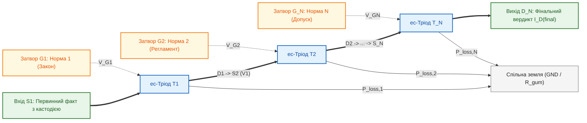
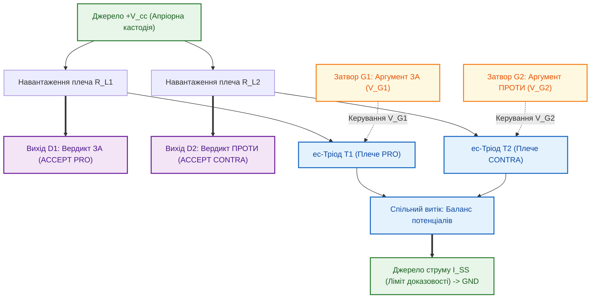

# Глава 07. Багатокаскадні схеми епістемічних тріодів та захист від комбінаторного вибуху

> [!NOTE]
> **Три фундаментальні положення авторського внеску Миколи Федчика**
> 1. Розроблено топологію послідовного дедуктивного каскаду з $N$ ес-тріодів, що забезпечує лінійну складність перевірки $O(N)$ тактів без комбінаторного вибуху простору станів.
> 2. Сформульовано правило наскрізної провідності складеного каскаду та автоматичної акумуляції складеної кастодії $`\mathcal{C}_{\mathrm{comp}}`$.
> 3. Запропоновано топологію диференційного каскаду на парі ес-тріодів для апаратного арбітражу суперечливих норм (ASPIC+ Pro et Contra) з автоматичною детекцією стану паритету.

---

## 1. Проблема багатоходового виведення

У класичних символьних системах на базі пошуку в глибину (Prolog / WAM) ланцюг із $N$ правил вимагає бектрекінгу у дереві виведення з експоненційною складністю $O(b^N)$, де $b$ — коефіцієнт розгалуження. При великій глибині нормативного дерева система зазнає колапсу продуктивності.

Епістемічна схемотехніка розв'язує цю проблему шляхом синтезу **послідовних та диференційних каскадів ес-тріодів**.

---

## 2. Послідовний дедуктивний каскад епістемічних тріодів

У послідовному каскаді стік $k$-го тріода $`D_k`$ з'єднується з витоком наступного $`S_{k+1}`$:

### 2.1. Властивості послідовного каскаду

1. **Інваріант наскрізної провідності:**
   Струм $`I_{D, \mathrm{final}} > 0`$ з'являється на виході тоді і лише тоді, коли відкрито **всі $N$ затворів**:

$$
\sigma_{\mathrm{total}} = \prod_{k=1}^N \sigma_k(V_{G, k})
$$

   Падіння керуючого потенціалу на будь-якому з проміжних затворів (наприклад, скасування відомчого регламенту на затворі $`G_2`$) миттєво обриває весь ланцюг.
2. **Лінійний час затримки:**
   Затримка поширення сигналу становить:

$$
\tau_{\mathrm{prop}} = \sum_{k=1}^N \tau_{\mathrm{switch}, k} = O(N) \text{ тактів}
$$

   що усуває ризик комбінаторного зависання процесора знань.
3. **Акумуляція складеної кастодії:**
   При проходженні кожного каскаду вектор кастодії збагачується дескриптором кроку:

$$
\mathcal{C}_{\mathrm{final}} = \mathcal{C}_1 \oplus \mathcal{C}_2 \oplus \dots \oplus \mathcal{C}_N
$$

---

## 3. Диференційний каскад для змагальної аргументації

Для вирішення нормативних колізій застосовується диференційна пара ес-тріодів зі спільним джерелом струму:

- **При паритеті доказів ($`V_{G1} \approx V_{G2}`$):** $`\Delta V_{\mathrm{out}} \approx 0`$. Струм ділиться порівну між обома плечима. Система автоматично генерує вердикт `QUALIFIED_NONANSWER (PARITY)`, унеможливлюючи упередженість.
- **При перевищенні порогу переваги ($`V_{G1} > V_{G2} + \Delta V_{\mathrm{pref}}`$):** Струм перемикається в плече $`T_1`$, замикаючи плече $`T_2`$. Вердикт `ACCEPT(PRO)` санкціонується з апаратно зафіксованою перемогою у регістрі аргументації.
