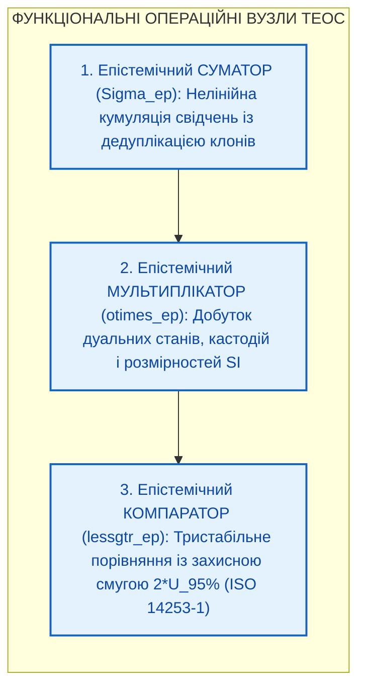
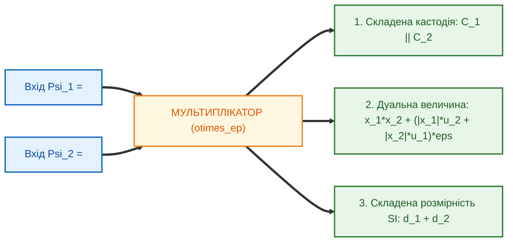

# Глава 08. Функціональні операційні вузли епістемічних схем: нелінійні суматори, дуальні мультиплікатори та інтервальні компаратори

> **Книга:** [Теорія епістемічних обчислювальних схем: Математичні інваріанти кастодії, метрології та детермінованого виведення](README.md) · Частина 3. Багатокаскадні схеми та функціональні операційні вузли  
> **Попередня глава:** [Глава 07. Багатокаскадні дедуктивні схеми та лінійна обчислювальна складність](ch07-multi-stage-cascades-and-linear-complexity.md)  
> **Наступна глава:** [Глава 09. Наукова критика, контрприклади та межі застосовності теорії епістемічних обчислювальних схем](ch09-scientific-critique-and-applicability-limits.md)  
> **Зміст книги:** [README.md](README.md)  
> **Автор:** [Микола Федчик](../ExpertSystem/about-the-author.md)  
> **Рівень складності та оптимальне вивчення:** `[L4]` Архітектурно-дослідницький рівень (індекс Д. Кнута `[38]`) · *Маршрут:* Базове ядро всіх треків; 2 проходи з опрацюванням розрахункового прикладу  
> **Очікувані результати:** опанувати математичну будову трьох базових операційних вузлів ТЕОС — нелінійного суматора на базі ко-норми Ейнштейна — Гамахера з дисконтуванням інформаційних клонів, однотактового дуального мультиплікатора тензорів стану та тристабільного інтервального компаратора із захисною смугою невизначеності за ISO 14253-1; виконати наскрізний розрахунок тракту «Суматор — Мультиплікатор — Компаратор» для системи автоматичного аварійного гальмування.

## Анотація

Восьма глава присвячена переходу від поодиноких операторів і дедуктивних каскадів до рівня інтегральних функціональних операційних вузлів (*Operational Units*) Теорії епістемічних обчислювальних схем (ТЕОС). Доведено, що класичні арифметико-логічні пристрої (АЛП) процесорів фон Неймана є недостатніми для доказових обчислень, оскільки лінійне додавання непрямих свідчень породжує ефект «інформаційної луна-камери», скалярне множення чисел із плаваючою комою втрачає похибки та фізичні розмірності, а бінарне порівняння на межі допуску (`x <= limit`) дає до 50% імовірності помилки першого роду.

У главі формалізовано три функціональні операційні вузли епістемічного процесора:
1. **Нелінійний епістемічний суматор ($`\Sigma_{\mathrm{ep}}`$)**, який здійснює структурну дедуплікацію корельованих джерел за графом походження і кумулює незалежні потенціали достовірності за гіперболічною трикутною ко-нормою Ейнштейна — Гамахера [[1]](#src-1), [[2]](#src-2), де верхньою асимптотою $`w_{\max} \equiv 1{,}00`$ виступає потенціал прямої побайтової кастодії першоджерела.
2. **Дуальний епістемічний мультиплікатор ($`\otimes_{\mathrm{ep}}`$)**, який за один такт синхронізації конкатенує дескриптори кастодії, точно обчислює лінійний диференціал похибки добутку в дуальній алгебрі Вільяма Кліффорда [[3]](#src-3) згідно зі стандартом JCGM GUM [[4]](#src-4) і додає семивимірні показники степенів одиниць SI [[7]](#src-7).
3. **Тристабільний інтервальний компаратор ($`\lessgtr_{\mathrm{ep}}`$)**, побудований з використанням симетричної захисної смуги невизначеності (*Guard Band*) шириною $`2 U_{95\%}`$ за міжнародним стандартом приймального контролю ISO 14253-1 [[5]](#src-5) та вимогами функціональної безпеки ISO 26262 [[6]](#src-6). Завершує главу наскрізний числовий розрахунок тракту керування гальмівною системою автономного шасі.

---

> [!NOTE]
> **Чотири наукові положення, що виносяться на захист у Главі 08**
> 1. **Нелінійний епістемічний суматор ($`\Sigma_{\mathrm{ep}}`$) із захистом від інформаційних клонів:** розроблено архітектуру вхідної матриці дедуплікації за криптографічним графом походження ($`\gamma_i = 1/\sqrt{\lvert G_k \rvert}`$) у поєднанні з гіперболічною S-конормою Ейнштейна — Гамахера, що нейтралізує ефект «луна-камери».
> 2. **Твердження про асимптотичну межу кастодії першоджерела:** строго доведено, що при агрегації за ко-нормою $`w_{\Sigma} = (w_1 + w_2)/(1 + w_1 w_2)`$ жодна скінченна комбінація непрямих свідчень ($`w_k < 1{,}00`$) не здатна досягти потенціалу прямої побайтової кастодії першоджерела $`w_{\max} \equiv 1{,}00`$.
> 3. **Однотактовий дуальний мультиплікатор тензорів стану ($`\otimes_{\mathrm{ep}}`$):** синтезовано операційний вузол, який паралельно конкатенує дескриптори кастодії, обчислює лінійний диференціал похибки добутку на дуальних числах Кліффорда та додає вектори розмірностей SI у решітці $`\mathbb{Z}^7`$.
> 4. **Тристабільний інтервальний компаратор ($`\lessgtr_{\mathrm{ep}}`$):** спроектовано пороговий компаратор із захисною смугою $`2 U_{95\%}`$ (ISO 14253-1), який при перетині довірчим інтервалом межі норми замість бінарного вгадування генерує детерміновану відмову `GUARD_BAND_REFUSAL`.
> *Керування рантаймом / Інженерний інваріант:* Жоден пороговий компаратор в епістемічній схемі не видає дозвіл `ACCEPT (PASS)`, якщо верхня межа розширеної невизначеності вимірювання перетинає нормативний ліміт ($`x_{\mathrm{meas}} + U_{95\%} > x_{\mathrm{limit}}`$).

---

## 1. Перехід від елементарних операторів до функціональних операційних вузлів

У цифрових обчислювальних системах проектування пройшло шлях від поодиноких логічних вентилів до інтегральних операційних блоків: суматорів, перемножувачів та компараторів. Аналогічно, у Теорії епістемічних обчислювальних схем на базі векторних верифікаторів розмірностей SI, предикатів кастодії та деонтичних вентилів синтезуються три базові функціональні операційні вузли (*Operational Units*), які утворюють ядро Епістемічного арифметико-логічного пристрою (ЕАЛП).

Структурну конвеєрну взаємодію трьох операційних вузлів зображено на рисунку 8.1.

**Рисунок 8.1.** Три базові функціональні операційні вузли ТЕОС у наскрізному тракті обробки доказів.

---

## 2. Нелінійний епістемічний суматор та гіперболічна ко-норма агрегації

У звичайних скалярних системах лінійний суматор обчислює зважену суму вхідних оцінок: $`w_{\mathrm{out}} = \sum_{i=1}^n \gamma_i w_i`$. Проте у сфері доказового виведення та агрегації свідчень **лінійне арифметичне додавання є некоректним** із двох причин:
1. **Дефект інформаційної луна-камери (*Echo-Chamber Defect*):** Якщо одне неперевірене вторинне повідомлення з потенціалом достовірності $`0{,}20`$ буде ретрансльовано десятьма залежними каналами, лінійний суматор додасть їхні ваги і видасть значення $`10 \times 0{,}20 = 2{,}00`$, перетворивши непідтверджене повідомлення на «абсолютний факт».
2. **Порушення асимптотичної межі кастодії першоджерела:** Жодна скінченна кількість непрямих (індуктивних чи евристичних) свідчень з потенціалами $`w_i < 1{,}00`$ не може досягти або перевищити одиничний потенціал прямої криптографічної кастодії незмінного першоджерела $`w_{\max} \equiv 1{,}00`$.

**Означення 8.1 (Нелінійний епістемічний суматор).** *Нелінійним епістемічним суматором* $`\Sigma_{\mathrm{ep}}`$ називається багатовходовий операційний вузол, який перевіряє розмірнісну сумісність входів через верифікатор $`\mathcal{V}_{\mathrm{SI}}`$, виконує групове дисконтування корельованих джерел за графом спільного походження та агрегує очищені потенціали незалежних свідчень за гіперболічною трикутною ко-нормою Ейнштейна — Гамахера [[1]](#src-1), [[2]](#src-2).

### 2.1. Математична модель суматора: дедуплікація та асимптотична межа одиниці

Нехай на вхід суматора надходить множина свідчень, розбита за графом цитування на $K$ кластерів спільного походження $`G_1, G_2, \dots, G_K`$. Якщо кластер $`G_k`$ містить $`\lvert G_k \rvert`$ реплік одного первинного джерела, ваговий коефіцієнт кожного каналу всередині кластера автоматично нормується так, щоб результуючий потенціал кластера залишався інваріантним щодо кількості копій.

$$
\gamma_i = \frac{1}{\sqrt{\lvert G_k \rvert}}, \qquad w_{\mathrm{eff}}(G_k) = \sqrt{ \sum_{i \in G_k} \left( \gamma_i \cdot \frac{w_i}{\sqrt{\lvert G_k \rvert}} \right)^2 } \equiv w_{\mathrm{origin}, k}
$$

**Формула (8.1).** Коефіцієнт групового дисконтування клонів та ефективний потенціал кластера спільного походження.

Тут:
- $`\lvert G_k \rvert \ge 1`$ — потужність (кількість корельованих повідомлень-клонів) $k$-го кластера спільного походження;
- $`\gamma_i \in (0, 1]`$ — ваговий коефіцієнт нормування $i$-го корельованого входу;
- $`w_{\mathrm{origin}, k} \in [0, 1]`$ — безрозмірний потенціал достовірності єдиного спільного джерела кластера $`G_k`$. Завдяки цьому 100 клонів одного повідомлення зі спільним криптографічним ідентифікатором першоджерела (`origin_hash`) дають сумарний внесок, тотожний одному повідомленню (випадок нерозміченого семантичного перефразування та його межі проаналізовано у [Главі 09](ch09-scientific-critique-and-applicability-limits.md)).

Після дедуплікації кластерів незалежні потенціали $`w_1, w_2 \in [0, 1{,}0)`$ агрегуються за гіперболічною S-конормою Ейнштейна — Гамахера [[1]](#src-1), [[2]](#src-2) (яка в класичних системах правдоподібного виведення ізоморфна комбінації односпрямованих коефіцієнтів впевненості), де верхня асимптота дорівнює потенціалу прямої кастодії першоджерела $`w_{\max} \equiv 1{,}00`$:

$$
w_{\Sigma} = w_1 \oplus_{\mathrm{ep}} w_2 = \frac{w_1 + w_2}{1 + \frac{w_1 \cdot w_2}{w_{\max}^2}} \equiv \frac{w_1 + w_2}{1 + w_1 \cdot w_2}, \qquad w_{\max} = 1{,}00
$$

**Формула (8.2).** Правило нелінійної агрегації незалежних потенціалів достовірності за гіперболічною S-конормою Ейнштейна — Гамахера.

Тут:
- $`w_1, w_2 \in [0, 1{,}0)`$ — очищені безрозмірні потенціали достовірності двох незалежних непрямих свідчень;
- $`w_{\max} = 1{,}00`$ — верхня асимптота прямої побайтової кастодії першоджерела;
- $`w_{\Sigma} \in [0, 1{,}0)`$ — результуючий кумулятивний потенціал на виході суматора.

**Твердження 8.1 (Асимптотична недосяжність одиничного потенціалу для непрямих свідчень).** *Для будь-якої скінченної кількості $n$ незалежних непрямих свідчень із потенціалами $`w_k < 1{,}00`$ ($`k = 1, \dots, n`$) їхня нелінійна сума за формулою (8.2) $`w_{\Sigma}^{(n)} = w_1 \oplus_{\mathrm{ep}} w_2 \oplus_{\mathrm{ep}} \dots \oplus_{\mathrm{ep}} w_n`$ монотонно зростає, але суворо обмежена зверху одиницею ($`w_{\Sigma}^{(n)} < 1{,}00`$). Рівність $`w_{\Sigma} = 1{,}00`$ досягається тоді і лише тоді, коли принаймні один із доданків володіє прямою кастодією першоджерела ($`w_k = 1{,}00`$).*

*Доведення.* Для двох доданків маємо алгебраїчну тотожність:

$$
1 - w_{\Sigma} = 1 - \frac{w_1 + w_2}{1 + w_1 w_2} = \frac{(1 - w_1)(1 - w_2)}{1 + w_1 w_2}
$$

Оскільки $`w_1 < 1`$ та $`w_2 < 1`$, чисельник $`(1 - w_1)(1 - w_2) > 0`$, звідки $`w_{\Sigma} < 1`$. За індукцією для $n$ доданків чисельник різниці $`1 - w_{\Sigma}^{(n)}`$ пропорційний добутку $`\prod_{k=1}^n (1 - w_k) > 0`$, що доводить недосяжність рівня $`1{,}00`$ без прямого першоджерела. ∎

---

## 3. Однотактовий дуальний мультиплікатор тензорів стану

Коли інженерна залежність вимагає перемноження або ділення фізичних величин (наприклад, обчислення механічної потужності $`P = F \cdot v`$ або кінетичного імпульсу $`p = m \cdot v`$), у схему вмикається **однотактовий дуальний епістемічний мультиплікатор** $`\otimes_{\mathrm{ep}}`$.

На відміну від суматора, мультиплікатор приймає на входи величини з довільними фізичними розмірностями SI, оскільки при множенні показники степенів розмірностей додаються у векторній решітці $`\mathbb{Z}^7`$.

**Означення 8.2 (Дуальний епістемічний мультиплікатор).** *Дуальним епістемічним мультиплікатором* $`\otimes_{\mathrm{ep}}`$ називається синхронний операційний вузол, який приймає на вхід два епістемічні тензори стану $`\Psi_1`$ та $`\Psi_2`$ і за один такт обчислює тензор добутку шляхом паралельної конкатенації дескрипторів кастодії, дуального множення Кліффорда [[3]](#src-3) та векторного додавання показників розмірностей SI [[7]](#src-7).

$$
\Psi_{\mathrm{out}} = \Psi_1 \otimes_{\mathrm{ep}} \Psi_2 = \left\langle \mathcal{C}_1 \parallel \mathcal{C}_2, \quad (x_1 x_2) + \left(\lvert x_1 \rvert u_2 + \lvert x_2 \rvert u_1\right)\varepsilon, \quad \vec{d}_1 + \vec{d}_2 \right\rangle
$$

**Формула (8.3).** Тензорне рівняння однотактового дуального мультиплікатора (у представленні граничних абсолютних похибок або L1-чутливостей).

Тут:
- $`\Psi_k = \langle \mathcal{C}_k, x_k + u_k\varepsilon, \vec{d}_k \rangle`$ ($`k \in \{1, 2\}`$) — вхідні епістемічні тензори стану фізичних величин $`x_1, x_2`$;
- $`\mathcal{C}_1 \parallel \mathcal{C}_2`$ — конкатенований дескриптор кастодії обох співмножників;
- $`x_1 x_2`$ — номінальне значення фізичного добутку;
- $`u_{\mathrm{out}} = \lvert x_1 \rvert u_2 + \lvert x_2 \rvert u_1`$ — лінійний диференціал похибки добутку над алгеброю дуальних чисел Кліффорда ($`\varepsilon^2 = 0`$) (для некорельованих стандартних невизначеностей з ортогональними одиницями $`\varepsilon_1, \varepsilon_2`$ середньоквадратична норма за JCGM GUM [[4]](#src-4) становить $`\sqrt{(x_1 u_2)^2 + (x_2 u_1)^2}`$);
- $`\vec{d}_1 + \vec{d}_2 \in \mathbb{Z}^7`$ — покомпонентна сума семивимірних векторів показників степенів SI (при операції ділення $`\oslash_{\mathrm{ep}}`$ вектори віднімаються: $`\vec{d}_1 - \vec{d}_2`$).

Архітектуру триканального паралельного обчислення в мультиплікаторі зображено на рисунку 8.2.

**Рисунок 8.2.** Структурна схема однотактового дуального епістемічного мультиплікатора тензорів стану.

---

## 4. Тристабільний інтервальний компаратор із захисною метрологічною смугою

У критичних системах керування (автомобільний стандарт ISO 26262 [[6]](#src-6), авіоніка, енергетика) фінальне рішення про відповідність параметра нормі безпеки ухвалює **пороговий компаратор**.

У класичному програмуванні компаратор реалізується булевим оператором `if (x_meas <= x_limit) return PASS`. З погляду метрології такий булів компаратор є **небезпечним на межі допуску**: якщо нормативна межа тиску становить $`x_{\mathrm{limit}} = 10{,}0\,\text{МПа}`$, а давач показує $`x_{\mathrm{meas}} = 9{,}9\,\text{МПа}`$ при розширеній невизначеності $`U_{95\%} = \pm 0{,}5\,\text{МПа}`$, дійсний тиск у резервуарі може досягати $`10{,}4\,\text{МПа}`$. Класичний булів компаратор ігнорує інтервал невизначеності $`U_{95\%}`$ і видає хибний дозвіл `PASS` у зоні ризику перевищення межі.

Щоб виключити цей клас помилок, у ТЕОС пороговий компаратор реалізує правило **захисної смуги невизначеності (*Guard Band*)** за міжнародним стандартом приймального контролю ISO 14253-1:2017 [[5]](#src-5).

**Означення 8.3 (Тристабільний інтервальний компаратор).** *Тристабільним інтервальним компаратором* $`\lessgtr_{\mathrm{ep}}`$ називається операційний вузол порівняння дуальної величини $`x_{\mathrm{meas}} \pm U_{95\%}`$ з нормативним порогом $`x_{\mathrm{limit}}`$, який формує навколо порогу симетричну захисну смугу невизначеності (*Guard Band*) шириною $`2 U_{95\%}`$ і відображає результат у три стани бірешітки Белнапа $`\{\mathbf{T}, \mathbf{F}, \mathbf{N}\}`$.

Діаграму зон прийняття рішень інтервального компаратора наведено на рисунку 8.3.

**Рисунок 8.3.** Зони прийняття рішень тристабільного інтервального компаратора із захисною смугою за стандартом ISO 14253-1.

$$
\mathrm{Verdict}_{\lessgtr}\left(x_{\mathrm{meas}}, U_{95\%}, x_{\mathrm{limit}}\right) = \begin{cases}
\mathbf{T} \ (\text{ACCEPT / PASS}), & \text{при } x_{\mathrm{meas}} + U_{95\%} \le x_{\mathrm{limit}} \\
\mathbf{F} \ (\text{REJECT / VIOLATION}), & \text{при } x_{\mathrm{meas}} - U_{95\%} \ge x_{\mathrm{limit}} \\
\mathbf{N} \ (\text{REFUSAL / GUARD\_BAND}), & \text{при } \lvert x_{\mathrm{meas}} - x_{\mathrm{limit}} \rvert < U_{95\%}
\end{cases}
$$

**Формула (8.4).** Передавальна функція інтервального компаратора із захисною смугою ISO 14253-1 (для верхнього граничного допуску $`x \le x_{\mathrm{limit}}`$).

Тут:
- $`x_{\mathrm{meas}}`$ — виміряне (або обчислене мультиплікатором) номінальне значення контрольованої фізичної величини;
- $`U_{95\%} = k_{95\%} \cdot u_c \ge 0`$ — розширена метрологічна невизначеність при рівні довіри $`95\%`$ (півширина захисної смуги *Guard Band*);
- $`x_{\mathrm{limit}}`$ — нормативний гранично допустимий поріг за стандартом безпеки.

Порівняння характеристик усіх трьох операційних вузлів зібрано у таблиці 8.1.

**Таблиця 8.1.** Зведена специфікація функціональних операційних вузлів ТЕОС.

| Операційний вузол | Символ | Вхідний контроль розмірностей SI | Обробка похибок та потенціалів | Захист від інженерних дефектів |
| :--- | :---: | :--- | :--- | :--- |
| **1. Епістемічний суматор** | $`\Sigma_{\mathrm{ep}}`$ | Сувора рівність $`\vec{d}_1 \equiv \vec{d}_2`$ | Дисконтування клонів $`1/\sqrt{\lvert G_k \rvert}`$ та S-конорма Ейнштейна — Гамахера | Блокує ефект луна-камери та перевищення межі $`w_{\max} = 1{,}00`$ |
| **2. Епістемічний мультиплікатор** | $`\otimes_{\mathrm{ep}}`$ | Додавання векторів $`\vec{d}_1 + \vec{d}_2 \in \mathbb{Z}^7`$ | Автодиференціювання Кліффорда $`(\lvert x_1 \rvert u_2 + \lvert x_2 \rvert u_1)\varepsilon`$ | Усуває втрату похибок і розмірностей при множенні |
| **3. Епістемічний компаратор** | $`\lessgtr_{\mathrm{ep}}`$ | Сувора рівність $`\vec{d}_{\mathrm{meas}} \equiv \vec{d}_{\mathrm{limit}}`$ | Тристабільне правило із захисною смугою $`\pm U_{95\%}`$ (ISO 14253-1) | Унеможливлює хибний допуск `PASS` на межі толерансу |

---

## 5. Навчальний інженерний приклад: комплексний розрахунок тракту «Суматор — Мультиплікатор — Компаратор» для системи автоматичного гальмування

Розглянемо роботу наскрізного операційного тракту в системі автоматичного екстреного гальмування (AEB) колісної платформи за стандартом функціональної безпеки ISO 26262 [[6]](#src-6). Система має перевірити, чи не перевищує кінетичний імпульс руху платформи $`p = m \cdot v`$ гранично допустиму норму енергопоглинання гальмівного супорта $`p_{\mathrm{limit}} = 30\,000\,\text{кг}\cdot\text{м/с}`$.

### 5.1. Вихідні інженерні дані

1. **Вузол 1 (Епістемічний суматор $`\Sigma_{\mathrm{ep}}`$ — агрегація свідчень про наявність перешкоди):**
   - Канал А (Тепловізійна камера): надіслав 4 корельовані кадри одного об'єкта (кластер клонів $`\lvert G_1 \rvert = 4`$) з потенціалом достовірності $`w_A = 0{,}60`$ кожен.
   - Канал Б (Незалежний міліметровий радар): надіслав 1 незалежне підтвердження ($`\lvert G_2 \rvert = 1`$) з потенціалом $`w_B = 0{,}75`$.
   - Поріг активації розрахунку гальмування становить $`w_{\mathrm{th}} = 0{,}85`$.
2. **Вузол 2 (Епістемічний мультиплікатор $`\otimes_{\mathrm{ep}}`$ — обчислення імпульсу $`p = m \cdot v`$):**
   - Тензор маси платформи $`\Psi_m`$: номінальна маса $`m = 1500\,\text{кг}`$, гранична похибка тензодавачів підвіски $`U_m = \pm 30\,\text{кг}`$, вектор SI $`\vec{d}_m = [0, 1, 0, 0, 0, 0, 0]^T`$.
   - Тензор швидкості $`\Psi_v`$: номінальна швидкість $`v = 19{,}6\,\text{м/с}`$, гранична похибка доплерівського радара $`U_v = \pm 0{,}5\,\text{м/с}`$, вектор SI $`\vec{d}_v = [1, 0, -1, 0, 0, 0, 0]^T`$.
3. **Вузол 3 (Епістемічний компаратор $`\lessgtr_{\mathrm{ep}}`$ — перевірка норми безпеки):**
   - Гранично допустимий імпульс гальмування без перегріву диска: $`p_{\mathrm{limit}} = 30\,000\,\text{кг}\cdot\text{м/с}`$ з вектором SI $`\vec{d}_{\mathrm{limit}} = [1, 1, -1, 0, 0, 0, 0]^T`$.

### 5.2. Покроковий розрахунок

**Крок 1. Робота Епістемічного суматора ($`\Sigma_{\mathrm{ep}}`$): дедуплікація клонів та нелінійна кумуляція.**
Якби система використовувала лінійне додавання, чотири кадри тепловізора дали б некоректний потенціал $`4 \times 0{,}60 = 2{,}40`$. Натомість вхідна матриця суматора за формулою (8.1) дисконтує кластер $`G_1`$ ($`\lvert G_1 \rvert = 4`$, $`\gamma_i = 1/\sqrt{4} = 0{,}5`$), залишаючи очищений потенціал першого джерела:

$$
w_{\mathrm{eff}}(G_1) = 0{,}60
$$

Тепер суматор агрегує очищений потенціал тепловізора $`w_1 = 0{,}60`$ та незалежного радара $`w_2 = 0{,}75`$ за формулою (8.2):

$$
w_{\Sigma} = \frac{0{,}60 + 0{,}75}{1 + 0{,}60 \times 0{,}75} = \frac{1{,}35}{1 + 0{,}45} = \frac{1{,}35}{1{,}45} \approx 0{,}9310
$$

Отриманий потенціал $`w_{\Sigma} = 0{,}9310`$ перевищує поріг активації $`w_{\mathrm{th}} = 0{,}85`$, але залишається суворо меншим за одиничний потенціал прямого першоджерела $`1{,}00`$.

**Крок 2. Робота Епістемічного мультиплікатора ($`\otimes_{\mathrm{ep}}`$): дуальний добуток маси на швидкість.**
За один такт мультиплікатор перемножує тензори $`\Psi_m \otimes_{\mathrm{ep}} \Psi_v`$ за формулою (8.3):
1. Конкатенує кастодії давачів маси і швидкості: $`\mathcal{C}_p = \mathcal{C}_m \parallel \mathcal{C}_v`$.
2. Обчислює номінальний імпульс та його дуальну граничну невизначеність $`U_p`$:

$$
p_{\mathrm{nom}} = m \cdot v = 1500 \times 19{,}6 = 29\,400\,\text{кг}\cdot\text{м/с}
$$

$$
U_p = m \cdot U_v + v \cdot U_m = (1500 \times 0{,}5) + (19{,}6 \times 30) = 750 + 588 = 1338\,\text{кг}\cdot\text{м/с}
$$

3. Додає вектори розмірностей SI:

$$
\vec{d}_p = \vec{d}_m + \vec{d}_v = [0, 1, 0, 0, 0, 0, 0]^T + [1, 0, -1, 0, 0, 0, 0]^T = [1, 1, -1, 0, 0, 0, 0]^T \ (\text{кг}\cdot\text{м}\cdot\text{с}^{-1})
$$

Отже, на виході мультиплікатора сформовано дуальне значення $`p = 29\,400 \pm 1338\,\text{кг}\cdot\text{м/с}`$.

**Крок 3. Робота Епістемічного компаратора ($`\lessgtr_{\mathrm{ep}}`$): перевірка захисної смуги ISO 14253-1.**
На вхід компаратора надходить обчислений імпульс $`x_{\mathrm{meas}} = 29\,400`$, розширена похибка $`U_{95\%} = 1338`$ та нормативний поріг $`x_{\mathrm{limit}} = 30\,000`$. Вхідний верифікатор розмірностей підтверджує тотожність $`\vec{d}_p \equiv \vec{d}_{\mathrm{limit}}`$.
Звичайний булів компаратор (`29400 <= 30000`) видав би хибний дозвіл `PASS`. Перевіримо умову гарантованого допуску за формулою (8.4) в інтервальному компараторі:

$$
x_{\mathrm{meas}} + U_{95\%} = 29\,400 + 1338 = 30\,738\,\text{кг}\cdot\text{м/с} > x_{\mathrm{limit}} = 30\,000\,\text{кг}\cdot\text{м/с}
$$

Водночас нижня межа становить $`x_{\mathrm{meas}} - U_{95\%} = 28\,062 < 30\,000`$, тобто відхилення від порогу лежить усередині захисної смуги *Guard Band*:

$$
\lvert 29\,400 - 30\,000 \rvert = 600 < U_{95\%} = 1338 \implies \text{Вердикт: N (FAIL-CLOSED / GUARD\_BAND\_REFUSAL)}
$$

Компаратор блокує штатний швидкісний режим і активує превентивне зниження швидкості, запобігаючи перевантаженню гальмівної системи в зоні метрологічної невизначеності.

---

## Висновки

1. Синтез трьох функціональних операційних вузлів — нелінійного суматора ($`\Sigma_{\mathrm{ep}}`$), однотактового дуального мультиплікатора ($`\otimes_{\mathrm{ep}}`$) та тристабільного інтервального компаратора ($`\lessgtr_{\mathrm{ep}}`$) — формує повний арифметико-логічний тракт процесора доказових обчислень.
2. Нелінійний епістемічний суматор завдяки вхідній дедуплікації кластерів за коефіцієнтом $`1/\sqrt{\lvert G_k \rvert}`$ та гіперболічній S-конормі Ейнштейна — Гамахера усуває вразливість інформаційної луна-камери та математично гарантує недосяжність одиничного потенціалу прямої кастодії першоджерела ($`w_{\max} = 1{,}00`$) для будь-якої скінченної комбінації непрямих свідчень.
3. Дуальний епістемічний мультиплікатор забезпечує однотактове поєднання фізичних величин з автоматичним диференціюванням похибок над алгеброю Кліффорда та строгим контролем семивимірних векторів розмірностей SI.
4. Тристабільний інтервальний компаратор із захисною смугою $`2 U_{95\%}`$ за стандартом ISO 14253-1 усуває ризик помилки першого роду на межі нормативного допуску, забезпечуючи детерміновану захисну відмову при перетині довірчим інтервалом межі специфікації.

---

## Словник

| Термін | Англійський еквівалент | Визначення |
| :--- | :--- | :--- |
| **Дефект інформаційної луна-камери** | *Echo-Chamber Defect* | Помилка лінійного сумування, коли багаторазовий переказ одного неперевіреного джерела хибно підвищує підсумкову оцінку достовірності. |
| **Тристабільний інтервальний компаратор** | *Tristable Interval Comparator* | Пороговий операційний вузол, який формує захисну смугу невизначеності навколо межі норми і повертає тризначний вердикт у бірешітці Белнапа. |
| **Дуальний мультиплікатор** | *Dual-Tensor Epistemic Multiplier* | Однотактовий операційний вузол, який одночасно конкатенує кастодії, перемножує дуальні величини Кліффорда та додає вектори розмірностей SI. |
| **Нелінійний епістемічний суматор** | *Non-Linear Epistemic Adder* | Операційний вузол кумуляції свідчень із попереднім дисконтуванням клонів та гіперболічною S-конормою Ейнштейна — Гамахера. |
| **Захисна метрологічна смуга** | *Metrological Guard Band* | Інтервал шириною у подвоєну розширену невизначеність вимірювання навколо нормативного порогу, всередині якого заборонено видавати односторонній дозвіл. |
| **Асимптотична межа першоджерела** | *Primary Custody Asymptote* | Верхня межа потенціалу прямої побайтової кастодії ($`w_{\max} = 1{,}00`$), яка є асимптотично недосяжною для будь-якої скінченної суми непрямих свідчень. |

---

## Абревіатури

| Абревіатура | Розшифрування | Опис |
| :--- | :--- | :--- |
| **AEB** | Autonomous Emergency Braking | Автономна система екстреного гальмування транспортного засобу. |
| **ASIL** | Automotive Safety Integrity Level | Рівень повноти автомобільної безпеки за стандартом ISO 26262 (від ASIL A до ASIL D). |
| **ЕАЛП** | Епістемічний арифметико-логічний пристрій | Центральний операційний блок процесора знань, складений із нелінійних суматорів, дуальних мультиплікаторів та інтервальних компараторів. |
| **GUM** | Guide to the Expression of Uncertainty in Measurement | Міжнародний метрологічний стандарт JCGM 100:2008 для розрахунку комбінованої та розширеної невизначеності. |
| **ISO 14253-1** | Geometrical Product Specifications — Decision Rules | Міжнародний стандарт правил прийняття рішень щодо відповідності або невідповідності специфікаціям із захисною смугою *Guard Band*. |
| **ISO 26262** | Road Vehicles — Functional Safety | Міжнародний стандарт функціональної безпеки дорожніх транспортних засобів. |

---

## Джерела

1. **Einstein, A.** Zur Elektrodynamik bewegter Körper // *Annalen der Physik*. — 1905. — Vol. 322, No. 10. — P. 891–921. — DOI: 10.1002/andp.19053221004.
2. **Hamacher, H.** *Über logische Aggregationen nicht-binär explizierter Entscheidungskriterien*. — Frankfurt am Main : Rita G. Fischer Verlag, 1978.
3. **Clifford, W. K.** Preliminary Sketch of Biquaternions // *Proceedings of the London Mathematical Society*. — 1873. — Vol. s1-4, No. 1. — P. 381–395.
4. **JCGM 100:2008 (GUM 1995 with minor corrections).** *Evaluation of measurement data — Guide to the expression of uncertainty in measurement*. — Sèvres : Joint Committee for Guides in Metrology, 2008.
5. **ISO 14253-1:2017.** *Geometrical product specifications (GPS) — Inspection by measurement of workpieces and measuring equipment — Part 1: Decision rules for verifying conformity or nonconformity with specifications*. — Geneva : International Organization for Standardization, 2017.
6. **ISO 26262:2018 (Parts 1–12).** *Road vehicles — Functional safety* (2nd Edition). — Geneva : International Organization for Standardization, 2018.
7. **BIPM.** *The International System of Units (SI) : 9th Edition*. — Sèvres : Bureau International des Poids et Mesures, 2019. — 216 p.

---

[← Глава 07. Багатокаскадні дедуктивні схеми та лінійна обчислювальна складність](ch07-multi-stage-cascades-and-linear-complexity.md) | [Зміст книги](README.md) | [Глава 09. Наукова критика, контрприклади та межі застосовності теорії епістемічних обчислювальних схем →](ch09-scientific-critique-and-applicability-limits.md)
