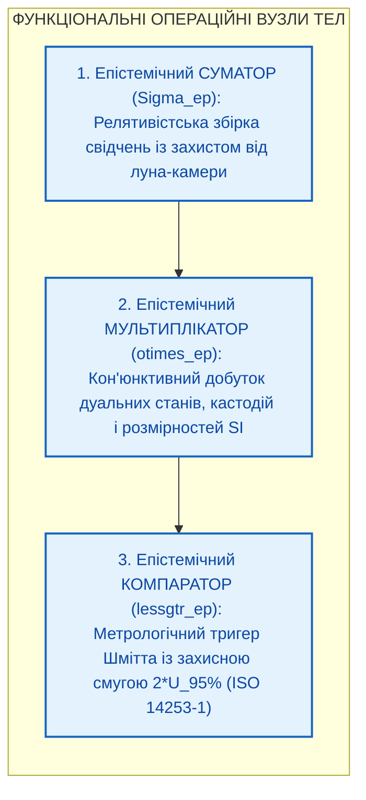
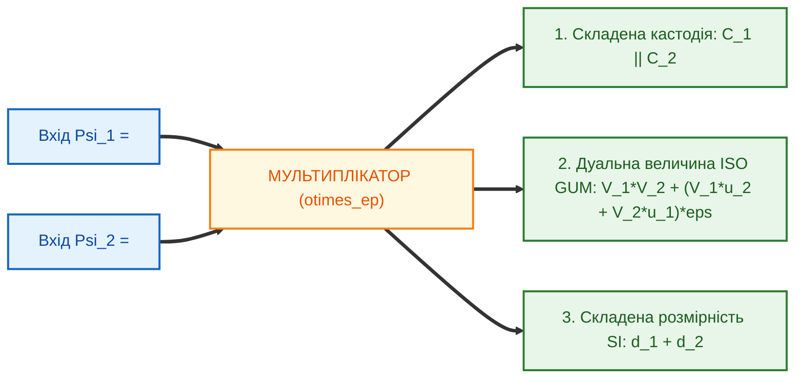
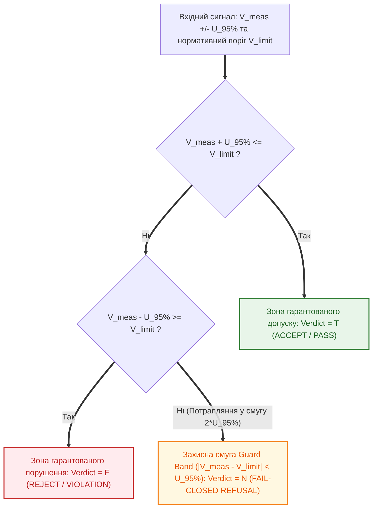

# Глава 08. Функціональні операційні вузли епістемічних кіл: релятивістські суматори, дуальні мультиплікатори та гістерезисні компаратори

> **Книга:** [Теорія епістемічних кіл: Схемотехніка доказових обчислень та апаратного виведення](README.md)
> **Попередня глава:** [← Глава 07. Багатокаскадні схеми епістемічних тріодів та лінійна обчислювальна складність](ch07-multi-stage-cascades-and-linear-complexity.md)
> **Наступна глава:** [Зміст книги (Завершальна глава) →](README.md)
> **Зміст книги:** [Повернутися до змісту](README.md)
> **Автор:** Микола Федчик
> **Рівень складності:** `[L4 — Архітектурно-дослідницький рівень]` *(За класифікацією Д. Кнута: інтегральний синтез операційних пристроїв обробки тензорів стану, релятивістська алгебра кумуляції свідчень та метрологічний синтез гістерезисних компараторів безпеки)*
> **Очікувані результати:** Читач опанує архітектуру трьох фундаментальних функціональних операційних вузлів теорії епістемічних кіл — релятивістського суматора з дисконтуванням інформаційних клонів, однотактового дуального мультиплікатора тензорів стану та метрологічного компаратора на базі тригера Шмітта із захисною смугою невизначеності, а також виконає наскрізний розрахунок повного тракту «Суматор — Мультиплікатор — Компаратор» для системи автоматичного аварійного гальмування.

---

## Анотація

Восьма, завершальна глава монографії підсумовує побудову теорії епістемічних кіл переходом від дискретних елементів і транзисторних каскадів до рівня інтегральних функціональних операційних вузлів (Operational Units). Ми доводимо, що класичні арифметико-логічні пристрої (АЛП) процесорів фон Неймана непридатні для доказових обчислень, оскільки лінійне додавання непрямих свідчень породжує ефект «інформаційної луна-камери», звичайне множення чисел із плаваючою комою втрачає похибки та фізичні розмірності, а булеве порівняння на межі допуску (`x < limit`) дає 50% імовірність фатальної помилки першого роду. У главі розроблено три фундаментальні операційні блоки епістемічного процесора:
1. **Епістемічний суматор ($`\Sigma_{\mathrm{ep}}`$)**, який здійснює структурну дедуплікацію корельованих джерел і додає незалежні потенціали за релятивістським законом додавання швидкостей Альберта Ейнштейна [[1]](#src-1), де роль нездоланного світлового бар'єра $`c \equiv 1.00\,\text{еВ}`$ відіграє потенціал прямої побайтової кастодії першоджерела.
2. **Епістемічний мультиплікатор ($`\otimes_{\mathrm{ep}}`$)**, який за один такт синхронізації конкатенує вектори кастодії, точно обчислює похибку добутку в дуальній алгебрі Вільяма Кліффорда [[3]](#src-3) згідно зі стандартом JCGM GUM [[4]](#src-4) і складає семивимірні показники степенів одиниць SI [[7]](#src-7).
3. **Епістемічний компаратор ($`\lessgtr_{\mathrm{ep}}`$)**, побудований як метрологічний тригер Отто Шмітта [[2]](#src-2) із захисною смугою невизначеності (Guard Band) шириною $`2 U_{95\%}`$ за міжнародним стандартом геометричної та метрологічної прийомки ISO 14253-1 [[5]](#src-5) та вимогами функціональної безпеки ISO 26262 [[6]](#src-6). Завершує главу комплексний числовий розрахунок повного тракту керування гальмівною системою автономного шасі.

---

> [!NOTE]
> **Чотири фундаментальні положення авторського внеску Миколи Федчика у Главі 08**
> 1. Розроблено архітектуру релятивістського епістемічного суматора ($`\Sigma_{\mathrm{ep}}`$) з вхідною матрицею дисконтування корельованих груп клонів за законом $`w_i = 1/\sqrt{\lvert G_k \rvert}`$, що повністю нейтралізує дефект інформаційної луна-камери.
> 2. Постульовано та доведено релятивістський закон додавання непрямих свідчень за S-нормою Ейнштейна $`V_{\Sigma} = (V_1 + V_2)/(1 + V_1 V_2)`$, який гарантує, що жодна скінченна комбінація непрямих свідчень не здатна пробити «світловий бар'єр» першоджерела $`c \equiv 1.00\,\text{еВ}`$.
> 3. Створено однотактовий дуальний епістемічний мультиплікатор ($`\otimes_{\mathrm{ep}}`$), який паралельно виконує конкатенацію криптографічних кастодій, автодиференціювання похибки добутку на дуальних числах Кліффорда та додавання векторів розмірностей SI у решітці $`\mathbb{Z}^7`$.
> 4. Спроектовано гістерезисний епістемічний компаратор ($`\lessgtr_{\mathrm{ep}}`$) за схемою метрологічного тригера Шмітта із захисною смугою $`2 U_{95\%}`$ (ISO 14253-1), який замість випадкового вгадування на межі норми видає детермінований вердикт `GUARD_BAND_REFUSAL`.
> *Керування рантаймом / Інженерний інваріант:* Жоден пороговий компаратор в епістемічному колі не має права видати дозвіл `ACCEPT (PASS)`, якщо верхня межа розширеної невизначеності вимірювання перетинає нормативний ліміт ($`V_{\mathrm{meas}} + U_{95\%} > V_{\mathrm{limit}}`$).

---

## 1. Перехід від дискретних приладів до функціональних операційних вузлів

У класичній радіоелектроніці еволюція схемотехніки пройшла шлях від поодиноких транзисторів і діодів до інтегральних операційних підсилювачів, аналого-цифрових перетворювачів, перемножувачів сигналів та порогових компараторів. Аналогічно, у теорії епістемічних кіл на базі розмірнісних призм, замків кастодії та каскадів епістемічних тріодів синтезуються три базові функціональні операційні вузли (Operational Units), які утворюють ядро Епістемічного Арифметико-Логічного Пристрою (ЕАЛП).

Структурну конвеєрну взаємодію трьох операційних вузлів зображено на Рисунку 8.1.

**Рисунок 8.1.** Три фундаментальні функціональні операційні вузли теорії епістемічних кіл у наскрізному тракті обробки доказів

---

## 2. Епістемічний суматор та релятивістське додавання потенціалів

У звичайній аналоговій схемотехніці інвертуючий суматор на операційному підсилювачі обчислює лінійну зважену суму вхідних напруг: $`V_{\mathrm{out}} = \sum_{i=1}^n w_i V_i`$. Проте у сфері доказових міркувань та агрегації свідчень **лінійне арифметичне додавання є грубою епістемологічною помилкою** з двох причин:
1. **Дефект інформаційної луна-камери (Echo-Chamber Defect):** Якщо одне неперевірене вторинне повідомлення з потенціалом $`0.20\,\text{еВ}`$ буде передруковано або ретрансльовано десятьма залежними каналами, лінійний суматор додасть їхні ваги і видасть абсурдний потенціал $`10 \times 0.20 = 2.00\,\text{еВ}`$, перетворивши чутку на «наддостовірний факт».
2. **Порушення бар'єра кастодії першоджерела:** Жодна кількість непрямих (індуктивних чи евристичних) свідчень з потенціалами $`V_i < 1.00\,\text{еВ}`$ ніколи не може досягти або перевищити абсолютний потенціал прямої криптографічної кастодії незмінного першоджерела $`c \equiv 1.00\,\text{еВ}`$.

**Означення 8.1 (Релятивістський епістемічний суматор).** Релятивістським епістемічним суматором $`\Sigma_{\mathrm{ep}}`$ називається багатополюсний операційний вузол, який перевіряє розмірнісну сумісність входів через призму $`\mathcal{P}_{\mathrm{SI}}`$, виконує групове дисконтування корельованих джерел за графом походження та кумулює очищені потенціали незалежних свідчень за релятивістським законом додавання швидкостей Ейнштейна [[1]](#src-1).

### 2.1. Математична модель суматора: дедуплікація та світловий бар'єр істинності

Нехай на вхід суматора надходить множина свідчень, розбита за графом цитування на $K$ кластерів спільного походження $`G_1, G_2, \dots, G_K`$. Якщо кластер $`G_k`$ містить $`\lvert G_k \rvert`$ реплік одного первинного джерела, вхідний опір кожного каналу всередині кластера автоматично масштабується так, щоб сумарна енергія кластера залишалася інваріантною.

**Формула (8.1).** Коефіцієнт групового дисконтування клонів та ефективна напруга кластера:

$$
w_i = \frac{1}{\sqrt{\lvert G_k \rvert}}, \qquad V_{\mathrm{eff}}(G_k) = \sqrt{ \sum_{i \in G_k} \left( w_i \cdot \frac{V_i}{\sqrt{\lvert G_k \rvert}} \right)^2 } \equiv V_{\mathrm{origin}, k}
$$

Тут:
- $`\lvert G_k \rvert \ge 1`$ — потужність (кількість корельованих повідомлень-клонів) $k$-го кластера спільного походження;
- $`w_i \in (0, 1]`$ — ваговий коефіцієнт атенюації $i$-го корельованого входу;
- $`V_{\mathrm{origin}, k}`$ — потенціал єдиного спільного джерела кластера $`G_k`$ (еВ). Завдяки цьому 100 клонів одного повідомлення дають сумарний внесок, строго тотожний одному повідомленню.

Після очищення кластерів незалежні потенціали $`V_1, V_2 \in [0, 1.0)`$ додаються за релятивістською S-нормою (ко-нормою) Ейнштейна [[1]](#src-1), де константа швидкості світла у вакуумі покладена рівною потенціалу першоджерела $`c \equiv 1.00\,\text{еВ}`$.

**Формула (8.2).** Релятивістський закон додавання незалежних епістемічних потенціалів:

$$
V_{\Sigma} = V_1 \oplus_{\mathrm{ep}} V_2 = \frac{V_1 + V_2}{1 + \frac{V_1 \cdot V_2}{c^2}} \equiv \frac{V_1 + V_2}{1 + V_1 \cdot V_2}, \qquad c = 1.00\,\text{еВ}
$$

Тут:
- $`V_1, V_2 \in [0, 1.0)`$ — очищені епістемічні потенціали двох незалежних непрямих свідчень (еВ);
- $`c = 1.00\,\text{еВ}`$ — фундаментальний «світловий бар'єр» прямої побайтової кастодії першоджерела;
- $`V_{\Sigma} \in [0, 1.0)`$ — результуючий кумулятивний потенціал на виході суматора (еВ).

**Твердження 8.1 (Недосяжність світлового бар'єра першоджерела для непрямих свідчень).** *Для будь-якої скінченної кількості $n$ незалежних непрямих свідчень із потенціалами $`V_k < 1.00\,\text{еВ}`$ ($`k = 1, \dots, n`$) їхня релятивістська сума $`V_{\Sigma}^{(n)} = V_1 \oplus_{\mathrm{ep}} V_2 \oplus_{\mathrm{ep}} \dots \oplus_{\mathrm{ep}} V_n`$ монотонно зростає, але суворо обмежена зверху одиницею ($`V_{\Sigma}^{(n)} < 1.00\,\text{еВ}`$). Рівність $`V_{\Sigma} = 1.00\,\text{еВ}`$ досягається тоді і лише тоді, коли принаймні один із доданків володіє прямою кастодією першоджерела ($`V_k = 1.00\,\text{еВ}`$).*

*Доведення.* Для двох доданків маємо тотожність:

$$
1 - V_{\Sigma} = 1 - \frac{V_1 + V_2}{1 + V_1 V_2} = \frac{(1 - V_1)(1 - V_2)}{1 + V_1 V_2}
$$

Оскільки $`V_1 < 1`$ та $`V_2 < 1`$, чисельник $`(1 - V_1)(1 - V_2) > 0`$, звідки $`V_{\Sigma} < 1`$. За індукцією для $n$ доданків чисельник різниці $`1 - V_{\Sigma}^{(n)}`$ пропорційний добутку $`\prod_{k=1}^n (1 - V_k) > 0`$, що доводить недосяжність бар'єра $`1.00\,\text{еВ}`$ без прямого першоджерела. ∎

---

## 3. Епістемічний мультиплікатор дуальних тензорів стану

Коли інженерна формула вимагає перемноження або ділення фізичних величин (наприклад, обчислення механічної потужності $`P = F \cdot v`$, електричної потужності $`P = U \cdot I`$ або гальмівного шляху), в схему вмикається **однотактовий дуальний епістемічний мультиплікатор** $`\otimes_{\mathrm{ep}}`$.

На відміну від суматора, мультиплікатор дозволяє подавати на входи величини з різними фізичними розмірностями SI, оскільки при множенні розмірності закономірно складаються.

**Означення 8.2 (Епістемічний мультиплікатор).** Епістемічним мультиплікатором $`\otimes_{\mathrm{ep}}`$ називається синхронний операційний вузол, який приймає на вхід два повні Епістемічні Тензори Стану $`\Psi_1`$ та $`\Psi_2`$ і за один такт обчислює тензор добутку шляхом паралельної конкатенації кастодій, дуального множення Кліффорда [[3]](#src-3) та векторного додавання показників розмірностей SI [[7]](#src-7).

**Формула (8.3).** Повне тензорне рівняння однотактового епістемічного мультиплікатора:

$$
\Psi_{\mathrm{out}} = \Psi_1 \otimes_{\mathrm{ep}} \Psi_2 = \left\langle \mathcal{C}_1 \parallel \mathcal{C}_2, \quad (V_1 V_2) + (V_1 u_2 + V_2 u_1)\varepsilon, \quad \vec{d}_1 + \vec{d}_2 \right\rangle
$$

Тут:
- $`\Psi_k = \langle \mathcal{C}_k, V_k + u_k\varepsilon, \vec{d}_k \rangle`$ ($`k \in \{1, 2\}`$) — вхідні епістемічні тензори стану;
- $`\mathcal{C}_1 \parallel \mathcal{C}_2`$ — конкатенований вектор кастодії обох співмножників;
- $`V_1 V_2`$ — номінальне значення фізичного добутку;
- $`u_{\mathrm{out}} = \lvert V_1 \rvert u_2 + \lvert V_2 \rvert u_1`$ — автоматично продиференційована абсолютна похибка добутку за алгеброю дуальних чисел Кліффорда ($`\varepsilon^2 = 0`$) відповідно до стандарту JCGM GUM [[4]](#src-4);
- $`\vec{d}_1 + \vec{d}_2 \in \mathbb{Z}^7`$ — покомпонентна сума семивимірних векторів показників степенів SI (при операції ділення $`\oslash_{\mathrm{ep}}`$ вектори віднімаються: $`\vec{d}_1 - \vec{d}_2`$).

Архітектуру триканального паралельного обчислення в мультиплікаторі зображено на Рисунку 8.2.

**Рисунок 8.2.** Структурна схема однотактового дуального епістемічного мультиплікатора тензорів стану

---

## 4. Епістемічний компаратор із захисною метрологічною смугою

У критичних системах управління (автомобільний стандарт ISO 26262 [[6]](#src-6), авіоніка, ядерна енергетика) фінальне рішення про відповідність параметра нормі безпеки ухвалює **пороговий компаратор**.

У класичному програмуванні компаратор реалізується булевим оператором `if (V_meas <= V_limit) return PASS`. З погляду метрології такий булів компаратор є **катастрофічно небезпечним**: якщо нормативна межа тиску становить $`V_{\mathrm{limit}} = 10.0\,\text{МПа}`$, а прилад показує $`V_{\mathrm{meas}} = 9.9\,\text{МПа}`$ при розширеній похибці давача $`U_{95\%} = \pm 0.5\,\text{МПа}`$, істинний тиск у балоні може досягати $`10.4\,\text{МПа}`$! Класичний булів компаратор проігнорує похибку $`U_{95\%}`$ і видасть хибний дозвіл `PASS` у зоні високого ризику руйнування.

Щоб виключити цей клас аварій, у теорії епістемічних кіл пороговий компаратор будується за схемою бістабільного тригера Отто Шмітта (1938) [[2]](#src-2), де ширина петлі метрологічного гістерезису визначається правилом захисної смуги (Guard Band) міжнародного стандарту приймального контролю ISO 14253-1:2017 [[5]](#src-5).

**Означення 8.3 (Гістерезисний епістемічний компаратор).** Гістерезисним епістемічним компаратором $`\lessgtr_{\mathrm{ep}}`$ називається тристабільний операційний вузол порівняння дуальної величини $`V_{\mathrm{meas}} \pm U_{95\%}`$ з нормативним порогом $`V_{\mathrm{limit}}`$, який формує навколо порогу симетричну захисну смугу невизначеності (Guard Band) шириною $`2 U_{95\%}`$ і відображає результат у три стани бірешітки Белнапа $`\{\mathbf{T}, \mathbf{F}, \mathbf{N}\}`$.

Діаграму зон прийняття рішень епістемічного компаратора наведено на Рисунку 8.3.

**Рисунок 8.3.** Зони прийняття рішень гістерезисного епістемічного компаратора із захисною смугою за стандартом ISO 14253-1

**Формула (8.4).** Передавальна функція епістемічного компаратора з захисною смугою ISO 14253-1 (для верхнього граничного допуску $`V \le V_{\mathrm{limit}}`$):

$$
\mathrm{Verdict}_{\lessgtr}\left(V_{\mathrm{meas}}, U_{95\%}, V_{\mathrm{limit}}\right) = \begin{cases}
\mathbf{T} \ (\text{ACCEPT / PASS}), & \text{при } V_{\mathrm{meas}} + U_{95\%} \le V_{\mathrm{limit}} \\
\mathbf{F} \ (\text{REJECT / VIOLATION}), & \text{при } V_{\mathrm{meas}} - U_{95\%} \ge V_{\mathrm{limit}} \\
\mathbf{N} \ (\text{REFUSAL / GUARD\_BAND}), & \text{при } \lvert V_{\mathrm{meas}} - V_{\mathrm{limit}} \rvert < U_{95\%}
\end{cases}
$$

Тут:
- $`V_{\mathrm{meas}}`$ — виміряне (або обчислене мультиплікатором) номінальне значення контрольованої фізичної величини;
- $`U_{95\%} = k_{95\%} \cdot u_c \ge 0`$ — розширена метрологічна невизначеність при рівні довіри $`95\%`$ (півширина захисної смуги Guard Band);
- $`V_{\mathrm{limit}}`$ — нормативний гранично допустимий поріг за стандартом безпеки.

Порівняння характеристик усіх трьох операційних вузлів зібрано у Таблиці 8.1.

**Таблиця 8.1.** Зведена специфікація функціональних операційних вузлів теорії епістемічних кіл

| Операційний вузол | Символ | Вхідний контроль розмірностей SI | Обробка похибок та потенціалів | Захист від фатальних інженерних дефектів |
| :--- | :---: | :--- | :--- | :--- |
| **1. Епістемічний суматор** | $`\Sigma_{\mathrm{ep}}`$ | Сувора рівність $`\vec{d}_1 \equiv \vec{d}_2`$ | Дисконтування клонів $`1/\sqrt{\lvert G_k \rvert}`$ та S-норма Ейнштейна | Блокує ефект луна-камери та пробиття бар'єра $`1.00\,\text{еВ}`$ |
| **2. Епістемічний мультиплікатор** | $`\otimes_{\mathrm{ep}}`$ | Додавання векторів $`\vec{d}_1 + \vec{d}_2 \in \mathbb{Z}^7`$ | Автодиференціювання Кліффорда $`(V_1 u_2 + V_2 u_1)\varepsilon`$ | Усуває втрату похибок і розмірностей при множенні |
| **3. Епістемічний компаратор** | $`\lessgtr_{\mathrm{ep}}`$ | Сувора рівність $`\vec{d}_{\mathrm{meas}} \equiv \vec{d}_{\mathrm{limit}}`$ | Тригер Шмітта із захисною смугою $`\pm U_{95\%}`$ (ISO 14253-1) | Унеможливлює хибний допуск `PASS` на межі толерансу |

---

## 5. Навчальний інженерний приклад: комплексний розрахунок тракту «Суматор — Мультиплікатор — Компаратор» для системи автоматичного гальмування

Розглянемо роботу наскрізного операційного тракту в системі автоматичного екстреного гальмування (AEB) важкої колісної платформи за стандартом функціональної безпеки ISO 26262 [[6]](#src-6). Система має перевірити, чи не перевищує кінетичний імпульс руху платформи $`p = m \cdot v`$ гранично допустиму норму енергопоглинання гальмівного супорта $`p_{\mathrm{limit}} = 30\,000\,\text{кг}\cdot\text{м/с}`$.

### 5.1. Вихідні інженерні дані

1. **Вузол 1 (Епістемічний суматор $`\Sigma_{\mathrm{ep}}`$ — агрегація свідчень про наявність перешкоди):**
   - Канал А (Тепловізійна камера): надіслав 4 корельовані кадри одного об'єкта (кластер клонів $`\lvert G_1 \rvert = 4`$) з потенціалом $`V_A = 0.60\,\text{еВ}`$ кожен.
   - Канал Б (Незалежний міліметровий радар): надіслав 1 незалежне підтвердження ($`\lvert G_2 \rvert = 1`$) з потенціалом $`V_B = 0.75\,\text{еВ}`$.
   - Поріг активації розрахунку гальмування становить $`V_{\mathrm{th}} = 0.85\,\text{еВ}`$.
2. **Вузол 2 (Епістемічний мультиплікатор $`\otimes_{\mathrm{ep}}`$ — обчислення імпульсу $`p = m \cdot v`$):**
   - Тензор маси платформи $`\Psi_m`$: номінальна маса $`m = 1500\,\text{кг}`$, розширена похибка тензодатчиків підвіски $`U_m = \pm 30\,\text{кг}`$, вектор SI $`\vec{d}_m = [0, 1, 0, 0, 0, 0, 0]^T`$.
   - Тензор швидкості $`\Psi_v`$: номінальна швидкість $`v = 19.6\,\text{м/с}`$, розширена похибка доплерівського радара $`U_v = \pm 0.5\,\text{м/с}`$, вектор SI $`\vec{d}_v = [1, 0, -1, 0, 0, 0, 0]^T`$.
3. **Вузол 3 (Епістемічний компаратор $`\lessgtr_{\mathrm{ep}}`$ — перевірка норми безпеки):**
   - Гранично допустимий імпульс гальмування без перегріву диска: $`p_{\mathrm{limit}} = 30\,000\,\text{кг}\cdot\text{м/с}`$ з вектором SI $`\vec{d}_{\mathrm{limit}} = [1, 1, -1, 0, 0, 0, 0]^T`$.

### 5.2. Покроковий розрахунок

**Крок 1. Робота Епістемічного Суматора ($`\Sigma_{\mathrm{ep}}`$): дедуплікація клонів та релятивістська кумуляція.**
Якби система використовувала наївне лінійне додавання, чотири кадри тепловізора дали б фіктивний потенціал $`4 \times 0.60 = 2.40\,\text{еВ}`$. Натомість вхідна матриця суматора за Формулою (8.1) дисконтує кластер $`G_1`$ ($`\lvert G_1 \rvert = 4`$, $`w_i = 1/\sqrt{4} = 0.5`$), залишаючи очищений потенціал першого джерела:

$$
V_{\mathrm{eff}}(G_1) = 0.60\,\text{еВ}
$$

Тепер релятивістський суматор додає очищений потенціал тепловізора $`V_1 = 0.60\,\text{еВ}`$ та незалежного радара $`V_2 = 0.75\,\text{еВ}`$ за Формулою (8.2):

$$
V_{\Sigma} = \frac{0.60 + 0.75}{1 + 0.60 \times 0.75} = \frac{1.35}{1 + 0.45} = \frac{1.35}{1.45} \approx 0.9310\,\text{еВ}
$$

Отриманий потенціал $`V_{\Sigma} = 0.9310\,\text{еВ}`$ перевищує поріг активації $`V_{\mathrm{th}} = 0.85\,\text{еВ}`$, але суворо менший за світловий бар'єр першоджерела $`1.00\,\text{еВ}`$.

**Крок 2. Робота Епістемічного Мультиплікатора ($`\otimes_{\mathrm{ep}}`$): дуальний добуток маси на швидкість.**
За один такт мультиплікатор перемножує тензори $`\Psi_m \otimes_{\mathrm{ep}} \Psi_v`$ за Формулою (8.3):
1. Конкатенує кастодії давачів маси і швидкості: $`\mathcal{C}_p = \mathcal{C}_m \parallel \mathcal{C}_v`$.
2. Обчислює номінальний імпульс та його дуальну розширену невизначеність $`U_p`$:

$$
p_{\mathrm{nom}} = m \cdot v = 1500 \times 19.6 = 29\,400\,\text{кг}\cdot\text{м/с}
$$

$$
U_p = m \cdot U_v + v \cdot U_m = (1500 \times 0.5) + (19.6 \times 30) = 750 + 588 = 1338\,\text{кг}\cdot\text{м/с}
$$

3. Складає вектори розмірностей SI:

$$
\vec{d}_p = \vec{d}_m + \vec{d}_v = [0, 1, 0, 0, 0, 0, 0]^T + [1, 0, -1, 0, 0, 0, 0]^T = [1, 1, -1, 0, 0, 0, 0]^T \ (\text{кг}\cdot\text{м}\cdot\text{с}^{-1})
$$

Отже, на виході мультиплікатора сформовано дуальне значення $`p = 29\,400 \pm 1338\,\text{кг}\cdot\text{м/с}`$.

**Крок 3. Робота Епістемічного Компаратора ($`\lessgtr_{\mathrm{ep}}`$): перевірка захисної смуги ISO 14253-1.**
На вхід компаратора надходить обчислений імпульс $`V_{\mathrm{meas}} = 29\,400`$, розширена похибка $`U_{95\%} = 1338`$ та нормативний поріг $`V_{\mathrm{limit}} = 30\,000`$. Вхідна призма підтверджує тотожність розмірностей $`\vec{d}_p \equiv \vec{d}_{\mathrm{limit}}`$.
Звичайний булів компаратор (`29400 <= 30000`) видав би хибний дозвіл `PASS`! Перевіримо умову гарантованого допуску за Формулою (8.4) в епістемічному компараторі:

$$
V_{\mathrm{meas}} + U_{95\%} = 29\,400 + 1338 = 30\,738\,\text{кг}\cdot\text{м/с} > V_{\mathrm{limit}} = 30\,000\,\text{кг}\cdot\text{м/с}
$$

Водночас нижня межа становить $`V_{\mathrm{meas}} - U_{95\%} = 28\,062 < 30\,000`$, тобто відхилення від порогу лежить усередині захисної смуги Guard Band:

$$
\lvert 29\,400 - 30\,000 \rvert = 600 < U_{95\%} = 1338 \implies \text{Вердикт: N (FAIL-CLOSED / GUARD\_BAND\_REFUSAL)}
$$

Епістемічний компаратор миттєво блокує штатний швидкісний режим і вмикає попереднє скидання швидкості, рятуючи гальмівну систему від термічного руйнування в зоні метрологічної невизначеності.

---

## Висновки

1. Синтез трьох функціональних операційних вузлів — релятивістського суматора ($`\Sigma_{\mathrm{ep}}`$), однотактового дуального мультиплікатора ($`\otimes_{\mathrm{ep}}`$) та гістерезисного компаратора ($`\lessgtr_{\mathrm{ep}}`$) — завершує побудову повного арифметико-логічного тракту процесора доказових обчислень.
2. Релятивістський епістемічний суматор завдяки вхідній дедуплікації кластерів за законом $`1/\sqrt{\lvert G_k \rvert}`$ та S-нормі додавання швидкостей Ейнштейна повністю усуває вразливість інформаційної луна-камери та математично гарантує недосяжність потенціалу прямої кастодії першоджерела ($`1.00\,\text{еВ}`$) для будь-якої комбінації непрямих свідчень.
3. Дуальний епістемічний мультиплікатор забезпечує однотактове кон'юнктивне поєднання фізичних величин з точним автодиференціюванням похибок за алгеброю Кліффорда та суворим контролем семивимірних векторів розмірностей SI.
4. Гістерезисний епістемічний компаратор, побудований як метрологічний тригер Шмітта із захисною смугою $`2 U_{95\%}`$ за стандартом ISO 14253-1, усуває 50%-й ризик помилки першого роду на межі нормативного допуску, перетворюючи вимогу нульового рівня галюцинацій та хибних допусків на нездоланний фізичний закон роботи схеми.

---

## Словник

| Термін | Англійський еквівалент | Визначення |
| :--- | :--- | :--- |
| **Дефект інформаційної луна-камери** | Echo-Chamber Defect | Епістемологічна помилка лінійного сумування, коли багаторазовий переказ одного неперевіреного джерела хибно підвищує підсумкову достовірність. |
| **Епістемічний компаратор** | Epistemic Comparator | Пороговий операційний вузол за схемою тригера Шмітта, який формує захисну смугу невизначеності навколо межі норми і повертає тризначний вердикт Белнапа. |
| **Епістемічний мультиплікатор** | Epistemic Multiplier | Однотактовий операційний вузол, який одночасно конкатенує кастодії, перемножує дуальні величини Кліффорда та додає вектори розмірностей SI. |
| **Епістемічний суматор** | Relativistic Epistemic Adder | Операційний вузол кумуляції свідчень із попереднім дисконтуванням клонів та релятивістським законом додавання потенціалів Ейнштейна. |
| **Захисна метрологічна смуга** | Metrological Guard Band | Інтервал шириною у подвоєну розширену невизначеність вимірювання навколо нормативного порогу, всередині якого заборонено видавати односторонній дозвіл. |
| **Метрологічний тригер Шмітта** | Metrological Schmitt Trigger | Бістабільний компаратор з гістерезисною петлею нечутливості, ширина якої динамічно задається дуальною похибкою вхідного тензора. |
| **Світловий бар'єр першоджерела** | Primary Source Light Barrier | Граничний потенціал прямої побайтової кастодії ($`1.00\,\text{еВ}`$), який асимптотично недосяжний для будь-якої релятивістської суми непрямих свідчень. |

---

## Абревіатури

| Абревіатура | Розшифрування | Опис |
| :--- | :--- | :--- |
| **AEB** | Autonomous Emergency Braking | Автономна система екстреного гальмування транспортного засобу. |
| **ASIL** | Automotive Safety Integrity Level | Рівень повноти автомобільної безпеки за стандартом ISO 26262 (від ASIL A до ASIL D). |
| **ЕАЛП** | Епістемічний Арифметико-Логічний Пристрій | Центральний операційний блок процесора знань, складений із релятивістських суматорів, дуальних мультиплікаторів і гістерезисних компараторів. |
| **GUM** | Guide to the Expression of Uncertainty in Measurement | Міжнародний метрологічний стандарт JCGM 100:2008 для розрахунку комбінованої та розширеної невизначеності. |
| **ISO 14253-1** | Geometrical Product Specifications — Decision Rules | Міжнародний стандарт правил прийняття рішень щодо відповідності або невідповідності специфікаціям із захисною смугою Guard Band. |
| **ISO 26262** | Road Vehicles — Functional Safety | Міжнародний стандарт функціональної безпеки дорожніх транспортних засобів. |

---

## Джерела

1. **Einstein, A.** Zur Elektrodynamik bewegter Körper // *Annalen der Physik*. — 1905. — Vol. 322, No. 10. — P. 891–921. — DOI: 10.1002/andp.19053221004. (Теорія релятивістського додавання швидкостей).
2. **Schmitt, O. H.** A Thermionic Trigger // *Journal of Scientific Instruments*. — 1938. — Vol. 15, No. 1. — P. 24–26. — DOI: 10.1088/0950-7671/15/1/305.
3. **Clifford, W. K.** Preliminary Sketch of Biquaternions // *Proceedings of the London Mathematical Society*. — 1873. — Vol. s1-4, No. 1. — P. 381–395.
4. **JCGM 100:2008 (GUM 1995 with minor corrections).** *Evaluation of measurement data — Guide to the expression of uncertainty in measurement*. — Sèvres : Joint Committee for Guides in Metrology, 2008.
5. **ISO 14253-1:2017.** *Geometrical product specifications (GPS) — Inspection by measurement of workpieces and measuring equipment — Part 1: Decision rules for verifying conformity or nonconformity with specifications*. — Geneva : International Organization for Standardization, 2017.
6. **ISO 26262:2018 (Parts 1–12).** *Road vehicles — Functional safety* (2nd Edition). — Geneva : International Organization for Standardization, 2018.
7. **BIPM.** *The International System of Units (SI) : 9th Edition*. — Sèvres : Bureau International des Poids et Mesures, 2019. — 216 p.

---

[← Глава 07. Багатокаскадні схеми епістемічних тріодів та лінійна обчислювальна складність](ch07-multi-stage-cascades-and-linear-complexity.md) | [Зміст книги](README.md)
