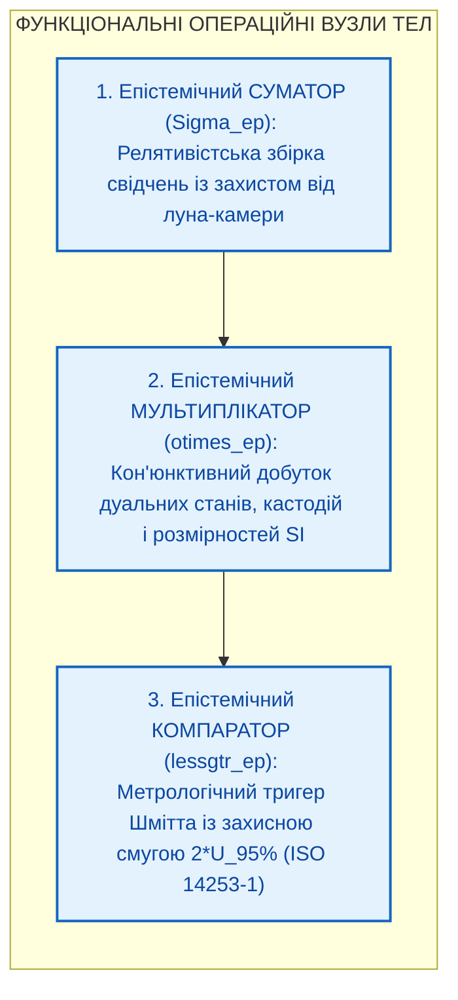
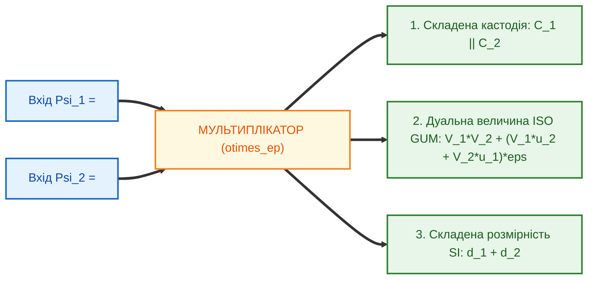
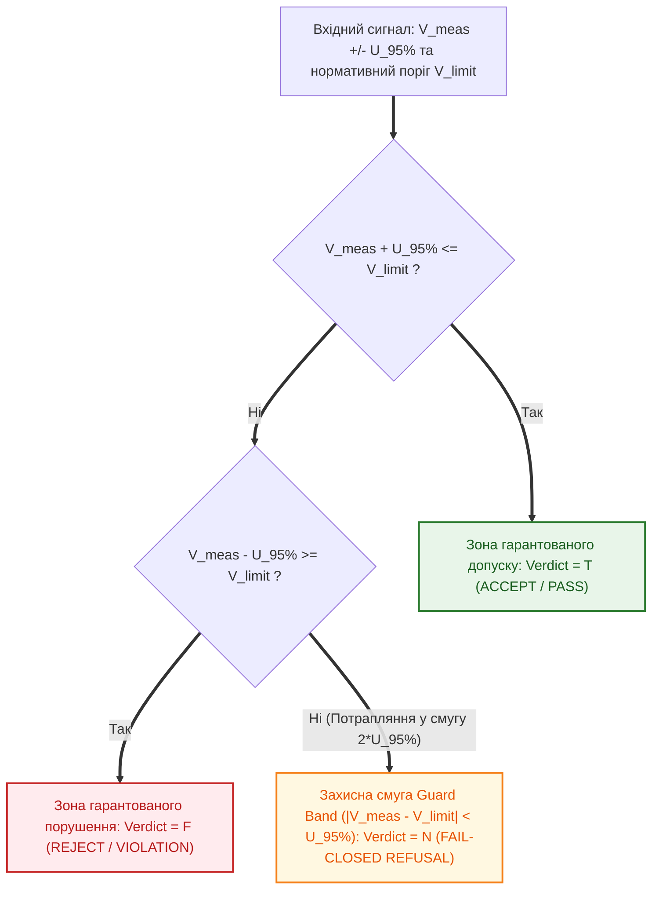

# Глава 08. Функціональні операційні вузли ТЕЛ: Релятивістські суматори, Дуальні мультиплікатори та Гістерезисні компаратори

> [!NOTE]
> **Три фундаментальні положення авторського внеску Миколи Федчика**
> 1. Розроблено архітектуру Епістемічного Суматора ($`\Sigma_{\mathrm{ep}}`$) з автоматичним дисконтуванням корельованих груп свідчень ($`w = 1/\sqrt{\lvert G \rvert}`$) та релятивістським законом додавання потенціалів Ейнштейна, що блокує ефект «луна-камери».
> 2. Створено модель Епістемічного Мультиплікатора ($`\otimes_{\mathrm{ep}}`$), який за один такт одночасно конкатенує вектори кастодії, перемножує дуальні похибки ISO GUM та додає 7-вимірні вектори розмірностей SI.
> 3. Запропоновано схему Епістемічного Компаратора ($`\lessgtr_{\mathrm{ep}}`$) як метрологічного тригера Шмітта із захисною зоною невизначеності $`2 U_{95\%}`$ (Guard Band за ISO 14253-1) та тритермінальним виходом Белнапа.

---

## 1. Перехід від елементарних приладів до операційних блоків

Подібно до того, як у радіоелектроніці з транзисторів та резисторів синтезуються операційні підсилювачі, суматори, перемножувачі сигналів і компаратори, в **епістемічній схемотехніці** з ес-тріодів та діодів будуються три фундаментальні функціональні вузли обробки доказів:

---

## 2. Епістемічний Суматор ($`\Sigma_{\mathrm{ep}}`$, Relativistic Epistemic Adder)

У класичній аналоговій схемотехніці інвертуючий суматор просто складає вхідні напруги: $`V_{\mathrm{out}} = \sum w_i V_i`$.
Проте в епістемології **лінійне додавання свідчень є фатальною помилкою**:
- Десять переказів однієї й тієї самої неперевіреної чутки не перетворюють її на 100% істину (дефект луна-камери / Echo-Chamber Defect).
- Сума будь-якої кількості непрямих свідчень не може перевищити потенціал прямої побайтової кастодії $`1.0\,\text{eV}`$.

### 2.1. Схемотехніка та математика Суматора Федчика

1. **Перевірка розмірнісної сумісності:** Вхідна Розмірнісна Призма перевіряє рівність векторів SI усіх доданків: $`\vec{d}_1 \equiv \vec{d}_2 \equiv \dots \equiv \vec{d}_n`$.
2. **Вхідна матриця дедуплікації та групового опору:** Якщо підмножина входів $`G_k`$ має спільне походження (один автор або одне первинне джерело), вхідний опір кожного такого каналу автоматично збільшується в $`\sqrt{\lvert G_k \rvert}`$ разів:

$$
w_i = \frac{1}{\sqrt{\lvert G_k \rvert}}
$$

   Це гарантує, що 100 клонів одного повідомлення дадуть сумарний внесок, тотожний одному повідомленню!
3. **Релятивістський закон додавання потенціалів (S-норма Ейнштейна):**
   Незалежні очищені потенціали $`V_1, V_2 \in [0, 1)`$ додаються за релятивістською формулою:

$$
V_{\Sigma} = V_1 \oplus_{\mathrm{ep}} V_2 = \frac{V_1 + V_2}{1 + V_1 \cdot V_2}
$$

   де роль швидкості світла $`c \equiv 1.0\,\text{eV}`$ відіграє абсолютний потенціал першоджерела. Жодна комбінація непрямих свідчень не здатна «пробити» світловий бар'єр $`1.0\,\text{eV}`$ без прямого ключа кастодії.

---

## 3. Епістемічний Мультиплікатор ($`\otimes_{\mathrm{ep}}`$, Dual-Tensor Multiplier)

Епістемічний мультиплікатор реалізує кон'юнктивне поєднання параметрів або фізичних величин у формулах розрахунку (наприклад, обчислення потужності $P = U \cdot I$ або механічного моменту $M = F \cdot l$).

На вхід мультиплікатора подаються два повні **Епістемічні Тензори Стану** $`\Psi_1`$ та $`\Psi_2`$. За один такт синхронізації вузол виконує три паралельні операції:

$$
\Psi_{\mathrm{out}} = \Psi_1 \otimes_{\mathrm{ep}} \Psi_2 = \left\langle \mathcal{C}_1 \parallel \mathcal{C}_2, \quad (V_1 V_2) + (V_1 u_2 + V_2 u_1)\varepsilon, \quad \vec{d}_1 + \vec{d}_2 \right\rangle
$$

1. **Конкатенація кастодій:** Формує складений доказ $`\mathcal{C}_{\mathrm{comp}} = \mathcal{C}_1 \parallel \mathcal{C}_2`$.
2. **Автодиференціювання похибки:** Точно обчислює похідну добутку на дуальних числах Кліффорда ($\varepsilon^2 = 0$) без жодної апроксимації.
3. **Алгебра розмірностей SI:** Додає цілочисельні показники степенів векторів $`\vec{d}_1 + \vec{d}_2 \in \mathbb{Z}^7`$.

---

## 4. Епістемічний Компаратор ($`\lessgtr_{\mathrm{ep}}`$, Guard-Banded Metrological Comparator)

У системах функціональної безпеки (ISO 26262, DO-178C, медичні дозатори) найнебезпечнішим вузлом є пороговий компаратор, який перевіряє умову «Чи не перевищує виміряний параметр $`V_{\mathrm{meas}}`$ гранично допустиму норму стандарту $`V_{\mathrm{limit}}`$?».

Звичайний булів компаратор (`if x < limit`) є смертельно небезпечним: якщо істинне значення перебуває на межі допуску, а датчик має похибку $`\pm U_{95\%}`$, компаратор видасть хибний дозвіл (`PASS`) з імовірністю 50%!

### 4.1. Принцип дії Епістемічного Компаратора (Тригер Шмітта за ISO 14253-1)

Епістемічний компаратор використовує дуальну компоненту невизначеності $`U_{95\%}`$ для автоматичного формування **захисної зони метрологічного гістерезису (Guard Band)** шириною $`2 U_{95\%}`$ навколо нормативного порогу $`V_{\mathrm{limit}}`$:

Передавальна функція Епістемічного Компаратора має три стани згідно з бірешіткою Белнапа:

$$
\mathrm{Verdict}_{\lessgtr}\left(V_{\mathrm{meas}}, U_{95\%}, V_{\mathrm{limit}}\right) = \begin{cases}
\mathbf{T} \ (\text{ACCEPT / PASS}), & \text{при } V_{\mathrm{meas}} + U_{95\%} \le V_{\mathrm{limit}} \\
\mathbf{F} \ (\text{REJECT / VIOLATION}), & \text{при } V_{\mathrm{meas}} - U_{95\%} \ge V_{\mathrm{limit}} \\
\mathbf{N} \ (\text{REFUSAL / GUARD\_BAND}), & \text{при } \lvert V_{\mathrm{meas}} - V_{\mathrm{limit}} \rvert < U_{95\%}
\end{cases}
$$

> [!IMPORTANT]
> **Інженерний інваріант безпеки:**
> Якщо виміряна величина з урахуванням її довірчого інтервалу $`U_{95\%}`$ зачіпає межу норми $`V_{\mathrm{limit}}`$, Епістемічний Компаратор ніколи не вгадує результат — він видає типізовану відмову `GUARD_BAND_REFUSAL`, вимагаючи точнішого вимірювального приладу або зниження робочого навантаження.
