# Глава 09. Наукова критика, контрприклади та межі застосовності теорії епістемічних обчислювальних схем

> **Книга:** [Теорія епістемічних обчислювальних схем: Математичні інваріанти кастодії, метрології та детермінованого виведення](README.md) · Частина 4. Методологічна верифікація та межі застосовності  
> **Попередня глава:** [Глава 08. Функціональні операційні вузли епістемічних схем: нелінійні суматори, дуальні мультиплікатори та інтервальні компаратори](ch08-operational-units-adders-multipliers-comparators.md)  
> **Наступна глава:** [Зміст книги (Завершальна глава) →](README.md)  
> **Зміст книги:** [README.md](README.md)  
> **Автор:** [Микола Федчик](../ExpertSystem/about-the-author.md)  
> **Рівень складності та оптимальне вивчення:** `[L4]` Методологічно-дослідницький рівень (індекс Д. Кнута `[40]`) · *Маршрут:* Обов'язкове завершальне ядро для всіх треків; 2 проходи з опрацюванням розрахункового прикладу  
> **Очікувані результати:** проаналізувати наукові контраргументи щодо теорії епістемічних обчислювальних схем із позицій теоретичної інформатики, метрології та математичної логіки; сформулювати строге розмежування між інтенсивним потенціалом достовірності та екстенсивним потоком транзакцій при розгалуженні графа; застосовувати критерій кривини Гессе для дуальної метрології та теорему про просторово-часову амортизацію NP-складності у фазу компіляції.

## Анотація

Згідно з методологічним принципом фальсифікованості Карла Поппера [[1]](#src-1) та вимогами строгої наукової верифікації [[10]](#src-10), формальна теорія повинна явно визначати контрприклади та граничні умови, за межами яких її інваріанти втрачають чинність. Дев'ята глава виконує систематичний критичний аналіз викладеної у главах 01–08 Теорії епістемічних обчислювальних схем (ТЕОС).

Досліджено шість фундаментальних проблем і заперечень: (1) парадокс розгалуження незнищуваної інформації (*Fan-out Paradox*) у рівнянні вузлового балансу потоків; (2) похибку лінійного автодиференціювання на дуальних числах Кліффорда ($\varepsilon^2 = 0$) для сильно нелінійних функцій порівняно з повним стандартом JCGM GUM [[4]](#src-4), [[5]](#src-5); (3) неможливість скасування теореми Кука — Левіна [[3]](#src-3) про NP-повноту логічного виведення за допомогою послідовних каскадів; (4) нечутливість криптографічних предикатів `SHA-256` до семантичних помилок первинної компіляції тексту в граф; (5) обчислювальну `#P`-складність побудови решіток Галуа та ризик випадкового ізоморфізму графів в операторі міждоменного морфізму [[8]](#src-8); (6) співвідношення деонтичного вентиля й нелінійного суматора з відомими мультиплікативними вентилями та алгебраїчними ко-нормами [[6]](#src-6), [[7]](#src-7). Для кожної проблеми сформульовано строге аксіоматичне уточнення та встановлено точну інженерну межу застосовності, що проілюстровано числовим розрахунком нелінійної похибки четвертого степеня.

---

> [!NOTE]
> **Чотири наукові положення, що виносяться на захист у Главі 09**
> 1. **Превентивна попперівська фальсифікація та формалізація меж теорії:** здійснено критичний аудит ТЕОС за шістьма класами заперечень, що закріплює інтерпретацію обчислювальної схеми як строгого алгебраїчного ізоморфізму узагальнених потокових графів без фізикалістських метафор.
> 2. **Розв'язання парадоксу розгалуження інформації (Fan-out Paradox):** у Першому топологічному інваріанті збереження розділено інтенсивну величину потенціалу достовірності ($`w \in [0, 1]`$), яка копіюється буферним повторювачем без ослаблення, та екстенсивну величину потоку верифікаційних транзакцій ($`\Phi`$), яка лінійно масштабується з числом паралельних гілок $M$.
> 3. **Критерій метрологічної нелінійності Гессе та гіпердуальний коректор:** виведено аналітичний критерій допустимості дуальної алгебри першого порядку ($\varepsilon^2 = 0$) через відношення другої та першої похідних вимірювальної функції й сформульовано умову переходу до гіпердуальних чисел другого порядку ($`\varepsilon_1 \varepsilon_2 \neq 0`$) за стандартом JCGM GUM.
> 4. **Теорема про просторово-часову амортизацію комбінаторної складності:** строго доведено, за яких структурних обмежень (обмежена деревна ширина графа норм $`w \le w_{\max}`$) NP-складна задача виведення амортизується у фазу офлайн-компіляції та виконується за лінійний час $\Theta(N)$ у рантаймі без експоненційного розростання розміру схеми.
> *Керування рантаймом / Інженерний інваріант:* Якщо індекс метрологічної нелінійності у вузлі перевищує поріг допуску ($`\kappa_{\mathrm{nonlin}} > \eta_{\mathrm{crit}}`$) або сумарний потік розгалуження перевищує пропускну здатність буфера пам'яті, рантайм зобов'язаний згенерувати переривання `NonLinearityFault` / `FanOutOverload`.

---

## 1. Презумпція попперівської фальсифікованості та методологічна строгість

Будь-яка формальна теорія, яка використовує апарат потокових мереж і балансових рівнянь у задачах математичної логіки та комп'ютерної інженерії, потребує чіткого визначення статусу своїх базових понять. Як наголошував Річард Фейнман у праці про методологічну дисципліну науки (1974) [[10]](#src-10), дослідник зобов'язаний викласти всі потенційні контрприклади та обмеження власної моделі так само ретельно, як і її переваги.

Керуючись критерієм демаркації Карла Поппера [[1]](#src-1), сформулюємо головне методологічне питання наукового критика до цієї монографії:

> *Які саме властивості Теорії епістемічних обчислювальних схем (ТЕОС) є строгими математичними інваріантами обчислювальних графів над чотирикомпонентним тензором стану, де пролягають межі точності лінійних дуальних апроксимацій і за рахунок яких ресурсів досягається лінійний час виконання $\Theta(N)$ у рантаймі?*

У наступних розділах послідовно розглянуто шість критичних заперечень до апарату ТЕОС, виконано строгу формалізацію граничних режимів і встановлено математичні умови застосовності кожного оператора.

---

## 2. Перший рубіж критики: проблема категорійної демаркації та парадокс розгалуження інформації

### 2.1. Формулювання закиду опонентів

**Закид 1 (Незбережуваність інформації при копіюванні та парадокс розгалуження).** У класичній теорії фізичних мереж рівняння нерозривності у вузлі є наслідком закону збереження матеріального носія. Якщо потік зі $100$ одиниць матеріального ресурсу за такт розгалужується у пасивному вузлі на дві однакові паралельні гілки, то в кожну гілку надійде по $50$ одиниць.
Натомість **інформація та логічна достовірність не є матеріальною субстанцією, що ділиться при читанні**. Якщо один первинний факт у пам'яті (наприклад, показ давача температури або стаття закону з потенціалом достовірності $`w_0 = 1{,}0`$) одночасно подається на входи $M = 10$ різних правил безпеки (коефіцієнт розгалуження `fan-out` $= 10$), то кожне з десяти правил отримує повну достовірність $`1{,}0`$, а не $`1/10 = 0{,}1`$.
Отже, вказують опоненти, без розмежування інтенсивних та екстенсивних величин у рівнянні вузлового балансу (формула (3.1) з глави 03) виникає суперечність:
- або читання одного факту десятьма споживачами зменшує його достовірність у $10$ разів;
- або ж у кожній гілці потік дорівнює $`\Phi_m = 1{,}0\text{ такт}^{-1}`$, сума вихідних потоків становить $`\sum_{m=1}^{10} \Phi_{\mathrm{out}, m} = 10{,}0 > \Phi_{\mathrm{in}} = 1{,}0`$, що порушує однорідне рівняння балансу. Додатково зауважується, що функціонал дисипативних втрат $`L_{\mathrm{diss}} = \Phi^2 \cdot D`$ є інформаційно-метрологічною штрафною функцією, а не термодинамічним виділенням теплоти за принципом Рольфа Ландауера ($`E_{\min} = k_B T \ln 2`$) [[2]](#src-2).

### 2.2. Наукова відповідь та розв'язання парадоксу розгалуження

Цей закид вимагає строгого розмежування інтенсивного параметра стану (потенціалу достовірності $`w`$) та екстенсивного параметра навантаження (потоку верифікаційних транзакцій $`\Phi`$).

**Принцип 9.1 (Статус формального системного ізоморфізму).** Теорія епістемічних обчислювальних схем спирається на математичний апарат **узагальнених потокових і зв'язкових графів (*Bond Graphs*)** Генрі Пейнтера [[9]](#src-9), згідно з яким динамічна система обробки ресурсу з виділеною парою спряжених змінних «Інтенсивний потенціал — Екстенсивний потік» ($`\text{Effort } e \leftrightarrow w`$, $`\text{Flow } f \leftrightarrow \Phi`$) описується топологічними рівняннями балансу на графі.

Як у теорії обчислювальних схем та зв'язкових графів передається інтенсивний потенціал одного джерела на $M$ споживачів без ослаблення потенціалу?
Між коміркою першоджерела та $M$ паралельними трактами правил встановлюється **оператор буферного повторення потенціалу (буфер кастодії з одиничним коефіцієнтом передачі $`K_w = 1`$)**, який не споживає вхідного потоку від комірки першоджерела ($`\Phi_{\mathrm{in}} = 0`$), а формує $M$ паралельних потоків транзакцій $`\Phi_{\mathrm{out}, m}`$ за рахунок загального бюджету пропускної здатності шини пам'яті процесора $`\Phi_{\mathrm{bus}}`$.

Структурне розв'язання парадоксу розгалуження наведено на рисунку 9.1.

```mermaid
flowchart TD
    accTitle: Рисунок 9.1. Розв'язання парадоксу розгалуження (Fan-out Paradox) в ТЕОС
    accDescr: Порівняння пасивного вузла розподілу пропускної здатності каналу та буферного повторювача потенціалу факту, де копіюється потенціал достовірності w = 1.0 без втрат за рахунок бюджету транзакцій шини пам'яті Phi_bus.

    subgraph Passive ["А. Пасивний вузол розподілу потоку (Ділення пропускної здатності)"]
        InP["Вхідний потік Phi_in = 1.0 такт^-1"]
        NodeP(("Пасивний вузол"))
        OutP1["Гілка 1: Phi_1 = 0.5 такт^-1"]
        OutP2["Гілка 2: Phi_2 = 0.5 такт^-1"]
        InP ==> NodeP
        NodeP ==> OutP1
        NodeP ==> OutP2
    end

    subgraph Active ["Б. Буферний повторювач факту (Копіювання потенціалу без втрат)"]
        Fact["Першоджерело в пам'яті: Потенціал w_S = 1.0"]
        VCC["Бюджет пропускної здатності шини Phi_bus"]
        Buf["Буферний повторювач кастодії (K_w = 1.0)"]
        Clone1["Споживач 1: w_1 = 1.0, Phi_1 = 1.0 такт^-1"]
        Clone2["Споживач 2: w_2 = 1.0, Phi_2 = 1.0 такт^-1"]
        Fact -.->|"Передача потенціалу w_S"| Buf
        VCC ==>|"Бюджет потоку M * Phi_0"| Buf
        Buf ==> Clone1
        Buf ==> Clone2
    end

    classDef pass fill:#fff8e1,stroke:#f57f17,stroke-width:2px,color:#e65100;
    classDef act fill:#e8f5e9,stroke:#2e7d32,stroke-width:2px,color:#1b5e20;
    class InP,NodeP,OutP1,OutP2 pass;
    class Fact,VCC,Buf,Clone1,Clone2 act;
```

**Рисунок 9.1.** Розмежування пасивного вузла розподілу пропускної здатності та буферного повторювача інтенсивного потенціалу факту.

**Твердження 9.1 (Дуальність потенціального копіювання та балансу потоків при розгалуженні).** *У ТЕОС розмноження верифікованого факту на $M$ паралельних правил здійснюється через буферний повторювач потенціалу, який копіює безрозмірний потенціал достовірності без атенюації ($`w_{\mathrm{out}, m} \equiv w_{\mathrm{source}}`$ для всіх $`m = 1, \dots, M`$), тоді як перший топологічний інваріант балансу потоків виконується відносно бюджету пропускної здатності шини пам'яті процесора $`\Phi_{\mathrm{bus}} = \sum_{m=1}^M \Phi_{\mathrm{out}, m} + \Phi_{\mathrm{leak}}`$, що відображає лінійне зростання апаратних витрат пропускної здатності на обслуговування $M$ одночасних споживачів.*

$$
w_{\mathrm{out}, m} = w_{\mathrm{source}} \quad (\forall m \in \{1, \dots, M\}), \qquad \Phi_{\mathrm{bus}} - \sum_{m=1}^{M} \Phi_{\mathrm{out}, m} - \Phi_{\mathrm{leak}} = 0
$$

**Формула (9.1).** Рівняння балансу буферного розгалужувача на $M$ паралельних гілок правил.

Тут:
- $`w_{\mathrm{source}} \in [0, 1{,}0]`$ — незмінний інтенсивний потенціал достовірності першоджерела;
- $`w_{\mathrm{out}, m} \in [0, 1{,}0]`$ — потенціал достовірності на вході $m$-го правила-споживача;
- $`\Phi_{\mathrm{bus}} \ge 0`$ — сумарний потік верифікаційних транзакцій за такт, що виділяється шиною пам'яті процесора знань ($`\text{такт}^{-1}`$);
- $`\Phi_{\mathrm{out}, m} \ge 0`$ — потік верифікації у $m$-й гілці розгалуження ($`\text{такт}^{-1}`$).

Таким чином, парадокс розгалуження повністю усувається: **достовірність $`w`$ є інтенсивною величиною (потенціалом)**, тому при паралельному підключенні споживачів вона залишається однаковою на всіх гілках ($`w_1 = w_2 = \dots = w_M = w_{\mathrm{source}}`$), тоді як **потік $`\Phi`$ є екстенсивною мірою навантаження пропускної здатності верифікатора**, яка сумується за першим топологічним інваріантом і обмежується пропускною здатністю шини пам'яті.

---

## 3. Другий рубіж критики: межі лінійної дуальної метрології при сильних нелінійностях

### 3.1. Формулювання закиду опонентів

**Закид 2 (Похибка відкидання членів вищого порядку при $\varepsilon^2 = 0$).** У главах 03, 04 та 08 показано, що дуальні числа Вільяма Кліффорда $`x + u\varepsilon`$ з нільпотентною умовою $\varepsilon^2 = 0$ забезпечують однотактове поширення метрологічної невизначеності за стандартом JCGM GUM.
Критик-метролог зауважить: алгебра Кліффорда $\varepsilon^2 = 0$ точно обчислює лише **лінійний член розкладу Тейлора першого порядку**. Проте стандарт JCGM 100:2008 (GUM, п. 5.1.2, Примітка) [[4]](#src-4) та Доповнення JCGM 101 [[5]](#src-5) прямо вказують: якщо функція вимірювання $`y = f(x_1, \dots, x_n)`$ є істотно нелінійною (наприклад, експоненційна залежність швидкості хімічної реакції Арреніуса $`k \propto \exp(-E_a / (R T))`$ або степеневий закон випромінювання Стефана — Больцмана $`q \propto T^4`$), то при значній стандартній невизначеності $`u(x)`$ умова $\varepsilon^2 = 0$ відкидає похідні другого та третього порядків ($`\partial^2 f / \partial x^2`$), що призводить до систематичного заниження розширеної невизначеності $`U_{95\%}`$ і звуження захисної смуги компаратора.

### 3.2. Математичний критерій кривини та перехід до гіпердуальних чисел

Це зауваження є справедливим. Лінійна дуальна алгебра $`\mathbb{D}_1`$ ($\varepsilon^2 = 0$) є точною для якобіана першого порядку (без похибок скінченних різниць $\Delta x$), але сам якобіан першого порядку є достатнім лише в області помірної кривини функції $f(x)$.

Щоб забезпечити метрологічну точність ТЕОС при сильних нелінійностях, запишемо повне рівняння дисперсії з членами вищого порядку згідно з п. 5.1.2 JCGM GUM [[4]](#src-4) і введемо індекс метрологічної нелінійності вузла.

$$
u_c^2(y) = \underbrace{\sum_{i=1}^{n} \left( \frac{\partial f}{\partial x_i} \right)^2 u^2(x_i)}_{\text{Лінійна дуальна частина } u_{\mathrm{lin}}^2 \ (\varepsilon^2 = 0)} + \underbrace{\sum_{i=1}^{n} \sum_{j=1}^{n} \left[ \frac{1}{2} \left( \frac{\partial^2 f}{\partial x_i \partial x_j} \right)^2 + \frac{\partial f}{\partial x_i} \frac{\partial^3 f}{\partial x_i \partial x_j^2} \right] u^2(x_i) u^2(x_j)}_{\text{Квадратична поправка кривини } \Delta u_{\mathrm{quad}}^2 \ (\text{втрачена при } \varepsilon^2 = 0)}
$$

**Формула (9.2).** Повне рівняння дисперсії JCGM GUM з урахуванням нелінійних членів другого порядку (кривини функції) та поправка до лінійної дуальної алгебри.

Тут:
- $`u_{\mathrm{lin}}(y)`$ — стандартна невизначеність першого порядку, яку обчислює базовий дуальний вузол при $\varepsilon^2 = 0$;
- $`\partial^2 f / (\partial x_i \partial x_j)`$ — елементи матриці Гессе (других частинних похідних) вимірювальної функції у робочій точці;
- $`\Delta u_{\mathrm{quad}}^2`$ — додатковий внесок дисперсії, зумовлений кривиною функції на інтервалі $`u(x_i)`$.

**Означення 9.1 (Індекс метрологічної нелінійності вузла).** *Безрозмірним індексом метрологічної нелінійності* $`\kappa_{\mathrm{nonlin}}`$ операційного вузла називається відношення квадратичного члена Тейлора другого порядку до лінійного члена першого порядку на інтервалі стандартної невизначеності $`u(x)`$:

$$
\kappa_{\mathrm{nonlin}} = \frac{\frac{1}{2} \left\lvert \frac{\partial^2 f}{\partial x^2} \right\rvert \cdot u^2(x)}{\left\lvert \frac{\partial f}{\partial x} \right\rvert \cdot u(x)} = \frac{1}{2} \left\lvert \frac{f''(x)}{f'(x)} \right\rvert \cdot u(x) \le \eta_{\mathrm{crit}}
$$

**Формула (9.3).** Критерій допустимості лінійної дуальної алгебри Кліффорда.

Тут:
- $`\kappa_{\mathrm{nonlin}} \ge 0`$ — індекс відносної метрологічної кривини у робочій точці $`x`$;
- $`\eta_{\mathrm{crit}}`$ — гранично допустимий поріг нелінійного спотворення похибки (зазвичай $`\eta_{\mathrm{crit}} = 0{,}05`$, або $5\%$).

Якщо у нелінійному вузлі індекс кривини перевищує поріг ($`\kappa_{\mathrm{nonlin}} > \eta_{\mathrm{crit}}`$), застосовуються два механізми захисту:
1. **Розширення тензора до алгебри гіпердуальних чисел другого порядку ($`\mathbb{D}_2`$):** Замість однієї нільпотентної одиниці $\varepsilon^2 = 0$ використовується чотирикомпонентне гіпердуальне число $`x + u_1 \varepsilon_1 + u_2 \varepsilon_2 + 0 \cdot \varepsilon_1 \varepsilon_2`$ (де $`\varepsilon_1^2 = \varepsilon_2^2 = 0`$, але змішаний добуток **$`\varepsilon_1 \varepsilon_2 \neq 0`$**), яке за один такт без скінченних різниць обчислює точну другу похідну $f''(x)$ для формули (9.2).
2. **Переривання `NonLinearityFault`:** Якщо апаратна шина підтримує лише дуальні числа першого порядку, при $`\kappa_{\mathrm{nonlin}} > \eta_{\mathrm{crit}}`$ вузол зобов'язаний заблокувати тракт за принципом `FAIL-CLOSED`, забороняючи використання заниженої лінійної оцінки $`U_{95\%}`$.

---

## 4. Третій рубіж критики: теорема Кука — Левіна та просторово-часова амортизація складності

### 4.1. Формулювання закиду опонентів

**Закид 3 (Неможливість обходу класу NP у загальному випадку).** У главі 07 показано, що послідовний каскад деонтичних вентилів замінює експоненційний пошук із поверненням $`\mathcal{O}(b^N)`$ у машинах резолюції (Prolog / WAM) на лінійний час поширення сигналу $\Theta(N)$ у рантаймі.
Фахівець із теорії обчислювальної складності вкаже: за теоремою Стівена Кука (1971) та Леоніда Левіна (1973) [[3]](#src-3) задача пропозиційної здійсненності булевих формул (SAT) є **NP-повною**, а обчислення скептичної прийнятності аргументів у загальних графах Дунга (ASPIC+) лежить у класі $`\Pi_2^P`$-повних задач. Оскільки для довільних булевих і нормативних графів не існує загального алгоритму поліноміального часу та лінійного розміру схеми (за гіпотезою $`\mathrm{P} \neq \mathrm{NP}`$), де саме в апараті ТЕОС амортизується експоненційна складність $`\mathcal{O}(b^N)`$?

### 4.2. Теорема про просторово-часову амортизацію та обмеження деревної ширини

Відповідь на це питання визначає точну границю обчислювальної складності ТЕОС. Апарат ТЕОС **не скасовує теорему Кука — Левіна**; лінійний час відгуку $\Theta(N)$ в оперативному режимі досягається за рахунок трьох формальних умов:

**Твердження 9.2 (Закон просторово-часової амортизації комбінаторної складності).** *Перехід від експоненційного часу пошуку в інтерпретаторі до лінійного часу поширення сигналу $`\tau_{\mathrm{prop}} = \Theta(N)`$ у скомпільованій епістемічній схемі здійснюється за рахунок:*
1. *перенесення задачі уніфікації та канонізації решітки правил із фази оперативного виконання (Runtime) у фазу попередньої офлайн-компіляції контейнера знань (Compile-Time Amortization);*
2. *просторового розгортання незалежних альтернативних шляхів у паралельні каскади вентилів розміром $`A_{\mathrm{circuit}}`$;*
3. *структурного обмеження графа нормативних залежностей класом стратифікованих ієрархій з обмеженою деревною шириною (Bounded Treewidth $`w \le w_{\max}`$) за теоремою Курселя.*

$$
T_{\mathrm{compile}} = \mathcal{O}\left(\lvert \mathcal{R} \rvert \cdot 2^{w}\right), \qquad A_{\mathrm{circuit}} = \Theta\left(\lvert \mathcal{R} \rvert \cdot b_{\mathrm{eff}}\right), \qquad T_{\mathrm{runtime}}(N) = \Theta(N)
$$

**Формула (9.4).** Співвідношення між часом компіляції, розміром скомпільованої схеми (кількістю вентилів $`A_{\mathrm{circuit}}`$) та часом оперативного відгуку в рантаймі.

Тут:
- $`\lvert \mathcal{R} \rvert`$ — загальна кількість елементарних нормативних правил у предметному домені;
- $`w`$ — деревна ширина (*treewidth*) графа взаємозалежності змінних у нормативній базі;
- $`b_{\mathrm{eff}}`$ — середня кількість паралельних альтернативних гілок на один вузол після офлайн-дедуплікації;
- $`A_{\mathrm{circuit}}`$ — просторова складність схеми (кількість деонтичних вентилів у скомпільованому графі);
- $`T_{\mathrm{runtime}}(N)`$ — гарантований верхній час оперативного відгуку (WCET) для каскаду глибини $N$.

**Межа застосовності:** ТЕОС ефективно працює для інженерних стандартів, юридичних кодексів та клінічних протоколів тому, що нормативні акти проектуються людьми як **стратифіковані ієрархічні дерева з малою деревною шириною ($w \le 5$)**. Якщо ж подати на вхід компілятора довільну криптографічну задачу 3-SAT із випадковим щільним графом ($w \sim N$), то під час спроби розгорнути її в ациклічну схему без бектрекінгу експонента перейде у розмір схеми ($`A_{\mathrm{circuit}} \sim \mathcal{O}(2^N)`$), і компілятор зафіксує перевищення ліміту пам'яті ще на етапі збирання.

---

## 5. Четвертий рубіж критики: проблема семантичного розриву компіляції та криптографічної кастодії

### 5.1. Формулювання закиду опонентів

**Закид 4 (Цілісність байтів не тотожна семантичній правильності екстракції правила).** У главах 01 та 05 показано, що криптографічний предикат побайтової кастодії $`\mathcal{P}_{\mathrm{SHA}}`$ (перевірка дайджесту $`\mathrm{SHA256}(\mathrm{Mem}[b_{\mathrm{start}} \dots b_{\mathrm{end}}]) \equiv h_{\mathrm{expected}}`$) гарантує відсутність галюцинацій у рантаймі.
Критик із формальної верифікації вкаже на суттєву відмінність: **функція `SHA-256` перевіряє лише незмінність байтів першоджерела в пам'яті, але не здатна перевірити, чи коректно компілятор знань видобув логічну структуру правила з цих байтів**.
Розглянемо контрприклад: у першоджерелі записано речення: *«Забороняється перевищувати тиск 15 МПа, за винятком стендових гідровипробувань, де дозволено 22 МПа»*. Якщо дефектний парсер під час компіляції виділив байтовий зріз слів *«дозволено 22 МПа»* і скомпілював його як норму робочого режиму (втративши умову *«стендових гідровипробувань»*), то під час виконання у рантаймі:
1. Байтовий зріз у пам'яті справді містить слова *«дозволено 22 МПа»*.
2. Контрольна сума `SHA-256` збігається побітово ($`\sigma_{\mathrm{SHA}} = 1`$).
3. Предикат кастодії пропускає хибно скомпільоване правило з валідним криптографічним сертифікатом.

### 5.2. Факторизація епістемічної чистоти на фазу компіляції та фазу рантайму

Це фундаментальне положення для будь-якої системи з попередньою компіляцією знань: **виконавчий процесор у рантаймі гарантує точне виконання скомпільованої схеми, але не може самостійно виправити семантичну помилку компілятора, допущену при трансляції природномовного тексту в граф вентилів**.

Формалізуємо це розмежування через рівняння наскрізної достовірності системи:

$$
\mathrm{ZHR}_{\mathrm{end\text{-}to\text{-}end}} = \mathrm{ZHR}_{\mathrm{runtime}}\left(\mathcal{P}_{\mathrm{SHA}}\right) \cdot \mathcal{F}_{\mathrm{compile}}\left(\text{Текст} \mapsto \text{Схема}\right)
$$

**Формула (9.5).** Факторизація наскрізної безпомилковості системи на інваріант рантайму та семантичну точність компіляції.

Тут:
- $`\mathrm{ZHR}_{\mathrm{runtime}}(\mathcal{P}_{\mathrm{SHA}}) \equiv 1{,}0000`$ — конструктивний інваріант нульових галюцинацій виконавчого рантайму (схема не може сформувати висновок без посилання на існуюче правило графа та незмінний байтовий зріз першоджерела);
- $`\mathcal{F}_{\mathrm{compile}} \in [0, 1]`$ — коефіцієнт семантичної точності компіляції (повнота і правильність екстракції логічних правил та умов керуючих входів із тексту першоджерела);
- $`\mathrm{ZHR}_{\mathrm{end\text{-}to\text{-}end}} \in [0, 1]`$ — підсумкова наскрізна безпомилковість системи для кінцевого користувача.

З формули (9.5) випливає, що предикат кастодії $`\mathcal{P}_{\mathrm{SHA}}`$ забезпечує $`\mathrm{ZHR}_{\mathrm{runtime}} = 1{,}0`$, а для наближення $`\mathcal{F}_{\mathrm{compile}} \to 1{,}0`$ на етапі компіляції бази знань необхідні:
1. Строгий синтаксично-семантичний аналіз обмежувальних конструкцій («якщо», «за винятком», «крім випадків») з обов'язковим підключенням кожного винятку як підсікаючого входу на затвор деонтичного вентиля.
2. Представлення людині-аудитору повної цитати у контексті всього речення або абзацу поруч із вердиктом, щоб оператор міг візуально верифікувати контекст байтового зрізу $`[b_{\mathrm{start}} \dots b_{\mathrm{end}}]`$.

---

## 6. П'ятий та шостий рубежі критики: обмеження міждоменного морфізму, дедуплікація клонів та новизна деонтичного вентиля

### 6.1. Обчислювальна складність решіток Галуа та ризик випадкового ізоморфізму

**Закид 5.** У главі 05 коефіцієнт передачі оператора міждоменного морфізму $`k_{\mathrm{FCA}}`$ визначається через ізоморфізм решіток Галуа (FCA) [[8]](#src-8) та тест Вейсфейлера — Лемана (1-WL). Критик зауважить:
1. Кількість формальних понять у решітці Галуа для бінарного контексту $(G, M, I)$ у найгіршому випадку становить $`2^{\min(\lvert G \rvert, \lvert M \rvert)}`$, тобто обчислення $`k_{\mathrm{FCA}}`$ є `#P`-повною задачею [[8]](#src-8).
2. Два домени можуть мати **випадково ізоморфні графи** (наприклад, ієрархія з 5 посад у відділі та граф із 5 вузлів зіркоподібної обчислювальної мережі мають $`k_{\mathrm{FCA}} = 1{,}0`$), але перенесення правил маршрутизації пакетів на трудове право є семантично некоректним.

**Відповідь та обмеження моделі:**
1. Побудова решітки Галуа та обчислення $`k_{\mathrm{FCA}}`$ **не виконуються у рантаймі за один такт**: це виключно офлайн-процедура компілятора під час побудови міждоменного відображення, обмежена локальними підрешітками глибини $d \le 3$.
2. Щоб унеможливити випадкові структурні збіги, вихід оператора міждоменного морфізму $`\mathcal{M}_{\mathrm{FCA}}`$ обов'язково каскадується з **векторним верифікатором розмірностей SI** $`\mathcal{V}_{\mathrm{SI}}`$: міждоменне перенесення дозволяється лише за одночасного виконання структурного гомоморфізму решіток і сумісності векторів фізичних розмірностей SI (або явно затвердженої експертом аксіоми міждоменної трансляції).

### 6.2. Межі дедуплікації перефразованих джерел та відмінність деонтичного вентиля від відомих моделей

**Закид 6 (Критерій дедуплікації клонів та співвідношення з MYCIN і LSTM).**
1. У главі 08 суматор дисконтує клони за формулою $`\gamma_i = 1/\sqrt{\lvert G_k \rvert}`$, а потенціали агрегує за формулою $`w_{\Sigma} = (w_1 + w_2)/(1 + w_1 w_2)`$. Критик зауважить, що ця формула агрегації збігається з гіперболічною ко-нормою Ейнштейна — Гамахера та правилом комбінації односпрямованих факторів впевненості в системі MYCIN Едварда Шортліффа (1975) [[6]](#src-6), а для роботи формули $`1/\sqrt{\lvert G_k \rvert}`$ суматор потребує механізму розпізнавання того, що два тексти походять з одного джерела.
2. У главі 06 рівняння вентиля $`\Phi_D = \Phi_0 \cdot w_S \cdot \sigma_{\mathrm{ch}}(w_G)`$ за формою нагадує мультиплікативний вентиль (`Forget Gate` / `Input Gate`) у рекурентних нейронних мережах LSTM Сеппа Гохрайтера та Юргена Шмідгубера (1997) [[7]](#src-7). У чому полягає специфічна новизна ТЕОС?

**Відповідь та точне розмежування:**
1. **Щодо дедуплікації клонів:** Дедуплікація в суматорі $`\Sigma_{\mathrm{ep}}`$ є точною і детермінованою тоді, коли повідомлення містять криптографічні посилання у графі походження (`origin_hash`). Якщо ж різні вторинні джерела переказали одне твердження різними словами *без збереження посилання на першоджерело* (нерозмічений семантичний плагіат), детермінований суматор не може виявити це криптографічно — кластеризація $`G_k`$ на етапі інгестії спирається на евристичну оцінку близькості й тому має статус наближеної фільтрації.
2. **Щодо структурної відмінності деонтичного вентиля ТЕОС від вентилів LSTM та MYCIN:** У нейромережах LSTM вентиль перемножує **емпірично навчені вектори прихованих станів** без дескрипторів походження, похибок вимірювання та фізичних розмірностей, а в системі MYCIN фактори впевненості комбінувалися скалярно без структурного розділення факту й норми. Специфічний внесок ТЕОС полягає в тому, що тритермінальний вентиль та нелінійний суматор діють над **чотирикомпонентним Епістемічним тензором стану** $`\Psi = \langle \mathcal{C}, w + u\varepsilon, \boldsymbol{\beta}, \vec{d}_{\mathrm{SI}} \rangle`$, поєднуючи в одному синхронному тракті побайтову кастодію першоджерела, деонтичне розмежування видів спростування за Поллоком (*Rebuttal* проти *Undercut*), автодиференціювання похибок за JCGM GUM та контроль розмірностей SI.

Зведену матрицю наукової критики, виявлених меж застосовності та формальних уточнень подано у таблиці 9.1.

**Таблиця 9.1.** Зведена матриця критичних заперечень, меж застосовності та аксіоматичних уточнень ТЕОС.

| № | Об'єкт критики у монографії | Суть наукового заперечення опонентів | Межа застосовності моделі | Формальне розв'язання в уточненій теорії |
| :-: | :--- | :--- | :--- | :--- |
| **1** | **Перший інваріант збереження потоків** | Інформація не ділиться на $1/M$ при читанні $M$ споживачами (`fan-out` парадокс) | Пряме пасивне розгалуження стосується лише пропускної здатності каналу | Розділено інтенсивний потенціал $`w`$ (копіюється буфером $`K_w = 1`$) та екстенсивний потік транзакцій $`\Phi_{\mathrm{bus}}`$ (формула (9.1)) |
| **2** | **Дуальна метрологія Кліффорда ($\varepsilon^2 = 0$)** | Умова $\varepsilon^2 = 0$ відкидає похідні 2-го порядку $f''(x)$ на нелінійних функціях | Лінійна алгебра $`\mathbb{D}_1`$ точна лише при малій кривині $`\kappa_{\mathrm{nonlin}} \le \eta_{\mathrm{crit}}`$ | Введено критерій кривини Гессе (формула (9.3)) та перехід до гіпердуальних чисел $`\mathbb{D}_2`$ ($`\varepsilon_1 \varepsilon_2 \neq 0`$) |
| **3** | **Лінійна складність каскаду $\Theta(N)$** | Неможливо обійти NP-повноту SAT / ASPIC+ (теорема Кука — Левіна) | Не працює для щільних циклічних графів із великою деревною шириною $w \sim N$ | Амортизація складності у фазу компіляції для стратифікованих норм з малою шириною $`w \le w_{\max}`$ (формула (9.4)) |
| **4** | **Криптографічний предикат кастодії SHA-256** | Хеш гарантує цілісність байтів, але не правильність екстракції правила з тексту | Предикат рантайму не виправляє семантичних помилок парсера при компіляції | Факторизація $`\mathrm{ZHR}_{\mathrm{runtime}} = 1{,}0`$ та точності компіляції $`\mathcal{F}_{\mathrm{compile}}`$ з контекстним аудитом (формула (9.5)) |
| **5** | **Оператор міждоменного морфізму FCA + 1-WL** | `#P`-повнота решітки Галуа та ризик випадкового ізоморфізму графів | Непридатний для динамічного обчислення в рантаймі на великих графах | Офлайн-компіляція локальних підрешіток у композиції з верифікатором розмірностей SI $`\mathcal{V}_{\mathrm{SI}}`$ |
| **6** | **Суматор клонів та деонтичний вентиль** | Потреба в графі походження для $`G_k`$; алгебраїчна спорідненість із MYCIN та LSTM | Детермінована дедуплікація не виявляє прихованого перефразування без посилань | Точна дедуплікація за графом криптографічного походження та робота операторів над повним тензором $\Psi$ |

---

## 7. Навчальний інженерний приклад: розрахунок нелінійної похибки дуальної метрології та її корекція гіпердуальними числами

Продемонструємо на числовому прикладі, як застосування базової дуальної алгебри першого порядку ($\varepsilon^2 = 0$) у сильно нелінійному вузлі призводить до заниження оцінки невизначеності і як критерій кривини з формули (9.3) виявляє та усуває цю похибку.

### 7.1. Вихідні інженерні дані

Розглянемо операційний вузол контролю теплового випромінювання захисного екрана реактора за законом Стефана — Больцмана, де густина потоку випромінювання $q$ пропорційна четвертому степеню абсолютної температури:

$$
q(T) = \alpha \cdot T^4
$$

1. Коефіцієнт випромінювання: $`\alpha = 5{,}0 \times 10^{-8}\,\text{Вт}/(\text{м}^2\cdot\text{К}^4)`$.
2. Виміряна пірометром температура в аварійному режимі: номінал $`T_0 = 1000\,\text{К}`$ зі стандартною невизначеністю у задимленому середовищі $`u(T) = 100\,\text{К}`$ (відносна похибка $10\%$).
3. Нормативний поріг допустимого індексу нелінійності вузла: $`\eta_{\mathrm{crit}} = 0{,}05`$ ($5\%$).

### 7.2. Покроковий розрахунок

**Крок 1. Обчислення номіналу та похідних функції $q(T) = \alpha T^4$ у точці $`T_0 = 1000\,\text{К}`$.**
Знаходимо номінальне значення густини потоку, а також першу, другу та третю похідні:

$$
q(1000) = 5{,}0 \times 10^{-8} \times (1000)^4 = 50\,000\,\text{Вт/м}^2 = 50{,}0\,\text{кВт/м}^2
$$

$$
q'(T) = 4\alpha T^3 = 200\,\text{Вт}/(\text{м}^2\cdot\text{К}), \qquad q''(T) = 12\alpha T^2 = 0{,}60\,\text{Вт}/(\text{м}^2\cdot\text{К}^2), \qquad q'''(T) = 24\alpha T = 0{,}0012\,\text{Вт}/(\text{м}^2\cdot\text{К}^3)
$$

**Крок 2. Оцінка похибки базовим дуальним мультиплікатором першого порядку ($\varepsilon^2 = 0$).**
При піднесенні дуального числа $`T_{\mathbb{D}} = 1000 + 100\varepsilon`$ до четвертого степеня за правилом Кліффорда $\varepsilon^2 = 0$ зберігається лише лінійний член першого порядку:

$$
u_{\mathrm{lin}}(q) = \lvert q'(T_0) \rvert \cdot u(T) = 200 \times 100 = 20\,000\,\text{Вт/м}^2 = 20{,}0\,\text{кВт/м}^2
$$

**Крок 3. Перевірка індексу метрологічної нелінійності за формулою (9.3).**
Обчислюємо індекс кривини $`\kappa_{\mathrm{nonlin}}`$ у робочій точці:

$$
\kappa_{\mathrm{nonlin}} = \frac{1}{2} \left\lvert \frac{q''(1000)}{q'(1000)} \right\rvert \cdot u(T) = \frac{1}{2} \cdot \frac{0{,}60}{200} \cdot 100 = 0{,}1500 \ (15{,}0\%) > \eta_{\mathrm{crit}} = 0{,}0500 \ (5{,}0\%)
$$

Індекс нелінійності втричі перевищує допустимий поріг. Лінійна дуальна схема першого порядку формує попередження `NonLinearityFault` і перемикає обчислення на гіпердуальний коректор другого порядку ($`\varepsilon_1 \varepsilon_2 \neq 0`$).

**Крок 4. Точний розрахунок за повною формулою JCGM GUM (формула (9.2)) на гіпердуальних числах.**
Обчислюємо квадратичну поправку дисперсії $`\Delta u_{\mathrm{quad}}^2`$:

$$
\Delta u_{\mathrm{quad}}^2 = \left[ \frac{1}{2} \left( q''(T_0) \right)^2 + q'(T_0) \cdot q'''(T_0) \right] \cdot u^4(T) = \left[ \frac{1}{2} (0{,}60)^2 + 200 \times 0{,}0012 \right] \times (100)^4
$$

$$
\Delta u_{\mathrm{quad}}^2 = [0{,}18 + 0{,}24] \times 10^8 = 0{,}42 \times 10^8\,\left(\text{Вт/м}^2\right)^2 = 42{,}0\,\left(\text{кВт/м}^2\right)^2
$$

Тоді повна комбінована стандартна невизначеність за формулою (9.2) становить:

$$
u_c(q) = \sqrt{u_{\mathrm{lin}}^2 + \Delta u_{\mathrm{quad}}^2} = \sqrt{20{,}0^2 + 42{,}0} = \sqrt{442{,}0} \approx 21{,}0238\,\text{кВт/м}^2
$$

Якби схема обмежилася лінійною алгеброю $\varepsilon^2 = 0$, вона б занизила стандартну невизначеність на $`1{,}02\,\text{кВт/м}^2`$ (а розширену захисну смугу $`2 U_{95\%}`$ — на понад $`4{,}0\,\text{кВт/м}^2`$). Гіпердуальний контроль кривини своєчасно виявляє нелінійність і розширює захисну смугу компаратора до коректного значення.

---

## Висновки

1. Критичний аналіз Теорії епістемічних обчислювальних схем показує, що її конструктивна цінність полягає у побудові строгого алгебраїчного ізоморфізму потокових графів над чотирикомпонентним тензором стану, який накладає на процеси виведення інваріанти збереження кастодії, односпрямованості та метрологічного допуску.
2. Парадокс розгалуження інформації (*Fan-out Paradox*) розв'язується строгим розділенням інтенсивного потенціалу достовірності ($`w`$), який копіюється буферними повторювачами без ослаблення, та екстенсивного потоку транзакцій верифікації ($`\Phi`$), який підпорядковується балансу пропускної здатності шини пам'яті.
3. Лінійна дуальна алгебра Кліффорда ($\varepsilon^2 = 0$) є точною в межах помірної кривини функції ($`\kappa_{\mathrm{nonlin}} \le \eta_{\mathrm{crit}}`$); при перевищенні порогу кривини схема залучає гіпердуальні числа другого порядку ($`\varepsilon_1 \varepsilon_2 \neq 0`$) згідно з повним рівнянням JCGM GUM.
4. Лінійна часова складність багатокаскадного виведення $\Theta(N)$ в оперативному режимі узгоджується з теоремою Кука — Левіна про NP-повноту завдяки просторово-часовій амортизації пошуку у фазу офлайн-компіляції для стратифікованих нормативних систем із обмеженою деревною шириною.
5. Криптографічний предикат побайтової кастодії $`\mathcal{P}_{\mathrm{SHA}}`$ гарантує епістемічну цілісність виконавчого рантайму ($`\mathrm{ZHR}_{\mathrm{runtime}} = 1{,}0`$), тоді як наскрізна безпомилковість системи визначається добутком інваріанта рантайму на коефіцієнт семантичної точності компілятора знань ($`\mathcal{F}_{\mathrm{compile}}`$).

---

## Словник

| Термін | Англійський еквівалент | Визначення |
| :--- | :--- | :--- |
| **Амортизація складності компіляцією** | *Compile-Time Complexity Amortization* | Перенесення комбінаторно складних операцій уніфікації та побудови решіток із фази оперативного виконання у фазу попереднього збирання контейнера знань. |
| **Буферний повторювач кастодії** | *Custody Buffer Repeater* | Оператор розгалуження з одиничним коефіцієнтом передачі потенціалу достовірності, який тиражує факт на $M$ споживачів за рахунок бюджету пропускної здатності шини пам'яті. |
| **Гіпердуальні числа другого порядку** | *Second-Order Hyper-Dual Numbers* | Розширення алгебри Кліффорда з ненульовим змішаним добутком нільпотентних одиниць ($`\varepsilon_1 \varepsilon_2 \neq 0`$) для точного однотактового обчислення других похідних Гессе. |
| **Деревна ширина графа норм** | *Normative Graph Treewidth* | Структурний параметр графа взаємозалежності правил, який визначає, наскільки граф близький до дерева і чи допускає він компактну розгортку без бектрекінгу. |
| **Зв'язковий граф Пейнтера** | *Paynter Bond Graph* | Доменно-незалежний математичний формалізм опису динамічних систем через пару спряжених змінних «Інтенсивний потенціал — Екстенсивний потік». |
| **Індекс метрологічної нелінійності** | *Metrological Non-Linearity Index* | Безрозмірне відношення квадратичного члена розкладу Тейлора до лінійного члена на інтервалі стандартної невизначеності вимірювання. |
| **Парадокс розгалуження інформації** | *Information Fan-Out Paradox* | Уявна суперечність між незнищуваністю інформації при копіюванні та рівнянням балансу екстенсивного потоку у вузлі розгалуження. |

---

## Абревіатури

| Абревіатура | Розшифрування | Опис |
| :--- | :--- | :--- |
| **3-SAT** | 3-Satisfiability Problem | Канонічна NP-повна задача перевірки здійсненності булевої формули у кон'юнктивній нормальній формі з трьома літералами в диз'юнкті. |
| **AD** | Automatic Differentiation | Автоматичне (алгоритмічне) диференціювання функцій у прямому або зворотному режимі. |
| **LSTM** | Long Short-Term Memory | Архітектура рекурентних нейронних мереж із мультиплікативними вентилями входу, забування та виходу. |
| **MYCIN** | MYCIN Expert System | Класична рання медична експертна система Стенфордського університету (1975), у якій запроваджено числення факторів впевненості (*Certainty Factors*). |
| **NP** | Nondeterministic Polynomial Time | Клас обчислювальної складності задач, розв'язок яких можна перевірити за поліноміальний час. |

---

## Джерела

1. **Popper, K. R.** *Conjectures and Refutations: The Growth of Scientific Knowledge*. — London : Routledge & Kegan Paul, 1963. — 412 p.
2. **Landauer, R.** Irreversibility and Heat Generation in the Computing Process // *IBM Journal of Research and Development*. — 1961. — Vol. 5, No. 3. — P. 183–191. — DOI: 10.1147/rd.53.0183.
3. **Cook, S. A.** The complexity of theorem-proving procedures // *Proceedings of the Third Annual ACM Symposium on Theory of Computing (STOC '71)*. — New York : ACM, 1971. — P. 151–158. — DOI: 10.1145/800157.805047.
4. **JCGM 100:2008 (GUM 1995 with minor corrections).** *Evaluation of measurement data — Guide to the expression of uncertainty in measurement*. — Sèvres : Joint Committee for Guides in Metrology, 2008. (Пункт 5.1.2 Note: Нелінійні члени вищого порядку).
5. **JCGM 101:2008.** *Evaluation of measurement data — Supplement 1 to the "Guide to the expression of uncertainty in measurement" — Propagation of distributions using a Monte Carlo method*. — Sèvres : JCGM, 2008.
6. **Shortliffe, E. H., Buchanan, B. G.** A model of inexact reasoning in medicine // *Mathematical Biosciences*. — 1975. — Vol. 23, No. 3–4. — P. 351–379. — DOI: 10.1016/0025-5564(75)90047-4.
7. **Hochreiter, S., Schmidhuber, J.** Long Short-Term Memory // *Neural Computation*. — 1997. — Vol. 9, No. 8. — P. 1735–1780. — DOI: 10.1162/neco.1997.9.8.1735.
8. **Kuznetsov, S. O.** On Computing the Size of a Lattice and Related Decision Problems // *Order*. — 2001. — Vol. 18, No. 4. — P. 313–324. (Доведення #P-повноти підрахунку формальних понять у решітках Галуа).
9. **Paynter, H. M.** *Analysis and Design of Engineering Systems*. — Cambridge, MA : MIT Press, 1961. — 303 p. (Основоположна праця з теорії міждоменних зв'язкових графів — *Bond Graphs*).
10. **Feynman, R. P.** Cargo Cult Science (Caltech Commencement Address) // *Engineering and Science*. — 1974. — Vol. 37, No. 7. — P. 10–13.

---

[← Глава 08. Функціональні операційні вузли епістемічних схем: нелінійні суматори, дуальні мультиплікатори та інтервальні компаратори](ch08-operational-units-adders-multipliers-comparators.md) | [Зміст книги](README.md)
