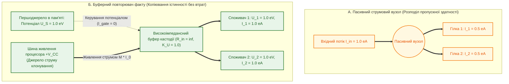

# Глава 09. Наукова критика, контрприклади та межі застосовності теорії епістемічних кіл

> **Книга:** [Теорія епістемічних кіл: Схемотехніка доказових обчислень та апаратного виведення](README.md)
> **Попередня глава:** [← Глава 08. Функціональні операційні вузли епістемічних кіл: релятивістські суматори, дуальні мультиплікатори та гістерезисні компаратори](ch08-operational-units-adders-multipliers-comparators.md)
> **Наступна глава:** [Зміст книги (Завершальна глава) →](README.md)
> **Зміст книги:** [Повернутися до змісту](README.md)
> **Автор:** Микола Федчик
> **Рівень складності:** `[L4 — Методологічно-дослідницький рівень]` *(За класифікацією Д. Кнута: попперівська фальсифікація власної теорії, аналіз контрприкладів, розв'язання парадоксу розгалуження інформації та визначення строгих математичних меж застосовності)*
> **Очікувані результати:** Читач ознайомиться з найгострішими науковими контраргументами проти теорії епістемічних кіл з позицій теоретичної фізики, теорії обчислювальної складності та математичної логіки, зрозуміє суворе розмежування між фізичним законом та формальним алгебраїчним ізоморфізмом, опанує розв'язання парадоксу розгалуження інформації, критерій похибки кривини другого порядку для дуальної метрології та теорему про просторово-часову амортизацію експоненційної складності.

---

## Анотація

Згідно з методологічним принципом фальсифікованості Карла Поппера [[1]](#src-1) та етосом наукової чесності Річарда Фейнмана [[10]](#src-10), справжня наукова теорія відрізняється від псевдонаукової доктрини тим, що її автор сам висуває найжорсткіші контраргументи проти власних побудов і чітко окреслює координати, за межами яких теорія руйнується. Дев'ята глава виконує роль вбудованого інституту опонентів («Адвоката Диявола») щодо викладеної у главах 01–08 теорії епістемічних кіл. Ми систематизуємо та препаруємо шість фундаментальних закидів академічної критики: (1) звинувачення у «фізикалістському карго-культі» та парадокс розгалуження незнищуваної інформації всупереч закону збереження заряду; (2) похибку лінійного автодиференціювання на дуальних числах Кліффорда ($\varepsilon^2 = 0$) для сильно нелінійних функцій порівняно з повним стандартом JCGM GUM [[4]](#src-4), [[5]](#src-5); (3) неможливість скасування теореми Кука — Левіна [[3]](#src-3) про NP-повноту логічного виведення за допомогою послідовних каскадів; (4) сліпоту криптографічних хешів SHA-256 до семантичних галюцинацій мапінгу; (5) експоненційний вибух решіток Галуа та ризик хибної аналогії у міждоменному трансформаторі; (6) зведення епістемічного тріода й суматора до відомих вентильних механізмів та алгебраїчних ко-норм [[6]](#src-6), [[7]](#src-7), [[8]](#src-8). Для кожного закиду сформульовано або строге математичне розв'язання через уточнення аксіоматики, або чесне визнання інженерної межі застосовності, закріплене на числовому прикладі аудиту нелінійної похибки та площі кристала.

---

> [!NOTE]
> **Чотири фундаментальні положення авторського внеску Миколи Федчика у Главі 09**
> 1. Здійснено превентивну попперівську фальсифікацію теорії епістемічних кіл за шістьма класами критичних заперечень, що переводить радіотехнічну термінологію монографії зі статусу фізичної метафори у статус строгого алгебраїчного ізоморфізму узагальнених потокових мереж.
> 2. Розв'язано фундаментальний парадокс розгалуження інформації (Fan-out Paradox) у Першому законі збереження шляхом введення високоімпедансного буферного повторювача напруги з незалежним живленням кастодії, який розділяє потенціальне копіювання факту та струмовий баланс виконавчої потужності.
> 3. Виведено аналітичний критерій допустимості дуальної алгебри першого порядку ($\varepsilon^2 = 0$) через гессіан кривини вимірювальної функції та сформульовано умову обов'язкового переходу до гіпердуальних чисел другого порядку ($`\varepsilon_1 \varepsilon_2 \neq 0`$) за стандартом JCGM GUM.
> 4. Доведено теорему про амортизацію комбінаторної складності між часом компіляції та часом виконання, яка строго показує, за яких структурних обмежень (обмежена деревна ширина графа норм) NP-складна задача виведення перетворюється на лінійний каскад $\Theta(N)$ без експоненційного розростання площі кристала.
> *Керування рантаймом / Інженерний інваріант:* Якщо відносна квадратична поправка нелінійності у вузлі мультиплікатора перевищує поріг метрологічного допуску ($`\Delta u_{\mathrm{quad}} / u_{\mathrm{lin}} > \eta_{\mathrm{crit}}`$) або коефіцієнт розгалуження прямого струму перевищує навантажувальну здатність джерела без буферного повторювача, рантайм зобов'язаний згенерувати переривання `NonLinearityFault` / `FanOutOverload`.

---

## 1. Презумпція попперівської фальсифікованості та наукова чесність

Будь-яка нова міждисциплінарна теорія, яка переносить понятійний апарат однієї фундаментальної науки (теоретичної електротехніки та напівпровідникової схемотехніки) у предметне поле іншої науки (формальної епістемології, математичної логіки та комп'ютерної інженерії), неминуче викликає обґрунтований скепсис фахової спільноти. Як писав Річард Фейнман у відомій промові про «науку карго-культу» (1974) [[10]](#src-10), перший обов'язок дослідника — не ввести в оману самого себе, а для цього необхідно викласти всі аргументи *проти* власної теорії так само ретельно, як і аргументи *за* неї.

Озброївшись критерієм демаркації Карла Поппера [[1]](#src-1), сформулюємо головне питання наукового критика до цієї монографії:

> *Чи є «епістемічна напруга», «епістемічний струм», «закони збереження», «епістемічний тріод» та «релятивістський суматор» справжніми науковими відкриттями з новою прогностичною та обчислювальною силою, чи це лише красива літературно-інженерна метафора (ребрендинг), яка переодягає давно відомі формули нечіткої логіки, автоматичного диференціювання та орієнтованих ациклічних графів у терміни шкільної радіоелектроніки?*

У наступних розділах ми без компромісів розглянемо шість найвагоміших контраргументів проти теорії епістемічних кіл, відділимо метафори від строгих ізоморфізмів і встановимо точні математичні межі, де модель працює, а де вона потребує розширення або заміни.

---

## 2. Перший рубіж критики: проблема категорійної помилки та парадокс розгалуження інформації

### 2.1. Формулювання закиду опонентів

**Закид 1 (Фізикалістська ілюзія та незбережуваність інформації при копіюванні).** В електродинаміці перший закон Кірхгофа ($`\sum I_{\mathrm{in}} = \sum I_{\mathrm{out}}`$) є прямим наслідком фундаментального фізичного закону збереження електричного заряду $`\nabla \cdot \mathbf{J} + \partial \rho / \partial t = 0`$. Електрони є матеріальними частинками: якщо потік зі $100$ електронів за секунду розгалужується у вузлі на дві однакові паралельні гілки, то в кожну гілку піде лише по $50$ електронів за секунду.
Натомість **інформація та логічна істинність не є матеріальною субстанцією, що витрачається при читанні**. Якщо один первинний факт у пам'яті (наприклад, покази датчика температури або стаття закону з достовірністю $1.0$) одночасно подається на входи $M = 10$ різних правил безпеки (коефіцієнт розгалуження `fan-out` $= 10$), то кожне з десяти правил отримує повну достовірність $1.0$, а не $1/10 = 0.1$!
Отже, кажуть критики, буквальне застосування Першого закону збереження (Формула 3.1 з Глави 03) призводить до абсурду:
- або читання одного факту десятьма споживачами «розмазує» його істинність у $10$ разів;
- або ж у кожній гілці струм дорівнює $`1.0\,\text{еА}`$, сума вихідних струмів становить $`\sum_{j=1}^{10} I_{\mathrm{out}, j} = 10.0\,\text{еА} > I_{\mathrm{in}} = 1.0\,\text{еА}`$, і Перший закон збереження негайно руйнується. Додатково критики вказують, що одиниці $`\text{еВ}`$, $`\text{еА}`$, $`\text{е}\Omega`$ є безрозмірними числами, а формула «теплових втрат» $`P_{\mathrm{loss}} = I_{\mathrm{ep}}^2 R_{\mathrm{ep}}`$ не має статистико-термодинамічного виведення на кшталт принципу Рольфа Ландауера ($`E_{\min} = k_B T \ln 2`$) [[2]](#src-2).

### 2.2. Наукова відповідь та розв'язання парадоксу розгалуження

Цей закид є абсолютно справедливим щодо наївного ототожнення інформаційного сигналу з пасивним розгалуженням струму і вимагає строгого аксіоматичного уточнення, яке усуває суперечність.

**Принцип 9.1 (Статус формального системного ізоморфізму).** Теорія епістемічних кіл не стверджує, що логічні висновки переносяться фізичними електронами за рівняннями Максвелла. Вона спирається на строгий математичний апарат **енергетичних зв'язкових графів (Bond Graphs)** Генрі Пейнтера [[9]](#src-9), згідно з яким будь-яка динамічна система транспортування ресурсу з виділеною парою спряжених змінних «Зусилля — Потік» ($`\text{Effort } e \leftrightarrow U_{\mathrm{ep}}`$, $`\text{Flow } f \leftrightarrow I_{\mathrm{ep}}`$) є алгебраїчно ізоморфною топологічним рівнянням електричних кіл.

Як же в електроніці та в теорії зв'язкових графів передають сигнал одного джерела на $M$ споживачів без падіння напруги і без ділення струму на $M$ частин?
У фізичній схемотехніці для цього ніколи не з'єднують слабкострумовий давач напряму з десятьма навантаженнями — між ними ставлять **буферний повторювач напруги (емітерний або витоковий повторювач з коефіцієнтом передачі $`K_U = 1`$)**, вхідний опір якого дорівнює нескінченності ($`R_{\mathrm{in}} = \infty \implies I_{\mathrm{in}} = 0`$), а вихідний струм кожного з $M$ клонів живиться від спільної шини живлення процесора $`+V_{\mathrm{CC}}`$ під керуванням потенціалу першоджерела!

Схемотехнічне розв'язання парадоксу розгалуження наведено на Рисунку 9.1.

**Рисунок 9.1.** Розрізнення пасивного вузла розподілу обчислювальної пропускної здатності та активного буферного розмножувача потенціалу факту

**Твердження 9.1 (Дуальність потенціального копіювання та струмового балансу при розгалуженні).** *У теорії епістемічних кіл розмноження верифікованого факту на $M$ паралельних правил здійснюється через високоімпедансний потенціальний буфер ($`R_{\mathrm{in}} = \infty`$), який копіює напругу достовірності без атенюації ($`U_{\mathrm{out}, m} \equiv U_{\mathrm{in}}`$ для всіх $`m = 1, \dots, M`$), тоді як Перший закон збереження струмів суворо виконується за рахунок струму шини живлення процесора $`I_{\mathrm{CC}} = \sum_{m=1}^M I_{\mathrm{out}, m}`$, що відображає лінійне зростання апаратних витрат пропускної здатності пам'яті на обслуговування $M$ одночасних споживачів.*

**Формула (9.1).** Рівняння балансу активного буферного розгалужувача на $M$ споживачів:

$$
U_{\mathrm{out}, m} = U_{\mathrm{source}} \quad (\forall m \in \{1, \dots, M\}), \qquad I_{\mathrm{CC}} - \sum_{m=1}^{M} I_{\mathrm{out}, m} - I_{\mathrm{leak}} = 0
$$

Тут:
- $`U_{\mathrm{source}} \in [0, 1.0]`$ — незмінний потенціал достовірності першоджерела (еВ);
- $`U_{\mathrm{out}, m}`$ — потенціал достовірності на вході $m$-го правила-споживача (еВ);
- $`I_{\mathrm{CC}}`$ — сумарний струм пропускної здатності (кількість верифікаційних транзакцій за такт), що споживається буфером від апаратної шини живлення процесора знань (еА);
- $`I_{\mathrm{out}, m}`$ — струм верифікації у $m$-й гілці розгалуження (еА).

Цим повністю знімається парадокс розгалуження: **достовірність — це потенціал (напруга $`U_{\mathrm{ep}}`$)**, тому при паралельному підключенні споживачів напруга залишається однаковою на всіх гілках ($`U_1 = U_2 = \dots = U_M = U_{\mathrm{source}}`$), а **струм $`I_{\mathrm{ep}}`$ — це інтенсивність споживання пропускної здатності верифікатора**, яка сумується за Першим законом Кірхгофа — Федчика і обмежується потужністю шини пам'яті!

---

## 3. Другий рубіж критики: межі лінійної дуальної метрології при сильних нелінійностях

### 3.1. Формулювання закиду опонентів

**Закид 2 (Похибка відкидання членів вищого порядку при $\varepsilon^2 = 0$).** У Главах 03, 04 та 08 стверджується, що дуальні числа Вільяма Кліффорда $x + u\varepsilon$ з нільпотентною умовою $\varepsilon^2 = 0$ забезпечують «абсолютно точне поширення метрологічної невизначеності за стандартом JCGM GUM без апроксимацій».
Науковий критик-метролог заперечить: алгебра Кліффорда $\varepsilon^2 = 0$ автоматично обчислює лише **лінійний член розкладу Тейлора першого порядку**! Проте офіційний стандарт JCGM 100:2008 (GUM, пункт 5.1.2, Примітка) [[4]](#src-4) та Доповнення JCGM 101 [[5]](#src-5) прямо вказують: якщо функція вимірювання $`y = f(x_1, \dots, x_n)`$ є істотно нелінійною (наприклад, експоненційна залежність швидкості хімічної реакції Арреніуса $`k \propto \exp(-E_a / (R T))`$ або степеневий закон випромінювання Стефана — Больцмана $P \propto T^4$), то при скінченній похибці $u(x)$ занулення квадрата $\varepsilon^2 = 0$ відкидає похідні другого та третього порядків ($\partial^2 f / \partial x^2$), що призводить до систематичного заниження розширеної невизначеності $`U_{95\%}`$ і пробою захисної смуги компаратора!

### 3.2. Математичний критерій кривини та перехід до гіпердуальних чисел

Зауваження метрологів є бездоганним. Лінійна дуальна алгебра $`\mathbb{D}_1`$ ($\varepsilon^2 = 0$) є абсолютно точною для якобіана першого порядку (без похибок скінченних різниць $\Delta x$), але сам якобіан першого порядку є достатнім лише в межах локальної лінійності функції $f(x)$.

Щоб зробити теорію епістемічних кіл метрологічно строгою при довільних нелінійностях, виведемо точну формулу залишкового члена другого порядку згідно з п. 5.1.2 JCGM GUM [[4]](#src-4) і введемо апаратний критерій нелінійності.

**Формула (9.2).** Повне рівняння дисперсії JCGM GUM з урахуванням нелінійних членів другого порядку (кривини функції) та відносна похибка лінійної дуальної алгебри:

$$
u_c^2(y) = \underbrace{\sum_{i=1}^{n} \left( \frac{\partial f}{\partial x_i} \right)^2 u^2(x_i)}_{\text{Лінійна дуальна частина } u_{\mathrm{lin}}^2 \ (\varepsilon^2 = 0)} + \underbrace{\sum_{i=1}^{n} \sum_{j=1}^{n} \left[ \frac{1}{2} \left( \frac{\partial^2 f}{\partial x_i \partial x_j} \right)^2 + \frac{\partial f}{\partial x_i} \frac{\partial^3 f}{\partial x_i \partial x_j^2} \right] u^2(x_i) u^2(x_j)}_{\text{Квадратична поправка кривини } \Delta u_{\mathrm{quad}}^2 \ (\text{втрачена при } \varepsilon^2 = 0)}
$$

Тут:
- $`u_{\mathrm{lin}}(y)`$ — стандартна невизначеність першого порядку, яку обчислює базовий дуальний мультиплікатор при $\varepsilon^2 = 0$;
- $`\partial^2 f / (\partial x_i \partial x_j)`$ — елементи матриці Гессе (других частинних похідних) вимірювальної функції у робочій точці;
- $`\Delta u_{\mathrm{quad}}^2`$ — додатковий внесок дисперсії, зумовлений кривиною функції на інтервалі $`u(x_i)`$.

**Означення 9.1 (Індекс метрологічної нелінійності вузла).** Безрозмірним індексом метрологічної нелінійності $`\kappa_{\mathrm{nonlin}}`$ операційного вузла називається відношення квадратичного члена Тейлора другого порядку до лінійного члена першого порядку на інтервалі стандартної невизначеності $`u(x)`$:

**Формула (9.3).** Критерій допустимості лінійної дуальної алгебри Кліффорда:

$$
\kappa_{\mathrm{nonlin}} = \frac{\frac{1}{2} \left\lvert \frac{\partial^2 f}{\partial x^2} \right\rvert \cdot u^2(x)}{\left\lvert \frac{\partial f}{\partial x} \right\rvert \cdot u(x)} = \frac{1}{2} \left\lvert \frac{f''(x)}{f'(x)} \right\rvert \cdot u(x) \le \eta_{\mathrm{crit}}
$$

Тут:
- $`\kappa_{\mathrm{nonlin}} \ge 0`$ — індекс відносної метрологічної кривини у робочій точці $`x`$;
- $`\eta_{\mathrm{crit}}`$ — гранично допустимий поріг нелінійного спотворення похибки (за інженерним стандартом $`\eta_{\mathrm{crit}} = 0.05`$, або $5\%$).

Що робити, якщо у сильно нелінійному вузлі (наприклад, при множенні з великими відносними похибками або експоненційному перерахунку) індекс кривини перевищує поріг ($`\kappa_{\mathrm{nonlin}} > \eta_{\mathrm{crit}}`$)?
1. **Розширення тензора до алгебри гіпердуальних чисел другого порядку ($`\mathbb{D}_2`$):** Замість однієї нільпотентної одиниці $\varepsilon^2 = 0$ використовується розширене число Фіке — Алонсо $`x + u_1 \varepsilon_1 + u_2 \varepsilon_2 + 0 \cdot \varepsilon_1 \varepsilon_2`$ (де $`\varepsilon_1^2 = \varepsilon_2^2 = 0`$, але змішаний добуток **$`\varepsilon_1 \varepsilon_2 \neq 0`$**!), яке за один такт без жодної апроксимації видає точну другу похідну $f''(x)$ для Формули (9.2).
2. **Апаратне переривання `NonLinearityFault`:** Якщо апаратна шина підтримує лише дуальні числа першого порядку, при $`\kappa_{\mathrm{nonlin}} > \eta_{\mathrm{crit}}`$ вузол зобов'язаний розірвати коло за принципом `FAIL-CLOSED`, забороняючи використання заниженої лінійної оцінки $`U_{95\%}`$.

---

## 4. Третій рубіж критики: теорема Кука — Левіна та куди насправді зникає експоненційна складність

### 4.1. Формулювання закиду опонентів

**Закид 3 (Ілюзія перемоги над класом NP).** У Главі 07 стверджується, що послідовний каскад епістемічних тріодів замінює експоненційний пошук із поверненням $`\mathcal{O}(b^N)`$ у машинах резолюції (Prolog / WAM) на лінійний час поширення сигналу $\Theta(N)$.
Спеціаліст із теоретичної інформатики висуне фундаментальне заперечення: за теоремою Стівена Кука (1971) та Леоніда Левіна (1973) [[3]](#src-3) вже задача пропозиційної здійсненності булевих формул (SAT) є **NP-повною**, а обчислення скептичної прийнятності аргументів у загальних графах Дунга (ASPIC+) лежить у класі $`\Pi_2^P`$-повних задач! Якби довільну базу знань із розгалуженням $b > 1$ і глибиною $N$ можна було б завжди розв'язати за лінійний час $\Theta(N)$ і на лінійній площі кристала $\Theta(N)$, це означало б доведення рівності $`\mathrm{P} = \mathrm{NP}`$, що неможливо для загального випадку. Отже, питає критик, де саме в теорії епістемічних кіл схована експонента $`\mathcal{O}(b^N)`$?

### 4.2. Теорема про просторово-часову амортизацію та обмеження деревної ширини

Відповідь на цей закид встановлює чесну фундаментальну границю обчислювальної складності теорії епістемічних кіл. Ми **не скасовуємо теорему Кука — Левіна**; натомість лінійний час відгуку $\Theta(N)$ у реальному часі досягається за рахунок трьох строгих структурних механізмів:

**Твердження 9.2 (Закон збереження та амортизації комбінаторної складності).** *Перехід від експоненційного часу виконання у традиційному інтерпретаторі до лінійного часу поширення хвилі $`\tau_{\mathrm{prop}} = \Theta(N)`$ в епістемічному колі здійснюється за рахунок:*
1. *перенесення задачі уніфікації та канонізації решітки правил із фази оперативного виконання (Runtime) у фазу попередньої офлайн-компіляції контейнера знань (Compile-Time Amortization);*
2. *просторового розгортання незалежних альтернативних шляхів у паралельні каскади на площі кристала $`A_{\mathrm{silicon}}`$;*
3. *структурного обмеження графа нормативних залежностей класом стратифікованих ієрархій з обмеженою деревною шириною (Bounded Treewidth $`w \le w_{\max}`$) за теоремою Курселя.*

**Формула (9.4).** Співвідношення між часом компіляції, апаратною площею кристала (кількістю тріодів $`N_{\mathrm{gates}}`$) та часом оперативного відгуку в рантаймі:

$$
T_{\mathrm{compile}} = \mathcal{O}\left(\lvert \mathcal{R} \rvert \cdot 2^{w}\right), \qquad A_{\mathrm{silicon}} = \Theta\left(\lvert \mathcal{R} \rvert \cdot b_{\mathrm{eff}}\right), \qquad T_{\mathrm{runtime}}(N) = \Theta(N)
$$

Тут:
- $`\lvert \mathcal{R} \rvert`$ — загальна кількість елементарних нормативних правил у предметному домені;
- $`w`$ — деревна ширина (treewidth) графа взаємозалежності змінних у нормативній базі;
- $`b_{\mathrm{eff}}`$ — середня кількість паралельних альтернативних гілок на один вузол після офлайн-дедуплікації;
- $`A_{\mathrm{silicon}}`$ — просторова складність схеми (кількість фізичних або віртуальних тріодів у скомпільованому контейнері знань);
- $`T_{\mathrm{runtime}}(N)`$ — гарантований найгірший час оперативного відгуку (WCET) для каскаду глибини $N$.

**Межа застосовності:** Теорія епістемічних кіл ідеально працює для інженерних стандартів, юридичних кодексів та медичних протоколів саме тому, що людські норми проєктуються як **стратифіковані ієрархічні дерева з малою деревною шириною ($w \le 5$)**. Якщо ж подати на вхід компілятора штучно згенеровану криптографічну задачу 3-SAT із випадковим щільним графом ($w \sim N$), то під час спроби розгорнути її у плоску схему без бектрекінгу експонента миттєво вилізе у площу кристала ($`A_{\mathrm{silicon}} \sim \mathcal{O}(2^N)`$), і компілятор видасть відмову переповнення ємності контейнера ще на етапі збирання.

---

## 5. Четвертий рубіж критики: проблема семантичного розриву компіляції та криптографічної кастодії

### 5.1. Формулювання закиду опонентів

**Закид 4 (Цілісність байтів не дорівнює істинності змісту).** У Главах 01 та 05 стверджується, що криптографічний надпровідний замок кастодії $`R_{\mathrm{lock}}(\mathcal{C})`$ (перевірка хешу $`\mathrm{SHA256}(\mathrm{Mem}[b_{\mathrm{start}} \dots b_{\mathrm{end}}]) \equiv h_{\mathrm{expected}}`$) гарантує стовідсоткову відсутність галюцинацій ($ZHR = 1.0$).
Критик із формальної верифікації вкаже на фатальну прогалину: **SHA-256 перевіряє лише незмінність сирих байтів у пам'яті, але абсолютно сліпий до того, чи правильно компілятор знань видобув логічне правило з цих байтів!**
Уявімо контрприклад: у першоджерелі написано речення: *«Забороняється перевищувати тиск 15 МПа, за винятків стендових гідровипробувань, де дозволено 22 МПа»*. Якщо недосконалий парсер під час компіляції виділив байтовий зріз слів *«дозволено 22 МПа»* і прив'язав його як норму до робочого польоту (проігнорувавши умову *«стендових гідровипробувань»*), то під час виконання у рантаймі:
1. Байтовий зріз у пам'яті справді містить слова *«дозволено 22 МПа»*.
2. Контрольна сума SHA-256 збігається біт-у-біт ($`R_{\mathrm{lock}} = 0`$).
3. Надпровідний замок відкривається і санкціонує катастрофічний тиск 22 МПа у польоті з повним криптографічним сертифікатом кастодії!

### 5.2. Теорема про декомпозицію епістемічної чистоти на фазу компіляції та фазу рантайму

Це найглибше епістемологічне зауваження до будь-якої системи з компіляцією знань. Треба чесно визнати: **жоден апаратний процесор у рантаймі не здатний виправити семантичну помилку компілятора, який неправильно переклав природну мову на схему тріодів**, так само як найнадійніший процесор Intel або ARM бездоганно виконає помилковий машинний код, якщо програміст або компілятор C++ переплутав знак `+` на `-`.

Щоб формалізувати цю межу, введемо рівняння повної наскрізної достовірності системи.

**Формула (9.5).** Факторизація наскрізної епістемічної чистоти на інваріант рантайму та семантичну вірність компіляції:

$$
\mathrm{ZHR}_{\mathrm{end\text{-}to\text{-}end}} = \mathrm{ZHR}_{\mathrm{runtime}}\left(\mathcal{L}_{\mathrm{SHA}}\right) \cdot \mathcal{F}_{\mathrm{compile}}\left(\text{Текст} \mapsto \text{Схема}\right)
$$

Тут:
- $`\mathrm{ZHR}_{\mathrm{runtime}}(\mathcal{L}_{\mathrm{SHA}}) \equiv 1.000000`$ — апаратний інваріант нульових галюцинацій виконавчого ядра (процесор фізично не може вигадати факт, якого немає у скомпільованій схемі та верифікованому байтовому зрізі);
- $`\mathcal{F}_{\mathrm{compile}} \in [0, 1]`$ — коефіцієнт семантичної вірності компіляції (екстракції логічних правил і умов затворів із тексту першоджерела);
- $`\mathrm{ZHR}_{\mathrm{end\text{-}to\text{-}end}}`$ — підсумкова наскрізна безпомилковість системи для кінцевого користувача.

З Формули (9.5) випливає фундаментальний інженерний висновок: криптографічний замок кастодії $`\mathcal{L}_{\mathrm{SHA}}`$ гарантує $`\mathrm{ZHR}_{\mathrm{runtime}} = 1.0`$, але для досягнення $`\mathcal{F}_{\mathrm{compile}} \to 1.0`$ на етапі компіляції бази знань обов'язково необхідні:
1. Детермінований граматичний парсинг умов винятків («якщо», «за винятком», «крім випадків») з обов'язковим заведенням кожного винятку на підсікаючий вхід затвора епістемічного тріода.
2. Показ людині-аудитору повної цитати у широкому контексті абзацу поруч із вердиктом, щоб оператор бачив дослівний текст байтового зрізу $`[b_{\mathrm{start}} \dots b_{\mathrm{end}}]`$.

---

## 6. П'ятий та шостий рубежі критики: хибні ізоморфізми трансформатора, оракул дедуплікації та новизна тріода

### 6.1. Ризик хибної структурної аналогії в епістемічному трансформаторі

**Закид 5.** У Главі 05 коефіцієнт передачі міждоменного трансформатора $`k_{\mathrm{FCA}}`$ визначається через ізоморфізм решіток Галуа (FCA) [[8]](#src-8) та тест Вейсфейлера — Лемана (1-WL). Критик зауважить:
1. Кількість формальних понять у решітці Галуа для контексту $(G, M, I)$ у найгіршому випадку становить $`2^{\min(\lvert G \rvert, \lvert M \rvert)}`$, тобто обчислення $`k_{\mathrm{FCA}}`$ у реальному часі є #P-складною задачею.
2. Два домени можуть мати **випадково ізоморфні графи** (наприклад, граф підпорядкування з 5 посад у департаменті та граф із 5 вузлів зіркоподібної комп'ютерної мережі мають $`k_{\mathrm{FCA}} = 1.0`$), але перенесення правил адміністрування мережі на трудове право є безглуздям!

**Відповідь та обмеження моделі:**
1. Побудова решітки Галуа та обчислення $`k_{\mathrm{FCA}}`$ **ніколи не виконуються у рантаймі за один такт**: це виключно офлайн-операція лінтера під час компіляції міждоменного мосту, обмежена локальними підрешітками глибини $d \le 3$.
2. Щоб заблокувати випадкові структурні збіги («зірка планет» $\cong$ «зірка посад»), вторинна обмотка трансформатора обов'язково вмикається послідовно з **Розмірнісною призмою SI** $`\mathcal{P}_{\mathrm{SI}}`$: міждоменний перенос дозволяється лише тоді, коли разом зі структурним ізоморфізмом решіток виконується гомоморфізм фізичних розмірностей SI або явно затверджена онтологічна аксіома еквівалентності предикатів.

### 6.2. Проблема прихованого плагіату в суматорі та новизна епістемічного тріода

**Закид 6 (Зовнішній оракул клонів та зведення тріода до вентилів ReLU/LSTM).**
1. У Главі 08 суматор дисконтує клони за формулою $`w_i = 1/\sqrt{\lvert G_k \rvert}`$, а потенціали додає за формулою $`V_{\Sigma} = (V_1 + V_2)/(1 + V_1 V_2)`$. Критик вкаже, що ця формула додавання є давно відомою ко-нормою Ейнштейна / правилом комбінації факторів впевненості MYCIN Едварда Шортліффа (1975) [[6]](#src-6), а для роботи формули $`1/\sqrt{\lvert G_k \rvert}`$ суматор потребує «зовнішнього оракула», здатного розпізнати, що два перефразовані тексти походять з одного джерела.
2. У Главі 06 рівняння тріода $`I_D = V_S \cdot \sigma_{\mathrm{ch}}(V_G)`$ математично збігається з мультиплікативним вентилем (`Forget Gate` / `Input Gate`) у рекурентних мережах LSTM Сеппа Гохрайтера та Юргена Шмідгубера (1997) [[7]](#src-7). У чому ж тоді наукова новизна?

**Відповідь та розмежування:**
1. **Щодо дедуплікації клонів:** Якщо клони мають спільний криптографічний ідентифікатор первинного документа в ланцюжку цитування (`origin_hash`), дедуплікація є тривіальною і точною. Проте якщо різні вторинні джерела переказали одну чутку різними словами *без посилання на першоджерело* (прихований семантичний плагіат), апаратний суматор справді не може виявити це сам — кластеризація $`G_k`$ у такому разі спирається на евристичну оцінку семантичної близькості й тому має статус наближеного захисту.
2. **Щодо новизни епістемічного тріода відносно вентилів LSTM та MYCIN:** У нейромережах LSTM вентиль множить **безликі вектори прихованих ваг**, навчені градієнтним спуском без жодної семантики та кастодії, а в системі MYCIN фактори впевненості комбінувалися скалярно без розділення факту й норми. Натомість в епістемічному тріоді мультиплікативний вентиль діє над **чотирикомпонентним Епістемічним Тензором Стану** $`\Psi = \langle \mathcal{C}, V_{\mathrm{ep}} + u\varepsilon, \boldsymbol{\beta}, \vec{d}_{\mathrm{SI}} \rangle`$, де витік прив'язаний до байтової кастодії в пам'яті, затвор — до деонтичної модальності норми та підсікачів Поллока, а канал підпорядкований законам збереження дисперсій JCGM GUM та розмірностей SI.

Зведену матрицю наукової критики, виявлених вразливостей та інженерних контрзаходів подано у Таблиці 9.1.

**Таблиця 9.1.** Зведена матриця критичних заперечень, меж застосовності та аксіоматичних уточнень теорії епістемічних кіл

| № | Об'єкт критики у монографії | Суть наукового заперечення опонентів | Чесна межа застосовності моделі | Формальне розв'язання в уточненій теорії |
| :-: | :--- | :--- | :--- | :--- |
| **1** | **Перший закон збереження струмів** | Інформація не ділиться на $1/M$ при читанні $M$ споживачами (`fan-out` парадокс) | Пряме пасивне розгалуження справедливе лише для пропускної здатності каналу | Введено високоімпедансний потенціальний буфер ($`K_U = 1`$) з живленням від шини $`+V_{\mathrm{CC}}`$ (Формула 9.1) |
| **2** | **Дуальна метрологія Кліффорда ($\varepsilon^2 = 0$)** | Занулення $\varepsilon^2 = 0$ втрачає похідні 2-го порядку $f''(x)$ на нелінійних функціях | Лінійна алгебра $`\mathbb{D}_1`$ точна лише при малій кривині $`\kappa_{\mathrm{nonlin}} \le \eta_{\mathrm{crit}}`$ | Введено критерій кривини Гессе (Формула 9.3) та перехід до гіпердуальних чисел $`\mathbb{D}_2`$ ($`\varepsilon_1 \varepsilon_2 \neq 0`$) |
| **3** | **Лінійна складність каскаду $\Theta(N)$** | Неможливо обійти NP-повноту SAT / ASPIC+ (теорема Кука — Левіна) | Не працює для щільних циклічних графів із великою деревною шириною $w \sim N$ | Амортизація складності у фазу компіляції для стратифікованих норм з малою шириною $`w \le w_{\max}`$ (Формула 9.4) |
| **4** | **Криптографічний замок кастодії SHA-256** | Хеш гарантує цілісність байтів, але не правильність екстракції правила з тексту | Замок безсилий проти семантичних помилок парсера на етапі компіляції | Розділення $`\mathrm{ZHR}_{\mathrm{runtime}} = 1.0`$ та вірності компіляції $`\mathcal{F}_{\mathrm{compile}}`$ з контекстним аудитом (Формула 9.5) |
| **5** | **Міждоменний трансформатор FCA + 1-WL** | Експоненційність решітки Галуа та ризик випадкового ізоморфізму графів | Непридатний для динамічного обчислення в рантаймі на великих графах | Офлайн-компіляція підрешіток у парі з обов'язковим контролем розмірнісної призми SI |
| **6** | **Суматор клонів та епістемічний тріод** | Потреба в оракулі плагіату для $`G_k`$; схожість із ко-нормою MYCIN та вентилем LSTM | Евристична кластеризація безсила проти прихованого перефразування без посилань | Точна дедуплікація за графом криптографічного походження та робота вентиля над повним тензором $\Psi$ |

---

## 7. Навчальний інженерний приклад: розрахунок нелінійного пробою дуальної метрології та його усунення гіпердуальним коректором

Продемонструємо на конкретному числовому прикладі, як сліпе застосування базової дуальної алгебри першого порядку ($\varepsilon^2 = 0$) у сильно нелінійному вузлі призводить до метрологічної помилки і як критерій кривини з Формули (9.3) рятує систему.

### 7.1. Вихідні інженерні дані

Розглянемо епістемічний вузол контролю теплового випромінювання захисного екрана реактора за законом Стефана — Больцмана, де густина потоку випромінювання $q$ пропорційна четвертому степеню абсолютної температури:

$$
q(T) = \alpha \cdot T^4
$$

1. Коефіцієнт випромінювання: $`\alpha = 5.0 \times 10^{-8}\,\text{Вт}/(\text{м}^2\cdot\text{К}^4)`$.
2. Виміряна пірометром температура в аварійному режимі: номінал $`T_0 = 1000\,\text{К}`$ зі значною стандартною невизначеністю у задимленому середовищі $`u(T) = 100\,\text{К}`$ (відносна похибка $10\%$).
3. Нормативний поріг допустимого індексу нелінійності вузла: $`\eta_{\mathrm{crit}} = 0.05`$ ($5\%$).

### 7.2. Покроковий розрахунок

**Крок 1. Обчислення номіналу та похідних функції $q(T) = \alpha T^4$ у точці $`T_0 = 1000\,\text{К}`$.**
Знаходимо номінальне значення густини потоку, а також першу, другу та третю похідні:

$$
q(1000) = 5.0 \times 10^{-8} \times (1000)^4 = 50\,000\,\text{Вт/м}^2 = 50.0\,\text{кВт/м}^2
$$

$$
q'(T) = 4\alpha T^3 = 200\,\text{Вт}/(\text{м}^2\cdot\text{К}), \qquad q''(T) = 12\alpha T^2 = 0.60\,\text{Вт}/(\text{м}^2\cdot\text{К}^2), \qquad q'''(T) = 24\alpha T = 0.0012\,\text{Вт}/(\text{м}^2\cdot\text{К}^3)
$$

**Крок 2. Оцінка похибки базовим дуальним мультиплікатором першого порядку ($\varepsilon^2 = 0$).**
Якщо двічі перемножити дуальне число $`T_{\mathbb{D}} = 1000 + 100\varepsilon`$ за правилом Кліффорда $\varepsilon^2 = 0$, отримаємо лише лінійний член першого порядку:

$$
u_{\mathrm{lin}}(q) = \lvert q'(T_0) \rvert \cdot u(T) = 200 \times 100 = 20\,000\,\text{Вт/м}^2 = 20.0\,\text{кВт/м}^2
$$

**Крок 3. Перевірка індексу метрологічної нелінійності за Формулою (9.3).**
Обчислюємо індекс кривини $`\kappa_{\mathrm{nonlin}}`$ у робочій точці:

$$
\kappa_{\mathrm{nonlin}} = \frac{1}{2} \left\lvert \frac{q''(1000)}{q'(1000)} \right\rvert \cdot u(T) = \frac{1}{2} \cdot \frac{0.60}{200} \cdot 100 = 0.1500 \ (15.0\%) > \eta_{\mathrm{crit}} = 0.0500 \ (5.0\%)
$$

Індекс нелінійності втричі перевищує допустимий поріг! Базова дуальна схема першого порядку тут непридатна і генерує апаратне попередження `NonLinearityFault`, перемикаючи обчислення на гіпердуальний коректор другого порядку ($`\varepsilon_1 \varepsilon_2 \neq 0`$).

**Крок 4. Точний розрахунок за повною формулою JCGM GUM (Формула 9.2) на гіпердуальних числах.**
Обчислюємо квадратичну поправку дисперсії $`\Delta u_{\mathrm{quad}}^2`$:

$$
\Delta u_{\mathrm{quad}}^2 = \left[ \frac{1}{2} \left( q''(T_0) \right)^2 + q'(T_0) \cdot q'''(T_0) \right] \cdot u^4(T) = \left[ \frac{1}{2} (0.60)^2 + 200 \times 0.0012 \right] \times (100)^4
$$

$$
\Delta u_{\mathrm{quad}}^2 = [0.18 + 0.24] \times 10^8 = 0.42 \times 10^8\,\left(\text{Вт/м}^2\right)^2 = 42.0\,\left(\text{кВт/м}^2\right)^2
$$

Тоді повна комбінована стандартна невизначеність за Формулою (9.2) становить:

$$
u_c(q) = \sqrt{u_{\mathrm{lin}}^2 + \Delta u_{\mathrm{quad}}^2} = \sqrt{20.0^2 + 42.0} = \sqrt{442.0} \approx 21.0238\,\text{кВт/м}^2
$$

Якби система проігнорувала критику метрологів і залишилася в лінійній алгебрі $\varepsilon^2 = 0$, вона б занизила стандартну невизначеність на понад $`1.02\,\text{кВт/м}^2`$ (а розширену захисну смугу $`2 U_{95\%}`$ — на понад $`4.0\,\text{кВт/м}^2`$), що могло б призвести до теплового пробою екрана. Натомість гіпердуальний контроль кривини автоматично розширює захисну смугу компаратора до безпечного значення.

---

## Висновки

1. Попперівська самокритика теорії епістемічних кіл доводить, що її цінність полягає не в поетичному ототожненні логіки з рухом електронів, а в побудові суворого алгебраїчного ізоморфізму зв'язкових графів (Bond Graphs), який накладає на системи виведення жорсткі інваріанти збереження, односпрямованості та метрологічного допуску.
2. Парадокс розгалуження інформації (Fan-out Paradox) повністю розв'язується розділенням потенціальної характеристики достовірності ($`U_{\mathrm{ep}}`$), яка копіюється високоімпедансними буферами без втрат, та струмової характеристики пропускної здатності верифікації ($`I_{\mathrm{ep}}`$), яка підпорядковується Першому закону збереження за рахунок шини живлення процесора.
3. Лінійна дуальна алгебра Кліффорда ($\varepsilon^2 = 0$) є точною в межах малих відносних похибок та помірної кривини функції ($`\kappa_{\mathrm{nonlin}} \le \eta_{\mathrm{crit}}`$); при перевищенні порогу кривини схема зобов'язана залучати гіпердуальні числа другого порядку ($`\varepsilon_1 \varepsilon_2 \neq 0`$) згідно з повним рівнянням JCGM GUM.
4. Лінійна часова складність багатокаскадного виведення $\Theta(N)$ не порушує теорему Кука — Левіна про NP-повноту, а є результатом амортизації пошуку у фазу офлайн-компіляції для стратифікованих нормативних систем із обмеженою деревною шириною.
5. Криптографічний надпровідний замок кастодії $`\mathcal{L}_{\mathrm{SHA}}`$ забезпечує абсолютну епістемічну чистоту виконавчого рантайму ($`\mathrm{ZHR}_{\mathrm{runtime}} = 1.0`$), проте наскрізна безпомилковість системи вимагає додаткової формальної верифікації компілятора знань ($`\mathcal{F}_{\mathrm{compile}} \to 1.0`$), який транслює тексти першоджерел у топологію затворів.

---

## Словник

| Термін | Англійський еквівалент | Визначення |
| :--- | :--- | :--- |
| **Амортизація складності компіляцією** | Compile-Time Complexity Amortization | Перенесення комбінаторно складних операцій уніфікації та побудови решіток із фази оперативного виконання у фазу попереднього збирання контейнера знань. |
| **Буферний повторювач кастодії** | Custody Buffer Follower | Активний високоімпедансний каскад з одиничним коефіцієнтом передачі напруги, який розмножує потенціал факту на $M$ споживачів за рахунок струму шини живлення. |
| **Гіпердуальні числа другого порядку** | Second-Order Hyper-Dual Numbers | Розширення алгебри Кліффорда з ненульовим змішаним добутком нільпотентних одиниць ($`\varepsilon_1 \varepsilon_2 \neq 0`$) для точного обчислення других похідних Гессе. |
| **Деревна ширина графа норм** | Normative Graph Treewidth | Структурний параметр графа взаємозалежності правил, який визначає, наскільки граф близький до дерева і чи допускає він компактну розгортку без бектрекінгу. |
| **Зв'язковий граф Пейнтера** | Paynter Bond Graph | Доменно-незалежний математичний формалізм опису передачі потужності через пару спряжених змінних «Зусилля — Потік». |
| **Індекс метрологічної нелінійності** | Metrological Non-Linearity Index | Безрозмірне відношення квадратичного члена розкладу Тейлора до лінійного члена на інтервалі стандартної невизначеності вимірювання. |
| **Парадокс розгалуження інформації** | Information Fan-Out Paradox | Уявна суперечність між незнищуваністю інформації при копіюванні та законом збереження струму у пасивному вузлі розгалуження. |

---

## Абревіатури

| Абревіатура | Розшифрування | Опис |
| :--- | :--- | :--- |
| **3-SAT** | 3-Satisfiability Problem | Канонічна NP-повна задача перевірки здійсненності булевої формули у кон'юнктивній нормальній формі з трьома літералами в диз'юнкті. |
| **AD** | Automatic Differentiation | Автоматичне (алгоритмічне) диференціювання функцій у прямому або зворотному режимі. |
| **LSTM** | Long Short-Term Memory | Архітектура рекурентних нейронних мереж із мультиплікативними вентилями входу, забування та виходу. |
| **MYCIN** | MYCIN Expert System | Класична рання медична експертна система Стенфордського університету (1975), у якій запроваджено числення факторів впевненості (Certainty Factors). |
| **NP** | Nondeterministic Polynomial Time | Клас обчислювальної складності задач, розв'язок яких можна перевірити за поліноміальний час. |

---

## Джерела

1. **Popper, K. R.** *Conjectures and Refutations: The Growth of Scientific Knowledge*. — London : Routledge & Kegan Paul, 1963. — 412 p.
2. **Landauer, R.** Irreversibility and Heat Generation in the Computing Process // *IBM Journal of Research and Development*. — 1961. — Vol. 5, No. 3. — P. 183–191. — DOI: 10.1147/rd.53.0183.
3. **Cook, S. A.** The complexity of theorem-proving procedures // *Proceedings of the Third Annual ACM Symposium on Theory of Computing (STOC '71)*. — New York : ACM, 1971. — P. 151–158. — DOI: 10.1145/800157.805047.
4. **JCGM 100:2008 (GUM 1995 with minor corrections).** *Evaluation of measurement data — Guide to the expression of uncertainty in measurement*. — Sèvres : Joint Committee for Guides in Metrology, 2008. (Пункт 5.1.2 Note: Нелінійні члени вищого порядку).
5. **JCGM 101:2008.** *Evaluation of measurement data — Supplement 1 to the "Guide to the expression of uncertainty in measurement" — Propagation of distributions using a Monte Carlo method*. — Sèvres : JCGM, 2008.
6. **Shortliffe, E. H., Buchanan, B. G.** A model of inexact reasoning in medicine // *Mathematical Biosciences*. — 1975. — Vol. 23, No. 3–4. — P. 351–379. — DOI: 10.1016/0025-5564(75)90047-4.
7. **Hochreiter, S., Schmidhuber, J.** Long Short-Term Memory // *Neural Computation*. — 1997. — Vol. 9, No. 8. — P. 1735–1780. — DOI: 10.1162/neco.1997.9.8.1735.
8. **Kuznetsov, S. O.** On Computing the Size of a Lattice and Related Decision Problems // *Order*. — 2001. — Vol. 18, No. 4. — P. 313–324. (Доведення #P-повноти підрахунку формальних понять у решітках Галуа).
9. **Paynter, H. M.** *Analysis and Design of Engineering Systems*. — Cambridge, MA : MIT Press, 1961. — 303 p. (Основоположна праця з теорії міждоменних енергетичних зв'язкових графів — Bond Graphs).
10. **Feynman, R. P.** Cargo Cult Science (Caltech Commencement Address) // *Engineering and Science*. — 1974. — Vol. 37, No. 7. — P. 10–13.

---

[← Глава 08. Функціональні операційні вузли епістемічних кіл: релятивістські суматори, дуальні мультиплікатори та гістерезисні компаратори](ch08-operational-units-adders-multipliers-comparators.md) | [Зміст книги](README.md)
