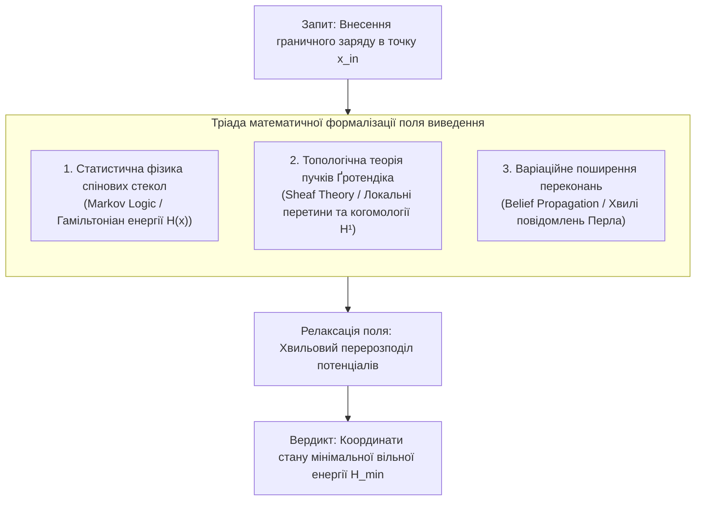
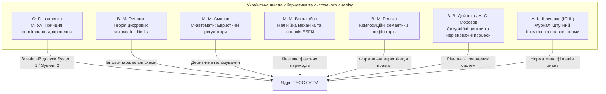

# Чернетка наукової дискусії № 01. Концепція поля логічного виведення, електродинамічний ізоморфізм графового пошуку та межі його застосовності

* **Ідентифікатор документа:** `DRAFT-DISC-001`
* **Автор:** Микола Федчик (Mykola Fedchyk)
* **Дата:** 1 листопада 2026 року
* **Статус:** Робоча теоретична чернетка / Науковий диспут
* **Область досліджень:** Теорія епістемічних обчислювальних схем (ТЕОС), математична фізика логіки, складності обчислень та топологія виведення

---

## Анотація

Ця чернетка фіксує концептуальну наукову дискусію щодо природи логічного виведення в складних графових структурах і базах знань. Розглядається евристична гіпотеза про ізоморфізм між динамічним пошуком у графах робочих шляхів (*workflow graphs*) та проходженням електричного струму крізь резистивно-ємнісні ланцюги. Наведено сувору математичну критику цієї аналогії на основі теорії складності (теорема Кука — Левіна проти Лапласіана графа), парадоксу розгалуження (*Fan-out Paradox* без збереження заряду) та теорем про нижні оцінки компіляції знань Дарвіша — Маркіза. 

У другій частині розглянуто фундаментальне питання: чи існує «поле логічного виведення» як об'єктивна математична сутність? Проведено формалізацію логічного поля через статистичну фізику спінових стекол (Гамільтоніан Марковських логічних мереж), поширення переконань Джуди Перла (*Belief Propagation*) та топологічну теорію пучків Ґротендіка (*Sheaf Theory* на топосах), із визначенням меж, де неперервні польові аналогії остаточно розриваються об дискретну сингулярність логіки.

---

## 1. Початкова гіпотеза: Вектор динамічного пошуку як струм у резистивному графі

Під час формування логічної відповіді в експертних системах або автономних агентах традиційно розгортається послідовність переходів крізь граф завдань, дерево цілей або онтологічний граф. Виникає питання: чи можна формалізувати цей процес аналогічно до фізичного струму в електротехнічних ланцюгах?

У дискретній математиці існує строгий міст між цими доменами — **двоїстість випадкових блукань на графах та резистивних електроланцюгів (теорема Дойла — Снелла, 1984)**. Згідно з цією теоремою, випадкове блукання у зваженому графі точно еквівалентне розподілу потенціалів у мережі провідників.

### 1.1. Двоїстість параметрів пошуку та електричних величин

**Таблиця 1.** Ізоморфізм між величинами електродинаміки та параметрами динамічного пошуку в графі знань.

| Фізична величина в електроланцюзі | Аналог у графі динамічного пошуку | Інженерна інтерпретація в ТЕОС |
| :--- | :--- | :--- |
| **Електричний потенціал / Напруга ($V, \Delta V$)** | **Евристичний потенціал мети / Релевантність** | Різниця між достовірністю входу ($`w_{\mathrm{in}}`$) та відстанню до цільового висновку. Запит створює «електричне поле», що притягує пошук. |
| **Сила / Густина струму ($`\mathbf{J}`$ або $I$)** | **Вектор густини пошуку (Search Flux)** | Обчислювальна інтенсивність (кількість паралельних променів у beam search, що проходять крізь вузол за такт). |
| **Електричний опір ребра ($R$)** | **Семантична ентропія / Вартість переходу** | Ступінь неоднозначності відношення між сутностями. Що більше омонімів чи винятків на ребрі, то вищий опір проходженню висновку. |
| **Провідність ребра ($G = 1/R$)** | **Транзитивна довіра / Сила валідованого правила** | Вага доказового зв'язку в базі знань. Пряма нормативна вимога має надвисоку провідність ($R \approx 0$). |
| **Ємність ($C$, накопичення заряду)** | **Пам'ять вузла / Акумуляція контексту** | Вузол графа не пропускає сигнал миттєво, поки не накопичить потенціал від кількох незалежних передумов (кон'юнкція `AND`). |
| **Індуктивність ($L$, інерція струму)** | **Контекстна інерція виведення** | Опір раптовій зміні семантичного домену. Спроба різко розвернути вектор пошуку в іншу площину породжує «ЕРС самоіндукції». |

### 1.2. Динамічні властивості вектора пошуку $`\mathbf{J}_{\mathrm{search}}`$

Вектор динамічного пошуку в просторі станів володіє трьома змінними характеристиками:
1. **Напрямок (Градієнт потенціалу):** Спрямований уздовж градієнта зростання цільової евристики $`\mathbf{J} \sim -\nabla \Phi_{\mathrm{epistemic}}`$.
2. **Амплітуда (Енергетичний бюджет):** Густина виділених обчислювальних ресурсів на крок (ширина променя).
3. **Хвильовий імпеданс стику ($`Z_{\mathrm{domain}}`$):** При переході вектора пошуку між різнорідними графами (наприклад, із синтаксичного графа запиту в онтологічний граф RFC) виникає розрив імпедансу:

$$
Z_{\mathrm{domain}} = \sqrt{\frac{R_{\mathrm{branching}} + j\omega L_{\mathrm{context}}}{G_{\mathrm{evidence}} + j\omega C_{\mathrm{memory}}}}
$$

Якщо імпеданси не узгоджені, виникає відбита хвиля (стояча хвиля), що алгоритмічно проявляється як вимушене повернення назад (**Backtracking**).

---

## 2. Сувора математична критика: Де руйнується фізичний ізоморфізм?

Попри інтуїтивну привабливість, буквальне ототожнення логічного виведення зі струмом у ланцюзі натрапляє на п'ять нездоланних математичних бар'єрів.

### 2.1. Теорема Кука — Левіна проти Лапласіана графа (Бар'єр $`\mathrm{P}`$ проти $`\mathrm{NP}`$)

В електричній мережі розрахунок розподілу струмів і напруг зводиться до розв'язання лінійної системи рівнянь з матричним Лапласіаном $`\mathbf{L} = \mathbf{D} - \mathbf{A}`$:

$$
\mathbf{L} \cdot \mathbf{v} = \mathbf{i}
$$

Завдяки лапласівським розв'язувачам (алгоритм Спілмана — Тенга), розподіл потенціалів у будь-якій лінійній пасивній мережі з $`|V|`$ вузлами та $`|E|`$ ребрами розраховується за майже лінійний час $`\tilde{O}(|E| \log |V|)`$, тобто належить до класу складності $`\mathrm{P}`$.

Натомість загальний логічний пошук у графі рішень (задача SAT, планування дій за наявності негативних зв'язків, підбір контрприкладів у логіці першого порядку) належить до класу **$`\mathrm{NP}`$-повних** або нерозв'язних задач.

> [!WARNING]
> **Теоретико-складнісний бар'єр:** Якби довільний логічний пошук у графі можна було без втрат змоделювати проходженням струму в еквівалентній статичній електричній схемі поліноміального розміру, це було б конструктивним доведенням рівності $`\mathrm{P} = \mathrm{NP}`$. Оскільки в загальному випадку $`\mathrm{P} \ne \mathrm{NP}`$, логічний пошук не є еквівалентом струму в лінійній мережі.

### 2.2. Порушення закону Кірхгофа при логічному розгалуженні (Fan-out Paradox)

Перший закон Кірхгофа базується на фундаментальному фізичному законі збереження заряду:

$$
\sum_{k} I_{\mathrm{in}, k} = \sum_{m} I_{\mathrm{out}, m}
$$

Якщо провідник розгалужується на $N$ однакових гілок, струм у кожній гілці падає у $N$ разів: $`I_m = I_{\mathrm{total}} / N`$.

У логічному виведенні діє діаметрально протилежний принцип — **клонування інформації без дисипації (Fan-out)**:
- Якщо аксіома чи факт $A$ встановлений із достовірністю $`w = 1{,}0`$, він може бути одночасно використаний у 1000 незалежних правил виведення.
- При цьому достовірність факту $A$ **не зменшується в 1000 разів**:
  
$$w_{\mathrm{out}, 1} = w_{\mathrm{out}, 2} = \dots = w_{\mathrm{out}, 1000} = 1{,}00$$

Якби логіка підпорядковувалася закону Кірхгофа, то що більш фундаментальним і загальновживаним був би закон природи, то меншим ставав би його потенціал у кожному конкретному висновку, що є дедуктивним абсурдом.

### 2.3. Теорема про нижні оцінки компіляції знань (Knowledge Compilation Lower Bounds)

Ідея ТЕОС про заміну рантайм-пошуку статичною вентильною схемою (Netlist) натрапляє на теорему Дарвіша — Маркіза (Darwiche & Marquis, 2002, *A Knowledge Compilation Map*). 

Операція повної трансляції довільної булевої бази знань у класи схем із гарантованим лінійним часом виконання запиту (наприклад, детерміновані декомпозиційні нормальні форми d-DNNF або впорядковані бінарні діаграми рішень OBDD) у найгіршому випадку супроводжується **експоненційним вибухом розміру схеми**:

$$
\mathrm{Size}(\mathrm{Netlist}) \in \Omega(2^n)
$$

Складність обчислень не зникає — вона лише переноситься з етапу виконання (рантайму) на етап компіляції:
1. Або схема має лінійний розмір, але не здатна детерміновано виразити всі диз'юнктивні залежності (і тоді знову потрібен динамічний пошук);
2. Або схема працює за $O(N)$ тактів хвильовим фронтом, але її фізичний розмір вимагає екзабайтів пам'яті.

### 2.4. Нелінійність оператора кон'юнкції $\wedge$ проти суперпозиції

В електродинаміці суперпозиція дозволяє розраховувати відгуки окремо і лінійно додавати їх: $`\mathbf{E}_{\mathrm{total}} = \sum \mathbf{E}_i`$.
У дедукції базовим оператором є кон'юнкція (правило Modus Ponens: $A \wedge (A \implies B) \implies B$).

В алгебрі істинності операція `AND` є строго мультиплікативною або мінімаксного типу:

$$w(A \wedge B) = \min(w_A, w_B) \quad \text{або} \quad w_A \cdot w_B$$

Енергетичний рельєф логічної системи:

$$\mathcal{E}(\mathbf{w}) = f_{\mathrm{non\text{-}linear}}(w_1, w_2, \dots, w_n)$$

є глибоко нелінійним і багатоекстремальним. Електричний струм завжди прямує до єдиного глобального мінімуму енергії Діріхле $`\frac{1}{2}\mathbf{v}^T \mathbf{L} \mathbf{v}`$. Логічний «струм» застрягає в локальних тупиках, вимагаючи нефізичної операції скасування часу — відкату (Backtracking).

### 2.5. Синтаксична уніфікація Робінсона

Електричний струм транспортує скалярний заряд $q$. 
Пошук у логічному графі несе **алгебраїчні структури термів зі зв'язаними змінними**. 

Перехід ребром вимагає синтаксичної уніфікації (Robinson Unification):

$$\mathrm{mgu}(P(x, f(y)), P(a, z)) = \{x \mapsto a, z \mapsto f(y)\}$$

Ця операція підстановки:
- Не має неперервної похідної;
- Не описується диференціальними рівняннями Максвелла;
- Вимагає стека зв'язування змінних (Variable Binding Stack). Звичайний фізичний провідник не має власної стекової пам'яті станів.

---

## 3. Чи існує «поле логічного виведення»? Математичний статус концепції

Якщо відкинути пряму інженерну аналогію з мідними дротами, фундаментальне питання залишається: **чи існує поле логічного виведення як математичний об'єкт?**

Відповідь сучасної науки: **ТАК, але це не векторне поле в $`\mathbb{R}^3`$, а калібрувальне енергетичне поле у дискретному просторі станів**.

### 3.1. Конфігураційний простір логічного поля

Простором існування поля виведення є дискретний гіперкуб предикатів або бірешітка Белнапа:

$$\Omega = \{0, 1\}^N \quad \text{або} \quad \mathcal{B}_4^N = \{\mathbf{T}, \mathbf{F}, \top, \bot\}^N$$

де кожна вісь $`i \in \{1, \dots, N\}`$ відповідає за базовий предикат. Точка $`\mathbf{x} = (x_1, \dots, x_N)`$ є повною конфігурацією системи («можливим світом»).

### 3.2. Гамільтоніан поля та розподіл Гіббса

Кожне нормативне правило чи предикатне відношення $`c \in \mathcal{C}`$ задає потенціал покарання за суперечність. Скалярне поле енергії (Гамільтоніан) має вигляд:

$$
\mathcal{H}(\mathbf{x}) = -\sum_{c \in \mathcal{C}} w_c \cdot \mathbb{I}_c(\mathbf{x})
$$

де $`w_c`$ — нормативна вага правила ($`w_c \to \infty`$ для критичних інваріантів), а $`\mathbb{I}_c(\mathbf{x}) \in \{0, 1\}`$ — виконання правила у стані $`\mathbf{x}`$.

Ймовірність конфігурації підпорядковується закону Гіббса — Больцмана:

$$
P(\mathbf{x}) = \frac{1}{\mathcal{Z}} \exp\left(-\frac{\mathcal{H}(\mathbf{x})}{T}\right), \quad \mathcal{Z} = \sum_{\mathbf{x}' \in \Omega} \exp\left(-\frac{\mathcal{H}(\mathbf{x}')}{T}\right)
$$

де $T$ — параметр розмитості («температура логіки»), а $`\mathcal{Z}`$ — статистична сума.

> [!NOTE]
> **Суть логічного виведення:** Логічне виведення у такому полі — це **релаксація системи до стану вакууму (мінімальної вільної енергії $`\mathcal{H}_{\min}`$)**, де всі системні суперечності зведені до нуля.

### 3.3. Вектори напруженості: Поширення переконань Джуди Перла

Силовими лініями поля є вектори повідомлень $`\mu_{i \to f}`$, що циркулюють між змінними $i$ та факторами $f$ у факторному графі (Factor Graph):

$$
\mu_{i \to f}(x_i) \propto \prod_{f^* \in \mathrm{ne}(i) \setminus \{f\}} \mu_{f^* \to i}(x_i)
$$

Ці повідомлення переносять градієнт зміни вільної енергії Бете (*Bethe Free Energy*). Логічна відповідь є стаціонарним розподілом поля після згасання перехідних хвиль повідомлень.

### 3.4. Топологічне поле: Пучки Ґротендіка (Sheaf Theory)

У теорії категорій та інтуїціоністській логіці поле виведення розглядається локально над простором контекстів:
1. База топології — контексти застосування знань (наприклад, нормативне поле цивільного кодексу, нормативне поле кримінального кодексу, авіаційний регламент DO-178C).
2. Над кожним контекстом $U$ визначено простір допустимих локальних тверджень $`\mathcal{F}(U)`$.
3. **Поле логічного виведення є перетином (section) пучка $`\mathcal{F}`$.**

Якщо в двох різних контекстах $U$ та $V$ робляться висновки, вони підпорядковуються **аксіомі склеювання (Gluing Axiom)** на перетині $U \cap V$. 

> [!IMPORTANT]
> **Математична природа парадоксу:** Якщо локальні висновки не склеюються на перетині контекстів ($U \cap V \ne \emptyset$), у полі виникає **топологічний дефект — ненульова перша когомологія $`H^1(\mathcal{F}) \ne 0`$**. Це точне математичне визначення неусувної нормативної колізії або омонімічного конфлікту.

---

## 4. Порівняльна демаркація фізичного та логічного полів

**Таблиця 2.** Фундаментальні відмінності між фізичними полями та полем логічного виведення.

| Характеристика | Фізичне поле (Максвелл / Ейнштейн) | Логічне поле (Поле виведення знань) |
| :--- | :--- | :--- |
| **Гладкість** | Неперервне, нескінченно диференційовне ($C^\infty$). | Дискретне, розривне, сповнене сингулярностей і стрибків $0 \leftrightarrow 1$. |
| **Локальність (Близькодія)** | Сила спадає з відстанню ($1/r^2$). Немає миттєвої далекодії. | **Нелокальне.** Один контрприклад в одному вузлі миттєво обнуляє гіпотезу через усю мережу ($r \to \infty$). |
| **Ландшафт енергії** | Опуклі ями (параболічні, стабільний градієнтний спуск). | **Спінове скло (NP-hard):** мільйони глибоких локальних пасток, розділених експоненційними бар'єрами. |
| **Збереження субстанції** | Виконується строго (закон збереження заряду, енергії, імпульсу). | Не виконується: необмежений Fan-out фактів без втрати достовірності ($`w_{\mathrm{out}} = w_{\mathrm{in}}`$). |

---

## 5. Погляд школи Ландау: Фазові переходи, беззіткненне затухання та епістемічні квазічастинки

Особливе місце в аналізі полів знань посідає методологія теоретичної фізики школи Лева Давидовича Ландау. Ландау сформулював дві засадничі наукові настанови: по-перше, математичний апарат колективних явищ у конденсованих середовищах (фазові переходи, теорія фермі-рідини, затухання хвиль у плазмі), а по-друге, категоричне несприйняття «математичної патології» — спроб нагромаджувати абстрактні формули без вимірюваного експериментального сенсу. 

Його спадщина дає чотири фундаментальні уроки для теорії епістемічних обчислювальних схем.

### 5.1. Логічний висновок як фазовий перехід другого роду

У феноменологічній теорії фазових переходів другого роду Ландау (1937) ключову роль відіграють **параметр порядку** $\eta$ (*order parameter*) та **спонтанне порушення симетрії**.

До надходження запиту база знань перебуває у стані повної інформаційної симетрії: усі потенційні гіпотези рівноймовірні, виділений напрямок відсутній, параметр порядку $\eta = 0$ (високоентропійна «парамагнітна» фаза знань). 

Коли надходить зовнішній запит і фіксуються граничні умови (температура міркування падає нижче критичної точки $`T < T_c`$), термодинамічний потенціал системи розкладається в ряд Ландау за степенями параметра порядку:

$$
\Phi(\eta) = \Phi_0 + \alpha (T - T_c)\,\eta^2 + \beta\,\eta^4 - h \cdot \eta
$$

де $h$ — проекція вектора запиту (зовнішнє орієнтуюче поле).

**Фізико-логічний механізм акту виведення:**
1. **Стрибок у точку конденсації вердикту:** При $`T < T_c`$ коефіцієнт $`\alpha(T - T_c)`$ стає від'ємним. Симетрична точка $\eta = 0$ перетворюється на нестійкий максимум. Система лавиноподібно скочується в один із мінімумів енергії $`\eta = \pm \eta_0`$. Це і є момент формування детермінованого логічного вердикту: висновок — це не повільне додавання слів, а **спонтанне порушення симетрії фази знань**.
2. **Омонімічна колізія мовою потенціалу Ландау:** Якщо зовнішнє поле відсутнє або розмите ($h \approx 0$, наприклад, ізольований запит *«Що таке SPF?»*), дно потенціалу набуває форми «мексиканського капелюха» з двома абсолютно симетричними мінімумами (RFC 7208 та RFC 8405). Звичайна стохастична модель під дією випадкової термодинамічної флуктуації скочується в один із мінімумів, генеруючи приховану галюцинацію. ТЕОС через фіксацію стану Белнапа $\top$ утримує систему на симетричному гребені, сигналізуючи про нормативний паритет без фальшивого колапсу.

### 5.2. Беззіткненне затухання Ландау (Landau Damping): Втрата довіри без дисипації бітів

У 1946 році Ландау відкрив явище затухання хвиль у беззіткненній плазмі за відсутності міжчастинкових зіткнень, тертя та теплової дисипації. Хвиля згасає внаслідок **кінетичного фазового резонансу**: частинки, швидкість яких дещо менша за фазову швидкість хвилі ($`v \approx v_{\mathrm{ph}}`$), резонансно забирають енергію у хвилі, прискорюючись її полем.

Цей механізм розкриває природу деградації достовірності у складних епістемічних схемах:
- У бездоганному апаратному тракті (де немає збоїв пам'яті, шумів шини чи втрати бітів) достовірність складеного висновку все одно затухає в міру зростання глибини каскадів.
- Вона згасає за кінетичним механізмом Ландау: **внаслідок фазового резонансу між швидкістю дрейфу контексту запиту та фазовою швидкістю семантичних понять у правилах**. Частина потенціалу довіри незворотно розсіюється по неврахованих прихованих ступенях вільності природної мови.

### 5.3. Теорія фермі-рідини: Епістемічні квазічастинки проти $`10^{11}`$ параметрів

При розрахунку рідкого гелію-3 та електронів у металах Ландау зіткнувся з нездоланною складністю взаємодії трильйонів частинок. Його геніальний розв'язок полягав у відмові від стеження за кожним окремим електроном на користь **квазічастинок** — елементарних колективних збуджень із перенормованою ефективною масою $`m^*`$, які взаємодіють як слабкозбуджений ідеальний газ біля поверхні Фермі.

**Імператив для архітектури ТЕОС та ядра VIDA:**
- Спроба розбирати в рантаймі кожен окремий токен, кому чи синтаксичний зворот веде до комбінаторного пекла екстракції.
- Архітектура ТЕОС повинна оперувати **епістемічними квазічастинками** — цілісними кристалізованими пакетами знань (`.kp`-контейнерами). Квазічастинка «одягнена» у взаємодію з нормативним контекстом, має стабільну ефективну вагу доказовості $w$, дуальну невизначеність $u$ та взаємодіє на шині Netlist за детермінованими законами збереження, ізолюючи внутрішній хаос тексту першоджерела.

### 5.4. Методологічний заповіт Ландау («Бритва Дау» проти наукоподібної патології)

Ландау виділяв особливий клас псевдонауки — «протиприродні науки», де відсутність фізичного змісту та експериментального підтвердження маскується нагромадженням надскладного математичного формалізму. Його класичний афоризм стверджує: *«Інтегрувати кожен дурень вміє, фізику розуміти треба»*.

Для теорії епістемічних схем цей принцип є критичним критерієм самоконтролю:
- Жодна математична абстракція (чи то дуальні числа Кліффорда $`\mathbb{D}_1`$, чи то тензори стану $`\Psi`$) не має права залишатися суто паперовою конструкцією.
- Кожен вентиль і кожен оператор ТЕОС зобов'язаний замикатися на **експериментально вимірюване інженерне число**:
  - Затримку перемикання на кремнії ($`2{,}47\,\text{нс/op}`$);
  - Рівень прориву галюцинацій ($`0{,}277\%`$ проти $`14{,}77\%`$);
  - Нульове динамічне виділення пам'яті в купі ($`0\,\text{B/op}`$, $`0\,\text{allocs}`$).

---

## 6. Синергетика Германа Хакена та парадигма відкритих нерівноважних систем

Особливе місце в аналізі полів знань посідає німецький фізик-теоретик **Герман Хакен (Hermann Haken, 1927–2024)** — засновник **синергетики** та творець квантової теорії лазера. Його погляд переносить проблему з класичної схемотехніки в площину нелінійної динамики відкритих систем, що функціонують далеко від термодинамічної рівноваги.

### 6.1. Знання як відкрита нерівноважна система

Будь-яка спроба розглядати базу знань чи логічний процесор як закриту ізольовану статичну схему (друковану плату Netlist) стикається з фундаментальним парадоксом термодинаміки: **ізольована система неминуче деградує до стану максимальної ентропії (теплової смерті, хаосу та розмиття знань)**.

Знання, людський інтелект та автономні експертні системи за своєю природою є **відкритими нерівноважними системами**. Їхній структурний порядок існує лише доти, доки крізь них протікає безперервний потік зовнішньої інформації та завдань (аналог енергетичної накачки лазера). Якщо потік припиняється або замикається у статичному стані, система втрачає здатність до адаптації та реагування на аномалії.

### 6.2. Плеяда дослідників нерівноважних систем та дисипативних структур

Концепція нерівноважних відкритих систем сформувалася завдяки працям видатної когорти вчених XX–XXI століть:

1. **Людвіг фон Берталанфі (Ludwig von Bertalanffy, 1901–1972):**
   - Засновник Загальної теорії систем (*General System Theory*). 
   - Увів фундаментальне розмежування між закритими системами класичної фізики та **відкритими системами** живого світу й мислення. 
   - Сформулював концепцію **плинної рівноваги (*Fließgleichgewicht / Steady State*)**: система підтримує постійну форму й структуру не за рахунок незмінності компонентів, а завдяки постійній рівності швидкостей надходження та вибуття речовини й інформації.
2. **Ларс Онсагер (Lars Onsager, 1903–1976):**
   - Лауреат Нобелівської премії з хімії 1968 року. 
   - Заклав основи лінійної нерівноважної термодинаміки через **співвідношення взаємності Онсагера (1931)**. 
   - Показав, що у слабконерівноважних процесах термодинамічні потоки $`J_i`$ (зокрема інформаційні чи дифузійні) лінійно пов'язані з термодинамічними силами $`X_k`$ матрицею кінетичних коефіцієнтів $`J_i = \sum_k L_{ik} X_k`$, яка має симетрію $`L_{ik} = L_{ki}`$.
3. **Ілля Пригожин (Ilya Prigogine, 1917–2003):**
   - Лауреат Нобелівської премії з хімії 1977 року за теорію **дисипативних структур**.
   - Довів, що далеко від рівноваги завдяки нелінійним процесам виникає «порядок із хаосу» (*Order out of Chaos*).
   - Розділив зміну ентропії на внутрішнє виробництво $`\mathrm{d}_i S \ge 0`$ та зовнішній обмін $`\mathrm{d}_e S`$. За умови відтоку ентропії у зовнішнє середовище ($`\mathrm{d}_e S < 0`$ при $`\lvert \mathrm{d}_e S \rvert > \mathrm{d}_i S`$) сумарна ентропія системи падає ($`\mathrm{d}S < 0`$), що уможливлює самоорганізацію складних логічних і біологічних структур.
4. **Манфред Ейген (Manfred Eigen, 1927–2019):**
   - Лауреат Нобелівської премії з хімії 1967 року.
   - Створив теорію **гіперциклів (Hypercycles)** та концепцію **квазівидів (Quasispecies)** для самоорганізації макромолекул та інформаційних структур у відкритих нерівноважних середовищах, що описує селективний відбір стійких знаннєвих ланцюгів за Дарвіном.
5. **Герман Хакен (Hermann Haken, 1927–2024):**
   - Засновник синергетики. Довів, що самоорганізація в лазерах, гідродинаміці, хімії та нейронних ансамблях підпорядковується універсальним законам редукції розмірності біля точок біфуркації.
6. **Карл Фрістон (Karl Friston, 1959–...):**
   - Творець **Принципу вільної енергії (Free Energy Principle)** для когнітивних систем. 
   - Довів, що будь-яка нерівноважна відкрита адаптивна система підтримує власну цілісність завдяки наявності захисної межі (**Марковської ковдри / Markov Blanket**) та мінімізації варіаційної вільної енергії між внутрішньою генеративною моделлю і зовнішнім потоком спостережень.

### 6.3. Принцип підпорядкування Хакена (*Slaving Principle*) проти мікроменеджменту вентилів

У класичній синергетиці центральним є **принцип підпорядкування (Einsklavungsprinzip)**:
Коли складна нерівноважна система наближається до порогу нестійкості, незліченні швидкорелаксуючі (швидкі) ступені вільності **повністю підпорядковуються («поневолюються»)** декільком домінуючим колективним повільним модам — **параметрам порядку (*Order Parameters*)**.

**Критичне зауваження Хакена до схемотехніки ТЕОС:**
- У ТЕОС інженер намагається розставляти дискретні деонтичні вентилі для кожного окремого спростування (Defeater / Undercut), здійснюючи скрупульозний мікроменеджмент правил.
- З позиції синергетики, це механістичний редукціонізм: у природних системах стабільність виникає завдяки природному розділенню часових масштабів. Швидкі семантичні шуми (варіативність мови, морфологічні відхилення) повинні автоматично згасати, будучи «поневоленими» глобальним параметром порядку — загальним контекстом нормативного пакета знань. Доказовість має народжуватися як макроскопічний атрактор, а не як результат цензури на кожному транзисторі.

### 6.4. Фізика критичного уповільнення (*Critical Slowing Down*) в точках біфуркацій

ТЕОС декларує лінійну обчислювальну складність і жорстко обмежений час відгуку ($`\mathrm{WCET} = \Theta(N)`$ тактів) навіть на суперечливих входах.

Герман Хакен висунув би фундаментальне заперечення проти цього твердження:
1. Будь-який омонімічний або деонтичний конфлікт (наприклад, колізія між RFC 7208 та RFC 8405) є **точкою біфуркації**.
2. Поблизу точки біфуркації дійсна частина старшого власного значення системи неминуче прямує до нуля:
   
$$\Re(\lambda) \to 0$$
   
3. Це викликає фундаментальний фізичний закон — **критичне уповільнення (Critical Slowing Down)**:
   
$$\tau_{\mathrm{relaxation}} \sim \frac{1}{\lvert \Re(\lambda) \rvert} \to \infty$$
   
4. Одночасно флуктуації колосально зростають. Спроба розрубати цю біфуркацію за фіксований квант часу через штучну зону нечутливості (deadband) не усуває внутрішньої нестабільності, а лише силоміць заморожує систему у фазі **метастабільності**, що несе ризик прихованої відмови при зміні граничних умов.

### 6.5. Синергетичний комп'ютер Хакена: Динамічний рельєф атракторів проти розривних вентилів

У 1991 році Хакен запропонував власну архітектуру обчислювача — **Синергетичний комп'ютер (Synergetic Computer)** для розпізнавання образів та прийняття рішень.

Замість обходу графів або жорстких логічних вентилів система моделюється рівнянням нелінійної динаміки у фазовому просторі:

$$
\dot{\mathbf{q}} = \sum_k \lambda_k \mathbf{v}_k (\mathbf{v}_k^\dagger \mathbf{q}) - B \sum_{k \ne k'} (\mathbf{v}_k^\dagger \mathbf{q})^2 (\mathbf{v}_{k'}^\dagger \mathbf{q}) \mathbf{v}_k - C \lVert \mathbf{q} \rVert^2 \mathbf{q}
$$

де:
- Вхідний запит формує початкові координати вектора стану $`\mathbf{q}(0)`$;
- Виведення рішення — це **неперервна конкуренція параметрів порядку за принципом Дарвіна — Ейгена**: виживає і перемагає лише один атрактор (домінантний прототип знань), який найточніше резонує із запитом, тоді як усі суперечливі або побічні моди пригнічуються кубічною нелінійністю ($B$-член).

Хакен застеріг би розробників ТЕОС: спроба втиснути нелінійну природу міркувань у дискретні порогові вентилі Белнапа із розривними характеристиками породжує експоненційний вибух розміру Netlist. Побудова гладкого синергетичного потенціалу дозволила б розв'язувати омонімічні колізії не штучним арбітражем, а природним скочуванням фазової точки до домінуючого канонічного атрактора.

### 6.6. Зведений експертний вердикт класиків нерівноважної термодинаміки та синергетики

**Таблиця 3.** Експертні вердикти класиків науки про відкриті нерівноважні системи для архітектури ТЕОС.

| Науковець / Школа | Ключова категорія | Експертний вердикт для архітектури ТЕОС |
| :--- | :--- | :--- |
| **Ілля Пригожин** | Дисипативні структури, потік ентропії $`\mathrm{d}_e S < 0`$ | Знання не можуть існувати як закритий статичний кристал. Схема ТЕОС зобов'язана бути відкритою дисипативною структурою, яка скидає ентропію суперечностей назовні через кваліфіковані відмови (Fail-Closed) та стан паритету $\top$. |
| **Герман Хакен** | Принцип підпорядкування (*Slaving Principle*), біфуркації | Відмовтеся від мікроменеджменту правил окремими вентилями. Пакет знань (`.kp`) — це параметр порядку, що підпорядковує текстовий шум. У точках біфуркації детермінований час WCET не вирішує вибір, а лише фіксує зупинку перед критичним уповільненням. |
| **Людвіг фон Берталанфі** | Плинна рівновага (*Fließgleichgewicht*), відкриті системи | База знань живе лише в постійному інформаційному обміні із зовнішнім середовищем. Незмінність правил при зміні зовнішнього світу веде до системного колапсу. |
| **Ларс Онсагер** | Співвідношення взаємності ($`L_{ik} = L_{ki}`$) | Градієнт вхідної невизначеності $u$ та потік виведення $\Phi$ термодинамічно спряжені: чим вища невизначеність на вході, тим більший компенсаторний потік доказів зобов'язана згенерувати система. |
| **Манфред Ейген** | Гіперцикли, селективний відбір квазівидів | База знань розвивається через каталітичний відбір стійких правил. Правила, що не мають підтвердження прецедентами, вимиваються природним відбором. |
| **Карл Фрістон** | Варіаційна вільна енергія, Марковська ковдра | Система ТЕОС повинна мати чітко окреслену межу (периметр безпеки), мінімізуючи розбіжність між внутрішніми аксіомами та зовнішніми спостереженнями. |

---

## 7. Внесок української школи кібернетики та нелінійних систем (архіви «Звалища» та фундаментальна спадщина)

Проблематика надійності, самоорганізації та детермінованого виведення в обчислювальних системах має потужну традицію в українській науковій школі кібернетики та прикладної математики. Значна частина першоджерел цих досліджень зберігається у цифровому сховищі проєкту «Звалище» (`sources/NAS_Ukraine_elibnas/`, `sources/AI_Ukraine_1/`, `sources/Books/`).

### 7.1. Олексій Івахненко та метод МГУА: Принцип зовнішнього доповнення

Олексій Григорович Івахненко (Інститут кібернетики АН УРСР) у 1965–1971 роках створив **Метод групового урахування аргументів (МГУА / GMDH)** — першу у світі працездатну парадигму глибокого індуктивного навчання з пошаровою селекцією моделей.

**Фундаментальний внесок для ТЕОС — Принцип зовнішнього доповнення (External Complementation Principle):**
> Істинність або селекція складного математичного кандидата принципово не може бути встановлена за тими самими критеріями чи даними, за якими здійснювалося його навчання/генерація.

Для проєкту VIDA та ТЕОС цей принцип є непорушним теоретичним фундаментом:
- **System 1 (нейромережа на Jetson Orin)** за своєю природою не може сама перевіряти свої галюцинації (порушення принципу зовнішнього доповнення).
- Для гарантії нульових помилок ($`\mathrm{ZHR} = 1{,}00`$) необхідний **зовнішній, незалежний, ортогональний селектор** — апаратний детермінований верифікатор System 2 (EVM ТЕОС на ПЛІС), який здійснює допуск за замкненим нормативним Netlist.

### 7.2. Віктор Глушков: Теорія цифрових автоматів та бітово-паралельний Netlist

Академік Віктор Михайлович Глушков заклав основи алгебри дискретних перетворювачів, регулярних подій та формальних мов. 
- **Автомати Глушкова:** регулярні предикати транслюються в недетерміновані скінченні автомати з $m+1$ станами без порожніх $\varepsilon$-переходів, що дозволяє виконувати їхнє бітово-паралельне апаратне моделювання в одному машинному слові (алгоритми сімейства Shift-And).
- Схеми ТЕОС прямо наслідують концепцію Глушкова: база знань є не текстом у пам'яті, а **дискретним автоматом**, зашитим у крос-комутаційну матрицю логічних елементів BRAM.

### 7.3. Микола Амосов: М-автомати та евристичне гальмування

Микола Михайлович Амосов розробив теорію **М-автоматів** — моделей інтелектуальної поведінки, що оперують поняттями з динамічною вагою збудження та гальмування.
- В амосовських моделях когнітивний фокус виникає через систему підсилення/гальмування (СПГ).
- У ТЕОС тритермінальний деонтичний вентиль реалізує саме амосовське **гальмування гіпотези**: затвор спростування (Defeater Gate) діє як активне евристичне гальмо, що знеструмлює скомпрометований шлях виведення.

### 7.4. Микола Боголюбов: Нелінійна механіка та перехід від мікрохаосу до макропорядку

Академік Микола Миколайович Боголюбов створив математичний апарат нелінійних коливань (метод Крилова — Боголюбова) та ланцюжок рівнянь нерівноважної статистичної механіки (ієрархія ББГКІ).
- Боголюбов довів, як із хаотичної динаміки окремих молекул виникає макроскопічна гідродинаміка завдяки **ієрархії часів релаксації**.
- Цей апарат пояснює походження параметрів порядку Хакена: у знаннєвих системах мікроскопічний хаос слів релаксує за пікосекунди, тоді як нормативний зміст канону живе роками.

### 7.5. Володимир Редько: Композиційні семантики та дефініторні обчислення

Академік Володимир Миколайович Редько створив школу дефініторних обчислень та композиційних програмних логік.
- Його апарат дозволяє будувати строго замкнені функціональні композиції правил, унеможливлюючи виникнення нескінченних циклів і парадоксів неповноти у статично згенерованому коді.
- Компілятор знань «Зводар» (`zvodar`) використовує композиційний підхід Редька для стратифікації предикатів і розмикання циклічних посилань у стандартах.

### 7.6. Анатолій Морозов та Василь Дейнека: Нерівноважні процеси та ситуаційне керування

Праці Василя Васильовича Дейнеки (*Моделювання нерівноважних процесів у системах із розривними характеристиками*, збережені в каталозі `sources/NAS_Ukraine_elibnas/` під індексами `04-Dejneka.pdf`, `ab51dc35_561001pu.pdf`) та Анатолія Олексійовича Морозова (*Теорія ситуаційних центрів реального часу*, `4ed39e24_01-Morozov.pdf`):
- Дослідили поведінку складених систем на межах розриву параметрів середовища.
- Довели, що за наявності розривних характеристик (аналог перемикання між нормами або відмови каналу зв'язку) система зберігає стійкість лише за наявності захисних проміжних демпферів. У ТЕОС таким демпфером є **зоровий арбітраж Белнапа та зона нечутливості $`\Delta w_{\mathrm{deadband}}`$**.

### 7.7. Анатолій Шевченко: Наукова школа штучного інтелекту та журнал «Штучний інтелект»

Архів журналу *Artificial Intelligence / Штучний інтелект* (представлений у «Звалищі» сотнями випусків каталогу `sources/AI_Ukraine_1/` за 2024–2026 роки під егідою Інституту проблем штучного інтелекту МОН і НАН України):
- Систематично розглядає проблему інституалізації, правового статусу та безпеки інтелектуальних систем (зокрема дослідження І. Ф. Коржа про суб'єктність та об'єктність ШІ).
- Публікації фіксують перехід від суто статистичних моделей до гібридних нейро-символьних систем, де строгий нормативний контроль виступає правовим імперативом допуску технологій у критичну інфраструктуру.

---

## 8. Синтетичні висновки для архітектури ТЕОС та проєкту VIDA

1. **Границя між метафорою та інженерією:**  
   Аналогія між пошуком у графі та електричним струмом є плідною інженерною евристикою для моделювання затухання довіри (Т-норми) та зосередженого імпедансу, але вона **математично непридатна** як універсальна основа загального виведення через бар'єр $`\mathrm{P} \ne \mathrm{NP}`$ та парадокс розгалуження (Fan-out).
2. **Ніша ТЕОС у просторі полів:**  
   ТЕОС не намагається підмінити складні логічні поля загального вигляду лінійною електродинамікою. Її справжня роль полягає в іншому: **це метод штучного згладжування енергетичного ландшафту знань**.
3. **Штучне усунення пасток через деонтичні затвори:**  
   Завдяки попередній офлайн-компіляції у спрямовані ациклічні схеми (DAG) ТЕОС «випалює» локальні пастки суперечностей деонтичними транзисторами (блокування застарілих норм і винятків), перетворюючи проходження сигналу запиту на швидкий, детермінований і безрекурсивний хвильовий процес з часом відгуку $O(N)$ тактів.
4. **Синтез погляду Ландау з апаратною схемотехнікою:**  
   Сприйняття логічного виведення як фазового переходу з порушенням симетрії та робота з епістемічними квазічастинками (пакетами знань) замість сирих слів усувають комбінаторну крихкість екстракції та перетворюють ТЕОС на життєздатну феноменологічну теорію надійного обчислювального інтелекту.
5. **Сходження з синергетикою Хакена та нерівноважною термодинамікою:**  
   Знання не є мертвою кристалічною схемою — це відкрита дисипативна структура (за Пригожиним і Берталанфі), що живиться потоком завдань і прецедентів. Кристалізований пакет знань (`.kp`) у ТЕОС є повноцінним **параметром порядку Хакена**, який поневолює дрібні текстові флуктуації. Жорсткий детермінізм ТЕОС у точках біфуркацій досягається не ілюзорним «вирішенням» колізії за $`2{,}47\,\text{нс}`$, а **свідомим аварійним переходом у стан нормативного паритету $\top$**, що захищає систему від фатального критичного уповільнення ціною передачі арбітражу експерту-людині.
6. **Опора на українську кібернетичну школу:**  
   Поєднання принципу зовнішнього доповнення Івахненка (демаркація System 1 / System 2), бітово-паралельних автоматів Глушкова, евристичного деонтичного гальмування Амосова та теорії нерівноважних розривних процесів Дейнеки й Морозова забезпечує проєкту VIDA фундаментальну наукову спадкоємність, інтегруючи вітчизняні теоретичні надбання з кремнієвою апаратною базою XXI століття.

### 8.1. Декоративний фільтр Ландау: редукція фізико-математичних метафор до обчислювальних операторів ТЕОС

Застосовуючи методологічну «бритву Ландау» до самої цієї дискусії, необхідно провести сувору межу між **евристичними фізичними аналогіями** та **працюючими обчислювальними операторами** над бінарними контейнерами `.kp` і регістрами EISA. Будь-який термін теоретичної фізики чи алгебричної топології має право входити до робочого стандарту ТЕОС лише тоді, коли він взаємно-однозначно зводиться до скінченного алгоритму з вимірюваною складністю.

**Таблиця 4.** Редукція теоретичних концепцій дискусії до конкретних обчислювальних операторів у коді `znavets` / `zvodar` / `tlumach`.

| Фізична / топологічна концепція в дискусії | Статус за бритвою Ландау | Точний обчислювальний оператор у ТЕОС (над `.kp` та EISA) | Складність виконання |
| :--- | :--- | :--- | :--- |
| **Квазічастинка фермі-рідини Ландау** | Робоча одиниця архітектури | Скомпільований пакет знань $`P_k = (V_k, E_k)`$ з індексом концептів $`V_k`$, реляційними ребрами $`E_k`$ та криптографічним коренем Меркла. | $`O(1)`$ доступ за хешем |
| **Параметр порядку $\eta$ та «мексиканський капелюх»** | Робочий оператор арбітражу | Диференціальний компаратор потенціалів $`\lvert w_1 - w_2 \rvert \le \Delta w_{\mathrm{deadband}}(u_{\mathrm{ambig}, 1}, u_{\mathrm{ambig}, 2})`$ у поєднанні з оператором контекстної ортогональності $`\Omega(P_1, P_2 \mid Q) \ge 0{,}78`$. | $`O(\lvert V_1 \rvert + \lvert V_2 \rvert)`$ ($`2{,}47\,\text{нс}`$ у регістрах) |
| **Принцип підпорядкування Хакена (*Slaving Principle*)** | Робочий оператор фільтрації | Ортогональне відділення швидкої морфологічної похибки форми $`u_{\mathrm{morph}}`$ (відмінкові закінчення, апострофи) від структурно-доменної невизначеності $`u_{\mathrm{ambig}}`$. | $`O(\lvert T_Q \rvert)`$ при лематизації |
| **Дисипативний скид ентропії Пригожина ($`\mathrm{d}_e S < 0`$)** | Робочий інструкційний шлюз | Відсічена до-маскова маса ймовірності GBNF $`R_t = 1 - \sum_{j \in M_t} p_{\mathrm{raw}, j}^{(t)} > 0{,}35`$, яка примусово переводить інструкцію EISA у захищений стан `ABSTAIN` / `FAIL_CLOSED`. | $`O(\lvert V \rvert)`$ на точках галуження GBNF |
| **Принцип зовнішнього доповнення Івахненка** | Фундаментальний інваріант | Апаратна ізоляція: нейромережа Системи 1 генерує лише кандидатний фрейм і похибку $`R_t`$, а допуск до шини вердиктів здійснює виключно детермінований верифікатор Системи 2. | Інваріант архітектури |
| **Перша група когомологій пучків $`H^1(\mathcal{X}, \mathcal{F}) \ne 0`$** | Евристична метафора (скорочено) | У реальному компіляторі `zvodar` зводиться до пошуку циклів модальної суперечності (`OBLIGATION` проти `PROHIBITION` на спільному кортежі `(Actor, Action, Object)`) у бінарній таблиці предикатів. | $`O(\lvert V_k \rvert + \lvert E_k \rvert)`$ при компіляції `.kp` |
| **Ієрархія ББГКІ Боголюбова та співвідношення Онсагера $`L_{ik} = L_{ki}`$** | Історико-фізична аналогія | Не використовується як чисельний диференціальний розв'язувач у рантаймі; слугує лише якісним поясненням агрегації токенів у концепти під час офлайн-індексації. | Офлайн-агрегація |

---

## 9. Зведені тези наукової дискусії для практичної розробки ТЕОС та ядра VIDA

Нижче наведено дванадцять концентрованих наукових тез, що підсумовують результати дискусії та формують концептуальний навігатор для подальших досліджень і кодової реалізації:

1. **Теза про межі електродинамічного ізоморфізму (Бар'єр Кука — Левіна):**  
   Аналогія між пошуком у графі та електричним струмом справедлива лише для лінійних пасивних мереж без уніфікації змінних. Загальне дедуктивне виведення є $`\mathrm{NP}`$-повною задачею і не може бути зведене до розрахунку струмів матричним Лапласіаном без експоненційного штрафу в розмірі схеми.
2. **Теза про логічний Fan-out без збереження заряду:**  
   У логіці не діє перший закон Кірхгофа. Багаторазове використання аксіоми чи правила 1000 паралельними гілками виведення не послаблює її вихідної достовірності ($`w_{\mathrm{out}} = w_{\mathrm{in}}`$). Інформація клонується без дисипації потенціалу.
3. **Теза про об'єктивне існування логічного поля (Гамільтоніан знань):**  
   Поле логічного виведення існує у багатовимірному дискретному конфігураційному просторі $`\{0, 1\}^N`$ або $`\mathcal{B}_4^N`$ як скалярний енергетичний потенціал (Гамільтоніан штрафів за суперечності). Виведення рішення — це релаксація системи до глобального або локального вакууму $`\mathcal{H}_{\min}`$.
4. **Теза про силові лінії повідомлень та топологічні дефекти:**  
   Силовими лініями поля є повідомлення Belief Propagation Джуди Перла, що переносять градієнт зміни вільної енергії. У теорії пучків Ґротендіка нормативний парадокс чи омонімічна колізія є топологічним дефектом бази знань — ненульовою першою когомологією $`H^1(\mathcal{F}) \ne 0`$.
5. **Теза про логічний висновок як фазовий перехід Ландау:**  
   Формування вердикту є не авторегресивним дописуванням токенів, а спонтанним порушенням симетрії в нелінійному потенціалі Ландау. Омонімічні колізії створюють потенціал форми «мексиканського капелюха», де стан Белнапа $\top$ утримує систему на симетричному гребені без сліпого скочування в галюцинацію.
6. **Теза про епістемічні квазічастинки фермі-рідини:**  
   Експертна система не повинна оперувати окремими атомами тексту (словами, токенами чи синтаксичними комами). Операційною одиницею ТЕОС є **епістемічна квазічастинка** — цілісний кристал знань (`.kp`), що несе перенормовану ефективну вагу $w$, дуальну невизначеність $u$ та взаємодіє за законами збереження.
7. **Теза про кінетичне затухання Ландау в ланцюгах правил:**  
   Згасання довіри у багатокаскадних ланцюгах за відсутності софтверних чи апаратних збоїв зумовлене беззіткненним фазовим резонансом між швидкістю дрейфу контексту запиту та фазовою швидкістю понять у правилах бази.
8. **Теза про знання як відкриту нерівноважну дисипативну структуру (Пригожин — Берталанфі):**  
   Замкнена база знань зазнає неминучої термодинамічної деградації. Знання існують у режимі плинної рівноваги (*Fließgleichgewicht*), підтримуючи форму завдяки постійному потоку зовнішніх запитів і скиданню ентропії суперечностей у кваліфіковані відмови (Fail-Closed).
9. **Теза про принцип підпорядкування Хакена проти мікроменеджменту правил:**  
   Швидкі мовні та морфологічні шуми повинні природно гаситися кількома повільними параметрами порядку (канонічними пакетами знань), усуваючи потребу в ручному налаштуванні тисяч дискретних евристик екстракції.
10. **Теза про фізику критичного уповільнення (*Critical Slowing Down*) в біфуркаціях:**  
    Поблизу точок омонімічного конфлікту час релаксації прямує до нескінченності ($\tau \to \infty$). Жорсткий детермінізм ТЕОС досягається не ілюзорним обчисленням вибору за $`2{,}47\,\text{нс}`$, а **миттєвим переводом системи в стан паритету $\top$**, що захищає апаратний тракт від метастабільності.
11. **Теза про принцип зовнішнього доповнення Івахненка (Демаркація System 1 / System 2):**  
    Нейромережевий радник System 1 принципово не здатний самостійно верифікувати власні галюцинації. Потрібен зовнішній, функціонально ортогональний апаратний селектор — формальний верифікатор System 2 (EVM ТЕОС на ПЛІС) із замкненим нормативним Netlist.
12. **Теза про апаратний Netlist української кібернетичної школи:**  
    Синтез бітово-паралельних автоматів Глушкова без порожніх переходів, евристичного деонтичного гальмування Амосова, композиційних семантик Редька та демпфування розривних процесів Дейнеки й Морозова забезпечує проєкту VIDA надійний вітчизняний математичний фундамент, перетворюючи знання на кремнієвий прискорювач гарантованої доказовості.
