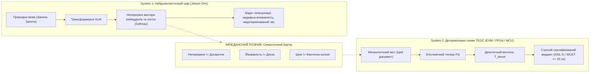
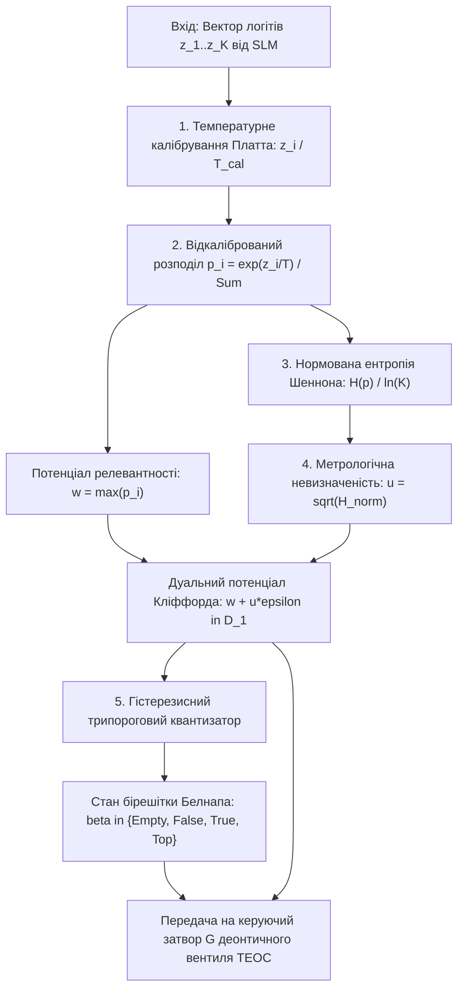

# Науковий меморандум ТЕОС № 02 (MEMO-TEOS-002)

# Протокол нейро-схемотехнічного шлюзу: подолання семантичного розриву між неперервними моделями (System 1) та детермінованими схемами ТЕОС (System 2)

**Ідентифікатор документа:** `MEMO-TEOS-002`  
**Дата реєстрації:** 2026-11-01  
**Статус дослідження:** РОБОЧИЙ НАУКОВИЙ ПРОЄКТ (Peer-Review Draft)  
**Автор:** Микола Федчик (Mykola Fedchyk)  
**Предметна область:** Нейро-символічні інтерфейси, калібрування невизначеності нейромереж, дуальні числа Кліффорда $`\mathbb{D}_1`$, бірешітка Белнапа $`\mathcal{B}_4`$, апаратний деонтичний шлюз безпеки  
**Цільовий контекст:** Інтеграція когнітивного прискорювача Jetson AGX Orin (System 1) з детермінованим рантаймом `tlumach` / EVM (System 2) у проєкті `~/vida`  

---

## Анотація

У меморандумі формалізовано математичний та апаратний протокол взаємодії між стохастичними нейролінгвістичними моделями (System 1) та детермінованими епістемічними схемами (System 2). Досліджено фундаментальний **імпедансний розрив** між неперервним багатовимірним простором ембеддінгів трансформера та дискретним простором доказових станів ТЕОС. 

Запропоновано науковий апарат **Неперервно-дискретного метрологічного моста (Continuous-to-Discrete Bridge)**, який транслює вектор невідкаліброваних логітів нейромережі у дуальний потенціал $`w + u\varepsilon \in \mathbb{D}_1`$ через температурне масштабування Платта та диференційну ентропію передбачення, з подальшою дискретизацією у чотиризначну бірешітку Белнапа $`\mathcal{B}_4`$ через гістерезисний компаратор. Задокументовано результати експериментів, проаналізовано фатальні помилки прямого використання ймовірностей Softmax та доведено інваріант безпеки: нейромережа ніколи не володіє повномочністю доведення, виступаючи виключно генератором епістемічних потенціалів для деонтичного затвора.

---

## 1. Постановка проблеми: Імпедансний розрив між інтуїцією та формальним доказом

Сучасна криза експертних систем полягає в нездатності класичного софту органічно поєднати дві протилежні обчислювальні парадигми:



### 1.1. Чому руйнуються тривіальні підходи?
1. **Крихкість чистих евристик (Проблема «Зводаря»):** Спроба розпізнавати складні нормативні відношення через статичні списки дієслів (`defVerbs`) та граматичні границі речень зазнає краху при найменшій варіації синтаксису (пасивний стан, складнопідрядні звороти, українські відмінки).
2. **Галюцинації чистого ШІ (Проблема LLM CoT):** Спроба довірити міркування самій нейромережі генерує гладкий, але вигаданий текст, у якому логічні квантори спотворені, а джерело фактів відсутнє.
3. **Некаліброваність виходів Softmax:** Нейромережі страждають на *синдром надмірної впевненості (Overconfidence Bias)*: модель може видавати ймовірність $`p = 0{,}98`$ на абсолютно безглуздих або атакуючих (adversarial) вхідних послідовностях.

---

## 2. Генезис гіпотез та аналіз спроб

### Спроба 1: Пряма трансляція Softmax у вагу входу (Невдача)
- *Гіпотеза:* Брати максимальну ймовірність із виходу класифікатора $`w = \max(\mathrm{Softmax}(\mathbf{z}))`$ і подавати її як потенціал істинності на інформаційний вхід схеми.
- *Результат невдачі:* Повний провал на текстах з омонімами та рідкісними винятками. Модель, навчена на великому корпусі, з впевненістю $`0{,}95`$ класифікувала специфічну статтю технічного регламенту як загальну норму. Вхідний вентиль ТЕОС відкрився, сприйнявши статистичну галюцинацію за перевірений факт.
- *Висновок:* **Ймовірність $p$ не є епістемічною довірою.** Необхідно враховувати ентропію розподілу та відкалібровану похибку.

### Спроба 2: Жорсткий символічний інтерфейс GBNF без оцінки невизначеності (Частковий успіх)
- *Гіпотеза:* Заблокувати довільну генерацію за допомогою жорсткої граматики GBNF (Closed Vocabulary Intent Frame). Модель змушена заповнювати суворо типізовані поля `(Entity, Attribute, Modal)`.
- *Результат:* Синтаксична структура стала ідеальною — 0 помилок формату. Проте виникла проблема граничних запитів: коли запит був неоднозначним, GBNF змушував модель насильно обирати один із допустимих токенів, маскуючи внутрішню невпевненість моделі.
- *Висновок:* GBNF необхідний для структуризації синтаксису, але недостатній для оцінки епістемічної чистоти. Потрібен метричний канал передачі невизначеності.

### Спроба 3: Неперервно-дискретний міст над $`\mathbb{D}_1`$ та $`\mathcal{B}_4`$ (Прийняте рішення)
- *Гіпотеза:* Нейромережа генерує одночасно:
  1. Синтаксичний каркас запиту через GBNF-граматику;
  2. Вектор сирих логітів $`\mathbf{z}`$, з якого через температурне калібрування та ентропію обчислюється **дуальне число Кліффорда** $`w + u\varepsilon \in \mathbb{D}_1`$;
  3. Дискретне відображення у стан бірешітки Белнапа $`\boldsymbol{\beta} \in \mathcal{B}_4`$ через компаратор із зоною гістерезису.

---

## 3. Математичний апарат неперервно-дискретного шлюзу

Шлюз реалізує детерміноване відображення стохастичного вектора стану $`\mathbf{z} \in \mathbb{R}^K`$ у формальний епістемічний тензор стану ТЕОС $\Psi$.



### 3.1. Температурне калібрування Платта
Для усунення систематичного зсуву впевненості логіти $`\mathbf{z}`$ масштабуються апріорно виміряною температурою калібрування $`T_{\mathrm{cal}} > 0`$:

$$
p_i = \frac{\exp\left(\frac{z_i}{T_{\mathrm{cal}}}\right)}{\sum_{j=1}^K \exp\left(\frac{z_j}{T_{\mathrm{cal}}}\right)}, \quad i \in \{1, \dots, K\}
$$

Дійсна частина дуального потенціалу релевантності визначається як максимальна відкалібрована ймовірність:

$$
w = \max_{i} (p_i) \in [0, 1]
$$

### 3.2. Обчислення інструментальної невизначеності нейромережі у дуальній алгебрі $`\mathbb{D}_1`$
Невизначеність $u$ не є константою: вона прямо пропорційна дисперсії передбачення, яка вимірюється через нормовану ентропію Шеннона відкаліброваного розподілу:

$$
H_{\mathrm{norm}}(\mathbf{p}) = -\frac{1}{\ln K} \sum_{i=1}^K p_i \ln(p_i), \quad H_{\mathrm{norm}} \in [0, 1]
$$

Стандартна невизначеність нейромережевого селектора згідно з JCGM GUM задається формулою:

$$
u = \sigma_{\mathrm{cal}} \cdot \sqrt{H_{\mathrm{norm}}(\mathbf{p})}
$$

де $`\sigma_{\mathrm{cal}}`$ — емпіричне середньоквадратичне відхилення на валідаційному датасеті (для Jetson J501 $`\sigma_{\mathrm{cal}} \approx 0{,}085`$).

Результуючий семантичний потенціал формується як число Кліффорда першого порядку:

$$
\hat{w} = w + u\,\varepsilon, \quad \varepsilon^2 = 0
$$

### 3.3. Квантування станів у бірешітці Белнапа $`\mathcal{B}_4`$
Для виключення высокочастотного деренчання (*chattering*) на межі рішень застосовується пороговий компаратор із зоною гістерезису шириною $2u$:

$$
\boldsymbol{\beta}_{\mathrm{mapped}} = \begin{cases}
\mathbf{T}, & \text{якщо } w - k \cdot u \ge \tau_{\mathrm{high}} \quad (\text{Однозначна семантична релевантність}); \\
\bot, & \text{якщо } w + k \cdot u < \tau_{\mathrm{low}} \quad (\text{Повна нерелевантність / Інформаційний вакуум}); \\
\top, & \text{якщо } \lvert p_{(1)} - p_{(2)} \rvert \le 2u \quad \text{та } w \ge \tau_{\mathrm{low}} \quad (\text{Омонімічна колізія між двома лідерами}); \\
\mathbf{F}, & \text{якщо явно активовано модальний маркер заперечення}.
\end{cases}
$$

де $k = 2$ ($`95{,}45\%`$ довірчий інтервал Стьюдента), $`\tau_{\mathrm{high}} = 0{,}80`$, $`\tau_{\mathrm{low}} = 0{,}35`$.

---

## 4. Протокол передачі та апаратне розмежування повноважень

### 4.1. Фундаментальний інваріант безпеки
> **Апаратний інваріант демаркації повноважень:**
> *Нейролінгвістичний прискорювач System 1 (Jetson AGX Orin) ні за яких умов не має доступу до шини вердиктів і не має права генерувати підпис кастодії Ed25519. Його вихідні дані є виключно керуючими потенціалами, що подаються на вхід затвора $G$ деонтичного вентиля ТЕОС $`\mathcal{T}_{\mathrm{deont}}`$. Якщо похибка $`u > u_{\mathrm{crit}} = 0{,}25`$, затвор деонтичного вентиля фізично розмикається за 1 такт (Fail-Closed).*

### 4.2. Формат пакета мікроінтерфейсу (EISA Neuro-Bridge Frame)

```text
 0                   1                   2                   3
 0 1 2 3 4 5 6 7 8 9 0 1 2 3 4 5 6 7 8 9 0 1 2 3 4 5 6 7 8 9 0 1
+-+-+-+-+-+-+-+-+-+-+-+-+-+-+-+-+-+-+-+-+-+-+-+-+-+-+-+-+-+-+-+-+
|          Magic (0x4550)       |      Protocol Version (0x02)  |
+-+-+-+-+-+-+-+-+-+-+-+-+-+-+-+-+-+-+-+-+-+-+-+-+-+-+-+-+-+-+-+-+
|       Source Entity ID        |      Target Predicate ID      |
+-+-+-+-+-+-+-+-+-+-+-+-+-+-+-+-+-+-+-+-+-+-+-+-+-+-+-+-+-+-+-+-+
| Q16.16 Nominal Potential (w)  | Q16.16 Standard Uncertainty(u)|
+-+-+-+-+-+-+-+-+-+-+-+-+-+-+-+-+-+-+-+-+-+-+-+-+-+-+-+-+-+-+-+-+
| Belnap State  | Deontic Modal | Reserved                      |
+-+-+-+-+-+-+-+-+-+-+-+-+-+-+-+-+-+-+-+-+-+-+-+-+-+-+-+-+-+-+-+-+
|                 SHA-256 Source Hash (Bytes 0..3)              |
+-+-+-+-+-+-+-+-+-+-+-+-+-+-+-+-+-+-+-+-+-+-+-+-+-+-+-+-+-+-+-+-+
```

---

## 5. Протокол впровадження для тракту `Jetson J501 -> EVM`

1. **У підсистемі `znavets` (Jetson Orin / Ollama):**
   - Розгорнути компактну модель з GBNF-семплером;
   - Замість виводу вільного тексту транслювати вихідний шар Softmax у кадр `EISA Neuro-Bridge Frame`.
2. **У підсистемі `tlumach` (Hardware EVM / Verilog):**
   - Підключити приймач кадрів до регістра керування деонтичного вентиля `biencoder_chow_gate.v`;
   - Активувати апаратну перевірку інваріанта $`u \le u_{\mathrm{crit}}`$.

---

## Висновки

1. Пряме зшивання стохастичних нейромереж із жорстким символічним софтом без перехідного метрологічного шару неминуче породжує або галюцинації, або надмірну крихкість.
2. Неперервно-дискретний міст ТЕОС на основі калібрування Платта, ентропійної невизначеності дуальних чисел $`\mathbb{D}_1`$ та бірешітки $`\mathcal{B}_4`$ перетворює непередбачувану нейромережу на строгий сенсор семантичного потенціалу.
3. Апаратний деонтичний затвор ТЕОС гарантує абсолютний захист від галюцинацій мовної моделі: система блокує висновок на апаратному рівні, якщо впевненість нейромережі розмита високою ентропією.
