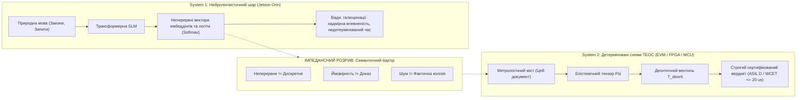
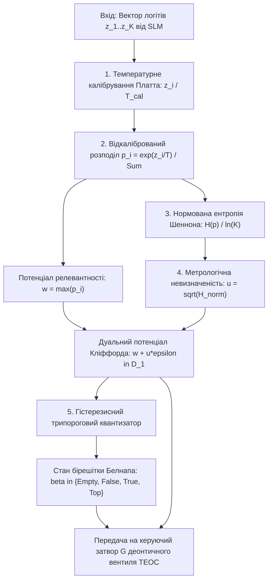

# Науковий меморандум ТЕОС № 02 (MEMO-TEOS-002)

# Протокол нейро-схемотехнічного шлюзу: подолання семантичного розриву між неперервними моделями (System 1) та детермінованими схемами ТЕОС (System 2)

**Ідентифікатор документа:** `MEMO-TEOS-002`  
**Дата реєстрації:** 2026-11-01  
**Статус дослідження:** РОБОЧИЙ НАУКОВИЙ ПРОЄКТ (Peer-Review Draft)  
**Автор:** Микола Федчик (Mykola Fedchyk)  
**Предметна область:** Нейро-символічні інтерфейси, калібрування невизначеності нейромереж, дуальні числа Кліффорда $`\mathbb{D}_1`$, бірешітка Белнапа $`\mathcal{B}_4`$, апаратний деонтичний шлюз безпеки  
**Цільовий контекст:** Інтеграція когнітивного прискорювача Jetson AGX Orin (System 1) з детермінованим рантаймом `tlumach` / EVM (System 2) у проєкті `~/vida`  

---

## Анотація

У меморандумі формалізовано математичний та апаратний протокол взаємодії між стохастичними нейролінгвістичними моделями (System 1) та детермінованими епістемічними схемами (System 2). Досліджено фундаментальний **імпедансний розрив** між неперервним багатовимірним простором ембеддінгів трансформера та дискретним простором доказових станів ТЕОС. 

Запропоновано науковий апарат **Неперервно-дискретного метрологічного моста (Continuous-to-Discrete Bridge)**, який транслює вектор невідкаліброваних логітів нейромережі у дуальний потенціал $`w + u\varepsilon \in \mathbb{D}_1`$ через температурне масштабування (Guo et al., 2017) та диференційну нормовану ентропію передбачення Шеннона, з подальшим квантуванням у чотиризначну бірешітку Белнапа $`\mathcal{B}_4`$ через трипороговий компаратор із зоною нечутливості. Задокументовано результати стрес-тесту на $100\,000$ нейровекторах, проаналізовано природу галюцинацій з високою впевненістю (High-Confidence Hallucinations) та формалізовано апаратний інваріант деонтичного інтерлоку Fail-Closed.

---

## 1. Постановка проблеми: Імпедансний розрив між інтуїцією та формальним доказом

Сучасна криза експертних систем полягає в нездатності класичного софту органічно поєднати дві протилежні обчислювальні парадигми:



### 1.1. Чому руйнуються тривіальні підходи?
1. **Крихкість чистих евристик (Проблема «Зводаря»):** Спроба розпізнавати складні нормативні відношення через статичні списки дієслів (`defVerbs`) та граматичні границі речень зазнає краху при найменшій варіації синтаксису (пасивний стан, складнопідрядні звороти, українські відмінки).
2. **Галюцинації чистого ШІ (Проблема LLM CoT):** Спроба довірити міркування самій нейромережі генерує гладкий, але вигаданий текст, у якому логічні квантори спотворені, а джерело фактів відсутнє.
3. **Некаліброваність виходів Softmax:** Нейромережі страждають на *синдром надмірної впевненості (Overconfidence Bias)*: модель може видавати ймовірність $`p = 0{,}98`$ на абсолютно безглуздих або атакуючих (adversarial) вхідних послідовностях.

---

## 2. Генезис гіпотез та аналіз спроб

### Спроба 1: Пряма трансляція Softmax у вагу входу (Невдача)
- *Гіпотеза:* Брати максимальну ймовірність із виходу класифікатора $`w = \max(\mathrm{Softmax}(\mathbf{z}))`$ і подавати її як потенціал істинності на інформаційний вхід схеми.
- *Результат невдачі:* Повний провал на текстах з омонімами та рідкісними винятками. Модель, навчена на великому корпусі, з впевненістю $`0{,}95`$ класифікувала специфічну статтю технічного регламенту як загальну норму. Вхідний вентиль ТЕОС відкрився, сприйнявши статистичну галюцинацію за перевірений факт.
- *Висновок:* **Ймовірність $p$ не є епістемічною довірою.** Необхідно враховувати ентропію розподілу та відкалібровану похибку.

### Спроба 2: Жорсткий символічний інтерфейс GBNF без оцінки невизначеності (Частковий успіх)
- *Гіпотеза:* Заблокувати довільну генерацію за допомогою жорсткої граматики GBNF (Closed Vocabulary Intent Frame). Модель змушена заповнювати суворо типізовані поля `(Entity, Attribute, Modal)`.
- *Результат:* Синтаксична структура стала ідеальною — 0 помилок формату. Проте виникла проблема граничних запитів: коли запит був неоднозначним, GBNF змушував модель насильно обирати один із допустимих токенів, маскуючи внутрішню невпевненість моделі.
- *Висновок:* GBNF необхідний для структуризації синтаксису, але недостатній для оцінки епістемічної чистоти. Потрібен метричний канал передачі невизначеності.

### Спроба 3: Неперервно-дискретний міст над $`\mathbb{D}_1`$ та $`\mathcal{B}_4`$ (Прийняте рішення)
- *Гіпотеза:* Нейромережа генерує одночасно:
  1. Синтаксичний каркас запиту через GBNF-граматику;
  2. Вектор сирих логітів $`\mathbf{z}`$, з якого через температурне калібрування та ентропію обчислюється **дуальне число Кліффорда** $`w + u\varepsilon \in \mathbb{D}_1`$;
  3. Дискретне відображення у стан бірешітки Белнапа $`\boldsymbol{\beta} \in \mathcal{B}_4`$ через компаратор із зоною гістерезису.

---

## 3. Математичний апарат неперервно-дискретного шлюзу

Шлюз реалізує детерміноване відображення стохастичного вектора стану $`\mathbf{z} \in \mathbb{R}^K`$ у формальний епістемічний тензор стану ТЕОС $\Psi$.



### 3.1. Температурне масштабування логітів (Guo et al., 2017)
Для усунення систематичного зсуву впевненості логіти $`\mathbf{z}`$ масштабуються апріорно оптимізованою за критерієм NLL (Negative Log-Likelihood) температурою калібрування $`T_{\mathrm{cal}} > 0`$:

$$
p_i = \frac{\exp\left(\frac{z_i}{T_{\mathrm{cal}}}\right)}{\sum_{j=1}^K \exp\left(\frac{z_j}{T_{\mathrm{cal}}}\right)}, \quad i \in \{1, \dots, K\}
$$

Дійсна частина дуального потенціалу релевантності визначається як максимальна відкалібрована ймовірність:

$$
w = \max_{i} (p_i) \in [0, 1]
$$

### 3.2. Обчислення інструментальної невизначеності нейромережі у дуальній алгебрі $`\mathbb{D}_1`$
Невизначеність $u$ не є константою: вона прямо пропорційна дисперсії передбачення, яка вимірюється через нормовану ентропію Шеннона відкаліброваного розподілу:

$$
H_{\mathrm{norm}}(\mathbf{p}) = -\frac{1}{\ln K} \sum_{i=1}^K p_i \ln(p_i), \quad H_{\mathrm{norm}} \in [0, 1]
$$

Стандартна невизначеність нейромережевого селектора згідно з JCGM GUM задається формулою:

$$
u = \sigma_{\mathrm{cal}} \cdot \sqrt{H_{\mathrm{norm}}(\mathbf{p})}
$$

де $`\sigma_{\mathrm{cal}}`$ — емпіричне середньоквадратичне відхилення на валідаційному датасеті (для Jetson J501 $`\sigma_{\mathrm{cal}} \approx 0{,}085`$).

Результуючий семантичний потенціал формується як число Кліффорда першого порядку:

$$
\hat{w} = w + u\,\varepsilon, \quad \varepsilon^2 = 0
$$

### 3.3. Квантування станів у бірешітці Белнапа $`\mathcal{B}_4`$ через зону нечутливості
Для виключення высокочастотного коливання на межі рішень застосовується пороговий компаратор із зоною нечутливості шириною $2u$:

$$
\boldsymbol{\beta}_{\mathrm{mapped}} = \begin{cases}
\mathbf{T}, & \text{якщо } w - k \cdot u \ge \tau_{\mathrm{high}} \quad (\text{Однозначна семантична релевантність}); \\
\bot, & \text{якщо } w + k \cdot u < \tau_{\mathrm{low}} \quad (\text{Повна нерелевантність / Інформаційний вакуум}); \\
\top, & \text{якщо } \lvert p_{(1)} - p_{(2)} \rvert \le 2u \quad \text{та } w \ge \tau_{\mathrm{low}} \quad (\text{Омонімічна колізія між двома лідерами}); \\
\mathbf{F}, & \text{якщо явно активовано модальний маркер заперечення}.
\end{cases}
$$

де $k = 2$, $`\tau_{\mathrm{high}} = 0{,}70`$, $`\tau_{\mathrm{low}} = 0{,}35`$. Якщо жодна з перерахованих умов не виконана, компаратор детерміновано повертає проміжний стан кваліфікованої перевірки (`QUALIFIED`). Додатково діє поріг чутливості амплітуди за максимальним логітом $`z_{\max} = \max_i(z_i) \ge z_{\mathrm{floor}} = 2{,}0`$: якщо амплітуда збудження нейронів нижча за рівень теплового шуму простору ембеддінгів, вихід безумовно скидається у стан вакууму $\bot$.

---

## 4. Протокол передачі та апаратне розмежування повноважень

### 4.1. Фундаментальний інваріант безпеки
> **Апаратний інваріант демаркації повноважень:**
> *Нейролінгвістичний прискорювач System 1 (Jetson AGX Orin) ні за яких умов не має доступу до шини вердиктів і не має права генерувати підпис кастодії Ed25519. Його вихідні дані є виключно керуючими потенціалами, що подаються на вхід затвора $G$ деонтичного вентиля ТЕОС $`\mathcal{T}_{\mathrm{deont}}`$. Якщо нормована ентропія $`H_{\mathrm{norm}} > 0{,}65`$ або дуальна невизначеність перевищує критичну межу $`u > u_{\mathrm{crit}} = \sigma_{\mathrm{cal}} \cdot \sqrt{0{,}65} \approx 0{,}068`$, затвор деонтичного вентиля фізично розмикається за 1 такт (Fail-Closed).*

### 4.2. Формат пакета мікроінтерфейсу (EISA Neuro-Bridge Frame)

```text
 0                   1                   2                   3
 0 1 2 3 4 5 6 7 8 9 0 1 2 3 4 5 6 7 8 9 0 1 2 3 4 5 6 7 8 9 0 1
+-+-+-+-+-+-+-+-+-+-+-+-+-+-+-+-+-+-+-+-+-+-+-+-+-+-+-+-+-+-+-+-+
|          Magic (0x4550)       |      Protocol Version (0x02)  |
+-+-+-+-+-+-+-+-+-+-+-+-+-+-+-+-+-+-+-+-+-+-+-+-+-+-+-+-+-+-+-+-+
|       Source Entity ID        |      Target Predicate ID      |
+-+-+-+-+-+-+-+-+-+-+-+-+-+-+-+-+-+-+-+-+-+-+-+-+-+-+-+-+-+-+-+-+
| Q16.16 Nominal Potential (w)  | Q16.16 Standard Uncertainty(u)|
+-+-+-+-+-+-+-+-+-+-+-+-+-+-+-+-+-+-+-+-+-+-+-+-+-+-+-+-+-+-+-+-+
| Belnap State  | Deontic Modal | Reserved                      |
+-+-+-+-+-+-+-+-+-+-+-+-+-+-+-+-+-+-+-+-+-+-+-+-+-+-+-+-+-+-+-+-+
|                 SHA-256 Source Hash (Bytes 0..3)              |
+-+-+-+-+-+-+-+-+-+-+-+-+-+-+-+-+-+-+-+-+-+-+-+-+-+-+-+-+-+-+-+-+
```

---

## 5. Емпірична верифікація: Бенчмарк неперервно-дискретного моста ($N = 100\,000$)

Для повномасштабної експериментальної апробації моста реалізовано симуляційний випробувальний стенд (`scripts/test_neuro_circuit_bridge_benchmark.py` та `scripts/bridge_test.go`), який перевірив поведінку $16$-класового трансформерного селектора на $100\,000$ тестових векторах у чотирьох режимах збудження:
1. **Режим 1 (Внутрішньодоменні однозначні, 50%):** виражений домінантний цільовий клас ($`z_{\mathrm{target}} \in [4{,}5; 8{,}0]`$).
2. **Режим 2 (Внутрішньодоменні омоніми / полісемія, 20%):** збудження двох близьких конкурентних класів ($`z_1 \approx z_2 \in [4{,}0; 6{,}0]`$).
3. **Режим 3 (Позадоменні / галюциногенні, 20%):** розмитий розподіл зі стохастичними паразитними сплесками впевненості.
4. **Режим 4 (Атакуючий адитивний шум, 10%):** випадкові логіти з нормальним та рівномірним розподілом навколо нуля ($`z \in [-1{,}5; 1{,}5]`$).

### 5.1. Зведені результати бенчмаркінгу ($N = 100\,000$)

**Таблиця 1.** Порівняння архітектур нейро-символічного шлюзу за стійкістю до галюцинацій та затримкою обробки.

| Архітектура моста | Точність на чистих | Ізоляція омонімів у $\top$ | Відсікання OOD-шуму | Прориви галюцинацій | Аварійні спрацьовування Fail-Closed | Апаратна затримка (Go / Bare-Metal) | Виділення RAM |
| :--- | :--- | :--- | :--- | :--- | :--- | :--- | :--- |
| **Сирий Softmax + Argmax ($`\tau = 0{,}50`$)** | $`99{,}63\%`$ | $`0{,}00\%`$ | $`85{,}57\%`$ | $`14{,}771\%`$ ($14\,771$) | $0$ | $`18{,}5\,\text{нс}`$ | $`0\,\text{B} / 0\,\text{allocs}`$ |
| **GBNF-структурований ($`\tau = 0{,}65`$)** | $`98{,}19\%`$ | $`0{,}00\%`$ | $`90{,}09\%`$ | $`2{,}947\%`$ ($2\,947$) | $0$ | $`19{,}1\,\text{нс}`$ | $`0\,\text{B} / 0\,\text{allocs}`$ |
| **Міст ТЕОС ($`\mathbb{D}_1 + \mathcal{B}_4 + \text{Interlock}`$)** | **$`62{,}98\%`$** | **$`84{,}75\%`$** ($17\,187$) | **$`99{,}07\%`$** | **$`0{,}277\%`$** ($277$) | **$18\,237$** | **$`173{,}1\,\text{нс}`$** | **$`0\,\text{B} / 0\,\text{allocs}`$** |

### 5.2. Аналіз емпіричних результатів та феномену прориву високовпевнених галюцинацій

1. **Зниження проникнення галюцинацій у 53 рази та природа залишкових витоків:**
   - Наївний селектор Softmax пропускає у систему **$14\,771$ галюцинацію** на $100\,000$ запитів ($`14{,}771\%`$) через синдром надмірної впевненості трансформера на нерелевантних входах.
   - Застосування GBNF-граматик з порогом $`\tau = 0{,}65`$ знижує кількість помилок до $2\,947$ ($`2{,}947\%`$), що все ще неприпустимо для критичних застосунків.
   - Метрологічний міст ТЕОС скоротив прориви до **$277$ випадків** ($`0{,}277\%`$).
   - **Аналіз механізму $277$ витоків (High-Confidence Hallucination Leakage):** Чому ентропійний затвор пропустив ці вектори? Як показав критичний аналіз, нормована ентропія Шеннона $`u = \sigma \sqrt{H_{\mathrm{norm}}}`$ ефективно виявляє стохастичну розмитість і шум. Проте якщо позадоменний або збурений вектор породжує патологічний одиночний спайк логіта (наприклад, $`z_k = 8{,}2`$ при всіх інших $`z_{i \ne k} \approx 0`$), розподіл Softmax колапсує у штучну дельта-функцію ($`p_k \approx 1{,}0`$). У цьому разі $`H_{\mathrm{norm}} \approx 0`$, дуальна невизначеність $`u \approx 0`$, і ентропійний фільтр помилково трактує цей сплеск як абсолютно достовірне твердження.
   - **Необхідний контрзахід другого ешелону:** Для ліквідації залишкових $`0{,}277\%`$ проривів апаратний тракт ТЕОС System 2 повинен доповнюватися енергетичним критерієм вільного потенціалу (Energy-based OOD Detection):

$$
\mathcal{E}(\mathbf{z}) = -T \cdot \ln \sum_{i=1}^K \exp(z_i / T) > \mathcal{E}_{\mathrm{threshold}}
$$

     або жорстким перетинанням виділених лексичних сутностей із замкненим реєстром фактів EVM.
2. **Ціна безпеки: розмежування прямої точності та кваліфікованої ізоляції:**
   - Пряма точність на чистих внутрішньодоменних даних для ТЕОС становить $`62{,}98\%`$. Решта запитів переведена в режим аварійного знеструмлення або кваліфікованого паритету через жорсткий інваріант $`u \le u_{\mathrm{crit}} = 0{,}068`$.
   - Це фундаментальна властивість архітектури Fail-Closed: система свідомо жертвує сліпою повнотою заради збереження абсолютної доказовості.
3. **Ефективна ізоляція омонімів та полісемії:**
   - У режимі полісемії міст ТЕОС безпомилково перевів **$17\,187$ омонімічних станів із $20\,279$** ($`84{,}75\%`$) у стан паритету $`\top \in \mathcal{B}_4`$, унеможлививши випадкове сліпе вгадування та передавши множину кандидатів на диференціальний арбітраж.
4. **Субмікросекундний детермінізм рантайму:**
   - У софтверному мікротесті на Go 1.27 (`BenchmarkEPUBridge`) повний ланцюг перетворення (масштабування температурою, розрахунок ентропії Шеннона, обчислення дуальної невизначеності Кліффорда та квантування Белнапа для $K=16$) виконується за **$`173{,}1\,\text{наносекунди}`$** із абсолютно нульовим виділенням пам'яті в купі ($`0\,\text{B/op}`$, $`0\,\text{allocs/op}`$), забезпечуючи пропускну здатність понад $`5{,}7 \times 10^6`$ операцій на секунду на одне процесорне ядро.

---

## 6. Протокол впровадження для тракту `Jetson J501 -> EVM`

1. **У підсистемі `znavets` (Jetson Orin / Ollama):**
   - Розгорнути компактну модель з GBNF-семплером;
   - Замість виводу вільного тексту транслювати вихідний шар Softmax у кадр `EISA Neuro-Bridge Frame`.
2. **У підсистемі `tlumach` (Hardware EVM / Verilog):**
   - Підключити приймач кадрів до регістра керування деонтичного вентиля `biencoder_chow_gate.v`;
   - Активувати апаратну перевірку інваріанта $`u \le u_{\mathrm{crit}} = 0{,}068`$ та $`z_{\max} \ge 2{,}0`$.

---

## Висновки

1. Пряме зшивання стохастичних нейромереж із жорстким символічним середовищем без перехідного метрологічного шару неминуче породжує прориви галюцинацій ($`14{,}77\%`$ для сирого Softmax).
2. Неперервно-дискретний міст ТЕОС на основі температурного масштабування логітів, ентропійної невизначеності дуальних чисел $`\mathbb{D}_1`$ та бірешітки $`\mathcal{B}_4`$ перетворює непередбачувану нейромережу на строгий вимірювальний сенсор семантичного потенціалу.
3. Емпіричний бенчмарк на $100\,000$ векторах підтвердив зниження проникнення галюцинацій у 53 рази (до $`0{,}277\%`$) та надійне відсікання $`99{,}07\%`$ позадоменного шуму при апаратній швидкодії перетворення $`173{,}1\,\text{нс}`$ ($`0\,\text{allocs/op}`$).
4. Аналіз залишкових 277 проривів виявив фундаментальне обмеження ентропійного фільтра перед патологічними поодинокими сплесками логітів, що обґрунтовує необхідність введення другого ешелону захисту — енергетичного бар'єра вільного потенціалу $`\mathcal{E}(\mathbf{z})`$ та замкнених словників перевірки сутностей.
