# Науковий меморандум ТЕОС № 04. Функціонально повна бібліотека базових елементів (`TEOS Rev. 2`) та розширення системи команд EISA для реляційно-параметричних нормативних автоматів

> **Статус документа:** Канонічний науково-дослідний меморандум і дорожня карта розвитку елементної бази (Standard Cell Library & EISA v2.0 Specification)  
> **Шифр:** `MEMO-TEOS-004`  
> **Автор:** Микола Федчик (Mykola Fedchyk)  
> **Дата:** 1 листопада 2026 р.  
> **Пов'язані глави монографії:** [Глава 04](ch04-belnap-bilattice-tnorms-and-dual-metrology.md), [Глава 06](ch06-three-terminal-deontic-gate.md), [Глава 08](ch08-operational-units-adders-multipliers-comparators.md), [Глава 09](ch09-scientific-critique-and-applicability-limits.md), [Меморандум № 01](memo-01-paraconsistent-differential-arbitration-and-recall-penalty.md), [Меморандум № 02](memo-02-neuro-circuit-interlock-protocol-and-continuous-discrete-bridge.md), [Меморандум № 03](memo-03-second-order-adversarial-falsification-and-architectural-refinements.md)  
> **Експериментальна база верифікації:** Золотий білінгвальний корпус `gold_slm_corpus_500.json` ($400$ нормативних атомів + $400$ атак інверсії ролей) та стенд `scripts/test_teos_rev2_primitives_benchmark.py`

---

## Анотація

У меморандумі задокументовано стратегічний план розвитку елементної бази теорії епістемічних обчислювальних схем (`TEOS Rev. 2`) і виконано формальний синтез п'яти відсутніх базових примітивів, які перетворюють ТЕОС із пропозиціональної потокової мережі першого покоління на **функціонально повну бібліотеку стандартних вентилів (*Standard Cell Library*)** для класу скінченних реляційно-параметричних нормативних автоматів у реальному часі. Показано, що початковий набір із чотирьох вузлів (тритермінальний деонтичний вентиль $`\mathcal{T}_{\mathrm{deont}}`$, диференційний арбітр $`\mathcal{A}_{\mathrm{diff}}`$, нелінійний суматор $`\Sigma_{\mathrm{ep}}`$ та дуальний мультиплікатор $`\otimes_{\mathrm{ep}}`$) є функціонально неповним відносно канонічної граматики інженерних вимог EARS (*Easy Approach to Requirements Syntax*), протоколів IETF RFC та стандартів функціональної безпеки ISO 26262 / IEC 61508. Для ліквідації цієї прогалини та прямої імплементації захисних механізмів проти семи спростувань другого порядку ([Меморандум № 03](memo-03-second-order-adversarial-falsification-and-architectural-refinements.md)) уведено п'ять нових елементарних операторів: (1) реляційний уніфікатор рольових фреймів $`\bowtie_{\mathrm{ep}}`$ (`E_BIND`), (2) інтервально-параметричний компаратор із 32-бітним грассманівським дескриптором сорту $`\mathcal{W}_{[L_{\min}, L_{\max}]}`$ (`E_BOUND`), (3) мультиплексор нормативної специфічності за принципом *Lex Specialis* $`\mathcal{M}_{\mathrm{lex}}`$ (`E_MUX`), (4) непараметричний мажоритарний вентиль порядкових статистик $`\mathcal{Q}_{K/M}`$ (`E_VOTER`), стійкий до теореми Гаїфмана — Гаєка, та (5) синхронний темпоральний регістр-фіксатор $`\mathcal{L}_{\Delta t}`$ (`E_LATCH`) з апаратним контролем інтервалу толерантності до відмов FTTI. Сформульовано та доведено теорему про функціональну повноту розширеної 9-елементної бібліотеки ТЕОС і наведено результати стендової верифікації на реальних нормативних атомах екосистеми VIDA.

---

## 1. Обґрунтування намірів: чому чотирьох елементів першого покоління недостатньо

Критичний аудит першого покоління ТЕОС ([Глави 06–08](ch06-three-terminal-deontic-gate.md)) та попперівська фальсифікація другого порядку ([Меморандум № 03](memo-03-second-order-adversarial-falsification-and-architectural-refinements.md)) виявили фундаментальний структурний розрив між наявними вузлами ТЕОС та реальними інженерними специфікаціями.

У промисловій практиці систем критичної безпеки (RTCA DO-178C, ISO 26262, IETF RFC) будь-яка атомарна вимога у канонічній нотації EARS (*Mavin et al., 2009*) розкладається на п'ять ортогональних синтаксичних компонентів:

$$
\text{Norm} \equiv \underbrace{\text{WHILE } \langle \text{State}(t) \rangle}_{\text{Темпоральний стан}} \;\; \underbrace{\text{WHEN } \langle x \in [L_{\min}, L_{\max}] \rangle}_{\text{Параметрична межа}} \;\; \underbrace{\text{IF } \langle \text{Exception } C_{\mathrm{spec}} \rangle}_{\text{Ієрархія Lex Specialis}} \;\; \underbrace{\text{THE } \langle \text{Actor} \rangle \text{ SHALL } \langle \text{Action}, \text{Target} \rangle}_{\text{Реляційний рольовий фрейм}}
$$

Зіставлення цієї структури з чотирма операторами першого покоління ТЕОС доводить, що жоден із перших чотирьох компонентів не може бути коректно обчислений без розширення елементної бази:
1. **Сліпота до перестановки семантичних ролей (потреба в `E_BIND`):** Вентиль $`\mathcal{T}_{\mathrm{deont}}`$ комутує скалярний потенціал факту $`w_S`$ і потенціал норми $`w_G`$, проте не перевіряє ізоморфізм зв'язування аргументів предикатів першого порядку $`P(\text{Actor}, \text{Action}, \text{Target})`$. Унаслідок цього перестановка суб'єкта й об'єкта (*«Клієнт автентифікує Сервер»* замість *«Сервер автентифікує Клієнта»*) має ідентичний словниковий склад і хибно пропускається булево-потоковою схемою.
2. **Виродженість $`\mathbb{Z}^7`$ та сингулярність похідної на порогах (потреба в `E_BOUND`):** Як доведено у розд. 2.2 та 2.6 [Меморандуму № 03](memo-03-second-order-adversarial-falsification-and-architectural-refinements.md), точкові похідні $`\mathbb{D}_1/\mathbb{D}_2`$ дорівнюють нулю перед точкою зламу порогової функції, а вектор SI $`\mathbb{Z}^7`$ не розрізняє крутний момент ($`\text{Н}\cdot\text{м}`$, бівектор $`\Lambda^2`$) та енергію ($`\text{Дж}`$, скаляр $`\Lambda^0`$), а також обнуляє всі дискретні одиниці ІТ-протоколів (`OCTET`, `SECOND`, `IPV4_TTL`).
3. **Відсутність направленого перемикання ієрархії норм (потреба в `E_MUX`):** Диференційний арбітр $`\mathcal{A}_{\mathrm{diff}}`$ ([Меморандум № 01](memo-01-paraconsistent-differential-arbitration-and-recall-penalty.md)) є симетричним і переводить колізію двох норм рівної ваги у стан білатеральної суперечності $`\top`$. Однак коли спеціальна норма (*Lex Specialis*) легітимно перевизначає загальну норму (*Lex Generalis*) за наявності активної умови $`C_{\mathrm{spec}}`$, це не колізія $`\top`$, а штатне перемикання активного правила зі збереженням кастодії обох норм.
4. **Вразливість адитивних S-конорм до семантичних переказів (потреба в `E_VOTER`):** За теоремою Гаїфмана — Гаєка ([Меморандум № 03, розд. 2.1](memo-03-second-order-adversarial-falsification-and-architectural-refinements.md)), жодна істиннісно-функціональна S-конорма не захищена від накачування потенціалу $`w_\Sigma \to 1{,}0`$ десятьма перефразованими непрямими джерелами з різними гешами `SHA-256`. Потрібен непараметричний оператор порядкових статистик, інваріантний до тиражування слабких джерел.
5. **Комбінаційна безпам'ятність (потреба в `E_LATCH`):** Усі оператори першого покоління ТЕОС є суто комбінаційними (без стану). Вони не здатні реалізувати вимоги вигляду *«Після спрацювання аварійного порогу утримувати клапан закритим і верифікувати свіжість телеметрії в межах інтервалу толерантності до відмов $\mathrm{FTTI} = 50\,\text{мс}$»*.

---

## 2. Дорожня карта та архітектурні наміри розвитку елементної бази (`TEOS Rev. 2`)

Для перетворення ТЕОС на завершену інженерну дисципліну та її впровадження у виконавче ядро `vida-evm` і компілятор знань `zvodar` зафіксовано чотири етапи дорожньої карти:

1. **Етап I. Стандартизація 9-елементної бібліотеки вентилів (`TEOS Standard Cell Library v2.0`):**
   Об'єднання чотирьох базових операторів першого покоління (`E_DEONT`, `E_ARBITER`, `E_SUM_MAX`, `E_MULT`) із п'ятьма новими спеціалізованими примітивами (`E_BIND`, `E_BOUND`, `E_MUX`, `E_VOTER`, `E_LATCH`) у єдиний ортогональний базис, де кожен вентиль має суворо визначену таблицю переходів у бірешітці Белнапа $`\mathcal{B}_4`$, закон поширення інтервальної похибки та правило конкатенації гешів кастодії Меркла.
2. **Етап II. Розширення бінарної системи команд процесора знань (`EISA v2.0`):**
   Введення однотактових 64-бітних детермінованих інструкцій віртуальної машини `EVM` для нових примітивів (`OP_EBIND = 0x15`, `OP_EBOUND = 0x16`, `OP_EMUX = 0x17`, `OP_EVOTER = 0x18`, `OP_ELATCH = 0x19`), які виконуються за константний час $`\mathcal{O}(1)`$ тактів процесора без динамічної алокації пам'яті в купі та без пошукового повернення (*backtracking*).
3. **Етап III. Компіляція природномовних та протокольних норм у вентильні графи (`NL/RFC-to-Circuit Synthesis`):**
   Модернізація компілятора пакетів знань `.kp` таким чином, щоб кожна нормативна клауза після видобування ролей на нейро-схемотехнічному шлюзі ([Меморандум № 02](memo-02-neuro-circuit-interlock-protocol-and-continuous-discrete-bridge.md)) автоматично синтезувалася у стандартну 5-каскадну комірку:
   `E_LATCH` (перевірка свіжості стану FTTI) $\to$ `E_BOUND` (перевірка числового вікна й сорту) $\to$ `E_MUX` (вибір спеціальної чи загальної норми) $\to$ `E_BIND` (уніфікація рольового фрейму) $\to$ `E_DEONT` (випуск криптографічно підписаного вердикту).
4. **Етап IV. Роздільна реалізація на CPU SIMD EVM та FPGA Safety Interlock:**
   Відповідно до сьомого рубіжу фальсифікації ([Меморандум № 03, розд. 2.7](memo-03-second-order-adversarial-falsification-and-architectural-refinements.md)), повна база знань (понад $17\,378$ пакетів `.kp`) виконується програмно-апаратною віртуальною машиною `EVM` на CPU з векторизацією AVX-512 / ARM NEON, тоді як критичне ядро безпеки обсягом до $256$ інваріантних правил ASIL-D синтезується безпосередньо у кремнієву мережу на ПЛІС/FPGA.

```mermaid
flowchart LR
    accTitle: Рисунок 1. Стандартна 5-каскадна комірка виконання нормативного правила у TEOS Rev. 2
    accDescr: Послідовно-паралельна схема проходження сигналу від вхідної телеметрії та факту через синхронний фіксатор свіжості E_LATCH, параметричний компаратор вікна E_BOUND, мажоритарний кворум E_VOTER, мультиплексор специфічності E_MUX та рольовий кросбар E_BIND до вихідного деонтичного вентиля E_DEONT.

    subgraph Sensors ["Вхідна телеметрія та свідчення"]
        S1["Давачі x_1..x_M\n(Дуальний сигнал + Sort 32b)"]
        F1["Факт запиту Psi_fact\n(Actor, Action, Target)"]
    end

    subgraph CellRev2 ["Стандартна комірка TEOS Rev. 2 (EISA v2.0)"]
        LATCH["1. E_LATCH (0x19)\nКонтроль свіжості Delta_t <= FTTI"]
        VOTER["2. E_VOTER (0x18)\nПорядкова статистика K-з-M"]
        BOUND["3. E_BOUND (0x16)\nІнтервальне вікно [L_min, L_max]\nта перевірка сорту Грассмана"]
        MUX["4. E_MUX (0x17)\nМультиплексор Lex Specialis\n(Норма N_spec vs N_gen)"]
        BIND["5. E_BIND (0x15)\nРольовий кросбар\n(Actor x Action x Target)"]
        DEONT["6. E_DEONT (0x10)\nТритермінальний деонтичний\nвентиль випуску вердикту"]
    end

    S1 --> LATCH --> VOTER --> BOUND --> MUX
    F1 --> BIND
    MUX -->|"Активна норма G"| DEONT
    BIND -->|"Уніфікований факт S"| DEONT
    DEONT --> OUT["Вихідний тензор вердикту Psi_out\n(ACCEPT / REFUSAL / TOP / BOT)"]

    classDef newGate fill:#e8f5e9,stroke:#2e7d32,stroke-width:2px,color:#1b5e20;
    classDef coreGate fill:#e3f2fd,stroke:#1565c0,stroke-width:2px,color:#0d47a1;
    classDef ioNode fill:#fff3e0,stroke:#e65100,stroke-width:2px,color:#bf360c;

    class LATCH,VOTER,BOUND,MUX,BIND newGate;
    class DEONT coreGate;
    class S1,F1,OUT ioNode;
```

---

## 3. Математична специфікація п'яти нових елементарних вентилів (`TEOS Rev. 2`)

Нижче подано строгу аксіоматику кожного з п'яти нових елементів над розширеним тензором стану $`\Psi = \langle \mathcal{C}, w, u, \boldsymbol{\beta}, \mathcal{D}_{\mathrm{sort}}, \mathcal{R}_{\mathrm{role}} \rangle`$, де $`\boldsymbol{\beta} \in \mathcal{B}_4 = \{\mathbf{T}, \mathbf{F}, \top, \bot\}`$ — статус у чотиризначній бірешітці Белнапа.

### 3.1. Елемент 1: Реляційний уніфікатор рольових фреймів $`\bowtie_{\mathrm{ep}}`$ (`E_BIND`, opcode `0x15`)

#### Інженерне призначення та проблема відмови
У нормативних базах знань атомарне твердження визначається впорядкованою трійкою семантичних ролей (відмінків Ч. Філлмора): **Суб'єкт дії (`Actor`)**, **Предикат дії (`Action`)** та **Об'єкт дії (`Target`)**. Класичний пошук за ключовими словами або скалярними ембедингами є інваріантним до перестановки слів (комутативним), через що інверсія суб'єкта й об'єкта не виявляється. Призначення вентиля `E_BIND` — за 1 такт виконати позиційну перевірку рольового ізоморфізму між фактом запиту $`\Psi_{\mathrm{fact}}`$ і шаблоном норми $`\Psi_{\mathrm{norm}}`$ за допомогою 32-бітних ідентифікаторів синсетів $`\mathrm{SynID} \in \mathbb{N}_{32}`$.

#### Математична модель і рівняння передачі
Нехай кожен фрейм подано кортежем із трьох ідентифікаторів концептів:
- Факт: $`\mathcal{R}_{\mathrm{fact}} = \langle a_f, v_f, t_f \rangle \in \mathbb{N}_{32}^3`$;
- Норма: $`\mathcal{R}_{\mathrm{norm}} = \langle a_n, v_n, t_n \rangle \in \mathbb{N}_{32}^3`$, де значення $`0`$ кодує універсальний квантор (`WILDCARD` $`\forall`$).

Введемо елементарний предикат позиційного збігу слота $`m(x_f, x_n) \in \{0, 1\}`$ та предикат інверсії ролей $`\mathrm{inv}(\mathcal{R}_f, \mathcal{R}_n) \in \{0, 1\}`$:

$$
m(x_f, x_n) = \mathbb{I}\!\left[(x_n = 0) \lor (x_f = x_n)\right], \qquad \mathrm{inv}(\mathcal{R}_f, \mathcal{R}_n) = \mathbb{I}\!\left[(a_f = t_n) \land (t_f = a_n) \land (a_n \ne t_n)\right]
$$

Тоді коефіцієнт структурного зв'язування $`\mu_{\mathrm{bind}}`$, вихідний потенціал $`w_{\mathrm{out}}`$ і статус Белнапа $`\boldsymbol{\beta}_{\mathrm{out}}`$ вентиля `E_BIND` визначаються формулою:

$$
\mu_{\mathrm{bind}} = m(a_f, a_n) \cdot m(v_f, v_n) \cdot m(t_f, t_n), \qquad
\boldsymbol{\beta}_{\mathrm{out}} = \begin{cases}
\boldsymbol{\beta}_{\mathrm{fact}}, & \text{якщо } \mu_{\mathrm{bind}} = 1, \\
\mathbf{F} \;\; (\text{код } \mathtt{0x04E1}), & \text{якщо } \mu_{\mathrm{bind}} = 0 \land \mathrm{inv}(\mathcal{R}_f, \mathcal{R}_n) = 1, \\
\bot \;\; (\text{код } \mathtt{0x04E0}), & \text{якщо } \mu_{\mathrm{bind}} = 0 \land \mathrm{inv}(\mathcal{R}_f, \mathcal{R}_n) = 0,
\end{cases}
$$

$$
w_{\mathrm{out}} = \mu_{\mathrm{bind}} \cdot T_{\mathrm{ep}}(w_{\mathrm{fact}}, w_{\mathrm{norm}}), \qquad u_{\mathrm{out}} = \mu_{\mathrm{bind}} \cdot \sqrt{u_{\mathrm{fact}}^2 + u_{\mathrm{norm}}^2}
$$

де:
- $`\mu_{\mathrm{bind}} \in \{0, 1\}`$ — бінарний індикатор повного трипозиційного узгодження ролей;
- $`\mathrm{inv}(\mathcal{R}_f, \mathcal{R}_n) = 1`$ — детектор прямої інверсії ролей (`Actor` $\leftrightarrow$ `Target`), який замість пасивного вакууму $`\bot`$ генерує активне блокування $`\mathbf{F}`$ (`ROLE_INVERSION_ATTACK`);
- $`T_{\mathrm{ep}}(\cdot, \cdot)`$ — раціональна Т-норма Гамахера ([Глава 04](ch04-belnap-bilattice-tnorms-and-dual-metrology.md)).

**Дія у виконавчому рантаймі:** Якщо усі три ролі збігаються ($`\mu_{\mathrm{bind}} = 1`$), вентиль відкриває тракт до деонтичного затвора $`\mathcal{T}_{\mathrm{deont}}`$. Якщо виявлено перестановку суб'єкта та об'єкта ($`\mathrm{inv} = 1`$), вентиль за 1 такт виставляє $`\boldsymbol{\beta}_{\mathrm{out}} = \mathbf{F}`$ з кодом діагностики `0x04E1`, фізично унеможливлюючи пропуск інвертованого факту.

---

### 3.2. Елемент 2: Інтервально-параметричний компаратор із грассманівським дескриптором сорту $`\mathcal{W}_{[L_{\min}, L_{\max}]}`$ (`E_BOUND`, opcode `0x16`)

#### Інженерне призначення та проблема відмови
Більшість технічних вимог перевіряють належність виміряного або видобутого параметра $`x \pm u`$ заданому нормативному інтервалу $`[L_{\min}, L_{\max}]`$ (наприклад, тиск у гідросистемі $`[10{,}0;\; 15{,}0]\,\text{МПа}`$ або довжина локальної частини email-адреси в RFC 5321 Section 4.5.3.1.1 $`\le 64\,\text{октети}`$). При цьому можливі дві критичні помилки: (а) порівняння величин різних онтологічних сортів або різного тензорного рангу Грассмана (наприклад, секунд з октетами або крутного моменту $`\text{Н}\cdot\text{м} \in \Lambda^2`$ з енергією $`\text{Дж} \in \Lambda^0`$) та (б) ігнорування інструментальної невизначеності $`u`$ поблизу межі допуску, де точкова похідна дорівнює нулю ([Меморандум № 03, розд. 2.2](memo-03-second-order-adversarial-falsification-and-architectural-refinements.md)).

#### Математична модель і рівняння передачі
Нехай вхідна величина має значення $`x`$, стандартну невизначеність $`u \ge 0`$, коефіцієнт охоплення $`k \ge 1`$ (за замовчуванням $`k=2`$ для довірчої ймовірності $`95{,}45\%`$ за ISO 14253-1) та 32-бітний дескриптор сорту $`\mathcal{D}_{\mathrm{sort}}(x) = \langle \mathrm{Dom}, \Lambda^p, \vec{d}_{\mathrm{SI}}, \mathrm{UnitID} \rangle`$. Нормативне вікно задано межами $`[L_{\min}, L_{\max}]`$ з дескриптором сорту $`\mathcal{D}_{\mathrm{sort}}(L)`$.

1. **Апаратна перевірка ідентичності сорту та рангу Грассмана:**
   Якщо $`\mathcal{D}_{\mathrm{sort}}(x) \ne \mathcal{D}_{\mathrm{sort}}(L)`$, вентиль негайно блокує обчислення і повертає стан структурної несправності:

$$
\mathcal{D}_{\mathrm{sort}}(x) \ne \mathcal{D}_{\mathrm{sort}}(L) \implies \boldsymbol{\beta}_{\mathrm{out}} = \bot \;\; (\text{код } \mathtt{0x04F0: SORT\_MISMATCH\_FAULT}), \quad w_{\mathrm{out}} = 0{,}0, \quad u_{\mathrm{out}} = 1{,}0
$$

2. **Інтервальна оцінка з проникненням хвоста розподілу через межу допуску:**
   За умови збігу дескрипторів сорту ($`\mathcal{D}_{\mathrm{sort}}(x) = \mathcal{D}_{\mathrm{sort}}(L)`$) побудуємо розширений інтервал невизначеності $`I_x = [x - ku,\; x + ku]`$. Статус Белнапа $`\boldsymbol{\beta}_{\mathrm{out}}`$ і мажоранта вихідної невизначеності $`u_{\mathrm{out}}`$ визначаються співвідношеннями:

$$
\boldsymbol{\beta}_{\mathrm{out}} = \begin{cases}
\mathbf{T} \;\; (\text{код } \mathtt{0x0000}), & \text{якщо } (x - ku \ge L_{\min}) \land (x + ku \le L_{\max}) \quad (\text{гарантована норма}), \\
\mathbf{F} \;\; (\text{код } \mathtt{0x0280}), & \text{якщо } (x + ku < L_{\min}) \lor (x - ku > L_{\max}) \quad (\text{гарантоване порушення}), \\
\top \;\; (\text{код } \mathtt{0x0281}), & \text{інакше } (I_x \text{ перетинає межу } L_{\min} \text{ або } L_{\max} \text{ у захисній смузі}),
\end{cases}
$$

$$
u_{\mathrm{out}} = \frac{1}{k}\max\!\left(0,\; (L_{\min} + ku) - x,\; x - (L_{\max} - ku)\right)
$$

**Дія у виконавчому рантаймі:** Формула для $`u_{\mathrm{out}}`$ повністю усуває сингулярність Дірака ([Меморандум № 03, розд. 2.2](memo-03-second-order-adversarial-falsification-and-architectural-refinements.md)): навіть коли номінал $`x = 63{,}5`$ лежить строго всередині ліміту $`L_{\max} = 64{,}0`$, але розширена похибка $`ku = 2 \times 0{,}6 = 1{,}2`$ перетинає поріг ($`63{,}5 + 1{,}2 = 64{,}7 > 64{,}0`$), вентиль видає ненульову мажоранту невизначеності та переводить лінію у стан $`\top`$ (`GUARD_BAND_BOUNDARY_STRADDLE`) для безпечної ескалації.

---

### 3.3. Елемент 3: Мультиплексор нормативної специфічності $`\mathcal{M}_{\mathrm{lex}}`$ (`E_MUX`, opcode `0x17`)

#### Інженерне призначення та проблема відмови
У праві та технічних стандартах діють фундаментальні колізійні принципи: *Lex specialis derogat legi generali* (спеціальна норма витісняє загальну) та *Lex posterior derogat legi priori* (новіша норма витісняє старішу). Якщо в системі одночасно присутні загальна норма $`N_{\mathrm{gen}}`$ (наприклад, *«Робочий тиск у магістралі охолодження не повинен перевищувати $15{,}0\,\text{МПа}$»*) і спеціальна норма $`N_{\mathrm{spec}}`$ (*«У режимі гідровипробувань допускається тиск до $22{,}0\,\text{МПа}$»*), звичайний симетричний арбітр $`\mathcal{A}_{\mathrm{diff}}`$ помилково оголосить між ними суперечність $`\top`$. Призначення вентиля `E_MUX` — здійснити направлений вибір між $`\Psi_{\mathrm{gen}}`$ та $`\Psi_{\mathrm{spec}}`$ під керуванням тензора умови $`\Psi_{\mathrm{cond}}`$, гарантуючи при цьому **безпечну огинаючу (*Fail-Safe Envelope*)** у разі втрати або суперечливості сигналу умови.

#### Математична модель і таблиця комутації в бірешітці Белнапа $`\mathcal{B}_4`$
Вентиль `E_MUX` має три тензорні входи: вхід загальної норми $`\Psi_{\mathrm{gen}}`$, вхід спеціальної норми $`\Psi_{\mathrm{spec}}`$ та керуючий вхід умови спеціалізації $`\Psi_{\mathrm{cond}}`$. На відміну від булевого мультиплексора `2-to-1`, де селектор є бінарним бітом $`s \in \{0, 1\}`$, керуючий сигнал $`\boldsymbol{\beta}_{\mathrm{cond}} \in \{\mathbf{T}, \mathbf{F}, \top, \bot\}`$ є чотиризначним:

$$
\Psi_{\mathrm{out}} = \mathcal{M}_{\mathrm{lex}}\!\left(\Psi_{\mathrm{gen}}, \Psi_{\mathrm{spec}} \;\middle|\; \Psi_{\mathrm{cond}}\right) = \begin{cases}
\left\langle \mathcal{C}_{\mathrm{gen}} \parallel \mathcal{C}_{\mathrm{spec}} \parallel \mathcal{C}_{\mathrm{cond}},\; T_{\mathrm{ep}}(w_{\mathrm{spec}}, w_{\mathrm{cond}}),\; \sqrt{u_{\mathrm{spec}}^2 + u_{\mathrm{cond}}^2},\; \boldsymbol{\beta}_{\mathrm{spec}},\; L_{\mathrm{spec}} \right\rangle, & \text{якщо } \boldsymbol{\beta}_{\mathrm{cond}} = \mathbf{T}, \\[8pt]
\left\langle \mathcal{C}_{\mathrm{gen}} \parallel \mathcal{C}_{\mathrm{cond}},\; T_{\mathrm{ep}}(w_{\mathrm{gen}}, w_{\mathrm{cond}}),\; \sqrt{u_{\mathrm{gen}}^2 + u_{\mathrm{cond}}^2},\; \boldsymbol{\beta}_{\mathrm{gen}},\; L_{\mathrm{gen}} \right\rangle, & \text{якщо } \boldsymbol{\beta}_{\mathrm{cond}} = \mathbf{F}, \\[8pt]
\left\langle \mathcal{C}_{\mathrm{gen}} \parallel \mathcal{C}_{\mathrm{spec}} \parallel \mathcal{C}_{\mathrm{cond}},\; \min(w_{\mathrm{gen}}, w_{\mathrm{spec}}),\; 1{,}0,\; \top,\; \min(L_{\mathrm{gen}}, L_{\mathrm{spec}}) \right\rangle, & \text{якщо } \boldsymbol{\beta}_{\mathrm{cond}} \in \{\top, \bot\}
\end{cases}
$$

**Таблиця 1.** Повна таблиця комутації мультиплексора `E_MUX` ($`\mathcal{M}_{\mathrm{lex}}`$) залежно від стану керуючої умови $`\boldsymbol{\beta}_{\mathrm{cond}}`$.

| Статус умови $`\boldsymbol{\beta}_{\mathrm{cond}}`$ | Фізичний / епістемічний зміст режиму | Обрана межа допуску $`L_{\mathrm{out}}`$ | Вихідний статус $`\boldsymbol{\beta}_{\mathrm{out}}`$ | Ланцюг криптографічної кастодії $`\mathcal{C}_{\mathrm{out}}`$ |
| :-: | :--- | :-: | :-: | :--- |
| $`\mathbf{T}`$ | Спеціальна умова достовірно активна (напр., підтверджено режим гідровипробувань) | $`L_{\mathrm{spec}}`$ ($`22{,}0\,\text{МПа}`$) | $`\boldsymbol{\beta}_{\mathrm{spec}}`$ | $`\mathrm{SHA256}(\mathcal{C}_{\mathrm{gen}} \parallel \mathcal{C}_{\mathrm{spec}} \parallel \mathcal{C}_{\mathrm{cond}})`$ (глибина 3) |
| $`\mathbf{F}`$ | Спеціальна умова достовірно відсутня (штатний експлуатаційний режим) | $`L_{\mathrm{gen}}`$ ($`15{,}0\,\text{МПа}`$) | $`\boldsymbol{\beta}_{\mathrm{gen}}`$ | $`\mathrm{SHA256}(\mathcal{C}_{\mathrm{gen}} \parallel \mathcal{C}_{\mathrm{cond}})`$ (глибина 2) |
| $`\top`$ або $`\bot`$ | Втрата телеметрії режиму ($`\bot`$) або колізія давачів стану ($`\top`$) | $`\min(L_{\mathrm{gen}}, L_{\mathrm{spec}})`$ ($`15{,}0\,\text{МПа}`$) | $`\top`$ (ескалація) | $`\mathrm{SHA256}(\mathcal{C}_{\mathrm{gen}} \parallel \mathcal{C}_{\mathrm{spec}} \parallel \mathcal{C}_{\mathrm{cond}})`$ (глибина 3) |

**Дія у виконавчому рантаймі:** Коли давач режиму гідровипробувань обірваний ($`\boldsymbol{\beta}_{\mathrm{cond}} = \bot`$), вентиль `E_MUX` **категорично не має права** залишити підвищений поріг $`22{,}0\,\text{МПа}`$. Він примусово обирає консервативний мінімум огинаючої безпеки $`\min(15{,}0;\; 22{,}0) = 15{,}0\,\text{МПа}`$ і виставляє прапорець $`\top`$ для сповіщення оператора про невизначеність режиму. Крім того, у режимі $`\boldsymbol{\beta}_{\mathrm{cond}} = \mathbf{T}`$ вихідний дескриптор кастодії фіксує геші **обох** норм і умови перемикання, що доводить аудитору, чому загальна норма була легітимно заміщена спеціальною.

---

### 3.4. Елемент 4: Непараметричний мажоритарний вентиль порядкових статистик $`\mathcal{Q}_{K/M}`$ (`E_VOTER`, opcode `0x18`)

#### Інженерне призначення та проблема відмови
У розд. 2.1 [Меморандуму № 03](memo-03-second-order-adversarial-falsification-and-architectural-refinements.md) доведено, що класичний адитивний суматор $`\Sigma_{\mathrm{ep}}`$ вразливий до атаки семантичного клонування («ефекту Ройтерс»): якщо 10 різних вебсайтів або LLM-агентів перекажуть одну й ту саму непідтверджену чутку з низьким потенціалом $`w_i = 0{,}30`$ своїми словами, їхні геші `SHA-256` будуть попарно різними ($`h_1 \ne \dots \ne h_{10}`$), і гіперболічна ко-норма роздує сумарний потенціал до $`w_\Sigma = 0{,}9959 \ge 0{,}95`$, спричиняючи катастрофічний хибний допуск. Водночас у апаратних системах безпеки (IEC 61508 SIL 3/4, авіоніка DO-178C) агрегація резервованих каналів здійснюється через мажоритарні схеми кворуму $`K\text{-out-of-}M`$ (`2oo3`, `3oo5`).

#### Математична модель на основі порядкових статистик
Нехай на вхід вентиля `E_VOTER` надходить $`M`$ сигналів $`\Psi_1, \dots, \Psi_M`$ після попередньої дедуплікації за класами еквівалентності походження (`provenance_root_id`). Розділимо вхідні канали на підмножину підтверджень $`\mathcal{P}_+ = \{i \mid \boldsymbol{\beta}_i = \mathbf{T}\}`$ потужності $`m_+ = \lvert \mathcal{P}_+ \rvert`$ та підмножину заперечень $`\mathcal{P}_- = \{j \mid \boldsymbol{\beta}_j = \mathbf{F}\}`$ потужності $`m_- = \lvert \mathcal{P}_- \rvert`$.

Впорядкуємо потенціали достовірності у кожній підмножині за незростанням (порядкові статистики):
- $`w_{(1)}^{+} \ge w_{(2)}^{+} \ge \dots \ge w_{(m_+)}^{+}`$;
- $`w_{(1)}^{-} \ge w_{(2)}^{-} \ge \dots \ge w_{(m_-)}^{-}`$.

Тоді оператор мажоритарного кворуму $`\mathcal{Q}_{K/M}`$ з порогом кворуму $`K \in \{1, \dots, M\}`$ визначається без жодного адитивного додавання слабких хвостів:

$$
\boldsymbol{\beta}_{\mathrm{out}} = \begin{cases}
\mathbf{T}, & \text{якщо } (m_+ \ge K) \land (m_- < K), \\
\mathbf{F}, & \text{якщо } (m_- \ge K) \land (m_+ < K), \\
\top, & \text{якщо } (m_+ \ge K) \land (m_- \ge K) \quad (\text{розщеплення кворуму}), \\
\bot, & \text{якщо } (m_+ < K) \land (m_- < K) \quad (\text{недостатність кворуму}),
\end{cases}
$$

$$
w_{\mathrm{out}} = \begin{cases}
w_{(K)}^{+}, & \text{якщо } \boldsymbol{\beta}_{\mathrm{out}} = \mathbf{T}, \\
w_{(K)}^{-}, & \text{якщо } \boldsymbol{\beta}_{\mathrm{out}} = \mathbf{F}, \\
\min\!\left(w_{(K)}^{+}, w_{(K)}^{-}\right), & \text{якщо } \boldsymbol{\beta}_{\mathrm{out}} = \top, \\
\max_{1 \le i \le M} w_i, & \text{якщо } \boldsymbol{\beta}_{\mathrm{out}} = \bot
\end{cases}
$$

де $`w_{(K)}^{+}`$ — **рівно $`K`$-та порядкова статистика** потенціалу серед каналів, що голосують «За».

**Строгий імунітет проти атаки луна-камери (наслідок для теореми Гаїфмана):**
Оскільки $`w_{(K)}^{+} \le w_{(1)}^{+} = \max_i w_i`$, вихідний потенціал вентиля `E_VOTER` **ніколи не перевищує** потенціалу найсильнішого окремого джерела у кворумі. Якщо подати $`M = 10`$ перефразованих чуток із потенціалом $`w_i = 0{,}30`$ кожна при порозі сертифікації $`\tau_{\mathrm{accept}} = 0{,}85`$ і кворумі $`K = 2`$, то 2-га порядкова статистика дорівнює рівно $`w_{(2)}^{+} = 0{,}30 < 0{,}85`$. Накачування достовірності кількістю переказів математично неможливе за побудовою оператора $`w_{(K)}`$.

---

### 3.5. Елемент 5: Синхронний темпоральний регістр-фіксатор $`\mathcal{L}_{\Delta t}`$ (`E_LATCH`, opcode `0x19`)

#### Інженерне призначення та проблема відмови
Відповідно до стандарту функціональної безпеки дорожніх транспортних засобів **ISO 26262-1:2018**, кожна система безпеки характеризується **інтервалом толерантності до несправності (*Fault Tolerant Time Interval*, $`\mathrm{FTTI}`$)** — максимальним часом від моменту виникнення фізичного відхилення до переведення системи у безпечний стан (*Safe State*). Якщо комбінаційна схема приймає рішення на основі застарілого факту в пам'яті (наприклад, показу давача швидкості, зчитаного $`200\,\text{мс}`$ тому при $`\mathrm{FTTI} = 50\,\text{мс}`$), виникає тиха темпоральна відмова (*Stale Telemetry Hazard*). Крім того, аварійне блокування (`FAIL_CLOSED`) не повинно миттєво зніматися через випадковий брязкіт контактів без явного сигналу скидання `Reset`.

#### Математична модель синхронного D-тригера над тензором $`\Psi`$
Елемент `E_LATCH` є синхронним автоматом зі станом $`Q(t_n) = \langle \Psi_{\mathrm{latched}}, t_{\mathrm{set}} \rangle`$, де $`t_{\mathrm{set}}`$ — монотонна апаратна мітка часу (`monotonic_clock_ns`) у момент фіксації події `Set`. Вентиль параметризується граничним віком свіжості $`\Delta t_{\max} = \mathrm{FTTI}`$, константою релаксації $\lambda \ge 0$ та булевим прапорцем безпечного режиму утримання `fail_closed_on_timeout`.

На кожному такті $`t_{\mathrm{now}}`$ (де $`\Delta t = t_{\mathrm{now}} - t_{\mathrm{set}}`$) перехід стану описується рівняннями:

$$
\boldsymbol{\beta}_{\mathrm{out}}(t_{\mathrm{now}}) = \begin{cases}
\mathbf{F} \;\; (\text{код } \mathtt{0x0510: FTTI\_TIMEOUT\_FAIL\_CLOSED}), & \text{якщо } (\Delta t > \mathrm{FTTI}) \land \mathrm{fail\_closed}, \\
\bot \;\; (\text{код } \mathtt{0x0511: FTTI\_STATE\_EXPIRED}), & \text{якщо } (\Delta t > \mathrm{FTTI}) \land \neg\mathrm{fail\_closed}, \\
\boldsymbol{\beta}_{\mathrm{latched}}, & \text{якщо } 0 \le \Delta t \le \mathrm{FTTI},
\end{cases}
$$

$$
w_{\mathrm{out}}(t_{\mathrm{now}}) = \begin{cases}
1{,}00, & \text{якщо } (\Delta t > \mathrm{FTTI}) \land \mathrm{fail\_closed} \quad (\text{детерміноване блокування приводу}), \\
0{,}00, & \text{якщо } (\Delta t > \mathrm{FTTI}) \land \neg\mathrm{fail\_closed}, \\
w_{\mathrm{latched}} \cdot e^{-\lambda \Delta t}, & \text{якщо } 0 \le \Delta t \le \mathrm{FTTI}
\end{cases}
$$

**Дія у виконавчому рантаймі:** Поки вік телеметрії не перевищує $`\mathrm{FTTI} = 50{,}0\,\text{мс}`$, регістр `E_LATCH` видає зафіксований тензор стану на вхід схеми за 1 такт. Щойно сторожовий таймер виявляє $`\Delta t > 50{,}0\,\text{мс}`$ без оновлення пакета `Set`, вихід миттєво перемикається у стан детермінованої заборони $`\boldsymbol{\beta}_{\mathrm{out}} = \mathbf{F}`$ ($`w_{\mathrm{out}} = 1{,}0`$), подаючи сигнал `Undercut` на затвор деонтичного вентиля $`\mathcal{T}_{\mathrm{deont}}`$ і переводячи виконавчий механізм у безпечний стан.

---

## 4. Теорема про функціональну повноту 9-елементної бібліотеки (`TEOS Rev. 2`) та специфікація EISA v2.0

Поєднавши чотири базові елементи першого покоління з п'ятьма новими примітивами, одержуємо канонічну 9-елементну бібліотеку стандартних комірок ТЕОС, зведену в таблиці 2.

**Таблиця 2.** Повна специфікація 9-елементної бібліотеки стандартних вентилів `TEOS Rev. 2` та коди операцій віртуальної машини `EISA v2.0`.

| № | Мнемоніка вентиля | Позначення | Код `EISA` | Покоління | Функціональна роль у нормативному автоматі | Час виконання (WCET) |
| :-: | :--- | :-: | :-: | :-: | :--- | :-: |
| 1 | `E_DEONT` | $`\mathcal{T}_{\mathrm{deont}}`$ | `0x10` | Rev. 1 | Тритермінальна комутація «Факт — Норма — Підсікання (*Undercut*)» | $`\mathcal{O}(1)`$ (1 такт) |
| 2 | `E_ARBITER` | $`\mathcal{A}_{\mathrm{diff}}`$ | `0x11` | Rev. 1/2 | Симетричний диференційний арбітраж колізій та омонімів у $`\mathcal{B}_4`$ | $`\mathcal{O}(1)`$ (1 такт) |
| 3 | `E_SUM_MAX` | $`\Sigma_{\mathrm{ep}}^{\max}`$ | `0x12` | Rev. 1/2 | Ідемпотентний агрегатор текстових свідчень $`\max_i w_i`$ з дедуплікацією | $`\mathcal{O}(M)`$ |
| 4 | `E_MULT` | $`\otimes_{\mathrm{ep}}`$ | `0x13` | Rev. 1 | Дуальний / гіпердуальний мультиплікатор з адитивністю $`\vec{d}_{\mathrm{SI}}`$ | $`\mathcal{O}(1)`$ (1 такт) |
| 5 | `E_BIND` | $`\bowtie_{\mathrm{ep}}`$ | `0x15` | **Rev. 2** | Реляційний уніфікатор рольових фреймів (`Actor` $\times$ `Action` $\times$ `Target`) | $`\mathcal{O}(1)`$ (1 такт) |
| 6 | `E_BOUND` | $`\mathcal{W}_{[L_{\min}, L_{\max}]}`$ | `0x16` | **Rev. 2** | Інтервальний компаратор вікна з 32-бітним дескриптором сорту Грассмана | $`\mathcal{O}(1)`$ (1 такт) |
| 7 | `E_MUX` | $`\mathcal{M}_{\mathrm{lex}}`$ | `0x17` | **Rev. 2** | Направлений мультиплексор ієрархії норм (*Lex Specialis / Lex Posterior*) | $`\mathcal{O}(1)`$ (1 такт) |
| 8 | `E_VOTER` | $`\mathcal{Q}_{K/M}`$ | `0x18` | **Rev. 2** | Мажоритарний вентиль порядкових статистик $`K`$-з-$`M`$ (імунний до клонів) | $`\mathcal{O}(M \log M)`$ |
| 9 | `E_LATCH` | $`\mathcal{L}_{\Delta t}`$ | `0x19` | **Rev. 2** | Синхронний регістр стану з контролем інтервалу свіжості $`\mathrm{FTTI}`$ | $`\mathcal{O}(1)`$ (1 такт) |

### Теорема 4.1 (Про функціональну повноту бібліотеки `TEOS Rev. 2` над класом EARS-автоматів)
*Нехай $`\mathfrak{N}_{\mathrm{EARS}}`$ — клас скінченних стратифікованих систем нормативних правил, у яких кожне правило має канонічну форму EARS (`WHILE <State> WHEN <Parametric Bounds> IF <Special Condition> THE <Actor> SHALL/SHALL NOT <Action, Target>`), без рекурсивних функціональних символів та з обмеженим горизонтом темпоральної пам'яті $`\Delta t \le \mathrm{FTTI}_{\max}`$. Тоді 9-елементна система операторів*

$$
\mathfrak{B}_{\mathrm{TEOS}}^{(9)} = \left\{\mathcal{T}_{\mathrm{deont}},\; \mathcal{A}_{\mathrm{diff}},\; \Sigma_{\mathrm{ep}}^{\max},\; \otimes_{\mathrm{ep}},\; \bowtie_{\mathrm{ep}},\; \mathcal{W}_{[L_{\min}, L_{\max}]},\; \mathcal{M}_{\mathrm{lex}},\; \mathcal{Q}_{K/M},\; \mathcal{L}_{\Delta t}\right\}
$$

*є функціонально повною над класом $`\mathfrak{N}_{\mathrm{EARS}}`$ зі збереженням чотирьох інваріантів: (1) чотиризначної параконсистентної семантики Белнапа $`\mathcal{B}_4`$, (2) побайтової криптографічної кастодії Меркла $`\mathcal{C}`$, (3) інтервальної метрологічної оцінки невизначеності $`u_{\mathrm{out}}`$ без сингулярностей на порогах та (4) лінійного верхнього часу виконання $`\mathrm{WCET} = \Theta(\lvert \mathcal{R} \rvert)`$ за один тактовий цикл опитування.*

#### Доведення (конструктивна декомпозиція довільної норми $`r \in \mathfrak{N}_{\mathrm{EARS}}`$)
Розглянемо довільне правило $`r \in \mathfrak{N}_{\mathrm{EARS}}`$. За граматикою EARS воно містить п'ять підструктур, кожна з яких взаємно-однозначно відображається на підсхему з базису $`\mathfrak{B}_{\mathrm{TEOS}}^{(9)}`$:
1. **Темпоральна передумова стану (`WHILE <State>`):** Кожна змінна стану або прапорець попередньої події з інтервалом чинності $`\mathrm{FTTI}_j`$ реалізується регістром $`\mathcal{L}_{\Delta t}`$ (`E_LATCH`), який гарантує автоматичне скидання застарілого стану в $`\mathbf{F}`$ або $`\bot`$ при $`\Delta t > \mathrm{FTTI}_j`$.
2. **Агрегація резервованих каналів вимірювання та перетворень величин:** Якщо фізичний параметр обчислюється як добуток або степенева функція первинних вимірювань, його номінал, похибка й розмірність обчислюються вузлом $`\otimes_{\mathrm{ep}}`$ (`E_MULT`), а узгодження показів $`M`$ резервованих давачів виконується мажоритарним вентилем $`\mathcal{Q}_{K/M}`$ (`E_VOTER`) або ідемпотентним агрегатором $`\Sigma_{\mathrm{ep}}^{\max}`$ (`E_SUM_MAX`).
3. **Параметричний тригер (`WHEN <Bounds>`):** Кожна нерівність вигляду $`x \in [L_{\min}, L_{\max}]`$ у типізованому просторі Грассмана — SI реалізується вентилем $`\mathcal{W}_{[L_{\min}, L_{\max}]}`$ (`E_BOUND`), який повертає статус у $`\mathcal{B}_4`$ разом із мажорантою похибки перетину межі.
4. **Ієрархічне перевизначення та винятки (`IF <Condition>` / *Lex Specialis*):** Ієрархічне дерево спеціалізацій глибини $`d`$ синтезується у каскад із $`d`$ мультиплексорів $`\mathcal{M}_{\mathrm{lex}}`$ (`E_MUX`), тоді як колізії норм однакового рангу розв'язуються симетричним диференційним арбітром $`\mathcal{A}_{\mathrm{diff}}`$ (`E_ARBITER`), а пряме блокування застосовності правила (*Undercut*) подається на інверсний вхід затвора вентиля $`\mathcal{T}_{\mathrm{deont}}`$ (`E_DEONT`).
5. **Реляційне ядро вимоги (`THE <Actor> SHALL <Action, Target>`):** Зіставлення видобутого факту з нормативним шаблоном виконується кросбаром $`\bowtie_{\mathrm{ep}}`$ (`E_BIND`), вихід якого подається на інформаційний вхід $`S`$ вентиля $`\mathcal{T}_{\mathrm{deont}}`$.

Оскільки граф правил у класі $`\mathfrak{N}_{\mathrm{EARS}}`$ є стратифікованим (або проходить попередню конденсацію сильно зв'язаних компонент за алгоритмом Тар'яна з переведенням непарних циклів у $`\top`$ згідно з [Меморандумом № 03, розд. 2.3](memo-03-second-order-adversarial-falsification-and-architectural-refinements.md)), суперпозиція вказаних дев'яти вентилів утворює скінченну ациклічну схему глибини $`\mathcal{O}(\lvert \mathcal{R} \rvert)`$, яка обчислює точний чотиризначний вердикт за лінійний час без пошукового бектрекінгу. Теорему доведено. $`\blacksquare`$

---

## 5. Результати емпіричної верифікації на реальних даних (`test_teos_rev2_primitives_benchmark.py`)

Для інструментальної перевірки всіх п'яти нових вентилів `TEOS Rev. 2` реалізовано автономний верифікаційний стенд `scripts/test_teos_rev2_primitives_benchmark.py`, який працює безпосередньо з реальним золотим корпусом `gold_slm_corpus_500.json` ($400$ білінгвальних нормативних клауз UK/EN із розміченими полями `actor`, `action`, `object_target`) та еталонними інженерними сценаріями RFC 5321, ISO 26262 і метрології Грассмана. Зведені результати випробувань подано у таблиці 3.

**Таблиця 3.** Результати емпіричної верифікації 5 нових базових елементів `TEOS Rev. 2` (`scripts/test_teos_rev2_primitives_benchmark.py`).

| Досліджуваний вентиль | Вхідний набір даних / Сценарій випробування | Показник базової лінії (Rev. 1 / наївний підхід) | Показник вентиля `TEOS Rev. 2` | Інженерний вердикт та код діагностики |
| :--- | :--- | :--- | :--- | :--- |
| **`E_BIND` (`0x15`)** | $400$ реальних нормативних атомів `gold_slm_corpus_500.json` + $400$ атак інверсії ролей (`Actor` $\leftrightarrow$ `Target`) | Наївний `Bag-of-Words` пропускає **$100{,}00\%$** ($400/400$) інвертованих ролей | Повнота на істинних ролях: **$100{,}00\%$** ($400/400$); пропуск інверсії ролей: **$0{,}00\%$** ($0/400$) | Повне однотактове блокування перестановки суб'єкта й об'єкта (`0x04E1: ROLE_INVERSION`) |
| **`E_BOUND` (`0x16`)** | 1) RFC 5321 `local-part = 50` vs `70` октетів (ліміт `64`); 2) Давач $`63{,}5 \pm 1{,}2`$ на межі `64`; 3) Колізія `50 s` vs `64 octets`; 4) Крутний момент $`50\,\text{Н}\cdot\text{м}`$ ($`\Lambda^2`$) vs Енергія $`64\,\text{Дж}`$ ($`\Lambda^0`$) | Вектор $`\mathbb{Z}^7`$ сліпий до `SECOND vs OCTET` (обидва $\vec{0}$) та до $`\text{Н}\cdot\text{м}`$ vs $`\text{Дж}`$ (обидва $`(2,1,-2)`$); похідна $`\mathbb{D}_1`$ у т. $63{,}5$ дає $`u_{\mathrm{out}}=0`$ | 1) `50` $\to \mathbf{T}$, `70` $\to \mathbf{F}$ (`0x0280`); 2) $`63{,}5 \pm 1{,}2 \to \top`$ (`0x0281`, $`u_{\mathrm{out}}=1{,}20`$); 3–4) Обидві розмірнісні колізії $\to \bot$ (`0x04F0`) | Усунено виродження $`\mathbb{Z}^7`$ через 32-бітний дескриптор сорту Грассмана та усунено сингулярність Дірака на порозі |
| **`E_MUX` (`0x17`)** | Перемикання *Lex Specialis*: штатна норма $`15{,}0\,\text{МПа}`$ vs гідровипробування $`22{,}0\,\text{МПа}`$ при $`\boldsymbol{\beta}_{\mathrm{cond}} \in \{\mathbf{T}, \mathbf{F}, \bot\}`$ | Симетричний арбітр блокує обидві норми в $`\top`$ навіть при достовірно активному режимі випробувань | При $`\mathbf{T} \to 22{,}0\,\text{МПа}`$ (глибина кастодії $3$); при $`\mathbf{F} \to 15{,}0\,\text{МПа}`$; при обриві давача $`\bot \to \min=15{,}0\,\text{МПа}`$, статус $`\top`$ | Легітимне перевизначення норми зі збереженням подвійної кастодії та безпечним поверненням до $`15{,}0\,\text{МПа}`$ при обриві |
| **`E_VOTER` (`0x18`)** | 1) Атака Гаїфмана: $10$ перефразованих чуток ($`w_i = 0{,}30`$, різні `SHA-256`); 2) Схема `2oo3` давачів ($`0{,}94(\mathbf{T}), 0{,}91(\mathbf{T}), 0{,}88(\mathbf{F})`$) | Адитивна S-конорма Гамахера на $10$ переказах дає **$`w_\Sigma = 0{,}9959 \ge 0{,}85`$** (хибний допуск чутки!) | 1) На $10$ переказах $`w_{(2)}^{+} = 0{,}3000 < 0{,}85 \to \bot`$; 2) На `2oo3` давачах $`w_{(2)}^{+} = 0{,}9100 \ge 0{,}85 \to \mathbf{T}`$ | Повний математичний імунітет порядкової статистики $`w_{(K)}`$ проти семантичних клонів без втрати чутливості `2oo3` |
| **`E_LATCH` (`0x19`)** | Моніторинг свіжості дозволу за ISO 26262 ($`\mathrm{FTTI} = 50{,}0\,\text{мс}`$) у моменти $`\Delta t \in \{20{,}0;\; 49{,}5;\; 55{,}0\}\,\text{мс}`$ | Комбінаційна схема без пам'яті часу продовжує видавати дозвіл $`\mathbf{T}`$ при $`\Delta t = 55{,}0\,\text{мс}`$ | При $`20{,}0\,\text{мс}`$ та $`49{,}5\,\text{мс} \to \mathbf{T}`$ ($`w=0{,}99`$); при $`55{,}0\,\text{мс} > 50{,}0\,\text{мс} \to \mathbf{F}`$ ($`w=1{,}00`$, `FAIL_CLOSED`) | Жорстке дотримання часового інваріанта безпеки ISO 26262 FTTI на рівні елементарного тригера |

---

## Висновки

1. **Завершення синтезу елементної бази `TEOS Rev. 2`:** Додавання п'яти спеціалізованих вентилів (`E_BIND`, `E_BOUND`, `E_MUX`, `E_VOTER`, `E_LATCH`) до чотирьох базових операторів першого покоління усуває пропозиціональні обмеження початкової версії ТЕОС і формує 9-елементну функціонально повну бібліотеку для виконання типізованих реляційно-параметричних нормативних правил класу EARS.
2. **Конструктивна реалізація захистів проти фальсифікацій другого порядку:** Кожне теоретичне уточнення, сформульоване у [Меморандумі № 03](memo-03-second-order-adversarial-falsification-and-architectural-refinements.md), одержало пряме схемотехнічне втілення в конкретному вентилі: `E_VOTER` нейтралізує теорему Гаїфмана на перефразованих джерелах через $`K`$-ту порядкову статистику ($`0{,}3000`$ замість $`0{,}9959`$), `E_BOUND` усуває сингулярність Дірака на порогах і розрізняє бівектор крутного моменту $`\Lambda^2`$ та скаляр енергії $`\Lambda^0`$, а `E_BIND` забезпечує $100{,}00\%$ перехоплення атак інверсії ролей на $400$ реальних нормативних атомах.
3. **Готовність до імплементації у виконавчому ядрі `EVM`:** Усі дев'ять операторів бібліотеки `TEOS Rev. 2` відображено на фіксовані коди операцій `EISA v2.0` (`0x10`–`0x19`) з детермінованим часом виконання без динамічного пошуку в рантаймі.
