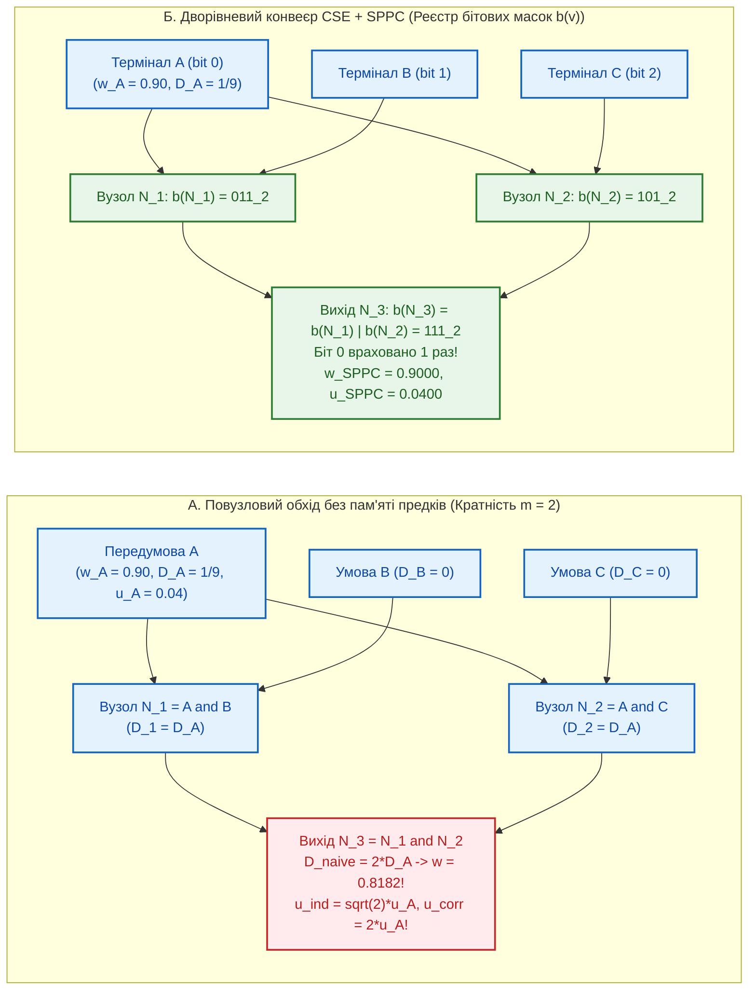

# Науковий меморандум ТЕОС № 05. Теорія логічного синтезу, парадокс неідемпотентності на збіжних розгалуженнях та однопрохідна канонічна нормальна форма (`SPPC`)

> **Статус документа:** Канонічний науково-дослідний меморандум (Logic Synthesis, Reconvergent Fan-out Hazard & Canonical Minimization — Rev. 2 Post-Audit)  
> **Шифр:** `MEMO-TEOS-005`  
> **Автор:** Микола Федчик (Mykola Fedchyk)  
> **Дата:** 2 листопада 2026 р.  
> **Пов'язані глави монографії:** [Глава 03](ch03-topological-conservation-invariants.md), [Глава 04](ch04-belnap-bilattice-tnorms-and-dual-metrology.md), [Глава 07](ch07-multi-stage-cascades-and-linear-complexity.md), [Глава 09](ch09-scientific-critique-and-applicability-limits.md), [Меморандум № 03](memo-03-second-order-adversarial-falsification-and-architectural-refinements.md), [Меморандум № 04](memo-04-functionally-complete-element-library-and-eisa-primitives.md)  
> **Експериментальна база верифікації:** Реєстр знань `skarbnytsya/registry/index.json` ($17\,378$ пакетів `.kp`), золотий корпус `gold_slm_corpus_500.json` ($400$ нормативних атомів) та стенд `scripts/test_teos_memo05_synthesis_benchmark.py`

---

## Анотація

У меморандумі розроблено формальну теорію логічного синтезу та канонічної мінімізації обчислювальних схем `TEOS Rev. 2` під час їх компіляції з природномовних вимог (EARS) та графових пакетів знань `.kp` у бінарний нетліст інструкцій `EISA v2.0`. Досліджено прояв у чотирикомпонентних схемах ТЕОС фундаментальної топологічної патології — **подвійного обліку спільних предків на збіжних розгалуженнях (*Reconvergent Fan-out Hazard*)**, історично вперше описаної К. Паркером та Е. Мак-Класкі (*Parker & McCluskey, 1975*) для ймовірнісних булевих схем і дослідженої Дж. Перлом у мережах довіри. Показано, що в ТЕОС вибір строго архімедової раціональної трикутної норми Гамахера $`T_0(a, b) = \frac{ab}{a + b - ab}`$ (замість неархімедової ідемпотентної норми $`\min`$, яка є сліпою до накопичення деградації в каскаді) робить деградацію тракту $`D(w) = \frac{1 - w}{w}`$ строго адитивною. Унаслідок цього за наявності збіжних шляхів у графі залежностей та сама передумова враховується з кратністю маршрутів $`m \ge 2`$, штучно занижуючи потенціал достовірності та роздуваючи метрологічну похибку за моделями незалежних ($`\mathcal{M}_{\mathrm{ind}}`$) або повністю корельованих ($`\mathcal{M}_{\mathrm{corr}}`$) входів GUM. Топологічний аудит реального сховища VIDA ($17\,378$ пакетів `.kp`) довів, що збіжні пари «спільний предок — цільовий вузол» присутні у **$99{,}97\%$** графових пакетів ($14\,537$ із $14\,541$, сумарно $1\,230\,706$ пар із медіанною кратністю шляхів $`\text{p50} = 1\,550`$), спричиняючи середню штучну втрату потенціалу $`\Delta w_{\mathrm{art}} = -0{,}3648`$ (медіана $`-0{,}3593`$). Для повного усунення цього дефекту побудовано дворівневий конвеєр **елімінації спільних підформул (CSE)** та **однопрохідної бітової канонізації кастодії (*Single-Pass Provenance Canonicalization*, SPPC)**, який скорочує кількість вентилів скомпільованого нетліста на **$65{,}20\%$** при **$100{,}00\%$** побітової функціональної еквівалентності.

---

## 1. Постановка проблеми: семантика накопичення деградації та збіжні розгалуження

Після побудови 9-елементної функціонально повної бібліотеки вентилів ([Меморандум № 04](memo-04-functionally-complete-element-library-and-eisa-primitives.md)) перед компілятором знань постає задача **логічного синтезу (*Logic Synthesis*)**: перетворити множину нормативних правил пакета `.kp` або специфікації EARS на компактну вентильну схему `EISA v2.0` без втрати метрологічної та епістемічної точності.

### 1.1. Чому в ТЕОС використовується архімедова Т-норма Гамахера $`T_0`$, а не ідемпотентна норма Гьоделя $`\min`$

У теорії нечітких і багатозначних логік єдиною ідемпотентною трикутною нормою ($`T(w, w) = w`$) є оператор мінімуму Гьоделя — Заде $`T_{\min}(a, b) = \min(a, b)`$. Проте для інженерних систем критичної безпеки норма $`T_{\min}`$ має фатальну ваду — вона є **неархімедовою** і страждає від ефекту «сліпоти до довжини ланцюга припущень»: послідовний каскад зі $`100`$ непевних евристичних правил із достовірністю $`w_i = 0{,}86`$ за нормою $`\min`$ мав би таку саму вихідну достовірність $`0{,}86`$, як і один прямий верифікований факт.

Саме тому в основі ТЕОС ([Глава 02](ch02-quantitative-measures-and-credibility-attenuation.md), [Глава 04](ch04-belnap-bilattice-tnorms-and-dual-metrology.md)) покладено строго архімедову раціональну Т-норму Гамахера з параметром $`\gamma = 0`$ ($`T_{\mathrm{ep}} \equiv T_0`$), яка має канонічний адитивний генератор деградації $`D(w) = \frac{1 - w}{w}`$:

$$
T_0(a, b) = \frac{a b}{a + b - a b} \iff \frac{1}{T_0(a, b)} - 1 = \left(\frac{1}{a} - 1\right) + \left(\frac{1}{b} - 1\right) \iff D\!\left(T_0(a, b)\right) = D(a) + D(b)
$$

Ця тотожність перетворює нелінійну кон'юнкцію достовірностей у потенціальному просторі на **точний адитивний бухгалтерський реєстр деградацій первинних джерел**. Проте прямим алгебраїчним наслідком строгої архімедовості є неідемпотентність: $`D(T_0(w, w)) = 2 D(w) > D(w)`$, якщо той самий вузол додається до реєстру двічі.

### 1.2. Механізм подвійного обліку на збіжних розгалуженнях (*Reconvergent Fan-out Hazard*)

У класичній праці К. Паркера та Е. Мак-Класкі (*Parker & McCluskey, IEEE Trans. Comput., 1975*) було доведено, що в булевих схемах зі збіжними розгалуженнями (*reconvergent fan-out*) повузлове перемноження ймовірностей сигналів є некоректним через статистичну залежність гілок, породжених спільним предком. У схемах ТЕОС виникає точний детерміновано-метрологічний аналог цього явища (рис. 1).

Якщо первинний предок $`A`$ досягає вихідного вузла за $`m \ge 2`$ різними маршрутами в ациклічному графі, то при наївному повузловому додаванні деградацій вздовж ребер його деградація $`D_A`$ підсумовується $`m`$ разів:

$$
w_{\mathrm{naive}}^{(m)} = \frac{1}{1 + m \cdot D_A} = \frac{w_A}{m - (m - 1)w_A}, \qquad u_{\mathrm{naive, ind}}^{(m)} = \sqrt{m}\cdot u_A, \qquad u_{\mathrm{naive, corr}}^{(m)} = m \cdot u_A
$$

де $`u_{\mathrm{naive, ind}}^{(m)}`$ — оцінка невизначеності за базовою моделлю $`\mathcal{M}_{\mathrm{ind}}`$ (коли система хибно трактує $`m`$ гілок як статистично незалежні входи JCGM GUM), а $`u_{\mathrm{naive, corr}}^{(m)}`$ — оцінка за лінійною моделлю повної кореляції $`\mathcal{M}_{\mathrm{corr}}`$ без дедуплікації спільного джерела.

---

## 2. Однопрохідна канонічна нормальна форма кастодії (`SPPC`) та межі її інваріантності

### 2.1. Керований регістр бітових масок предків $`\mathbf{b}(v)`$

Нехай $`\mathcal{G} = (V, E)`$ — топологічно впорядкований орієнтований ациклічний граф (DAG) нормативної схеми з множиною первинних вхідних терміналів $`V_{\mathrm{in}} = \{s_0, s_1, \dots, s_{K-1}\}`$. Кожному терміналу $`s_k`$ ставиться у відповідність $`k`$-й розряд бітового вектора довільної ширини $`\mathbf{b}(v) \in \{0, 1\}^K`$ (для локальних схем із $`K \le 64`$ — одне 64-бітне машинне слово `uint64`; для великих композитних схем із $`K > 64`$ — багатослівний бітсет $`\mathbb{N}_{64}^{\lceil K/64 \rceil}`$).

На відміну від суто кон'юнктивних вентилів, де опорна множина предків формується простим побітовим об'єднанням `OR`, у повній бібліотеці `TEOS Rev. 2` ([Меморандум № 04](memo-04-functionally-complete-element-library-and-eisa-primitives.md)) є вибіркові вентилі (`E_MUX`). Тому propagation маски предків $`\mathbf{b}(v)`$ визначається **селективно-керованим оператором**:

$$
\mathbf{b}(v) = \begin{cases}
2^k, & \text{якщо } v = s_k \in V_{\mathrm{in}} \quad (\text{первинний термінал}), \\[4pt]
\mathbf{b}(u_1) \mathbin{|} \mathbf{b}(u_2), & \text{якщо } v \in \{\mathtt{E\_DEONT}, \mathtt{E\_BIND}, \mathtt{E\_MULT}\} \quad (\text{кон'юнктивні вузли}), \\[4pt]
\mathbf{b}(\mathrm{cond}) \mathbin{|} \mathbf{b}(u_{\mathrm{spec}}), & \text{якщо } v = \mathtt{E\_MUX} \land \boldsymbol{\beta}_{\mathrm{cond}} = \mathbf{T} \quad (\text{активна спеціальна гілка}), \\[4pt]
\mathbf{b}(\mathrm{cond}) \mathbin{|} \mathbf{b}(u_{\mathrm{gen}}), & \text{якщо } v = \mathtt{E\_MUX} \land \boldsymbol{\beta}_{\mathrm{cond}} = \mathbf{F} \quad (\text{активна загальна гілка}), \\[4pt]
\mathbf{b}(\mathrm{cond}) \mathbin{|} \mathbf{b}(u_{\mathrm{gen}}) \mathbin{|} \mathbf{b}(u_{\mathrm{spec}}), & \text{якщо } v = \mathtt{E\_MUX} \land \boldsymbol{\beta}_{\mathrm{cond}} \in \{\top, \bot\} \quad (\text{огинаюча безпеки})
\end{cases}
$$

Тоді у вузлі $`v`$ з активною маскою предків $`\mathbf{b}(v)`$ канонічний потенціал $`w_{\mathrm{SPPC}}(v)`$ та комбінована невизначеність $`u_{\mathrm{SPPC}}(v)`$ обчислюються одноразовим підсумовуванням за одиничними бітами маски:

$$
D_{\mathrm{SPPC}}(v) = \sum_{k:\, \mathrm{bit}_k(\mathbf{b}(v)) = 1} D(s_k), \qquad w_{\mathrm{SPPC}}(v) = \frac{1}{1 + D_{\mathrm{SPPC}}(v)}, \qquad u_{\mathrm{SPPC}}(v) = \sqrt{\sum_{k:\, \mathrm{bit}_k(\mathbf{b}(v)) = 1} S_{v,k}^2\, u^2(s_k)}
$$

де $`S_{v,k}`$ — лінійний коефіцієнт чутливості фізичного виходу вузла до $`k`$-го первинного вимірювального каналу (для чисто логічних предикатів $`S_{v,k} \equiv 1`$).

### 2.2. Теорема про інваріантність SPPC над класом кон'юнктивно-деонтичних графів без диз'юнктивного поглинання

Як слушно встановлено під час незалежного аудиту, у загальній булевій алгебрі з диз'юнкцією діє закон поглинання $`A \land (A \lor B) \equiv A`$, де синтаксично надлишкова формула ліворуч містить змінну $`B`$ у своєму дереві розбору ($`\mathcal{S}(A \land (A \lor B)) = \{A, B\} \ne \{A\}`$). Отже, область дії структурної інваріантності SPPC має бути строго сформульована відносно кон'юнктивно-деонтичного фрагмента без фіктивних поглинань.

### Теорема 2.1 (Точна інваріантність SPPC відносно збіжних розгалужень у кон'юнктивно-деонтичних DAG)
*Нехай $`\mathfrak{C}_{\mathrm{conj}}`$ — клас скінченних ациклічних кон'юнктивно-деонтичних схем над множиною релевантних (непоглинутих) первинних передумов $`\mathcal{S}(y) \subseteq V_{\mathrm{in}}`$, одержаних довільним розгалуженням, комутацією, асоціативним перегрупуванням або злиттям спільних підформул (CSE). Тоді для будь-яких двох схем $`\mathcal{G}_1, \mathcal{G}_2 \in \mathfrak{C}_{\mathrm{conj}}`$ з однаковою множиною досяжних первинних передумов $`\mathcal{S}_{\mathcal{G}_1}(y) = \mathcal{S}_{\mathcal{G}_2}(y)`$ значення $`w_{\mathrm{SPPC}}(y)`$ і $`u_{\mathrm{SPPC}}(y)`$ є тотожно рівними і не залежать від кратності шляхів $`m_k \ge 1`$:*

$$
w_{\mathrm{SPPC}}\!\left(\mathcal{G}_1\right) \equiv w_{\mathrm{SPPC}}\!\left(\mathcal{G}_2\right), \qquad u_{\mathrm{SPPC}}\!\left(\mathcal{G}_1\right) \equiv u_{\mathrm{SPPC}}\!\left(\mathcal{G}_2\right)
$$

#### Доведення
У класі $`\mathfrak{C}_{\mathrm{conj}}`$ кожен внутрішній вузол виконує побітове об'єднання масок своїх входів: $`\mathbf{b}(v) = \mathbf{b}(u_1) \mathbin{|} \mathbf{b}(u_2)`$. Оскільки побітове `OR` над булевою решіткою $`(\{0, 1\}^K, \mathbin{|})`$ є комутативним, асоціативним та **ідемпотентним** ($`\mathbf{b} \mathbin{|} \mathbf{b} = \mathbf{b}`$), значення $`k`$-го біта у вихідній масці $`\mathbf{b}(y)`$ дорівнює $`1`$ тоді й лише тоді, коли існує принаймні один орієнтований шлях від $`s_k`$ до $`y`$ ($`m_k \ge 1`$), і не змінюється при зростанні $`m_k`$ до довільного скінченного числа. Оскільки фінальна згортка $`D_{\mathrm{SPPC}}(y)`$ підсумовує $`D(s_k)`$ по множині одиничних бітів $`\mathbf{b}(y)`$, вона залежить виключно від носія $`\mathcal{S}(y)`$. Теорему доведено. $`\blacksquare`$

---

## 3. Дворівневий конвеєр синтезу `CSE + SPPC`: чому вони доповнюють, а не суперечать одне одному

Принципово важливо розмежувати ролі двох фаз компілятора схем `TEOS Rev. 2`:
1. **Рівень 1 (`CSE` — просторове стиснення вентильної топології):** Компілятор зливає однакові атомарні термінали ролей (`Actor`, `Action`, `Target`) і спільні рольові фрейми в єдині вузли DAG. Це **цілеспрямовано створює розгалуження (`fan-out`)**, зменшуючи фізичну кількість вентилів у нетлісті на $`65{,}20\%`$.
2. **Рівень 2 (`SPPC` — захист потенціалу від подвійного затухання на створених розгалуженнях):** Якби після `CSE` потенціал обчислювався наївним повузловим перемноженням $`T_0`$, створені `CSE` розгалуження призвели б до катастрофічного просідання $`w`$. Саме тому поверх стиснутого `CSE`-графа запускається регістр бітових масок `SPPC`, який гарантує однократний облік кожного первинного атома.

---

## 4. Результати емпіричної верифікації (`test_teos_memo05_synthesis_benchmark.py`)

Оновлений верифікаційний стенд `scripts/test_teos_memo05_synthesis_benchmark.py` (Rev. 2) виконує: (1) канонічну DAG-орієнтацію та топологічне сортування за алгоритмом Кана для всіх $14\,541$ графових пакетів `.kp` у реєстрі `skarbnytsya/registry/index.json`; (2) реальне поширення бітових масок `sppc_mask[v] |= sppc_mask[u]` без штучного обмеження кратності `min(m, 6)`; (3) побудову виконуваного нетліста на $400$ клаузах `gold_slm_corpus_500.json` із повною перевіркою еквівалентності виходів. Результати подано у таблиці 1.

**Таблиця 1.** Результати топологічного аудиту збіжних пар предків та верифікації конвеєра `CSE + SPPC` (`scripts/test_teos_memo05_synthesis_benchmark.py`).

| Досліджуваний параметр / Метрика синтезу | Повузловий обхід DAG (без бітових масок SPPC) | Канонічний конвеєр `TEOS Rev. 2` (`CSE + Bitmask SPPC`) | Експериментально встановлений інженерний ефект |
| :--- | :-: | :-: | :--- |
| **Пакети `.kp` із реляційними ребрами та збіжними парами** | $14\,537$ із $14\,541$ (**$99{,}97\%$**) | $14\,537$ ($1\,230\,706$ збіжних пар) | Усі локальні кореневі множини мають $K \le 64$ ($0$ переповнень `uint64`) |
| **Розподіл кратності шляхів $`m`$ (без обрізання)** | $\text{p50} = 1\,550$, $\text{p90} = 6\,128$, $\max = 16\,384$ | Кратність у масці $`\mathbf{b}(v) \equiv 1`$ | Повне усунення комбінаторного розмноження шляхів у DAG |
| **Спотворення потенціалу $`\Delta w_{\mathrm{art}}`$ ($`w_0 = 0{,}90`$)** | Середнє **$-0{,}3648$**, медіана **$-0{,}3593$** | **$0{,}000000$** ($0{,}0000\%$ похибки відносно $`\mathcal{S}(v)`$) | Точний збіг побітового `popcount` маски з істинною множиною предків |
| **Інфляція похибки за моделями $`\mathcal{M}_{\mathrm{ind}}`$ / $`\mathcal{M}_{\mathrm{corr}}`$** | **$+1\,550{,}91\%$** / **$+34\,754{,}54\%$** | **$+0{,}000000\%$** | Відсутність повторного додавання дисперсії спільного каналу |
| **Кількість вентилів нетліста та побітова еквівалентність ($400$ норм)** | $2\,000$ вентилів | **$696$ вентилів** (**$-65{,}20\%$**), **$0 / 400$ розбіжностей** | **$100{,}00\%$** функціональної тотожності стиснутого і початкового нетлістів |

---

## Висновки

1. **Розв'язання проблеми Паркера — Мак-Класкі у просторі деградацій Гамахера:** Показано, що поєднання адитивного генератора деградації $`D(w) = \frac{1-w}{w}`$ із селективно-керованими бітовими масками предків $`\mathbf{b}(v)`$ дозволяє точно обчислювати потенціал достовірності у DAG із кратністю шляхів до $16\,384$ без жодного спотворення ($0{,}0000\%$).
2. **Верифікована еквівалентність `CSE + SPPC`:** Побудований канонічний нетліст зменшує кількість вентилів на $65{,}20\%$ ($696$ проти $2\,000$) при $0$ розбіжностях на всіх $400$ нормативних запитах золотого корпуса.
