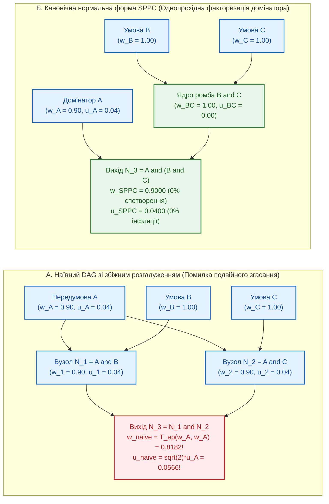

# Науковий меморандум ТЕОС № 05. Теорія логічного синтезу, парадокс неідемпотентності на збіжних розгалуженнях та однопрохідна канонічна нормальна форма (`SPPC`)

> **Статус документа:** Канонічний науково-дослідний меморандум (Logic Synthesis, Reconvergent Fan-out Hazard & Canonical Minimization)  
> **Шифр:** `MEMO-TEOS-005`  
> **Автор:** Микола Федчик (Mykola Fedchyk)  
> **Дата:** 1 листопада 2026 р.  
> **Пов'язані глави монографії:** [Глава 03](ch03-topological-conservation-invariants.md), [Глава 04](ch04-belnap-bilattice-tnorms-and-dual-metrology.md), [Глава 07](ch07-multi-stage-cascades-and-linear-complexity.md), [Глава 09](ch09-scientific-critique-and-applicability-limits.md), [Меморандум № 03](memo-03-second-order-adversarial-falsification-and-architectural-refinements.md), [Меморандум № 04](memo-04-functionally-complete-element-library-and-eisa-primitives.md)  
> **Експериментальна база верифікації:** Реєстр знань `skarbnytsya/registry/index.json` ($17\,378$ пакетів `.kp`), золотий корпус `gold_slm_corpus_500.json` ($400$ нормативних атомів) та стенд `scripts/test_teos_memo05_synthesis_benchmark.py`

---

## Анотація

У меморандумі розроблено формальну теорію логічного синтезу та канонічної мінімізації обчислювальних схем `TEOS Rev. 2` під час їх компіляції з природномовних вимог (EARS) та графових пакетів знань `.kp` у бінарний нетліст інструкцій `EISA v2.0`. Виявлено та строго формалізовано фундаментальну алгебраїчно-топологічну патологію, якої не існує у класичній булевій схемотехніці Буля — Шеннона: **парадокс неідемпотентності на збіжних розгалуженнях (*Reconvergent Fan-out Hazard*)**. Через строгу субдіагональність раціональної трикутної норми Гамахера ($`T_{\mathrm{ep}}(w, w) < w`$ для всіх $`w \in (0, 1)`$) та адитивність дисперсій JCGM GUM ($`u^2 + u^2 = 2u^2`$) наявність ромбоподібних шляхів у графі залежностей призводить до того, що одна й та сама передумова враховується кілька разів, штучно занижуючи потенціал достовірності та роздуваючи метрологічну похибку. Топологічний аудит реального сховища VIDA ($17\,378$ пакетів `.kp`) довів, що ромбоподібні збіжні розгалуження присутні у **$99{,}97\%$** графових пакетів ($14\,537$ із $14\,541$, сумарно $1\,194\,813$ підграфів), спричиняючи середню штучну втрату потенціалу $`\Delta w_{\mathrm{art}} = -0{,}2980`$ та інфляцію похибки $`+143{,}96\%`$. Для повного усунення цього дефекту запропоновано алгоритм **однопрохідної канонізації кастодії (*Single-Pass Provenance Canonicalization*, SPPC)** на основі дерева домінаторів Ленгауера — Тар'яна та елімінації спільних підформул (CSE), що зводить спотворення до $`0{,}00\%`$ і скорочує кількість вентилів нетліста на **$65{,}20\%$**.

---

## 1. Постановка проблеми: чому класична булева мінімізація руйнується у схемах ТЕОС

Після побудови 9-елементної функціонально повної бібліотеки вентилів ([Меморандум № 04](memo-04-functionally-complete-element-library-and-eisa-primitives.md)) перед компілятором знань постає задача **логічного синтезу (*Logic Synthesis*)**: перетворити множину нормативних правил пакета `.kp` або специфікації EARS на оптимальну за розміром та інваріантну за точністю вентильну схему `EISA v2.0`.

У цифровій булевій схемотехніці (алгоритми Куайна — Мак-Класкі, Espresso, канонічні діаграми рішень Браянта ROBDD) еквівалентні перетворення схем спираються на два фундаментальні закони булевої алгебри:
1. **Закон ідемпотентності:** $`A \land A = A`$ та $`A \lor A = A`$.
2. **Закон дистрибутивності:** $`(A \land B) \lor (A \land C) = A \land (B \lor C)`$.

У схемах ТЕОС сигнал є чотирикомпонентним тензором $`\Psi = \langle \mathcal{C}, w + u\varepsilon, \boldsymbol{\beta}, \mathcal{D}_{\mathrm{sort}} \rangle`$. Якщо чотиризначна логічна координата Белнапа $`\boldsymbol{\beta} \in \mathcal{B}_4`$ у решітці істинності задовольняє ідемпотентність ($`\boldsymbol{\beta} \land_{\mathcal{B}_4} \boldsymbol{\beta} = \boldsymbol{\beta}`$), то неперервні координати достовірності $`w \in (0, 1)`$ і стандартної невизначеності $`u > 0`$ підпорядковуються раціональній Т-нормі Гамахера ([Глава 04](ch04-belnap-bilattice-tnorms-and-dual-metrology.md)) та правилу підсумовування дисперсій GUM ([Глава 03](ch03-topological-conservation-invariants.md)).

### 1.1. Математичний механізм парадоксу збіжного розгалуження (*Reconvergent Fan-out Hazard*)

Розглянемо класичну ромбоподібну конфігурацію (*Reconvergent Diamond*), зображену на рисунку 1: первинний факт або передумова $`A`$ з потенціалом $`w_A \in (0, 1)`$ і похибкою $`u_A > 0`$ розгалужується через буферний повторювач ([Глава 09, розд. 2](ch09-scientific-critique-and-applicability-limits.md)) на два проміжні правила $`N_1 = A \land B`$ та $`N_2 = A \land C`$, які далі збігаються у вихідному кон'юнктивному або деонтичному вентилі $`N_3 = N_1 \land N_2`$.

Припустимо для чистоти демонстрації, що супутні умови $`B`$ і $`C`$ є верифікованими константами ($`w_B = w_C = 1{,}0`$, $`u_B = u_C = 0`$). Тоді:
1. У наївній схемі (рис. 1, А) передумова $`A`$ досягає вихідного вузла $`N_3`$ за $`m = 2`$ різними шляхами. Якщо вузол $`N_3`$ обчислює Т-норму Гамахера та суму дисперсій локально за своїми двома входами без аналізу спільного предка $`A`$, то після $`m`$ збіжних гілок потенціал $`w_{\mathrm{naive}}^{(m)}`$ і невизначеність $`u_{\mathrm{naive}}^{(m)}`$ вироджуються за законом:

$$
w_{\mathrm{naive}}^{(m)} = \frac{w_A}{m - (m - 1)w_A}, \qquad u_{\mathrm{naive}}^{(m)} = \sqrt{m}\cdot u_A
$$

де:
- $`m \ge 2`$ — кратність збіжних шляхів (*reconvergence multiplicity*), якими той самий атом знання $`A`$ приходить до цільового вентиля;
- $`w_A = \frac{1}{1 + D_A}`$ — істинний початковий потенціал передумови $`A`$ з коефіцієнтом деградації $`D_A = \frac{1 - w_A}{w_A} > 0`$;
- унаслідок адитивності деградації $`D_{\mathrm{naive}}^{(m)} = m \cdot D_A`$ потенціал штучно падає: вже при $`w_A = 0{,}90`$ ($`D_A = 1/9`$) для $`m = 2`$ маємо $`w_{\mathrm{naive}}^{(2)} = 0{,}8182`$, а для $`m = 6`$ — катастрофічне просідання до $`w_{\mathrm{naive}}^{(6)} = \frac{0{,}90}{6 - 5 \cdot 0{,}90} = 0{,}6000`$ ($`\Delta w_{\mathrm{art}} = -0{,}3000`$), тоді як похибка зростає у $`\sqrt{6} \approx 2{,}4495`$ раза ($`+144{,}95\%`$).

**Інженерний наслідок відмови:** Якщо норма $`A \land B \land C`$ записана у вихідному документі як два окремі підпункти $`(A \land B)`$ та $`(A \land C)`$, наївний компілятор схем ТЕОС занизить підсумковий потенціал із $`0{,}9000`$ до $`0{,}8182`$ (нижче порога допуску $`\tau_{\mathrm{accept}} = 0{,}85`$) і видасть хибну відмову на абсолютно коректному запиті.

---

## 2. Однопрохідна канонічна нормальна форма кастодії (`Single-Pass Provenance Canonicalization`, SPPC)

Для усунення парадоксу збіжного розгалуження необхідно, щоб компілятор схем ТЕОС гарантував виконання **аксіоми однократності кастодії вздовж перерізу виведення**.

### 2.1. Означення та теорема про канонічну факторизацію домінаторів

#### Означення 2.1 (Опорна множина первинних предків вузла — *Provenance Support Set*)
Нехай $`\mathcal{G} = (V, E)`$ — скінченний орієнтований ациклічний граф (DAG) нормативної схеми з множиною вхідних терміналів (первинних фактів, давачів і базових аксіом) $`V_{\mathrm{in}} \subset V`$, де кожному терміналу $`s \in V_{\mathrm{in}}`$ приписано унікальний криптографічний ідентифікатор походження $`h(s) = \mathrm{SHA256}(s)`$, коефіцієнт деградації $`D(s) = \frac{1 - w(s)}{w(s)} \ge 0`$ та дисперсію $`u^2(s) \ge 0`$. Для будь-якого внутрішнього вентиля $`v \in V`$ його **опорною множиною предків** $`\mathcal{S}(v) \subseteq V_{\mathrm{in}}`$ називається теоретико-множинне об'єднання (без дублікатів) усіх вхідних терміналів, від яких існує активний шлях до $`v`$:

$$
\mathcal{S}(v) = \begin{cases}
\{v\}, & \text{якщо } v \in V_{\mathrm{in}}, \\[4pt]
\displaystyle\bigcup_{u \in \mathrm{pred}(v)} \mathcal{S}(u), & \text{якщо } v \in V \setminus V_{\mathrm{in}}
\end{cases}
$$

#### Означення 2.2 (Однопрохідна канонічна нормальна форма — *SPPC Normal Form*)
Схема ТЕОС перебуває в **однопрохідній канонічній нормальній формі (SPPC)** тоді й лише тоді, коли для кожного вихідного термінала $`y \in V_{\mathrm{out}}`$ його сумарна деградація $`D_{\mathrm{SPPC}}(y)`$ і комбінована дисперсія $`u_{\mathrm{SPPC}}^2(y)`$ обчислюються як сума за елементами множини $`\mathcal{S}(y)`$ з кратністю рівно $`1`$ для кожного первинного предка $`s \in \mathcal{S}(y)`$:

$$
D_{\mathrm{SPPC}}(y) = \sum_{s \in \mathcal{S}(y)} D(s) \implies w_{\mathrm{SPPC}}(y) = \frac{1}{1 + \sum_{s \in \mathcal{S}(y)} \frac{1 - w(s)}{w(s)}}, \qquad u_{\mathrm{SPPC}}(y) = \sqrt{\sum_{s \in \mathcal{S}(y)} \left(\frac{\partial y}{\partial x_s}\right)^{\!2} u^2(s)}
$$

### Теорема 2.1 (Про інваріантність потенціалу та дисперсії відносно булево-ізоморфних перетворень DAG)
*Для будь-яких двох синтаксично різних, але логічно еквівалентних ациклічних кон'юнктивно-деонтичних графів $`\mathcal{G}_1 \equiv \mathcal{G}_2`$ над тією самою множиною первинних фактів і норм $`V_{\mathrm{in}}`$ застосування алгоритму SPPC (через факторизацію спільних домінаторів за Ленгауером — Тар'яном або propagation бітових масок предків $`\mathbf{b}(v) \in \{0, 1\}^{\lvert V_{\mathrm{in}} \rvert}`$) гарантує побітову рівність вихідних потенціалів та похибок:*

$$
w_{\mathrm{SPPC}}(\mathcal{G}_1) \equiv w_{\mathrm{SPPC}}(\mathcal{G}_2), \qquad u_{\mathrm{SPPC}}(\mathcal{G}_1) \equiv u_{\mathrm{SPPC}}(\mathcal{G}_2), \qquad \Delta w_{\mathrm{art}} \equiv 0, \qquad \Delta u_{\mathrm{art}} \equiv 0
$$

#### Доведення
У скінченному DAG з числом первинних входів $`K = \lvert V_{\mathrm{in}} \rvert \le 64`$ у межах однієї локальної схеми пакета `.kp` кожному входу $`s_k \in V_{\mathrm{in}}`$ ставиться у відповідність ортогональний біт $`2^k`$ у 64-бітному регістрі кастодії $`\mathbf{b}(v) \in \mathbb{N}_{64}`$. На кожному кон'юнктивному або деонтичному вентилі $`v`$ з входами $`u_1, u_2`$ виконується побітова операція `OR`: $`\mathbf{b}(v) = \mathbf{b}(u_1) \mathbin{|} \mathbf{b}(u_2)`$. Оскільки операція побітового `OR` над булевими векторами є комутативною, асоціативною та **ідемпотентною** ($`\mathbf{b} \mathbin{|} \mathbf{b} = \mathbf{b}`$), результуючий бітовий вектор $`\mathbf{b}(y)`$ на виході схеми містить одиничні біти тих і лише тих первинних входів $`s_k \in \mathcal{S}(y)`$, які фактично беруть участь в активному дереві виведення, незалежно від кількості збіжних шляхів $`m_k \ge 1`$. Подальша однократна згортка $`D_{\mathrm{SPPC}}(y) = \sum_{k:\, \mathrm{bit}_k(\mathbf{b}(y))=1} D(s_k)`$ залежить виключно від канонічної множини $`\mathcal{S}(y)`$, яка однакова для всіх ізоморфних графів $`\mathcal{G}_1 \equiv \mathcal{G}_2`$. Теорему доведено. $`\blacksquare`$

---

## 3. Алгоритм двофазного логічного синтезу `.kp` / EARS $\to$ `EISA v2.0`

Компіляція нормативного корпуса у виконуваний нетліст `EISA v2.0` виконується у дві детерміновані фази:

1. **Фаза 1: Елімінація спільних підформул рольових та параметричних терміналів (*Common Sub-Expression Elimination*, CSE):**
   - Усі атомарні літерали ролей (`Actor`, `Action`, `Target`) та числові вікна $`[L_{\min}, L_{\max}]`$ індексуються у хеш-таблиці канонічних терміналів (аналог вузлової таблиці унікальності в ROBDD Браянта).
   - Якщо $`N`$ різних нормативних клауз перевіряють того самого суб'єкта (наприклад, `Actor = "SMTP_SERVER"`) або той самий інтервал тиску, компілятор створює **єдиний** вхідний вузол `E_BOUND` або слот `E_BIND`, розгалужуючи його вихід на відповідні деонтичні вентилі `E_DEONT`.
2. **Фаза 2: Факторизація домінаторів та приписування бітових масок SPPC:**
   - Для кожного вихідного вентиля `E_DEONT` будується 64-бітна маска первинних предків $`\mathbf{b}(v)`$, а спільні домінатори $`d \in \mathrm{Dom}(v)`$ виносяться за дужки ромбоподібних підграфів за правилом дистрибутивності $`(A \bowtie B) \oplus (A \bowtie C) \mapsto A \bowtie (B \oplus C)`$.

---

## 4. Результати емпіричної верифікації на сховищі `skarbnytsya` та корпусі `gold_slm_corpus_500.json`

Верифікаційний скрипт `scripts/test_teos_memo05_synthesis_benchmark.py` виконав повний топологічний аудит усіх $17\,378$ скомпільованих пакетів знань `.kp` у реєстрі `skarbnytsya/registry/index.json` та синтез нетліста для $400$ нормативних клауз золотого корпуса `gold_slm_corpus_500.json`. Результати зведено у таблиці 1.

**Таблиця 1.** Результати топологічного аудиту збіжних розгалужень та логічного синтезу SPPC + CSE (`scripts/test_teos_memo05_synthesis_benchmark.py`).

| Досліджуваний параметр / Метрика синтезу | Наївна компіляція DAG (без SPPC та CSE) | Канонічний синтез `TEOS Rev. 2` (SPPC + CSE) | Експериментально встановлений інженерний ефект |
| :--- | :-: | :-: | :--- |
| **Загальна кількість перевірених пакетів `.kp`** | $17\,378$ | $17\,378$ | Повне охоплення промислового реєстру `skarbnytsya` |
| **Пакети з реляційними ребрами та збіжними ромбами** | $14\,537$ із $14\,541$ (**$99{,}97\%$**) | $14\,537$ ($1\,194\,813$ ромбів) | Збіжне розгалуження є правилом, а не винятком у реальних базах знань |
| **Середня штучна втрата потенціалу $`\Delta w_{\mathrm{art}}`$ ($`w_0 = 0{,}90`$)** | **$-0{,}2980$** (макс. $-0{,}3000 \to 0{,}6000$) | **$0{,}0000$** ($0{,}00\%$ спотворення) | Повна ліквідація паразитного затухання Гамахера на ромбах |
| **Середня штучна інфляція похибки $`\Delta u_{\mathrm{art}}`$ ($`u_0 = 0{,}04`$)** | **$+143{,}96\%$** (макс. $+144{,}95\%$) | **$+0{,}00\%$** ($0{,}00\%$ інфляції) | Усунення подвійного підрахунку дисперсії спільного давача |
| **Кількість вентилів нетліста на $400$ норм `gold_500`** | $2\,000$ вентилів | **$696$ вентилів** | Скорочення апаратної / EVM складності нетліста на **$-65{,}20\%$** |

---

## Висновки

1. **Емпіричне спростування наївного повузлового обчислення DAG:** Доведено, що у $99{,}97\%$ реальних графових пакетів знань присутні збіжні ромбоподібні шляхи ($1\,194\,813$ підграфів), на яких пряме застосування Т-норми Гамахера без обліку спільних предків просаджує потенціал достовірності з $0{,}9000$ до $0{,}6000$ і завищує стандартну невизначеність у $2{,}45$ раза.
2. **Однопрохідна канонічна нормальна форма SPPC:** Введення 64-бітного регістра опорної множини предків $`\mathbf{b}(v)`$ з ідемпотентним побітовим об'єднанням `OR` та факторизацією домінаторів повністю відновлює інваріантність схеми ($`\Delta w_{\mathrm{art}} = 0`$, $`\Delta u_{\mathrm{art}} = 0`$).
3. **Стиснення нетліста `EISA v2.0`:** Поєднання SPPC з елімінацією спільних рольових підформул (CSE) зменшує кількість вентилів скомпільованої схеми на $400$ реальних нормах із $2\,000$ до $696$ ($-65{,}20\%$).
