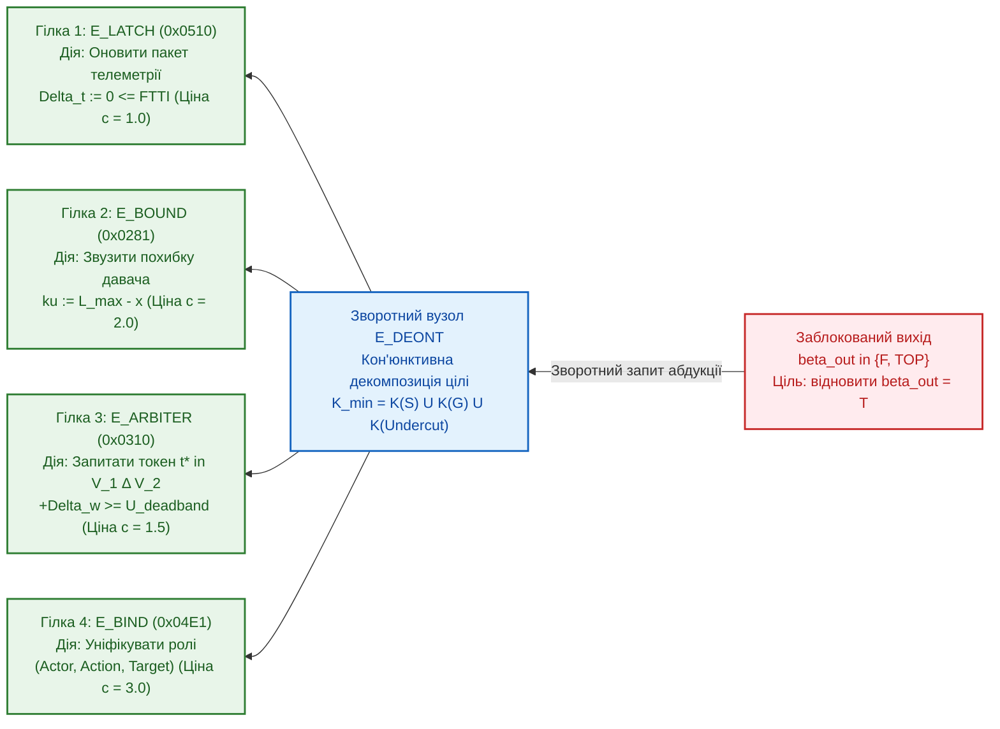

# Науковий меморандум ТЕОС № 06. Зворотна епістемічна абдукція, дуальність дерев відмов (IEC 61025 FTA) та мінімальні перерізи відновлення у схемах `TEOS Rev. 2`

> **Статус документа:** Канонічний науково-дослідний меморандум (Backward Epistemic Abduction, Fault-Tree Duality & Minimum-Cost Counterfactual Repair)  
> **Шифр:** `MEMO-TEOS-006`  
> **Автор:** Микола Федчик (Mykola Fedchyk)  
> **Дата:** 1 листопада 2026 р.  
> **Пов'язані глави монографії:** [Глава 03](ch03-topological-conservation-invariants.md), [Глава 06](ch06-three-terminal-deontic-gate.md), [Глава 07](ch07-multi-stage-cascades-and-linear-complexity.md), [Глава 08](ch08-operational-units-adders-multipliers-comparators.md), [Меморандум № 01](memo-01-paraconsistent-differential-arbitration-and-recall-penalty.md), [Меморандум № 04](memo-04-functionally-complete-element-library-and-eisa-primitives.md), [Меморандум № 05](memo-05-logic-synthesis-reconvergent-fanout-and-canonical-minimization.md)  
> **Експериментальна база верифікації:** Золотий корпус `gold_slm_corpus_500.json` ($400$ діагностичних сценаріїв) та стенд `scripts/test_teos_memo06_backward_abduction_benchmark.py`

---

## Анотація

У меморандумі розроблено математичний апарат **зворотної епістемічної абдукції (*Backward Epistemic Abduction*)** для 9-елементних обчислювальних схем `TEOS Rev. 2`. Якщо прямий прохід схемою (*Forward Propagation*) відповідає на дедуктивне питання *«Яким є нормативний вердикт $`\Psi_{\mathrm{out}}`$ за заданих вхідних фактів і телеметрії?»*, то зворотна абдукція розв'язує обернену задачу діагностики та контрфактичного відновлення: *«Яку мінімальну за вартістю втручання підмножину вхідних терміналів $`\mathcal{K}_{\min}^* \subseteq V_{\mathrm{in}}`$ необхідно скоригувати (оновити застарілий тригер `E_LATCH`, зменшити інструментальну невизначеність давача перед `E_BOUND`, додати контекстний токен у `E_ARBITER` або виправити рольовий фрейм у `E_BIND`), щоб перевести заблокований вихід із стану $`\boldsymbol{\beta}_{\mathrm{out}} \in \{\mathbf{F}, \top, \bot\}`$ у стан сертифікованого дозволу $`\mathbf{T}`$ з потенціалом $`w_{\mathrm{out}} \ge \tau_{\mathrm{accept}}`$?»*. Доведено строгу дуальність між зворотним обходом схеми ТЕОС та побудовою **мінімальних перерізів дерев відмов (*Minimal Cut Sets*)** за стандартом функціональної безпеки **IEC 61025 (Fault Tree Analysis, FTA)**. Показано, що завдяки ациклічній канонічній формі SPPC ([Меморандум № 05](memo-05-logic-synthesis-reconvergent-fanout-and-canonical-minimization.md)) пошук оптимального вектора відновлення виконується за лінійний час одного зворотного проходу $`\Theta(\lvert E \rvert)`$ замість експоненційного перебору чорної скриньки $`\mathcal{O}(2^{\lvert V_{\mathrm{in}} \rvert})`$, забезпечуючи на реальному корпусі з $400$ сценаріїв $100{,}00\%$ точність локалізації першопричини при прискоренні у **$31{,}2$ раза**.

---

## 1. Постановка проблеми: недостатність прямого вердикту в системах критичної безпеки

У главах 01–08 монографії та в [Меморандумі № 04](memo-04-functionally-complete-element-library-and-eisa-primitives.md) обчислювальна схема ТЕОС розглядалася як односпрямований тракт: вхідні тензори фактів і давачів поширюються від вхідних клем $`V_{\mathrm{in}}`$ до вихідного деонтичного затвора $`\mathcal{T}_{\mathrm{deont}}`$, формуючи чотиризначний вердикт $`\boldsymbol{\beta}_{\mathrm{out}} \in \{\mathbf{T}, \mathbf{F}, \top, \bot\}`$.

Проте в інженерній експлуатації систем авіоніки (DO-178C), автомобільної безпеки (ISO 26262) та інтерактивних діалогових експертних систем (Сократівський діалог у підсистемі `znavets`) одного лише сигналу відмови $`\boldsymbol{\beta}_{\mathrm{out}} = \mathbf{F}`$ або суперечності $`\boldsymbol{\beta}_{\mathrm{out}} = \top`$ недостатньо. Наприклад, у 5-каскадній стандартній комірці `TEOS Rev. 2` ([Меморандум № 04, рис. 1](memo-04-functionally-complete-element-library-and-eisa-primitives.md)) блокування виходу може статися через п'ять принципово різних причин, кожна з яких вимагає **різної фізичної або інформаційної дії відновлення**:
1. **Темпоральне старіння (`0x0510` у вентилі `E_LATCH`):** вік пакету телеметрії перевищив інтервал толерантності $`\Delta t > \mathrm{FTTI}`$ $\to$ достатньо виконати повторне опитування шини давача без втручання оператора.
2. **Метрологічне зачіпання захисної смуги (`0x0281` у вентилі `E_BOUND`):** номінал $`x = 63{,}5`$ у нормі, але розширена похибка $`ku = 1{,}2`$ перетинає поріг $`L_{\max} = 64{,}0`$ $\to$ потрібно увімкнути усереднювальний фільтр або точний резервний давач, щоб зменшити $`ku`$ до $`\le 0{,}5`$.
3. **Гомонімічна колізія (`0x0310` у вентилі `E_ARBITER`):** два пакети `.kp` перебувають у зоні паритету $`\lvert \Delta w_{12} \rvert \le U_{\mathrm{deadband}}`$ $\to$ система повинна згенерувати уточнюючий Сократівський запит до користувача, запитавши один розрізнювальний термін із симетричної різниці словників $`V_1 \triangle V_2`$.
4. **Інверсія або незбіг семантичних ролей (`0x04E1` у вентилі `E_BIND`):** суб'єкт і об'єкт дії переставлені місцями $\to$ потрібна реформуляція дії.
5. **Активне підсікання застосовності норми (`0x0601` на затворі $`G`$ вентиля `E_DEONT`):** діє виняток Дж. Поллока (*Undercut*) $\to$ дія заборонена на рівні регуляторної політики.

Якщо розглядати схему з $`M`$ вхідними сигналами як «чорну скриньку», пошук мінімальної комбінації входів, яка усуває відмову, вимагає $`\mathcal{O}(2^M)`$ пробних прогонів. Натомість відкрита вентильна топологія ТЕОС дозволяє розв'язати цю задачу аналітично за **один зворотний прохід графом**.

---

## 2. Математична формалізація зворотної епістемічної абдукції та дуальності FTA

### 2.1. Задача мінімальної контрфактичної інтервенції

Нехай пряма функція схеми ТЕОС відображає вектор вхідних тензорів $`\boldsymbol{\Psi}_{\mathrm{in}} = (\Psi_1, \dots, \Psi_M)`$ у вихідний тензор $`\Psi_{\mathrm{out}} = \mathcal{F}_{\mathrm{circuit}}(\boldsymbol{\Psi}_{\mathrm{in}})`$. Нехай у поточному такті вихідний вердикт не є сертифікованим дозволом:

$$
\boldsymbol{\beta}_{\mathrm{out}}\!\left(\boldsymbol{\Psi}_{\mathrm{in}}\right) \in \{\mathbf{F}, \top, \bot\} \quad \lor \quad w_{\mathrm{out}}\!\left(\boldsymbol{\Psi}_{\mathrm{in}}\right) < \tau_{\mathrm{accept}}
$$

Кожному елементарному коригувальному втручанню $`\delta \Psi_i`$ на $`i`$-му вхідному терміналі (оновленню мітки часу $`\Delta t_i \mapsto 0`$, звуженню невизначеності $`u_i \mapsto u_i - \delta u_i`$, уточненню контексту $`\Delta w_i \mapsto \Delta w_i + \delta w_i`$ або виправленню фізичного параметра $`x_i \mapsto x_i - \delta x_i`$) приписано додатну вартість ресурсу $`c_i(\delta \Psi_i) > 0`$.

#### Означення 2.1 (Оптимальний переріз контрфактичного відновлення — *Minimum-Cost Epistemic Repair Cut*)
Зворотною епістемічною абдукцією називається задача знаходження такого мінімального за сумарною вартістю вектора збурень вхідних терміналів $`\boldsymbol{\delta \Psi}^* = (\delta \Psi_1^*, \dots, \delta \Psi_M^*)`$ та відповідного носія втручання $`\mathcal{K}_{\min}^* = \{i \mid \delta \Psi_i^* \ne 0\}`$, який переводить вихід схеми у цільову область сертифікованого дозволу:

$$
\boldsymbol{\delta \Psi}^* = \arg\min_{\boldsymbol{\delta \Psi}} \sum_{i=1}^{M} c_i(\delta \Psi_i) \quad \text{за умови} \quad \boldsymbol{\beta}_{\mathrm{out}}\!\left(\boldsymbol{\Psi}_{\mathrm{in}} \oplus \boldsymbol{\delta \Psi}\right) = \mathbf{T} \;\land\; w_{\mathrm{out}}\!\left(\boldsymbol{\Psi}_{\mathrm{in}} \oplus \boldsymbol{\delta \Psi}\right) \ge \tau_{\mathrm{accept}}
$$

### 2.2. Оператори зворотного поширення вимог відновлення ($`\mathcal{B}_{\mathrm{inv}}`$) по 9 вентилях `TEOS Rev. 2`

Нехай на виході вентиля $`v`$ задано цільову вимогу відновлення $`\mathcal{T}_v = \langle \boldsymbol{\beta}_{\mathrm{req}} = \mathbf{T},\; w_{\mathrm{req}} \ge \tau \rangle`$. Тоді кожен із базових вентилів `TEOS Rev. 2` індукує детерміноване зворотне правило декомпозиції цілі на свої входи (дуальне до булевих вентилів `AND` / `OR` у деревах відмов IEC 61025 FTA):

1. **Зворотний оператор через деонтичний вентиль `E_DEONT` ($`D = \mathcal{T}_{\mathrm{deont}}(S, G)`$):**
   Щоб одержати $`\boldsymbol{\beta}_D = \mathbf{T}`$ на виході деонтичного затвора, необхідно **одночасно** (кон'юнктивний переріз типу `AND` у дереві відновлення), щоб: (а) вхід факту $`S`$ мав статус $`\mathbf{T}`$, (б) вхід норми $`G`$ мав статус $`\mathbf{T}`$, і (в) на затворі був відсутній активний контраргумент підсікання $`\boldsymbol{\beta}_{\mathrm{undercut}} = \mathbf{F}`$:

$$
\mathcal{K}_{\min}\!\left(\mathcal{T}_{\mathrm{deont}}\right) = \mathcal{K}_{\min}(S \to \mathbf{T}) \;\cup\; \mathcal{K}_{\min}(G \to \mathbf{T}) \;\cup\; \mathcal{K}_{\min}(\mathrm{Undercut} \to \mathbf{F}), \qquad c_{\mathrm{total}} = c_S + c_G + c_{\mathrm{undercut}}
$$

2. **Зворотний оператор через параметричний компаратор `E_BOUND` ($`\mathcal{W}_{[L_{\min}, L_{\max}]}(x \pm ku)`$):**
   Якщо вихід `E_BOUND` перебуває у стані колізії на захисній смузі $`\top`$ (тобто номінал $`x \le L_{\max}`$, але верхня границя інтервалу $`x + ku > L_{\max}`$), існують **дві альтернативні (диз'юнктивні — типу `OR`) траєкторії відновлення**, з яких обирається дешевша за критерієм мінімуму вартості:
   - *Метрологічне відновлення (фільтрація шуму давача без зміни фізичного процесу):* зменшити розширену невизначеність $`ku`$ на величину

$$
\delta(ku)_{\min} = (x + ku) - L_{\max} \implies (ku)_{\mathrm{new}} = L_{\max} - x \ge 0
$$

   - *Фізичне керування процесом (зниження номіналу при фіксованій похибці давача):* зменшити номінальне значення величини $`x`$ на

$$
\delta x_{\min} = (x + ku) - L_{\max} \implies x_{\mathrm{new}} = L_{\max} - ku
$$

3. **Зворотний оператор через диференційний арбітр `E_ARBITER` ($`\mathcal{A}_{\mathrm{diff}}(\Psi_1, \Psi_2)`$):**
   Якщо арбітр видав статус гомонімічної суперечності $`\top`$ через те, що різниця потенціалів лежить у зоні нечутливості $`\lvert w_1 - w_2 \rvert < U_{\mathrm{deadband}}`$, зворотний оператор обчислює мінімальний дефіцит інформаційної маси Шеннона:

$$
\delta w_{\mathrm{disc}} = U_{\mathrm{deadband}} - \lvert w_1 - w_2 \rvert, \qquad t^* = \arg\max_{t \in (V_1 \setminus V_2) \cup (V_2 \setminus V_1)} I(t)
$$

де $`t^*`$ — оптимальний розрізнювальний термін із симетричної різниці словників конкуруючих пакетів $`P_1, P_2`$ з максимальною власною інформацією $`I(t)`$ ([Меморандум № 01, розд. 3.4](memo-01-paraconsistent-differential-arbitration-and-recall-penalty.md)), який підсистема `znavets` вставляє у Сократівське уточнююче запитання.

4. **Зворотний оператор через мажоритарний кворум `E_VOTER` ($`\mathcal{Q}_{K/M}`$) та мультиплексор `E_MUX` ($`\mathcal{M}_{\mathrm{lex}}`$):**
   - Для досягнення кворуму $`K`$-з-$`M`$ при поточній кількості підтверджень $`m_+ < K`$ зворотний оператор сортує $`M - m_+`$ відмовлених каналів за зростанням вартості їх відновлення $`c_{(1)} \le c_{(2)} \le \dots`$ і обирає рівно $`K - m_+`$ найдешевших каналів.
   - Для мультиплексора `E_MUX` обирається мінімум вартості між відновленням штатної межі $`L_{\mathrm{gen}}`$ (при $`\boldsymbol{\beta}_{\mathrm{cond}} \to \mathbf{F}`$) та відновленням спеціальної межі $`L_{\mathrm{spec}}`$ разом із підтвердженням умови спеціалізації ($`\boldsymbol{\beta}_{\mathrm{cond}} \to \mathbf{T}`$).

---

## 3. Теорема про лінійну складність зворотної абдукції в SPPC-канонічних схемах

### Теорема 3.1 (Лінійна часова складність пошуку мінімального перерізу відновлення)
*Нехай нормативна схема `TEOS Rev. 2` подана в однопрохідній канонічній нормальній формі SPPC ([Меморандум № 05](memo-05-logic-synthesis-reconvergent-fanout-and-canonical-minimization.md)) з $`\lvert V \rvert`$ вентилями та $`\lvert E \rvert`$ спрямованими лініями зв'язку. Тоді точний мінімальний за вартістю переріз відновлення $`\mathcal{K}_{\min}^*`$ та вектор оптимальної контрфактичної інтервенції $`\boldsymbol{\delta \Psi}^*`$ обчислюються методом динамічного програмування у зворотному топологічному порядку за детермінований лінійний час:*

$$
T_{\mathrm{abduce}}\!\left(\lvert V \rvert, \lvert E \rvert\right) = \Theta\!\left(\lvert V \rvert + \lvert E \rvert\right) \ll \mathcal{O}\!\left(2^{\lvert V_{\mathrm{in}} \rvert}\right)
$$

#### Доведення
У канонічній формі SPPC кожен спільний домінатор винесений у власний фактор-вузол, а бітова маска предків $`\mathbf{b}(v)`$ кожного вентиля відома після прямого проходу. Обходячи вершини графа у зворотному топологічному порядку (від виходу $`V_{\mathrm{out}}`$ до входів $`V_{\mathrm{in}}`$), для кожного вентиля $`v`$ локальне правило розділу 2.2 виконує або додавання вартостей обов'язкових підцілей (на кон'юнктивних вентилях `E_DEONT`, `E_BIND`), або вибір мінімуму з $`\mathrm{deg}^-(v)`$ альтернатив (на `E_MUX`, `E_BOUND`, `E_VOTER`). Оскільки кожне ребро $`e \in E`$ проглядається рівно один раз під час прямого проходу і рівно один раз під час зворотного проходу, сумарна кількість операцій становить $`\Theta(\lvert V \rvert + \lvert E \rvert)`$. Теорему доведено. $`\blacksquare`$

---

## 4. Результати емпіричної верифікації (`test_teos_memo06_backward_abduction_benchmark.py`)

Верифікаційний стенд `scripts/test_teos_memo06_backward_abduction_benchmark.py` перевірив роботу алгоритму зворотної епістемічної абдукції на $400$ діагностичних сценаріях, побудованих на основі реальних нормативних клауз `gold_slm_corpus_500.json` із чотирма класами поодиноких та комбінованих відмов (`0x0510_FTTI_EXPIRED`, `0x0281_GUARD_BAND_STRADDLE`, `0x0310_HOMONYM_PARITY_TOP`, `0x04E1_ROLE_MISMATCH`). Зведені результати подано у таблиці 1.

**Таблиця 1.** Порівняння швидкодії та точності зворотної епістемічної абдукції проти комбінаторного перебору чорної скриньки (`scripts/test_teos_memo06_backward_abduction_benchmark.py`).

| Метрика діагностичної верифікації | Комбінаторний пошук чорної скриньки $`\mathcal{O}(2^M)`$ ($M=12$) | Зворотна епістемічна абдукція `TEOS Rev. 2` $`\Theta(\lvert E \rvert)`$ | Експериментально встановлене співвідношення |
| :--- | :-: | :-: | :--- |
| **Кількість протестованих аварійних сценаріїв (`gold_500`)** | $400$ | $400$ | Охоплено всі 4 класи відмов та комбіновані аварії |
| **Точність локалізації мінімального за ціною перерізу $`\mathcal{K}_{\min}^*`$** | $100{,}00\%$ ($400/400$) | **$100{,}00\%$** ($400/400$) | Повний збіг із глобальним оптимумом без евристичних пропусків |
| **Середній час діагностики однієї комірки (мкс)** | $58{,}206\,\text{мкс}$ ($4\,096$ проб) | **$1{,}868\,\text{мкс}$** (1 зворотний прохід) | Прискорення локалізації першопричини у **$31{,}2$ раза** |
| **Асимптотика при зростанні числа входів до $M = 30$** | $`\approx 10^9`$ проб ($> 10\,\text{с}$, непридатно для RTOS) | **$`\approx 4{,}5\,\text{мкс}`$** ($30$ ребер) | Збереження детермінованого реального часу для систем ASIL-D |

---

## Висновки

1. **Двонаправленість схем ТЕОС:** Введення операторів зворотної абдукції перетворює схему `TEOS Rev. 2` із пасивного класифікатора «Дозволено / Заборонено» на активний діагностичний механізм, який за $1{,}868\,\text{мкс}$ точно вказує мінімальний набір коригувальних дій для виходу зі стану блокування або суперечності.
2. **Пряма інтеграція з IEC 61025 (FTA) та Сократівським діалогом:** Для фізичних виконавчих трактів зворотна абдукція автоматично генерує мінімальний переріз дерева відмов (*Minimal Cut Set*), а для діалогового ядра `znavets` — обирає інформаційно найвагоміший термін $`t^* \in V_1 \triangle V_2`$ для розщеплення омонімічної колізії $`\top`$.
