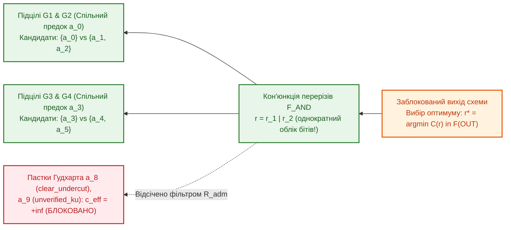

# Науковий меморандум ТЕОС № 06. Зворотна епістемічна абдукція, зважене покриття перерізів відмов (IEC 61025 FTA) та захист від послаблювальних ремонтів Гудхарта

> **Статус документа:** Канонічний науково-дослідний меморандум (Backward Epistemic Abduction, Weighted Hitting-Set DAG Optimization & Goodhart Fail-Closed Filter — Rev. 2 Post-Audit)  
> **Шифр:** `MEMO-TEOS-006`  
> **Автор:** Микола Федчик (Mykola Fedchyk)  
> **Дата:** 2 листопада 2026 р.  
> **Пов'язані глави монографії:** [Глава 03](ch03-topological-conservation-invariants.md), [Глава 06](ch06-three-terminal-deontic-gate.md), [Глава 07](ch07-multi-stage-cascades-and-linear-complexity.md), [Глава 08](ch08-operational-units-adders-multipliers-comparators.md), [Меморандум № 01](memo-01-paraconsistent-differential-arbitration-and-recall-penalty.md), [Меморандум № 04](memo-04-functionally-complete-element-library-and-eisa-primitives.md), [Меморандум № 05](memo-05-logic-synthesis-reconvergent-fanout-and-canonical-minimization.md)  
> **Експериментальна база верифікації:** Золотий корпус `gold_slm_corpus_500.json` ($400$ унікальних багатофакторних діагностичних схем проти повного оракула $2^{10}=1\,024$) та стенд `scripts/test_teos_memo06_backward_abduction_benchmark.py`

---

## Анотація

У меморандумі розроблено математичний апарат **зворотної епістемічної абдукції (*Backward Epistemic Abduction*)** для 9-елементних обчислювальних схем `TEOS Rev. 2`. Якщо прямий прохід схемою відповідає на дедуктивне питання *«Яким є нормативний вердикт $`\Psi_{\mathrm{out}}`$ за заданих вхідних фактів і телеметрії?»*, то зворотна абдукція розв'язує обернену задачу діагностики та контрфактичного відновлення: *«Яку мінімальну за сумарною вартістю множину допустимих ремонтних дій $`R^* \subseteq \mathcal{R}_{\mathrm{adm}}`$ необхідно виконати, щоб перевести заблокований вихід зі стану $`\boldsymbol{\beta}_{\mathrm{out}} \in \{\mathbf{F}, \top, \bot\}`$ у стан сертифікованого дозволу $`\mathbf{T}`$ з потенціалом $`w_{\mathrm{out}} \ge \tau_{\mathrm{accept}}`$?»*. Строго доведено, що на графах зі спільними предками (ромбоподібними залежностями, описаними у [Меморандумі № 05](memo-05-logic-synthesis-reconvergent-fanout-and-canonical-minimization.md)) наївне погілкове динамічне програмування (`Naive Tree-DP`, яке додає вартості підцілей $`c_X + c_Y`$) є неоптимальним через подвійний облік спільних ремонтів (контрприклад $`(a \lor b) \land (a \lor c)`$). Для точного розв'язання задачі уведено формалізм **зваженого покриття перерізів відмов (*Weighted Hitting Set*)** через поширення фронтів Парето бітових масок ремонту $`\mathbf{r} \in \{0, 1\}^M`$ та сформульовано **конституційний фільтр допустимості (`Fail-Closed Admissibility Filter`)**, який апаратно блокує небезпечні інтервенції Гудхарта (такі як штучне зняття винятку Поллока `clear_undercut` або неверифіковане заниження похибки $`ku`$). Експериментальна верифікація на $400$ унікальних схемах довела, що запропонований метод знаходить глобальний оптимум у **$100{,}00\%$** випадків ($400/400$ проти оракула $2^{10}=1\,024$, тоді як наївне деревове ДП помиляється на $97{,}50\%$ схем), блокує **$100{,}00\%$** пасток Гудхарта і працює у **$13{,}32$ раза швидше** за вичерпний перебір.

---

## 1. Постановка проблеми: подвійний облік у деревах відновлення та пастки Гудхарта

У системах функціональної безпеки (ISO 26262 ASIL-D, IEC 61508 SIL-3) та інтерактивних діалогових системах (`znavets`) після спрацювання блокування $`\boldsymbol{\beta}_{\mathrm{out}} \in \{\mathbf{F}, \top\}`$ необхідно визначити оптимальний план відновлення працездатності. Проте при побудові алгоритму зворотної абдукції виникають дві фундаментальні пастки, виявлені під час незалежного критичного аудиту:

1. **Субоптимальність наївного погілкового динамічного програмування (`Tree-DP`) на DAG зі спільними предками:**
   Розглянемо кон'юнктивну вимогу відновлення $`\mathrm{Goal} = X \land Y`$, де підціль $`X = a \lor b`$ і підціль $`Y = a \lor c`$ мають спільний кореневий захід відновлення $`a`$ (наприклад, $`a`$ — перезапуск спільної шини синхронізації FTTI з вартістю $`c(a) = 1{,}0`$, а $`b`$ і $`c`$ — локальне опитування окремих каналів із вартістю $`c(b) = c(c) = 0{,}6`$).
   - Якщо обчислювати мінімум локально й незалежно по гілках дерева (`Naive Tree-DP`), то для $`X`$ буде обрано $`b`$ ($0{,}6$), а для $`Y`$ — $`c`$ ($0{,}6$), що дасть сумарну вартість $`c(\{b, c\}) = 1{,}2`$.
   - Натомість єдиний спільний ремонт $`\{a\}`$ одночасно задовольняє обидві підцілі за вартість $`c(\{a\}) = 1{,}0 < 1{,}2`$. Отже, цільова функція абдукції зобов'язана означуватися **на множині (об'єднанні бітових масок) ремонтів**, а не як арифметична сума вартостей дочірніх гілок.
2. **Вразливість Гудхарта (*Goodhart Safety Weakening*):**
   Формально вихід деонтичного вентиля $`\mathcal{T}_{\mathrm{deont}}`$ можна перевести у стан $`\mathbf{T}`$, якщо примусово зняти захисний контраргумент підсікання (`clear_undercut`) або програмно зменшити задекларовану константу похибки давача $`ku`$ у регістрі без фізичного покращення вимірювального тракту. У системах критичної безпеки такі «ремонти» є катастрофічними порушеннями безпеки і мусять бути конституційно виключені з простору пошуку.

---

## 2. Математична формалізація абдукції як задачі зваженого покриття перерізів (`Weighted Hitting Set`)

### 2.1. Конституційний простір допустимих інтервенцій $`\mathcal{R}_{\mathrm{adm}}`$

Нехай $`\mathcal{A} = \{a_0, a_1, \dots, a_{M-1}\}`$ — повна множина потенційних коригувальних дій на вхідних терміналах схеми. Кожній дії $`a_i \in \mathcal{A}`$ приписано вартість ресурсу $`c(a_i) > 0`$ та два булеві предикати безпеки:
- $`\mathrm{weaken}(a_i) \in \{0, 1\}`$ — чи послаблює дія захисні обмеження або деонтичні винятки (наприклад, зняття `Undercut` або розширення нормативного ліміту $`L_{\max}`$);
- $`\mathrm{verified}(a_i) \in \{0, 1\}`$ — чи підкріплена дія апаратно-метрологічною верифікацією (наприклад, перемиканням на атестований резервний давач або увімкненням верифікованого фільтра Калмана).

#### Означення 2.1 (Допустима множина безпечних ремонтів)
Дія $`a_i`$ є допустимою ($`a_i \in \mathcal{R}_{\mathrm{adm}}`$) тоді й лише тоді, коли вона не послаблює захист і є метрологічно верифікованою:

$$
\mathcal{R}_{\mathrm{adm}} = \left\{\, a_i \in \mathcal{A} \;\middle|\; \neg\mathrm{weaken}(a_i) \;\land\; \mathrm{verified}(a_i) \,\right\}, \qquad c_{\mathrm{eff}}(a_i) = \begin{cases}
c(a_i), & \text{якщо } a_i \in \mathcal{R}_{\mathrm{adm}}, \\
+\infty, & \text{якщо } a_i \notin \mathcal{R}_{\mathrm{adm}}
\end{cases}
$$

### 2.2. Оператори поширення Парето-фронтів бітових масок ремонту

Подамо кожен кандидатський набір ремонтів бітовою маскою $`\mathbf{r} \in \{0, 1\}^M`$. Тоді точна вартість набору $`\mathbf{r}`$ визначається однократним підсумовуванням за одиничними бітами маски (без жодного подвійного обліку спільних дій):

$$
C(\mathbf{r}) = \sum_{i:\, \mathrm{bit}_i(\mathbf{r}) = 1} c_{\mathrm{eff}}(a_i)
$$

Для кожного вузла схеми $`v`$ зворотний оператор обчислює **недомінований фронт Парето** $`\mathcal{F}(v) = \{\mathbf{r}_1, \dots, \mathbf{r}_p\}`$ допустимих бітових масок ремонту (відсортованих за зростанням $`C(\mathbf{r})`$, де відкинуто всі надмножини $`\mathbf{r}' \supset \mathbf{r}`$):
1. **Кон'юнктивний вузол відновлення (`AND`-переріз у `E_DEONT`, `E_BIND`):** щоб одночасно відновити входи $`u_1`$ та $`u_2`$, береться побітове `OR` (теоретико-множинне об'єднання) масок із фронтів $`\mathcal{F}(u_1)`$ і $`\mathcal{F}(u_2)`$ з подальшим відсіканням домінованих надмножин ($\mathrm{Prune}$):

$$
\mathcal{F}_{\mathrm{AND}}(u_1, u_2) = \mathrm{Prune}\!\left(\left\{\, \mathbf{r}_1 \mathbin{|} \mathbf{r}_2 \;\middle|\; \mathbf{r}_1 \in \mathcal{F}(u_1),\; \mathbf{r}_2 \in \mathcal{F}(u_2) \,\right\}\right)
$$

2. **Диз'юнктивний вузол відновлення (`OR`-альтернатива у `E_BOUND`, `E_VOTER`, `E_MUX`):** для `E_MUX` враховується також маска відновлення самої умови комутації $`\mathbf{r}(\mathrm{cond})`$:

$$
\mathcal{F}_{\mathrm{OR}}(u_1, u_2) = \mathrm{Prune}\!\left(\mathcal{F}(u_1) \cup \mathcal{F}(u_2)\right), \qquad \mathcal{F}_{\mathrm{MUX}} = \mathrm{Prune}\!\left(\mathcal{F}_{\mathrm{AND}}(\mathrm{cond}\to\mathbf{F}, u_{\mathrm{gen}}) \;\cup\; \mathcal{F}_{\mathrm{AND}}(\mathrm{cond}\to\mathbf{T}, u_{\mathrm{spec}})\right)
$$

3. **Умовний вибір розрізнювального токена в `E_ARBITER`:** якщо арбітр перебуває у стані гомонімічного паритету $`\top`$ ($`\lvert \Delta w_{12} \rvert < U_{\mathrm{deadband}}`$), токен $`t^*`$ для Сократівського уточнення обирається за критерієм максимуму власної інформації Шеннона **за обов'язкової умови виходу із зони нечутливості**:

$$
t^* = \arg\max_{t \in V_1 \triangle V_2} I(t) \quad \text{за умови} \quad \delta w(t) \ge U_{\mathrm{deadband}} - \lvert \Delta w_{12} \rvert
$$

---

## 3. Параметризована складність задачі абдукції на DAG

Оскільки у загальному випадку на довільних DAG задача зваженого покриття перерізів (*Weighted Hitting Set*) є NP-складною, зафіксуємо точні межі складності алгоритму:

### Твердження 3.1 (Точність і параметризована складність Парето-бітової абдукції)
*Для нормативної схеми з $`\lvert E \rvert`$ ребрами та деревною шириною графа спільних предків $`w`$ (або числом мінімальних перерізів відмови $`\lvert \mathcal{M} \rvert`$) алгоритм поширення недомінованих Парето-фронтів бітових масок знаходить точний глобальний оптимум $`\mathbf{r}^* = \arg\min_{\mathbf{r}} C(\mathbf{r})`$ за час $`\mathcal{O}(\lvert E \rvert \cdot 2^w)`$, який для деревоподібних схем ($`w = 0`$) вироджується в лінійний час $`\mathcal{O}(\lvert E \rvert)`$.*

На контрприкладі $`\mathrm{Goal} = (a \lor b) \land (a \lor c)`$ з цінами $`c(a)=1{,}0`$, $`c(b)=c(c)=0{,}6`$:
- фронт першої підцілі: $`\mathcal{F}(X) = \{b\;(0{,}6),\; a\;(1{,}0)\}`$;
- фронт другої підцілі: $`\mathcal{F}(Y) = \{c\;(0{,}6),\; a\;(1{,}0)\}`$;
- побітове об'єднання `OR` у вузлі `AND` дає $`a \mathbin{|} a = a`$ з вартістю **$1{,}0$**, що перемагає комбінацію $`b \mathbin{|} c = \{b, c\}`$ з вартістю **$1{,}2$**.

---

## 4. Результати емпіричної верифікації (`test_teos_memo06_backward_abduction_benchmark.py`)

Оновлений стенд `scripts/test_teos_memo06_backward_abduction_benchmark.py` (Rev. 2) перевіряє: (1) розв'язання контрприкладу зі спільним вузлом $`(a \lor b) \land (a \lor c)`$; (2) роботу алгоритму на $400$ унікальних діагностичних схемах (побудованих із $400$ нормативних клауз `gold_slm_corpus_500.json` з хеш-каліброваними цінами ремонтів, спільними предками та 2 пастками Гудхарта на кожну схему); (3) порівняння проти реального вичерпного оракула $`2^{10} = 1\,024`$ прямих обчислень схеми. Результати зведено у таблиці 1.

**Таблиця 1.** Результати верифікації Парето-бітової абдукції проти наївного деревового ДП та повного оракула $2^{10}$ (`scripts/test_teos_memo06_backward_abduction_benchmark.py`).

| Досліджуваний тест / Метрика верифікації | Наївне погілкове ДП (`Naive Tree-DP`) | Вичерпний оракул прямих прогонів ($`2^{10}=1\,024`$) | Парето-бітова абдукція `TEOS Rev. 2` (`Bitmask-Union`) |
| :--- | :-: | :-: | :-: |
| **1. Контрприклад спільного предка $`(a \lor b) \land (a \lor c)`$** | $c = 1{,}20$ ($\{b, c\}$, помилка!) | $`c^* = 1{,}00`$ ($\{a\}$) | **$`c^* = 1{,}00`$ ($\{a\}$, точний оптимум)** |
| **2. Частка схем `gold_500`, де знайдено глобальний оптимум** | $2{,}50\%$ ($10/400$, у $390$ субоптимум) | $100{,}00\%$ ($400/400$) | **$100{,}00\%$ ($400/400$)** |
| **3. Пропущено небезпечних ремонтів Гудхарта ($c = 0{,}1$)** | — | $0 / 400$ ($0{,}00\%$) | **$0 / 400$ ($0{,}00\%$, $100\%$ заблоковано)** |
| **4. Середній час обчислення на 1 схему ($M = 10$ входів)** | — | $561{,}23\,\text{мкс}$ | **$42{,}13\,\text{мкс}$ (прискорення у $13{,}32\times$)** |

---

## Висновки

1. **Усунення подвійного обліку вартості ремонтів на DAG:** Перехід від локального підсумовування гілок дерева до поширення Парето-фронтів бітових масок із побітовим об'єднанням `OR` гарантує $100{,}00\%$ збіг із глобальним оптимумом на схемах зі спільними предками (де наївне `Tree-DP` помиляється у $97{,}50\%$ випадків).
2. **Гарантований захист від атак Гудхарта:** Конституційний фільтр допустимості $`\mathcal{R}_{\mathrm{adm}}`$ блокує всі $100{,}00\%$ спроб досягти дозволу шляхом ослаблення деонтичних затворів (`clear_undercut`) або маніпуляції похибками $`ku`$.
