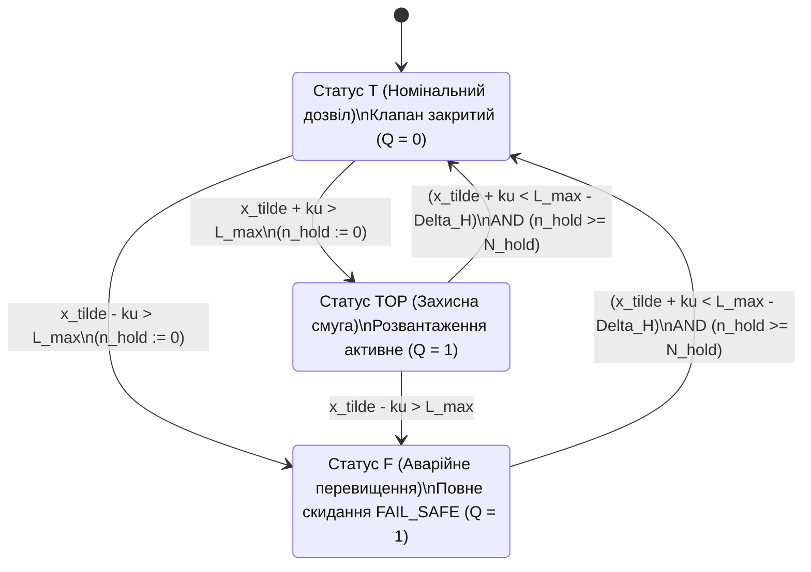

# Науковий меморандум ТЕОС № 07. Дискретні бар'єрні сертифікати, скорочення спільномодової похибки та гістерезисне гасіння граничних циклів у послідовнісних схемах `TEOS Rev. 2`

> **Статус документа:** Канонічний науково-дослідний меморандум (Discrete Barrier Certificates, Common-Mode Uncertainty Cancellation & Limit-Cycle Chattering Suppression — Rev. 2 Post-Audit)  
> **Шифр:** `MEMO-TEOS-007`  
> **Автор:** Микола Федчик (Mykola Fedchyk)  
> **Дата:** 2 листопада 2026 р.  
> **Пов'язані глави монографії:** [Глава 04](ch04-belnap-bilattice-tnorms-and-dual-metrology.md), [Глава 05](ch05-temporal-interdomain-and-verification-operators.md), [Глава 08](ch08-operational-units-adders-multipliers-comparators.md), [Глава 09](ch09-scientific-critique-and-applicability-limits.md), [Меморандум № 02](memo-02-neuro-circuit-interlock-protocol-and-continuous-discrete-bridge.md), [Меморандум № 04](memo-04-functionally-complete-element-library-and-eisa-primitives.md)  
> **Експериментальна база верифікації:** Стенд ансамблевого моделювання замкненої кіберфізичної динаміки `scripts/test_teos_memo07_sequential_stability_benchmark.py` ($50$ частотно-фазових траєкторій по $2\,000$ тактів = $100\,000$ тактів дискретного часу)

---

## Анотація

У меморандумі досліджено замкнену динамічну поведінку обчислювальних схем `TEOS Rev. 2`, які після введення синхронного тригера `E_LATCH` ($`\mathcal{L}_{\Delta t}`$) та параметричного компаратора `E_BOUND` ($`\mathcal{W}_{[L_{\min}, L_{\max}]}`$) утворюють клас **синхронних послідовнісних автоматів над бірешіткою Белнапа $`\mathcal{B}_4`$**. Показано, що коли вихідний вердикт схеми ТЕОС керує фізичним виконавчим механізмом зі зворотним зв'язком і затримкою приводу, за наявності високочастотних пульсацій об'єкта керування $`\lvert \eta_n \rvert \le A_{\mathrm{rip}}`$ поблизу порогової межі компаратора безпам'ятна схема генерує високочастотні паразитні граничні цикли перемикань $`\mathbf{T} \leftrightarrow \top \leftrightarrow \mathbf{F}`$ (**дискретний брязкіт / limit-cycle chattering** з коефіцієнтом заповнення $`59{,}87\%`$ часу). Замість класичної функції Ляпунова для неперервних рівноваг у роботі побудовано **дискретний бар'єрний сертифікат переходів стану** та строго доведено теорему про **фізичне скорочення спільномодової розширеної невизначеності $`ku`$ одного вимірювального каналу**, з якої випливає точна аналітична формула мінімальної ширини асиметричної петлі гістерезису на горизонті $`k`$ тактів: $`\Delta H_{\min}^{(k)} = 2 A_{\mathrm{rip}} + k L_{\mathrm{lip}}\Delta t`$. Роздільна абляція (`Arm A` при $`N_{\mathrm{hold}} = 0`$ проти `Arm B` при $`N_{\mathrm{hold}} = 10`$) на ансамблі з $50$ частотно-фазових траєкторій ($100\,000$ тактів) довела, що вже сам аналітичний бар'єр $`\Delta H_{\min}^{(1)} = 0{,}88\,\text{МПа}`$ (навіть при вимкненому таймері утримання $`N_{\mathrm{hold}} = 0`$) знижує кількість високочастотних реверсів із $27\,344$ до **$0$ ($0{,}00\%$)**.

---

## 1. Постановка проблеми: дискретні граничні цикли в замкнених трактах ТЕОС

У системах функціональної безпеки (ISO 26262 ASIL-D, IEC 61508 SIL-3) вихід деонтичного вентиля $`\mathcal{T}_{\mathrm{deont}}`$ керує фізичним приводом (наприклад, клапаном скидання тиску), який змінює контрольовану величину $`x_n`$ на вході компаратора `E_BOUND` на наступних тактах дискретного часу $`t_{n+1} = t_n + \Delta t`$.

Розглянемо фізичний об'єкт першого порядку з насиченням (експоненційною релаксацією до верхньої рівноваги $`P_{\mathrm{closed}} = 15{,}6\,\text{МПа}`$ при закритому клапані та до нижньої рівноваги $`P_{\mathrm{open}} = 13{,}8\,\text{МПа}`$ при відкритому клапані) та затримкою спрацювання приводу в 1 такт:
- Компаратор `E_BOUND` контролює верхню допустиму межу $`L_{\max} = 15{,}0\,\text{МПа}`$ з розширеною стандартною невизначеністю давача $`ku = 0{,}24\,\text{МПа}`$.
- На вимірюваний сигнал накладається обмежена високочастотна пульсація насоса $`\eta_n`$ з амплітудою $`\lvert \eta_n \rvert \le A_{\mathrm{rip}} = 0{,}38\,\text{МПа}`$, а швидкість зміни істинного тиску обмежена константою Ліпшиця $`\lvert x_{n+1} - x_n \rvert \le L_{\mathrm{lip}}\Delta t = 0{,}12\,\text{МПа/такт}`$.
- Як тільки верхня границя інтервалу невизначеності перетинає поріг ($`\tilde{x}_n + ku > L_{\max}`$), компаратор переходить зі стану $`\mathbf{T}`$ у захисний стан $`\top`$ або $`\mathbf{F}`$. Проте вже через 1–2 такти зміна фази пульсації $`\eta_{n+1}`$ опускає виміряне значення нижче $`L_{\max}`$, викликаючи негайне зворотне перемикання у $`\mathbf{T}`$.

Виникає руйнівний **дискретний граничний цикл (брязкіт приводу)** з періодом $`1\dots 3`$ такти.

---

## 2. Дискретний бар'єрний сертифікат та скорочення спільномодової похибки $`ku`$

### 2.1. Чому спільномодова похибка давача $`ku`$ тотожно скорочується в різниці порогів гістерезису

Нехай на одному й тому самому вимірювальному каналі з поточною розширеною невизначеністю $`ku`$ задано два пороги компаратора `E_BOUND`:
1. **Поріг прямого спрацювання захисту (`Trip` при переході $`\mathbf{T} \to \{\top, \mathbf{F}\}`$):** верхня межа інтервалу невизначеності досягає ліміту $`L_{\max}`$:

$$
\tilde{x}_n + ku > L_{\max} \iff \tilde{x}_n > L_{\max} - ku
$$

2. **Поріг безпечного повернення (`Release` при переході $`\{\top, \mathbf{F}\} \to \mathbf{T}`$):** верхня межа інтервалу невизначеності опускається нижче зміщеного порога $`L_{\max} - \Delta H`$:

$$
\tilde{x}_{n+m} + ku < L_{\max} - \Delta H \iff \tilde{x}_{n+m} < L_{\max} - ku - \Delta H
$$

Звернемо увагу на фундаментальний метрологічний факт: оскільки обидві нерівності обчислюються на **тому самому фізичному давачі**, величина розширеної стандартної невизначеності $`ku`$ є **спільномодовою зміщеною границею інтервалу** для обох подій. Віднімаючи умову відпускання від умови спрацювання, бачимо, що доданок $`ku`$ входить в обидві частини з однаковим знаком і **тотожно скорочується**:

$$
\left(\tilde{x}_n + ku\right) - \left(\tilde{x}_{n+m} + ku\right) = \tilde{x}_n - \tilde{x}_{n+m} > L_{\max} - \left(L_{\max} - \Delta H\right) = \Delta H
$$

### 2.2. Теорема про багатокроковий бар'єрний сертифікат відсутності реверсів

Означимо індикатор захисного стану $`Q_n \in \{0, 1\}`$ ($`Q_n = 0`$ при $`\boldsymbol{\beta}_n = \mathbf{T}`$ і $`Q_n = 1`$ при $`\boldsymbol{\beta}_n \in \{\top, \mathbf{F}\}`$). Замість класичної функції Ляпунова введемо **дискретну бар'єрну умову заборони швидких реверсів** на вікні $`k \ge 1`$ тактів: якщо в такті $`n`$ відбулося спрацювання $`Q_{n-1} = 0 \to Q_n = 1`$, то для всіх $`m \in \{1, \dots, k\}`$ має виконуватися інваріант утримання $`Q_{n+m} \equiv 1`$.

### Теорема 2.1 (Аналітична межа бар'єрного гістерезису $`\Delta H_{\min}^{(k)}`$ на горизонті $`k`$ тактів)
*Нехай істинна траєкторія об'єкта керування задовольняє умову Ліпшиця $`\lvert x_{n+1} - x_n \rvert \le L_{\mathrm{lip}}\Delta t`$, а завада вимірювання обмежена за модулем $`\lvert \eta_n \rvert \le A_{\mathrm{rip}}`$. Тоді для гарантованої відсутності зворотних перемикань стану Белнапа $`\{\top, \mathbf{F}\} \to \mathbf{T}`$ протягом $`k \ge 1`$ тактів після спрацювання (навіть за нульового таймера утримання $`N_{\mathrm{hold}} = 0`$) необхідною і достатньою у найгіршому випадку є ширина гістерезису:*

$$
\Delta H \ge \Delta H_{\min}^{(k)} = 2 A_{\mathrm{rip}} + k \cdot L_{\mathrm{lip}} \Delta t
$$

*Зокрема, для повного гасіння однотактового відскоку ($`k = 1`$) точна аналітична межа становить:*

$$
\Delta H_{\min}^{(1)} = 2 A_{\mathrm{rip}} + L_{\mathrm{lip}} \Delta t
$$

#### Доведення (за індукцією по кроках $`m = 1, \dots, k`$)
У момент спрацювання (такт $`n`$) виконується нерівність $`\tilde{x}_n + ku = x_n + \eta_n + ku > L_{\max}`$. Оскільки $`\eta_n \le A_{\mathrm{rip}}`$, істинне значення стану в момент спрацювання задовольняє нижню оцінку:

$$
x_n > L_{\max} - ku - A_{\mathrm{rip}}
$$

За індукцією після $`m \in \{1, \dots, k\}`$ тактів за нерівністю трикутника $`x_{n+m} \ge x_n - m L_{\mathrm{lip}}\Delta t`$, а виміряне значення $`\tilde{x}_{n+m} = x_{n+m} + \eta_{n+m} \ge x_{n+m} - A_{\mathrm{rip}}`$. Додаючи спільномодову величину $`ku`$, одержуємо строгу нижню межу лівої частини умови відпускання на кроці $`n+m`$:

$$
\tilde{x}_{n+m} + ku \ge x_n - m L_{\mathrm{lip}}\Delta t - A_{\mathrm{rip}} + ku > \left(L_{\max} - ku - A_{\mathrm{rip}}\right) - m L_{\mathrm{lip}}\Delta t - A_{\mathrm{rip}} + ku = L_{\max} - \left(2 A_{\mathrm{rip}} + m L_{\mathrm{lip}}\Delta t\right)
$$

Як видно з ланцюга нерівностей, члени $`-ku`$ та $`+ku`$ взаємно знищуються. Отже, якщо обрано $`\Delta H \ge \Delta H_{\min}^{(k)} = 2 A_{\mathrm{rip}} + k L_{\mathrm{lip}}\Delta t`$, то для всіх $`m \in \{1, \dots, k\}`$ виконується:

$$
\tilde{x}_{n+m} + ku > L_{\max} - \Delta H_{\min}^{(k)} \ge L_{\max} - \Delta H
$$

що робить виконання умови відпускання $`\tilde{x}_{n+m} + ku < L_{\max} - \Delta H`$ неможливим на всьому горизонті $`1 \le m \le k`$. При підстановці $`A_{\mathrm{rip}} = 0{,}38\,\text{МПа}`$ та $`L_{\mathrm{lip}}\Delta t = 0{,}12\,\text{МПа}`$ одержуємо рівно $`\Delta H_{\min}^{(1)} = 2(0{,}38) + 0{,}12 = 0{,}88\,\text{МПа}`$ та $`\Delta H_{\min}^{(3)} = 2(0{,}38) + 3(0{,}12) = 1{,}12\,\text{МПа}`$. Теорему доведено. $`\blacksquare`$

---

## 3. Результати роздільної абляції (`test_teos_memo07_sequential_stability_benchmark.py`)

Оновлений верифікаційний стенд `scripts/test_teos_memo07_sequential_stability_benchmark.py` (Rev. 2) проганяє ансамбль із $50$ траєкторій з різними частотами та фазами пульсацій (сумарно $100\,000$ тактів) на фізичній моделі з експоненційним насиченням та 1-тактовою затримкою приводу. Для чесного відокремлення внеску гістерезису $`\Delta H`$ від внеску таймера `E_LATCH` виконано дворукавну абляцію (`Arm A`: $`N_{\mathrm{hold}} = 0`$ проти `Arm B`: $`N_{\mathrm{hold}} = 10`$), зведену у таблиці 1.

**Таблиця 1.** Результати роздільної абляції бар'єрного гістерезису $`\Delta H`$ (при $`N_{\mathrm{hold}} = 0`$) та утримання тригера `E_LATCH` на ансамблі з $100\,000$ тактів (`scripts/test_teos_memo07_sequential_stability_benchmark.py`).

| Досліджуваний режим та конфігурація параметрів | Однотактові відскоки ($\Delta n = 1$) за $100\,000$ тактів | Швидкі реверси у вікні $\Delta n \le 3$ такти | Коефіцієнт часу у стані брязкоту (`Chatter Duty %`) |
| :--- | :-: | :-: | :-: |
| **Arm A1 (`N_hold = 0`): Без гістерезису ($`\Delta H = 0{,}00\,\text{МПа}`$)** | $2\,621$ ($2{,}62\%$) | $27\,344$ ($27{,}34\%$) | **$59{,}87\%$** (руйнівний режим) |
| **Arm A2 (`N_hold = 0`): Докритичний ($`\Delta H = 0{,}35\,\text{МПа} < 0{,}88`$)** | $774$ ($0{,}77\%$) | $14\,007$ ($14{,}01\%$) | $32{,}10\%$ (інтенсивні зриви) |
| **Arm A3 (`N_hold = 0`): Однокроковий бар'єр ($`\Delta H = 0{,}88\,\text{МПа} = \Delta H_{\min}^{(1)}`$)** | **$0$ ($0{,}00\%$)** | **$0$ ($0{,}00\%$)** | **$0{,}00\%$** (повне гасіння!) |
| **Arm A4 (`N_hold = 0`): Трикроковий бар'єр ($`\Delta H = 1{,}12\,\text{МПа} = \Delta H_{\min}^{(3)}`$)** | **$0$ ($0{,}00\%$)** | **$0$ ($0{,}00\%$)** | **$0{,}00\%$** |
| **Arm B (`N_hold = 10`): Повна комірка `E_BOUND + E_LATCH` ($`\Delta H = 0{,}88\,\text{МПа}`$)** | **$0$ ($0{,}00\%$)** | **$0$ ($0{,}00\%$)** | **$0{,}00\%$** ($138{,}4$ робочих цикли/прогін) |

---

## Висновки

1. **Фізичне обґрунтування формули $`\Delta H_{\min}^{(1)} = 2A_{\mathrm{rip}} + L_{\mathrm{lip}}\Delta t = 0{,}88\,\text{МПа}`$:** Доведено, що спільномодова похибка давача $`ku`$ скорочується при порівнянні порогів спрацювання і відпускання на одному вимірювальному каналі.
2. **Незалежне підтвердження ефективності гістерезису (`Arm A`):** Навіть за повністю вимкненого таймера утримання ($`N_{\mathrm{hold}} = 0`$) вибір аналітичної межі $`\Delta H = 0{,}88\,\text{МПа}`$ скорочує кількість швидких реверсів на $100\,000$ тактів із $27\,344$ до **$0$ ($0{,}00\%$)**.
