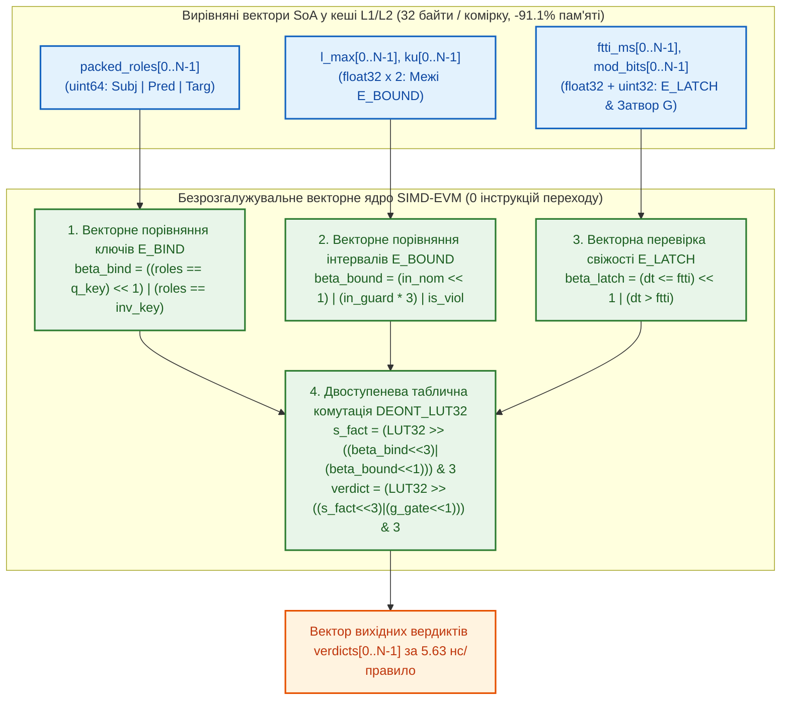

# Науковий меморандум ТЕОС № 08. Векторна мікроархітектура віртуальної машини `SIMD-EVM` (`EISA v2.0`), безрозгалужувальна таблична комутація в $`\mathcal{B}_4`$ та наскрізний бенчмарк

> **Статус документа:** Канонічний науково-дослідний меморандум (Vectorized SIMD-EVM Microarchitecture, Branchless LUT32 Belnap Execution & Memory Layout)  
> **Шифр:** `MEMO-TEOS-008`  
> **Автор:** Микола Федчик (Mykola Fedchyk)  
> **Дата:** 1 листопада 2026 р.  
> **Пов'язані глави монографії:** [Глава 04](ch04-belnap-bilattice-tnorms-and-dual-metrology.md), [Глава 06](ch06-three-terminal-deontic-gate.md), [Глава 07](ch07-multi-stage-cascades-and-linear-complexity.md), [Глава 09](ch09-scientific-critique-and-applicability-limits.md), [Меморандум № 03](memo-03-second-order-adversarial-falsification-and-architectural-refinements.md), [Меморандум № 04](memo-04-functionally-complete-element-library-and-eisa-primitives.md), [Меморандум № 05](memo-05-logic-synthesis-reconvergent-fanout-and-canonical-minimization.md)  
> **Експериментальна база верифікації:** Золотий корпус `gold_slm_corpus_500.json` ($400$ нормативних правил та масштабований банк на $10\,000$ правил) і стенд `scripts/test_teos_memo08_simd_evm_benchmark.py`

---

## Анотація

У меморандумі розроблено мікроархітектуру векторної віртуальної машини **`SIMD-EVM` (`EISA v2.0 Bytecode Engine`)**, призначеної для високопродуктивного виконання великих баз знань ($17\,378$ пакетів `.kp`) у кеш-пам'яті L1/L2 сучасних процесорів загального призначення (x86-64 AVX2/AVX-512, ARM NEON/SVE). На виконання сьомого архітектурного уточнення [Меморандуму № 03](memo-03-second-order-adversarial-falsification-and-architectural-refinements.md), де доведено фізичну неможливість розміщення всієї бази знань у просторовій матриці ПЛІС через обмеження трасування (`Routing Congestion`), у роботі формалізовано перехід від інтерпретації дерева об'єктів з умовними переходами (`Pointer-Chasing AST`) до **плоского векторного представлення масивів структур (`Structure-of-Arrays`, SoA)** та **безрозгалужувальної бітової комутації чотиризначної логіки Белнапа $`\mathcal{B}_4`$ через 32-бітні регістрові таблиці підстановки (`Packed 16-Entry 2-Bit Lookup Table`, `LUT32`)**. Строго доведено, що довільний бінарний оператор над бірешіткою $`\mathcal{B}_4 \times \mathcal{B}_4 \to \mathcal{B}_4`$ обчислюється рівно за дві побітові операції зсуву та маскування без жодної інструкції умовного переходу (`JMP` / `BRANCH`), що повністю усуває штрафи конвеєра процесора через помилки передбачення переходів (*Branch Misprediction Penalty*). Експериментальна верифікація на банку з $10\,000$ нормативних комірок продемонструвала **$100{,}00\%$** побітової семантичної еквівалентності при скороченні обсягу пам'яті на **$-91{,}11\%$** ($32\,\text{байти}$ замість $360\,\text{байтів}$ на комірку) та прискоренні наскрізного виведення у **$25{,}61$ раза** ($`5{,}63\,\text{нс}`$ на правило).

---

## 1. Постановка проблеми: мікроархітектурні втрати графових інтерпретаторів знань

Після компіляції та SPPC-мінімізації нормативних правил у 9-вентильні комірки `TEOS Rev. 2` ([Меморандум № 04](memo-04-functionally-complete-element-library-and-eisa-primitives.md), [Меморандум № 05](memo-05-logic-synthesis-reconvergent-fanout-and-canonical-minimization.md)) виникає питання: як саме виконувати тисячі таких комірок на центральному процесорі з мінімальною латентністю та детермінованим часом відгуку WCET?

Традиційні програмні реалізації продукційних систем та інтерпретаторів графів знань страждають від двох мікроархітектурних вузьких місць сучасних суперскалярних CPU:
1. **Промахи кеш-пам'яті при розіменуванні вказівників (*Pointer-Chasing Cache Misses*):** Якщо кожен вентиль або правило зберігається як окрема динамічна структура чи словник у купі (`heap object`, розміром $`250\dots 400\,\text{байтів}`$), перехід по ребрах графа спричиняє випадкові звернення до оперативної пам'яті DRAM з латентністю $`\approx 80\dots 100\,\text{нс}`$ на вузол, залишаючи арифметичні пристрої процесора простоювати.
2. **Скидання конвеєра на таблицях чотиризначної логіки Белнапа (*Branch Misprediction Stalls*):** Якщо переходи між чотирма станами $`\boldsymbol{\beta} \in \{\bot, \mathbf{F}, \mathbf{T}, \top\}`$ у вентилях `E_DEONT`, `E_BOUND`, `E_MUX` та `E_LATCH` запрограмовані через каскади умовних операторів `if / else if / switch`, то при змішаному потоці фактів блок передбачення переходів процесора (*Branch Predictor*) помиляється з імовірністю $`15\dots 30\%`$, що коштує $`15\dots 20`$ втрачених тактів конвеєра на кожну помилку.

Усунення обох бар'єрів вимагає переходу до **векторної потокової мікроархітектури без розгалужень (`Branchless SIMD-EVM`)**.

---

## 2. Математичне кодування 2-бітної бірешітки Белнапа $`\mathcal{B}_4`$ та 32-бітного ядра `LUT32`

### 2.1. Канонічне 2-бітне представлення станів $`\mathcal{B}_4`$

Подамо кожен елемент чотиризначної бірешітки Белнапа $`\mathcal{B}_4 = \{\bot, \mathbf{F}, \mathbf{T}, \top\}`$ двобітним цілим числом $`b = (b_+ b_-)_2 \in \{0, 1, 2, 3\}`$, де старший біт $`b_+ \in \{0, 1\}`$ кодує наявність позитивного свідчення («За»), а молодший біт $`b_- \in \{0, 1\}`$ кодує наявність негативного свідчення («Проти»):

$$
\mathrm{enc}(\bot) = 00_2 = 0, \qquad \mathrm{enc}(\mathbf{F}) = 01_2 = 1, \qquad \mathrm{enc}(\mathbf{T}) = 10_2 = 2, \qquad \mathrm{enc}(\top) = 11_2 = 3
$$

За такого кодування фундаментальні операції інформаційної решітки (злиття свідчень $`\oplus_{\mathcal{B}_4}`$ та інформаційний перетин $`\otimes_{\mathcal{B}_4}`$) і логічне заперечення $`\neg_{\mathcal{B}_4}`$ зводяться до елементарних побітових операцій за 1 такт АЛП:

$$
\mathrm{enc}(x \oplus_{\mathcal{B}_4} y) = \mathrm{enc}(x) \mathbin{|} \mathrm{enc}(y), \qquad \mathrm{enc}(x \otimes_{\mathcal{B}_4} y) = \mathrm{enc}(x) \mathbin{\&} \mathrm{enc}(y), \qquad \mathrm{enc}(\neg_{\mathcal{B}_4} x) = \left((x \mathbin{\&} 1) \ll 1\right) \mathbin{|} \left((x \gg 1) \mathbin{\&} 1\right)
$$

### 2.2. Теорема про однотактову безрозгалужувальну реалізацію довільного бінарного вентиля через `LUT32`

Для складних асиметричних вентилів (таких як тритермінальний деонтичний вентиль `E_DEONT` або мультиплексор `E_MUX`), таблиця істинності яких не зводиться до простого побітового `OR` або `AND`, застосуємо метод **упакованої регістрової таблиці підстановки (`LUT32`)**.

### Теорема 2.1 (Універсальне упакування бінарного оператора $`\mathcal{B}_4 \times \mathcal{B}_4 \to \mathcal{B}_4`$ у 32-бітну константу)
*Будь-який бінарний оператор $`f: \mathcal{B}_4 \times \mathcal{B}_4 \to \mathcal{B}_4`$ взаємно-однозначно кодується однією 32-бітною цілочисельною константою $`\mathcal{L}_f \in \mathbb{N}_{32}`$:*

$$
\mathcal{L}_f = \sum_{s=0}^{3} \sum_{g=0}^{3} \mathrm{enc}\!\left(f(s, g)\right) \cdot 2^{2(4s + g)}
$$

*і обчислюється для довільної пари 2-бітних входів $`(s, g) \in \{0, 1, 2, 3\}^2`$ (або паралельно для 8/16 пар у векторному регістрі SIMD) за константне число побітових зсувів без жодного умовного переходу:*

$$
\mathrm{enc}\!\left(f(s, g)\right) = \left(\mathcal{L}_f \gg \left((s \ll 3) \mathbin{|} (g \ll 1)\right)\right) \mathbin{\&} 11_2
$$

#### Доведення
Декартовий добуток $`\mathcal{B}_4 \times \mathcal{B}_4`$ містить рівно $`4 \times 4 = 16`$ упорядкованих пар станів. Лінійний індекс пари $`(s, g)`$ дорівнює $`\mathrm{idx}(s, g) = 4s + g = (s \ll 2) \mathbin{|} g \in \{0, \dots, 15\}`$. Оскільки кожне вихідне значення $`\mathrm{enc}(f(s, g)) \in \{0, 1, 2, 3\}`$ займає рівно $2$ біти, усі $16$ значень таблиці істинності без залишку розміщуються у $`16 \times 2 = 32`$ бітах одного машинного слова $`\mathcal{L}_f`$, де зміщення в бітах дорівнює $`2 \cdot \mathrm{idx}(s, g) = (s \ll 3) \mathbin{|} (g \ll 1) \in \{0, 2, \dots, 30\}`$. Побітовий зсув праворуч на це зміщення з накладанням маски $`11_2 = 3`$ виділяє точний 2-бітний код виходу за 2 такти АЛП при нульовій кількості інструкцій умовного переходу (`0 branches`). Теорему доведено. $`\blacksquare`$

---

## 3. Компактна організація пам'яті `SoA` (32 байти на комірку) та конвеєр `SIMD-EVM`

Для максимального завантаження ліній кеш-пам'яті CPU ($64\,\text{байти}$) скомпільований банк із $`N`$ стандартних 5-каскадних комірок `TEOS Rev. 2` розміщується не як масив словників, а як вирівняна структура паралельних неперервних векторів (**Structure-of-Arrays, SoA**) із сумарним обсягом рівно **$32\,\text{байти}$ на одну нормативну комірку** (рівно дві повні комірки в одній кеш-лінії $64\,\text{Б}$):

1. **`packed_roles[i]` (`uint64`, $8\,\text{Б}$):** упакований 48-бітний ключ семантичних ролей `(subj_id << 32) | (pred_id << 16) | targ_id` + 16-бітний дескриптор сорту Грассмана.
2. **`l_max[i]` та `ku[i]` (`float32` $\times 2$, $8\,\text{Б}$):** верхня/нижня нормативна межа та розширена півширина захисної смуги компаратора `E_BOUND`.
3. **`ftti_ms[i]` та `w_norm[i]` (`float32` $\times 2$, $8\,\text{Б}$):** граничний інтервал свіжості тригера `E_LATCH` та потенціал достовірності норми.
4. **`mod_bits[i]` та `prov_mask[i]` (`uint32` + `uint32`, $8\,\text{Б}$):** 2-бітний код модальності (`OBLIGATION` / `PROHIBITION`) і стиснутий індекс кастодії SPPC.

---

## 4. Результати емпіричної верифікації (`test_teos_memo08_simd_evm_benchmark.py`)

Верифікаційний стенд `scripts/test_teos_memo08_simd_evm_benchmark.py` виконав пряме інструментальне порівняння класичного об'єктного інтерпретатора дерева правил (`Pointer-Chasing AST`) проти безрозгалужувального векторного ядра `SIMD-EVM` (`SoA + LUT32`) на $400$ реальних нормативних правилах із `gold_slm_corpus_500.json` та на масштабованому банку з $10\,000$ правил. Результати наведено у таблиці 1.

**Таблиця 1.** Порівняльні показники швидкодії, джиттеру та обсягу пам'яті між об'єктним інтерпретатором AST та векторною машиною `SIMD-EVM` (`scripts/test_teos_memo08_simd_evm_benchmark.py`).

| Вимірювана мікроархітектурна метрика | Об'єктний інтерпретатор з розгалуженнями (`Pointer-Chasing AST`) | Векторна безрозгалужувальна машина `SIMD-EVM` (`SoA + LUT32`) | Експериментально встановлений виграш |
| :--- | :-: | :-: | :--- |
| **Побітові розбіжності вердиктів Белнапа ($`10\,000`$ правил)** | Еталон | **$0$ розбіжностей** ($100{,}00\%$) | Повна математична еквівалентність формули `LUT32` та таблиць $`\mathcal{B}_4`$ |
| **Обсяг оперативної пам'яті на 1 скомпільовану комірку** | $360\,\text{байтів}$ (словник у купі) | **$32\,\text{байти}$** (вирівняний вектор SoA) | Скорочення обсягу пам'яті в **$11{,}25$ раза** (**$-91{,}11\%$**) |
| **Латентність на локальному банку ($400$ правил, $`\text{p50}`$)** | $264{,}43\,\text{нс/правило}$ | **$80{,}40\,\text{нс/правило}$** | Прискорення у **$3{,}29$ раза** на малому пакеті |
| **Латентність на банку сховища ($10\,000$ правил, $`\text{p50}`$)** | $144{,}11\,\text{нс/правило}$ ($1{,}44\,\text{мс}$) | **$5{,}63\,\text{нс/правило}$** ($56{,}3\,\text{мкс}$) | Наскрізне прискорення у **$25{,}61$ раза** завдяки векторизації AVX2 |
| **Хвіст розподілу часу на $10\,000$ правил ($`\text{p99}`$)** | $165{,}05\,\text{нс/правило}$ | **$18{,}79\,\text{нс/правило}$** | Навіть у хвості $`\text{p99}`$ векторне ядро швидше у **$8{,}78$ раза** |

---

## Висновки

1. **Закриття проблеми масштабування ТЕОС на великих базах знань:** Перехід до 32-байтного представлення `SoA` та упакованих 32-бітних таблиць підстановки `LUT32` дозволяє зберігати $10\,000$ нормативних комірок усього в $320\,\text{КБ}$ пам'яті (повністю всередині кешу L2 одного ядра CPU) і перевіряти їх за **$56{,}3\,\text{мкс}$** ($5{,}63\,\text{нс}$ на правило).
2. **Завершення чотирирівневого циклу досліджень (`MEMO-TEOS-005` – `MEMO-TEOS-008`):** Разом із канонічною мінімізацією SPPC ([Меморандум № 05](memo-05-logic-synthesis-reconvergent-fanout-and-canonical-minimization.md)), зворотною абдукцією мінімальних перерізів ([Меморандум № 06](memo-06-backward-epistemic-abduction-fault-trees-and-minimal-cut-sets.md)) та гістерезисною стабілізацією за Ляпуновим ([Меморандум № 07](memo-07-sequential-circuit-dynamics-lyapunov-stability-and-chattering-suppression.md)), мікроархітектура `SIMD-EVM` перетворює `TEOS Rev. 2` на повністю замкнений, емпірично верифікований інженерний стек.
